<!-- BEGIN STATS (generated by Scripts/skill_trees.py; do not edit) -->
**Mastered:** 8 / 248 · **Depth:** 2% · **Mastery Depth:** 3% · **Discovered:** 115 · **Planned:** 133 · **Locked:** 83 · **Rusty:** 0

| | L0 Discovered | L1 Recall | L2 Apply | L3 Prove ★ | L4 Wield | L5 Command |
|---|---:|---:|---:|---:|---:|---:|
| **At this level** | 106 | 0 | 1 | 8 | 0 | 0 |
| **Reached (this level or higher)** | 115 | 9 | 9 | 8 | 0 | 0 |

**Next up:** [[Set of Integer Multiples]], [[Integer Combination]], [[Divides Basic Properties]], [[Modular Arithmetic]], [[Cancellation Property]]

Legend: dashed grey = planned (no note yet) · dark grey = locked · white L0 Discovered · green L1 Recall · blue L2 Apply · purple L3 Prove (Mastered) · orange L4 Wield · gold L5 Command · brown dashed border = rusty
<!-- END STATS -->

## Dummit & Foote Ch. 0: Integers and Modular Arithmetic
**Reached:** L1 0 · L2 0 · L3 0 · L4 0 · L5 0 (of 21 nodes)

```mermaid
flowchart TD
    classDef planned fill:#1E293B,stroke:#64748B,stroke-width:2px,stroke-dasharray:5 5,color:#94A3B8;
    classDef locked fill:#334155,stroke:#475569,stroke-width:2px,color:#94A3B8;
    classDef L0 fill:#F1F5F9,stroke:#94A3B8,stroke-width:2px,color:#000000;
    classDef L1 fill:#22C55E,stroke:#15803D,stroke-width:2px,color:#000000;
    classDef L2 fill:#3B82F6,stroke:#1D4ED8,stroke-width:3px,color:#FFFFFF;
    classDef L3 fill:#A855F7,stroke:#6B21A8,stroke-width:3px,color:#FFFFFF,font-weight:bold;
    classDef L4 fill:#F97316,stroke:#C2410C,stroke-width:4px,color:#000000,font-weight:bold;
    classDef L5 fill:#FFD700,stroke:#FF8C00,stroke-width:5px,color:#000000,font-weight:bold;
    classDef rusty stroke:#8B4513,stroke-width:4px,stroke-dasharray:3 3;
    subgraph sg_prereqs["Prerequisites from other groups"]
        n_well_ordering_principle["Well Ordering Principle"]
        n_divides["Divides"]
        n_multiple["Multiple"]
        n_linear_combination["Linear Combination"]
        n_prime_factorization["Prime Factorization"]
        n_equivalence_relation["Equivalence Relation"]
        n_binomial_theorem["Binomial Theorem"]
        n_prime_number["Prime Number"]
    end
    n_divides_basic_properties["Divides Basic Properties"]
    n_division_with_remainder["Division with Remainder"]
    n_remainder_function["Remainder Function"]
    n_set_of_integer_multiples["Set of Integer Multiples"]
    n_integer_combination["Integer Combination"]
    n_integer_span["Integer Span"]
    n_euclidean_algorithm["Euclidean Algorithm"]
    n_greatest_common_divisor["Greatest Common Divisor"]
    n_relatively_prime["Relatively Prime"]
    n_natural_number_prime_factorization["Natural Number Prime Factorization"]
    n_modular_arithmetic["Modular Arithmetic"]
    n_modular_arithmetic_basic_properties["Modular Arithmetic Basic Properties"]
    n_congruence_class["Congruence Class"]
    n_modular_arithmetic_equivalence_theorem["Modular Arithmetic Equivalence Theorem"]
    n_set_of_congruence_classes_modulo_n["Set of Congruence Classes Modulo n"]
    n_set_of_congruence_classes_modulo_n_cardinality["Set of Congruence Classes Modulo n Cardinality"]
    n_set_of_congruence_classes_modulo_n_multiplicative_inverse["Set of Congruence Classes Modulo n Multiplicative Inverse"]
    n_chinese_remainder_theorem["Chinese Remainder Theorem"]
    n_binomial_theorem_congruence_with_prime_power["Binomial Theorem Congruence with Prime Power"]
    n_fermat_s_little_theorem["Fermat's Little Theorem"]
    n_two_prime_fermat["Two Prime Fermat"]
    n_well_ordering_principle --> n_division_with_remainder
    n_division_with_remainder --> n_remainder_function
    n_divides --> n_divides_basic_properties
    n_multiple --> n_set_of_integer_multiples
    n_linear_combination --> n_integer_combination
    n_integer_combination --> n_integer_span
    n_set_of_integer_multiples --> n_integer_span
    n_remainder_function --> n_euclidean_algorithm
    n_euclidean_algorithm --> n_greatest_common_divisor
    n_integer_span --> n_greatest_common_divisor
    n_divides_basic_properties --> n_greatest_common_divisor
    n_greatest_common_divisor --> n_relatively_prime
    n_relatively_prime --> n_natural_number_prime_factorization
    n_prime_factorization --> n_natural_number_prime_factorization
    n_divides --> n_modular_arithmetic
    n_modular_arithmetic --> n_modular_arithmetic_basic_properties
    n_modular_arithmetic --> n_congruence_class
    n_equivalence_relation --> n_congruence_class
    n_congruence_class --> n_modular_arithmetic_equivalence_theorem
    n_remainder_function --> n_modular_arithmetic_equivalence_theorem
    n_congruence_class --> n_set_of_congruence_classes_modulo_n
    n_set_of_congruence_classes_modulo_n --> n_set_of_congruence_classes_modulo_n_cardinality
    n_modular_arithmetic_equivalence_theorem --> n_set_of_congruence_classes_modulo_n_cardinality
    n_set_of_congruence_classes_modulo_n --> n_set_of_congruence_classes_modulo_n_multiplicative_inverse
    n_relatively_prime --> n_set_of_congruence_classes_modulo_n_multiplicative_inverse
    n_modular_arithmetic --> n_chinese_remainder_theorem
    n_relatively_prime --> n_chinese_remainder_theorem
    n_binomial_theorem --> n_binomial_theorem_congruence_with_prime_power
    n_modular_arithmetic --> n_binomial_theorem_congruence_with_prime_power
    n_prime_number --> n_binomial_theorem_congruence_with_prime_power
    n_binomial_theorem_congruence_with_prime_power --> n_fermat_s_little_theorem
    n_fermat_s_little_theorem --> n_two_prime_fermat
    n_chinese_remainder_theorem --> n_two_prime_fermat
    class n_well_ordering_principle,n_division_with_remainder,n_remainder_function,n_integer_span,n_euclidean_algorithm,n_greatest_common_divisor,n_relatively_prime,n_natural_number_prime_factorization,n_modular_arithmetic_basic_properties,n_congruence_class,n_modular_arithmetic_equivalence_theorem,n_set_of_congruence_classes_modulo_n,n_set_of_congruence_classes_modulo_n_cardinality,n_set_of_congruence_classes_modulo_n_multiplicative_inverse,n_chinese_remainder_theorem,n_binomial_theorem_congruence_with_prime_power,n_fermat_s_little_theorem,n_two_prime_fermat locked;
    class n_prime_factorization,n_binomial_theorem,n_divides_basic_properties,n_set_of_integer_multiples,n_integer_combination,n_modular_arithmetic L0;
    class n_divides,n_multiple,n_equivalence_relation,n_prime_number L2;
    class n_linear_combination L3;
    class n_well_ordering_principle,n_divides,n_multiple,n_linear_combination,n_prime_factorization,n_equivalence_relation,n_binomial_theorem,n_prime_number,n_divides_basic_properties,n_division_with_remainder,n_remainder_function,n_set_of_integer_multiples,n_integer_combination,n_integer_span,n_euclidean_algorithm,n_greatest_common_divisor,n_relatively_prime,n_natural_number_prime_factorization,n_modular_arithmetic,n_modular_arithmetic_basic_properties,n_congruence_class,n_modular_arithmetic_equivalence_theorem,n_set_of_congruence_classes_modulo_n,n_set_of_congruence_classes_modulo_n_cardinality,n_set_of_congruence_classes_modulo_n_multiplicative_inverse,n_chinese_remainder_theorem,n_binomial_theorem_congruence_with_prime_power,n_fermat_s_little_theorem,n_two_prime_fermat internal-link;
```

## Dummit & Foote Ch. 1: Introduction to Groups
**Reached:** L1 7 · L2 7 · L3 6 · L4 0 · L5 0 (of 48 nodes, 1 planned)

```mermaid
flowchart TD
    classDef planned fill:#1E293B,stroke:#64748B,stroke-width:2px,stroke-dasharray:5 5,color:#94A3B8;
    classDef locked fill:#334155,stroke:#475569,stroke-width:2px,color:#94A3B8;
    classDef L0 fill:#F1F5F9,stroke:#94A3B8,stroke-width:2px,color:#000000;
    classDef L1 fill:#22C55E,stroke:#15803D,stroke-width:2px,color:#000000;
    classDef L2 fill:#3B82F6,stroke:#1D4ED8,stroke-width:3px,color:#FFFFFF;
    classDef L3 fill:#A855F7,stroke:#6B21A8,stroke-width:3px,color:#FFFFFF,font-weight:bold;
    classDef L4 fill:#F97316,stroke:#C2410C,stroke-width:4px,color:#000000,font-weight:bold;
    classDef L5 fill:#FFD700,stroke:#FF8C00,stroke-width:5px,color:#000000,font-weight:bold;
    classDef rusty stroke:#8B4513,stroke-width:4px,stroke-dasharray:3 3;
    subgraph sg_prereqs["Prerequisites from other groups"]
        n_algebraic_structures["Algebraic Structures"]
        n_binary_operation["Binary Operation"]
        n_associative_property["Associative Property"]
        n_identity_property["Identity Property"]
        n_commutative_property["Commutative Property"]
        n_set_cardinality["Set Cardinality"]
        n_integer["Integer"]
        n_set_of_congruence_classes_modulo_n["Set of Congruence Classes Modulo n"]
        n_set_of_congruence_classes_modulo_n_multiplicative_inverse["Set of Congruence Classes Modulo n Multiplicative Inverse"]
        n_euclidean_distance["Euclidean Distance"]
        n_affine_transformation["Affine Transformation"]
        n_matrix_multiplication["Matrix Multiplication"]
        n_bijective_function["Bijective Function"]
        n_disjoint_sets["Disjoint Sets"]
        n_function_composition["Function Composition"]
        n_matrix["Matrix"]
        n_special_orthogonal_matrix["Special Orthogonal Matrix"]
        n_direct_product_group["Direct Product Group"]
        n_chinese_remainder_theorem["Chinese Remainder Theorem"]
    end
    n_abstract_algebra["Abstract Algebra"]
    n_operation_closure["Operation Closure"]
    n_magma["Magma"]
    n_quasigroup["Quasigroup"]
    n_semigroup["Semigroup"]
    n_general_associative_law["General Associative Law"]
    n_monoid["Monoid"]
    n_group["Group"]
    n_group_identity_properties["Group Identity Properties"]
    n_group_inverse_properties["Group Inverse Properties"]
    n_group_left_multiplication["Group Left Multiplication"]
    n_group_right_multiplication["Group Right Multiplication"]
    n_group_equation["Group Equation"]
    n_cancellation_property["Cancellation Property"]
    n_group_multiplication_properties["Group Multiplication Properties"]
    n_group_power_properties["Group Power Properties"]
    n_abelian_group["Abelian Group"]
    n_group_order["Group Order"]
    n_group_of_integers["Group of Integers"]
    n_monoid_of_congruence_classes_modulo_n["Monoid of Congruence Classes Modulo n"]
    n_group_of_congruence_classes_modulo_n["Group of Congruence Classes Modulo n"]
    n_group_of_modular_units["Group of Modular Units"]
    n_group_of_modular_units_elements["Group of Modular Units Elements"]
    n_group_of_modular_units_group_order["Group of Modular Units Group Order"]
    n_isometry["Isometry"]
    n_affine_symmetry["Affine Symmetry"]
    n_shape_symmetry["Shape Symmetry"]
    n_dihedral_group["Dihedral Group"]
    n_infinite_dihedral_group["Infinite Dihedral Group"]
    n_permutation["Permutation"]
    n_cycle["Cycle"]
    n_disjoint_cycles["Disjoint Cycles"]
    n_cycle_notation["Cycle Notation"]
    n_transposition["Transposition"]
    n_cycle_type["Cycle Type"]
    n_symmetric_group["Symmetric Group"]
    n_general_linear_set["General Linear Set"]
    n_general_linear_group["General Linear Group"]
    n_set_of_special_orthogonal_matrices["Set of Special Orthogonal Matrices"]
    n_group_of_special_orthogonal_matrices["Group of Special Orthogonal Matrices"]
    n_symmetries_of_unit_disk["Symmetries of Unit Disk"]
    n_quaternion_group["Quaternion Group"]
    n_group_homomorphism["Group Homomorphism"]
    n_group_isomorphism["Group Isomorphism"]
    n_group_of_modular_units_group_isomorphism["Group of Modular Units Group Isomorphism"]
    n_group_automorphism["Group Automorphism"]
    n_group_action["Group Action"]
    n_symmetry["Symmetry"]
    n_algebraic_structures --> n_abstract_algebra
    n_binary_operation --> n_operation_closure
    n_abstract_algebra --> n_magma
    n_operation_closure --> n_magma
    n_magma --> n_quasigroup
    n_magma --> n_semigroup
    n_associative_property --> n_semigroup
    n_semigroup --> n_general_associative_law
    n_semigroup --> n_monoid
    n_identity_property --> n_monoid
    n_monoid --> n_group
    n_group --> n_group_identity_properties
    n_group --> n_group_inverse_properties
    n_group --> n_group_left_multiplication
    n_group --> n_group_right_multiplication
    n_group_inverse_properties --> n_group_equation
    n_algebraic_structures --> n_cancellation_property
    n_group_left_multiplication --> n_group_multiplication_properties
    n_group_right_multiplication --> n_group_multiplication_properties
    n_group_equation --> n_group_multiplication_properties
    n_cancellation_property --> n_group_multiplication_properties
    n_group --> n_group_power_properties
    n_general_associative_law --> n_group_power_properties
    n_group --> n_abelian_group
    n_commutative_property --> n_abelian_group
    n_group --> n_group_order
    n_set_cardinality --> n_group_order
    n_abelian_group --> n_group_of_integers
    n_integer --> n_group_of_integers
    n_monoid --> n_monoid_of_congruence_classes_modulo_n
    n_set_of_congruence_classes_modulo_n --> n_monoid_of_congruence_classes_modulo_n
    n_abelian_group --> n_group_of_congruence_classes_modulo_n
    n_set_of_congruence_classes_modulo_n --> n_group_of_congruence_classes_modulo_n
    n_abelian_group --> n_group_of_modular_units
    n_set_of_congruence_classes_modulo_n_multiplicative_inverse --> n_group_of_modular_units
    n_group_of_modular_units --> n_group_of_modular_units_elements
    n_group_of_modular_units --> n_group_of_modular_units_group_order
    n_group_order --> n_group_of_modular_units_group_order
    n_euclidean_distance --> n_isometry
    n_isometry --> n_affine_symmetry
    n_affine_transformation --> n_affine_symmetry
    n_group --> n_shape_symmetry
    n_symmetry --> n_shape_symmetry
    n_matrix_multiplication --> n_shape_symmetry
    n_shape_symmetry --> n_dihedral_group
    n_dihedral_group --> n_infinite_dihedral_group
    n_bijective_function --> n_permutation
    n_permutation --> n_cycle
    n_cycle --> n_disjoint_cycles
    n_disjoint_sets --> n_disjoint_cycles
    n_disjoint_cycles --> n_cycle_notation
    n_cycle --> n_transposition
    n_disjoint_cycles --> n_cycle_type
    n_permutation --> n_symmetric_group
    n_group --> n_symmetric_group
    n_function_composition --> n_symmetric_group
    n_matrix --> n_general_linear_set
    n_general_linear_set --> n_general_linear_group
    n_group --> n_general_linear_group
    n_special_orthogonal_matrix --> n_set_of_special_orthogonal_matrices
    n_general_linear_set --> n_set_of_special_orthogonal_matrices
    n_set_of_special_orthogonal_matrices --> n_group_of_special_orthogonal_matrices
    n_general_linear_group --> n_group_of_special_orthogonal_matrices
    n_group_of_special_orthogonal_matrices --> n_symmetries_of_unit_disk
    n_group --> n_quaternion_group
    n_group --> n_group_homomorphism
    n_group_homomorphism --> n_group_isomorphism
    n_bijective_function --> n_group_isomorphism
    n_group_of_modular_units --> n_group_of_modular_units_group_isomorphism
    n_group_isomorphism --> n_group_of_modular_units_group_isomorphism
    n_direct_product_group --> n_group_of_modular_units_group_isomorphism
    n_chinese_remainder_theorem --> n_group_of_modular_units_group_isomorphism
    n_group_isomorphism --> n_group_automorphism
    n_group_homomorphism --> n_group_action
    n_symmetric_group --> n_group_action
    n_function_composition --> n_symmetry
    n_bijective_function --> n_symmetry
    class n_quaternion_group planned;
    class n_set_of_congruence_classes_modulo_n,n_set_of_congruence_classes_modulo_n_multiplicative_inverse,n_disjoint_sets,n_special_orthogonal_matrix,n_chinese_remainder_theorem,n_group_equation,n_group_multiplication_properties,n_group_power_properties,n_abelian_group,n_group_of_integers,n_monoid_of_congruence_classes_modulo_n,n_group_of_congruence_classes_modulo_n,n_group_of_modular_units,n_group_of_modular_units_elements,n_group_of_modular_units_group_order,n_isometry,n_affine_symmetry,n_shape_symmetry,n_dihedral_group,n_infinite_dihedral_group,n_cycle,n_disjoint_cycles,n_cycle_notation,n_transposition,n_cycle_type,n_symmetric_group,n_general_linear_group,n_set_of_special_orthogonal_matrices,n_group_of_special_orthogonal_matrices,n_symmetries_of_unit_disk,n_group_of_modular_units_group_isomorphism,n_group_automorphism,n_group_action locked;
    class n_commutative_property,n_euclidean_distance,n_affine_transformation,n_direct_product_group,n_quasigroup,n_general_associative_law,n_group_identity_properties,n_group_inverse_properties,n_group_left_multiplication,n_group_right_multiplication,n_cancellation_property,n_group_order,n_permutation,n_general_linear_set,n_group_isomorphism,n_symmetry L0;
    class n_set_cardinality,n_integer,n_group_homomorphism L2;
    class n_algebraic_structures,n_binary_operation,n_associative_property,n_identity_property,n_matrix_multiplication,n_bijective_function,n_function_composition,n_matrix,n_abstract_algebra,n_operation_closure,n_magma,n_semigroup,n_monoid,n_group L3;
    class n_algebraic_structures,n_binary_operation,n_associative_property,n_identity_property,n_commutative_property,n_set_cardinality,n_integer,n_set_of_congruence_classes_modulo_n,n_set_of_congruence_classes_modulo_n_multiplicative_inverse,n_euclidean_distance,n_affine_transformation,n_matrix_multiplication,n_bijective_function,n_disjoint_sets,n_function_composition,n_matrix,n_special_orthogonal_matrix,n_direct_product_group,n_chinese_remainder_theorem,n_abstract_algebra,n_operation_closure,n_magma,n_quasigroup,n_semigroup,n_general_associative_law,n_monoid,n_group,n_group_identity_properties,n_group_inverse_properties,n_group_left_multiplication,n_group_right_multiplication,n_group_equation,n_cancellation_property,n_group_multiplication_properties,n_group_power_properties,n_abelian_group,n_group_order,n_group_of_integers,n_monoid_of_congruence_classes_modulo_n,n_group_of_congruence_classes_modulo_n,n_group_of_modular_units,n_group_of_modular_units_elements,n_group_of_modular_units_group_order,n_isometry,n_affine_symmetry,n_shape_symmetry,n_dihedral_group,n_infinite_dihedral_group,n_permutation,n_cycle,n_disjoint_cycles,n_cycle_notation,n_transposition,n_cycle_type,n_symmetric_group,n_general_linear_set,n_general_linear_group,n_set_of_special_orthogonal_matrices,n_group_of_special_orthogonal_matrices,n_symmetries_of_unit_disk,n_group_homomorphism,n_group_isomorphism,n_group_of_modular_units_group_isomorphism,n_group_automorphism,n_group_action,n_symmetry internal-link;
```

## Dummit & Foote Ch. 2: Subgroups
**Reached:** L1 2 · L2 2 · L3 2 · L4 0 · L5 0 (of 13 nodes, 5 planned)

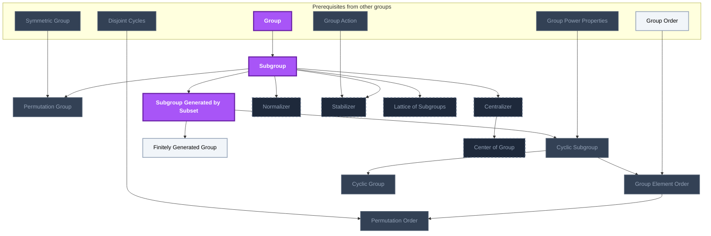

## Dummit & Foote Ch. 3: Quotient Groups and Homomorphisms
**Reached:** L1 0 · L2 0 · L3 0 · L4 0 · L5 0 (of 27 nodes, 3 planned)

```mermaid
flowchart TD
    classDef planned fill:#1E293B,stroke:#64748B,stroke-width:2px,stroke-dasharray:5 5,color:#94A3B8;
    classDef locked fill:#334155,stroke:#475569,stroke-width:2px,color:#94A3B8;
    classDef L0 fill:#F1F5F9,stroke:#94A3B8,stroke-width:2px,color:#000000;
    classDef L1 fill:#22C55E,stroke:#15803D,stroke-width:2px,color:#000000;
    classDef L2 fill:#3B82F6,stroke:#1D4ED8,stroke-width:3px,color:#FFFFFF;
    classDef L3 fill:#A855F7,stroke:#6B21A8,stroke-width:3px,color:#FFFFFF,font-weight:bold;
    classDef L4 fill:#F97316,stroke:#C2410C,stroke-width:4px,color:#000000,font-weight:bold;
    classDef L5 fill:#FFD700,stroke:#FF8C00,stroke-width:5px,color:#000000,font-weight:bold;
    classDef rusty stroke:#8B4513,stroke-width:4px,stroke-dasharray:3 3;
    subgraph sg_prereqs["Prerequisites from other groups"]
        n_subgroup["Subgroup"]
        n_divides["Divides"]
        n_group_element_order["Group Element Order"]
        n_cyclic_group["Cyclic Group"]
        n_even_number["Even Number"]
        n_prime_number["Prime Number"]
        n_group["Group"]
        n_equivalence_class["Equivalence Class"]
        n_group_homomorphism["Group Homomorphism"]
        n_group_of_congruence_classes_modulo_n["Group of Congruence Classes Modulo n"]
        n_group_of_integers["Group of Integers"]
        n_set_of_integer_multiples["Set of Integer Multiples"]
        n_kernel["Kernel"]
        n_image["Image"]
        n_group_isomorphism["Group Isomorphism"]
        n_transposition["Transposition"]
        n_odd_number["Odd Number"]
        n_symmetric_group["Symmetric Group"]
    end
    n_left_coset["Left Coset"]
    n_right_coset["Right Coset"]
    n_coset["Coset"]
    n_index["Index"]
    n_lagrange_s_theorem["Lagrange's Theorem"]
    n_generalized_lagrange_s_theorem["Generalized Lagrange's Theorem"]
    n_order_theorem["Order Theorem"]
    n_fundamental_theorem_of_cyclic_groups["Fundamental Theorem of Cyclic Groups"]
    n_even_order_theorem["Even Order Theorem"]
    n_cauchy_s_theorem_abstract_algebra["Cauchy's Theorem (Abstract Algebra)"]
    n_product_subset["Product Subset"]
    n_normal_subgroup["Normal Subgroup"]
    n_group_of_normal_cosets["Group of Normal Cosets"]
    n_quotient_group["Quotient Group"]
    n_quotient_function["Quotient Function"]
    n_group_of_congruence_classes_modulo_n_as_a_quotient_group["Group of Congruence Classes Modulo n as a Quotient Group"]
    n_group_homomorphism_theorem["Group Homomorphism Theorem"]
    n_group_isomorphism_theorem["Group Isomorphism Theorem"]
    n_diamond_group_isomorphism_theorem["Diamond Group Isomorphism Theorem"]
    n_factorization_theorem["Factorization Theorem"]
    n_correspondence_theorem["Correspondence Theorem"]
    n_simple_group["Simple Group"]
    n_composition_series["Composition Series"]
    n_jordan_h_lder_theorem["Jordan-Hölder Theorem"]
    n_permutation_parity["Permutation Parity"]
    n_permutation_sign["Permutation Sign"]
    n_alternating_group["Alternating Group"]
    n_subgroup --> n_left_coset
    n_subgroup --> n_right_coset
    n_left_coset --> n_coset
    n_right_coset --> n_coset
    n_coset --> n_index
    n_coset --> n_lagrange_s_theorem
    n_divides --> n_lagrange_s_theorem
    n_lagrange_s_theorem --> n_generalized_lagrange_s_theorem
    n_index --> n_generalized_lagrange_s_theorem
    n_lagrange_s_theorem --> n_order_theorem
    n_group_element_order --> n_order_theorem
    n_cyclic_group --> n_fundamental_theorem_of_cyclic_groups
    n_order_theorem --> n_fundamental_theorem_of_cyclic_groups
    n_order_theorem --> n_even_order_theorem
    n_even_number --> n_even_order_theorem
    n_group_element_order --> n_cauchy_s_theorem_abstract_algebra
    n_prime_number --> n_cauchy_s_theorem_abstract_algebra
    n_group --> n_product_subset
    n_coset --> n_normal_subgroup
    n_normal_subgroup --> n_group_of_normal_cosets
    n_product_subset --> n_group_of_normal_cosets
    n_group_of_normal_cosets --> n_quotient_group
    n_equivalence_class --> n_quotient_group
    n_quotient_group --> n_quotient_function
    n_group_homomorphism --> n_quotient_function
    n_group_of_congruence_classes_modulo_n --> n_group_of_congruence_classes_modulo_n_as_a_quotient_group
    n_quotient_group --> n_group_of_congruence_classes_modulo_n_as_a_quotient_group
    n_group_of_integers --> n_group_of_congruence_classes_modulo_n_as_a_quotient_group
    n_set_of_integer_multiples --> n_group_of_congruence_classes_modulo_n_as_a_quotient_group
    n_quotient_function --> n_group_homomorphism_theorem
    n_kernel --> n_group_homomorphism_theorem
    n_group_homomorphism_theorem --> n_group_isomorphism_theorem
    n_image --> n_group_isomorphism_theorem
    n_group_isomorphism --> n_group_isomorphism_theorem
    n_group_isomorphism_theorem --> n_diamond_group_isomorphism_theorem
    n_group_isomorphism_theorem --> n_factorization_theorem
    n_quotient_function --> n_correspondence_theorem
    n_normal_subgroup --> n_simple_group
    n_simple_group --> n_composition_series
    n_quotient_group --> n_composition_series
    n_composition_series --> n_jordan_h_lder_theorem
    n_group_isomorphism --> n_jordan_h_lder_theorem
    n_transposition --> n_permutation_parity
    n_even_number --> n_permutation_parity
    n_odd_number --> n_permutation_parity
    n_permutation_parity --> n_permutation_sign
    n_permutation_parity --> n_alternating_group
    n_symmetric_group --> n_alternating_group
    n_subgroup --> n_alternating_group
    class n_simple_group,n_composition_series,n_jordan_h_lder_theorem planned;
    class n_group_element_order,n_cyclic_group,n_group_of_congruence_classes_modulo_n,n_group_of_integers,n_transposition,n_symmetric_group,n_coset,n_index,n_lagrange_s_theorem,n_generalized_lagrange_s_theorem,n_order_theorem,n_fundamental_theorem_of_cyclic_groups,n_even_order_theorem,n_cauchy_s_theorem_abstract_algebra,n_normal_subgroup,n_group_of_normal_cosets,n_quotient_group,n_quotient_function,n_group_of_congruence_classes_modulo_n_as_a_quotient_group,n_group_homomorphism_theorem,n_group_isomorphism_theorem,n_diamond_group_isomorphism_theorem,n_factorization_theorem,n_correspondence_theorem,n_permutation_parity,n_permutation_sign,n_alternating_group locked;
    class n_even_number,n_equivalence_class,n_set_of_integer_multiples,n_group_isomorphism,n_odd_number,n_left_coset,n_right_coset,n_product_subset L0;
    class n_divides,n_prime_number,n_group_homomorphism,n_kernel,n_image L2;
    class n_subgroup,n_group L3;
    class n_subgroup,n_divides,n_group_element_order,n_cyclic_group,n_even_number,n_prime_number,n_group,n_equivalence_class,n_group_homomorphism,n_group_of_congruence_classes_modulo_n,n_group_of_integers,n_set_of_integer_multiples,n_kernel,n_image,n_group_isomorphism,n_transposition,n_odd_number,n_symmetric_group,n_left_coset,n_right_coset,n_coset,n_index,n_lagrange_s_theorem,n_generalized_lagrange_s_theorem,n_order_theorem,n_fundamental_theorem_of_cyclic_groups,n_even_order_theorem,n_cauchy_s_theorem_abstract_algebra,n_product_subset,n_normal_subgroup,n_group_of_normal_cosets,n_quotient_group,n_quotient_function,n_group_of_congruence_classes_modulo_n_as_a_quotient_group,n_group_homomorphism_theorem,n_group_isomorphism_theorem,n_diamond_group_isomorphism_theorem,n_factorization_theorem,n_correspondence_theorem,n_permutation_parity,n_permutation_sign,n_alternating_group internal-link;
```

## Dummit & Foote Ch. 4: Group Actions
**Reached:** L1 0 · L2 0 · L3 0 · L4 0 · L5 0 (of 14 nodes, 9 planned)

```mermaid
flowchart TD
    classDef planned fill:#1E293B,stroke:#64748B,stroke-width:2px,stroke-dasharray:5 5,color:#94A3B8;
    classDef locked fill:#334155,stroke:#475569,stroke-width:2px,color:#94A3B8;
    classDef L0 fill:#F1F5F9,stroke:#94A3B8,stroke-width:2px,color:#000000;
    classDef L1 fill:#22C55E,stroke:#15803D,stroke-width:2px,color:#000000;
    classDef L2 fill:#3B82F6,stroke:#1D4ED8,stroke-width:3px,color:#FFFFFF;
    classDef L3 fill:#A855F7,stroke:#6B21A8,stroke-width:3px,color:#FFFFFF,font-weight:bold;
    classDef L4 fill:#F97316,stroke:#C2410C,stroke-width:4px,color:#000000,font-weight:bold;
    classDef L5 fill:#FFD700,stroke:#FF8C00,stroke-width:5px,color:#000000,font-weight:bold;
    classDef rusty stroke:#8B4513,stroke-width:4px,stroke-dasharray:3 3;
    subgraph sg_prereqs["Prerequisites from other groups"]
        n_group_action["Group Action"]
        n_stabilizer["Stabilizer"]
        n_index["Index"]
        n_group_left_multiplication["Group Left Multiplication"]
        n_group_isomorphism["Group Isomorphism"]
        n_subgroup["Subgroup"]
        n_group["Group"]
        n_group_homomorphism["Group Homomorphism"]
        n_cycle_type["Cycle Type"]
        n_center_of_group["Center of Group"]
        n_group_automorphism["Group Automorphism"]
        n_image["Image"]
        n_quotient_group["Quotient Group"]
        n_normal_subgroup["Normal Subgroup"]
        n_lagrange_s_theorem["Lagrange's Theorem"]
        n_prime_number["Prime Number"]
        n_normalizer["Normalizer"]
        n_alternating_group["Alternating Group"]
        n_simple_group["Simple Group"]
    end
    n_orbit["Orbit"]
    n_orbit_stabilizer_theorem["Orbit-Stabilizer Theorem"]
    n_cayley_s_theorem["Cayley's Theorem"]
    n_group_conjugate["Group Conjugate"]
    n_conjugation_group_homomorphism["Conjugation Group Homomorphism"]
    n_cycle_conjugation["Cycle Conjugation"]
    n_conjugacy_class["Conjugacy Class"]
    n_class_equation["Class Equation"]
    n_inner_group_automorphism["Inner Group Automorphism"]
    n_outer_group_automorphism["Outer Group Automorphism"]
    n_characteristic_subgroup["Characteristic Subgroup"]
    n_sylow_p_subgroup["Sylow p-Subgroup"]
    n_sylow_theorems["Sylow Theorems"]
    n_simplicity_of_alternating_group["Simplicity of Alternating Group"]
    n_group_action --> n_orbit
    n_orbit --> n_orbit_stabilizer_theorem
    n_stabilizer --> n_orbit_stabilizer_theorem
    n_index --> n_orbit_stabilizer_theorem
    n_group_action --> n_cayley_s_theorem
    n_group_left_multiplication --> n_cayley_s_theorem
    n_group_isomorphism --> n_cayley_s_theorem
    n_subgroup --> n_cayley_s_theorem
    n_group --> n_group_conjugate
    n_group_conjugate --> n_conjugation_group_homomorphism
    n_group_homomorphism --> n_conjugation_group_homomorphism
    n_group_conjugate --> n_cycle_conjugation
    n_cycle_type --> n_cycle_conjugation
    n_group_conjugate --> n_conjugacy_class
    n_orbit --> n_conjugacy_class
    n_conjugacy_class --> n_class_equation
    n_orbit_stabilizer_theorem --> n_class_equation
    n_center_of_group --> n_class_equation
    n_group_automorphism --> n_inner_group_automorphism
    n_conjugation_group_homomorphism --> n_inner_group_automorphism
    n_image --> n_inner_group_automorphism
    n_inner_group_automorphism --> n_outer_group_automorphism
    n_quotient_group --> n_outer_group_automorphism
    n_group_automorphism --> n_characteristic_subgroup
    n_normal_subgroup --> n_characteristic_subgroup
    n_lagrange_s_theorem --> n_sylow_p_subgroup
    n_prime_number --> n_sylow_p_subgroup
    n_sylow_p_subgroup --> n_sylow_theorems
    n_class_equation --> n_sylow_theorems
    n_normalizer --> n_sylow_theorems
    n_alternating_group --> n_simplicity_of_alternating_group
    n_simple_group --> n_simplicity_of_alternating_group
    n_cycle_conjugation --> n_simplicity_of_alternating_group
    class n_stabilizer,n_center_of_group,n_normalizer,n_simple_group,n_orbit,n_orbit_stabilizer_theorem,n_cayley_s_theorem,n_conjugacy_class,n_class_equation,n_characteristic_subgroup,n_sylow_p_subgroup,n_sylow_theorems,n_simplicity_of_alternating_group planned;
    class n_group_action,n_index,n_cycle_type,n_group_automorphism,n_quotient_group,n_normal_subgroup,n_lagrange_s_theorem,n_alternating_group,n_conjugation_group_homomorphism,n_cycle_conjugation,n_inner_group_automorphism,n_outer_group_automorphism locked;
    class n_group_left_multiplication,n_group_isomorphism,n_group_conjugate L0;
    class n_group_homomorphism,n_image,n_prime_number L2;
    class n_subgroup,n_group L3;
    class n_group_action,n_index,n_group_left_multiplication,n_group_isomorphism,n_subgroup,n_group,n_group_homomorphism,n_cycle_type,n_group_automorphism,n_image,n_quotient_group,n_normal_subgroup,n_lagrange_s_theorem,n_prime_number,n_alternating_group,n_group_conjugate,n_conjugation_group_homomorphism,n_cycle_conjugation,n_inner_group_automorphism,n_outer_group_automorphism internal-link;
```

## Dummit & Foote Ch. 5: Direct and Semidirect Products and Abelian Groups
**Reached:** L1 0 · L2 0 · L3 0 · L4 0 · L5 0 (of 8 nodes, 1 planned)

```mermaid
flowchart TD
    classDef planned fill:#1E293B,stroke:#64748B,stroke-width:2px,stroke-dasharray:5 5,color:#94A3B8;
    classDef locked fill:#334155,stroke:#475569,stroke-width:2px,color:#94A3B8;
    classDef L0 fill:#F1F5F9,stroke:#94A3B8,stroke-width:2px,color:#000000;
    classDef L1 fill:#22C55E,stroke:#15803D,stroke-width:2px,color:#000000;
    classDef L2 fill:#3B82F6,stroke:#1D4ED8,stroke-width:3px,color:#FFFFFF;
    classDef L3 fill:#A855F7,stroke:#6B21A8,stroke-width:3px,color:#FFFFFF,font-weight:bold;
    classDef L4 fill:#F97316,stroke:#C2410C,stroke-width:4px,color:#000000,font-weight:bold;
    classDef L5 fill:#FFD700,stroke:#FF8C00,stroke-width:5px,color:#000000,font-weight:bold;
    classDef rusty stroke:#8B4513,stroke-width:4px,stroke-dasharray:3 3;
    subgraph sg_prereqs["Prerequisites from other groups"]
        n_group["Group"]
        n_abelian_group["Abelian Group"]
        n_basis["Basis"]
        n_matrix["Matrix"]
        n_divides["Divides"]
        n_cyclic_group["Cyclic Group"]
        n_group_isomorphism["Group Isomorphism"]
        n_chinese_remainder_theorem["Chinese Remainder Theorem"]
        n_normal_subgroup["Normal Subgroup"]
        n_conjugation_group_homomorphism["Conjugation Group Homomorphism"]
        n_group_automorphism["Group Automorphism"]
        n_product_subset["Product Subset"]
    end
    n_direct_product_group["Direct Product Group"]
    n_free_abelian_group["Free-Abelian Group"]
    n_smith_normal_form["Smith Normal Form"]
    n_invariant_factor_decomposition["Invariant Factor Decomposition"]
    n_elementary_divisor_decomposition["Elementary Divisor Decomposition"]
    n_commutator_subgroup["Commutator Subgroup"]
    n_semidirect_product_group["Semidirect Product Group"]
    n_recognition_theorem_for_semidirect_product["Recognition Theorem for Semidirect Product"]
    n_group --> n_direct_product_group
    n_abelian_group --> n_free_abelian_group
    n_basis --> n_free_abelian_group
    n_matrix --> n_smith_normal_form
    n_divides --> n_smith_normal_form
    n_free_abelian_group --> n_invariant_factor_decomposition
    n_smith_normal_form --> n_invariant_factor_decomposition
    n_direct_product_group --> n_invariant_factor_decomposition
    n_cyclic_group --> n_invariant_factor_decomposition
    n_group_isomorphism --> n_invariant_factor_decomposition
    n_invariant_factor_decomposition --> n_elementary_divisor_decomposition
    n_chinese_remainder_theorem --> n_elementary_divisor_decomposition
    n_normal_subgroup --> n_commutator_subgroup
    n_abelian_group --> n_commutator_subgroup
    n_direct_product_group --> n_semidirect_product_group
    n_conjugation_group_homomorphism --> n_semidirect_product_group
    n_group_automorphism --> n_semidirect_product_group
    n_semidirect_product_group --> n_recognition_theorem_for_semidirect_product
    n_normal_subgroup --> n_recognition_theorem_for_semidirect_product
    n_product_subset --> n_recognition_theorem_for_semidirect_product
    class n_commutator_subgroup planned;
    class n_abelian_group,n_cyclic_group,n_chinese_remainder_theorem,n_normal_subgroup,n_conjugation_group_homomorphism,n_group_automorphism,n_free_abelian_group,n_invariant_factor_decomposition,n_elementary_divisor_decomposition,n_semidirect_product_group,n_recognition_theorem_for_semidirect_product locked;
    class n_group_isomorphism,n_product_subset,n_direct_product_group,n_smith_normal_form L0;
    class n_divides L2;
    class n_group,n_basis,n_matrix L3;
    class n_group,n_abelian_group,n_basis,n_matrix,n_divides,n_cyclic_group,n_group_isomorphism,n_chinese_remainder_theorem,n_normal_subgroup,n_conjugation_group_homomorphism,n_group_automorphism,n_product_subset,n_direct_product_group,n_free_abelian_group,n_smith_normal_form,n_invariant_factor_decomposition,n_elementary_divisor_decomposition,n_semidirect_product_group,n_recognition_theorem_for_semidirect_product internal-link;
```

## Dummit & Foote Ch. 6: Further Topics in Group Theory
**Reached:** L1 0 · L2 0 · L3 0 · L4 0 · L5 0 (of 5 nodes, 5 planned)

```mermaid
flowchart TD
    classDef planned fill:#1E293B,stroke:#64748B,stroke-width:2px,stroke-dasharray:5 5,color:#94A3B8;
    classDef locked fill:#334155,stroke:#475569,stroke-width:2px,color:#94A3B8;
    classDef L0 fill:#F1F5F9,stroke:#94A3B8,stroke-width:2px,color:#000000;
    classDef L1 fill:#22C55E,stroke:#15803D,stroke-width:2px,color:#000000;
    classDef L2 fill:#3B82F6,stroke:#1D4ED8,stroke-width:3px,color:#FFFFFF;
    classDef L3 fill:#A855F7,stroke:#6B21A8,stroke-width:3px,color:#FFFFFF,font-weight:bold;
    classDef L4 fill:#F97316,stroke:#C2410C,stroke-width:4px,color:#000000,font-weight:bold;
    classDef L5 fill:#FFD700,stroke:#FF8C00,stroke-width:5px,color:#000000,font-weight:bold;
    classDef rusty stroke:#8B4513,stroke-width:4px,stroke-dasharray:3 3;
    subgraph sg_prereqs["Prerequisites from other groups"]
        n_group_order["Group Order"]
        n_prime_number["Prime Number"]
        n_center_of_group["Center of Group"]
        n_quotient_group["Quotient Group"]
        n_commutator_subgroup["Commutator Subgroup"]
        n_subgroup_generated_by_subset["Subgroup Generated by Subset"]
        n_group_homomorphism["Group Homomorphism"]
    end
    n_p_group["p-Group"]
    n_nilpotent_group["Nilpotent Group"]
    n_solvable_group["Solvable Group"]
    n_free_group["Free Group"]
    n_group_presentation["Group Presentation"]
    n_group_order --> n_p_group
    n_prime_number --> n_p_group
    n_center_of_group --> n_nilpotent_group
    n_quotient_group --> n_nilpotent_group
    n_commutator_subgroup --> n_solvable_group
    n_quotient_group --> n_solvable_group
    n_subgroup_generated_by_subset --> n_free_group
    n_group_homomorphism --> n_free_group
    n_free_group --> n_group_presentation
    n_quotient_group --> n_group_presentation
    class n_center_of_group,n_commutator_subgroup,n_p_group,n_nilpotent_group,n_solvable_group,n_free_group,n_group_presentation planned;
    class n_quotient_group locked;
    class n_group_order L0;
    class n_prime_number,n_group_homomorphism L2;
    class n_subgroup_generated_by_subset L3;
    class n_group_order,n_prime_number,n_quotient_group,n_subgroup_generated_by_subset,n_group_homomorphism internal-link;
```

## Dummit & Foote Ch. 7: Introduction to Rings
**Reached:** L1 0 · L2 0 · L3 0 · L4 0 · L5 0 (of 18 nodes, 15 planned)

```mermaid
flowchart TD
    classDef planned fill:#1E293B,stroke:#64748B,stroke-width:2px,stroke-dasharray:5 5,color:#94A3B8;
    classDef locked fill:#334155,stroke:#475569,stroke-width:2px,color:#94A3B8;
    classDef L0 fill:#F1F5F9,stroke:#94A3B8,stroke-width:2px,color:#000000;
    classDef L1 fill:#22C55E,stroke:#15803D,stroke-width:2px,color:#000000;
    classDef L2 fill:#3B82F6,stroke:#1D4ED8,stroke-width:3px,color:#FFFFFF;
    classDef L3 fill:#A855F7,stroke:#6B21A8,stroke-width:3px,color:#FFFFFF,font-weight:bold;
    classDef L4 fill:#F97316,stroke:#C2410C,stroke-width:4px,color:#000000,font-weight:bold;
    classDef L5 fill:#FFD700,stroke:#FF8C00,stroke-width:5px,color:#000000,font-weight:bold;
    classDef rusty stroke:#8B4513,stroke-width:4px,stroke-dasharray:3 3;
    subgraph sg_prereqs["Prerequisites from other groups"]
        n_abelian_group["Abelian Group"]
        n_group_of_congruence_classes_modulo_n["Group of Congruence Classes Modulo n"]
        n_monoid_of_congruence_classes_modulo_n["Monoid of Congruence Classes Modulo n"]
        n_polynomial["Polynomial"]
        n_matrix["Matrix"]
        n_group_homomorphism["Group Homomorphism"]
        n_subgroup["Subgroup"]
        n_quotient_group["Quotient Group"]
        n_group_isomorphism_theorem["Group Isomorphism Theorem"]
        n_field["Field"]
        n_chinese_remainder_theorem["Chinese Remainder Theorem"]
        n_direct_product_group["Direct Product Group"]
    end
    n_ring["Ring"]
    n_ring_of_congruence_classes_modulo_n["Ring of Congruence Classes Modulo n"]
    n_zero_divisor["Zero Divisor"]
    n_ring_unit["Ring Unit"]
    n_integral_domain["Integral Domain"]
    n_division_ring["Division Ring"]
    n_polynomial_ring["Polynomial Ring"]
    n_matrix_ring["Matrix Ring"]
    n_group_ring["Group Ring"]
    n_ring_homomorphism["Ring Homomorphism"]
    n_ideal["Ideal"]
    n_quotient_ring["Quotient Ring"]
    n_ring_isomorphism_theorems["Ring Isomorphism Theorems"]
    n_principal_ideal["Principal Ideal"]
    n_maximal_ideal["Maximal Ideal"]
    n_prime_ideal["Prime Ideal"]
    n_field_of_fractions["Field of Fractions"]
    n_chinese_remainder_theorem_ring_theory["Chinese Remainder Theorem (Ring Theory)"]
    n_abelian_group --> n_ring
    n_ring --> n_ring_of_congruence_classes_modulo_n
    n_group_of_congruence_classes_modulo_n --> n_ring_of_congruence_classes_modulo_n
    n_monoid_of_congruence_classes_modulo_n --> n_ring_of_congruence_classes_modulo_n
    n_ring --> n_zero_divisor
    n_ring --> n_ring_unit
    n_zero_divisor --> n_integral_domain
    n_ring_unit --> n_division_ring
    n_ring --> n_polynomial_ring
    n_polynomial --> n_polynomial_ring
    n_ring --> n_matrix_ring
    n_matrix --> n_matrix_ring
    n_ring --> n_group_ring
    n_ring --> n_ring_homomorphism
    n_group_homomorphism --> n_ring_homomorphism
    n_ring --> n_ideal
    n_subgroup --> n_ideal
    n_ideal --> n_quotient_ring
    n_quotient_group --> n_quotient_ring
    n_quotient_ring --> n_ring_isomorphism_theorems
    n_ring_homomorphism --> n_ring_isomorphism_theorems
    n_group_isomorphism_theorem --> n_ring_isomorphism_theorems
    n_ideal --> n_principal_ideal
    n_ideal --> n_maximal_ideal
    n_ideal --> n_prime_ideal
    n_integral_domain --> n_field_of_fractions
    n_field --> n_field_of_fractions
    n_chinese_remainder_theorem --> n_chinese_remainder_theorem_ring_theory
    n_quotient_ring --> n_chinese_remainder_theorem_ring_theory
    n_direct_product_group --> n_chinese_remainder_theorem_ring_theory
    class n_zero_divisor,n_ring_unit,n_integral_domain,n_division_ring,n_matrix_ring,n_group_ring,n_ring_homomorphism,n_ideal,n_quotient_ring,n_ring_isomorphism_theorems,n_principal_ideal,n_maximal_ideal,n_prime_ideal,n_field_of_fractions,n_chinese_remainder_theorem_ring_theory planned;
    class n_abelian_group,n_group_of_congruence_classes_modulo_n,n_monoid_of_congruence_classes_modulo_n,n_quotient_group,n_group_isomorphism_theorem,n_chinese_remainder_theorem,n_ring,n_ring_of_congruence_classes_modulo_n,n_polynomial_ring locked;
    class n_direct_product_group L0;
    class n_polynomial,n_group_homomorphism L2;
    class n_matrix,n_subgroup,n_field L3;
    class n_abelian_group,n_group_of_congruence_classes_modulo_n,n_monoid_of_congruence_classes_modulo_n,n_polynomial,n_matrix,n_group_homomorphism,n_subgroup,n_quotient_group,n_group_isomorphism_theorem,n_field,n_chinese_remainder_theorem,n_direct_product_group,n_ring,n_ring_of_congruence_classes_modulo_n,n_polynomial_ring internal-link;
```

## Dummit & Foote Ch. 8: Euclidean Domains, PIDs, and UFDs
**Reached:** L1 0 · L2 0 · L3 0 · L4 0 · L5 0 (of 5 nodes, 5 planned)

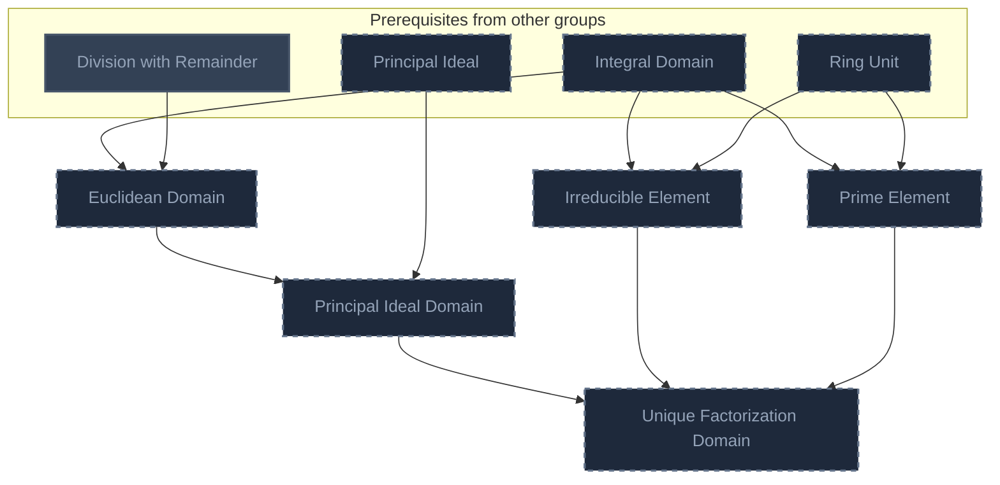

## Dummit & Foote Ch. 9: Polynomial Rings
**Reached:** L1 0 · L2 0 · L3 0 · L4 0 · L5 0 (of 7 nodes, 7 planned)

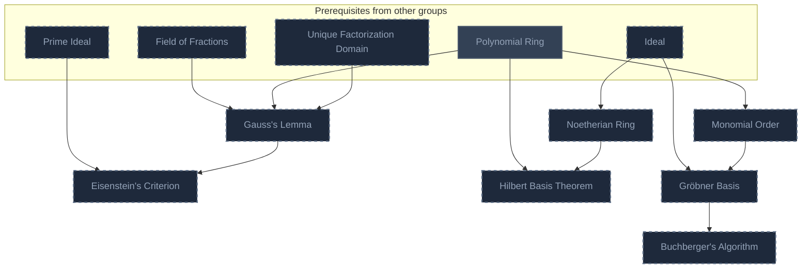

## Dummit & Foote Ch. 10: Introduction to Module Theory
**Reached:** L1 0 · L2 0 · L3 0 · L4 0 · L5 0 (of 11 nodes, 11 planned)

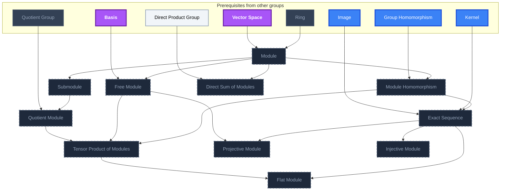

## Dummit & Foote Ch. 11: Vector Spaces
**Reached:** L1 0 · L2 0 · L3 0 · L4 0 · L5 0 (of 3 nodes, 3 planned)

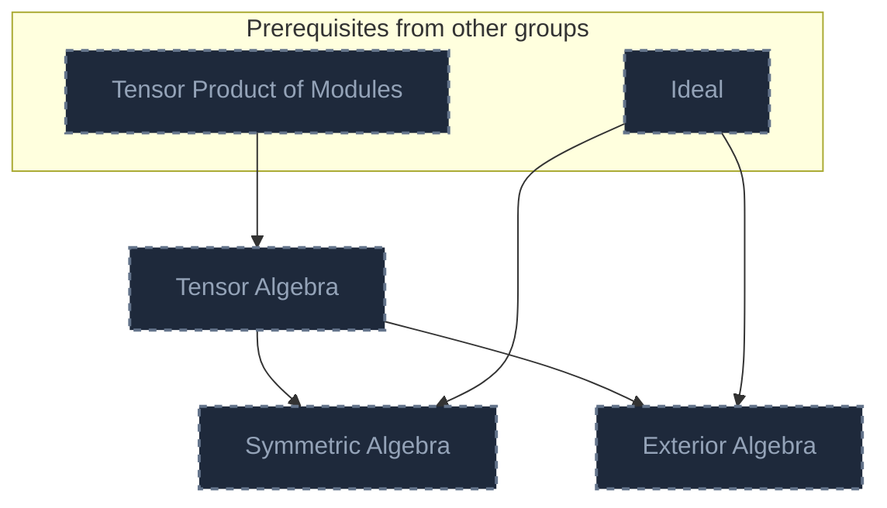

## Dummit & Foote Ch. 12: Modules over Principal Ideal Domains
**Reached:** L1 0 · L2 0 · L3 0 · L4 0 · L5 0 (of 4 nodes, 4 planned)

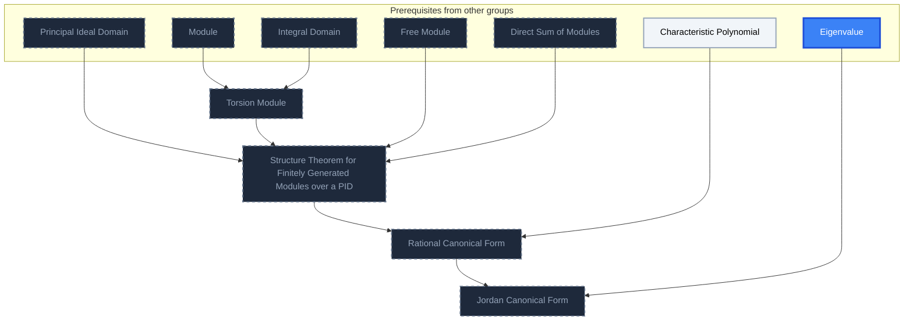

## Dummit & Foote Ch. 13: Field Theory
**Reached:** L1 0 · L2 0 · L3 0 · L4 0 · L5 0 (of 15 nodes, 15 planned)

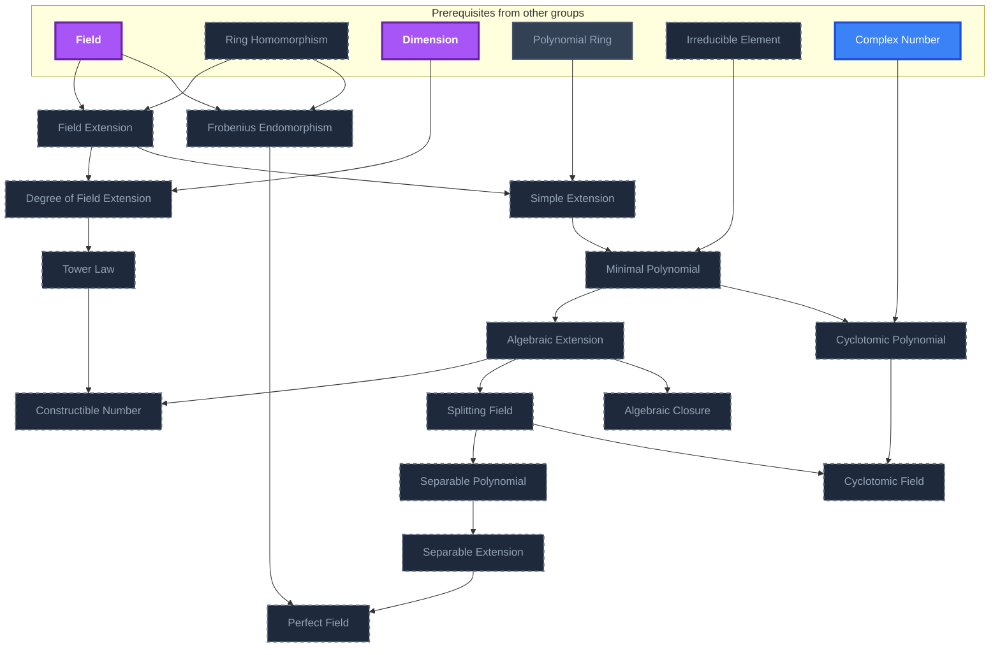

## Dummit & Foote Ch. 14: Galois Theory
**Reached:** L1 0 · L2 0 · L3 0 · L4 0 · L5 0 (of 16 nodes, 16 planned)

```mermaid
flowchart TD
    classDef planned fill:#1E293B,stroke:#64748B,stroke-width:2px,stroke-dasharray:5 5,color:#94A3B8;
    classDef locked fill:#334155,stroke:#475569,stroke-width:2px,color:#94A3B8;
    classDef L0 fill:#F1F5F9,stroke:#94A3B8,stroke-width:2px,color:#000000;
    classDef L1 fill:#22C55E,stroke:#15803D,stroke-width:2px,color:#000000;
    classDef L2 fill:#3B82F6,stroke:#1D4ED8,stroke-width:3px,color:#FFFFFF;
    classDef L3 fill:#A855F7,stroke:#6B21A8,stroke-width:3px,color:#FFFFFF,font-weight:bold;
    classDef L4 fill:#F97316,stroke:#C2410C,stroke-width:4px,color:#000000,font-weight:bold;
    classDef L5 fill:#FFD700,stroke:#FF8C00,stroke-width:5px,color:#000000,font-weight:bold;
    classDef rusty stroke:#8B4513,stroke-width:4px,stroke-dasharray:3 3;
    subgraph sg_prereqs["Prerequisites from other groups"]
        n_field_extension["Field Extension"]
        n_group_automorphism["Group Automorphism"]
        n_separable_extension["Separable Extension"]
        n_normal_subgroup["Normal Subgroup"]
        n_tower_law["Tower Law"]
        n_frobenius_endomorphism["Frobenius Endomorphism"]
        n_cyclotomic_field["Cyclotomic Field"]
        n_group_of_modular_units["Group of Modular Units"]
        n_splitting_field["Splitting Field"]
        n_permutation_group["Permutation Group"]
        n_alternating_group["Alternating Group"]
        n_simple_extension["Simple Extension"]
        n_solvable_group["Solvable Group"]
        n_simplicity_of_alternating_group["Simplicity of Alternating Group"]
        n_algebraic_extension["Algebraic Extension"]
    end
    n_field_automorphism["Field Automorphism"]
    n_galois_group["Galois Group"]
    n_galois_extension["Galois Extension"]
    n_fundamental_theorem_of_galois_theory["Fundamental Theorem of Galois Theory"]
    n_finite_field["Finite Field"]
    n_composite_field["Composite Field"]
    n_primitive_element_theorem["Primitive Element Theorem"]
    n_cyclotomic_extension_galois_group["Cyclotomic Extension Galois Group"]
    n_abelian_extension["Abelian Extension"]
    n_galois_group_of_polynomial["Galois Group of Polynomial"]
    n_discriminant_of_polynomial["Discriminant of Polynomial"]
    n_radical_extension["Radical Extension"]
    n_solvability_by_radicals_theorem["Solvability by Radicals Theorem"]
    n_insolvability_of_the_quintic["Insolvability of the Quintic"]
    n_transcendence_basis["Transcendence Basis"]
    n_transcendence_degree["Transcendence Degree"]
    n_field_extension --> n_field_automorphism
    n_group_automorphism --> n_field_automorphism
    n_field_automorphism --> n_galois_group
    n_galois_group --> n_galois_extension
    n_separable_extension --> n_galois_extension
    n_galois_extension --> n_fundamental_theorem_of_galois_theory
    n_normal_subgroup --> n_fundamental_theorem_of_galois_theory
    n_tower_law --> n_fundamental_theorem_of_galois_theory
    n_fundamental_theorem_of_galois_theory --> n_finite_field
    n_frobenius_endomorphism --> n_finite_field
    n_field_extension --> n_composite_field
    n_fundamental_theorem_of_galois_theory --> n_primitive_element_theorem
    n_cyclotomic_field --> n_cyclotomic_extension_galois_group
    n_galois_group --> n_cyclotomic_extension_galois_group
    n_group_of_modular_units --> n_cyclotomic_extension_galois_group
    n_galois_extension --> n_abelian_extension
    n_galois_group --> n_galois_group_of_polynomial
    n_splitting_field --> n_galois_group_of_polynomial
    n_permutation_group --> n_galois_group_of_polynomial
    n_galois_group_of_polynomial --> n_discriminant_of_polynomial
    n_alternating_group --> n_discriminant_of_polynomial
    n_simple_extension --> n_radical_extension
    n_radical_extension --> n_solvability_by_radicals_theorem
    n_solvable_group --> n_solvability_by_radicals_theorem
    n_fundamental_theorem_of_galois_theory --> n_solvability_by_radicals_theorem
    n_solvability_by_radicals_theorem --> n_insolvability_of_the_quintic
    n_simplicity_of_alternating_group --> n_insolvability_of_the_quintic
    n_galois_group_of_polynomial --> n_insolvability_of_the_quintic
    n_algebraic_extension --> n_transcendence_basis
    n_transcendence_basis --> n_transcendence_degree
    class n_field_extension,n_separable_extension,n_tower_law,n_frobenius_endomorphism,n_cyclotomic_field,n_splitting_field,n_simple_extension,n_solvable_group,n_simplicity_of_alternating_group,n_algebraic_extension,n_field_automorphism,n_galois_group,n_galois_extension,n_fundamental_theorem_of_galois_theory,n_finite_field,n_composite_field,n_primitive_element_theorem,n_cyclotomic_extension_galois_group,n_abelian_extension,n_galois_group_of_polynomial,n_discriminant_of_polynomial,n_radical_extension,n_solvability_by_radicals_theorem,n_insolvability_of_the_quintic,n_transcendence_basis,n_transcendence_degree planned;
    class n_group_automorphism,n_normal_subgroup,n_group_of_modular_units,n_permutation_group,n_alternating_group locked;
    class n_group_automorphism,n_normal_subgroup,n_group_of_modular_units,n_permutation_group,n_alternating_group internal-link;
```

## Dummit & Foote Ch. 15: Commutative Rings and Algebraic Geometry
**Reached:** L1 0 · L2 0 · L3 0 · L4 0 · L5 0 (of 11 nodes, 11 planned)

```mermaid
flowchart TD
    classDef planned fill:#1E293B,stroke:#64748B,stroke-width:2px,stroke-dasharray:5 5,color:#94A3B8;
    classDef locked fill:#334155,stroke:#475569,stroke-width:2px,color:#94A3B8;
    classDef L0 fill:#F1F5F9,stroke:#94A3B8,stroke-width:2px,color:#000000;
    classDef L1 fill:#22C55E,stroke:#15803D,stroke-width:2px,color:#000000;
    classDef L2 fill:#3B82F6,stroke:#1D4ED8,stroke-width:3px,color:#FFFFFF;
    classDef L3 fill:#A855F7,stroke:#6B21A8,stroke-width:3px,color:#FFFFFF,font-weight:bold;
    classDef L4 fill:#F97316,stroke:#C2410C,stroke-width:4px,color:#000000,font-weight:bold;
    classDef L5 fill:#FFD700,stroke:#FF8C00,stroke-width:5px,color:#000000,font-weight:bold;
    classDef rusty stroke:#8B4513,stroke-width:4px,stroke-dasharray:3 3;
    subgraph sg_prereqs["Prerequisites from other groups"]
        n_ideal["Ideal"]
        n_polynomial_ring["Polynomial Ring"]
        n_field["Field"]
        n_quotient_ring["Quotient Ring"]
        n_prime_ideal["Prime Ideal"]
        n_ring["Ring"]
        n_polynomial["Polynomial"]
        n_algebraic_closure["Algebraic Closure"]
        n_hilbert_basis_theorem["Hilbert Basis Theorem"]
        n_field_of_fractions["Field of Fractions"]
        n_maximal_ideal["Maximal Ideal"]
    end
    n_affine_algebraic_set["Affine Algebraic Set"]
    n_coordinate_ring["Coordinate Ring"]
    n_zariski_topology["Zariski Topology"]
    n_radical_of_ideal["Radical of Ideal"]
    n_affine_variety["Affine Variety"]
    n_integral_extension["Integral Extension"]
    n_integral_closure["Integral Closure"]
    n_hilbert_s_nullstellensatz["Hilbert's Nullstellensatz"]
    n_localization["Localization"]
    n_local_ring["Local Ring"]
    n_prime_spectrum["Prime Spectrum"]
    n_ideal --> n_affine_algebraic_set
    n_polynomial_ring --> n_affine_algebraic_set
    n_field --> n_affine_algebraic_set
    n_affine_algebraic_set --> n_coordinate_ring
    n_quotient_ring --> n_coordinate_ring
    n_affine_algebraic_set --> n_zariski_topology
    n_ideal --> n_radical_of_ideal
    n_affine_algebraic_set --> n_affine_variety
    n_prime_ideal --> n_affine_variety
    n_ring --> n_integral_extension
    n_polynomial --> n_integral_extension
    n_integral_extension --> n_integral_closure
    n_radical_of_ideal --> n_hilbert_s_nullstellensatz
    n_affine_algebraic_set --> n_hilbert_s_nullstellensatz
    n_integral_extension --> n_hilbert_s_nullstellensatz
    n_algebraic_closure --> n_hilbert_s_nullstellensatz
    n_hilbert_basis_theorem --> n_hilbert_s_nullstellensatz
    n_field_of_fractions --> n_localization
    n_prime_ideal --> n_localization
    n_localization --> n_local_ring
    n_maximal_ideal --> n_local_ring
    n_prime_ideal --> n_prime_spectrum
    n_zariski_topology --> n_prime_spectrum
    class n_ideal,n_quotient_ring,n_prime_ideal,n_algebraic_closure,n_hilbert_basis_theorem,n_field_of_fractions,n_maximal_ideal,n_affine_algebraic_set,n_coordinate_ring,n_zariski_topology,n_radical_of_ideal,n_affine_variety,n_integral_extension,n_integral_closure,n_hilbert_s_nullstellensatz,n_localization,n_local_ring,n_prime_spectrum planned;
    class n_polynomial_ring,n_ring locked;
    class n_polynomial L2;
    class n_field L3;
    class n_polynomial_ring,n_field,n_ring,n_polynomial internal-link;
```

## Dummit & Foote Ch. 16: Artinian Rings, DVRs, and Dedekind Domains
**Reached:** L1 0 · L2 0 · L3 0 · L4 0 · L5 0 (of 4 nodes, 4 planned)

```mermaid
flowchart TD
    classDef planned fill:#1E293B,stroke:#64748B,stroke-width:2px,stroke-dasharray:5 5,color:#94A3B8;
    classDef locked fill:#334155,stroke:#475569,stroke-width:2px,color:#94A3B8;
    classDef L0 fill:#F1F5F9,stroke:#94A3B8,stroke-width:2px,color:#000000;
    classDef L1 fill:#22C55E,stroke:#15803D,stroke-width:2px,color:#000000;
    classDef L2 fill:#3B82F6,stroke:#1D4ED8,stroke-width:3px,color:#FFFFFF;
    classDef L3 fill:#A855F7,stroke:#6B21A8,stroke-width:3px,color:#FFFFFF,font-weight:bold;
    classDef L4 fill:#F97316,stroke:#C2410C,stroke-width:4px,color:#000000,font-weight:bold;
    classDef L5 fill:#FFD700,stroke:#FF8C00,stroke-width:5px,color:#000000,font-weight:bold;
    classDef rusty stroke:#8B4513,stroke-width:4px,stroke-dasharray:3 3;
    subgraph sg_prereqs["Prerequisites from other groups"]
        n_ideal["Ideal"]
        n_principal_ideal_domain["Principal Ideal Domain"]
        n_local_ring["Local Ring"]
        n_integral_closure["Integral Closure"]
        n_noetherian_ring["Noetherian Ring"]
        n_prime_ideal["Prime Ideal"]
        n_field_of_fractions["Field of Fractions"]
        n_submodule["Submodule"]
    end
    n_artinian_ring["Artinian Ring"]
    n_discrete_valuation_ring["Discrete Valuation Ring"]
    n_dedekind_domain["Dedekind Domain"]
    n_fractional_ideal["Fractional Ideal"]
    n_ideal --> n_artinian_ring
    n_principal_ideal_domain --> n_discrete_valuation_ring
    n_local_ring --> n_discrete_valuation_ring
    n_integral_closure --> n_dedekind_domain
    n_noetherian_ring --> n_dedekind_domain
    n_prime_ideal --> n_dedekind_domain
    n_field_of_fractions --> n_fractional_ideal
    n_submodule --> n_fractional_ideal
    class n_ideal,n_principal_ideal_domain,n_local_ring,n_integral_closure,n_noetherian_ring,n_prime_ideal,n_field_of_fractions,n_submodule,n_artinian_ring,n_discrete_valuation_ring,n_dedekind_domain,n_fractional_ideal planned;
```

## Dummit & Foote Ch. 17: Introduction to Homological Algebra and Group Cohomology
**Reached:** L1 0 · L2 0 · L3 0 · L4 0 · L5 0 (of 7 nodes, 7 planned)

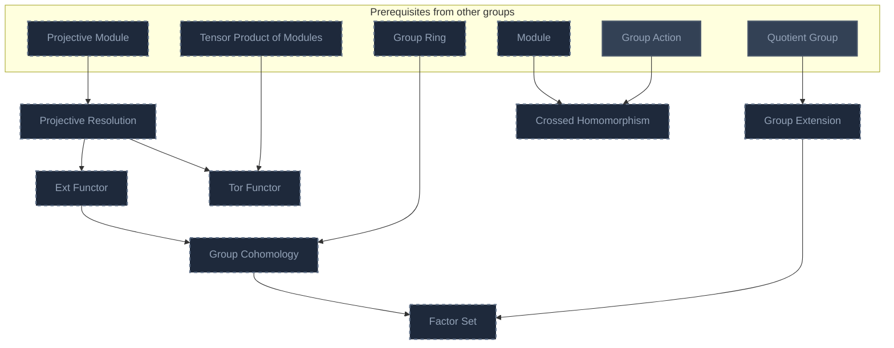

## Dummit & Foote Ch. 18: Representation Theory
**Reached:** L1 0 · L2 0 · L3 0 · L4 0 · L5 0 (of 6 nodes, 6 planned)

```mermaid
flowchart TD
    classDef planned fill:#1E293B,stroke:#64748B,stroke-width:2px,stroke-dasharray:5 5,color:#94A3B8;
    classDef locked fill:#334155,stroke:#475569,stroke-width:2px,color:#94A3B8;
    classDef L0 fill:#F1F5F9,stroke:#94A3B8,stroke-width:2px,color:#000000;
    classDef L1 fill:#22C55E,stroke:#15803D,stroke-width:2px,color:#000000;
    classDef L2 fill:#3B82F6,stroke:#1D4ED8,stroke-width:3px,color:#FFFFFF;
    classDef L3 fill:#A855F7,stroke:#6B21A8,stroke-width:3px,color:#FFFFFF,font-weight:bold;
    classDef L4 fill:#F97316,stroke:#C2410C,stroke-width:4px,color:#000000,font-weight:bold;
    classDef L5 fill:#FFD700,stroke:#FF8C00,stroke-width:5px,color:#000000,font-weight:bold;
    classDef rusty stroke:#8B4513,stroke-width:4px,stroke-dasharray:3 3;
    subgraph sg_prereqs["Prerequisites from other groups"]
        n_general_linear_group["General Linear Group"]
        n_group_homomorphism["Group Homomorphism"]
        n_vector_space["Vector Space"]
        n_group_ring["Group Ring"]
        n_module["Module"]
        n_division_ring["Division Ring"]
        n_matrix_ring["Matrix Ring"]
        n_trace["Trace"]
        n_conjugacy_class["Conjugacy Class"]
        n_inner_product["Inner Product"]
    end
    n_group_representation["Group Representation"]
    n_maschke_s_theorem["Maschke's Theorem"]
    n_wedderburn_s_theorem["Wedderburn's Theorem"]
    n_group_character["Group Character"]
    n_class_function["Class Function"]
    n_character_orthogonality_relations["Character Orthogonality Relations"]
    n_general_linear_group --> n_group_representation
    n_group_homomorphism --> n_group_representation
    n_vector_space --> n_group_representation
    n_group_representation --> n_maschke_s_theorem
    n_group_ring --> n_maschke_s_theorem
    n_module --> n_maschke_s_theorem
    n_division_ring --> n_wedderburn_s_theorem
    n_matrix_ring --> n_wedderburn_s_theorem
    n_module --> n_wedderburn_s_theorem
    n_group_representation --> n_group_character
    n_trace --> n_group_character
    n_conjugacy_class --> n_class_function
    n_group_character --> n_character_orthogonality_relations
    n_class_function --> n_character_orthogonality_relations
    n_inner_product --> n_character_orthogonality_relations
    class n_group_ring,n_module,n_division_ring,n_matrix_ring,n_conjugacy_class,n_group_representation,n_maschke_s_theorem,n_wedderburn_s_theorem,n_group_character,n_class_function,n_character_orthogonality_relations planned;
    class n_general_linear_group locked;
    class n_trace L0;
    class n_group_homomorphism,n_inner_product L2;
    class n_vector_space L3;
    class n_general_linear_group,n_group_homomorphism,n_vector_space,n_trace,n_inner_product internal-link;
```

## Dummit & Foote Ch. 19: Further Topics in Character Theory
**Reached:** L1 0 · L2 0 · L3 0 · L4 0 · L5 0 (of 5 nodes, 5 planned)

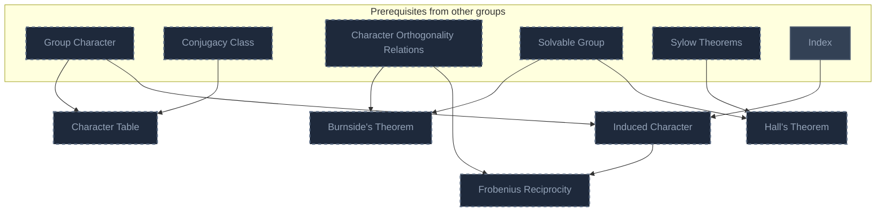

# Source
Graph structure: the single source for the diagrams above, edited by `/note` and `Scripts/skill_trees.py` (`add`, `edge`, `rename`). Everything above this heading is regenerated by `render`.

```skilltree
    %% PREREQUISITES
    n_divides["Divides"]
    n_multiple["Multiple"]
    n_linear_combination["Linear Combination"]
    n_prime_factorization["Prime Factorization"]
    n_equivalence_relation["Equivalence Relation"]
    n_prime_number["Prime Number"]
    n_algebraic_structures["Algebraic Structures"]
    n_binary_operation["Binary Operation"]
    n_associative_property["Associative Property"]
    n_identity_property["Identity Property"]
    n_commutative_property["Commutative Property"]
    n_set_cardinality["Set Cardinality"]
    n_integer["Integer"]
    n_euclidean_distance["Euclidean Distance"]
    n_affine_transformation["Affine Transformation"]
    n_matrix_multiplication["Matrix Multiplication"]
    n_bijective_function["Bijective Function"]
    n_disjoint_sets["Disjoint Sets"]
    n_function_composition["Function Composition"]
    n_matrix["Matrix"]
    n_even_number["Even Number"]
    n_equivalence_class["Equivalence Class"]
    n_odd_number["Odd Number"]
    n_polynomial["Polynomial"]
    n_field["Field"]
    n_vector_space["Vector Space"]
    n_characteristic_polynomial["Characteristic Polynomial"]
    n_eigenvalue["Eigenvalue"]
    n_dimension["Dimension"]
    n_complex_number["Complex Number"]
    n_trace["Trace"]
    n_inner_product["Inner Product"]
    n_well_ordering_principle["Well Ordering Principle"]
    n_binomial_theorem["Binomial Theorem"]
    n_special_orthogonal_matrix["Special Orthogonal Matrix"]
    n_image["Image"]
    n_kernel["Kernel"]
    n_basis["Basis"]
    %% NODES
    %% == Dummit & Foote Ch. 0: Integers and Modular Arithmetic ==
    n_divides_basic_properties["Divides Basic Properties"]
    n_division_with_remainder["Division with Remainder"]
    n_remainder_function["Remainder Function"]
    n_set_of_integer_multiples["Set of Integer Multiples"]
    n_integer_combination["Integer Combination"]
    n_integer_span["Integer Span"]
    n_euclidean_algorithm["Euclidean Algorithm"]
    n_greatest_common_divisor["Greatest Common Divisor"]
    n_relatively_prime["Relatively Prime"]
    n_natural_number_prime_factorization["Natural Number Prime Factorization"]
    n_modular_arithmetic["Modular Arithmetic"]
    n_modular_arithmetic_basic_properties["Modular Arithmetic Basic Properties"]
    n_congruence_class["Congruence Class"]
    n_modular_arithmetic_equivalence_theorem["Modular Arithmetic Equivalence Theorem"]
    n_set_of_congruence_classes_modulo_n["Set of Congruence Classes Modulo n"]
    n_set_of_congruence_classes_modulo_n_cardinality["Set of Congruence Classes Modulo n Cardinality"]
    n_set_of_congruence_classes_modulo_n_multiplicative_inverse["Set of Congruence Classes Modulo n Multiplicative Inverse"]
    n_chinese_remainder_theorem["Chinese Remainder Theorem"]
    n_binomial_theorem_congruence_with_prime_power["Binomial Theorem Congruence with Prime Power"]
    n_fermat_s_little_theorem["Fermat's Little Theorem"]
    n_two_prime_fermat["Two Prime Fermat"]
    %% == Dummit & Foote Ch. 1: Introduction to Groups ==
    n_abstract_algebra["Abstract Algebra"]
    n_operation_closure["Operation Closure"]
    n_magma["Magma"]
    n_quasigroup["Quasigroup"]
    n_semigroup["Semigroup"]
    n_general_associative_law["General Associative Law"]
    n_monoid["Monoid"]
    n_group["Group"]
    n_group_identity_properties["Group Identity Properties"]
    n_group_inverse_properties["Group Inverse Properties"]
    n_group_left_multiplication["Group Left Multiplication"]
    n_group_right_multiplication["Group Right Multiplication"]
    n_group_equation["Group Equation"]
    n_cancellation_property["Cancellation Property"]
    n_group_multiplication_properties["Group Multiplication Properties"]
    n_group_power_properties["Group Power Properties"]
    n_abelian_group["Abelian Group"]
    n_group_order["Group Order"]
    n_group_of_integers["Group of Integers"]
    n_monoid_of_congruence_classes_modulo_n["Monoid of Congruence Classes Modulo n"]
    n_group_of_congruence_classes_modulo_n["Group of Congruence Classes Modulo n"]
    n_group_of_modular_units["Group of Modular Units"]
    n_group_of_modular_units_elements["Group of Modular Units Elements"]
    n_group_of_modular_units_group_order["Group of Modular Units Group Order"]
    n_isometry["Isometry"]
    n_affine_symmetry["Affine Symmetry"]
    n_shape_symmetry["Shape Symmetry"]
    n_dihedral_group["Dihedral Group"]
    n_infinite_dihedral_group["Infinite Dihedral Group"]
    n_permutation["Permutation"]
    n_cycle["Cycle"]
    n_disjoint_cycles["Disjoint Cycles"]
    n_cycle_notation["Cycle Notation"]
    n_transposition["Transposition"]
    n_cycle_type["Cycle Type"]
    n_symmetric_group["Symmetric Group"]
    n_general_linear_set["General Linear Set"]
    n_general_linear_group["General Linear Group"]
    n_set_of_special_orthogonal_matrices["Set of Special Orthogonal Matrices"]
    n_group_of_special_orthogonal_matrices["Group of Special Orthogonal Matrices"]
    n_symmetries_of_unit_disk["Symmetries of Unit Disk"]
    n_quaternion_group["Quaternion Group"]
    n_group_homomorphism["Group Homomorphism"]
    n_group_isomorphism["Group Isomorphism"]
    n_group_of_modular_units_group_isomorphism["Group of Modular Units Group Isomorphism"]
    n_group_automorphism["Group Automorphism"]
    n_group_action["Group Action"]
    n_symmetry["Symmetry"]
    %% == Dummit & Foote Ch. 2: Subgroups ==
    n_subgroup["Subgroup"]
    n_permutation_group["Permutation Group"]
    n_subgroup_generated_by_subset["Subgroup Generated by Subset"]
    n_cyclic_subgroup["Cyclic Subgroup"]
    n_group_element_order["Group Element Order"]
    n_permutation_order["Permutation Order"]
    n_cyclic_group["Cyclic Group"]
    n_finitely_generated_group["Finitely Generated Group"]
    n_centralizer["Centralizer"]
    n_center_of_group["Center of Group"]
    n_normalizer["Normalizer"]
    n_stabilizer["Stabilizer"]
    n_lattice_of_subgroups["Lattice of Subgroups"]
    %% == Dummit & Foote Ch. 3: Quotient Groups and Homomorphisms ==
    n_left_coset["Left Coset"]
    n_right_coset["Right Coset"]
    n_coset["Coset"]
    n_index["Index"]
    n_lagrange_s_theorem["Lagrange's Theorem"]
    n_generalized_lagrange_s_theorem["Generalized Lagrange's Theorem"]
    n_order_theorem["Order Theorem"]
    n_fundamental_theorem_of_cyclic_groups["Fundamental Theorem of Cyclic Groups"]
    n_even_order_theorem["Even Order Theorem"]
    n_cauchy_s_theorem_abstract_algebra["Cauchy's Theorem (Abstract Algebra)"]
    n_product_subset["Product Subset"]
    n_normal_subgroup["Normal Subgroup"]
    n_group_of_normal_cosets["Group of Normal Cosets"]
    n_quotient_group["Quotient Group"]
    n_quotient_function["Quotient Function"]
    n_group_of_congruence_classes_modulo_n_as_a_quotient_group["Group of Congruence Classes Modulo n as a Quotient Group"]
    n_group_homomorphism_theorem["Group Homomorphism Theorem"]
    n_group_isomorphism_theorem["Group Isomorphism Theorem"]
    n_diamond_group_isomorphism_theorem["Diamond Group Isomorphism Theorem"]
    n_factorization_theorem["Factorization Theorem"]
    n_correspondence_theorem["Correspondence Theorem"]
    n_simple_group["Simple Group"]
    n_composition_series["Composition Series"]
    n_jordan_h_lder_theorem["Jordan-Hölder Theorem"]
    n_permutation_parity["Permutation Parity"]
    n_permutation_sign["Permutation Sign"]
    n_alternating_group["Alternating Group"]
    %% == Dummit & Foote Ch. 4: Group Actions ==
    n_orbit["Orbit"]
    n_orbit_stabilizer_theorem["Orbit-Stabilizer Theorem"]
    n_cayley_s_theorem["Cayley's Theorem"]
    n_group_conjugate["Group Conjugate"]
    n_conjugation_group_homomorphism["Conjugation Group Homomorphism"]
    n_cycle_conjugation["Cycle Conjugation"]
    n_conjugacy_class["Conjugacy Class"]
    n_class_equation["Class Equation"]
    n_inner_group_automorphism["Inner Group Automorphism"]
    n_outer_group_automorphism["Outer Group Automorphism"]
    n_characteristic_subgroup["Characteristic Subgroup"]
    n_sylow_p_subgroup["Sylow p-Subgroup"]
    n_sylow_theorems["Sylow Theorems"]
    n_simplicity_of_alternating_group["Simplicity of Alternating Group"]
    %% == Dummit & Foote Ch. 5: Direct and Semidirect Products and Abelian Groups ==
    n_direct_product_group["Direct Product Group"]
    n_free_abelian_group["Free-Abelian Group"]
    n_smith_normal_form["Smith Normal Form"]
    n_invariant_factor_decomposition["Invariant Factor Decomposition"]
    n_elementary_divisor_decomposition["Elementary Divisor Decomposition"]
    n_commutator_subgroup["Commutator Subgroup"]
    n_semidirect_product_group["Semidirect Product Group"]
    n_recognition_theorem_for_semidirect_product["Recognition Theorem for Semidirect Product"]
    %% == Dummit & Foote Ch. 6: Further Topics in Group Theory ==
    n_p_group["p-Group"]
    n_nilpotent_group["Nilpotent Group"]
    n_solvable_group["Solvable Group"]
    n_free_group["Free Group"]
    n_group_presentation["Group Presentation"]
    %% == Dummit & Foote Ch. 7: Introduction to Rings ==
    n_ring["Ring"]
    n_ring_of_congruence_classes_modulo_n["Ring of Congruence Classes Modulo n"]
    n_zero_divisor["Zero Divisor"]
    n_ring_unit["Ring Unit"]
    n_integral_domain["Integral Domain"]
    n_division_ring["Division Ring"]
    n_polynomial_ring["Polynomial Ring"]
    n_matrix_ring["Matrix Ring"]
    n_group_ring["Group Ring"]
    n_ring_homomorphism["Ring Homomorphism"]
    n_ideal["Ideal"]
    n_quotient_ring["Quotient Ring"]
    n_ring_isomorphism_theorems["Ring Isomorphism Theorems"]
    n_principal_ideal["Principal Ideal"]
    n_maximal_ideal["Maximal Ideal"]
    n_prime_ideal["Prime Ideal"]
    n_field_of_fractions["Field of Fractions"]
    n_chinese_remainder_theorem_ring_theory["Chinese Remainder Theorem (Ring Theory)"]
    %% == Dummit & Foote Ch. 8: Euclidean Domains, PIDs, and UFDs ==
    n_euclidean_domain["Euclidean Domain"]
    n_principal_ideal_domain["Principal Ideal Domain"]
    n_irreducible_element["Irreducible Element"]
    n_prime_element["Prime Element"]
    n_unique_factorization_domain["Unique Factorization Domain"]
    %% == Dummit & Foote Ch. 9: Polynomial Rings ==
    n_gauss_s_lemma["Gauss's Lemma"]
    n_eisenstein_s_criterion["Eisenstein's Criterion"]
    n_noetherian_ring["Noetherian Ring"]
    n_hilbert_basis_theorem["Hilbert Basis Theorem"]
    n_monomial_order["Monomial Order"]
    n_gr_bner_basis["Gröbner Basis"]
    n_buchberger_s_algorithm["Buchberger's Algorithm"]
    %% == Dummit & Foote Ch. 10: Introduction to Module Theory ==
    n_module["Module"]
    n_submodule["Submodule"]
    n_module_homomorphism["Module Homomorphism"]
    n_quotient_module["Quotient Module"]
    n_free_module["Free Module"]
    n_direct_sum_of_modules["Direct Sum of Modules"]
    n_tensor_product_of_modules["Tensor Product of Modules"]
    n_exact_sequence["Exact Sequence"]
    n_projective_module["Projective Module"]
    n_injective_module["Injective Module"]
    n_flat_module["Flat Module"]
    %% == Dummit & Foote Ch. 11: Vector Spaces ==
    n_tensor_algebra["Tensor Algebra"]
    n_symmetric_algebra["Symmetric Algebra"]
    n_exterior_algebra["Exterior Algebra"]
    %% == Dummit & Foote Ch. 12: Modules over Principal Ideal Domains ==
    n_torsion_module["Torsion Module"]
    n_structure_theorem_for_finitely_generated_modules_over_a_pid["Structure Theorem for Finitely Generated Modules over a PID"]
    n_rational_canonical_form["Rational Canonical Form"]
    n_jordan_canonical_form["Jordan Canonical Form"]
    %% == Dummit & Foote Ch. 13: Field Theory ==
    n_field_extension["Field Extension"]
    n_degree_of_field_extension["Degree of Field Extension"]
    n_simple_extension["Simple Extension"]
    n_minimal_polynomial["Minimal Polynomial"]
    n_algebraic_extension["Algebraic Extension"]
    n_tower_law["Tower Law"]
    n_constructible_number["Constructible Number"]
    n_splitting_field["Splitting Field"]
    n_algebraic_closure["Algebraic Closure"]
    n_separable_polynomial["Separable Polynomial"]
    n_separable_extension["Separable Extension"]
    n_frobenius_endomorphism["Frobenius Endomorphism"]
    n_perfect_field["Perfect Field"]
    n_cyclotomic_polynomial["Cyclotomic Polynomial"]
    n_cyclotomic_field["Cyclotomic Field"]
    %% == Dummit & Foote Ch. 14: Galois Theory ==
    n_field_automorphism["Field Automorphism"]
    n_galois_group["Galois Group"]
    n_galois_extension["Galois Extension"]
    n_fundamental_theorem_of_galois_theory["Fundamental Theorem of Galois Theory"]
    n_finite_field["Finite Field"]
    n_composite_field["Composite Field"]
    n_primitive_element_theorem["Primitive Element Theorem"]
    n_cyclotomic_extension_galois_group["Cyclotomic Extension Galois Group"]
    n_abelian_extension["Abelian Extension"]
    n_galois_group_of_polynomial["Galois Group of Polynomial"]
    n_discriminant_of_polynomial["Discriminant of Polynomial"]
    n_radical_extension["Radical Extension"]
    n_solvability_by_radicals_theorem["Solvability by Radicals Theorem"]
    n_insolvability_of_the_quintic["Insolvability of the Quintic"]
    n_transcendence_basis["Transcendence Basis"]
    n_transcendence_degree["Transcendence Degree"]
    %% == Dummit & Foote Ch. 15: Commutative Rings and Algebraic Geometry ==
    n_affine_algebraic_set["Affine Algebraic Set"]
    n_coordinate_ring["Coordinate Ring"]
    n_zariski_topology["Zariski Topology"]
    n_radical_of_ideal["Radical of Ideal"]
    n_affine_variety["Affine Variety"]
    n_integral_extension["Integral Extension"]
    n_integral_closure["Integral Closure"]
    n_hilbert_s_nullstellensatz["Hilbert's Nullstellensatz"]
    n_localization["Localization"]
    n_local_ring["Local Ring"]
    n_prime_spectrum["Prime Spectrum"]
    %% == Dummit & Foote Ch. 16: Artinian Rings, DVRs, and Dedekind Domains ==
    n_artinian_ring["Artinian Ring"]
    n_discrete_valuation_ring["Discrete Valuation Ring"]
    n_dedekind_domain["Dedekind Domain"]
    n_fractional_ideal["Fractional Ideal"]
    %% == Dummit & Foote Ch. 17: Introduction to Homological Algebra and Group Cohomology ==
    n_projective_resolution["Projective Resolution"]
    n_ext_functor["Ext Functor"]
    n_tor_functor["Tor Functor"]
    n_group_cohomology["Group Cohomology"]
    n_crossed_homomorphism["Crossed Homomorphism"]
    n_group_extension["Group Extension"]
    n_factor_set["Factor Set"]
    %% == Dummit & Foote Ch. 18: Representation Theory ==
    n_group_representation["Group Representation"]
    n_maschke_s_theorem["Maschke's Theorem"]
    n_wedderburn_s_theorem["Wedderburn's Theorem"]
    n_group_character["Group Character"]
    n_class_function["Class Function"]
    n_character_orthogonality_relations["Character Orthogonality Relations"]
    %% == Dummit & Foote Ch. 19: Further Topics in Character Theory ==
    n_character_table["Character Table"]
    n_burnside_s_theorem["Burnside's Theorem"]
    n_hall_s_theorem["Hall's Theorem"]
    n_induced_character["Induced Character"]
    n_frobenius_reciprocity["Frobenius Reciprocity"]
    %% EDGES
    n_well_ordering_principle --> n_division_with_remainder
    n_division_with_remainder --> n_remainder_function
    n_divides --> n_divides_basic_properties
    n_multiple --> n_set_of_integer_multiples
    n_linear_combination --> n_integer_combination
    n_integer_combination --> n_integer_span
    n_set_of_integer_multiples --> n_integer_span
    n_remainder_function --> n_euclidean_algorithm
    n_euclidean_algorithm --> n_greatest_common_divisor
    n_integer_span --> n_greatest_common_divisor
    n_divides_basic_properties --> n_greatest_common_divisor
    n_greatest_common_divisor --> n_relatively_prime
    n_relatively_prime --> n_natural_number_prime_factorization
    n_prime_factorization --> n_natural_number_prime_factorization
    n_divides --> n_modular_arithmetic
    n_modular_arithmetic --> n_modular_arithmetic_basic_properties
    n_modular_arithmetic --> n_congruence_class
    n_equivalence_relation --> n_congruence_class
    n_congruence_class --> n_modular_arithmetic_equivalence_theorem
    n_remainder_function --> n_modular_arithmetic_equivalence_theorem
    n_congruence_class --> n_set_of_congruence_classes_modulo_n
    n_set_of_congruence_classes_modulo_n --> n_set_of_congruence_classes_modulo_n_cardinality
    n_modular_arithmetic_equivalence_theorem --> n_set_of_congruence_classes_modulo_n_cardinality
    n_set_of_congruence_classes_modulo_n --> n_set_of_congruence_classes_modulo_n_multiplicative_inverse
    n_relatively_prime --> n_set_of_congruence_classes_modulo_n_multiplicative_inverse
    n_modular_arithmetic --> n_chinese_remainder_theorem
    n_relatively_prime --> n_chinese_remainder_theorem
    n_binomial_theorem --> n_binomial_theorem_congruence_with_prime_power
    n_modular_arithmetic --> n_binomial_theorem_congruence_with_prime_power
    n_prime_number --> n_binomial_theorem_congruence_with_prime_power
    n_binomial_theorem_congruence_with_prime_power --> n_fermat_s_little_theorem
    n_fermat_s_little_theorem --> n_two_prime_fermat
    n_chinese_remainder_theorem --> n_two_prime_fermat
    n_algebraic_structures --> n_abstract_algebra
    n_binary_operation --> n_operation_closure
    n_abstract_algebra --> n_magma
    n_operation_closure --> n_magma
    n_magma --> n_quasigroup
    n_magma --> n_semigroup
    n_associative_property --> n_semigroup
    n_semigroup --> n_general_associative_law
    n_semigroup --> n_monoid
    n_identity_property --> n_monoid
    n_monoid --> n_group
    n_group --> n_group_identity_properties
    n_group --> n_group_inverse_properties
    n_group --> n_group_left_multiplication
    n_group --> n_group_right_multiplication
    n_group_inverse_properties --> n_group_equation
    n_algebraic_structures --> n_cancellation_property
    n_group_left_multiplication --> n_group_multiplication_properties
    n_group_right_multiplication --> n_group_multiplication_properties
    n_group_equation --> n_group_multiplication_properties
    n_cancellation_property --> n_group_multiplication_properties
    n_group --> n_group_power_properties
    n_general_associative_law --> n_group_power_properties
    n_group --> n_abelian_group
    n_commutative_property --> n_abelian_group
    n_group --> n_group_order
    n_set_cardinality --> n_group_order
    n_abelian_group --> n_group_of_integers
    n_integer --> n_group_of_integers
    n_monoid --> n_monoid_of_congruence_classes_modulo_n
    n_set_of_congruence_classes_modulo_n --> n_monoid_of_congruence_classes_modulo_n
    n_abelian_group --> n_group_of_congruence_classes_modulo_n
    n_set_of_congruence_classes_modulo_n --> n_group_of_congruence_classes_modulo_n
    n_abelian_group --> n_group_of_modular_units
    n_set_of_congruence_classes_modulo_n_multiplicative_inverse --> n_group_of_modular_units
    n_group_of_modular_units --> n_group_of_modular_units_elements
    n_group_of_modular_units --> n_group_of_modular_units_group_order
    n_group_order --> n_group_of_modular_units_group_order
    n_euclidean_distance --> n_isometry
    n_isometry --> n_affine_symmetry
    n_affine_transformation --> n_affine_symmetry
    n_group --> n_shape_symmetry
    n_symmetry --> n_shape_symmetry
    n_matrix_multiplication --> n_shape_symmetry
    n_shape_symmetry --> n_dihedral_group
    n_dihedral_group --> n_infinite_dihedral_group
    n_bijective_function --> n_permutation
    n_permutation --> n_cycle
    n_cycle --> n_disjoint_cycles
    n_disjoint_sets --> n_disjoint_cycles
    n_disjoint_cycles --> n_cycle_notation
    n_cycle --> n_transposition
    n_disjoint_cycles --> n_cycle_type
    n_permutation --> n_symmetric_group
    n_group --> n_symmetric_group
    n_function_composition --> n_symmetric_group
    n_matrix --> n_general_linear_set
    n_general_linear_set --> n_general_linear_group
    n_group --> n_general_linear_group
    n_special_orthogonal_matrix --> n_set_of_special_orthogonal_matrices
    n_general_linear_set --> n_set_of_special_orthogonal_matrices
    n_set_of_special_orthogonal_matrices --> n_group_of_special_orthogonal_matrices
    n_general_linear_group --> n_group_of_special_orthogonal_matrices
    n_group_of_special_orthogonal_matrices --> n_symmetries_of_unit_disk
    n_group --> n_quaternion_group
    n_group --> n_group_homomorphism
    n_group_homomorphism --> n_group_isomorphism
    n_bijective_function --> n_group_isomorphism
    n_group_of_modular_units --> n_group_of_modular_units_group_isomorphism
    n_group_isomorphism --> n_group_of_modular_units_group_isomorphism
    n_direct_product_group --> n_group_of_modular_units_group_isomorphism
    n_chinese_remainder_theorem --> n_group_of_modular_units_group_isomorphism
    n_group_isomorphism --> n_group_automorphism
    n_group_homomorphism --> n_group_action
    n_symmetric_group --> n_group_action
    n_group --> n_subgroup
    n_symmetric_group --> n_permutation_group
    n_subgroup --> n_permutation_group
    n_subgroup --> n_subgroup_generated_by_subset
    n_subgroup_generated_by_subset --> n_cyclic_subgroup
    n_group_power_properties --> n_cyclic_subgroup
    n_cyclic_subgroup --> n_group_element_order
    n_group_order --> n_group_element_order
    n_disjoint_cycles --> n_permutation_order
    n_group_element_order --> n_permutation_order
    n_cyclic_subgroup --> n_cyclic_group
    n_subgroup_generated_by_subset --> n_finitely_generated_group
    n_subgroup --> n_centralizer
    n_centralizer --> n_center_of_group
    n_subgroup --> n_normalizer
    n_group_action --> n_stabilizer
    n_subgroup --> n_stabilizer
    n_subgroup --> n_lattice_of_subgroups
    n_subgroup --> n_left_coset
    n_subgroup --> n_right_coset
    n_left_coset --> n_coset
    n_right_coset --> n_coset
    n_coset --> n_index
    n_coset --> n_lagrange_s_theorem
    n_divides --> n_lagrange_s_theorem
    n_lagrange_s_theorem --> n_generalized_lagrange_s_theorem
    n_index --> n_generalized_lagrange_s_theorem
    n_lagrange_s_theorem --> n_order_theorem
    n_group_element_order --> n_order_theorem
    n_cyclic_group --> n_fundamental_theorem_of_cyclic_groups
    n_order_theorem --> n_fundamental_theorem_of_cyclic_groups
    n_order_theorem --> n_even_order_theorem
    n_even_number --> n_even_order_theorem
    n_group_element_order --> n_cauchy_s_theorem_abstract_algebra
    n_prime_number --> n_cauchy_s_theorem_abstract_algebra
    n_group --> n_product_subset
    n_coset --> n_normal_subgroup
    n_normal_subgroup --> n_group_of_normal_cosets
    n_product_subset --> n_group_of_normal_cosets
    n_group_of_normal_cosets --> n_quotient_group
    n_equivalence_class --> n_quotient_group
    n_quotient_group --> n_quotient_function
    n_group_homomorphism --> n_quotient_function
    n_group_of_congruence_classes_modulo_n --> n_group_of_congruence_classes_modulo_n_as_a_quotient_group
    n_quotient_group --> n_group_of_congruence_classes_modulo_n_as_a_quotient_group
    n_group_of_integers --> n_group_of_congruence_classes_modulo_n_as_a_quotient_group
    n_set_of_integer_multiples --> n_group_of_congruence_classes_modulo_n_as_a_quotient_group
    n_quotient_function --> n_group_homomorphism_theorem
    n_kernel --> n_group_homomorphism_theorem
    n_group_homomorphism_theorem --> n_group_isomorphism_theorem
    n_image --> n_group_isomorphism_theorem
    n_group_isomorphism --> n_group_isomorphism_theorem
    n_group_isomorphism_theorem --> n_diamond_group_isomorphism_theorem
    n_group_isomorphism_theorem --> n_factorization_theorem
    n_quotient_function --> n_correspondence_theorem
    n_normal_subgroup --> n_simple_group
    n_simple_group --> n_composition_series
    n_quotient_group --> n_composition_series
    n_composition_series --> n_jordan_h_lder_theorem
    n_group_isomorphism --> n_jordan_h_lder_theorem
    n_transposition --> n_permutation_parity
    n_even_number --> n_permutation_parity
    n_odd_number --> n_permutation_parity
    n_permutation_parity --> n_permutation_sign
    n_permutation_parity --> n_alternating_group
    n_symmetric_group --> n_alternating_group
    n_subgroup --> n_alternating_group
    n_group_action --> n_orbit
    n_orbit --> n_orbit_stabilizer_theorem
    n_stabilizer --> n_orbit_stabilizer_theorem
    n_index --> n_orbit_stabilizer_theorem
    n_group_action --> n_cayley_s_theorem
    n_group_left_multiplication --> n_cayley_s_theorem
    n_group_isomorphism --> n_cayley_s_theorem
    n_subgroup --> n_cayley_s_theorem
    n_group --> n_group_conjugate
    n_group_conjugate --> n_conjugation_group_homomorphism
    n_group_homomorphism --> n_conjugation_group_homomorphism
    n_group_conjugate --> n_cycle_conjugation
    n_cycle_type --> n_cycle_conjugation
    n_group_conjugate --> n_conjugacy_class
    n_orbit --> n_conjugacy_class
    n_conjugacy_class --> n_class_equation
    n_orbit_stabilizer_theorem --> n_class_equation
    n_center_of_group --> n_class_equation
    n_group_automorphism --> n_inner_group_automorphism
    n_conjugation_group_homomorphism --> n_inner_group_automorphism
    n_image --> n_inner_group_automorphism
    n_inner_group_automorphism --> n_outer_group_automorphism
    n_quotient_group --> n_outer_group_automorphism
    n_group_automorphism --> n_characteristic_subgroup
    n_normal_subgroup --> n_characteristic_subgroup
    n_lagrange_s_theorem --> n_sylow_p_subgroup
    n_prime_number --> n_sylow_p_subgroup
    n_sylow_p_subgroup --> n_sylow_theorems
    n_class_equation --> n_sylow_theorems
    n_normalizer --> n_sylow_theorems
    n_alternating_group --> n_simplicity_of_alternating_group
    n_simple_group --> n_simplicity_of_alternating_group
    n_cycle_conjugation --> n_simplicity_of_alternating_group
    n_group --> n_direct_product_group
    n_abelian_group --> n_free_abelian_group
    n_basis --> n_free_abelian_group
    n_matrix --> n_smith_normal_form
    n_divides --> n_smith_normal_form
    n_free_abelian_group --> n_invariant_factor_decomposition
    n_smith_normal_form --> n_invariant_factor_decomposition
    n_direct_product_group --> n_invariant_factor_decomposition
    n_cyclic_group --> n_invariant_factor_decomposition
    n_group_isomorphism --> n_invariant_factor_decomposition
    n_invariant_factor_decomposition --> n_elementary_divisor_decomposition
    n_chinese_remainder_theorem --> n_elementary_divisor_decomposition
    n_normal_subgroup --> n_commutator_subgroup
    n_abelian_group --> n_commutator_subgroup
    n_direct_product_group --> n_semidirect_product_group
    n_conjugation_group_homomorphism --> n_semidirect_product_group
    n_group_automorphism --> n_semidirect_product_group
    n_semidirect_product_group --> n_recognition_theorem_for_semidirect_product
    n_normal_subgroup --> n_recognition_theorem_for_semidirect_product
    n_product_subset --> n_recognition_theorem_for_semidirect_product
    n_group_order --> n_p_group
    n_prime_number --> n_p_group
    n_center_of_group --> n_nilpotent_group
    n_quotient_group --> n_nilpotent_group
    n_commutator_subgroup --> n_solvable_group
    n_quotient_group --> n_solvable_group
    n_subgroup_generated_by_subset --> n_free_group
    n_group_homomorphism --> n_free_group
    n_free_group --> n_group_presentation
    n_quotient_group --> n_group_presentation
    n_abelian_group --> n_ring
    n_ring --> n_ring_of_congruence_classes_modulo_n
    n_group_of_congruence_classes_modulo_n --> n_ring_of_congruence_classes_modulo_n
    n_monoid_of_congruence_classes_modulo_n --> n_ring_of_congruence_classes_modulo_n
    n_ring --> n_zero_divisor
    n_ring --> n_ring_unit
    n_zero_divisor --> n_integral_domain
    n_ring_unit --> n_division_ring
    n_ring --> n_polynomial_ring
    n_polynomial --> n_polynomial_ring
    n_ring --> n_matrix_ring
    n_matrix --> n_matrix_ring
    n_ring --> n_group_ring
    n_ring --> n_ring_homomorphism
    n_group_homomorphism --> n_ring_homomorphism
    n_ring --> n_ideal
    n_subgroup --> n_ideal
    n_ideal --> n_quotient_ring
    n_quotient_group --> n_quotient_ring
    n_quotient_ring --> n_ring_isomorphism_theorems
    n_ring_homomorphism --> n_ring_isomorphism_theorems
    n_group_isomorphism_theorem --> n_ring_isomorphism_theorems
    n_ideal --> n_principal_ideal
    n_ideal --> n_maximal_ideal
    n_ideal --> n_prime_ideal
    n_integral_domain --> n_field_of_fractions
    n_field --> n_field_of_fractions
    n_chinese_remainder_theorem --> n_chinese_remainder_theorem_ring_theory
    n_quotient_ring --> n_chinese_remainder_theorem_ring_theory
    n_direct_product_group --> n_chinese_remainder_theorem_ring_theory
    n_integral_domain --> n_euclidean_domain
    n_division_with_remainder --> n_euclidean_domain
    n_euclidean_domain --> n_principal_ideal_domain
    n_principal_ideal --> n_principal_ideal_domain
    n_integral_domain --> n_irreducible_element
    n_ring_unit --> n_irreducible_element
    n_integral_domain --> n_prime_element
    n_ring_unit --> n_prime_element
    n_principal_ideal_domain --> n_unique_factorization_domain
    n_irreducible_element --> n_unique_factorization_domain
    n_prime_element --> n_unique_factorization_domain
    n_unique_factorization_domain --> n_gauss_s_lemma
    n_polynomial_ring --> n_gauss_s_lemma
    n_field_of_fractions --> n_gauss_s_lemma
    n_gauss_s_lemma --> n_eisenstein_s_criterion
    n_prime_ideal --> n_eisenstein_s_criterion
    n_ideal --> n_noetherian_ring
    n_noetherian_ring --> n_hilbert_basis_theorem
    n_polynomial_ring --> n_hilbert_basis_theorem
    n_polynomial_ring --> n_monomial_order
    n_monomial_order --> n_gr_bner_basis
    n_ideal --> n_gr_bner_basis
    n_gr_bner_basis --> n_buchberger_s_algorithm
    n_ring --> n_module
    n_vector_space --> n_module
    n_module --> n_submodule
    n_module --> n_module_homomorphism
    n_group_homomorphism --> n_module_homomorphism
    n_submodule --> n_quotient_module
    n_quotient_group --> n_quotient_module
    n_module --> n_free_module
    n_basis --> n_free_module
    n_module --> n_direct_sum_of_modules
    n_direct_product_group --> n_direct_sum_of_modules
    n_module_homomorphism --> n_tensor_product_of_modules
    n_free_module --> n_tensor_product_of_modules
    n_quotient_module --> n_tensor_product_of_modules
    n_module_homomorphism --> n_exact_sequence
    n_kernel --> n_exact_sequence
    n_image --> n_exact_sequence
    n_exact_sequence --> n_projective_module
    n_free_module --> n_projective_module
    n_exact_sequence --> n_injective_module
    n_exact_sequence --> n_flat_module
    n_tensor_product_of_modules --> n_flat_module
    n_tensor_product_of_modules --> n_tensor_algebra
    n_tensor_algebra --> n_symmetric_algebra
    n_ideal --> n_symmetric_algebra
    n_tensor_algebra --> n_exterior_algebra
    n_ideal --> n_exterior_algebra
    n_module --> n_torsion_module
    n_integral_domain --> n_torsion_module
    n_principal_ideal_domain --> n_structure_theorem_for_finitely_generated_modules_over_a_pid
    n_torsion_module --> n_structure_theorem_for_finitely_generated_modules_over_a_pid
    n_free_module --> n_structure_theorem_for_finitely_generated_modules_over_a_pid
    n_direct_sum_of_modules --> n_structure_theorem_for_finitely_generated_modules_over_a_pid
    n_structure_theorem_for_finitely_generated_modules_over_a_pid --> n_rational_canonical_form
    n_characteristic_polynomial --> n_rational_canonical_form
    n_rational_canonical_form --> n_jordan_canonical_form
    n_eigenvalue --> n_jordan_canonical_form
    n_field --> n_field_extension
    n_ring_homomorphism --> n_field_extension
    n_field_extension --> n_degree_of_field_extension
    n_dimension --> n_degree_of_field_extension
    n_field_extension --> n_simple_extension
    n_polynomial_ring --> n_simple_extension
    n_simple_extension --> n_minimal_polynomial
    n_irreducible_element --> n_minimal_polynomial
    n_minimal_polynomial --> n_algebraic_extension
    n_degree_of_field_extension --> n_tower_law
    n_tower_law --> n_constructible_number
    n_algebraic_extension --> n_constructible_number
    n_algebraic_extension --> n_splitting_field
    n_algebraic_extension --> n_algebraic_closure
    n_splitting_field --> n_separable_polynomial
    n_separable_polynomial --> n_separable_extension
    n_field --> n_frobenius_endomorphism
    n_ring_homomorphism --> n_frobenius_endomorphism
    n_separable_extension --> n_perfect_field
    n_frobenius_endomorphism --> n_perfect_field
    n_minimal_polynomial --> n_cyclotomic_polynomial
    n_complex_number --> n_cyclotomic_polynomial
    n_cyclotomic_polynomial --> n_cyclotomic_field
    n_splitting_field --> n_cyclotomic_field
    n_field_extension --> n_field_automorphism
    n_group_automorphism --> n_field_automorphism
    n_field_automorphism --> n_galois_group
    n_galois_group --> n_galois_extension
    n_separable_extension --> n_galois_extension
    n_galois_extension --> n_fundamental_theorem_of_galois_theory
    n_normal_subgroup --> n_fundamental_theorem_of_galois_theory
    n_tower_law --> n_fundamental_theorem_of_galois_theory
    n_fundamental_theorem_of_galois_theory --> n_finite_field
    n_frobenius_endomorphism --> n_finite_field
    n_field_extension --> n_composite_field
    n_fundamental_theorem_of_galois_theory --> n_primitive_element_theorem
    n_cyclotomic_field --> n_cyclotomic_extension_galois_group
    n_galois_group --> n_cyclotomic_extension_galois_group
    n_group_of_modular_units --> n_cyclotomic_extension_galois_group
    n_galois_extension --> n_abelian_extension
    n_galois_group --> n_galois_group_of_polynomial
    n_splitting_field --> n_galois_group_of_polynomial
    n_permutation_group --> n_galois_group_of_polynomial
    n_galois_group_of_polynomial --> n_discriminant_of_polynomial
    n_alternating_group --> n_discriminant_of_polynomial
    n_simple_extension --> n_radical_extension
    n_radical_extension --> n_solvability_by_radicals_theorem
    n_solvable_group --> n_solvability_by_radicals_theorem
    n_fundamental_theorem_of_galois_theory --> n_solvability_by_radicals_theorem
    n_solvability_by_radicals_theorem --> n_insolvability_of_the_quintic
    n_simplicity_of_alternating_group --> n_insolvability_of_the_quintic
    n_galois_group_of_polynomial --> n_insolvability_of_the_quintic
    n_algebraic_extension --> n_transcendence_basis
    n_transcendence_basis --> n_transcendence_degree
    n_ideal --> n_affine_algebraic_set
    n_polynomial_ring --> n_affine_algebraic_set
    n_field --> n_affine_algebraic_set
    n_affine_algebraic_set --> n_coordinate_ring
    n_quotient_ring --> n_coordinate_ring
    n_affine_algebraic_set --> n_zariski_topology
    n_ideal --> n_radical_of_ideal
    n_affine_algebraic_set --> n_affine_variety
    n_prime_ideal --> n_affine_variety
    n_ring --> n_integral_extension
    n_polynomial --> n_integral_extension
    n_integral_extension --> n_integral_closure
    n_radical_of_ideal --> n_hilbert_s_nullstellensatz
    n_affine_algebraic_set --> n_hilbert_s_nullstellensatz
    n_integral_extension --> n_hilbert_s_nullstellensatz
    n_algebraic_closure --> n_hilbert_s_nullstellensatz
    n_hilbert_basis_theorem --> n_hilbert_s_nullstellensatz
    n_field_of_fractions --> n_localization
    n_prime_ideal --> n_localization
    n_localization --> n_local_ring
    n_maximal_ideal --> n_local_ring
    n_prime_ideal --> n_prime_spectrum
    n_zariski_topology --> n_prime_spectrum
    n_ideal --> n_artinian_ring
    n_principal_ideal_domain --> n_discrete_valuation_ring
    n_local_ring --> n_discrete_valuation_ring
    n_integral_closure --> n_dedekind_domain
    n_noetherian_ring --> n_dedekind_domain
    n_prime_ideal --> n_dedekind_domain
    n_field_of_fractions --> n_fractional_ideal
    n_submodule --> n_fractional_ideal
    n_projective_module --> n_projective_resolution
    n_projective_resolution --> n_ext_functor
    n_projective_resolution --> n_tor_functor
    n_tensor_product_of_modules --> n_tor_functor
    n_ext_functor --> n_group_cohomology
    n_group_ring --> n_group_cohomology
    n_module --> n_crossed_homomorphism
    n_group_action --> n_crossed_homomorphism
    n_quotient_group --> n_group_extension
    n_group_extension --> n_factor_set
    n_group_cohomology --> n_factor_set
    n_general_linear_group --> n_group_representation
    n_group_homomorphism --> n_group_representation
    n_vector_space --> n_group_representation
    n_group_representation --> n_maschke_s_theorem
    n_group_ring --> n_maschke_s_theorem
    n_module --> n_maschke_s_theorem
    n_division_ring --> n_wedderburn_s_theorem
    n_matrix_ring --> n_wedderburn_s_theorem
    n_module --> n_wedderburn_s_theorem
    n_group_representation --> n_group_character
    n_trace --> n_group_character
    n_conjugacy_class --> n_class_function
    n_group_character --> n_character_orthogonality_relations
    n_class_function --> n_character_orthogonality_relations
    n_inner_product --> n_character_orthogonality_relations
    n_group_character --> n_character_table
    n_conjugacy_class --> n_character_table
    n_character_orthogonality_relations --> n_burnside_s_theorem
    n_solvable_group --> n_burnside_s_theorem
    n_solvable_group --> n_hall_s_theorem
    n_sylow_theorems --> n_hall_s_theorem
    n_group_character --> n_induced_character
    n_index --> n_induced_character
    n_induced_character --> n_frobenius_reciprocity
    n_character_orthogonality_relations --> n_frobenius_reciprocity
    n_function_composition --> n_symmetry
    n_bijective_function --> n_symmetry
```
