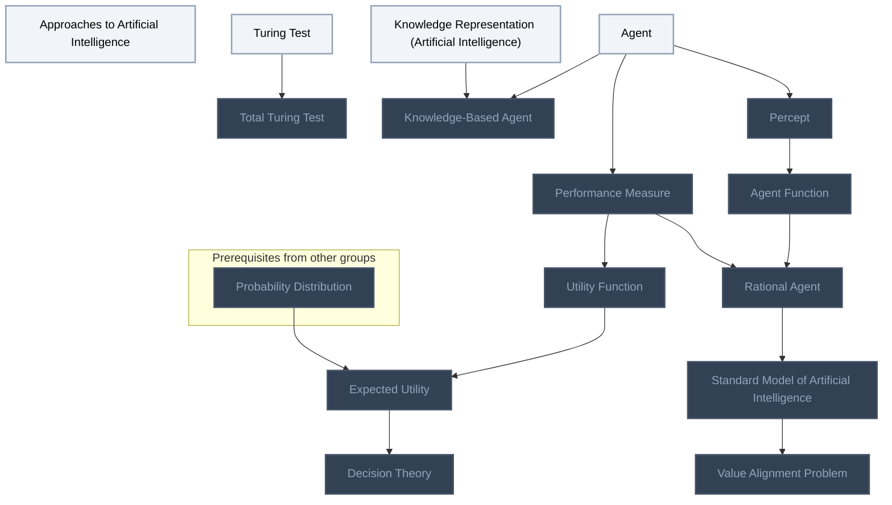
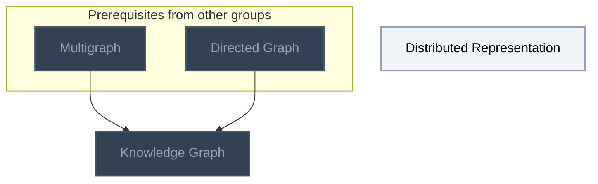

<!-- BEGIN STATS (generated by Scripts/skill_trees.py; do not edit) -->
**Mastered:** 0 / 39 · **Depth:** 0% · **Mastery Depth:** 0% · **Discovered:** 39 · **Planned:** 0 · **Locked:** 33 · **Rusty:** 0

| | L0 Discovered | L1 Recall | L2 Apply | L3 Prove ★ | L4 Wield | L5 Command |
|---|---:|---:|---:|---:|---:|---:|
| **At this level** | 39 | 0 | 0 | 0 | 0 | 0 |
| **Reached (this level or higher)** | 39 | 0 | 0 | 0 | 0 | 0 |

**Next up:** [[Approaches to Artificial Intelligence]], [[Turing Test]], [[Agent]], [[Knowledge Representation (Artificial Intelligence)]], [[Artificial Intelligence]]

Legend: dashed grey = planned (no note yet) · dark grey = locked · white L0 Discovered · green L1 Recall · blue L2 Apply · purple L3 Prove (Mastered) · orange L4 Wield · gold L5 Command · brown dashed border = rusty
<!-- END STATS -->

## Foundations of AI (Russell and Norvig, Ch. 1)
**Reached:** L1 0 · L2 0 · L3 0 · L4 0 · L5 0 (of 15 nodes)



## Task Environments (Russell and Norvig, Ch. 2)
**Reached:** L1 0 · L2 0 · L3 0 · L4 0 · L5 0 (of 8 nodes)

```mermaid
flowchart TD
    classDef planned fill:#1E293B,stroke:#64748B,stroke-width:2px,stroke-dasharray:5 5,color:#94A3B8;
    classDef locked fill:#334155,stroke:#475569,stroke-width:2px,color:#94A3B8;
    classDef L0 fill:#F1F5F9,stroke:#94A3B8,stroke-width:2px,color:#000000;
    classDef L1 fill:#22C55E,stroke:#15803D,stroke-width:2px,color:#000000;
    classDef L2 fill:#3B82F6,stroke:#1D4ED8,stroke-width:3px,color:#FFFFFF;
    classDef L3 fill:#A855F7,stroke:#6B21A8,stroke-width:3px,color:#FFFFFF,font-weight:bold;
    classDef L4 fill:#F97316,stroke:#C2410C,stroke-width:4px,color:#000000,font-weight:bold;
    classDef L5 fill:#FFD700,stroke:#FF8C00,stroke-width:5px,color:#000000,font-weight:bold;
    classDef rusty stroke:#8B4513,stroke-width:4px,stroke-dasharray:3 3;
    subgraph sg_prereqs["Prerequisites from other groups"]
        n_performance_measure["Performance Measure"]
    end
    n_task_environment["Task Environment"]
    n_observability_task_environment["Observability (Task Environment)"]
    n_multiagent_environment["Multiagent Environment"]
    n_determinism_task_environment["Determinism (Task Environment)"]
    n_episodic_vs_sequential_environment["Episodic vs Sequential Environment"]
    n_environment_dynamics["Environment Dynamics"]
    n_known_vs_unknown_environment["Known vs Unknown Environment"]
    n_discrete_vs_continuous_environment["Discrete vs Continuous Environment"]
    n_performance_measure --> n_task_environment
    n_task_environment --> n_observability_task_environment
    n_task_environment --> n_multiagent_environment
    n_task_environment --> n_determinism_task_environment
    n_task_environment --> n_episodic_vs_sequential_environment
    n_task_environment --> n_environment_dynamics
    n_task_environment --> n_known_vs_unknown_environment
    n_task_environment --> n_discrete_vs_continuous_environment
    class n_performance_measure,n_task_environment,n_observability_task_environment,n_multiagent_environment,n_determinism_task_environment,n_episodic_vs_sequential_environment,n_environment_dynamics,n_known_vs_unknown_environment,n_discrete_vs_continuous_environment locked;
    class n_performance_measure,n_task_environment,n_observability_task_environment,n_multiagent_environment,n_determinism_task_environment,n_episodic_vs_sequential_environment,n_environment_dynamics,n_known_vs_unknown_environment,n_discrete_vs_continuous_environment internal-link;
```



## Agent Programs (Russell and Norvig, Ch. 2)
**Reached:** L1 0 · L2 0 · L3 0 · L4 0 · L5 0 (of 14 nodes)

```mermaid
flowchart TD
    classDef planned fill:#1E293B,stroke:#64748B,stroke-width:2px,stroke-dasharray:5 5,color:#94A3B8;
    classDef locked fill:#334155,stroke:#475569,stroke-width:2px,color:#94A3B8;
    classDef L0 fill:#F1F5F9,stroke:#94A3B8,stroke-width:2px,color:#000000;
    classDef L1 fill:#22C55E,stroke:#15803D,stroke-width:2px,color:#000000;
    classDef L2 fill:#3B82F6,stroke:#1D4ED8,stroke-width:3px,color:#FFFFFF;
    classDef L3 fill:#A855F7,stroke:#6B21A8,stroke-width:3px,color:#FFFFFF,font-weight:bold;
    classDef L4 fill:#F97316,stroke:#C2410C,stroke-width:4px,color:#000000,font-weight:bold;
    classDef L5 fill:#FFD700,stroke:#FF8C00,stroke-width:5px,color:#000000,font-weight:bold;
    classDef rusty stroke:#8B4513,stroke-width:4px,stroke-dasharray:3 3;
    subgraph sg_prereqs["Prerequisites from other groups"]
        n_agent_function["Agent Function"]
        n_agent["Agent"]
        n_percept["Percept"]
        n_expected_utility["Expected Utility"]
        n_performance_measure["Performance Measure"]
    end
    n_agent_program["Agent Program"]
    n_simple_reflex_agent["Simple Reflex Agent"]
    n_transition_model["Transition Model"]
    n_sensor_model["Sensor Model"]
    n_model_based_reflex_agent["Model-Based Reflex Agent"]
    n_goal_based_agent["Goal-Based Agent"]
    n_utility_based_agent["Utility-Based Agent"]
    n_model_free_agent["Model-Free Agent"]
    n_learning_agent["Learning Agent"]
    n_critic["Critic"]
    n_problem_generator["Problem Generator"]
    n_reward_artificial_intelligence["Reward (Artificial Intelligence)"]
    n_artificial_intelligence["Artificial Intelligence"]
    n_ethical_concerns_of_artificial_intelligence["Ethical Concerns of Artificial Intelligence"]
    n_agent_function --> n_agent_program
    n_agent_program --> n_simple_reflex_agent
    n_agent --> n_transition_model
    n_percept --> n_sensor_model
    n_agent_program --> n_model_based_reflex_agent
    n_transition_model --> n_model_based_reflex_agent
    n_sensor_model --> n_model_based_reflex_agent
    n_agent_program --> n_goal_based_agent
    n_agent_program --> n_utility_based_agent
    n_expected_utility --> n_utility_based_agent
    n_utility_based_agent --> n_model_free_agent
    n_transition_model --> n_model_free_agent
    n_agent_program --> n_learning_agent
    n_learning_agent --> n_critic
    n_performance_measure --> n_critic
    n_learning_agent --> n_problem_generator
    n_critic --> n_reward_artificial_intelligence
    n_artificial_intelligence --> n_ethical_concerns_of_artificial_intelligence
    class n_agent_function,n_percept,n_expected_utility,n_performance_measure,n_agent_program,n_simple_reflex_agent,n_transition_model,n_sensor_model,n_model_based_reflex_agent,n_goal_based_agent,n_utility_based_agent,n_model_free_agent,n_learning_agent,n_critic,n_problem_generator,n_reward_artificial_intelligence,n_ethical_concerns_of_artificial_intelligence locked;
    class n_agent,n_artificial_intelligence L0;
    class n_agent_function,n_agent,n_percept,n_expected_utility,n_performance_measure,n_agent_program,n_simple_reflex_agent,n_transition_model,n_sensor_model,n_model_based_reflex_agent,n_goal_based_agent,n_utility_based_agent,n_model_free_agent,n_learning_agent,n_critic,n_problem_generator,n_reward_artificial_intelligence,n_artificial_intelligence,n_ethical_concerns_of_artificial_intelligence internal-link;
```



## Knowledge and Representation
**Reached:** L1 0 · L2 0 · L3 0 · L4 0 · L5 0 (of 2 nodes)



# Source
Graph structure: the single source for the diagrams above, edited by `/note` and `Scripts/skill_trees.py` (`add`, `edge`, `rename`). Everything above this heading is regenerated by `render`.

```skilltree
    %% PREREQUISITES
    n_probability_distribution["Probability Distribution"]
    n_multigraph["Multigraph"]
    n_directed_graph["Directed Graph"]
    %% NODES
    %% == Foundations of AI (Russell and Norvig, Ch. 1) ==
    n_approaches_to_artificial_intelligence["Approaches to Artificial Intelligence"]
    n_turing_test["Turing Test"]
    n_total_turing_test["Total Turing Test"]
    n_agent["Agent"]
    n_percept["Percept"]
    n_agent_function["Agent Function"]
    n_performance_measure["Performance Measure"]
    n_rational_agent["Rational Agent"]
    n_standard_model_of_artificial_intelligence["Standard Model of Artificial Intelligence"]
    n_value_alignment_problem["Value Alignment Problem"]
    n_utility_function["Utility Function"]
    n_expected_utility["Expected Utility"]
    n_decision_theory["Decision Theory"]
    n_knowledge_representation_artificial_intelligence["Knowledge Representation (Artificial Intelligence)"]
    n_knowledge_based_agent["Knowledge-Based Agent"]
    %% == Task Environments (Russell and Norvig, Ch. 2) ==
    n_task_environment["Task Environment"]
    n_observability_task_environment["Observability (Task Environment)"]
    n_multiagent_environment["Multiagent Environment"]
    n_determinism_task_environment["Determinism (Task Environment)"]
    n_episodic_vs_sequential_environment["Episodic vs Sequential Environment"]
    n_environment_dynamics["Environment Dynamics"]
    n_known_vs_unknown_environment["Known vs Unknown Environment"]
    n_discrete_vs_continuous_environment["Discrete vs Continuous Environment"]
    %% == Agent Programs (Russell and Norvig, Ch. 2) ==
    n_agent_program["Agent Program"]
    n_simple_reflex_agent["Simple Reflex Agent"]
    n_transition_model["Transition Model"]
    n_sensor_model["Sensor Model"]
    n_model_based_reflex_agent["Model-Based Reflex Agent"]
    n_goal_based_agent["Goal-Based Agent"]
    n_utility_based_agent["Utility-Based Agent"]
    n_model_free_agent["Model-Free Agent"]
    n_learning_agent["Learning Agent"]
    n_critic["Critic"]
    n_problem_generator["Problem Generator"]
    n_reward_artificial_intelligence["Reward (Artificial Intelligence)"]
    n_artificial_intelligence["Artificial Intelligence"]
    n_ethical_concerns_of_artificial_intelligence["Ethical Concerns of Artificial Intelligence"]
    %% == Knowledge and Representation ==
    n_distributed_representation["Distributed Representation"]
    n_knowledge_graph["Knowledge Graph"]
    %% EDGES
    n_turing_test --> n_total_turing_test
    n_agent --> n_percept
    n_percept --> n_agent_function
    n_agent --> n_performance_measure
    n_agent_function --> n_rational_agent
    n_performance_measure --> n_rational_agent
    n_rational_agent --> n_standard_model_of_artificial_intelligence
    n_standard_model_of_artificial_intelligence --> n_value_alignment_problem
    n_performance_measure --> n_utility_function
    n_utility_function --> n_expected_utility
    n_probability_distribution --> n_expected_utility
    n_expected_utility --> n_decision_theory
    n_agent --> n_knowledge_based_agent
    n_knowledge_representation_artificial_intelligence --> n_knowledge_based_agent
    n_performance_measure --> n_task_environment
    n_task_environment --> n_observability_task_environment
    n_task_environment --> n_multiagent_environment
    n_task_environment --> n_determinism_task_environment
    n_task_environment --> n_episodic_vs_sequential_environment
    n_task_environment --> n_environment_dynamics
    n_task_environment --> n_known_vs_unknown_environment
    n_task_environment --> n_discrete_vs_continuous_environment
    n_agent_function --> n_agent_program
    n_agent_program --> n_simple_reflex_agent
    n_agent --> n_transition_model
    n_percept --> n_sensor_model
    n_agent_program --> n_model_based_reflex_agent
    n_transition_model --> n_model_based_reflex_agent
    n_sensor_model --> n_model_based_reflex_agent
    n_agent_program --> n_goal_based_agent
    n_agent_program --> n_utility_based_agent
    n_expected_utility --> n_utility_based_agent
    n_utility_based_agent --> n_model_free_agent
    n_transition_model --> n_model_free_agent
    n_agent_program --> n_learning_agent
    n_learning_agent --> n_critic
    n_performance_measure --> n_critic
    n_learning_agent --> n_problem_generator
    n_critic --> n_reward_artificial_intelligence
    n_artificial_intelligence --> n_ethical_concerns_of_artificial_intelligence
    n_multigraph --> n_knowledge_graph
    n_directed_graph --> n_knowledge_graph
```
