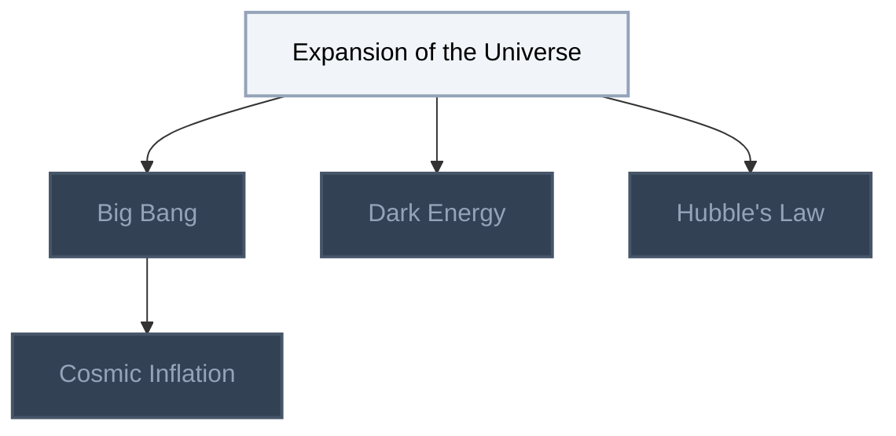

<!-- BEGIN STATS (generated by Scripts/skill_trees.py; do not edit) -->
**Mastered:** 0 / 5 · **Depth:** 0% · **Discovered:** 5 · **Planned:** 0 · **Locked:** 4 · **Rusty:** 0

**Levels:** L0 5 · L1 0 · L2 0 · L3 0 · L4 0 · L5 0

**Next up:** [[Expansion of the Universe]]

Legend: dashed grey = planned (no note yet) · dark grey = locked · white L0 Discovered · green L1 Recall · blue L2 Apply · purple L3 Prove (Mastered) · orange L4 Wield · gold L5 Command · brown dashed border = rusty
<!-- END STATS -->

## Modern Physics and Cosmology
**Mastered:** 0 / 5 · **Discovered:** 5 / 5



# Source
Graph structure: the single source for the diagrams above, edited by `/note` and `Scripts/skill_trees.py` (`add`, `edge`, `rename`). Everything above this heading is regenerated by `render`.

```skilltree
    %% PREREQUISITES
    %% NODES
    %% == Modern Physics and Cosmology ==
    n_expansion_of_the_universe["Expansion of the Universe"]
    n_big_bang["Big Bang"]
    n_dark_energy["Dark Energy"]
    n_hubble_s_law["Hubble's Law"]
    n_cosmic_inflation["Cosmic Inflation"]
    %% EDGES
    n_expansion_of_the_universe --> n_big_bang
    n_expansion_of_the_universe --> n_dark_energy
    n_expansion_of_the_universe --> n_hubble_s_law
    n_big_bang --> n_cosmic_inflation
```
