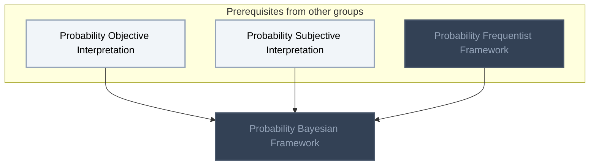
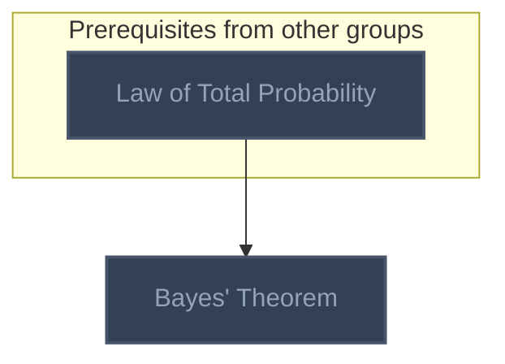
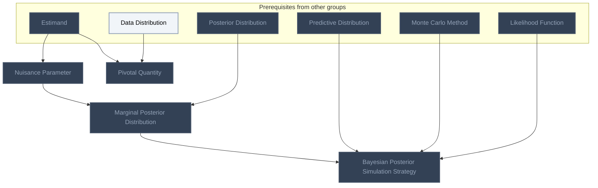
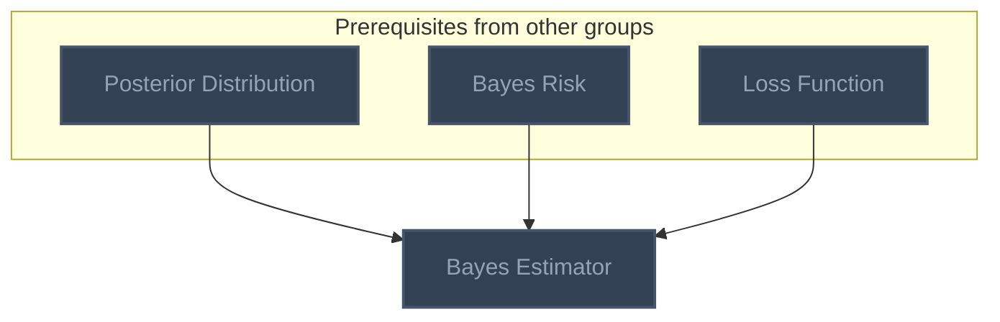

<!-- BEGIN STATS (generated by Scripts/skill_trees.py; do not edit) -->
**Mastered:** 0 / 30 · **Depth:** 0% · **Mastery Depth:** 0% · **Discovered:** 30 · **Planned:** 0 · **Locked:** 27 · **Rusty:** 0

| | L0 Discovered | L1 Recall | L2 Apply | L3 Prove ★ | L4 Wield | L5 Command |
|---|---:|---:|---:|---:|---:|---:|
| **At this level** | 30 | 0 | 0 | 0 | 0 | 0 |
| **Reached (this level or higher)** | 30 | 0 | 0 | 0 | 0 | 0 |

**Next up:** [[Statistical Inference]], [[Covariate]], [[Data Distribution]]

Legend: dashed grey = planned (no note yet) · dark grey = locked · white L0 Discovered · green L1 Recall · blue L2 Apply · purple L3 Prove (Mastered) · orange L4 Wield · gold L5 Command · brown dashed border = rusty
<!-- END STATS -->

## Bayesian Statistical Methods: Interpretations of Probability
**Reached:** L1 0 · L2 0 · L3 0 · L4 0 · L5 0 (of 1 nodes)



## Bayes' Theorem
**Reached:** L1 0 · L2 0 · L3 0 · L4 0 · L5 0 (of 1 nodes)



## Bayesian Data Analysis Ch 1: Probability and Inference
**Reached:** L1 0 · L2 0 · L3 0 · L4 0 · L5 0 (of 13 nodes)

```mermaid
flowchart TD
    classDef planned fill:#1E293B,stroke:#64748B,stroke-width:2px,stroke-dasharray:5 5,color:#94A3B8;
    classDef locked fill:#334155,stroke:#475569,stroke-width:2px,color:#94A3B8;
    classDef L0 fill:#F1F5F9,stroke:#94A3B8,stroke-width:2px,color:#000000;
    classDef L1 fill:#22C55E,stroke:#15803D,stroke-width:2px,color:#000000;
    classDef L2 fill:#3B82F6,stroke:#1D4ED8,stroke-width:3px,color:#FFFFFF;
    classDef L3 fill:#A855F7,stroke:#6B21A8,stroke-width:3px,color:#FFFFFF,font-weight:bold;
    classDef L4 fill:#F97316,stroke:#C2410C,stroke-width:4px,color:#000000,font-weight:bold;
    classDef L5 fill:#FFD700,stroke:#FF8C00,stroke-width:5px,color:#000000,font-weight:bold;
    classDef rusty stroke:#8B4513,stroke-width:4px,stroke-dasharray:3 3;
    subgraph sg_prereqs["Prerequisites from other groups"]
        n_joint_probability_distribution["Joint Probability Distribution"]
        n_permutation["Permutation"]
        n_conditional_distribution["Conditional Distribution"]
        n_marginal_distribution["Marginal Distribution"]
        n_bayes_theorem["Bayes' Theorem"]
        n_odds["Odds"]
        n_hyperparameter["Hyperparameter"]
    end
    n_statistical_inference["Statistical Inference"]
    n_estimand["Estimand"]
    n_causal_inference["Causal Inference"]
    n_covariate["Covariate"]
    n_exchangeability["Exchangeability"]
    n_data_distribution["Data Distribution"]
    n_prior_distribution["Prior Distribution"]
    n_posterior_distribution["Posterior Distribution"]
    n_prior_predictive_distribution["Prior Predictive Distribution"]
    n_bayesian_inference["Bayesian Inference"]
    n_credible_interval["Credible Interval"]
    n_posterior_odds["Posterior Odds"]
    n_hierarchical_model["Hierarchical Model"]
    n_statistical_inference --> n_estimand
    n_estimand --> n_causal_inference
    n_joint_probability_distribution --> n_exchangeability
    n_permutation --> n_exchangeability
    n_conditional_distribution --> n_data_distribution
    n_marginal_distribution --> n_prior_distribution
    n_bayes_theorem --> n_posterior_distribution
    n_prior_distribution --> n_posterior_distribution
    n_data_distribution --> n_posterior_distribution
    n_prior_distribution --> n_prior_predictive_distribution
    n_data_distribution --> n_prior_predictive_distribution
    n_posterior_distribution --> n_bayesian_inference
    n_statistical_inference --> n_bayesian_inference
    n_posterior_distribution --> n_credible_interval
    n_posterior_distribution --> n_posterior_odds
    n_odds --> n_posterior_odds
    n_prior_distribution --> n_hierarchical_model
    n_hyperparameter --> n_hierarchical_model
    class n_joint_probability_distribution,n_marginal_distribution,n_bayes_theorem,n_hyperparameter,n_estimand,n_causal_inference,n_exchangeability,n_prior_distribution,n_posterior_distribution,n_prior_predictive_distribution,n_bayesian_inference,n_credible_interval,n_posterior_odds,n_hierarchical_model locked;
    class n_permutation,n_odds,n_statistical_inference,n_covariate,n_data_distribution L0;
    class n_conditional_distribution L1;
    class n_joint_probability_distribution,n_permutation,n_conditional_distribution,n_marginal_distribution,n_bayes_theorem,n_odds,n_hyperparameter,n_statistical_inference,n_estimand,n_causal_inference,n_covariate,n_exchangeability,n_data_distribution,n_prior_distribution,n_posterior_distribution,n_prior_predictive_distribution,n_bayesian_inference,n_credible_interval,n_posterior_odds,n_hierarchical_model internal-link;
```



## Bayesian Data Analysis Ch 2: Single-Parameter Models
**Reached:** L1 0 · L2 0 · L3 0 · L4 0 · L5 0 (of 10 nodes)

```mermaid
flowchart TD
    classDef planned fill:#1E293B,stroke:#64748B,stroke-width:2px,stroke-dasharray:5 5,color:#94A3B8;
    classDef locked fill:#334155,stroke:#475569,stroke-width:2px,color:#94A3B8;
    classDef L0 fill:#F1F5F9,stroke:#94A3B8,stroke-width:2px,color:#000000;
    classDef L1 fill:#22C55E,stroke:#15803D,stroke-width:2px,color:#000000;
    classDef L2 fill:#3B82F6,stroke:#1D4ED8,stroke-width:3px,color:#FFFFFF;
    classDef L3 fill:#A855F7,stroke:#6B21A8,stroke-width:3px,color:#FFFFFF,font-weight:bold;
    classDef L4 fill:#F97316,stroke:#C2410C,stroke-width:4px,color:#000000,font-weight:bold;
    classDef L5 fill:#FFD700,stroke:#FF8C00,stroke-width:5px,color:#000000,font-weight:bold;
    classDef rusty stroke:#8B4513,stroke-width:4px,stroke-dasharray:3 3;
    subgraph sg_prereqs["Prerequisites from other groups"]
        n_posterior_distribution["Posterior Distribution"]
        n_prior_predictive_distribution["Prior Predictive Distribution"]
        n_law_of_total_expectation["Law of Total Expectation"]
        n_law_of_total_variance["Law of Total Variance"]
        n_covariance_matrix["Covariance Matrix"]
        n_credible_interval["Credible Interval"]
        n_prior_distribution["Prior Distribution"]
        n_fisher_information["Fisher Information"]
        n_change_of_variables["Change of Variables"]
        n_exponential_family["Exponential Family"]
    end
    n_prior_and_posterior_moment_relations["Prior and Posterior Moment Relations"]
    n_posterior_compromise_between_prior_and_data["Posterior Compromise Between Prior and Data"]
    n_highest_posterior_density_region["Highest Posterior Density Region"]
    n_precision_statistics["Precision (Statistics)"]
    n_conjugate_prior["Conjugate Prior"]
    n_prior_distribution_selection["Prior Distribution Selection"]
    n_weakly_informative_prior["Weakly Informative Prior"]
    n_noninformative_prior["Noninformative Prior"]
    n_jeffreys_prior["Jeffreys Prior"]
    n_improper_prior["Improper Prior"]
    n_posterior_distribution --> n_prior_and_posterior_moment_relations
    n_prior_predictive_distribution --> n_prior_and_posterior_moment_relations
    n_law_of_total_expectation --> n_prior_and_posterior_moment_relations
    n_law_of_total_variance --> n_prior_and_posterior_moment_relations
    n_covariance_matrix --> n_precision_statistics
    n_posterior_distribution --> n_posterior_compromise_between_prior_and_data
    n_precision_statistics --> n_posterior_compromise_between_prior_and_data
    n_credible_interval --> n_highest_posterior_density_region
    n_posterior_distribution --> n_conjugate_prior
    n_prior_distribution --> n_prior_distribution_selection
    n_posterior_distribution --> n_weakly_informative_prior
    n_posterior_distribution --> n_noninformative_prior
    n_noninformative_prior --> n_jeffreys_prior
    n_fisher_information --> n_jeffreys_prior
    n_change_of_variables --> n_jeffreys_prior
    n_prior_distribution --> n_improper_prior
    n_exponential_family --> n_conjugate_prior
    class n_posterior_distribution,n_prior_predictive_distribution,n_law_of_total_expectation,n_law_of_total_variance,n_covariance_matrix,n_credible_interval,n_prior_distribution,n_fisher_information,n_change_of_variables,n_exponential_family,n_prior_and_posterior_moment_relations,n_posterior_compromise_between_prior_and_data,n_highest_posterior_density_region,n_precision_statistics,n_conjugate_prior,n_prior_distribution_selection,n_weakly_informative_prior,n_noninformative_prior,n_jeffreys_prior,n_improper_prior locked;
    class n_posterior_distribution,n_prior_predictive_distribution,n_law_of_total_expectation,n_law_of_total_variance,n_covariance_matrix,n_credible_interval,n_prior_distribution,n_fisher_information,n_change_of_variables,n_exponential_family,n_prior_and_posterior_moment_relations,n_posterior_compromise_between_prior_and_data,n_highest_posterior_density_region,n_precision_statistics,n_conjugate_prior,n_prior_distribution_selection,n_weakly_informative_prior,n_noninformative_prior,n_jeffreys_prior,n_improper_prior internal-link;
```



## Bayesian Data Analysis Ch 3: Multiparameter Models
**Reached:** L1 0 · L2 0 · L3 0 · L4 0 · L5 0 (of 4 nodes)



## Bayesian Decision Theory
**Reached:** L1 0 · L2 0 · L3 0 · L4 0 · L5 0 (of 1 nodes)



# Source
Graph structure: the single source for the diagrams above, edited by `/note` and `Scripts/skill_trees.py` (`add`, `edge`, `rename`). Everything above this heading is regenerated by `render`.

```skilltree
    %% PREREQUISITES
    n_law_of_total_probability["Law of Total Probability"]
    n_permutation["Permutation"]
    n_conditional_distribution["Conditional Distribution"]
    n_marginal_distribution["Marginal Distribution"]
    n_odds["Odds"]
    n_hyperparameter["Hyperparameter"]
    n_law_of_total_expectation["Law of Total Expectation"]
    n_law_of_total_variance["Law of Total Variance"]
    n_covariance_matrix["Covariance Matrix"]
    n_fisher_information["Fisher Information"]
    n_change_of_variables["Change of Variables"]
    n_predictive_distribution["Predictive Distribution"]
    n_monte_carlo_method["Monte Carlo Method"]
    n_bayes_risk["Bayes Risk"]
    n_likelihood_function["Likelihood Function"]
    n_exponential_family["Exponential Family"]
    n_loss_function["Loss Function"]
    n_joint_probability_distribution["Joint Probability Distribution"]
    n_probability_objective_interpretation["Probability Objective Interpretation"]
    n_probability_subjective_interpretation["Probability Subjective Interpretation"]
    n_probability_frequentist_framework["Probability Frequentist Framework"]
    %% NODES
    %% == Bayesian Statistical Methods: Interpretations of Probability ==
    n_probability_bayesian_framework["Probability Bayesian Framework"]
    %% == Probability Distributions ==
    %% == Named Distributions and Their Moments ==
    %% == Bayes' Theorem ==
    n_bayes_theorem["Bayes' Theorem"]
    %% == Bayesian Data Analysis Ch 1: Probability and Inference ==
    n_statistical_inference["Statistical Inference"]
    n_estimand["Estimand"]
    n_causal_inference["Causal Inference"]
    n_covariate["Covariate"]
    n_exchangeability["Exchangeability"]
    n_data_distribution["Data Distribution"]
    n_prior_distribution["Prior Distribution"]
    n_posterior_distribution["Posterior Distribution"]
    n_prior_predictive_distribution["Prior Predictive Distribution"]
    n_bayesian_inference["Bayesian Inference"]
    n_credible_interval["Credible Interval"]
    n_posterior_odds["Posterior Odds"]
    n_hierarchical_model["Hierarchical Model"]
    %% == Bayesian Data Analysis Ch 2: Single-Parameter Models ==
    n_prior_and_posterior_moment_relations["Prior and Posterior Moment Relations"]
    n_posterior_compromise_between_prior_and_data["Posterior Compromise Between Prior and Data"]
    n_highest_posterior_density_region["Highest Posterior Density Region"]
    n_precision_statistics["Precision (Statistics)"]
    n_conjugate_prior["Conjugate Prior"]
    n_prior_distribution_selection["Prior Distribution Selection"]
    n_weakly_informative_prior["Weakly Informative Prior"]
    n_noninformative_prior["Noninformative Prior"]
    n_jeffreys_prior["Jeffreys Prior"]
    n_improper_prior["Improper Prior"]
    %% == Bayesian Data Analysis Ch 3: Multiparameter Models ==
    n_nuisance_parameter["Nuisance Parameter"]
    n_marginal_posterior_distribution["Marginal Posterior Distribution"]
    n_pivotal_quantity["Pivotal Quantity"]
    n_bayesian_posterior_simulation_strategy["Bayesian Posterior Simulation Strategy"]
    %% == Bayesian Decision Theory ==
    n_bayes_estimator["Bayes Estimator"]
    %% EDGES
    n_probability_objective_interpretation --> n_probability_bayesian_framework
    n_probability_subjective_interpretation --> n_probability_bayesian_framework
    n_probability_frequentist_framework --> n_probability_bayesian_framework
    n_law_of_total_probability --> n_bayes_theorem
    n_statistical_inference --> n_estimand
    n_estimand --> n_causal_inference
    n_joint_probability_distribution --> n_exchangeability
    n_permutation --> n_exchangeability
    n_conditional_distribution --> n_data_distribution
    n_marginal_distribution --> n_prior_distribution
    n_bayes_theorem --> n_posterior_distribution
    n_prior_distribution --> n_posterior_distribution
    n_data_distribution --> n_posterior_distribution
    n_prior_distribution --> n_prior_predictive_distribution
    n_data_distribution --> n_prior_predictive_distribution
    n_posterior_distribution --> n_bayesian_inference
    n_statistical_inference --> n_bayesian_inference
    n_posterior_distribution --> n_credible_interval
    n_posterior_distribution --> n_posterior_odds
    n_odds --> n_posterior_odds
    n_prior_distribution --> n_hierarchical_model
    n_hyperparameter --> n_hierarchical_model
    n_posterior_distribution --> n_prior_and_posterior_moment_relations
    n_prior_predictive_distribution --> n_prior_and_posterior_moment_relations
    n_law_of_total_expectation --> n_prior_and_posterior_moment_relations
    n_law_of_total_variance --> n_prior_and_posterior_moment_relations
    n_covariance_matrix --> n_precision_statistics
    n_posterior_distribution --> n_posterior_compromise_between_prior_and_data
    n_precision_statistics --> n_posterior_compromise_between_prior_and_data
    n_credible_interval --> n_highest_posterior_density_region
    n_posterior_distribution --> n_conjugate_prior
    n_prior_distribution --> n_prior_distribution_selection
    n_posterior_distribution --> n_weakly_informative_prior
    n_posterior_distribution --> n_noninformative_prior
    n_noninformative_prior --> n_jeffreys_prior
    n_fisher_information --> n_jeffreys_prior
    n_change_of_variables --> n_jeffreys_prior
    n_prior_distribution --> n_improper_prior
    n_estimand --> n_nuisance_parameter
    n_nuisance_parameter --> n_marginal_posterior_distribution
    n_posterior_distribution --> n_marginal_posterior_distribution
    n_estimand --> n_pivotal_quantity
    n_data_distribution --> n_pivotal_quantity
    n_marginal_posterior_distribution --> n_bayesian_posterior_simulation_strategy
    n_predictive_distribution --> n_bayesian_posterior_simulation_strategy
    n_monte_carlo_method --> n_bayesian_posterior_simulation_strategy
    n_posterior_distribution --> n_bayes_estimator
    n_bayes_risk --> n_bayes_estimator
    n_likelihood_function --> n_bayesian_posterior_simulation_strategy
    n_exponential_family --> n_conjugate_prior
    n_loss_function --> n_bayes_estimator
```
