<!-- BEGIN STATS (generated by Scripts/skill_trees.py; do not edit) -->
**Mastered:** 0 / 193 · **Depth:** 0% · **Discovered:** 188 · **Planned:** 5 · **Locked:** 187 · **Rusty:** 0

**Levels:** L0 188 · L1 0 · L2 0 · L3 0 · L4 0 · L5 0

**Next up:** [[Finite Series Basic Properties]]

Legend: dashed grey = planned (no note yet) · dark grey = locked · white L0 Discovered · green L1 Recall · blue L2 Apply · purple L3 Prove (Mastered) · orange L4 Wield · gold L5 Command · brown dashed border = rusty
<!-- END STATS -->

## Stewart Ch. 2: Limits and Derivatives
**Mastered:** 0 / 39 · **Discovered:** 39 / 39

```mermaid
flowchart TD
    classDef planned fill:#1E293B,stroke:#64748B,stroke-width:2px,stroke-dasharray:5 5,color:#94A3B8;
    classDef locked fill:#334155,stroke:#475569,stroke-width:2px,color:#94A3B8;
    classDef L0 fill:#F1F5F9,stroke:#94A3B8,stroke-width:2px,color:#000000;
    classDef L1 fill:#22C55E,stroke:#15803D,stroke-width:2px,color:#000000;
    classDef L2 fill:#3B82F6,stroke:#1D4ED8,stroke-width:3px,color:#FFFFFF;
    classDef L3 fill:#A855F7,stroke:#6B21A8,stroke-width:3px,color:#FFFFFF,font-weight:bold;
    classDef L4 fill:#F97316,stroke:#C2410C,stroke-width:4px,color:#000000,font-weight:bold;
    classDef L5 fill:#FFD700,stroke:#FF8C00,stroke-width:5px,color:#000000,font-weight:bold;
    classDef rusty stroke:#8B4513,stroke-width:4px,stroke-dasharray:3 3;
    subgraph sg_prereqs["Prerequisites from other groups"]
        n_slope["Slope"]
        n_line["Line"]
        n_function["Function"]
        n_polynomial_function["Polynomial Function"]
        n_rational_function["Rational Function"]
        n_interval_notation["Interval Notation"]
        n_inverse_function["Inverse Function"]
        n_function_composition["Function Composition"]
        n_difference_quotient_of_function["Difference Quotient of Function"]
    end
    n_tangent_line["Tangent Line"]
    n_secant_line["Secant Line"]
    n_intersecting_line["Intersecting Line"]
    n_limit_of_function["Limit of Function"]
    n_heaviside_function["Heaviside Function"]
    n_infinite_limit_of_function["Infinite Limit of Function"]
    n_limit_of_function_subtraction_law["Limit of Function Subtraction Law"]
    n_limit_of_function_nth_root_law["Limit of Function nth Root Law"]
    n_limit_of_function_quotient_law["Limit of Function Quotient Law"]
    n_limit_of_function_product_law["Limit of Function Product Law"]
    n_limit_of_function_addition_law["Limit of Function Addition Law"]
    n_limit_of_function_scalar_product_law["Limit of Function Scalar Product Law"]
    n_limit_of_function_power_law["Limit of Function Power Law"]
    n_limit_of_function_direct_substitution_property["Limit of Function Direct Substitution Property"]
    n_limit_of_function_equality["Limit of Function Equality"]
    n_limit_of_function_squeeze_theorem["Limit of Function Squeeze Theorem"]
    n_limit_of_function_inequality["Limit of Function Inequality"]
    n_one_sided_limit_of_function["One-Sided Limit of Function"]
    n_limit_of_function_and_one_sided_limit_of_function_theorem["Limit of Function and One-Sided Limit of Function Theorem"]
    n_continuous_function["Continuous Function"]
    n_continuity["Continuity"]
    n_one_sided_continuous_function["One-Sided Continuous Function"]
    n_continuous_function_on_interval["Continuous Function on Interval"]
    n_continuous_function_addition_rule["Continuous Function Addition Rule"]
    n_continuous_function_scalar_product_rule["Continuous Function Scalar Product Rule"]
    n_continuous_function_subtraction_rule["Continuous Function Subtraction Rule"]
    n_continuous_function_quotient_rule["Continuous Function Quotient Rule"]
    n_continuous_function_product_rule["Continuous Function Product Rule"]
    n_continuous_function_inverse["Continuous Function Inverse"]
    n_continuous_function_composition["Continuous Function Composition"]
    n_continuous_function_composition_rule["Continuous Function Composition Rule"]
    n_limit_of_function_at_infinity["Limit of Function at Infinity"]
    n_derivative["Derivative"]
    n_differentiation_operator["Differentiation Operator"]
    n_differentiable_function["Differentiable Function"]
    n_differentiable_implies_continuous["Differentiable Implies Continuous"]
    n_second_derivative["Second Derivative"]
    n_nth_derivative["Nth Derivative"]
    n_derivative_of_inverse_function["Derivative of Inverse Function"]
    n_slope --> n_tangent_line
    n_secant_line --> n_tangent_line
    n_limit_of_function --> n_tangent_line
    n_line --> n_secant_line
    n_line --> n_intersecting_line
    n_function --> n_limit_of_function
    n_function --> n_heaviside_function
    n_limit_of_function --> n_infinite_limit_of_function
    n_limit_of_function_addition_law --> n_limit_of_function_subtraction_law
    n_limit_of_function_scalar_product_law --> n_limit_of_function_subtraction_law
    n_limit_of_function --> n_limit_of_function_nth_root_law
    n_limit_of_function --> n_limit_of_function_quotient_law
    n_limit_of_function --> n_limit_of_function_product_law
    n_limit_of_function --> n_limit_of_function_addition_law
    n_limit_of_function --> n_limit_of_function_scalar_product_law
    n_limit_of_function_product_law --> n_limit_of_function_power_law
    n_polynomial_function --> n_limit_of_function_direct_substitution_property
    n_rational_function --> n_limit_of_function_direct_substitution_property
    n_limit_of_function_quotient_law --> n_limit_of_function_direct_substitution_property
    n_limit_of_function_addition_law --> n_limit_of_function_direct_substitution_property
    n_limit_of_function_scalar_product_law --> n_limit_of_function_direct_substitution_property
    n_limit_of_function_power_law --> n_limit_of_function_direct_substitution_property
    n_limit_of_function --> n_limit_of_function_equality
    n_limit_of_function --> n_limit_of_function_squeeze_theorem
    n_limit_of_function --> n_limit_of_function_inequality
    n_limit_of_function --> n_one_sided_limit_of_function
    n_one_sided_limit_of_function --> n_limit_of_function_and_one_sided_limit_of_function_theorem
    n_limit_of_function --> n_continuous_function
    n_continuous_function --> n_continuity
    n_one_sided_limit_of_function --> n_one_sided_continuous_function
    n_continuous_function --> n_one_sided_continuous_function
    n_interval_notation --> n_continuous_function_on_interval
    n_one_sided_continuous_function --> n_continuous_function_on_interval
    n_limit_of_function_addition_law --> n_continuous_function_addition_rule
    n_continuous_function --> n_continuous_function_addition_rule
    n_limit_of_function_scalar_product_law --> n_continuous_function_scalar_product_rule
    n_continuous_function --> n_continuous_function_scalar_product_rule
    n_continuous_function_addition_rule --> n_continuous_function_subtraction_rule
    n_continuous_function_product_rule --> n_continuous_function_subtraction_rule
    n_limit_of_function_quotient_law --> n_continuous_function_quotient_rule
    n_continuous_function --> n_continuous_function_quotient_rule
    n_limit_of_function_product_law --> n_continuous_function_product_rule
    n_continuous_function --> n_continuous_function_product_rule
    n_inverse_function --> n_continuous_function_inverse
    n_continuous_function --> n_continuous_function_inverse
    n_continuous_function_composition_rule --> n_continuous_function_composition
    n_function_composition --> n_continuous_function_composition_rule
    n_continuous_function --> n_continuous_function_composition_rule
    n_limit_of_function --> n_limit_of_function_at_infinity
    n_difference_quotient_of_function --> n_derivative
    n_tangent_line --> n_derivative
    n_derivative --> n_differentiation_operator
    n_derivative --> n_differentiable_function
    n_continuous_function --> n_differentiable_implies_continuous
    n_differentiable_function --> n_differentiable_implies_continuous
    n_derivative --> n_second_derivative
    n_differentiation_operator --> n_nth_derivative
    n_second_derivative --> n_nth_derivative
    n_differentiable_function --> n_derivative_of_inverse_function
    n_inverse_function --> n_derivative_of_inverse_function
    class n_slope,n_line,n_function,n_polynomial_function,n_rational_function,n_interval_notation,n_inverse_function,n_function_composition,n_difference_quotient_of_function,n_tangent_line,n_secant_line,n_intersecting_line,n_limit_of_function,n_heaviside_function,n_infinite_limit_of_function,n_limit_of_function_subtraction_law,n_limit_of_function_nth_root_law,n_limit_of_function_quotient_law,n_limit_of_function_product_law,n_limit_of_function_addition_law,n_limit_of_function_scalar_product_law,n_limit_of_function_power_law,n_limit_of_function_direct_substitution_property,n_limit_of_function_equality,n_limit_of_function_squeeze_theorem,n_limit_of_function_inequality,n_one_sided_limit_of_function,n_limit_of_function_and_one_sided_limit_of_function_theorem,n_continuous_function,n_continuity,n_one_sided_continuous_function,n_continuous_function_on_interval,n_continuous_function_addition_rule,n_continuous_function_scalar_product_rule,n_continuous_function_subtraction_rule,n_continuous_function_quotient_rule,n_continuous_function_product_rule,n_continuous_function_inverse,n_continuous_function_composition,n_continuous_function_composition_rule,n_limit_of_function_at_infinity,n_derivative,n_differentiation_operator,n_differentiable_function,n_differentiable_implies_continuous,n_second_derivative,n_nth_derivative,n_derivative_of_inverse_function locked;
    class n_slope,n_line,n_function,n_polynomial_function,n_rational_function,n_interval_notation,n_inverse_function,n_function_composition,n_difference_quotient_of_function,n_tangent_line,n_secant_line,n_intersecting_line,n_limit_of_function,n_heaviside_function,n_infinite_limit_of_function,n_limit_of_function_subtraction_law,n_limit_of_function_nth_root_law,n_limit_of_function_quotient_law,n_limit_of_function_product_law,n_limit_of_function_addition_law,n_limit_of_function_scalar_product_law,n_limit_of_function_power_law,n_limit_of_function_direct_substitution_property,n_limit_of_function_equality,n_limit_of_function_squeeze_theorem,n_limit_of_function_inequality,n_one_sided_limit_of_function,n_limit_of_function_and_one_sided_limit_of_function_theorem,n_continuous_function,n_continuity,n_one_sided_continuous_function,n_continuous_function_on_interval,n_continuous_function_addition_rule,n_continuous_function_scalar_product_rule,n_continuous_function_subtraction_rule,n_continuous_function_quotient_rule,n_continuous_function_product_rule,n_continuous_function_inverse,n_continuous_function_composition,n_continuous_function_composition_rule,n_limit_of_function_at_infinity,n_derivative,n_differentiation_operator,n_differentiable_function,n_differentiable_implies_continuous,n_second_derivative,n_nth_derivative,n_derivative_of_inverse_function internal-link;
```

## Stewart Ch. 3: Differentiation Rules
**Mastered:** 0 / 55 · **Discovered:** 55 / 55

```mermaid
flowchart TD
    classDef planned fill:#1E293B,stroke:#64748B,stroke-width:2px,stroke-dasharray:5 5,color:#94A3B8;
    classDef locked fill:#334155,stroke:#475569,stroke-width:2px,color:#94A3B8;
    classDef L0 fill:#F1F5F9,stroke:#94A3B8,stroke-width:2px,color:#000000;
    classDef L1 fill:#22C55E,stroke:#15803D,stroke-width:2px,color:#000000;
    classDef L2 fill:#3B82F6,stroke:#1D4ED8,stroke-width:3px,color:#FFFFFF;
    classDef L3 fill:#A855F7,stroke:#6B21A8,stroke-width:3px,color:#FFFFFF,font-weight:bold;
    classDef L4 fill:#F97316,stroke:#C2410C,stroke-width:4px,color:#000000,font-weight:bold;
    classDef L5 fill:#FFD700,stroke:#FF8C00,stroke-width:5px,color:#000000,font-weight:bold;
    classDef rusty stroke:#8B4513,stroke-width:4px,stroke-dasharray:3 3;
    subgraph sg_prereqs["Prerequisites from other groups"]
        n_function["Function"]
        n_derivative["Derivative"]
        n_limit_of_function_scalar_product_law["Limit of Function Scalar Product Law"]
        n_tangent_line["Tangent Line"]
        n_limit_of_function_addition_law["Limit of Function Addition Law"]
        n_exponential_function["Exponential Function"]
        n_limit_of_function_product_law["Limit of Function Product Law"]
        n_differentiable_implies_continuous["Differentiable Implies Continuous"]
        n_limit_of_function_quotient_law["Limit of Function Quotient Law"]
        n_even_function["Even Function"]
        n_one_sided_limit_of_function["One-Sided Limit of Function"]
        n_sine_function["Sine Function"]
        n_limit_of_function_squeeze_theorem["Limit of Function Squeeze Theorem"]
        n_tangent_function["Tangent Function"]
        n_cotangent_function["Cotangent Function"]
        n_cosecant_function["Cosecant Function"]
        n_secant_function["Secant Function"]
        n_cosine_function["Cosine Function"]
        n_function_composition["Function Composition"]
        n_differentiable_function["Differentiable Function"]
        n_inverse_function["Inverse Function"]
        n_trigonometric_function["Trigonometric Function"]
        n_logarithm_function["Logarithm Function"]
    end
    n_power_function["Power Function"]
    n_derivative_power_rule["Derivative Power Rule"]
    n_derivative_constant_multiple_rule["Derivative Constant Multiple Rule"]
    n_normal_line["Normal Line"]
    n_derivative_difference_rule["Derivative Difference Rule"]
    n_derivative_sum_rule["Derivative Sum Rule"]
    n_euler_s_number["Euler's Number"]
    n_derivative_of_exponential_function["Derivative of Exponential Function"]
    n_derivative_product_rule["Derivative Product Rule"]
    n_derivative_quotient_rule["Derivative Quotient Rule"]
    n_one_sided_limit_of_even_function["One-Sided Limit of Even Function"]
    n_derivative_of_sine_function["Derivative of Sine Function"]
    n_derivative_of_tangent_function["Derivative of Tangent Function"]
    n_derivative_of_cotangent_function["Derivative of Cotangent Function"]
    n_derivative_of_cosecant_function["Derivative of Cosecant Function"]
    n_derivative_of_secant_function["Derivative of Secant Function"]
    n_derivative_of_cosine_function["Derivative of Cosine Function"]
    n_derivative_chain_rule["Derivative Chain Rule"]
    n_derivative_with_respect_to_other_variable["Derivative with Respect to Other Variable"]
    n_inverse_trigonometric_function["Inverse Trigonometric Function"]
    n_derivative_of_inverse_cotangent_function["Derivative of Inverse Cotangent Function"]
    n_derivative_of_inverse_cosine_function["Derivative of Inverse Cosine Function"]
    n_derivative_of_inverse_secant_function["Derivative of Inverse Secant Function"]
    n_derivative_of_inverse_cosecant_function["Derivative of Inverse Cosecant Function"]
    n_derivative_of_inverse_tangent_function["Derivative of Inverse Tangent Function"]
    n_derivative_of_inverse_sine_function["Derivative of Inverse Sine Function"]
    n_derivative_of_logarithmic_function["Derivative of Logarithmic Function"]
    n_linear_approximation["Linear Approximation"]
    n_hyperbolic_sine_function["Hyperbolic Sine Function"]
    n_hyperbolic_cotangent_function["Hyperbolic Cotangent Function"]
    n_hyperbolic_function["Hyperbolic Function"]
    n_hyperbolic_cosecant_function["Hyperbolic Cosecant Function"]
    n_hyperbolic_tangent_function["Hyperbolic Tangent Function"]
    n_hyperbolic_cosine_function["Hyperbolic Cosine Function"]
    n_hyperbolic_secant_function["Hyperbolic Secant Function"]
    n_hyperbolic_function_identities["Hyperbolic Function Identities"]
    n_derivative_of_hyperbolic_cosine_function["Derivative of Hyperbolic Cosine Function"]
    n_derivative_of_hyperbolic_secant_function["Derivative of Hyperbolic Secant Function"]
    n_derivative_of_hyperbolic_sine_function["Derivative of Hyperbolic Sine Function"]
    n_derivative_of_hyperbolic_tangent_function["Derivative of Hyperbolic Tangent Function"]
    n_derivative_of_hyperbolic_cosecant_function["Derivative of Hyperbolic Cosecant Function"]
    n_derivative_of_hyperbolic_cotangent_function["Derivative of Hyperbolic Cotangent Function"]
    n_inverse_hyperbolic_secant_function["Inverse Hyperbolic Secant Function"]
    n_inverse_hyperbolic_tangent_function["Inverse Hyperbolic Tangent Function"]
    n_inverse_hyperbolic_cosecant_function["Inverse Hyperbolic Cosecant Function"]
    n_inverse_hyperbolic_function["Inverse Hyperbolic Function"]
    n_inverse_hyperbolic_sine_function["Inverse Hyperbolic Sine Function"]
    n_inverse_hyperbolic_cotangent_function["Inverse Hyperbolic Cotangent Function"]
    n_inverse_hyperbolic_cosine_function["Inverse Hyperbolic Cosine Function"]
    n_derivative_of_inverse_hyperbolic_sine_function["Derivative of Inverse Hyperbolic Sine Function"]
    n_derivative_of_inverse_hyperbolic_secant_function["Derivative of Inverse Hyperbolic Secant Function"]
    n_derivative_of_inverse_hyperbolic_cosine_function["Derivative of Inverse Hyperbolic Cosine Function"]
    n_derivative_of_inverse_hyperbolic_tangent_function["Derivative of Inverse Hyperbolic Tangent Function"]
    n_derivative_of_inverse_hyperbolic_cotangent_function["Derivative of Inverse Hyperbolic Cotangent Function"]
    n_derivative_of_inverse_hyperbolic_cosecant_function["Derivative of Inverse Hyperbolic Cosecant Function"]
    n_function --> n_power_function
    n_derivative --> n_derivative_power_rule
    n_power_function --> n_derivative_power_rule
    n_limit_of_function_scalar_product_law --> n_derivative_constant_multiple_rule
    n_derivative --> n_derivative_constant_multiple_rule
    n_tangent_line --> n_normal_line
    n_derivative_constant_multiple_rule --> n_derivative_difference_rule
    n_derivative_sum_rule --> n_derivative_difference_rule
    n_limit_of_function_addition_law --> n_derivative_sum_rule
    n_derivative --> n_derivative_sum_rule
    n_exponential_function --> n_euler_s_number
    n_derivative --> n_euler_s_number
    n_euler_s_number --> n_derivative_of_exponential_function
    n_limit_of_function_product_law --> n_derivative_product_rule
    n_differentiable_implies_continuous --> n_derivative_product_rule
    n_limit_of_function_quotient_law --> n_derivative_quotient_rule
    n_differentiable_implies_continuous --> n_derivative_quotient_rule
    n_even_function --> n_one_sided_limit_of_even_function
    n_one_sided_limit_of_function --> n_one_sided_limit_of_even_function
    n_sine_function --> n_derivative_of_sine_function
    n_limit_of_function_squeeze_theorem --> n_derivative_of_sine_function
    n_derivative --> n_derivative_of_sine_function
    n_tangent_function --> n_derivative_of_tangent_function
    n_derivative_quotient_rule --> n_derivative_of_tangent_function
    n_derivative_of_sine_function --> n_derivative_of_tangent_function
    n_derivative_of_cosine_function --> n_derivative_of_tangent_function
    n_cotangent_function --> n_derivative_of_cotangent_function
    n_derivative_quotient_rule --> n_derivative_of_cotangent_function
    n_derivative_of_sine_function --> n_derivative_of_cotangent_function
    n_derivative_of_cosine_function --> n_derivative_of_cotangent_function
    n_cosecant_function --> n_derivative_of_cosecant_function
    n_derivative_quotient_rule --> n_derivative_of_cosecant_function
    n_derivative_of_sine_function --> n_derivative_of_cosecant_function
    n_secant_function --> n_derivative_of_secant_function
    n_derivative_quotient_rule --> n_derivative_of_secant_function
    n_derivative_of_cosine_function --> n_derivative_of_secant_function
    n_cosine_function --> n_derivative_of_cosine_function
    n_limit_of_function_squeeze_theorem --> n_derivative_of_cosine_function
    n_derivative --> n_derivative_of_cosine_function
    n_function_composition --> n_derivative_chain_rule
    n_differentiable_function --> n_derivative_chain_rule
    n_derivative_chain_rule --> n_derivative_with_respect_to_other_variable
    n_inverse_function --> n_inverse_trigonometric_function
    n_trigonometric_function --> n_inverse_trigonometric_function
    n_derivative_of_cotangent_function --> n_derivative_of_inverse_cotangent_function
    n_derivative_chain_rule --> n_derivative_of_inverse_cotangent_function
    n_inverse_trigonometric_function --> n_derivative_of_inverse_cotangent_function
    n_derivative_of_cosine_function --> n_derivative_of_inverse_cosine_function
    n_derivative_chain_rule --> n_derivative_of_inverse_cosine_function
    n_inverse_trigonometric_function --> n_derivative_of_inverse_cosine_function
    n_derivative_of_secant_function --> n_derivative_of_inverse_secant_function
    n_derivative_chain_rule --> n_derivative_of_inverse_secant_function
    n_inverse_trigonometric_function --> n_derivative_of_inverse_secant_function
    n_derivative_of_cosecant_function --> n_derivative_of_inverse_cosecant_function
    n_derivative_chain_rule --> n_derivative_of_inverse_cosecant_function
    n_inverse_trigonometric_function --> n_derivative_of_inverse_cosecant_function
    n_derivative_of_tangent_function --> n_derivative_of_inverse_tangent_function
    n_derivative_chain_rule --> n_derivative_of_inverse_tangent_function
    n_inverse_trigonometric_function --> n_derivative_of_inverse_tangent_function
    n_derivative_of_sine_function --> n_derivative_of_inverse_sine_function
    n_derivative_chain_rule --> n_derivative_of_inverse_sine_function
    n_inverse_trigonometric_function --> n_derivative_of_inverse_sine_function
    n_logarithm_function --> n_derivative_of_logarithmic_function
    n_derivative_of_exponential_function --> n_derivative_of_logarithmic_function
    n_derivative_chain_rule --> n_derivative_of_logarithmic_function
    n_differentiable_function --> n_linear_approximation
    n_hyperbolic_function --> n_hyperbolic_sine_function
    n_hyperbolic_sine_function --> n_hyperbolic_cotangent_function
    n_hyperbolic_cosine_function --> n_hyperbolic_cotangent_function
    n_euler_s_number --> n_hyperbolic_function
    n_hyperbolic_sine_function --> n_hyperbolic_cosecant_function
    n_hyperbolic_sine_function --> n_hyperbolic_tangent_function
    n_hyperbolic_cosine_function --> n_hyperbolic_tangent_function
    n_hyperbolic_function --> n_hyperbolic_cosine_function
    n_hyperbolic_cosine_function --> n_hyperbolic_secant_function
    n_hyperbolic_sine_function --> n_hyperbolic_function_identities
    n_hyperbolic_cosine_function --> n_hyperbolic_function_identities
    n_derivative_of_exponential_function --> n_derivative_of_hyperbolic_cosine_function
    n_hyperbolic_cosine_function --> n_derivative_of_hyperbolic_cosine_function
    n_derivative_quotient_rule --> n_derivative_of_hyperbolic_secant_function
    n_hyperbolic_secant_function --> n_derivative_of_hyperbolic_secant_function
    n_derivative_of_hyperbolic_cosine_function --> n_derivative_of_hyperbolic_secant_function
    n_derivative_of_exponential_function --> n_derivative_of_hyperbolic_sine_function
    n_hyperbolic_sine_function --> n_derivative_of_hyperbolic_sine_function
    n_derivative_quotient_rule --> n_derivative_of_hyperbolic_tangent_function
    n_hyperbolic_tangent_function --> n_derivative_of_hyperbolic_tangent_function
    n_hyperbolic_function_identities --> n_derivative_of_hyperbolic_tangent_function
    n_derivative_of_hyperbolic_cosine_function --> n_derivative_of_hyperbolic_tangent_function
    n_derivative_of_hyperbolic_sine_function --> n_derivative_of_hyperbolic_tangent_function
    n_derivative_quotient_rule --> n_derivative_of_hyperbolic_cosecant_function
    n_hyperbolic_cosecant_function --> n_derivative_of_hyperbolic_cosecant_function
    n_derivative_of_hyperbolic_sine_function --> n_derivative_of_hyperbolic_cosecant_function
    n_derivative_quotient_rule --> n_derivative_of_hyperbolic_cotangent_function
    n_hyperbolic_cotangent_function --> n_derivative_of_hyperbolic_cotangent_function
    n_hyperbolic_function_identities --> n_derivative_of_hyperbolic_cotangent_function
    n_derivative_of_hyperbolic_cosine_function --> n_derivative_of_hyperbolic_cotangent_function
    n_derivative_of_hyperbolic_sine_function --> n_derivative_of_hyperbolic_cotangent_function
    n_hyperbolic_secant_function --> n_inverse_hyperbolic_secant_function
    n_inverse_hyperbolic_function --> n_inverse_hyperbolic_secant_function
    n_hyperbolic_tangent_function --> n_inverse_hyperbolic_tangent_function
    n_inverse_hyperbolic_function --> n_inverse_hyperbolic_tangent_function
    n_hyperbolic_cosecant_function --> n_inverse_hyperbolic_cosecant_function
    n_inverse_hyperbolic_function --> n_inverse_hyperbolic_cosecant_function
    n_inverse_function --> n_inverse_hyperbolic_function
    n_hyperbolic_function --> n_inverse_hyperbolic_function
    n_hyperbolic_sine_function --> n_inverse_hyperbolic_sine_function
    n_inverse_hyperbolic_function --> n_inverse_hyperbolic_sine_function
    n_hyperbolic_cotangent_function --> n_inverse_hyperbolic_cotangent_function
    n_inverse_hyperbolic_function --> n_inverse_hyperbolic_cotangent_function
    n_hyperbolic_cosine_function --> n_inverse_hyperbolic_cosine_function
    n_inverse_hyperbolic_function --> n_inverse_hyperbolic_cosine_function
    n_derivative_chain_rule --> n_derivative_of_inverse_hyperbolic_sine_function
    n_derivative_of_hyperbolic_sine_function --> n_derivative_of_inverse_hyperbolic_sine_function
    n_inverse_hyperbolic_sine_function --> n_derivative_of_inverse_hyperbolic_sine_function
    n_derivative_chain_rule --> n_derivative_of_inverse_hyperbolic_secant_function
    n_derivative_of_hyperbolic_secant_function --> n_derivative_of_inverse_hyperbolic_secant_function
    n_inverse_hyperbolic_secant_function --> n_derivative_of_inverse_hyperbolic_secant_function
    n_derivative_chain_rule --> n_derivative_of_inverse_hyperbolic_cosine_function
    n_derivative_of_hyperbolic_cosine_function --> n_derivative_of_inverse_hyperbolic_cosine_function
    n_inverse_hyperbolic_cosine_function --> n_derivative_of_inverse_hyperbolic_cosine_function
    n_derivative_chain_rule --> n_derivative_of_inverse_hyperbolic_tangent_function
    n_derivative_of_hyperbolic_tangent_function --> n_derivative_of_inverse_hyperbolic_tangent_function
    n_inverse_hyperbolic_tangent_function --> n_derivative_of_inverse_hyperbolic_tangent_function
    n_derivative_chain_rule --> n_derivative_of_inverse_hyperbolic_cotangent_function
    n_derivative_of_hyperbolic_cotangent_function --> n_derivative_of_inverse_hyperbolic_cotangent_function
    n_inverse_hyperbolic_cotangent_function --> n_derivative_of_inverse_hyperbolic_cotangent_function
    n_derivative_chain_rule --> n_derivative_of_inverse_hyperbolic_cosecant_function
    n_derivative_of_hyperbolic_cosecant_function --> n_derivative_of_inverse_hyperbolic_cosecant_function
    n_inverse_hyperbolic_cosecant_function --> n_derivative_of_inverse_hyperbolic_cosecant_function
    class n_function,n_derivative,n_limit_of_function_scalar_product_law,n_tangent_line,n_limit_of_function_addition_law,n_exponential_function,n_limit_of_function_product_law,n_differentiable_implies_continuous,n_limit_of_function_quotient_law,n_even_function,n_one_sided_limit_of_function,n_sine_function,n_limit_of_function_squeeze_theorem,n_tangent_function,n_cotangent_function,n_cosecant_function,n_secant_function,n_cosine_function,n_function_composition,n_differentiable_function,n_inverse_function,n_trigonometric_function,n_logarithm_function,n_power_function,n_derivative_power_rule,n_derivative_constant_multiple_rule,n_normal_line,n_derivative_difference_rule,n_derivative_sum_rule,n_euler_s_number,n_derivative_of_exponential_function,n_derivative_product_rule,n_derivative_quotient_rule,n_one_sided_limit_of_even_function,n_derivative_of_sine_function,n_derivative_of_tangent_function,n_derivative_of_cotangent_function,n_derivative_of_cosecant_function,n_derivative_of_secant_function,n_derivative_of_cosine_function,n_derivative_chain_rule,n_derivative_with_respect_to_other_variable,n_inverse_trigonometric_function,n_derivative_of_inverse_cotangent_function,n_derivative_of_inverse_cosine_function,n_derivative_of_inverse_secant_function,n_derivative_of_inverse_cosecant_function,n_derivative_of_inverse_tangent_function,n_derivative_of_inverse_sine_function,n_derivative_of_logarithmic_function,n_linear_approximation,n_hyperbolic_sine_function,n_hyperbolic_cotangent_function,n_hyperbolic_function,n_hyperbolic_cosecant_function,n_hyperbolic_tangent_function,n_hyperbolic_cosine_function,n_hyperbolic_secant_function,n_hyperbolic_function_identities,n_derivative_of_hyperbolic_cosine_function,n_derivative_of_hyperbolic_secant_function,n_derivative_of_hyperbolic_sine_function,n_derivative_of_hyperbolic_tangent_function,n_derivative_of_hyperbolic_cosecant_function,n_derivative_of_hyperbolic_cotangent_function,n_inverse_hyperbolic_secant_function,n_inverse_hyperbolic_tangent_function,n_inverse_hyperbolic_cosecant_function,n_inverse_hyperbolic_function,n_inverse_hyperbolic_sine_function,n_inverse_hyperbolic_cotangent_function,n_inverse_hyperbolic_cosine_function,n_derivative_of_inverse_hyperbolic_sine_function,n_derivative_of_inverse_hyperbolic_secant_function,n_derivative_of_inverse_hyperbolic_cosine_function,n_derivative_of_inverse_hyperbolic_tangent_function,n_derivative_of_inverse_hyperbolic_cotangent_function,n_derivative_of_inverse_hyperbolic_cosecant_function locked;
    class n_function,n_derivative,n_limit_of_function_scalar_product_law,n_tangent_line,n_limit_of_function_addition_law,n_exponential_function,n_limit_of_function_product_law,n_differentiable_implies_continuous,n_limit_of_function_quotient_law,n_even_function,n_one_sided_limit_of_function,n_sine_function,n_limit_of_function_squeeze_theorem,n_tangent_function,n_cotangent_function,n_cosecant_function,n_secant_function,n_cosine_function,n_function_composition,n_differentiable_function,n_inverse_function,n_trigonometric_function,n_logarithm_function,n_power_function,n_derivative_power_rule,n_derivative_constant_multiple_rule,n_normal_line,n_derivative_difference_rule,n_derivative_sum_rule,n_euler_s_number,n_derivative_of_exponential_function,n_derivative_product_rule,n_derivative_quotient_rule,n_one_sided_limit_of_even_function,n_derivative_of_sine_function,n_derivative_of_tangent_function,n_derivative_of_cotangent_function,n_derivative_of_cosecant_function,n_derivative_of_secant_function,n_derivative_of_cosine_function,n_derivative_chain_rule,n_derivative_with_respect_to_other_variable,n_inverse_trigonometric_function,n_derivative_of_inverse_cotangent_function,n_derivative_of_inverse_cosine_function,n_derivative_of_inverse_secant_function,n_derivative_of_inverse_cosecant_function,n_derivative_of_inverse_tangent_function,n_derivative_of_inverse_sine_function,n_derivative_of_logarithmic_function,n_linear_approximation,n_hyperbolic_sine_function,n_hyperbolic_cotangent_function,n_hyperbolic_function,n_hyperbolic_cosecant_function,n_hyperbolic_tangent_function,n_hyperbolic_cosine_function,n_hyperbolic_secant_function,n_hyperbolic_function_identities,n_derivative_of_hyperbolic_cosine_function,n_derivative_of_hyperbolic_secant_function,n_derivative_of_hyperbolic_sine_function,n_derivative_of_hyperbolic_tangent_function,n_derivative_of_hyperbolic_cosecant_function,n_derivative_of_hyperbolic_cotangent_function,n_inverse_hyperbolic_secant_function,n_inverse_hyperbolic_tangent_function,n_inverse_hyperbolic_cosecant_function,n_inverse_hyperbolic_function,n_inverse_hyperbolic_sine_function,n_inverse_hyperbolic_cotangent_function,n_inverse_hyperbolic_cosine_function,n_derivative_of_inverse_hyperbolic_sine_function,n_derivative_of_inverse_hyperbolic_secant_function,n_derivative_of_inverse_hyperbolic_cosine_function,n_derivative_of_inverse_hyperbolic_tangent_function,n_derivative_of_inverse_hyperbolic_cotangent_function,n_derivative_of_inverse_hyperbolic_cosecant_function internal-link;
```

## Stewart Ch. 4: Applications of Differentiation
**Mastered:** 0 / 18 · **Discovered:** 18 / 18

```mermaid
flowchart TD
    classDef planned fill:#1E293B,stroke:#64748B,stroke-width:2px,stroke-dasharray:5 5,color:#94A3B8;
    classDef locked fill:#334155,stroke:#475569,stroke-width:2px,color:#94A3B8;
    classDef L0 fill:#F1F5F9,stroke:#94A3B8,stroke-width:2px,color:#000000;
    classDef L1 fill:#22C55E,stroke:#15803D,stroke-width:2px,color:#000000;
    classDef L2 fill:#3B82F6,stroke:#1D4ED8,stroke-width:3px,color:#FFFFFF;
    classDef L3 fill:#A855F7,stroke:#6B21A8,stroke-width:3px,color:#FFFFFF,font-weight:bold;
    classDef L4 fill:#F97316,stroke:#C2410C,stroke-width:4px,color:#000000,font-weight:bold;
    classDef L5 fill:#FFD700,stroke:#FF8C00,stroke-width:5px,color:#000000,font-weight:bold;
    classDef rusty stroke:#8B4513,stroke-width:4px,stroke-dasharray:3 3;
    subgraph sg_prereqs["Prerequisites from other groups"]
        n_function["Function"]
        n_continuous_function_on_interval["Continuous Function on Interval"]
        n_local_maximum["Local Maximum"]
        n_local_minimum["Local Minimum"]
        n_derivative["Derivative"]
        n_differentiable_function["Differentiable Function"]
        n_mean_value_theorem["Mean Value Theorem"]
        n_tangent_line["Tangent Line"]
        n_second_derivative["Second Derivative"]
        n_continuous_function["Continuous Function"]
        n_infinite_limit_of_function["Infinite Limit of Function"]
        n_one_sided_limit_of_function["One-Sided Limit of Function"]
        n_limit_of_function_at_infinity["Limit of Function at Infinity"]
        n_linear_approximation["Linear Approximation"]
    end
    n_absolute_maximum["Absolute Maximum"]
    n_absolute_minimum["Absolute Minimum"]
    n_extreme_value_theorem["Extreme Value Theorem"]
    n_fermat_s_theorem["Fermat's Theorem"]
    n_critical_number["Critical Number"]
    n_closed_interval_method["Closed Interval Method"]
    n_rolle_s_theorem["Rolle's Theorem"]
    n_zero_derivative_implies_constant_function_theorem["Zero Derivative Implies Constant Function Theorem"]
    n_first_derivative_test["First Derivative Test"]
    n_concave_downward_function["Concave Downward Function"]
    n_concave_upward_function["Concave Upward Function"]
    n_concavity_test["Concavity Test"]
    n_inflection_point["Inflection Point"]
    n_second_derivative_test["Second Derivative Test"]
    n_l_hospital_s_rule["L'Hospital's Rule"]
    n_first_derivative_test_for_absolute_extreme_values["First Derivative Test for Absolute Extreme Values"]
    n_newton_s_method["Newton's Method"]
    n_antiderivative["Antiderivative"]
    n_function --> n_absolute_maximum
    n_function --> n_absolute_minimum
    n_continuous_function_on_interval --> n_extreme_value_theorem
    n_absolute_maximum --> n_extreme_value_theorem
    n_absolute_minimum --> n_extreme_value_theorem
    n_local_maximum --> n_fermat_s_theorem
    n_local_minimum --> n_fermat_s_theorem
    n_derivative --> n_fermat_s_theorem
    n_derivative --> n_critical_number
    n_extreme_value_theorem --> n_closed_interval_method
    n_fermat_s_theorem --> n_closed_interval_method
    n_critical_number --> n_closed_interval_method
    n_differentiable_function --> n_rolle_s_theorem
    n_extreme_value_theorem --> n_rolle_s_theorem
    n_fermat_s_theorem --> n_rolle_s_theorem
    n_mean_value_theorem --> n_zero_derivative_implies_constant_function_theorem
    n_local_maximum --> n_first_derivative_test
    n_local_minimum --> n_first_derivative_test
    n_mean_value_theorem --> n_first_derivative_test
    n_critical_number --> n_first_derivative_test
    n_tangent_line --> n_concave_downward_function
    n_tangent_line --> n_concave_upward_function
    n_second_derivative --> n_concavity_test
    n_concave_downward_function --> n_concavity_test
    n_concave_upward_function --> n_concavity_test
    n_continuous_function --> n_inflection_point
    n_concave_downward_function --> n_inflection_point
    n_concave_upward_function --> n_inflection_point
    n_local_maximum --> n_second_derivative_test
    n_local_minimum --> n_second_derivative_test
    n_critical_number --> n_second_derivative_test
    n_concavity_test --> n_second_derivative_test
    n_mean_value_theorem --> n_l_hospital_s_rule
    n_infinite_limit_of_function --> n_l_hospital_s_rule
    n_one_sided_limit_of_function --> n_l_hospital_s_rule
    n_limit_of_function_at_infinity --> n_l_hospital_s_rule
    n_differentiable_function --> n_l_hospital_s_rule
    n_absolute_maximum --> n_first_derivative_test_for_absolute_extreme_values
    n_absolute_minimum --> n_first_derivative_test_for_absolute_extreme_values
    n_first_derivative_test --> n_first_derivative_test_for_absolute_extreme_values
    n_linear_approximation --> n_newton_s_method
    n_derivative --> n_antiderivative
    n_zero_derivative_implies_constant_function_theorem --> n_antiderivative
    class n_function,n_continuous_function_on_interval,n_local_maximum,n_local_minimum,n_derivative,n_differentiable_function,n_mean_value_theorem,n_tangent_line,n_second_derivative,n_continuous_function,n_infinite_limit_of_function,n_one_sided_limit_of_function,n_limit_of_function_at_infinity,n_linear_approximation,n_absolute_maximum,n_absolute_minimum,n_extreme_value_theorem,n_fermat_s_theorem,n_critical_number,n_closed_interval_method,n_rolle_s_theorem,n_zero_derivative_implies_constant_function_theorem,n_first_derivative_test,n_concave_downward_function,n_concave_upward_function,n_concavity_test,n_inflection_point,n_second_derivative_test,n_l_hospital_s_rule,n_first_derivative_test_for_absolute_extreme_values,n_newton_s_method,n_antiderivative locked;
    class n_function,n_continuous_function_on_interval,n_local_maximum,n_local_minimum,n_derivative,n_differentiable_function,n_mean_value_theorem,n_tangent_line,n_second_derivative,n_continuous_function,n_infinite_limit_of_function,n_one_sided_limit_of_function,n_limit_of_function_at_infinity,n_linear_approximation,n_absolute_maximum,n_absolute_minimum,n_extreme_value_theorem,n_fermat_s_theorem,n_critical_number,n_closed_interval_method,n_rolle_s_theorem,n_zero_derivative_implies_constant_function_theorem,n_first_derivative_test,n_concave_downward_function,n_concave_upward_function,n_concavity_test,n_inflection_point,n_second_derivative_test,n_l_hospital_s_rule,n_first_derivative_test_for_absolute_extreme_values,n_newton_s_method,n_antiderivative internal-link;
```

## Stewart Ch. 5: Integrals
**Mastered:** 0 / 11 · **Discovered:** 11 / 11

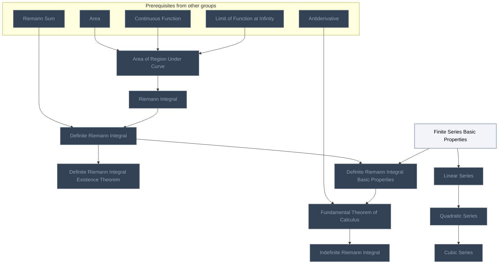

## Stewart Ch. 6: Applications of Integration
**Mastered:** 0 / 2 · **Discovered:** 2 / 2

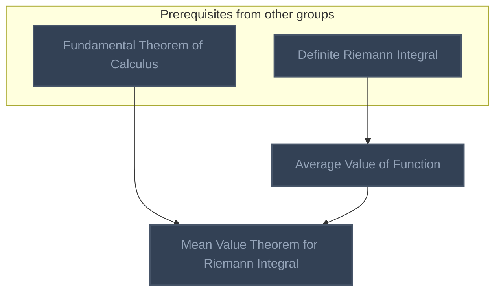

## Stewart Ch. 7: Techniques of Integration
**Mastered:** 0 / 11 · **Discovered:** 11 / 11

```mermaid
flowchart TD
    classDef planned fill:#1E293B,stroke:#64748B,stroke-width:2px,stroke-dasharray:5 5,color:#94A3B8;
    classDef locked fill:#334155,stroke:#475569,stroke-width:2px,color:#94A3B8;
    classDef L0 fill:#F1F5F9,stroke:#94A3B8,stroke-width:2px,color:#000000;
    classDef L1 fill:#22C55E,stroke:#15803D,stroke-width:2px,color:#000000;
    classDef L2 fill:#3B82F6,stroke:#1D4ED8,stroke-width:3px,color:#FFFFFF;
    classDef L3 fill:#A855F7,stroke:#6B21A8,stroke-width:3px,color:#FFFFFF,font-weight:bold;
    classDef L4 fill:#F97316,stroke:#C2410C,stroke-width:4px,color:#000000,font-weight:bold;
    classDef L5 fill:#FFD700,stroke:#FF8C00,stroke-width:5px,color:#000000,font-weight:bold;
    classDef rusty stroke:#8B4513,stroke-width:4px,stroke-dasharray:3 3;
    subgraph sg_prereqs["Prerequisites from other groups"]
        n_derivative_product_rule["Derivative Product Rule"]
        n_indefinite_riemann_integral["Indefinite Riemann Integral"]
        n_inverse_function["Inverse Function"]
        n_derivative_of_inverse_tangent_function["Derivative of Inverse Tangent Function"]
        n_derivative_of_logarithmic_function["Derivative of Logarithmic Function"]
        n_rational_function["Rational Function"]
        n_polynomial_division["Polynomial Division"]
        n_real_factorization_theorem["Real Factorization Theorem"]
        n_one_sided_limit_of_function["One-Sided Limit of Function"]
        n_definite_riemann_integral["Definite Riemann Integral"]
        n_expression["Expression"]
    end
    n_integration_by_parts["Integration by Parts"]
    n_integration_of_trigonometric_functions["Integration of Trigonometric Functions"]
    n_inverse_substitution["Inverse Substitution"]
    n_integration_using_trigonometric_substitution["Integration Using Trigonometric Substitution"]
    n_integration_by_partial_fractions["Integration by Partial Fractions"]
    n_proper_rational_function["Proper Rational Function"]
    n_improper_rational_function["Improper Rational Function"]
    n_partial_fractions["Partial Fractions"]
    n_improper_riemann_integral["Improper Riemann Integral"]
    n_improper_riemann_integral_comparison_theorem["Improper Riemann Integral Comparison Theorem"]
    n_u_substitution["u-Substitution"]
    n_derivative_product_rule --> n_integration_by_parts
    n_indefinite_riemann_integral --> n_integration_by_parts
    n_u_substitution --> n_integration_of_trigonometric_functions
    n_indefinite_riemann_integral --> n_integration_of_trigonometric_functions
    n_inverse_function --> n_inverse_substitution
    n_u_substitution --> n_inverse_substitution
    n_indefinite_riemann_integral --> n_inverse_substitution
    n_integration_of_trigonometric_functions --> n_integration_using_trigonometric_substitution
    n_inverse_substitution --> n_integration_using_trigonometric_substitution
    n_derivative_of_inverse_tangent_function --> n_integration_by_partial_fractions
    n_derivative_of_logarithmic_function --> n_integration_by_partial_fractions
    n_indefinite_riemann_integral --> n_integration_by_partial_fractions
    n_improper_rational_function --> n_integration_by_partial_fractions
    n_partial_fractions --> n_integration_by_partial_fractions
    n_rational_function --> n_proper_rational_function
    n_polynomial_division --> n_improper_rational_function
    n_rational_function --> n_improper_rational_function
    n_real_factorization_theorem --> n_partial_fractions
    n_proper_rational_function --> n_partial_fractions
    n_one_sided_limit_of_function --> n_improper_riemann_integral
    n_definite_riemann_integral --> n_improper_riemann_integral
    n_improper_riemann_integral --> n_improper_riemann_integral_comparison_theorem
    n_expression --> n_u_substitution
    class n_derivative_product_rule,n_indefinite_riemann_integral,n_inverse_function,n_derivative_of_inverse_tangent_function,n_derivative_of_logarithmic_function,n_rational_function,n_polynomial_division,n_real_factorization_theorem,n_one_sided_limit_of_function,n_definite_riemann_integral,n_expression,n_integration_by_parts,n_integration_of_trigonometric_functions,n_inverse_substitution,n_integration_using_trigonometric_substitution,n_integration_by_partial_fractions,n_proper_rational_function,n_improper_rational_function,n_partial_fractions,n_improper_riemann_integral,n_improper_riemann_integral_comparison_theorem,n_u_substitution locked;
    class n_derivative_product_rule,n_indefinite_riemann_integral,n_inverse_function,n_derivative_of_inverse_tangent_function,n_derivative_of_logarithmic_function,n_rational_function,n_polynomial_division,n_real_factorization_theorem,n_one_sided_limit_of_function,n_definite_riemann_integral,n_expression,n_integration_by_parts,n_integration_of_trigonometric_functions,n_inverse_substitution,n_integration_using_trigonometric_substitution,n_integration_by_partial_fractions,n_proper_rational_function,n_improper_rational_function,n_partial_fractions,n_improper_riemann_integral,n_improper_riemann_integral_comparison_theorem,n_u_substitution internal-link;
```

## Stewart Ch. 10: Parametric Equations and Polar Coordinates
**Mastered:** 0 / 2 · **Discovered:** 2 / 2

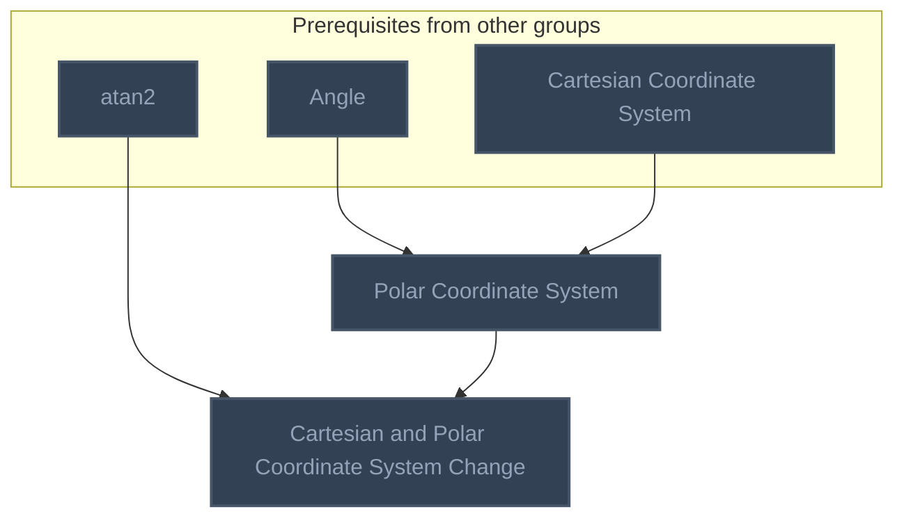

## Stewart Ch. 11: Infinite Sequences and Series
**Mastered:** 0 / 8 · **Discovered:** 8 / 8

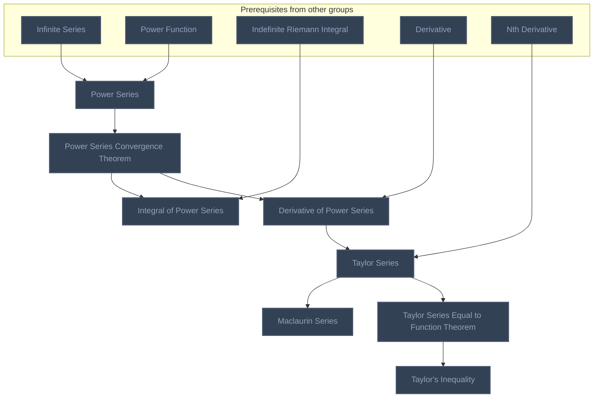

## Stewart Ch. 12: Vectors and the Geometry of Space
**Mastered:** 0 / 9 · **Discovered:** 9 / 9

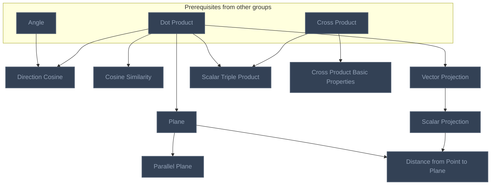

## Stewart Ch. 14: Partial Derivatives
**Mastered:** 0 / 6 · **Discovered:** 6 / 6

```mermaid
flowchart TD
    classDef planned fill:#1E293B,stroke:#64748B,stroke-width:2px,stroke-dasharray:5 5,color:#94A3B8;
    classDef locked fill:#334155,stroke:#475569,stroke-width:2px,color:#94A3B8;
    classDef L0 fill:#F1F5F9,stroke:#94A3B8,stroke-width:2px,color:#000000;
    classDef L1 fill:#22C55E,stroke:#15803D,stroke-width:2px,color:#000000;
    classDef L2 fill:#3B82F6,stroke:#1D4ED8,stroke-width:3px,color:#FFFFFF;
    classDef L3 fill:#A855F7,stroke:#6B21A8,stroke-width:3px,color:#FFFFFF,font-weight:bold;
    classDef L4 fill:#F97316,stroke:#C2410C,stroke-width:4px,color:#000000,font-weight:bold;
    classDef L5 fill:#FFD700,stroke:#FF8C00,stroke-width:5px,color:#000000,font-weight:bold;
    classDef rusty stroke:#8B4513,stroke-width:4px,stroke-dasharray:3 3;
    subgraph sg_prereqs["Prerequisites from other groups"]
        n_derivative["Derivative"]
        n_continuous_function["Continuous Function"]
        n_differentiable_function["Differentiable Function"]
        n_matrix["Matrix"]
        n_linear_map["Linear Map"]
        n_real_valued_function["Real-Valued Function"]
        n_cost_function["Cost Function"]
    end
    n_partial_derivative["Partial Derivative"]
    n_clairaut_s_theorem["Clairaut's Theorem"]
    n_partial_derivative_differentiable_theorem["Partial Derivative Differentiable Theorem"]
    n_jacobian_matrix["Jacobian Matrix"]
    n_gradient_vector["Gradient Vector"]
    n_hessian_matrix["Hessian Matrix"]
    n_derivative --> n_partial_derivative
    n_continuous_function --> n_clairaut_s_theorem
    n_partial_derivative --> n_clairaut_s_theorem
    n_continuous_function --> n_partial_derivative_differentiable_theorem
    n_differentiable_function --> n_partial_derivative_differentiable_theorem
    n_partial_derivative --> n_partial_derivative_differentiable_theorem
    n_partial_derivative --> n_jacobian_matrix
    n_matrix --> n_jacobian_matrix
    n_linear_map --> n_jacobian_matrix
    n_partial_derivative --> n_gradient_vector
    n_real_valued_function --> n_gradient_vector
    n_partial_derivative --> n_hessian_matrix
    n_cost_function --> n_hessian_matrix
    class n_derivative,n_continuous_function,n_differentiable_function,n_matrix,n_linear_map,n_real_valued_function,n_cost_function,n_partial_derivative,n_clairaut_s_theorem,n_partial_derivative_differentiable_theorem,n_jacobian_matrix,n_gradient_vector,n_hessian_matrix locked;
    class n_derivative,n_continuous_function,n_differentiable_function,n_matrix,n_linear_map,n_real_valued_function,n_cost_function,n_partial_derivative,n_clairaut_s_theorem,n_partial_derivative_differentiable_theorem,n_jacobian_matrix,n_gradient_vector,n_hessian_matrix internal-link;
```

## Stewart Ch. 15: Multiple Integrals
**Mastered:** 0 / 8 · **Discovered:** 8 / 8

```mermaid
flowchart TD
    classDef planned fill:#1E293B,stroke:#64748B,stroke-width:2px,stroke-dasharray:5 5,color:#94A3B8;
    classDef locked fill:#334155,stroke:#475569,stroke-width:2px,color:#94A3B8;
    classDef L0 fill:#F1F5F9,stroke:#94A3B8,stroke-width:2px,color:#000000;
    classDef L1 fill:#22C55E,stroke:#15803D,stroke-width:2px,color:#000000;
    classDef L2 fill:#3B82F6,stroke:#1D4ED8,stroke-width:3px,color:#FFFFFF;
    classDef L3 fill:#A855F7,stroke:#6B21A8,stroke-width:3px,color:#FFFFFF,font-weight:bold;
    classDef L4 fill:#F97316,stroke:#C2410C,stroke-width:4px,color:#000000,font-weight:bold;
    classDef L5 fill:#FFD700,stroke:#FF8C00,stroke-width:5px,color:#000000,font-weight:bold;
    classDef rusty stroke:#8B4513,stroke-width:4px,stroke-dasharray:3 3;
    subgraph sg_prereqs["Prerequisites from other groups"]
        n_definite_riemann_integral["Definite Riemann Integral"]
        n_cartesian_and_polar_coordinate_system_change["Cartesian and Polar Coordinate System Change"]
        n_polar_coordinate_system["Polar Coordinate System"]
        n_determinant["Determinant"]
        n_jacobian_matrix["Jacobian Matrix"]
        n_bijective_function["Bijective Function"]
    end
    n_double_riemann_integral["Double Riemann Integral"]
    n_fubini_s_theorem["Fubini's Theorem"]
    n_triple_riemann_integral["Triple Riemann Integral"]
    n_cartesian_and_cylindrical_coordinate_system_change["Cartesian and Cylindrical Coordinate System Change"]
    n_cylindrical_coordinate_system["Cylindrical Coordinate System"]
    n_cartesian_and_spherical_coordinate_system_change["Cartesian and Spherical Coordinate System Change"]
    n_spherical_coordinate_system["Spherical Coordinate System"]
    n_change_of_variables["Change of Variables"]
    n_definite_riemann_integral --> n_double_riemann_integral
    n_triple_riemann_integral --> n_fubini_s_theorem
    n_double_riemann_integral --> n_triple_riemann_integral
    n_cartesian_and_polar_coordinate_system_change --> n_cartesian_and_cylindrical_coordinate_system_change
    n_cylindrical_coordinate_system --> n_cartesian_and_cylindrical_coordinate_system_change
    n_polar_coordinate_system --> n_cylindrical_coordinate_system
    n_cartesian_and_polar_coordinate_system_change --> n_cartesian_and_spherical_coordinate_system_change
    n_spherical_coordinate_system --> n_cartesian_and_spherical_coordinate_system_change
    n_polar_coordinate_system --> n_spherical_coordinate_system
    n_determinant --> n_change_of_variables
    n_jacobian_matrix --> n_change_of_variables
    n_bijective_function --> n_change_of_variables
    n_triple_riemann_integral --> n_change_of_variables
    class n_definite_riemann_integral,n_cartesian_and_polar_coordinate_system_change,n_polar_coordinate_system,n_determinant,n_jacobian_matrix,n_bijective_function,n_double_riemann_integral,n_fubini_s_theorem,n_triple_riemann_integral,n_cartesian_and_cylindrical_coordinate_system_change,n_cylindrical_coordinate_system,n_cartesian_and_spherical_coordinate_system_change,n_spherical_coordinate_system,n_change_of_variables locked;
    class n_definite_riemann_integral,n_cartesian_and_polar_coordinate_system_change,n_polar_coordinate_system,n_determinant,n_jacobian_matrix,n_bijective_function,n_double_riemann_integral,n_fubini_s_theorem,n_triple_riemann_integral,n_cartesian_and_cylindrical_coordinate_system_change,n_cylindrical_coordinate_system,n_cartesian_and_spherical_coordinate_system_change,n_spherical_coordinate_system,n_change_of_variables internal-link;
```

## Stewart Ch. 16: Vector Calculus
**Mastered:** 0 / 24 · **Discovered:** 19 / 24

```mermaid
flowchart TD
    classDef planned fill:#1E293B,stroke:#64748B,stroke-width:2px,stroke-dasharray:5 5,color:#94A3B8;
    classDef locked fill:#334155,stroke:#475569,stroke-width:2px,color:#94A3B8;
    classDef L0 fill:#F1F5F9,stroke:#94A3B8,stroke-width:2px,color:#000000;
    classDef L1 fill:#22C55E,stroke:#15803D,stroke-width:2px,color:#000000;
    classDef L2 fill:#3B82F6,stroke:#1D4ED8,stroke-width:3px,color:#FFFFFF;
    classDef L3 fill:#A855F7,stroke:#6B21A8,stroke-width:3px,color:#FFFFFF,font-weight:bold;
    classDef L4 fill:#F97316,stroke:#C2410C,stroke-width:4px,color:#000000,font-weight:bold;
    classDef L5 fill:#FFD700,stroke:#FF8C00,stroke-width:5px,color:#000000,font-weight:bold;
    classDef rusty stroke:#8B4513,stroke-width:4px,stroke-dasharray:3 3;
    subgraph sg_prereqs["Prerequisites from other groups"]
        n_vector_field["Vector Field"]
        n_partial_derivative["Partial Derivative"]
        n_curve_arc_length["Curve Arc Length"]
        n_definite_riemann_integral["Definite Riemann Integral"]
        n_unit_tangent_vector_field_on_curve["Unit Tangent Vector Field on Curve"]
        n_derivative_chain_rule["Derivative Chain Rule"]
        n_fundamental_theorem_of_calculus["Fundamental Theorem of Calculus"]
        n_curve["Curve"]
        n_cross_product["Cross Product"]
        n_clairaut_s_theorem["Clairaut's Theorem"]
        n_double_riemann_integral["Double Riemann Integral"]
        n_orientable_surface["Orientable Surface"]
        n_triple_riemann_integral["Triple Riemann Integral"]
        n_simple_curve["Simple Curve"]
        n_piecewise_smooth_curve["Piecewise Smooth Curve"]
        n_domain_topology["Domain (Topology)"]
        n_function["Function"]
        n_gradient_vector["Gradient Vector"]
    end
    n_conservative_vector_field["Conservative Vector Field"]
    n_line_riemann_integral["Line Riemann Integral"]
    n_line_riemann_integral_basic_properties["Line Riemann Integral Basic Properties"]
    n_line_integral_of_vector_field["Line Integral of Vector Field"]
    n_fundamental_theorem_for_line_riemann_integral["Fundamental Theorem for Line Riemann Integral"]
    n_line_integral_of_conservative_vector_field_independent_of_path["Line Integral of Conservative Vector Field Independent of Path"]
    n_closed_curve["Closed Curve"]
    n_line_integral_independent_of_path["Line Integral Independent of Path"]
    n_line_integral_independent_of_path_closed_curve["Line Integral Independent of Path Closed Curve"]
    n_line_integral_independent_of_path_theorem["Line Integral Independent of Path Theorem"]
    n_curl_of_vector_field["Curl of Vector Field"]
    n_curl_of_gradient_vector_field["Curl of Gradient Vector Field"]
    n_conservative_vector_field_existence_with_curl_theorem["Conservative Vector Field Existence With Curl Theorem"]
    n_divergence_of_vector_field["Divergence of Vector Field"]
    n_divergence_of_curl["Divergence of Curl"]
    n_parametric_surface["Parametric Surface"]
    n_surface_area_of_parametric_surface["Surface Area of Parametric Surface"]
    n_surface_riemann_integral["Surface Riemann Integral"]
    n_surface_integral_of_vector_field["Surface Integral of Vector Field"]
    n_stokes_theorem["Stokes' Theorem"]
    n_divergence_theorem["Divergence Theorem"]
    n_green_s_theorem["Green's Theorem"]
    n_vector_valued_function["Vector-Valued Function"]
    n_real_vector_valued_function["Real Vector-Valued Function"]
    n_vector_field --> n_conservative_vector_field
    n_partial_derivative --> n_conservative_vector_field
    n_curve_arc_length --> n_line_riemann_integral
    n_definite_riemann_integral --> n_line_riemann_integral
    n_line_riemann_integral --> n_line_riemann_integral_basic_properties
    n_unit_tangent_vector_field_on_curve --> n_line_integral_of_vector_field
    n_vector_field --> n_line_integral_of_vector_field
    n_line_riemann_integral --> n_line_integral_of_vector_field
    n_derivative_chain_rule --> n_fundamental_theorem_for_line_riemann_integral
    n_fundamental_theorem_of_calculus --> n_fundamental_theorem_for_line_riemann_integral
    n_conservative_vector_field --> n_fundamental_theorem_for_line_riemann_integral
    n_line_integral_of_vector_field --> n_fundamental_theorem_for_line_riemann_integral
    n_fundamental_theorem_for_line_riemann_integral --> n_line_integral_of_conservative_vector_field_independent_of_path
    n_line_integral_independent_of_path --> n_line_integral_of_conservative_vector_field_independent_of_path
    n_curve --> n_closed_curve
    n_line_integral_of_vector_field --> n_line_integral_independent_of_path
    n_closed_curve --> n_line_integral_independent_of_path_closed_curve
    n_line_integral_independent_of_path --> n_line_integral_independent_of_path_closed_curve
    n_conservative_vector_field --> n_line_integral_independent_of_path_theorem
    n_line_integral_independent_of_path --> n_line_integral_independent_of_path_theorem
    n_cross_product --> n_curl_of_vector_field
    n_vector_field --> n_curl_of_vector_field
    n_partial_derivative --> n_curl_of_vector_field
    n_clairaut_s_theorem --> n_curl_of_gradient_vector_field
    n_conservative_vector_field --> n_curl_of_gradient_vector_field
    n_curl_of_vector_field --> n_curl_of_gradient_vector_field
    n_conservative_vector_field --> n_conservative_vector_field_existence_with_curl_theorem
    n_curl_of_vector_field --> n_conservative_vector_field_existence_with_curl_theorem
    n_vector_field --> n_divergence_of_vector_field
    n_partial_derivative --> n_divergence_of_vector_field
    n_clairaut_s_theorem --> n_divergence_of_curl
    n_curl_of_vector_field --> n_divergence_of_curl
    n_divergence_of_vector_field --> n_divergence_of_curl
    n_partial_derivative --> n_parametric_surface
    n_cross_product --> n_surface_area_of_parametric_surface
    n_double_riemann_integral --> n_surface_area_of_parametric_surface
    n_parametric_surface --> n_surface_area_of_parametric_surface
    n_surface_area_of_parametric_surface --> n_surface_riemann_integral
    n_orientable_surface --> n_surface_integral_of_vector_field
    n_vector_field --> n_surface_integral_of_vector_field
    n_surface_riemann_integral --> n_surface_integral_of_vector_field
    n_green_s_theorem --> n_stokes_theorem
    n_line_integral_of_vector_field --> n_stokes_theorem
    n_curl_of_vector_field --> n_stokes_theorem
    n_surface_integral_of_vector_field --> n_stokes_theorem
    n_triple_riemann_integral --> n_divergence_theorem
    n_divergence_of_vector_field --> n_divergence_theorem
    n_surface_integral_of_vector_field --> n_divergence_theorem
    n_simple_curve --> n_green_s_theorem
    n_piecewise_smooth_curve --> n_green_s_theorem
    n_domain_topology --> n_green_s_theorem
    n_partial_derivative --> n_green_s_theorem
    n_closed_curve --> n_green_s_theorem
    n_function --> n_vector_valued_function
    n_vector_valued_function --> n_real_vector_valued_function
    n_gradient_vector --> n_fundamental_theorem_for_line_riemann_integral
    class n_parametric_surface,n_surface_area_of_parametric_surface,n_surface_integral_of_vector_field,n_stokes_theorem,n_divergence_theorem planned;
    class n_vector_field,n_partial_derivative,n_curve_arc_length,n_definite_riemann_integral,n_unit_tangent_vector_field_on_curve,n_derivative_chain_rule,n_fundamental_theorem_of_calculus,n_curve,n_cross_product,n_clairaut_s_theorem,n_double_riemann_integral,n_orientable_surface,n_triple_riemann_integral,n_simple_curve,n_piecewise_smooth_curve,n_domain_topology,n_function,n_gradient_vector,n_conservative_vector_field,n_line_riemann_integral,n_line_riemann_integral_basic_properties,n_line_integral_of_vector_field,n_fundamental_theorem_for_line_riemann_integral,n_line_integral_of_conservative_vector_field_independent_of_path,n_closed_curve,n_line_integral_independent_of_path,n_line_integral_independent_of_path_closed_curve,n_line_integral_independent_of_path_theorem,n_curl_of_vector_field,n_curl_of_gradient_vector_field,n_conservative_vector_field_existence_with_curl_theorem,n_divergence_of_vector_field,n_divergence_of_curl,n_surface_riemann_integral,n_green_s_theorem,n_vector_valued_function,n_real_vector_valued_function locked;
    class n_vector_field,n_partial_derivative,n_curve_arc_length,n_definite_riemann_integral,n_unit_tangent_vector_field_on_curve,n_derivative_chain_rule,n_fundamental_theorem_of_calculus,n_curve,n_cross_product,n_clairaut_s_theorem,n_double_riemann_integral,n_orientable_surface,n_triple_riemann_integral,n_simple_curve,n_piecewise_smooth_curve,n_domain_topology,n_function,n_gradient_vector,n_conservative_vector_field,n_line_riemann_integral,n_line_riemann_integral_basic_properties,n_line_integral_of_vector_field,n_fundamental_theorem_for_line_riemann_integral,n_line_integral_of_conservative_vector_field_independent_of_path,n_closed_curve,n_line_integral_independent_of_path,n_line_integral_independent_of_path_closed_curve,n_line_integral_independent_of_path_theorem,n_curl_of_vector_field,n_curl_of_gradient_vector_field,n_conservative_vector_field_existence_with_curl_theorem,n_divergence_of_vector_field,n_divergence_of_curl,n_surface_riemann_integral,n_green_s_theorem,n_vector_valued_function,n_real_vector_valued_function internal-link;
```

# Source
Graph structure: the single source for the diagrams above, edited by `/note` and `Scripts/skill_trees.py` (`add`, `edge`, `rename`). Everything above this heading is regenerated by `render`.

```skilltree
    %% PREREQUISITES
    n_atan2["atan2"]
    n_cross_product["Cross Product"]
    n_curve["Curve"]
    n_curve_arc_length["Curve Arc Length"]
    n_dot_product["Dot Product"]
    n_orientable_surface["Orientable Surface"]
    n_unit_tangent_vector_field_on_curve["Unit Tangent Vector Field on Curve"]
    n_vector_field["Vector Field"]
    n_determinant["Determinant"]
    n_even_function["Even Function"]
    n_angle["Angle"]
    n_area["Area"]
    n_slope["Slope"]
    n_bijective_function["Bijective Function"]
    n_cartesian_coordinate_system["Cartesian Coordinate System"]
    n_cosecant_function["Cosecant Function"]
    n_cosine_function["Cosine Function"]
    n_cotangent_function["Cotangent Function"]
    n_difference_quotient_of_function["Difference Quotient of Function"]
    n_exponential_function["Exponential Function"]
    n_function["Function"]
    n_function_composition["Function Composition"]
    n_interval_notation["Interval Notation"]
    n_inverse_function["Inverse Function"]
    n_line["Line"]
    n_local_maximum["Local Maximum"]
    n_local_minimum["Local Minimum"]
    n_logarithm_function["Logarithm Function"]
    n_polynomial_division["Polynomial Division"]
    n_polynomial_function["Polynomial Function"]
    n_rational_function["Rational Function"]
    n_real_factorization_theorem["Real Factorization Theorem"]
    n_secant_function["Secant Function"]
    n_sine_function["Sine Function"]
    n_tangent_function["Tangent Function"]
    n_trigonometric_function["Trigonometric Function"]
    n_infinite_series["Infinite Series"]
    n_mean_value_theorem["Mean Value Theorem"]
    n_riemann_sum["Riemann Sum"]
    n_simple_curve["Simple Curve"]
    n_piecewise_smooth_curve["Piecewise Smooth Curve"]
    n_domain_topology["Domain (Topology)"]
    n_matrix["Matrix"]
    n_linear_map["Linear Map"]
    n_expression["Expression"]
    n_real_valued_function["Real-Valued Function"]
    n_cost_function["Cost Function"]
    %% NODES
    %% == Stewart: Book Review ==
    %% == Stewart Ch. 2: Limits and Derivatives ==
    n_tangent_line["Tangent Line"]
    n_secant_line["Secant Line"]
    n_intersecting_line["Intersecting Line"]
    n_limit_of_function["Limit of Function"]
    n_heaviside_function["Heaviside Function"]
    n_infinite_limit_of_function["Infinite Limit of Function"]
    n_limit_of_function_subtraction_law["Limit of Function Subtraction Law"]
    n_limit_of_function_nth_root_law["Limit of Function nth Root Law"]
    n_limit_of_function_quotient_law["Limit of Function Quotient Law"]
    n_limit_of_function_product_law["Limit of Function Product Law"]
    n_limit_of_function_addition_law["Limit of Function Addition Law"]
    n_limit_of_function_scalar_product_law["Limit of Function Scalar Product Law"]
    n_limit_of_function_power_law["Limit of Function Power Law"]
    n_limit_of_function_direct_substitution_property["Limit of Function Direct Substitution Property"]
    n_limit_of_function_equality["Limit of Function Equality"]
    n_limit_of_function_squeeze_theorem["Limit of Function Squeeze Theorem"]
    n_limit_of_function_inequality["Limit of Function Inequality"]
    n_one_sided_limit_of_function["One-Sided Limit of Function"]
    n_limit_of_function_and_one_sided_limit_of_function_theorem["Limit of Function and One-Sided Limit of Function Theorem"]
    n_continuous_function["Continuous Function"]
    n_continuity["Continuity"]
    n_one_sided_continuous_function["One-Sided Continuous Function"]
    n_continuous_function_on_interval["Continuous Function on Interval"]
    n_continuous_function_addition_rule["Continuous Function Addition Rule"]
    n_continuous_function_scalar_product_rule["Continuous Function Scalar Product Rule"]
    n_continuous_function_subtraction_rule["Continuous Function Subtraction Rule"]
    n_continuous_function_quotient_rule["Continuous Function Quotient Rule"]
    n_continuous_function_product_rule["Continuous Function Product Rule"]
    n_continuous_function_inverse["Continuous Function Inverse"]
    n_continuous_function_composition["Continuous Function Composition"]
    n_continuous_function_composition_rule["Continuous Function Composition Rule"]
    n_limit_of_function_at_infinity["Limit of Function at Infinity"]
    n_derivative["Derivative"]
    n_differentiation_operator["Differentiation Operator"]
    n_differentiable_function["Differentiable Function"]
    n_differentiable_implies_continuous["Differentiable Implies Continuous"]
    n_second_derivative["Second Derivative"]
    n_nth_derivative["Nth Derivative"]
    n_derivative_of_inverse_function["Derivative of Inverse Function"]
    %% == Stewart Ch. 3: Differentiation Rules ==
    n_power_function["Power Function"]
    n_derivative_power_rule["Derivative Power Rule"]
    n_derivative_constant_multiple_rule["Derivative Constant Multiple Rule"]
    n_normal_line["Normal Line"]
    n_derivative_difference_rule["Derivative Difference Rule"]
    n_derivative_sum_rule["Derivative Sum Rule"]
    n_euler_s_number["Euler's Number"]
    n_derivative_of_exponential_function["Derivative of Exponential Function"]
    n_derivative_product_rule["Derivative Product Rule"]
    n_derivative_quotient_rule["Derivative Quotient Rule"]
    n_one_sided_limit_of_even_function["One-Sided Limit of Even Function"]
    n_derivative_of_sine_function["Derivative of Sine Function"]
    n_derivative_of_tangent_function["Derivative of Tangent Function"]
    n_derivative_of_cotangent_function["Derivative of Cotangent Function"]
    n_derivative_of_cosecant_function["Derivative of Cosecant Function"]
    n_derivative_of_secant_function["Derivative of Secant Function"]
    n_derivative_of_cosine_function["Derivative of Cosine Function"]
    n_derivative_chain_rule["Derivative Chain Rule"]
    n_derivative_with_respect_to_other_variable["Derivative with Respect to Other Variable"]
    n_inverse_trigonometric_function["Inverse Trigonometric Function"]
    n_derivative_of_inverse_cotangent_function["Derivative of Inverse Cotangent Function"]
    n_derivative_of_inverse_cosine_function["Derivative of Inverse Cosine Function"]
    n_derivative_of_inverse_secant_function["Derivative of Inverse Secant Function"]
    n_derivative_of_inverse_cosecant_function["Derivative of Inverse Cosecant Function"]
    n_derivative_of_inverse_tangent_function["Derivative of Inverse Tangent Function"]
    n_derivative_of_inverse_sine_function["Derivative of Inverse Sine Function"]
    n_derivative_of_logarithmic_function["Derivative of Logarithmic Function"]
    n_linear_approximation["Linear Approximation"]
    n_hyperbolic_sine_function["Hyperbolic Sine Function"]
    n_hyperbolic_cotangent_function["Hyperbolic Cotangent Function"]
    n_hyperbolic_function["Hyperbolic Function"]
    n_hyperbolic_cosecant_function["Hyperbolic Cosecant Function"]
    n_hyperbolic_tangent_function["Hyperbolic Tangent Function"]
    n_hyperbolic_cosine_function["Hyperbolic Cosine Function"]
    n_hyperbolic_secant_function["Hyperbolic Secant Function"]
    n_hyperbolic_function_identities["Hyperbolic Function Identities"]
    n_derivative_of_hyperbolic_cosine_function["Derivative of Hyperbolic Cosine Function"]
    n_derivative_of_hyperbolic_secant_function["Derivative of Hyperbolic Secant Function"]
    n_derivative_of_hyperbolic_sine_function["Derivative of Hyperbolic Sine Function"]
    n_derivative_of_hyperbolic_tangent_function["Derivative of Hyperbolic Tangent Function"]
    n_derivative_of_hyperbolic_cosecant_function["Derivative of Hyperbolic Cosecant Function"]
    n_derivative_of_hyperbolic_cotangent_function["Derivative of Hyperbolic Cotangent Function"]
    n_inverse_hyperbolic_secant_function["Inverse Hyperbolic Secant Function"]
    n_inverse_hyperbolic_tangent_function["Inverse Hyperbolic Tangent Function"]
    n_inverse_hyperbolic_cosecant_function["Inverse Hyperbolic Cosecant Function"]
    n_inverse_hyperbolic_function["Inverse Hyperbolic Function"]
    n_inverse_hyperbolic_sine_function["Inverse Hyperbolic Sine Function"]
    n_inverse_hyperbolic_cotangent_function["Inverse Hyperbolic Cotangent Function"]
    n_inverse_hyperbolic_cosine_function["Inverse Hyperbolic Cosine Function"]
    n_derivative_of_inverse_hyperbolic_sine_function["Derivative of Inverse Hyperbolic Sine Function"]
    n_derivative_of_inverse_hyperbolic_secant_function["Derivative of Inverse Hyperbolic Secant Function"]
    n_derivative_of_inverse_hyperbolic_cosine_function["Derivative of Inverse Hyperbolic Cosine Function"]
    n_derivative_of_inverse_hyperbolic_tangent_function["Derivative of Inverse Hyperbolic Tangent Function"]
    n_derivative_of_inverse_hyperbolic_cotangent_function["Derivative of Inverse Hyperbolic Cotangent Function"]
    n_derivative_of_inverse_hyperbolic_cosecant_function["Derivative of Inverse Hyperbolic Cosecant Function"]
    %% == Stewart Ch. 4: Applications of Differentiation ==
    n_absolute_maximum["Absolute Maximum"]
    n_absolute_minimum["Absolute Minimum"]
    n_extreme_value_theorem["Extreme Value Theorem"]
    n_fermat_s_theorem["Fermat's Theorem"]
    n_critical_number["Critical Number"]
    n_closed_interval_method["Closed Interval Method"]
    n_rolle_s_theorem["Rolle's Theorem"]
    n_zero_derivative_implies_constant_function_theorem["Zero Derivative Implies Constant Function Theorem"]
    n_first_derivative_test["First Derivative Test"]
    n_concave_downward_function["Concave Downward Function"]
    n_concave_upward_function["Concave Upward Function"]
    n_concavity_test["Concavity Test"]
    n_inflection_point["Inflection Point"]
    n_second_derivative_test["Second Derivative Test"]
    n_l_hospital_s_rule["L'Hospital's Rule"]
    n_first_derivative_test_for_absolute_extreme_values["First Derivative Test for Absolute Extreme Values"]
    n_newton_s_method["Newton's Method"]
    n_antiderivative["Antiderivative"]
    %% == Stewart Ch. 5: Integrals ==
    n_area_of_region_under_curve["Area of Region Under Curve"]
    n_definite_riemann_integral["Definite Riemann Integral"]
    n_riemann_integral["Riemann Integral"]
    n_definite_riemann_integral_existence_theorem["Definite Riemann Integral Existence Theorem"]
    n_quadratic_series["Quadratic Series"]
    n_cubic_series["Cubic Series"]
    n_finite_series_basic_properties["Finite Series Basic Properties"]
    n_linear_series["Linear Series"]
    n_definite_riemann_integral_basic_properties["Definite Riemann Integral Basic Properties"]
    n_fundamental_theorem_of_calculus["Fundamental Theorem of Calculus"]
    n_indefinite_riemann_integral["Indefinite Riemann Integral"]
    %% == Stewart Ch. 6: Applications of Integration ==
    n_average_value_of_function["Average Value of Function"]
    n_mean_value_theorem_for_riemann_integral["Mean Value Theorem for Riemann Integral"]
    %% == Stewart Ch. 7: Techniques of Integration ==
    n_integration_by_parts["Integration by Parts"]
    n_integration_of_trigonometric_functions["Integration of Trigonometric Functions"]
    n_inverse_substitution["Inverse Substitution"]
    n_integration_using_trigonometric_substitution["Integration Using Trigonometric Substitution"]
    n_integration_by_partial_fractions["Integration by Partial Fractions"]
    n_proper_rational_function["Proper Rational Function"]
    n_improper_rational_function["Improper Rational Function"]
    n_partial_fractions["Partial Fractions"]
    n_improper_riemann_integral["Improper Riemann Integral"]
    n_improper_riemann_integral_comparison_theorem["Improper Riemann Integral Comparison Theorem"]
    n_u_substitution["u-Substitution"]
    %% == Stewart Ch. 9: Differential Equations ==
    %% == Stewart Ch. 10: Parametric Equations and Polar Coordinates ==
    n_polar_coordinate_system["Polar Coordinate System"]
    n_cartesian_and_polar_coordinate_system_change["Cartesian and Polar Coordinate System Change"]
    %% == Stewart Ch. 11: Infinite Sequences and Series ==
    n_power_series["Power Series"]
    n_power_series_convergence_theorem["Power Series Convergence Theorem"]
    n_integral_of_power_series["Integral of Power Series"]
    n_derivative_of_power_series["Derivative of Power Series"]
    n_maclaurin_series["Maclaurin Series"]
    n_taylor_series["Taylor Series"]
    n_taylor_series_equal_to_function_theorem["Taylor Series Equal to Function Theorem"]
    n_taylor_s_inequality["Taylor's Inequality"]
    %% == Stewart Ch. 12: Vectors and the Geometry of Space ==
    n_direction_cosine["Direction Cosine"]
    n_cosine_similarity["Cosine Similarity"]
    n_scalar_projection["Scalar Projection"]
    n_vector_projection["Vector Projection"]
    n_scalar_triple_product["Scalar Triple Product"]
    n_cross_product_basic_properties["Cross Product Basic Properties"]
    n_plane["Plane"]
    n_parallel_plane["Parallel Plane"]
    n_distance_from_point_to_plane["Distance from Point to Plane"]
    %% == Stewart Ch. 14: Partial Derivatives ==
    n_partial_derivative["Partial Derivative"]
    n_clairaut_s_theorem["Clairaut's Theorem"]
    n_partial_derivative_differentiable_theorem["Partial Derivative Differentiable Theorem"]
    n_jacobian_matrix["Jacobian Matrix"]
    n_gradient_vector["Gradient Vector"]
    n_hessian_matrix["Hessian Matrix"]
    %% == Stewart Ch. 15: Multiple Integrals ==
    n_double_riemann_integral["Double Riemann Integral"]
    n_fubini_s_theorem["Fubini's Theorem"]
    n_triple_riemann_integral["Triple Riemann Integral"]
    n_cartesian_and_cylindrical_coordinate_system_change["Cartesian and Cylindrical Coordinate System Change"]
    n_cylindrical_coordinate_system["Cylindrical Coordinate System"]
    n_cartesian_and_spherical_coordinate_system_change["Cartesian and Spherical Coordinate System Change"]
    n_spherical_coordinate_system["Spherical Coordinate System"]
    n_change_of_variables["Change of Variables"]
    %% == Stewart Ch. 16: Vector Calculus ==
    n_conservative_vector_field["Conservative Vector Field"]
    n_line_riemann_integral["Line Riemann Integral"]
    n_line_riemann_integral_basic_properties["Line Riemann Integral Basic Properties"]
    n_line_integral_of_vector_field["Line Integral of Vector Field"]
    n_fundamental_theorem_for_line_riemann_integral["Fundamental Theorem for Line Riemann Integral"]
    n_line_integral_of_conservative_vector_field_independent_of_path["Line Integral of Conservative Vector Field Independent of Path"]
    n_closed_curve["Closed Curve"]
    n_line_integral_independent_of_path["Line Integral Independent of Path"]
    n_line_integral_independent_of_path_closed_curve["Line Integral Independent of Path Closed Curve"]
    n_line_integral_independent_of_path_theorem["Line Integral Independent of Path Theorem"]
    n_curl_of_vector_field["Curl of Vector Field"]
    n_curl_of_gradient_vector_field["Curl of Gradient Vector Field"]
    n_conservative_vector_field_existence_with_curl_theorem["Conservative Vector Field Existence With Curl Theorem"]
    n_divergence_of_vector_field["Divergence of Vector Field"]
    n_divergence_of_curl["Divergence of Curl"]
    n_parametric_surface["Parametric Surface"]
    n_surface_area_of_parametric_surface["Surface Area of Parametric Surface"]
    n_surface_riemann_integral["Surface Riemann Integral"]
    n_surface_integral_of_vector_field["Surface Integral of Vector Field"]
    n_stokes_theorem["Stokes' Theorem"]
    n_divergence_theorem["Divergence Theorem"]
    n_green_s_theorem["Green's Theorem"]
    n_vector_valued_function["Vector-Valued Function"]
    n_real_vector_valued_function["Real Vector-Valued Function"]
    %% EDGES
    n_slope --> n_tangent_line
    n_secant_line --> n_tangent_line
    n_limit_of_function --> n_tangent_line
    n_line --> n_secant_line
    n_line --> n_intersecting_line
    n_function --> n_limit_of_function
    n_function --> n_heaviside_function
    n_limit_of_function --> n_infinite_limit_of_function
    n_limit_of_function_addition_law --> n_limit_of_function_subtraction_law
    n_limit_of_function_scalar_product_law --> n_limit_of_function_subtraction_law
    n_limit_of_function --> n_limit_of_function_nth_root_law
    n_limit_of_function --> n_limit_of_function_quotient_law
    n_limit_of_function --> n_limit_of_function_product_law
    n_limit_of_function --> n_limit_of_function_addition_law
    n_limit_of_function --> n_limit_of_function_scalar_product_law
    n_limit_of_function_product_law --> n_limit_of_function_power_law
    n_polynomial_function --> n_limit_of_function_direct_substitution_property
    n_rational_function --> n_limit_of_function_direct_substitution_property
    n_limit_of_function_quotient_law --> n_limit_of_function_direct_substitution_property
    n_limit_of_function_addition_law --> n_limit_of_function_direct_substitution_property
    n_limit_of_function_scalar_product_law --> n_limit_of_function_direct_substitution_property
    n_limit_of_function_power_law --> n_limit_of_function_direct_substitution_property
    n_limit_of_function --> n_limit_of_function_equality
    n_limit_of_function --> n_limit_of_function_squeeze_theorem
    n_limit_of_function --> n_limit_of_function_inequality
    n_limit_of_function --> n_one_sided_limit_of_function
    n_one_sided_limit_of_function --> n_limit_of_function_and_one_sided_limit_of_function_theorem
    n_limit_of_function --> n_continuous_function
    n_continuous_function --> n_continuity
    n_one_sided_limit_of_function --> n_one_sided_continuous_function
    n_continuous_function --> n_one_sided_continuous_function
    n_interval_notation --> n_continuous_function_on_interval
    n_one_sided_continuous_function --> n_continuous_function_on_interval
    n_limit_of_function_addition_law --> n_continuous_function_addition_rule
    n_continuous_function --> n_continuous_function_addition_rule
    n_limit_of_function_scalar_product_law --> n_continuous_function_scalar_product_rule
    n_continuous_function --> n_continuous_function_scalar_product_rule
    n_continuous_function_addition_rule --> n_continuous_function_subtraction_rule
    n_continuous_function_product_rule --> n_continuous_function_subtraction_rule
    n_limit_of_function_quotient_law --> n_continuous_function_quotient_rule
    n_continuous_function --> n_continuous_function_quotient_rule
    n_limit_of_function_product_law --> n_continuous_function_product_rule
    n_continuous_function --> n_continuous_function_product_rule
    n_inverse_function --> n_continuous_function_inverse
    n_continuous_function --> n_continuous_function_inverse
    n_continuous_function_composition_rule --> n_continuous_function_composition
    n_function_composition --> n_continuous_function_composition_rule
    n_continuous_function --> n_continuous_function_composition_rule
    n_limit_of_function --> n_limit_of_function_at_infinity
    n_difference_quotient_of_function --> n_derivative
    n_tangent_line --> n_derivative
    n_derivative --> n_differentiation_operator
    n_derivative --> n_differentiable_function
    n_continuous_function --> n_differentiable_implies_continuous
    n_differentiable_function --> n_differentiable_implies_continuous
    n_derivative --> n_second_derivative
    n_differentiation_operator --> n_nth_derivative
    n_second_derivative --> n_nth_derivative
    n_function --> n_power_function
    n_derivative --> n_derivative_power_rule
    n_power_function --> n_derivative_power_rule
    n_limit_of_function_scalar_product_law --> n_derivative_constant_multiple_rule
    n_derivative --> n_derivative_constant_multiple_rule
    n_tangent_line --> n_normal_line
    n_derivative_constant_multiple_rule --> n_derivative_difference_rule
    n_derivative_sum_rule --> n_derivative_difference_rule
    n_limit_of_function_addition_law --> n_derivative_sum_rule
    n_derivative --> n_derivative_sum_rule
    n_exponential_function --> n_euler_s_number
    n_derivative --> n_euler_s_number
    n_euler_s_number --> n_derivative_of_exponential_function
    n_limit_of_function_product_law --> n_derivative_product_rule
    n_differentiable_implies_continuous --> n_derivative_product_rule
    n_limit_of_function_quotient_law --> n_derivative_quotient_rule
    n_differentiable_implies_continuous --> n_derivative_quotient_rule
    n_even_function --> n_one_sided_limit_of_even_function
    n_one_sided_limit_of_function --> n_one_sided_limit_of_even_function
    n_sine_function --> n_derivative_of_sine_function
    n_limit_of_function_squeeze_theorem --> n_derivative_of_sine_function
    n_derivative --> n_derivative_of_sine_function
    n_tangent_function --> n_derivative_of_tangent_function
    n_derivative_quotient_rule --> n_derivative_of_tangent_function
    n_derivative_of_sine_function --> n_derivative_of_tangent_function
    n_derivative_of_cosine_function --> n_derivative_of_tangent_function
    n_cotangent_function --> n_derivative_of_cotangent_function
    n_derivative_quotient_rule --> n_derivative_of_cotangent_function
    n_derivative_of_sine_function --> n_derivative_of_cotangent_function
    n_derivative_of_cosine_function --> n_derivative_of_cotangent_function
    n_cosecant_function --> n_derivative_of_cosecant_function
    n_derivative_quotient_rule --> n_derivative_of_cosecant_function
    n_derivative_of_sine_function --> n_derivative_of_cosecant_function
    n_secant_function --> n_derivative_of_secant_function
    n_derivative_quotient_rule --> n_derivative_of_secant_function
    n_derivative_of_cosine_function --> n_derivative_of_secant_function
    n_cosine_function --> n_derivative_of_cosine_function
    n_limit_of_function_squeeze_theorem --> n_derivative_of_cosine_function
    n_derivative --> n_derivative_of_cosine_function
    n_function_composition --> n_derivative_chain_rule
    n_differentiable_function --> n_derivative_chain_rule
    n_derivative_chain_rule --> n_derivative_with_respect_to_other_variable
    n_inverse_function --> n_inverse_trigonometric_function
    n_trigonometric_function --> n_inverse_trigonometric_function
    n_derivative_of_cotangent_function --> n_derivative_of_inverse_cotangent_function
    n_derivative_chain_rule --> n_derivative_of_inverse_cotangent_function
    n_inverse_trigonometric_function --> n_derivative_of_inverse_cotangent_function
    n_derivative_of_cosine_function --> n_derivative_of_inverse_cosine_function
    n_derivative_chain_rule --> n_derivative_of_inverse_cosine_function
    n_inverse_trigonometric_function --> n_derivative_of_inverse_cosine_function
    n_derivative_of_secant_function --> n_derivative_of_inverse_secant_function
    n_derivative_chain_rule --> n_derivative_of_inverse_secant_function
    n_inverse_trigonometric_function --> n_derivative_of_inverse_secant_function
    n_derivative_of_cosecant_function --> n_derivative_of_inverse_cosecant_function
    n_derivative_chain_rule --> n_derivative_of_inverse_cosecant_function
    n_inverse_trigonometric_function --> n_derivative_of_inverse_cosecant_function
    n_derivative_of_tangent_function --> n_derivative_of_inverse_tangent_function
    n_derivative_chain_rule --> n_derivative_of_inverse_tangent_function
    n_inverse_trigonometric_function --> n_derivative_of_inverse_tangent_function
    n_derivative_of_sine_function --> n_derivative_of_inverse_sine_function
    n_derivative_chain_rule --> n_derivative_of_inverse_sine_function
    n_inverse_trigonometric_function --> n_derivative_of_inverse_sine_function
    n_logarithm_function --> n_derivative_of_logarithmic_function
    n_derivative_of_exponential_function --> n_derivative_of_logarithmic_function
    n_derivative_chain_rule --> n_derivative_of_logarithmic_function
    n_differentiable_function --> n_linear_approximation
    n_hyperbolic_function --> n_hyperbolic_sine_function
    n_hyperbolic_sine_function --> n_hyperbolic_cotangent_function
    n_hyperbolic_cosine_function --> n_hyperbolic_cotangent_function
    n_euler_s_number --> n_hyperbolic_function
    n_hyperbolic_sine_function --> n_hyperbolic_cosecant_function
    n_hyperbolic_sine_function --> n_hyperbolic_tangent_function
    n_hyperbolic_cosine_function --> n_hyperbolic_tangent_function
    n_hyperbolic_function --> n_hyperbolic_cosine_function
    n_hyperbolic_cosine_function --> n_hyperbolic_secant_function
    n_hyperbolic_sine_function --> n_hyperbolic_function_identities
    n_hyperbolic_cosine_function --> n_hyperbolic_function_identities
    n_derivative_of_exponential_function --> n_derivative_of_hyperbolic_cosine_function
    n_hyperbolic_cosine_function --> n_derivative_of_hyperbolic_cosine_function
    n_derivative_quotient_rule --> n_derivative_of_hyperbolic_secant_function
    n_hyperbolic_secant_function --> n_derivative_of_hyperbolic_secant_function
    n_derivative_of_hyperbolic_cosine_function --> n_derivative_of_hyperbolic_secant_function
    n_derivative_of_exponential_function --> n_derivative_of_hyperbolic_sine_function
    n_hyperbolic_sine_function --> n_derivative_of_hyperbolic_sine_function
    n_derivative_quotient_rule --> n_derivative_of_hyperbolic_tangent_function
    n_hyperbolic_tangent_function --> n_derivative_of_hyperbolic_tangent_function
    n_hyperbolic_function_identities --> n_derivative_of_hyperbolic_tangent_function
    n_derivative_of_hyperbolic_cosine_function --> n_derivative_of_hyperbolic_tangent_function
    n_derivative_of_hyperbolic_sine_function --> n_derivative_of_hyperbolic_tangent_function
    n_derivative_quotient_rule --> n_derivative_of_hyperbolic_cosecant_function
    n_hyperbolic_cosecant_function --> n_derivative_of_hyperbolic_cosecant_function
    n_derivative_of_hyperbolic_sine_function --> n_derivative_of_hyperbolic_cosecant_function
    n_derivative_quotient_rule --> n_derivative_of_hyperbolic_cotangent_function
    n_hyperbolic_cotangent_function --> n_derivative_of_hyperbolic_cotangent_function
    n_hyperbolic_function_identities --> n_derivative_of_hyperbolic_cotangent_function
    n_derivative_of_hyperbolic_cosine_function --> n_derivative_of_hyperbolic_cotangent_function
    n_derivative_of_hyperbolic_sine_function --> n_derivative_of_hyperbolic_cotangent_function
    n_hyperbolic_secant_function --> n_inverse_hyperbolic_secant_function
    n_inverse_hyperbolic_function --> n_inverse_hyperbolic_secant_function
    n_hyperbolic_tangent_function --> n_inverse_hyperbolic_tangent_function
    n_inverse_hyperbolic_function --> n_inverse_hyperbolic_tangent_function
    n_hyperbolic_cosecant_function --> n_inverse_hyperbolic_cosecant_function
    n_inverse_hyperbolic_function --> n_inverse_hyperbolic_cosecant_function
    n_inverse_function --> n_inverse_hyperbolic_function
    n_hyperbolic_function --> n_inverse_hyperbolic_function
    n_hyperbolic_sine_function --> n_inverse_hyperbolic_sine_function
    n_inverse_hyperbolic_function --> n_inverse_hyperbolic_sine_function
    n_hyperbolic_cotangent_function --> n_inverse_hyperbolic_cotangent_function
    n_inverse_hyperbolic_function --> n_inverse_hyperbolic_cotangent_function
    n_hyperbolic_cosine_function --> n_inverse_hyperbolic_cosine_function
    n_inverse_hyperbolic_function --> n_inverse_hyperbolic_cosine_function
    n_derivative_chain_rule --> n_derivative_of_inverse_hyperbolic_sine_function
    n_derivative_of_hyperbolic_sine_function --> n_derivative_of_inverse_hyperbolic_sine_function
    n_inverse_hyperbolic_sine_function --> n_derivative_of_inverse_hyperbolic_sine_function
    n_derivative_chain_rule --> n_derivative_of_inverse_hyperbolic_secant_function
    n_derivative_of_hyperbolic_secant_function --> n_derivative_of_inverse_hyperbolic_secant_function
    n_inverse_hyperbolic_secant_function --> n_derivative_of_inverse_hyperbolic_secant_function
    n_derivative_chain_rule --> n_derivative_of_inverse_hyperbolic_cosine_function
    n_derivative_of_hyperbolic_cosine_function --> n_derivative_of_inverse_hyperbolic_cosine_function
    n_inverse_hyperbolic_cosine_function --> n_derivative_of_inverse_hyperbolic_cosine_function
    n_derivative_chain_rule --> n_derivative_of_inverse_hyperbolic_tangent_function
    n_derivative_of_hyperbolic_tangent_function --> n_derivative_of_inverse_hyperbolic_tangent_function
    n_inverse_hyperbolic_tangent_function --> n_derivative_of_inverse_hyperbolic_tangent_function
    n_derivative_chain_rule --> n_derivative_of_inverse_hyperbolic_cotangent_function
    n_derivative_of_hyperbolic_cotangent_function --> n_derivative_of_inverse_hyperbolic_cotangent_function
    n_inverse_hyperbolic_cotangent_function --> n_derivative_of_inverse_hyperbolic_cotangent_function
    n_derivative_chain_rule --> n_derivative_of_inverse_hyperbolic_cosecant_function
    n_derivative_of_hyperbolic_cosecant_function --> n_derivative_of_inverse_hyperbolic_cosecant_function
    n_inverse_hyperbolic_cosecant_function --> n_derivative_of_inverse_hyperbolic_cosecant_function
    n_function --> n_absolute_maximum
    n_function --> n_absolute_minimum
    n_continuous_function_on_interval --> n_extreme_value_theorem
    n_absolute_maximum --> n_extreme_value_theorem
    n_absolute_minimum --> n_extreme_value_theorem
    n_local_maximum --> n_fermat_s_theorem
    n_local_minimum --> n_fermat_s_theorem
    n_derivative --> n_fermat_s_theorem
    n_derivative --> n_critical_number
    n_extreme_value_theorem --> n_closed_interval_method
    n_fermat_s_theorem --> n_closed_interval_method
    n_critical_number --> n_closed_interval_method
    n_differentiable_function --> n_rolle_s_theorem
    n_extreme_value_theorem --> n_rolle_s_theorem
    n_fermat_s_theorem --> n_rolle_s_theorem
    n_mean_value_theorem --> n_zero_derivative_implies_constant_function_theorem
    n_local_maximum --> n_first_derivative_test
    n_local_minimum --> n_first_derivative_test
    n_mean_value_theorem --> n_first_derivative_test
    n_critical_number --> n_first_derivative_test
    n_tangent_line --> n_concave_downward_function
    n_tangent_line --> n_concave_upward_function
    n_second_derivative --> n_concavity_test
    n_concave_downward_function --> n_concavity_test
    n_concave_upward_function --> n_concavity_test
    n_continuous_function --> n_inflection_point
    n_concave_downward_function --> n_inflection_point
    n_concave_upward_function --> n_inflection_point
    n_local_maximum --> n_second_derivative_test
    n_local_minimum --> n_second_derivative_test
    n_critical_number --> n_second_derivative_test
    n_concavity_test --> n_second_derivative_test
    n_mean_value_theorem --> n_l_hospital_s_rule
    n_infinite_limit_of_function --> n_l_hospital_s_rule
    n_one_sided_limit_of_function --> n_l_hospital_s_rule
    n_limit_of_function_at_infinity --> n_l_hospital_s_rule
    n_differentiable_function --> n_l_hospital_s_rule
    n_absolute_maximum --> n_first_derivative_test_for_absolute_extreme_values
    n_absolute_minimum --> n_first_derivative_test_for_absolute_extreme_values
    n_first_derivative_test --> n_first_derivative_test_for_absolute_extreme_values
    n_linear_approximation --> n_newton_s_method
    n_derivative --> n_antiderivative
    n_zero_derivative_implies_constant_function_theorem --> n_antiderivative
    n_area --> n_area_of_region_under_curve
    n_continuous_function --> n_area_of_region_under_curve
    n_limit_of_function_at_infinity --> n_area_of_region_under_curve
    n_riemann_sum --> n_definite_riemann_integral
    n_riemann_integral --> n_definite_riemann_integral
    n_area_of_region_under_curve --> n_riemann_integral
    n_definite_riemann_integral --> n_definite_riemann_integral_existence_theorem
    n_linear_series --> n_quadratic_series
    n_quadratic_series --> n_cubic_series
    n_finite_series_basic_properties --> n_linear_series
    n_definite_riemann_integral --> n_definite_riemann_integral_basic_properties
    n_finite_series_basic_properties --> n_definite_riemann_integral_basic_properties
    n_antiderivative --> n_fundamental_theorem_of_calculus
    n_definite_riemann_integral_basic_properties --> n_fundamental_theorem_of_calculus
    n_fundamental_theorem_of_calculus --> n_indefinite_riemann_integral
    n_definite_riemann_integral --> n_average_value_of_function
    n_fundamental_theorem_of_calculus --> n_mean_value_theorem_for_riemann_integral
    n_average_value_of_function --> n_mean_value_theorem_for_riemann_integral
    n_derivative_product_rule --> n_integration_by_parts
    n_indefinite_riemann_integral --> n_integration_by_parts
    n_u_substitution --> n_integration_of_trigonometric_functions
    n_indefinite_riemann_integral --> n_integration_of_trigonometric_functions
    n_inverse_function --> n_inverse_substitution
    n_u_substitution --> n_inverse_substitution
    n_indefinite_riemann_integral --> n_inverse_substitution
    n_integration_of_trigonometric_functions --> n_integration_using_trigonometric_substitution
    n_inverse_substitution --> n_integration_using_trigonometric_substitution
    n_derivative_of_inverse_tangent_function --> n_integration_by_partial_fractions
    n_derivative_of_logarithmic_function --> n_integration_by_partial_fractions
    n_indefinite_riemann_integral --> n_integration_by_partial_fractions
    n_improper_rational_function --> n_integration_by_partial_fractions
    n_partial_fractions --> n_integration_by_partial_fractions
    n_rational_function --> n_proper_rational_function
    n_polynomial_division --> n_improper_rational_function
    n_rational_function --> n_improper_rational_function
    n_real_factorization_theorem --> n_partial_fractions
    n_proper_rational_function --> n_partial_fractions
    n_one_sided_limit_of_function --> n_improper_riemann_integral
    n_definite_riemann_integral --> n_improper_riemann_integral
    n_improper_riemann_integral --> n_improper_riemann_integral_comparison_theorem
    n_angle --> n_polar_coordinate_system
    n_cartesian_coordinate_system --> n_polar_coordinate_system
    n_atan2 --> n_cartesian_and_polar_coordinate_system_change
    n_polar_coordinate_system --> n_cartesian_and_polar_coordinate_system_change
    n_infinite_series --> n_power_series
    n_power_function --> n_power_series
    n_power_series --> n_power_series_convergence_theorem
    n_indefinite_riemann_integral --> n_integral_of_power_series
    n_power_series_convergence_theorem --> n_integral_of_power_series
    n_derivative --> n_derivative_of_power_series
    n_power_series_convergence_theorem --> n_derivative_of_power_series
    n_taylor_series --> n_maclaurin_series
    n_nth_derivative --> n_taylor_series
    n_derivative_of_power_series --> n_taylor_series
    n_taylor_series --> n_taylor_series_equal_to_function_theorem
    n_taylor_series_equal_to_function_theorem --> n_taylor_s_inequality
    n_dot_product --> n_direction_cosine
    n_angle --> n_direction_cosine
    n_dot_product --> n_cosine_similarity
    n_vector_projection --> n_scalar_projection
    n_dot_product --> n_vector_projection
    n_cross_product --> n_scalar_triple_product
    n_dot_product --> n_scalar_triple_product
    n_cross_product --> n_cross_product_basic_properties
    n_dot_product --> n_plane
    n_plane --> n_parallel_plane
    n_scalar_projection --> n_distance_from_point_to_plane
    n_plane --> n_distance_from_point_to_plane
    n_derivative --> n_partial_derivative
    n_continuous_function --> n_clairaut_s_theorem
    n_partial_derivative --> n_clairaut_s_theorem
    n_continuous_function --> n_partial_derivative_differentiable_theorem
    n_differentiable_function --> n_partial_derivative_differentiable_theorem
    n_partial_derivative --> n_partial_derivative_differentiable_theorem
    n_definite_riemann_integral --> n_double_riemann_integral
    n_triple_riemann_integral --> n_fubini_s_theorem
    n_double_riemann_integral --> n_triple_riemann_integral
    n_cartesian_and_polar_coordinate_system_change --> n_cartesian_and_cylindrical_coordinate_system_change
    n_cylindrical_coordinate_system --> n_cartesian_and_cylindrical_coordinate_system_change
    n_polar_coordinate_system --> n_cylindrical_coordinate_system
    n_cartesian_and_polar_coordinate_system_change --> n_cartesian_and_spherical_coordinate_system_change
    n_spherical_coordinate_system --> n_cartesian_and_spherical_coordinate_system_change
    n_polar_coordinate_system --> n_spherical_coordinate_system
    n_determinant --> n_change_of_variables
    n_jacobian_matrix --> n_change_of_variables
    n_bijective_function --> n_change_of_variables
    n_triple_riemann_integral --> n_change_of_variables
    n_vector_field --> n_conservative_vector_field
    n_partial_derivative --> n_conservative_vector_field
    n_curve_arc_length --> n_line_riemann_integral
    n_definite_riemann_integral --> n_line_riemann_integral
    n_line_riemann_integral --> n_line_riemann_integral_basic_properties
    n_unit_tangent_vector_field_on_curve --> n_line_integral_of_vector_field
    n_vector_field --> n_line_integral_of_vector_field
    n_line_riemann_integral --> n_line_integral_of_vector_field
    n_derivative_chain_rule --> n_fundamental_theorem_for_line_riemann_integral
    n_fundamental_theorem_of_calculus --> n_fundamental_theorem_for_line_riemann_integral
    n_conservative_vector_field --> n_fundamental_theorem_for_line_riemann_integral
    n_line_integral_of_vector_field --> n_fundamental_theorem_for_line_riemann_integral
    n_fundamental_theorem_for_line_riemann_integral --> n_line_integral_of_conservative_vector_field_independent_of_path
    n_line_integral_independent_of_path --> n_line_integral_of_conservative_vector_field_independent_of_path
    n_curve --> n_closed_curve
    n_line_integral_of_vector_field --> n_line_integral_independent_of_path
    n_closed_curve --> n_line_integral_independent_of_path_closed_curve
    n_line_integral_independent_of_path --> n_line_integral_independent_of_path_closed_curve
    n_conservative_vector_field --> n_line_integral_independent_of_path_theorem
    n_line_integral_independent_of_path --> n_line_integral_independent_of_path_theorem
    n_cross_product --> n_curl_of_vector_field
    n_vector_field --> n_curl_of_vector_field
    n_partial_derivative --> n_curl_of_vector_field
    n_clairaut_s_theorem --> n_curl_of_gradient_vector_field
    n_conservative_vector_field --> n_curl_of_gradient_vector_field
    n_curl_of_vector_field --> n_curl_of_gradient_vector_field
    n_conservative_vector_field --> n_conservative_vector_field_existence_with_curl_theorem
    n_curl_of_vector_field --> n_conservative_vector_field_existence_with_curl_theorem
    n_vector_field --> n_divergence_of_vector_field
    n_partial_derivative --> n_divergence_of_vector_field
    n_clairaut_s_theorem --> n_divergence_of_curl
    n_curl_of_vector_field --> n_divergence_of_curl
    n_divergence_of_vector_field --> n_divergence_of_curl
    n_partial_derivative --> n_parametric_surface
    n_cross_product --> n_surface_area_of_parametric_surface
    n_double_riemann_integral --> n_surface_area_of_parametric_surface
    n_parametric_surface --> n_surface_area_of_parametric_surface
    n_surface_area_of_parametric_surface --> n_surface_riemann_integral
    n_orientable_surface --> n_surface_integral_of_vector_field
    n_vector_field --> n_surface_integral_of_vector_field
    n_surface_riemann_integral --> n_surface_integral_of_vector_field
    n_green_s_theorem --> n_stokes_theorem
    n_line_integral_of_vector_field --> n_stokes_theorem
    n_curl_of_vector_field --> n_stokes_theorem
    n_surface_integral_of_vector_field --> n_stokes_theorem
    n_triple_riemann_integral --> n_divergence_theorem
    n_divergence_of_vector_field --> n_divergence_theorem
    n_surface_integral_of_vector_field --> n_divergence_theorem
    n_simple_curve --> n_green_s_theorem
    n_piecewise_smooth_curve --> n_green_s_theorem
    n_domain_topology --> n_green_s_theorem
    n_partial_derivative --> n_green_s_theorem
    n_closed_curve --> n_green_s_theorem
    n_function --> n_vector_valued_function
    n_vector_valued_function --> n_real_vector_valued_function
    n_partial_derivative --> n_jacobian_matrix
    n_matrix --> n_jacobian_matrix
    n_linear_map --> n_jacobian_matrix
    n_expression --> n_u_substitution
    n_gradient_vector --> n_fundamental_theorem_for_line_riemann_integral
    n_partial_derivative --> n_gradient_vector
    n_real_valued_function --> n_gradient_vector
    n_partial_derivative --> n_hessian_matrix
    n_cost_function --> n_hessian_matrix
    n_differentiable_function --> n_derivative_of_inverse_function
    n_inverse_function --> n_derivative_of_inverse_function
```
