<!-- BEGIN STATS (generated by Scripts/skill_trees.py; do not edit) -->
**Mastered:** 0 / 130 · **Depth:** 0% · **Discovered:** 130 · **Planned:** 0 · **Locked:** 125 · **Rusty:** 0

| | L0 Discovered | L1 Recall | L2 Apply | L3 Prove ★ | L4 Wield | L5 Command |
|---|---:|---:|---:|---:|---:|---:|
| **At this level** | 130 | 0 | 0 | 0 | 0 | 0 |
| **Reached (this level or higher)** | 130 | 0 | 0 | 0 | 0 | 0 |

**Next up:** [[Categorical Variable]], [[Quantitative Variable]], [[Odds]], [[Logistic Function]], [[Sigmoid Function]]

Legend: dashed grey = planned (no note yet) · dark grey = locked · white L0 Discovered · green L1 Recall · blue L2 Apply · purple L3 Prove (Mastered) · orange L4 Wield · gold L5 Command · brown dashed border = rusty
<!-- END STATS -->

## Agresti 1.1: Variable Types
**Reached:** L1 0 · L2 0 · L3 0 · L4 0 · L5 0 (of 7 nodes)

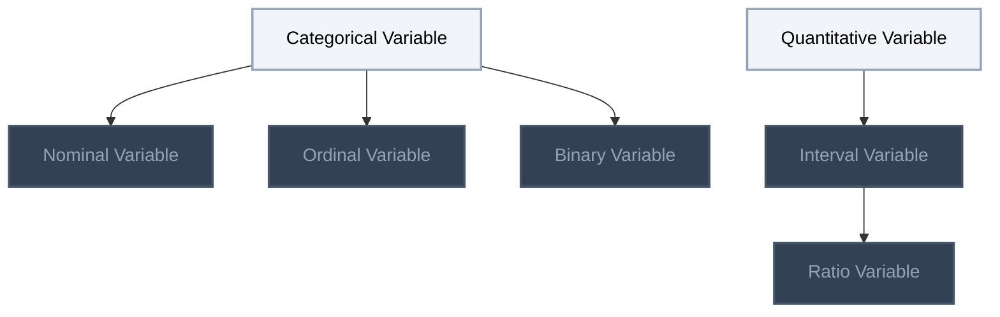

## Agresti 1.2: Distributions for Categorical Data
**Reached:** L1 0 · L2 0 · L3 0 · L4 0 · L5 0 (of 27 nodes)

```mermaid
flowchart TD
    classDef planned fill:#1E293B,stroke:#64748B,stroke-width:2px,stroke-dasharray:5 5,color:#94A3B8;
    classDef locked fill:#334155,stroke:#475569,stroke-width:2px,color:#94A3B8;
    classDef L0 fill:#F1F5F9,stroke:#94A3B8,stroke-width:2px,color:#000000;
    classDef L1 fill:#22C55E,stroke:#15803D,stroke-width:2px,color:#000000;
    classDef L2 fill:#3B82F6,stroke:#1D4ED8,stroke-width:3px,color:#FFFFFF;
    classDef L3 fill:#A855F7,stroke:#6B21A8,stroke-width:3px,color:#FFFFFF,font-weight:bold;
    classDef L4 fill:#F97316,stroke:#C2410C,stroke-width:4px,color:#000000,font-weight:bold;
    classDef L5 fill:#FFD700,stroke:#FF8C00,stroke-width:5px,color:#000000,font-weight:bold;
    classDef rusty stroke:#8B4513,stroke-width:4px,stroke-dasharray:3 3;
    subgraph sg_prereqs["Prerequisites from other groups"]
        n_independent_random_variable["Independent Random Variable"]
        n_marginal_distribution["Marginal Distribution"]
        n_discrete_random_variable["Discrete Random Variable"]
        n_probability_distribution["Probability Distribution"]
        n_variance["Variance"]
        n_correlation["Correlation"]
        n_mutually_exclusive_events["Mutually Exclusive Events"]
        n_random_experiment["Random Experiment"]
        n_expectation["Expectation"]
        n_combination["Combination"]
        n_normal_distribution["Normal Distribution"]
        n_poisson_distribution["Poisson Distribution"]
        n_linearly_dependent["Linearly Dependent"]
        n_covariance["Covariance"]
        n_negative_binomial_distribution["Negative Binomial Distribution"]
        n_moment_generating_function_technique["Moment Generating Function Technique"]
    end
    n_i_i_d["i.i.d."]
    n_discrete_probability_distribution["Discrete Probability Distribution"]
    n_probability_distribution_skewness["Probability Distribution Skewness"]
    n_probability_distribution_overdispersion["Probability Distribution Overdispersion"]
    n_overdispersion_causes["Overdispersion Causes"]
    n_bernoulli_distribution["Bernoulli Distribution"]
    n_bernoulli_distribution_expectation["Bernoulli Distribution Expectation"]
    n_bernoulli_distribution_variance["Bernoulli Distribution Variance"]
    n_binomial_distribution["Binomial Distribution"]
    n_binomial_distribution_expectation["Binomial Distribution Expectation"]
    n_binomial_distribution_variance["Binomial Distribution Variance"]
    n_binomial_distribution_skewness["Binomial Distribution Skewness"]
    n_binomial_distribution_normal_approximation["Binomial Distribution Normal Approximation"]
    n_binomial_distribution_poisson_approximation["Binomial Distribution Poisson Approximation"]
    n_multinomial_distribution["Multinomial Distribution"]
    n_multinomial_distribution_expectation["Multinomial Distribution Expectation"]
    n_multinomial_distribution_variance["Multinomial Distribution Variance"]
    n_multinomial_distribution_covariance["Multinomial Distribution Covariance"]
    n_multinomial_distribution_row_sum["Multinomial Distribution Row Sum"]
    n_multinomial_distribution_column_sum["Multinomial Distribution Column Sum"]
    n_poisson_distribution_expectation["Poisson Distribution Expectation"]
    n_poisson_distribution_variance["Poisson Distribution Variance"]
    n_poisson_distribution_skewness["Poisson Distribution Skewness"]
    n_poisson_distribution_normal_approximation["Poisson Distribution Normal Approximation"]
    n_poisson_distribution_overdispersion["Poisson Distribution Overdispersion"]
    n_poisson_distribution_addition["Poisson Distribution Addition"]
    n_poisson_distribution_and_multinomial_distribution_connection["Poisson Distribution and Multinomial Distribution Connection"]
    n_independent_random_variable --> n_i_i_d
    n_marginal_distribution --> n_i_i_d
    n_discrete_random_variable --> n_discrete_probability_distribution
    n_probability_distribution --> n_discrete_probability_distribution
    n_probability_distribution --> n_probability_distribution_skewness
    n_probability_distribution --> n_probability_distribution_overdispersion
    n_variance --> n_probability_distribution_overdispersion
    n_correlation --> n_overdispersion_causes
    n_probability_distribution_overdispersion --> n_overdispersion_causes
    n_mutually_exclusive_events --> n_bernoulli_distribution
    n_random_experiment --> n_bernoulli_distribution
    n_discrete_probability_distribution --> n_bernoulli_distribution
    n_expectation --> n_bernoulli_distribution_expectation
    n_bernoulli_distribution --> n_bernoulli_distribution_expectation
    n_variance --> n_bernoulli_distribution_variance
    n_bernoulli_distribution --> n_bernoulli_distribution_variance
    n_combination --> n_binomial_distribution
    n_i_i_d --> n_binomial_distribution
    n_bernoulli_distribution --> n_binomial_distribution
    n_expectation --> n_binomial_distribution_expectation
    n_binomial_distribution --> n_binomial_distribution_expectation
    n_variance --> n_binomial_distribution_variance
    n_binomial_distribution --> n_binomial_distribution_variance
    n_probability_distribution_skewness --> n_binomial_distribution_skewness
    n_binomial_distribution --> n_binomial_distribution_skewness
    n_normal_distribution --> n_binomial_distribution_normal_approximation
    n_binomial_distribution --> n_binomial_distribution_normal_approximation
    n_poisson_distribution --> n_binomial_distribution_poisson_approximation
    n_binomial_distribution --> n_binomial_distribution_poisson_approximation
    n_linearly_dependent --> n_multinomial_distribution
    n_binomial_distribution --> n_multinomial_distribution
    n_expectation --> n_multinomial_distribution_expectation
    n_multinomial_distribution --> n_multinomial_distribution_expectation
    n_variance --> n_multinomial_distribution_variance
    n_multinomial_distribution --> n_multinomial_distribution_variance
    n_covariance --> n_multinomial_distribution_covariance
    n_multinomial_distribution --> n_multinomial_distribution_covariance
    n_multinomial_distribution --> n_multinomial_distribution_row_sum
    n_multinomial_distribution --> n_multinomial_distribution_column_sum
    n_expectation --> n_poisson_distribution_expectation
    n_poisson_distribution --> n_poisson_distribution_expectation
    n_poisson_distribution --> n_poisson_distribution_variance
    n_variance --> n_poisson_distribution_variance
    n_poisson_distribution --> n_poisson_distribution_skewness
    n_probability_distribution_skewness --> n_poisson_distribution_skewness
    n_normal_distribution --> n_poisson_distribution_normal_approximation
    n_poisson_distribution --> n_poisson_distribution_normal_approximation
    n_negative_binomial_distribution --> n_poisson_distribution_overdispersion
    n_poisson_distribution --> n_poisson_distribution_overdispersion
    n_probability_distribution_overdispersion --> n_poisson_distribution_overdispersion
    n_independent_random_variable --> n_poisson_distribution_addition
    n_moment_generating_function_technique --> n_poisson_distribution_addition
    n_poisson_distribution --> n_poisson_distribution_addition
    n_poisson_distribution --> n_poisson_distribution_and_multinomial_distribution_connection
    n_multinomial_distribution --> n_poisson_distribution_and_multinomial_distribution_connection
    class n_marginal_distribution,n_discrete_random_variable,n_probability_distribution,n_variance,n_correlation,n_expectation,n_normal_distribution,n_poisson_distribution,n_linearly_dependent,n_covariance,n_negative_binomial_distribution,n_moment_generating_function_technique,n_i_i_d,n_discrete_probability_distribution,n_probability_distribution_skewness,n_probability_distribution_overdispersion,n_overdispersion_causes,n_bernoulli_distribution,n_bernoulli_distribution_expectation,n_bernoulli_distribution_variance,n_binomial_distribution,n_binomial_distribution_expectation,n_binomial_distribution_variance,n_binomial_distribution_skewness,n_binomial_distribution_normal_approximation,n_binomial_distribution_poisson_approximation,n_multinomial_distribution,n_multinomial_distribution_expectation,n_multinomial_distribution_variance,n_multinomial_distribution_covariance,n_multinomial_distribution_row_sum,n_multinomial_distribution_column_sum,n_poisson_distribution_expectation,n_poisson_distribution_variance,n_poisson_distribution_skewness,n_poisson_distribution_normal_approximation,n_poisson_distribution_overdispersion,n_poisson_distribution_addition,n_poisson_distribution_and_multinomial_distribution_connection locked;
    class n_independent_random_variable,n_mutually_exclusive_events,n_random_experiment L1;
    class n_combination L2;
    class n_independent_random_variable,n_marginal_distribution,n_discrete_random_variable,n_probability_distribution,n_variance,n_correlation,n_mutually_exclusive_events,n_random_experiment,n_expectation,n_combination,n_normal_distribution,n_poisson_distribution,n_linearly_dependent,n_covariance,n_negative_binomial_distribution,n_moment_generating_function_technique,n_i_i_d,n_discrete_probability_distribution,n_probability_distribution_skewness,n_probability_distribution_overdispersion,n_overdispersion_causes,n_bernoulli_distribution,n_bernoulli_distribution_expectation,n_bernoulli_distribution_variance,n_binomial_distribution,n_binomial_distribution_expectation,n_binomial_distribution_variance,n_binomial_distribution_skewness,n_binomial_distribution_normal_approximation,n_binomial_distribution_poisson_approximation,n_multinomial_distribution,n_multinomial_distribution_expectation,n_multinomial_distribution_variance,n_multinomial_distribution_covariance,n_multinomial_distribution_row_sum,n_multinomial_distribution_column_sum,n_poisson_distribution_expectation,n_poisson_distribution_variance,n_poisson_distribution_skewness,n_poisson_distribution_normal_approximation,n_poisson_distribution_overdispersion,n_poisson_distribution_addition,n_poisson_distribution_and_multinomial_distribution_connection internal-link;
```

## Agresti 1.2 / Hogg 3.3: Chi-Squared Distribution
**Reached:** L1 0 · L2 0 · L3 0 · L4 0 · L5 0 (of 4 nodes)

```mermaid
flowchart TD
    classDef planned fill:#1E293B,stroke:#64748B,stroke-width:2px,stroke-dasharray:5 5,color:#94A3B8;
    classDef locked fill:#334155,stroke:#475569,stroke-width:2px,color:#94A3B8;
    classDef L0 fill:#F1F5F9,stroke:#94A3B8,stroke-width:2px,color:#000000;
    classDef L1 fill:#22C55E,stroke:#15803D,stroke-width:2px,color:#000000;
    classDef L2 fill:#3B82F6,stroke:#1D4ED8,stroke-width:3px,color:#FFFFFF;
    classDef L3 fill:#A855F7,stroke:#6B21A8,stroke-width:3px,color:#FFFFFF,font-weight:bold;
    classDef L4 fill:#F97316,stroke:#C2410C,stroke-width:4px,color:#000000,font-weight:bold;
    classDef L5 fill:#FFD700,stroke:#FF8C00,stroke-width:5px,color:#000000,font-weight:bold;
    classDef rusty stroke:#8B4513,stroke-width:4px,stroke-dasharray:3 3;
    subgraph sg_prereqs["Prerequisites from other groups"]
        n_chi_squared_distribution["Chi-Squared Distribution"]
        n_normal_distribution["Normal Distribution"]
        n_probability_distribution_skewness["Probability Distribution Skewness"]
        n_multivariate_normal_distribution["Multivariate Normal Distribution"]
        n_gamma_distribution_addition["Gamma Distribution Addition"]
    end
    n_chi_squared_distribution_normal_approximation["Chi-Squared Distribution Normal Approximation"]
    n_chi_squared_distribution_skewness["Chi-Squared Distribution Skewness"]
    n_chi_squared_random_variable_and_normal_random_variable["Chi-Squared Random Variable and Normal Random Variable"]
    n_chi_squared_distribution_addition["Chi-Squared Distribution Addition"]
    n_chi_squared_distribution --> n_chi_squared_distribution_normal_approximation
    n_normal_distribution --> n_chi_squared_distribution_normal_approximation
    n_chi_squared_distribution --> n_chi_squared_distribution_skewness
    n_probability_distribution_skewness --> n_chi_squared_distribution_skewness
    n_chi_squared_distribution --> n_chi_squared_random_variable_and_normal_random_variable
    n_multivariate_normal_distribution --> n_chi_squared_random_variable_and_normal_random_variable
    n_chi_squared_distribution --> n_chi_squared_distribution_addition
    n_gamma_distribution_addition --> n_chi_squared_distribution_addition
    class n_chi_squared_distribution,n_normal_distribution,n_probability_distribution_skewness,n_multivariate_normal_distribution,n_gamma_distribution_addition,n_chi_squared_distribution_normal_approximation,n_chi_squared_distribution_skewness,n_chi_squared_random_variable_and_normal_random_variable,n_chi_squared_distribution_addition locked;
    class n_chi_squared_distribution,n_normal_distribution,n_probability_distribution_skewness,n_multivariate_normal_distribution,n_gamma_distribution_addition,n_chi_squared_distribution_normal_approximation,n_chi_squared_distribution_skewness,n_chi_squared_random_variable_and_normal_random_variable,n_chi_squared_distribution_addition internal-link;
```

## Exponential Families (Gelman 2.4)
**Reached:** L1 0 · L2 0 · L3 0 · L4 0 · L5 0 (of 2 nodes)

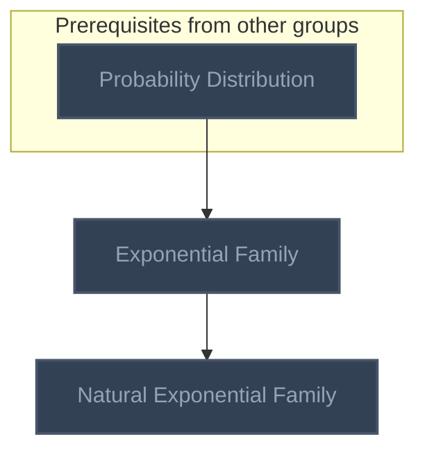

## Likelihood and Fisher Information (Agresti 1.3, Hogg 6.1-6.2, 6.4)
**Reached:** L1 0 · L2 0 · L3 0 · L4 0 · L5 0 (of 14 nodes)

```mermaid
flowchart TD
    classDef planned fill:#1E293B,stroke:#64748B,stroke-width:2px,stroke-dasharray:5 5,color:#94A3B8;
    classDef locked fill:#334155,stroke:#475569,stroke-width:2px,color:#94A3B8;
    classDef L0 fill:#F1F5F9,stroke:#94A3B8,stroke-width:2px,color:#000000;
    classDef L1 fill:#22C55E,stroke:#15803D,stroke-width:2px,color:#000000;
    classDef L2 fill:#3B82F6,stroke:#1D4ED8,stroke-width:3px,color:#FFFFFF;
    classDef L3 fill:#A855F7,stroke:#6B21A8,stroke-width:3px,color:#FFFFFF,font-weight:bold;
    classDef L4 fill:#F97316,stroke:#C2410C,stroke-width:4px,color:#000000,font-weight:bold;
    classDef L5 fill:#FFD700,stroke:#FF8C00,stroke-width:5px,color:#000000,font-weight:bold;
    classDef rusty stroke:#8B4513,stroke-width:4px,stroke-dasharray:3 3;
    subgraph sg_prereqs["Prerequisites from other groups"]
        n_probability_distribution["Probability Distribution"]
        n_random_sample["Random Sample"]
        n_logarithm["Logarithm"]
        n_expectation["Expectation"]
        n_maximum_likelihood_regularity_conditions["Maximum Likelihood Regularity Conditions"]
        n_second_derivative["Second Derivative"]
        n_normal_distribution["Normal Distribution"]
        n_standard_error["Standard Error"]
        n_maximum_likelihood_estimator_asymptotic_normality["Maximum Likelihood Estimator Asymptotic Normality"]
        n_maximum_likelihood_estimator_invariance["Maximum Likelihood Estimator Invariance"]
        n_unbiased_estimator["Unbiased Estimator"]
        n_covariance_matrix["Covariance Matrix"]
    end
    n_likelihood_function["Likelihood Function"]
    n_log_likelihood_function["Log-Likelihood Function"]
    n_maximum_likelihood_estimation["Maximum Likelihood Estimation"]
    n_score_function["Score Function"]
    n_score_function_expectation["Score Function Expectation"]
    n_fisher_information["Fisher Information"]
    n_score_function_variance["Score Function Variance"]
    n_score_function_normal_approximation["Score Function Normal Approximation"]
    n_maximum_likelihood_estimator_variance["Maximum Likelihood Estimator Variance"]
    n_maximum_likelihood_estimator_standard_error["Maximum Likelihood Estimator Standard Error"]
    n_maximum_likelihood_estimation_properties["Maximum Likelihood Estimation Properties"]
    n_fisher_information_matrix["Fisher Information Matrix"]
    n_distribution_of_estimated_parameter["Distribution of Estimated Parameter"]
    n_fisher_information_matrix_relationship_with_covariance_matrix["Fisher Information Matrix Relationship with Covariance Matrix"]
    n_probability_distribution --> n_likelihood_function
    n_random_sample --> n_likelihood_function
    n_logarithm --> n_log_likelihood_function
    n_likelihood_function --> n_log_likelihood_function
    n_log_likelihood_function --> n_maximum_likelihood_estimation
    n_log_likelihood_function --> n_score_function
    n_expectation --> n_score_function_expectation
    n_score_function --> n_score_function_expectation
    n_maximum_likelihood_regularity_conditions --> n_fisher_information
    n_second_derivative --> n_fisher_information
    n_score_function --> n_fisher_information
    n_score_function_expectation --> n_score_function_variance
    n_fisher_information --> n_score_function_variance
    n_normal_distribution --> n_score_function_normal_approximation
    n_score_function_variance --> n_score_function_normal_approximation
    n_maximum_likelihood_estimation --> n_maximum_likelihood_estimator_variance
    n_fisher_information --> n_maximum_likelihood_estimator_variance
    n_standard_error --> n_maximum_likelihood_estimator_standard_error
    n_maximum_likelihood_estimator_variance --> n_maximum_likelihood_estimator_standard_error
    n_maximum_likelihood_estimator_asymptotic_normality --> n_maximum_likelihood_estimation_properties
    n_maximum_likelihood_estimator_invariance --> n_maximum_likelihood_estimation_properties
    n_unbiased_estimator --> n_maximum_likelihood_estimation_properties
    n_maximum_likelihood_estimation --> n_maximum_likelihood_estimation_properties
    n_covariance_matrix --> n_fisher_information_matrix
    n_fisher_information --> n_fisher_information_matrix
    n_maximum_likelihood_estimator_asymptotic_normality --> n_distribution_of_estimated_parameter
    n_fisher_information_matrix --> n_distribution_of_estimated_parameter
    n_standard_error --> n_fisher_information_matrix_relationship_with_covariance_matrix
    n_distribution_of_estimated_parameter --> n_fisher_information_matrix_relationship_with_covariance_matrix
    class n_probability_distribution,n_random_sample,n_logarithm,n_expectation,n_maximum_likelihood_regularity_conditions,n_normal_distribution,n_standard_error,n_maximum_likelihood_estimator_asymptotic_normality,n_maximum_likelihood_estimator_invariance,n_covariance_matrix,n_likelihood_function,n_log_likelihood_function,n_maximum_likelihood_estimation,n_score_function,n_score_function_expectation,n_fisher_information,n_score_function_variance,n_score_function_normal_approximation,n_maximum_likelihood_estimator_variance,n_maximum_likelihood_estimator_standard_error,n_maximum_likelihood_estimation_properties,n_fisher_information_matrix,n_distribution_of_estimated_parameter,n_fisher_information_matrix_relationship_with_covariance_matrix locked;
    class n_second_derivative L0;
    class n_unbiased_estimator L1;
    class n_probability_distribution,n_random_sample,n_logarithm,n_expectation,n_maximum_likelihood_regularity_conditions,n_second_derivative,n_normal_distribution,n_standard_error,n_maximum_likelihood_estimator_asymptotic_normality,n_maximum_likelihood_estimator_invariance,n_unbiased_estimator,n_covariance_matrix,n_likelihood_function,n_log_likelihood_function,n_maximum_likelihood_estimation,n_score_function,n_score_function_expectation,n_fisher_information,n_score_function_variance,n_score_function_normal_approximation,n_maximum_likelihood_estimator_variance,n_maximum_likelihood_estimator_standard_error,n_maximum_likelihood_estimation_properties,n_fisher_information_matrix,n_distribution_of_estimated_parameter,n_fisher_information_matrix_relationship_with_covariance_matrix internal-link;
```

## Likelihood-Based Tests and Confidence Intervals (Agresti 1.3, Hogg 6.3)
**Reached:** L1 0 · L2 0 · L3 0 · L4 0 · L5 0 (of 11 nodes)

```mermaid
flowchart TD
    classDef planned fill:#1E293B,stroke:#64748B,stroke-width:2px,stroke-dasharray:5 5,color:#94A3B8;
    classDef locked fill:#334155,stroke:#475569,stroke-width:2px,color:#94A3B8;
    classDef L0 fill:#F1F5F9,stroke:#94A3B8,stroke-width:2px,color:#000000;
    classDef L1 fill:#22C55E,stroke:#15803D,stroke-width:2px,color:#000000;
    classDef L2 fill:#3B82F6,stroke:#1D4ED8,stroke-width:3px,color:#FFFFFF;
    classDef L3 fill:#A855F7,stroke:#6B21A8,stroke-width:3px,color:#FFFFFF,font-weight:bold;
    classDef L4 fill:#F97316,stroke:#C2410C,stroke-width:4px,color:#000000,font-weight:bold;
    classDef L5 fill:#FFD700,stroke:#FF8C00,stroke-width:5px,color:#000000,font-weight:bold;
    classDef rusty stroke:#8B4513,stroke-width:4px,stroke-dasharray:3 3;
    subgraph sg_prereqs["Prerequisites from other groups"]
        n_chi_squared_distribution["Chi-Squared Distribution"]
        n_statistical_hypothesis_test["Statistical Hypothesis Test"]
        n_maximum_likelihood_estimator_standard_error["Maximum Likelihood Estimator Standard Error"]
        n_maximum_likelihood_estimator_asymptotic_normality["Maximum Likelihood Estimator Asymptotic Normality"]
        n_maximum_likelihood_estimation["Maximum Likelihood Estimation"]
        n_fisher_information["Fisher Information"]
        n_score_function_normal_approximation["Score Function Normal Approximation"]
        n_confidence_interval["Confidence Interval"]
        n_p_value["P-Value"]
    end
    n_wald_test_statistic["Wald Test Statistic"]
    n_wald_test["Wald Test"]
    n_likelihood_ratio_test["Likelihood Ratio Test"]
    n_likelihood_ratio_test_statistic["Likelihood Ratio Test Statistic"]
    n_score_test["Score Test"]
    n_score_test_statistic["Score Test Statistic"]
    n_confidence_set["Confidence Set"]
    n_wald_test_confidence_interval["Wald Test Confidence Interval"]
    n_likelihood_ratio_test_confidence_interval["Likelihood Ratio Test Confidence Interval"]
    n_score_test_confidence_interval["Score Test Confidence Interval"]
    n_mid_p_value["Mid P-Value"]
    n_chi_squared_distribution --> n_wald_test_statistic
    n_statistical_hypothesis_test --> n_wald_test_statistic
    n_maximum_likelihood_estimator_standard_error --> n_wald_test_statistic
    n_maximum_likelihood_estimator_asymptotic_normality --> n_wald_test
    n_wald_test_statistic --> n_wald_test
    n_maximum_likelihood_estimator_asymptotic_normality --> n_likelihood_ratio_test
    n_statistical_hypothesis_test --> n_likelihood_ratio_test
    n_maximum_likelihood_estimation --> n_likelihood_ratio_test
    n_chi_squared_distribution --> n_likelihood_ratio_test_statistic
    n_likelihood_ratio_test --> n_likelihood_ratio_test_statistic
    n_statistical_hypothesis_test --> n_score_test
    n_maximum_likelihood_estimation --> n_score_test
    n_fisher_information --> n_score_test
    n_chi_squared_distribution --> n_score_test_statistic
    n_score_function_normal_approximation --> n_score_test_statistic
    n_score_test --> n_score_test_statistic
    n_statistical_hypothesis_test --> n_confidence_set
    n_confidence_interval --> n_wald_test_confidence_interval
    n_wald_test --> n_wald_test_confidence_interval
    n_confidence_set --> n_wald_test_confidence_interval
    n_confidence_interval --> n_likelihood_ratio_test_confidence_interval
    n_likelihood_ratio_test --> n_likelihood_ratio_test_confidence_interval
    n_confidence_set --> n_likelihood_ratio_test_confidence_interval
    n_confidence_interval --> n_score_test_confidence_interval
    n_score_test --> n_score_test_confidence_interval
    n_confidence_set --> n_score_test_confidence_interval
    n_p_value --> n_mid_p_value
    class n_chi_squared_distribution,n_statistical_hypothesis_test,n_maximum_likelihood_estimator_standard_error,n_maximum_likelihood_estimator_asymptotic_normality,n_maximum_likelihood_estimation,n_fisher_information,n_score_function_normal_approximation,n_confidence_interval,n_p_value,n_wald_test_statistic,n_wald_test,n_likelihood_ratio_test,n_likelihood_ratio_test_statistic,n_score_test,n_score_test_statistic,n_confidence_set,n_wald_test_confidence_interval,n_likelihood_ratio_test_confidence_interval,n_score_test_confidence_interval,n_mid_p_value locked;
    class n_chi_squared_distribution,n_statistical_hypothesis_test,n_maximum_likelihood_estimator_standard_error,n_maximum_likelihood_estimator_asymptotic_normality,n_maximum_likelihood_estimation,n_fisher_information,n_score_function_normal_approximation,n_confidence_interval,n_p_value,n_wald_test_statistic,n_wald_test,n_likelihood_ratio_test,n_likelihood_ratio_test_statistic,n_score_test,n_score_test_statistic,n_confidence_set,n_wald_test_confidence_interval,n_likelihood_ratio_test_confidence_interval,n_score_test_confidence_interval,n_mid_p_value internal-link;
```

## Inference for Binomial and Multinomial Parameters (Agresti 1.4-1.5)
**Reached:** L1 0 · L2 0 · L3 0 · L4 0 · L5 0 (of 19 nodes)

```mermaid
flowchart TD
    classDef planned fill:#1E293B,stroke:#64748B,stroke-width:2px,stroke-dasharray:5 5,color:#94A3B8;
    classDef locked fill:#334155,stroke:#475569,stroke-width:2px,color:#94A3B8;
    classDef L0 fill:#F1F5F9,stroke:#94A3B8,stroke-width:2px,color:#000000;
    classDef L1 fill:#22C55E,stroke:#15803D,stroke-width:2px,color:#000000;
    classDef L2 fill:#3B82F6,stroke:#1D4ED8,stroke-width:3px,color:#FFFFFF;
    classDef L3 fill:#A855F7,stroke:#6B21A8,stroke-width:3px,color:#FFFFFF,font-weight:bold;
    classDef L4 fill:#F97316,stroke:#C2410C,stroke-width:4px,color:#000000,font-weight:bold;
    classDef L5 fill:#FFD700,stroke:#FF8C00,stroke-width:5px,color:#000000,font-weight:bold;
    classDef rusty stroke:#8B4513,stroke-width:4px,stroke-dasharray:3 3;
    subgraph sg_prereqs["Prerequisites from other groups"]
        n_binomial_distribution["Binomial Distribution"]
        n_maximum_likelihood_estimation["Maximum Likelihood Estimation"]
        n_unbiased_estimator["Unbiased Estimator"]
        n_binomial_distribution_variance["Binomial Distribution Variance"]
        n_score_function["Score Function"]
        n_fisher_information["Fisher Information"]
        n_wald_test["Wald Test"]
        n_wald_test_confidence_interval["Wald Test Confidence Interval"]
        n_score_test["Score Test"]
        n_score_test_statistic["Score Test Statistic"]
        n_score_test_confidence_interval["Score Test Confidence Interval"]
        n_likelihood_ratio_test["Likelihood Ratio Test"]
        n_likelihood_ratio_test_statistic["Likelihood Ratio Test Statistic"]
        n_likelihood_ratio_test_confidence_interval["Likelihood Ratio Test Confidence Interval"]
        n_multinomial_distribution["Multinomial Distribution"]
    end
    n_binomial_distribution_maximum_likelihood_estimation["Binomial Distribution Maximum Likelihood Estimation"]
    n_binomial_distribution_maximum_likelihood_estimator_expectation["Binomial Distribution Maximum Likelihood Estimator Expectation"]
    n_binomial_distribution_maximum_likelihood_estimator_variance["Binomial Distribution Maximum Likelihood Estimator Variance"]
    n_binomial_distribution_score_function["Binomial Distribution Score Function"]
    n_binomial_distribution_fisher_information["Binomial Distribution Fisher Information"]
    n_binomial_distribution_maximum_likelihood_estimation_wald_test["Binomial Distribution Maximum Likelihood Estimation Wald Test"]
    n_binomial_distribution_maximum_likelihood_estimation_wald_test_statistic["Binomial Distribution Maximum Likelihood Estimation Wald Test Statistic"]
    n_binomial_distribution_maximum_likelihood_estimation_wald_test_confidence_interval["Binomial Distribution Maximum Likelihood Estimation Wald Test Confidence Interval"]
    n_binomial_distribution_maximum_likelihood_estimation_score_test["Binomial Distribution Maximum Likelihood Estimation Score Test"]
    n_binomial_distribution_maximum_likelihood_estimation_score_test_statistic["Binomial Distribution Maximum Likelihood Estimation Score Test Statistic"]
    n_binomial_distribution_maximum_likelihood_estimation_score_test_confidence_interval["Binomial Distribution Maximum Likelihood Estimation Score Test Confidence Interval"]
    n_binomial_distribution_maximum_likelihood_estimation_likelihood_ratio_test["Binomial Distribution Maximum Likelihood Estimation Likelihood Ratio Test"]
    n_binomial_distribution_maximum_likelihood_estimation_likelihood_ratio_test_statistic["Binomial Distribution Maximum Likelihood Estimation Likelihood Ratio Test Statistic"]
    n_binomial_distribution_maximum_likelihood_estimation_likelihood_ratio_test_confidence_interval["Binomial Distribution Maximum Likelihood Estimation Likelihood Ratio Test Confidence Interval"]
    n_multinomial_distribution_maximum_likelihood_estimation["Multinomial Distribution Maximum Likelihood Estimation"]
    n_multinomial_distribution_maximum_likelihood_estimation_score_test["Multinomial Distribution Maximum Likelihood Estimation Score Test"]
    n_multinomial_distribution_maximum_likelihood_estimation_score_test_statistic["Multinomial Distribution Maximum Likelihood Estimation Score Test Statistic"]
    n_multinomial_distribution_maximum_likelihood_estimation_likelihood_ratio_test["Multinomial Distribution Maximum Likelihood Estimation Likelihood Ratio Test"]
    n_multinomial_distribution_maximum_likelihood_estimation_likelihood_ratio_test_statistic["Multinomial Distribution Maximum Likelihood Estimation Likelihood Ratio Test Statistic"]
    n_binomial_distribution --> n_binomial_distribution_maximum_likelihood_estimation
    n_maximum_likelihood_estimation --> n_binomial_distribution_maximum_likelihood_estimation
    n_unbiased_estimator --> n_binomial_distribution_maximum_likelihood_estimator_expectation
    n_binomial_distribution_maximum_likelihood_estimation --> n_binomial_distribution_maximum_likelihood_estimator_expectation
    n_binomial_distribution_variance --> n_binomial_distribution_maximum_likelihood_estimator_variance
    n_binomial_distribution_maximum_likelihood_estimation --> n_binomial_distribution_maximum_likelihood_estimator_variance
    n_score_function --> n_binomial_distribution_score_function
    n_binomial_distribution_maximum_likelihood_estimation --> n_binomial_distribution_score_function
    n_fisher_information --> n_binomial_distribution_fisher_information
    n_binomial_distribution_score_function --> n_binomial_distribution_fisher_information
    n_wald_test --> n_binomial_distribution_maximum_likelihood_estimation_wald_test
    n_binomial_distribution_maximum_likelihood_estimation --> n_binomial_distribution_maximum_likelihood_estimation_wald_test
    n_binomial_distribution_fisher_information --> n_binomial_distribution_maximum_likelihood_estimation_wald_test_statistic
    n_binomial_distribution_maximum_likelihood_estimation_wald_test --> n_binomial_distribution_maximum_likelihood_estimation_wald_test_statistic
    n_wald_test_confidence_interval --> n_binomial_distribution_maximum_likelihood_estimation_wald_test_confidence_interval
    n_binomial_distribution_maximum_likelihood_estimation_wald_test_statistic --> n_binomial_distribution_maximum_likelihood_estimation_wald_test_confidence_interval
    n_score_test --> n_binomial_distribution_maximum_likelihood_estimation_score_test
    n_binomial_distribution_maximum_likelihood_estimation --> n_binomial_distribution_maximum_likelihood_estimation_score_test
    n_score_test_statistic --> n_binomial_distribution_maximum_likelihood_estimation_score_test_statistic
    n_binomial_distribution_fisher_information --> n_binomial_distribution_maximum_likelihood_estimation_score_test_statistic
    n_binomial_distribution_maximum_likelihood_estimation_score_test --> n_binomial_distribution_maximum_likelihood_estimation_score_test_statistic
    n_score_test_confidence_interval --> n_binomial_distribution_maximum_likelihood_estimation_score_test_confidence_interval
    n_binomial_distribution_maximum_likelihood_estimation_score_test_statistic --> n_binomial_distribution_maximum_likelihood_estimation_score_test_confidence_interval
    n_likelihood_ratio_test --> n_binomial_distribution_maximum_likelihood_estimation_likelihood_ratio_test
    n_binomial_distribution_maximum_likelihood_estimation --> n_binomial_distribution_maximum_likelihood_estimation_likelihood_ratio_test
    n_likelihood_ratio_test_statistic --> n_binomial_distribution_maximum_likelihood_estimation_likelihood_ratio_test_statistic
    n_binomial_distribution_maximum_likelihood_estimation_likelihood_ratio_test --> n_binomial_distribution_maximum_likelihood_estimation_likelihood_ratio_test_statistic
    n_likelihood_ratio_test_confidence_interval --> n_binomial_distribution_maximum_likelihood_estimation_likelihood_ratio_test_confidence_interval
    n_binomial_distribution_maximum_likelihood_estimation_likelihood_ratio_test_statistic --> n_binomial_distribution_maximum_likelihood_estimation_likelihood_ratio_test_confidence_interval
    n_multinomial_distribution --> n_multinomial_distribution_maximum_likelihood_estimation
    n_maximum_likelihood_estimation --> n_multinomial_distribution_maximum_likelihood_estimation
    n_score_test --> n_multinomial_distribution_maximum_likelihood_estimation_score_test
    n_multinomial_distribution_maximum_likelihood_estimation --> n_multinomial_distribution_maximum_likelihood_estimation_score_test
    n_score_test_statistic --> n_multinomial_distribution_maximum_likelihood_estimation_score_test_statistic
    n_multinomial_distribution_maximum_likelihood_estimation_score_test --> n_multinomial_distribution_maximum_likelihood_estimation_score_test_statistic
    n_likelihood_ratio_test --> n_multinomial_distribution_maximum_likelihood_estimation_likelihood_ratio_test
    n_multinomial_distribution_maximum_likelihood_estimation --> n_multinomial_distribution_maximum_likelihood_estimation_likelihood_ratio_test
    n_likelihood_ratio_test_statistic --> n_multinomial_distribution_maximum_likelihood_estimation_likelihood_ratio_test_statistic
    n_multinomial_distribution_maximum_likelihood_estimation_likelihood_ratio_test --> n_multinomial_distribution_maximum_likelihood_estimation_likelihood_ratio_test_statistic
    class n_binomial_distribution,n_maximum_likelihood_estimation,n_binomial_distribution_variance,n_score_function,n_fisher_information,n_wald_test,n_wald_test_confidence_interval,n_score_test,n_score_test_statistic,n_score_test_confidence_interval,n_likelihood_ratio_test,n_likelihood_ratio_test_statistic,n_likelihood_ratio_test_confidence_interval,n_multinomial_distribution,n_binomial_distribution_maximum_likelihood_estimation,n_binomial_distribution_maximum_likelihood_estimator_expectation,n_binomial_distribution_maximum_likelihood_estimator_variance,n_binomial_distribution_score_function,n_binomial_distribution_fisher_information,n_binomial_distribution_maximum_likelihood_estimation_wald_test,n_binomial_distribution_maximum_likelihood_estimation_wald_test_statistic,n_binomial_distribution_maximum_likelihood_estimation_wald_test_confidence_interval,n_binomial_distribution_maximum_likelihood_estimation_score_test,n_binomial_distribution_maximum_likelihood_estimation_score_test_statistic,n_binomial_distribution_maximum_likelihood_estimation_score_test_confidence_interval,n_binomial_distribution_maximum_likelihood_estimation_likelihood_ratio_test,n_binomial_distribution_maximum_likelihood_estimation_likelihood_ratio_test_statistic,n_binomial_distribution_maximum_likelihood_estimation_likelihood_ratio_test_confidence_interval,n_multinomial_distribution_maximum_likelihood_estimation,n_multinomial_distribution_maximum_likelihood_estimation_score_test,n_multinomial_distribution_maximum_likelihood_estimation_score_test_statistic,n_multinomial_distribution_maximum_likelihood_estimation_likelihood_ratio_test,n_multinomial_distribution_maximum_likelihood_estimation_likelihood_ratio_test_statistic locked;
    class n_unbiased_estimator L1;
    class n_binomial_distribution,n_maximum_likelihood_estimation,n_unbiased_estimator,n_binomial_distribution_variance,n_score_function,n_fisher_information,n_wald_test,n_wald_test_confidence_interval,n_score_test,n_score_test_statistic,n_score_test_confidence_interval,n_likelihood_ratio_test,n_likelihood_ratio_test_statistic,n_likelihood_ratio_test_confidence_interval,n_multinomial_distribution,n_binomial_distribution_maximum_likelihood_estimation,n_binomial_distribution_maximum_likelihood_estimator_expectation,n_binomial_distribution_maximum_likelihood_estimator_variance,n_binomial_distribution_score_function,n_binomial_distribution_fisher_information,n_binomial_distribution_maximum_likelihood_estimation_wald_test,n_binomial_distribution_maximum_likelihood_estimation_wald_test_statistic,n_binomial_distribution_maximum_likelihood_estimation_wald_test_confidence_interval,n_binomial_distribution_maximum_likelihood_estimation_score_test,n_binomial_distribution_maximum_likelihood_estimation_score_test_statistic,n_binomial_distribution_maximum_likelihood_estimation_score_test_confidence_interval,n_binomial_distribution_maximum_likelihood_estimation_likelihood_ratio_test,n_binomial_distribution_maximum_likelihood_estimation_likelihood_ratio_test_statistic,n_binomial_distribution_maximum_likelihood_estimation_likelihood_ratio_test_confidence_interval,n_multinomial_distribution_maximum_likelihood_estimation,n_multinomial_distribution_maximum_likelihood_estimation_score_test,n_multinomial_distribution_maximum_likelihood_estimation_score_test_statistic,n_multinomial_distribution_maximum_likelihood_estimation_likelihood_ratio_test,n_multinomial_distribution_maximum_likelihood_estimation_likelihood_ratio_test_statistic internal-link;
```

## Contingency Tables (Agresti Ch. 2)
**Reached:** L1 0 · L2 0 · L3 0 · L4 0 · L5 0 (of 16 nodes)

```mermaid
flowchart TD
    classDef planned fill:#1E293B,stroke:#64748B,stroke-width:2px,stroke-dasharray:5 5,color:#94A3B8;
    classDef locked fill:#334155,stroke:#475569,stroke-width:2px,color:#94A3B8;
    classDef L0 fill:#F1F5F9,stroke:#94A3B8,stroke-width:2px,color:#000000;
    classDef L1 fill:#22C55E,stroke:#15803D,stroke-width:2px,color:#000000;
    classDef L2 fill:#3B82F6,stroke:#1D4ED8,stroke-width:3px,color:#FFFFFF;
    classDef L3 fill:#A855F7,stroke:#6B21A8,stroke-width:3px,color:#FFFFFF,font-weight:bold;
    classDef L4 fill:#F97316,stroke:#C2410C,stroke-width:4px,color:#000000,font-weight:bold;
    classDef L5 fill:#FFD700,stroke:#FF8C00,stroke-width:5px,color:#000000,font-weight:bold;
    classDef rusty stroke:#8B4513,stroke-width:4px,stroke-dasharray:3 3;
    subgraph sg_prereqs["Prerequisites from other groups"]
        n_categorical_variable["Categorical Variable"]
        n_probability["Probability"]
        n_confidence_interval["Confidence Interval"]
        n_two_sample_confidence_interval_for_difference_of_means["Two-Sample Confidence Interval for Difference of Means"]
        n_bernoulli_distribution["Bernoulli Distribution"]
        n_conditional_probability["Conditional Probability"]
        n_independent_random_variable["Independent Random Variable"]
    end
    n_contingency_table["Contingency Table"]
    n_two_way_contingency_table["Two-Way Contingency Table"]
    n_homogeneity["Homogeneity"]
    n_difference_of_proportions["Difference of Proportions"]
    n_relative_risk["Relative Risk"]
    n_odds["Odds"]
    n_odds_ratio["Odds Ratio"]
    n_odds_ratio_basic_properties["Odds Ratio Basic Properties"]
    n_odds_ratio_relation_with_relative_risk["Odds Ratio Relation With Relative Risk"]
    n_difference_of_proportions_confidence_interval["Difference of Proportions Confidence Interval"]
    n_relative_risk_confidence_interval["Relative Risk Confidence Interval"]
    n_odds_ratio_confidence_interval["Odds Ratio Confidence Interval"]
    n_three_way_contingency_table["Three-Way Contingency Table"]
    n_conditional_odds_ratio["Conditional Odds Ratio"]
    n_marginal_odds_ratio["Marginal Odds Ratio"]
    n_simpson_s_paradox["Simpson's Paradox"]
    n_categorical_variable --> n_contingency_table
    n_contingency_table --> n_two_way_contingency_table
    n_two_way_contingency_table --> n_homogeneity
    n_homogeneity --> n_difference_of_proportions
    n_homogeneity --> n_relative_risk
    n_probability --> n_odds
    n_homogeneity --> n_odds_ratio
    n_odds --> n_odds_ratio
    n_odds_ratio --> n_odds_ratio_basic_properties
    n_relative_risk --> n_odds_ratio_relation_with_relative_risk
    n_odds_ratio --> n_odds_ratio_relation_with_relative_risk
    n_confidence_interval --> n_difference_of_proportions_confidence_interval
    n_two_sample_confidence_interval_for_difference_of_means --> n_difference_of_proportions_confidence_interval
    n_bernoulli_distribution --> n_difference_of_proportions_confidence_interval
    n_difference_of_proportions --> n_difference_of_proportions_confidence_interval
    n_confidence_interval --> n_relative_risk_confidence_interval
    n_relative_risk --> n_relative_risk_confidence_interval
    n_confidence_interval --> n_odds_ratio_confidence_interval
    n_odds_ratio --> n_odds_ratio_confidence_interval
    n_conditional_probability --> n_three_way_contingency_table
    n_independent_random_variable --> n_three_way_contingency_table
    n_two_way_contingency_table --> n_three_way_contingency_table
    n_odds_ratio --> n_conditional_odds_ratio
    n_three_way_contingency_table --> n_conditional_odds_ratio
    n_odds_ratio --> n_marginal_odds_ratio
    n_three_way_contingency_table --> n_marginal_odds_ratio
    n_conditional_odds_ratio --> n_simpson_s_paradox
    n_marginal_odds_ratio --> n_simpson_s_paradox
    class n_confidence_interval,n_two_sample_confidence_interval_for_difference_of_means,n_bernoulli_distribution,n_contingency_table,n_two_way_contingency_table,n_homogeneity,n_difference_of_proportions,n_relative_risk,n_odds_ratio,n_odds_ratio_basic_properties,n_odds_ratio_relation_with_relative_risk,n_difference_of_proportions_confidence_interval,n_relative_risk_confidence_interval,n_odds_ratio_confidence_interval,n_three_way_contingency_table,n_conditional_odds_ratio,n_marginal_odds_ratio,n_simpson_s_paradox locked;
    class n_categorical_variable,n_conditional_probability,n_odds L0;
    class n_probability,n_independent_random_variable L1;
    class n_categorical_variable,n_probability,n_confidence_interval,n_two_sample_confidence_interval_for_difference_of_means,n_bernoulli_distribution,n_conditional_probability,n_independent_random_variable,n_contingency_table,n_two_way_contingency_table,n_homogeneity,n_difference_of_proportions,n_relative_risk,n_odds,n_odds_ratio,n_odds_ratio_basic_properties,n_odds_ratio_relation_with_relative_risk,n_difference_of_proportions_confidence_interval,n_relative_risk_confidence_interval,n_odds_ratio_confidence_interval,n_three_way_contingency_table,n_conditional_odds_ratio,n_marginal_odds_ratio,n_simpson_s_paradox internal-link;
```

## Logistic and Logit Functions
**Reached:** L1 0 · L2 0 · L3 0 · L4 0 · L5 0 (of 4 nodes)

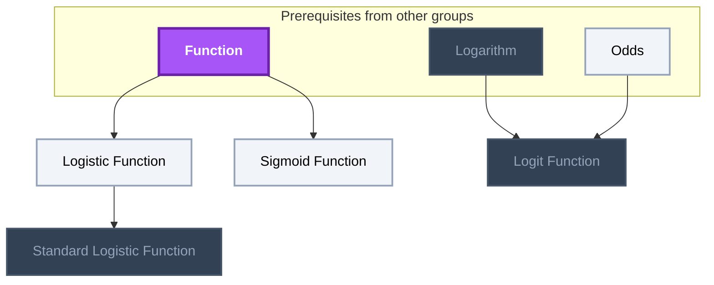

## Generalized Linear Models (Agresti Ch. 3-4)
**Reached:** L1 0 · L2 0 · L3 0 · L4 0 · L5 0 (of 11 nodes)

```mermaid
flowchart TD
    classDef planned fill:#1E293B,stroke:#64748B,stroke-width:2px,stroke-dasharray:5 5,color:#94A3B8;
    classDef locked fill:#334155,stroke:#475569,stroke-width:2px,color:#94A3B8;
    classDef L0 fill:#F1F5F9,stroke:#94A3B8,stroke-width:2px,color:#000000;
    classDef L1 fill:#22C55E,stroke:#15803D,stroke-width:2px,color:#000000;
    classDef L2 fill:#3B82F6,stroke:#1D4ED8,stroke-width:3px,color:#FFFFFF;
    classDef L3 fill:#A855F7,stroke:#6B21A8,stroke-width:3px,color:#FFFFFF,font-weight:bold;
    classDef L4 fill:#F97316,stroke:#C2410C,stroke-width:4px,color:#000000,font-weight:bold;
    classDef L5 fill:#FFD700,stroke:#FF8C00,stroke-width:5px,color:#000000,font-weight:bold;
    classDef rusty stroke:#8B4513,stroke-width:4px,stroke-dasharray:3 3;
    subgraph sg_prereqs["Prerequisites from other groups"]
        n_differentiable_function["Differentiable Function"]
        n_monotonic_function["Monotonic Function"]
        n_exponential_family["Exponential Family"]
        n_independent_random_variable["Independent Random Variable"]
        n_linear_regression["Linear Regression"]
        n_normal_distribution["Normal Distribution"]
        n_regression["Regression"]
        n_standard_logistic_function["Standard Logistic Function"]
        n_bernoulli_distribution["Bernoulli Distribution"]
        n_logit_function["Logit Function"]
        n_binomial_distribution["Binomial Distribution"]
        n_logarithm["Logarithm"]
        n_poisson_distribution["Poisson Distribution"]
    end
    n_link_function["Link Function"]
    n_generalized_linear_model["Generalized Linear Model"]
    n_generalized_linear_model_assumptions["Generalized Linear Model Assumptions"]
    n_linear_regression_as_generalized_linear_model["Linear Regression as Generalized Linear Model"]
    n_logistic_regression["Logistic Regression"]
    n_binary_logistic_regression["Binary Logistic Regression"]
    n_binary_logistic_regression_as_generalized_linear_model["Binary Logistic Regression as Generalized Linear Model"]
    n_binomial_regression["Binomial Regression"]
    n_log_linear_regression["Log-Linear Regression"]
    n_poisson_regression["Poisson Regression"]
    n_poisson_regression_as_generalized_linear_model["Poisson Regression as Generalized Linear Model"]
    n_differentiable_function --> n_link_function
    n_monotonic_function --> n_link_function
    n_exponential_family --> n_generalized_linear_model
    n_link_function --> n_generalized_linear_model
    n_independent_random_variable --> n_generalized_linear_model_assumptions
    n_generalized_linear_model --> n_generalized_linear_model_assumptions
    n_linear_regression --> n_linear_regression_as_generalized_linear_model
    n_normal_distribution --> n_linear_regression_as_generalized_linear_model
    n_generalized_linear_model_assumptions --> n_linear_regression_as_generalized_linear_model
    n_regression --> n_logistic_regression
    n_standard_logistic_function --> n_logistic_regression
    n_bernoulli_distribution --> n_binary_logistic_regression
    n_logistic_regression --> n_binary_logistic_regression
    n_logit_function --> n_binary_logistic_regression_as_generalized_linear_model
    n_generalized_linear_model --> n_binary_logistic_regression_as_generalized_linear_model
    n_binary_logistic_regression --> n_binary_logistic_regression_as_generalized_linear_model
    n_binomial_distribution --> n_binomial_regression
    n_logistic_regression --> n_binomial_regression
    n_logarithm --> n_log_linear_regression
    n_regression --> n_log_linear_regression
    n_poisson_distribution --> n_poisson_regression
    n_log_linear_regression --> n_poisson_regression
    n_generalized_linear_model --> n_poisson_regression_as_generalized_linear_model
    n_poisson_regression --> n_poisson_regression_as_generalized_linear_model
    n_regression --> n_poisson_regression
    class n_monotonic_function,n_exponential_family,n_linear_regression,n_normal_distribution,n_regression,n_standard_logistic_function,n_bernoulli_distribution,n_logit_function,n_binomial_distribution,n_logarithm,n_poisson_distribution,n_link_function,n_generalized_linear_model,n_generalized_linear_model_assumptions,n_linear_regression_as_generalized_linear_model,n_logistic_regression,n_binary_logistic_regression,n_binary_logistic_regression_as_generalized_linear_model,n_binomial_regression,n_log_linear_regression,n_poisson_regression,n_poisson_regression_as_generalized_linear_model locked;
    class n_independent_random_variable L1;
    class n_differentiable_function L3;
    class n_differentiable_function,n_monotonic_function,n_exponential_family,n_independent_random_variable,n_linear_regression,n_normal_distribution,n_regression,n_standard_logistic_function,n_bernoulli_distribution,n_logit_function,n_binomial_distribution,n_logarithm,n_poisson_distribution,n_link_function,n_generalized_linear_model,n_generalized_linear_model_assumptions,n_linear_regression_as_generalized_linear_model,n_logistic_regression,n_binary_logistic_regression,n_binary_logistic_regression_as_generalized_linear_model,n_binomial_regression,n_log_linear_regression,n_poisson_regression,n_poisson_regression_as_generalized_linear_model internal-link;
```

## GLM Inference, Deviance and Residuals (Agresti Ch. 4)
**Reached:** L1 0 · L2 0 · L3 0 · L4 0 · L5 0 (of 15 nodes)

```mermaid
flowchart TD
    classDef planned fill:#1E293B,stroke:#64748B,stroke-width:2px,stroke-dasharray:5 5,color:#94A3B8;
    classDef locked fill:#334155,stroke:#475569,stroke-width:2px,color:#94A3B8;
    classDef L0 fill:#F1F5F9,stroke:#94A3B8,stroke-width:2px,color:#000000;
    classDef L1 fill:#22C55E,stroke:#15803D,stroke-width:2px,color:#000000;
    classDef L2 fill:#3B82F6,stroke:#1D4ED8,stroke-width:3px,color:#FFFFFF;
    classDef L3 fill:#A855F7,stroke:#6B21A8,stroke-width:3px,color:#FFFFFF,font-weight:bold;
    classDef L4 fill:#F97316,stroke:#C2410C,stroke-width:4px,color:#000000,font-weight:bold;
    classDef L5 fill:#FFD700,stroke:#FF8C00,stroke-width:5px,color:#000000,font-weight:bold;
    classDef rusty stroke:#8B4513,stroke-width:4px,stroke-dasharray:3 3;
    subgraph sg_prereqs["Prerequisites from other groups"]
        n_fisher_information_matrix["Fisher Information Matrix"]
        n_generalized_linear_model["Generalized Linear Model"]
        n_binomial_regression["Binomial Regression"]
        n_likelihood_ratio_test_statistic["Likelihood Ratio Test Statistic"]
        n_p_value["P-Value"]
        n_likelihood_ratio_test_confidence_interval["Likelihood Ratio Test Confidence Interval"]
        n_log_linear_regression["Log-Linear Regression"]
        n_poisson_regression["Poisson Regression"]
        n_contingency_table["Contingency Table"]
    end
    n_generalized_linear_model_fisher_information_matrix["Generalized Linear Model Fisher Information Matrix"]
    n_binomial_regression_fisher_information_matrix["Binomial Regression Fisher Information Matrix"]
    n_generalized_linear_model_deviance["Generalized Linear Model Deviance"]
    n_nested_model_comparison["Nested Model Comparison"]
    n_profile_likelihood_confidence_interval["Profile Likelihood Confidence Interval"]
    n_log_linear_regression_deviance["Log-Linear Regression Deviance"]
    n_poisson_regression_deviance["Poisson Regression Deviance"]
    n_binomial_regression_deviance["Binomial Regression Deviance"]
    n_raw_residual["Raw Residual"]
    n_pearson_residual["Pearson Residual"]
    n_deviance_residual["Deviance Residual"]
    n_standardized_residual["Standardized Residual"]
    n_contingency_table_raw_residual["Contingency Table Raw Residual"]
    n_contingency_table_pearson_residual["Contingency Table Pearson Residual"]
    n_contingency_table_standardized_residual["Contingency Table Standardized Residual"]
    n_fisher_information_matrix --> n_generalized_linear_model_fisher_information_matrix
    n_generalized_linear_model --> n_generalized_linear_model_fisher_information_matrix
    n_binomial_regression --> n_binomial_regression_fisher_information_matrix
    n_generalized_linear_model_fisher_information_matrix --> n_binomial_regression_fisher_information_matrix
    n_likelihood_ratio_test_statistic --> n_generalized_linear_model_deviance
    n_generalized_linear_model --> n_generalized_linear_model_deviance
    n_generalized_linear_model_deviance --> n_nested_model_comparison
    n_p_value --> n_profile_likelihood_confidence_interval
    n_likelihood_ratio_test_confidence_interval --> n_profile_likelihood_confidence_interval
    n_nested_model_comparison --> n_profile_likelihood_confidence_interval
    n_log_linear_regression --> n_log_linear_regression_deviance
    n_generalized_linear_model_deviance --> n_log_linear_regression_deviance
    n_poisson_regression --> n_poisson_regression_deviance
    n_generalized_linear_model_deviance --> n_poisson_regression_deviance
    n_binomial_regression --> n_binomial_regression_deviance
    n_generalized_linear_model_deviance --> n_binomial_regression_deviance
    n_generalized_linear_model --> n_raw_residual
    n_raw_residual --> n_pearson_residual
    n_generalized_linear_model_deviance --> n_deviance_residual
    n_pearson_residual --> n_standardized_residual
    n_contingency_table --> n_contingency_table_raw_residual
    n_raw_residual --> n_contingency_table_raw_residual
    n_pearson_residual --> n_contingency_table_pearson_residual
    n_contingency_table_raw_residual --> n_contingency_table_pearson_residual
    n_standardized_residual --> n_contingency_table_standardized_residual
    n_contingency_table_pearson_residual --> n_contingency_table_standardized_residual
    class n_fisher_information_matrix,n_generalized_linear_model,n_binomial_regression,n_likelihood_ratio_test_statistic,n_p_value,n_likelihood_ratio_test_confidence_interval,n_log_linear_regression,n_poisson_regression,n_contingency_table,n_generalized_linear_model_fisher_information_matrix,n_binomial_regression_fisher_information_matrix,n_generalized_linear_model_deviance,n_nested_model_comparison,n_profile_likelihood_confidence_interval,n_log_linear_regression_deviance,n_poisson_regression_deviance,n_binomial_regression_deviance,n_raw_residual,n_pearson_residual,n_deviance_residual,n_standardized_residual,n_contingency_table_raw_residual,n_contingency_table_pearson_residual,n_contingency_table_standardized_residual locked;
    class n_fisher_information_matrix,n_generalized_linear_model,n_binomial_regression,n_likelihood_ratio_test_statistic,n_p_value,n_likelihood_ratio_test_confidence_interval,n_log_linear_regression,n_poisson_regression,n_contingency_table,n_generalized_linear_model_fisher_information_matrix,n_binomial_regression_fisher_information_matrix,n_generalized_linear_model_deviance,n_nested_model_comparison,n_profile_likelihood_confidence_interval,n_log_linear_regression_deviance,n_poisson_regression_deviance,n_binomial_regression_deviance,n_raw_residual,n_pearson_residual,n_deviance_residual,n_standardized_residual,n_contingency_table_raw_residual,n_contingency_table_pearson_residual,n_contingency_table_standardized_residual internal-link;
```

# Source
Graph structure: the single source for the diagrams above, edited by `/note` and `Scripts/skill_trees.py` (`add`, `edge`, `rename`). Everything above this heading is regenerated by `render`.

```skilltree
    %% PREREQUISITES
    n_probability_distribution["Probability Distribution"]
    n_differentiable_function["Differentiable Function"]
    n_second_derivative["Second Derivative"]
    n_linear_regression["Linear Regression"]
    n_regression["Regression"]
    n_conditional_probability["Conditional Probability"]
    n_probability["Probability"]
    n_linearly_dependent["Linearly Dependent"]
    n_chi_squared_distribution["Chi-Squared Distribution"]
    n_combination["Combination"]
    n_correlation["Correlation"]
    n_covariance["Covariance"]
    n_covariance_matrix["Covariance Matrix"]
    n_discrete_random_variable["Discrete Random Variable"]
    n_expectation["Expectation"]
    n_gamma_distribution_addition["Gamma Distribution Addition"]
    n_independent_random_variable["Independent Random Variable"]
    n_marginal_distribution["Marginal Distribution"]
    n_maximum_likelihood_estimator_asymptotic_normality["Maximum Likelihood Estimator Asymptotic Normality"]
    n_maximum_likelihood_estimator_invariance["Maximum Likelihood Estimator Invariance"]
    n_maximum_likelihood_regularity_conditions["Maximum Likelihood Regularity Conditions"]
    n_moment_generating_function_technique["Moment Generating Function Technique"]
    n_multivariate_normal_distribution["Multivariate Normal Distribution"]
    n_mutually_exclusive_events["Mutually Exclusive Events"]
    n_negative_binomial_distribution["Negative Binomial Distribution"]
    n_normal_distribution["Normal Distribution"]
    n_p_value["P-Value"]
    n_poisson_distribution["Poisson Distribution"]
    n_random_experiment["Random Experiment"]
    n_random_sample["Random Sample"]
    n_statistical_hypothesis_test["Statistical Hypothesis Test"]
    n_two_sample_confidence_interval_for_difference_of_means["Two-Sample Confidence Interval for Difference of Means"]
    n_variance["Variance"]
    n_function["Function"]
    n_logarithm["Logarithm"]
    n_monotonic_function["Monotonic Function"]
    n_confidence_interval["Confidence Interval"]
    n_standard_error["Standard Error"]
    n_unbiased_estimator["Unbiased Estimator"]
    %% NODES
    %% == Agresti 1.1: Variable Types ==
    n_categorical_variable["Categorical Variable"]
    n_quantitative_variable["Quantitative Variable"]
    n_nominal_variable["Nominal Variable"]
    n_ordinal_variable["Ordinal Variable"]
    n_binary_variable["Binary Variable"]
    n_interval_variable["Interval Variable"]
    n_ratio_variable["Ratio Variable"]
    %% == Agresti 1.2: Distributions for Categorical Data ==
    n_i_i_d["i.i.d."]
    n_discrete_probability_distribution["Discrete Probability Distribution"]
    n_probability_distribution_skewness["Probability Distribution Skewness"]
    n_probability_distribution_overdispersion["Probability Distribution Overdispersion"]
    n_overdispersion_causes["Overdispersion Causes"]
    n_bernoulli_distribution["Bernoulli Distribution"]
    n_bernoulli_distribution_expectation["Bernoulli Distribution Expectation"]
    n_bernoulli_distribution_variance["Bernoulli Distribution Variance"]
    n_binomial_distribution["Binomial Distribution"]
    n_binomial_distribution_expectation["Binomial Distribution Expectation"]
    n_binomial_distribution_variance["Binomial Distribution Variance"]
    n_binomial_distribution_skewness["Binomial Distribution Skewness"]
    n_binomial_distribution_normal_approximation["Binomial Distribution Normal Approximation"]
    n_binomial_distribution_poisson_approximation["Binomial Distribution Poisson Approximation"]
    n_multinomial_distribution["Multinomial Distribution"]
    n_multinomial_distribution_expectation["Multinomial Distribution Expectation"]
    n_multinomial_distribution_variance["Multinomial Distribution Variance"]
    n_multinomial_distribution_covariance["Multinomial Distribution Covariance"]
    n_multinomial_distribution_row_sum["Multinomial Distribution Row Sum"]
    n_multinomial_distribution_column_sum["Multinomial Distribution Column Sum"]
    n_poisson_distribution_expectation["Poisson Distribution Expectation"]
    n_poisson_distribution_variance["Poisson Distribution Variance"]
    n_poisson_distribution_skewness["Poisson Distribution Skewness"]
    n_poisson_distribution_normal_approximation["Poisson Distribution Normal Approximation"]
    n_poisson_distribution_overdispersion["Poisson Distribution Overdispersion"]
    n_poisson_distribution_addition["Poisson Distribution Addition"]
    n_poisson_distribution_and_multinomial_distribution_connection["Poisson Distribution and Multinomial Distribution Connection"]
    %% == Agresti 1.2 / Hogg 3.3: Chi-Squared Distribution ==
    n_chi_squared_distribution_normal_approximation["Chi-Squared Distribution Normal Approximation"]
    n_chi_squared_distribution_skewness["Chi-Squared Distribution Skewness"]
    n_chi_squared_random_variable_and_normal_random_variable["Chi-Squared Random Variable and Normal Random Variable"]
    n_chi_squared_distribution_addition["Chi-Squared Distribution Addition"]
    %% == Exponential Families (Gelman 2.4) ==
    n_exponential_family["Exponential Family"]
    n_natural_exponential_family["Natural Exponential Family"]
    %% == Likelihood and Fisher Information (Agresti 1.3, Hogg 6.1-6.2, 6.4) ==
    n_likelihood_function["Likelihood Function"]
    n_log_likelihood_function["Log-Likelihood Function"]
    n_maximum_likelihood_estimation["Maximum Likelihood Estimation"]
    n_score_function["Score Function"]
    n_score_function_expectation["Score Function Expectation"]
    n_fisher_information["Fisher Information"]
    n_score_function_variance["Score Function Variance"]
    n_score_function_normal_approximation["Score Function Normal Approximation"]
    n_maximum_likelihood_estimator_variance["Maximum Likelihood Estimator Variance"]
    n_maximum_likelihood_estimator_standard_error["Maximum Likelihood Estimator Standard Error"]
    n_maximum_likelihood_estimation_properties["Maximum Likelihood Estimation Properties"]
    n_fisher_information_matrix["Fisher Information Matrix"]
    n_distribution_of_estimated_parameter["Distribution of Estimated Parameter"]
    n_fisher_information_matrix_relationship_with_covariance_matrix["Fisher Information Matrix Relationship with Covariance Matrix"]
    %% == Likelihood-Based Tests and Confidence Intervals (Agresti 1.3, Hogg 6.3) ==
    n_wald_test_statistic["Wald Test Statistic"]
    n_wald_test["Wald Test"]
    n_likelihood_ratio_test["Likelihood Ratio Test"]
    n_likelihood_ratio_test_statistic["Likelihood Ratio Test Statistic"]
    n_score_test["Score Test"]
    n_score_test_statistic["Score Test Statistic"]
    n_confidence_set["Confidence Set"]
    n_wald_test_confidence_interval["Wald Test Confidence Interval"]
    n_likelihood_ratio_test_confidence_interval["Likelihood Ratio Test Confidence Interval"]
    n_score_test_confidence_interval["Score Test Confidence Interval"]
    n_mid_p_value["Mid P-Value"]
    %% == Inference for Binomial and Multinomial Parameters (Agresti 1.4-1.5) ==
    n_binomial_distribution_maximum_likelihood_estimation["Binomial Distribution Maximum Likelihood Estimation"]
    n_binomial_distribution_maximum_likelihood_estimator_expectation["Binomial Distribution Maximum Likelihood Estimator Expectation"]
    n_binomial_distribution_maximum_likelihood_estimator_variance["Binomial Distribution Maximum Likelihood Estimator Variance"]
    n_binomial_distribution_score_function["Binomial Distribution Score Function"]
    n_binomial_distribution_fisher_information["Binomial Distribution Fisher Information"]
    n_binomial_distribution_maximum_likelihood_estimation_wald_test["Binomial Distribution Maximum Likelihood Estimation Wald Test"]
    n_binomial_distribution_maximum_likelihood_estimation_wald_test_statistic["Binomial Distribution Maximum Likelihood Estimation Wald Test Statistic"]
    n_binomial_distribution_maximum_likelihood_estimation_wald_test_confidence_interval["Binomial Distribution Maximum Likelihood Estimation Wald Test Confidence Interval"]
    n_binomial_distribution_maximum_likelihood_estimation_score_test["Binomial Distribution Maximum Likelihood Estimation Score Test"]
    n_binomial_distribution_maximum_likelihood_estimation_score_test_statistic["Binomial Distribution Maximum Likelihood Estimation Score Test Statistic"]
    n_binomial_distribution_maximum_likelihood_estimation_score_test_confidence_interval["Binomial Distribution Maximum Likelihood Estimation Score Test Confidence Interval"]
    n_binomial_distribution_maximum_likelihood_estimation_likelihood_ratio_test["Binomial Distribution Maximum Likelihood Estimation Likelihood Ratio Test"]
    n_binomial_distribution_maximum_likelihood_estimation_likelihood_ratio_test_statistic["Binomial Distribution Maximum Likelihood Estimation Likelihood Ratio Test Statistic"]
    n_binomial_distribution_maximum_likelihood_estimation_likelihood_ratio_test_confidence_interval["Binomial Distribution Maximum Likelihood Estimation Likelihood Ratio Test Confidence Interval"]
    n_multinomial_distribution_maximum_likelihood_estimation["Multinomial Distribution Maximum Likelihood Estimation"]
    n_multinomial_distribution_maximum_likelihood_estimation_score_test["Multinomial Distribution Maximum Likelihood Estimation Score Test"]
    n_multinomial_distribution_maximum_likelihood_estimation_score_test_statistic["Multinomial Distribution Maximum Likelihood Estimation Score Test Statistic"]
    n_multinomial_distribution_maximum_likelihood_estimation_likelihood_ratio_test["Multinomial Distribution Maximum Likelihood Estimation Likelihood Ratio Test"]
    n_multinomial_distribution_maximum_likelihood_estimation_likelihood_ratio_test_statistic["Multinomial Distribution Maximum Likelihood Estimation Likelihood Ratio Test Statistic"]
    %% == Contingency Tables (Agresti Ch. 2) ==
    n_contingency_table["Contingency Table"]
    n_two_way_contingency_table["Two-Way Contingency Table"]
    n_homogeneity["Homogeneity"]
    n_difference_of_proportions["Difference of Proportions"]
    n_relative_risk["Relative Risk"]
    n_odds["Odds"]
    n_odds_ratio["Odds Ratio"]
    n_odds_ratio_basic_properties["Odds Ratio Basic Properties"]
    n_odds_ratio_relation_with_relative_risk["Odds Ratio Relation With Relative Risk"]
    n_difference_of_proportions_confidence_interval["Difference of Proportions Confidence Interval"]
    n_relative_risk_confidence_interval["Relative Risk Confidence Interval"]
    n_odds_ratio_confidence_interval["Odds Ratio Confidence Interval"]
    n_three_way_contingency_table["Three-Way Contingency Table"]
    n_conditional_odds_ratio["Conditional Odds Ratio"]
    n_marginal_odds_ratio["Marginal Odds Ratio"]
    n_simpson_s_paradox["Simpson's Paradox"]
    %% == Logistic and Logit Functions ==
    n_logistic_function["Logistic Function"]
    n_standard_logistic_function["Standard Logistic Function"]
    n_sigmoid_function["Sigmoid Function"]
    n_logit_function["Logit Function"]
    %% == Generalized Linear Models (Agresti Ch. 3-4) ==
    n_link_function["Link Function"]
    n_generalized_linear_model["Generalized Linear Model"]
    n_generalized_linear_model_assumptions["Generalized Linear Model Assumptions"]
    n_linear_regression_as_generalized_linear_model["Linear Regression as Generalized Linear Model"]
    n_logistic_regression["Logistic Regression"]
    n_binary_logistic_regression["Binary Logistic Regression"]
    n_binary_logistic_regression_as_generalized_linear_model["Binary Logistic Regression as Generalized Linear Model"]
    n_binomial_regression["Binomial Regression"]
    n_log_linear_regression["Log-Linear Regression"]
    n_poisson_regression["Poisson Regression"]
    n_poisson_regression_as_generalized_linear_model["Poisson Regression as Generalized Linear Model"]
    %% == GLM Inference, Deviance and Residuals (Agresti Ch. 4) ==
    n_generalized_linear_model_fisher_information_matrix["Generalized Linear Model Fisher Information Matrix"]
    n_binomial_regression_fisher_information_matrix["Binomial Regression Fisher Information Matrix"]
    n_generalized_linear_model_deviance["Generalized Linear Model Deviance"]
    n_nested_model_comparison["Nested Model Comparison"]
    n_profile_likelihood_confidence_interval["Profile Likelihood Confidence Interval"]
    n_log_linear_regression_deviance["Log-Linear Regression Deviance"]
    n_poisson_regression_deviance["Poisson Regression Deviance"]
    n_binomial_regression_deviance["Binomial Regression Deviance"]
    n_raw_residual["Raw Residual"]
    n_pearson_residual["Pearson Residual"]
    n_deviance_residual["Deviance Residual"]
    n_standardized_residual["Standardized Residual"]
    n_contingency_table_raw_residual["Contingency Table Raw Residual"]
    n_contingency_table_pearson_residual["Contingency Table Pearson Residual"]
    n_contingency_table_standardized_residual["Contingency Table Standardized Residual"]
    %% EDGES
    n_categorical_variable --> n_nominal_variable
    n_categorical_variable --> n_ordinal_variable
    n_categorical_variable --> n_binary_variable
    n_quantitative_variable --> n_interval_variable
    n_interval_variable --> n_ratio_variable
    n_independent_random_variable --> n_i_i_d
    n_marginal_distribution --> n_i_i_d
    n_discrete_random_variable --> n_discrete_probability_distribution
    n_probability_distribution --> n_discrete_probability_distribution
    n_probability_distribution --> n_probability_distribution_skewness
    n_probability_distribution --> n_probability_distribution_overdispersion
    n_variance --> n_probability_distribution_overdispersion
    n_correlation --> n_overdispersion_causes
    n_probability_distribution_overdispersion --> n_overdispersion_causes
    n_mutually_exclusive_events --> n_bernoulli_distribution
    n_random_experiment --> n_bernoulli_distribution
    n_discrete_probability_distribution --> n_bernoulli_distribution
    n_expectation --> n_bernoulli_distribution_expectation
    n_bernoulli_distribution --> n_bernoulli_distribution_expectation
    n_variance --> n_bernoulli_distribution_variance
    n_bernoulli_distribution --> n_bernoulli_distribution_variance
    n_combination --> n_binomial_distribution
    n_i_i_d --> n_binomial_distribution
    n_bernoulli_distribution --> n_binomial_distribution
    n_expectation --> n_binomial_distribution_expectation
    n_binomial_distribution --> n_binomial_distribution_expectation
    n_variance --> n_binomial_distribution_variance
    n_binomial_distribution --> n_binomial_distribution_variance
    n_probability_distribution_skewness --> n_binomial_distribution_skewness
    n_binomial_distribution --> n_binomial_distribution_skewness
    n_normal_distribution --> n_binomial_distribution_normal_approximation
    n_binomial_distribution --> n_binomial_distribution_normal_approximation
    n_poisson_distribution --> n_binomial_distribution_poisson_approximation
    n_binomial_distribution --> n_binomial_distribution_poisson_approximation
    n_linearly_dependent --> n_multinomial_distribution
    n_binomial_distribution --> n_multinomial_distribution
    n_expectation --> n_multinomial_distribution_expectation
    n_multinomial_distribution --> n_multinomial_distribution_expectation
    n_variance --> n_multinomial_distribution_variance
    n_multinomial_distribution --> n_multinomial_distribution_variance
    n_covariance --> n_multinomial_distribution_covariance
    n_multinomial_distribution --> n_multinomial_distribution_covariance
    n_multinomial_distribution --> n_multinomial_distribution_row_sum
    n_multinomial_distribution --> n_multinomial_distribution_column_sum
    n_expectation --> n_poisson_distribution_expectation
    n_poisson_distribution --> n_poisson_distribution_expectation
    n_poisson_distribution --> n_poisson_distribution_variance
    n_variance --> n_poisson_distribution_variance
    n_poisson_distribution --> n_poisson_distribution_skewness
    n_probability_distribution_skewness --> n_poisson_distribution_skewness
    n_normal_distribution --> n_poisson_distribution_normal_approximation
    n_poisson_distribution --> n_poisson_distribution_normal_approximation
    n_negative_binomial_distribution --> n_poisson_distribution_overdispersion
    n_poisson_distribution --> n_poisson_distribution_overdispersion
    n_probability_distribution_overdispersion --> n_poisson_distribution_overdispersion
    n_independent_random_variable --> n_poisson_distribution_addition
    n_moment_generating_function_technique --> n_poisson_distribution_addition
    n_poisson_distribution --> n_poisson_distribution_addition
    n_poisson_distribution --> n_poisson_distribution_and_multinomial_distribution_connection
    n_multinomial_distribution --> n_poisson_distribution_and_multinomial_distribution_connection
    n_chi_squared_distribution --> n_chi_squared_distribution_normal_approximation
    n_normal_distribution --> n_chi_squared_distribution_normal_approximation
    n_chi_squared_distribution --> n_chi_squared_distribution_skewness
    n_probability_distribution_skewness --> n_chi_squared_distribution_skewness
    n_chi_squared_distribution --> n_chi_squared_random_variable_and_normal_random_variable
    n_multivariate_normal_distribution --> n_chi_squared_random_variable_and_normal_random_variable
    n_chi_squared_distribution --> n_chi_squared_distribution_addition
    n_gamma_distribution_addition --> n_chi_squared_distribution_addition
    n_probability_distribution --> n_exponential_family
    n_exponential_family --> n_natural_exponential_family
    n_probability_distribution --> n_likelihood_function
    n_random_sample --> n_likelihood_function
    n_logarithm --> n_log_likelihood_function
    n_likelihood_function --> n_log_likelihood_function
    n_log_likelihood_function --> n_maximum_likelihood_estimation
    n_log_likelihood_function --> n_score_function
    n_expectation --> n_score_function_expectation
    n_score_function --> n_score_function_expectation
    n_maximum_likelihood_regularity_conditions --> n_fisher_information
    n_second_derivative --> n_fisher_information
    n_score_function --> n_fisher_information
    n_score_function_expectation --> n_score_function_variance
    n_fisher_information --> n_score_function_variance
    n_normal_distribution --> n_score_function_normal_approximation
    n_score_function_variance --> n_score_function_normal_approximation
    n_maximum_likelihood_estimation --> n_maximum_likelihood_estimator_variance
    n_fisher_information --> n_maximum_likelihood_estimator_variance
    n_standard_error --> n_maximum_likelihood_estimator_standard_error
    n_maximum_likelihood_estimator_variance --> n_maximum_likelihood_estimator_standard_error
    n_maximum_likelihood_estimator_asymptotic_normality --> n_maximum_likelihood_estimation_properties
    n_maximum_likelihood_estimator_invariance --> n_maximum_likelihood_estimation_properties
    n_unbiased_estimator --> n_maximum_likelihood_estimation_properties
    n_maximum_likelihood_estimation --> n_maximum_likelihood_estimation_properties
    n_covariance_matrix --> n_fisher_information_matrix
    n_fisher_information --> n_fisher_information_matrix
    n_maximum_likelihood_estimator_asymptotic_normality --> n_distribution_of_estimated_parameter
    n_fisher_information_matrix --> n_distribution_of_estimated_parameter
    n_standard_error --> n_fisher_information_matrix_relationship_with_covariance_matrix
    n_distribution_of_estimated_parameter --> n_fisher_information_matrix_relationship_with_covariance_matrix
    n_chi_squared_distribution --> n_wald_test_statistic
    n_statistical_hypothesis_test --> n_wald_test_statistic
    n_maximum_likelihood_estimator_standard_error --> n_wald_test_statistic
    n_maximum_likelihood_estimator_asymptotic_normality --> n_wald_test
    n_wald_test_statistic --> n_wald_test
    n_maximum_likelihood_estimator_asymptotic_normality --> n_likelihood_ratio_test
    n_statistical_hypothesis_test --> n_likelihood_ratio_test
    n_maximum_likelihood_estimation --> n_likelihood_ratio_test
    n_chi_squared_distribution --> n_likelihood_ratio_test_statistic
    n_likelihood_ratio_test --> n_likelihood_ratio_test_statistic
    n_statistical_hypothesis_test --> n_score_test
    n_maximum_likelihood_estimation --> n_score_test
    n_fisher_information --> n_score_test
    n_chi_squared_distribution --> n_score_test_statistic
    n_score_function_normal_approximation --> n_score_test_statistic
    n_score_test --> n_score_test_statistic
    n_statistical_hypothesis_test --> n_confidence_set
    n_confidence_interval --> n_wald_test_confidence_interval
    n_wald_test --> n_wald_test_confidence_interval
    n_confidence_set --> n_wald_test_confidence_interval
    n_confidence_interval --> n_likelihood_ratio_test_confidence_interval
    n_likelihood_ratio_test --> n_likelihood_ratio_test_confidence_interval
    n_confidence_set --> n_likelihood_ratio_test_confidence_interval
    n_confidence_interval --> n_score_test_confidence_interval
    n_score_test --> n_score_test_confidence_interval
    n_confidence_set --> n_score_test_confidence_interval
    n_p_value --> n_mid_p_value
    n_binomial_distribution --> n_binomial_distribution_maximum_likelihood_estimation
    n_maximum_likelihood_estimation --> n_binomial_distribution_maximum_likelihood_estimation
    n_unbiased_estimator --> n_binomial_distribution_maximum_likelihood_estimator_expectation
    n_binomial_distribution_maximum_likelihood_estimation --> n_binomial_distribution_maximum_likelihood_estimator_expectation
    n_binomial_distribution_variance --> n_binomial_distribution_maximum_likelihood_estimator_variance
    n_binomial_distribution_maximum_likelihood_estimation --> n_binomial_distribution_maximum_likelihood_estimator_variance
    n_score_function --> n_binomial_distribution_score_function
    n_binomial_distribution_maximum_likelihood_estimation --> n_binomial_distribution_score_function
    n_fisher_information --> n_binomial_distribution_fisher_information
    n_binomial_distribution_score_function --> n_binomial_distribution_fisher_information
    n_wald_test --> n_binomial_distribution_maximum_likelihood_estimation_wald_test
    n_binomial_distribution_maximum_likelihood_estimation --> n_binomial_distribution_maximum_likelihood_estimation_wald_test
    n_binomial_distribution_fisher_information --> n_binomial_distribution_maximum_likelihood_estimation_wald_test_statistic
    n_binomial_distribution_maximum_likelihood_estimation_wald_test --> n_binomial_distribution_maximum_likelihood_estimation_wald_test_statistic
    n_wald_test_confidence_interval --> n_binomial_distribution_maximum_likelihood_estimation_wald_test_confidence_interval
    n_binomial_distribution_maximum_likelihood_estimation_wald_test_statistic --> n_binomial_distribution_maximum_likelihood_estimation_wald_test_confidence_interval
    n_score_test --> n_binomial_distribution_maximum_likelihood_estimation_score_test
    n_binomial_distribution_maximum_likelihood_estimation --> n_binomial_distribution_maximum_likelihood_estimation_score_test
    n_score_test_statistic --> n_binomial_distribution_maximum_likelihood_estimation_score_test_statistic
    n_binomial_distribution_fisher_information --> n_binomial_distribution_maximum_likelihood_estimation_score_test_statistic
    n_binomial_distribution_maximum_likelihood_estimation_score_test --> n_binomial_distribution_maximum_likelihood_estimation_score_test_statistic
    n_score_test_confidence_interval --> n_binomial_distribution_maximum_likelihood_estimation_score_test_confidence_interval
    n_binomial_distribution_maximum_likelihood_estimation_score_test_statistic --> n_binomial_distribution_maximum_likelihood_estimation_score_test_confidence_interval
    n_likelihood_ratio_test --> n_binomial_distribution_maximum_likelihood_estimation_likelihood_ratio_test
    n_binomial_distribution_maximum_likelihood_estimation --> n_binomial_distribution_maximum_likelihood_estimation_likelihood_ratio_test
    n_likelihood_ratio_test_statistic --> n_binomial_distribution_maximum_likelihood_estimation_likelihood_ratio_test_statistic
    n_binomial_distribution_maximum_likelihood_estimation_likelihood_ratio_test --> n_binomial_distribution_maximum_likelihood_estimation_likelihood_ratio_test_statistic
    n_likelihood_ratio_test_confidence_interval --> n_binomial_distribution_maximum_likelihood_estimation_likelihood_ratio_test_confidence_interval
    n_binomial_distribution_maximum_likelihood_estimation_likelihood_ratio_test_statistic --> n_binomial_distribution_maximum_likelihood_estimation_likelihood_ratio_test_confidence_interval
    n_multinomial_distribution --> n_multinomial_distribution_maximum_likelihood_estimation
    n_maximum_likelihood_estimation --> n_multinomial_distribution_maximum_likelihood_estimation
    n_score_test --> n_multinomial_distribution_maximum_likelihood_estimation_score_test
    n_multinomial_distribution_maximum_likelihood_estimation --> n_multinomial_distribution_maximum_likelihood_estimation_score_test
    n_score_test_statistic --> n_multinomial_distribution_maximum_likelihood_estimation_score_test_statistic
    n_multinomial_distribution_maximum_likelihood_estimation_score_test --> n_multinomial_distribution_maximum_likelihood_estimation_score_test_statistic
    n_likelihood_ratio_test --> n_multinomial_distribution_maximum_likelihood_estimation_likelihood_ratio_test
    n_multinomial_distribution_maximum_likelihood_estimation --> n_multinomial_distribution_maximum_likelihood_estimation_likelihood_ratio_test
    n_likelihood_ratio_test_statistic --> n_multinomial_distribution_maximum_likelihood_estimation_likelihood_ratio_test_statistic
    n_multinomial_distribution_maximum_likelihood_estimation_likelihood_ratio_test --> n_multinomial_distribution_maximum_likelihood_estimation_likelihood_ratio_test_statistic
    n_categorical_variable --> n_contingency_table
    n_contingency_table --> n_two_way_contingency_table
    n_two_way_contingency_table --> n_homogeneity
    n_homogeneity --> n_difference_of_proportions
    n_homogeneity --> n_relative_risk
    n_probability --> n_odds
    n_homogeneity --> n_odds_ratio
    n_odds --> n_odds_ratio
    n_odds_ratio --> n_odds_ratio_basic_properties
    n_relative_risk --> n_odds_ratio_relation_with_relative_risk
    n_odds_ratio --> n_odds_ratio_relation_with_relative_risk
    n_confidence_interval --> n_difference_of_proportions_confidence_interval
    n_two_sample_confidence_interval_for_difference_of_means --> n_difference_of_proportions_confidence_interval
    n_bernoulli_distribution --> n_difference_of_proportions_confidence_interval
    n_difference_of_proportions --> n_difference_of_proportions_confidence_interval
    n_confidence_interval --> n_relative_risk_confidence_interval
    n_relative_risk --> n_relative_risk_confidence_interval
    n_confidence_interval --> n_odds_ratio_confidence_interval
    n_odds_ratio --> n_odds_ratio_confidence_interval
    n_conditional_probability --> n_three_way_contingency_table
    n_independent_random_variable --> n_three_way_contingency_table
    n_two_way_contingency_table --> n_three_way_contingency_table
    n_odds_ratio --> n_conditional_odds_ratio
    n_three_way_contingency_table --> n_conditional_odds_ratio
    n_odds_ratio --> n_marginal_odds_ratio
    n_three_way_contingency_table --> n_marginal_odds_ratio
    n_conditional_odds_ratio --> n_simpson_s_paradox
    n_marginal_odds_ratio --> n_simpson_s_paradox
    n_function --> n_logistic_function
    n_logistic_function --> n_standard_logistic_function
    n_function --> n_sigmoid_function
    n_logarithm --> n_logit_function
    n_odds --> n_logit_function
    n_differentiable_function --> n_link_function
    n_monotonic_function --> n_link_function
    n_exponential_family --> n_generalized_linear_model
    n_link_function --> n_generalized_linear_model
    n_independent_random_variable --> n_generalized_linear_model_assumptions
    n_generalized_linear_model --> n_generalized_linear_model_assumptions
    n_linear_regression --> n_linear_regression_as_generalized_linear_model
    n_normal_distribution --> n_linear_regression_as_generalized_linear_model
    n_generalized_linear_model_assumptions --> n_linear_regression_as_generalized_linear_model
    n_regression --> n_logistic_regression
    n_standard_logistic_function --> n_logistic_regression
    n_bernoulli_distribution --> n_binary_logistic_regression
    n_logistic_regression --> n_binary_logistic_regression
    n_logit_function --> n_binary_logistic_regression_as_generalized_linear_model
    n_generalized_linear_model --> n_binary_logistic_regression_as_generalized_linear_model
    n_binary_logistic_regression --> n_binary_logistic_regression_as_generalized_linear_model
    n_binomial_distribution --> n_binomial_regression
    n_logistic_regression --> n_binomial_regression
    n_logarithm --> n_log_linear_regression
    n_regression --> n_log_linear_regression
    n_poisson_distribution --> n_poisson_regression
    n_log_linear_regression --> n_poisson_regression
    n_generalized_linear_model --> n_poisson_regression_as_generalized_linear_model
    n_poisson_regression --> n_poisson_regression_as_generalized_linear_model
    n_fisher_information_matrix --> n_generalized_linear_model_fisher_information_matrix
    n_generalized_linear_model --> n_generalized_linear_model_fisher_information_matrix
    n_binomial_regression --> n_binomial_regression_fisher_information_matrix
    n_generalized_linear_model_fisher_information_matrix --> n_binomial_regression_fisher_information_matrix
    n_likelihood_ratio_test_statistic --> n_generalized_linear_model_deviance
    n_generalized_linear_model --> n_generalized_linear_model_deviance
    n_generalized_linear_model_deviance --> n_nested_model_comparison
    n_p_value --> n_profile_likelihood_confidence_interval
    n_likelihood_ratio_test_confidence_interval --> n_profile_likelihood_confidence_interval
    n_nested_model_comparison --> n_profile_likelihood_confidence_interval
    n_log_linear_regression --> n_log_linear_regression_deviance
    n_generalized_linear_model_deviance --> n_log_linear_regression_deviance
    n_poisson_regression --> n_poisson_regression_deviance
    n_generalized_linear_model_deviance --> n_poisson_regression_deviance
    n_binomial_regression --> n_binomial_regression_deviance
    n_generalized_linear_model_deviance --> n_binomial_regression_deviance
    n_generalized_linear_model --> n_raw_residual
    n_raw_residual --> n_pearson_residual
    n_generalized_linear_model_deviance --> n_deviance_residual
    n_pearson_residual --> n_standardized_residual
    n_contingency_table --> n_contingency_table_raw_residual
    n_raw_residual --> n_contingency_table_raw_residual
    n_pearson_residual --> n_contingency_table_pearson_residual
    n_contingency_table_raw_residual --> n_contingency_table_pearson_residual
    n_standardized_residual --> n_contingency_table_standardized_residual
    n_contingency_table_pearson_residual --> n_contingency_table_standardized_residual
    n_regression --> n_poisson_regression
```
