<!-- BEGIN STATS (generated by Scripts/skill_trees.py; do not edit) -->
**Mastered:** 0 / 65 · **Depth:** 0% · **Discovered:** 65 · **Planned:** 0 · **Locked:** 55 · **Rusty:** 0

| | L0 Discovered | L1 Recall | L2 Apply | L3 Prove ★ | L4 Wield | L5 Command |
|---|---:|---:|---:|---:|---:|---:|
| **At this level** | 65 | 0 | 0 | 0 | 0 | 0 |
| **Reached (this level or higher)** | 65 | 0 | 0 | 0 | 0 | 0 |

**Next up:** [[International System of Units]], [[Length]], [[Time]], [[Mechanics]], [[Gravitation]]

Legend: dashed grey = planned (no note yet) · dark grey = locked · white L0 Discovered · green L1 Recall · blue L2 Apply · purple L3 Prove (Mastered) · orange L4 Wield · gold L5 Command · brown dashed border = rusty
<!-- END STATS -->

## Halliday Physics Vol. 1: Measurement
**Reached:** L1 0 · L2 0 · L3 0 · L4 0 · L5 0 (of 4 nodes)

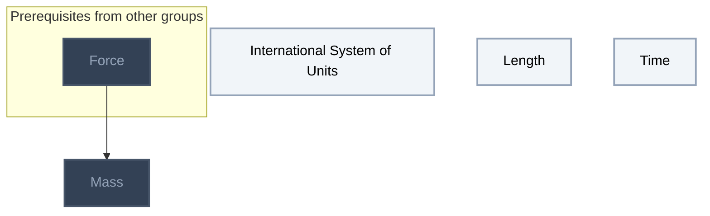

## Halliday Physics Vol. 1: Motion
**Reached:** L1 0 · L2 0 · L3 0 · L4 0 · L5 0 (of 7 nodes)

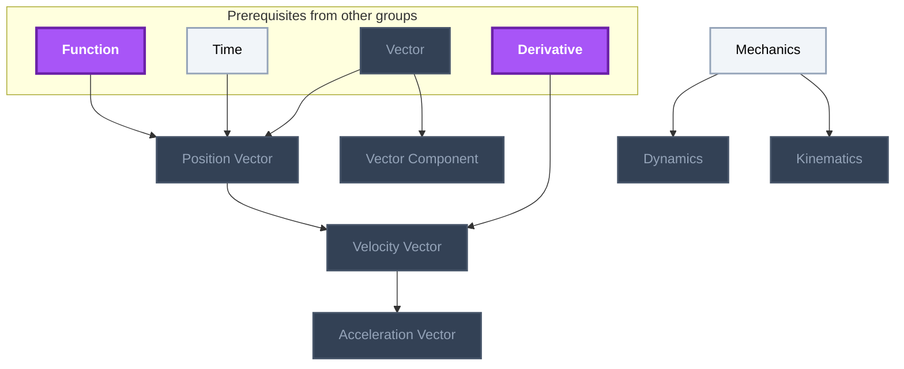

## Halliday Physics Vol. 1: Force and Newton's Laws
**Reached:** L1 0 · L2 0 · L3 0 · L4 0 · L5 0 (of 3 nodes)

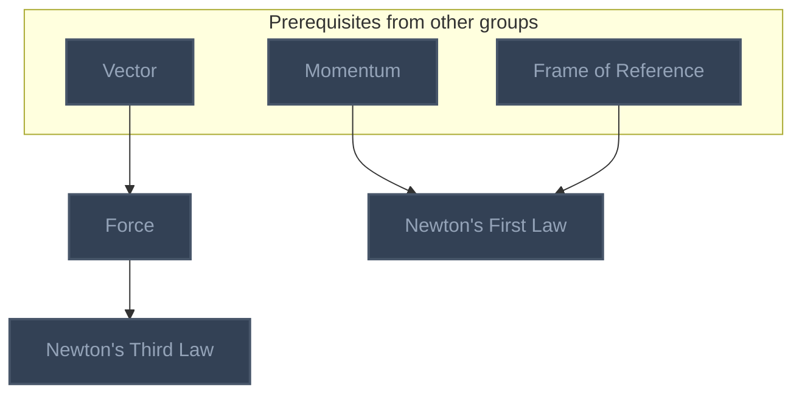

## Feynman Vol. I Ch. 2: Basic Physics
**Reached:** L1 0 · L2 0 · L3 0 · L4 0 · L5 0 (of 1 nodes)


## Feynman Vol. I Ch. 4: Conservation of Energy
**Reached:** L1 0 · L2 0 · L3 0 · L4 0 · L5 0 (of 5 nodes)

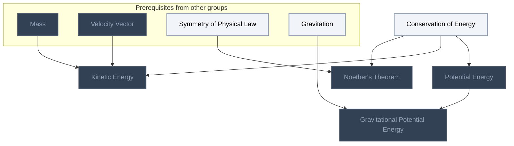

## Feynman Vol. I Ch. 5: Time and Distance
**Reached:** L1 0 · L2 0 · L3 0 · L4 0 · L5 0 (of 4 nodes)

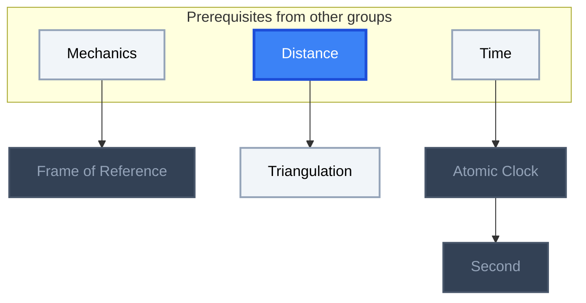

## Feynman Vol. I Ch. 7: The Theory of Gravitation
**Reached:** L1 0 · L2 0 · L3 0 · L4 0 · L5 0 (of 7 nodes)

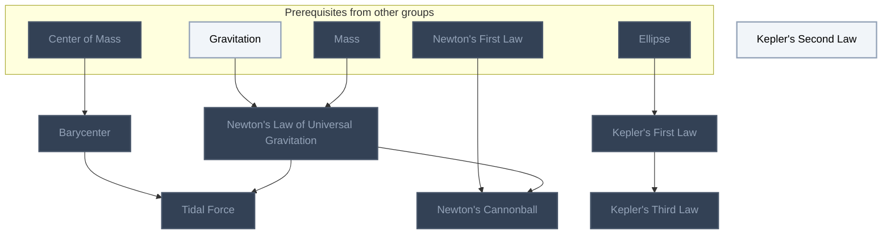

## Feynman Vol. I Ch. 8: Motion
**Reached:** L1 0 · L2 0 · L3 0 · L4 0 · L5 0 (of 2 nodes)

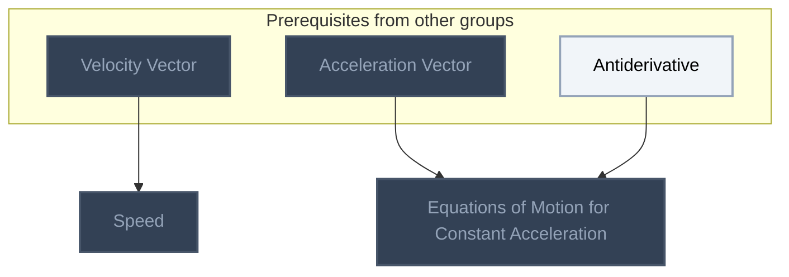

## Feynman Vol. I Ch. 9: Newton's Laws of Dynamics
**Reached:** L1 0 · L2 0 · L3 0 · L4 0 · L5 0 (of 6 nodes)

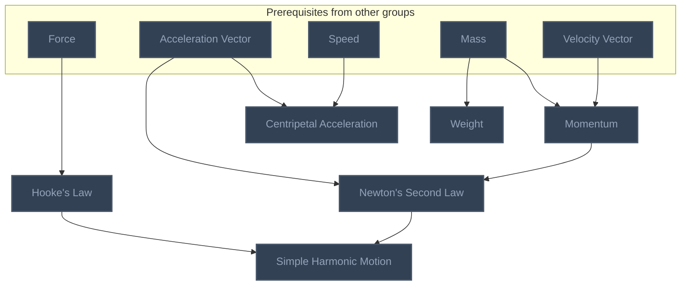

## Feynman Vol. I Ch. 10: Conservation of Momentum
**Reached:** L1 0 · L2 0 · L3 0 · L4 0 · L5 0 (of 4 nodes)

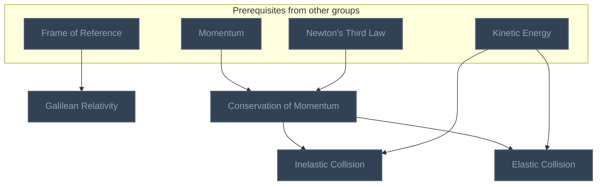

## Feynman Vol. I Ch. 11: Vectors
**Reached:** L1 0 · L2 0 · L3 0 · L4 0 · L5 0 (of 2 nodes)

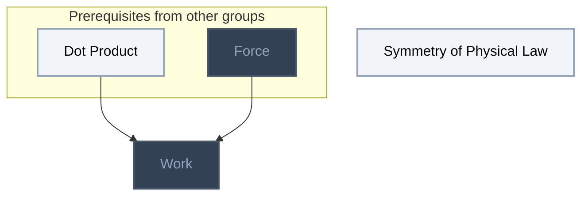

## Feynman Vol. I Ch. 12: Characteristics of Force
**Reached:** L1 0 · L2 0 · L3 0 · L4 0 · L5 0 (of 4 nodes)

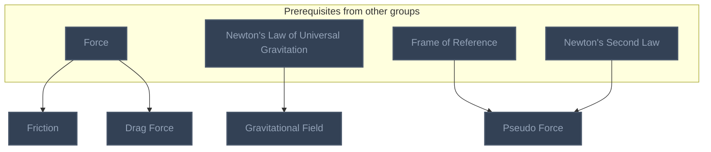

## Feynman Vol. I Ch. 13: Work and Potential Energy (A)
**Reached:** L1 0 · L2 0 · L3 0 · L4 0 · L5 0 (of 4 nodes)

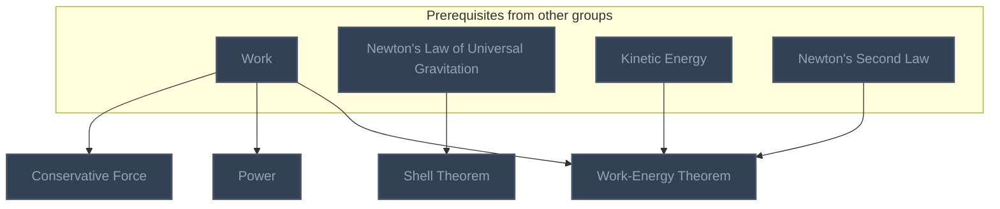

## Feynman Vol. I Ch. 14: Work and Potential Energy (B)
**Reached:** L1 0 · L2 0 · L3 0 · L4 0 · L5 0 (of 2 nodes)

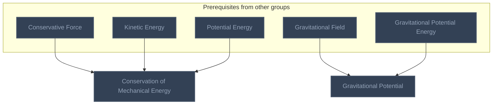

## Feynman Vol. I Ch. 18: Rotation in Two Dimensions
**Reached:** L1 0 · L2 0 · L3 0 · L4 0 · L5 0 (of 10 nodes)

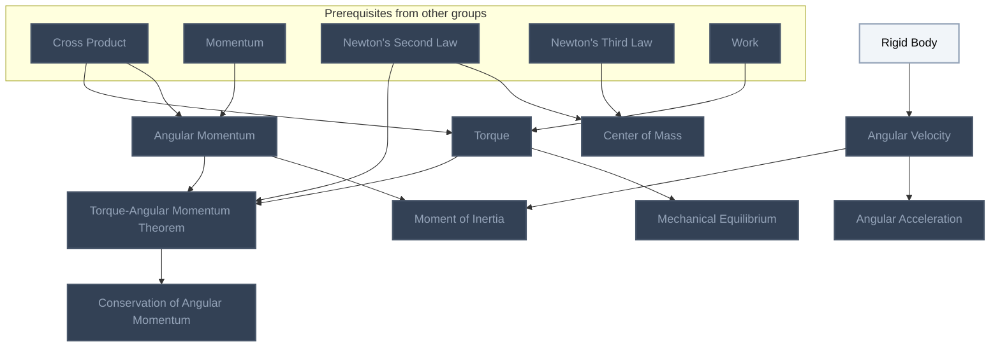

# Source
Graph structure: the single source for the diagrams above, edited by `/note` and `Scripts/skill_trees.py` (`add`, `edge`, `rename`). Everything above this heading is regenerated by `render`.

```skilltree
    %% PREREQUISITES
    n_antiderivative["Antiderivative"]
    n_cross_product["Cross Product"]
    n_derivative["Derivative"]
    n_function["Function"]
    n_vector["Vector"]
    n_distance["Distance"]
    n_ellipse["Ellipse"]
    n_dot_product["Dot Product"]
    %% NODES
    %% == Halliday Physics Vol. 1: Measurement ==
    n_international_system_of_units["International System of Units"]
    n_length["Length"]
    n_mass["Mass"]
    n_time["Time"]
    %% == Halliday Physics Vol. 1: Motion ==
    n_mechanics["Mechanics"]
    n_dynamics["Dynamics"]
    n_kinematics["Kinematics"]
    n_vector_component["Vector Component"]
    n_position_vector["Position Vector"]
    n_velocity_vector["Velocity Vector"]
    n_acceleration_vector["Acceleration Vector"]
    %% == Halliday Physics Vol. 1: Force and Newton's Laws ==
    n_force["Force"]
    n_newton_s_first_law["Newton's First Law"]
    n_newton_s_third_law["Newton's Third Law"]
    %% == Feynman Vol. I Ch. 2: Basic Physics ==
    n_gravitation["Gravitation"]
    %% == Feynman Vol. I Ch. 4: Conservation of Energy ==
    n_conservation_of_energy["Conservation of Energy"]
    n_potential_energy["Potential Energy"]
    n_kinetic_energy["Kinetic Energy"]
    n_noether_s_theorem["Noether's Theorem"]
    n_gravitational_potential_energy["Gravitational Potential Energy"]
    %% == Feynman Vol. I Ch. 5: Time and Distance ==
    n_frame_of_reference["Frame of Reference"]
    n_triangulation["Triangulation"]
    n_atomic_clock["Atomic Clock"]
    n_second["Second"]
    %% == Feynman Vol. I Ch. 7: The Theory of Gravitation ==
    n_kepler_s_second_law["Kepler's Second Law"]
    n_barycenter["Barycenter"]
    n_newton_s_law_of_universal_gravitation["Newton's Law of Universal Gravitation"]
    n_kepler_s_first_law["Kepler's First Law"]
    n_tidal_force["Tidal Force"]
    n_kepler_s_third_law["Kepler's Third Law"]
    n_newton_s_cannonball["Newton's Cannonball"]
    %% == Feynman Vol. I Ch. 8: Motion ==
    n_speed["Speed"]
    n_equations_of_motion_for_constant_acceleration["Equations of Motion for Constant Acceleration"]
    %% == Feynman Vol. I Ch. 9: Newton's Laws of Dynamics ==
    n_hooke_s_law["Hooke's Law"]
    n_centripetal_acceleration["Centripetal Acceleration"]
    n_momentum["Momentum"]
    n_weight["Weight"]
    n_newton_s_second_law["Newton's Second Law"]
    n_simple_harmonic_motion["Simple Harmonic Motion"]
    %% == Feynman Vol. I Ch. 10: Conservation of Momentum ==
    n_galilean_relativity["Galilean Relativity"]
    n_conservation_of_momentum["Conservation of Momentum"]
    n_inelastic_collision["Inelastic Collision"]
    n_elastic_collision["Elastic Collision"]
    %% == Feynman Vol. I Ch. 11: Vectors ==
    n_symmetry_of_physical_law["Symmetry of Physical Law"]
    n_work["Work"]
    %% == Feynman Vol. I Ch. 12: Characteristics of Force ==
    n_friction["Friction"]
    n_drag_force["Drag Force"]
    n_gravitational_field["Gravitational Field"]
    n_pseudo_force["Pseudo Force"]
    %% == Feynman Vol. I Ch. 13: Work and Potential Energy (A) ==
    n_conservative_force["Conservative Force"]
    n_power["Power"]
    n_shell_theorem["Shell Theorem"]
    n_work_energy_theorem["Work-Energy Theorem"]
    %% == Feynman Vol. I Ch. 14: Work and Potential Energy (B) ==
    n_conservation_of_mechanical_energy["Conservation of Mechanical Energy"]
    n_gravitational_potential["Gravitational Potential"]
    %% == Feynman Vol. I Ch. 18: Rotation in Two Dimensions ==
    n_rigid_body["Rigid Body"]
    n_torque["Torque"]
    n_center_of_mass["Center of Mass"]
    n_angular_velocity["Angular Velocity"]
    n_angular_momentum["Angular Momentum"]
    n_moment_of_inertia["Moment of Inertia"]
    n_angular_acceleration["Angular Acceleration"]
    n_mechanical_equilibrium["Mechanical Equilibrium"]
    n_torque_angular_momentum_theorem["Torque-Angular Momentum Theorem"]
    n_conservation_of_angular_momentum["Conservation of Angular Momentum"]
    %% EDGES
    n_cross_product --> n_angular_momentum
    n_momentum --> n_angular_momentum
    n_rigid_body --> n_angular_velocity
    n_newton_s_second_law --> n_center_of_mass
    n_newton_s_third_law --> n_center_of_mass
    n_mechanics --> n_dynamics
    n_vector --> n_force
    n_mechanics --> n_kinematics
    n_function --> n_position_vector
    n_time --> n_position_vector
    n_vector --> n_position_vector
    n_cross_product --> n_torque
    n_work --> n_torque
    n_vector --> n_vector_component
    n_angular_velocity --> n_angular_acceleration
    n_force --> n_mass
    n_torque --> n_mechanical_equilibrium
    n_angular_momentum --> n_moment_of_inertia
    n_angular_velocity --> n_moment_of_inertia
    n_angular_momentum --> n_torque_angular_momentum_theorem
    n_newton_s_second_law --> n_torque_angular_momentum_theorem
    n_torque --> n_torque_angular_momentum_theorem
    n_derivative --> n_velocity_vector
    n_position_vector --> n_velocity_vector
    n_velocity_vector --> n_acceleration_vector
    n_torque_angular_momentum_theorem --> n_conservation_of_angular_momentum
    n_velocity_vector --> n_speed
    n_acceleration_vector --> n_equations_of_motion_for_constant_acceleration
    n_antiderivative --> n_equations_of_motion_for_constant_acceleration
    n_momentum --> n_newton_s_first_law
    n_frame_of_reference --> n_newton_s_first_law
    n_force --> n_newton_s_third_law
    n_conservation_of_energy --> n_potential_energy
    n_conservation_of_energy --> n_kinetic_energy
    n_mass --> n_kinetic_energy
    n_velocity_vector --> n_kinetic_energy
    n_conservation_of_energy --> n_noether_s_theorem
    n_symmetry_of_physical_law --> n_noether_s_theorem
    n_gravitation --> n_gravitational_potential_energy
    n_potential_energy --> n_gravitational_potential_energy
    n_mechanics --> n_frame_of_reference
    n_distance --> n_triangulation
    n_time --> n_atomic_clock
    n_atomic_clock --> n_second
    n_center_of_mass --> n_barycenter
    n_gravitation --> n_newton_s_law_of_universal_gravitation
    n_mass --> n_newton_s_law_of_universal_gravitation
    n_ellipse --> n_kepler_s_first_law
    n_barycenter --> n_tidal_force
    n_newton_s_law_of_universal_gravitation --> n_tidal_force
    n_kepler_s_first_law --> n_kepler_s_third_law
    n_newton_s_first_law --> n_newton_s_cannonball
    n_newton_s_law_of_universal_gravitation --> n_newton_s_cannonball
    n_force --> n_hooke_s_law
    n_acceleration_vector --> n_centripetal_acceleration
    n_speed --> n_centripetal_acceleration
    n_mass --> n_momentum
    n_velocity_vector --> n_momentum
    n_mass --> n_weight
    n_acceleration_vector --> n_newton_s_second_law
    n_momentum --> n_newton_s_second_law
    n_hooke_s_law --> n_simple_harmonic_motion
    n_newton_s_second_law --> n_simple_harmonic_motion
    n_frame_of_reference --> n_galilean_relativity
    n_momentum --> n_conservation_of_momentum
    n_newton_s_third_law --> n_conservation_of_momentum
    n_conservation_of_momentum --> n_inelastic_collision
    n_kinetic_energy --> n_inelastic_collision
    n_conservation_of_momentum --> n_elastic_collision
    n_kinetic_energy --> n_elastic_collision
    n_dot_product --> n_work
    n_force --> n_work
    n_force --> n_friction
    n_force --> n_drag_force
    n_newton_s_law_of_universal_gravitation --> n_gravitational_field
    n_frame_of_reference --> n_pseudo_force
    n_newton_s_second_law --> n_pseudo_force
    n_work --> n_conservative_force
    n_work --> n_power
    n_newton_s_law_of_universal_gravitation --> n_shell_theorem
    n_kinetic_energy --> n_work_energy_theorem
    n_newton_s_second_law --> n_work_energy_theorem
    n_work --> n_work_energy_theorem
    n_conservative_force --> n_conservation_of_mechanical_energy
    n_kinetic_energy --> n_conservation_of_mechanical_energy
    n_potential_energy --> n_conservation_of_mechanical_energy
    n_gravitational_field --> n_gravitational_potential
    n_gravitational_potential_energy --> n_gravitational_potential
```
