<!-- BEGIN STATS (generated by Scripts/skill_trees.py; do not edit) -->
**Mastered:** 0 / 86 · **Depth:** 0% · **Discovered:** 60 · **Planned:** 26 · **Locked:** 60 · **Rusty:** 0

**Levels:** L0 60 · L1 0 · L2 0 · L3 0 · L4 0 · L5 0

**Next up:** —

Legend: dashed grey = planned (no note yet) · dark grey = locked · white L0 Discovered · green L1 Recall · blue L2 Apply · purple L3 Prove (Mastered) · orange L4 Wield · gold L5 Command · brown dashed border = rusty
<!-- END STATS -->

## Fisher Ch. 1.1-1.2: Complex Numbers and the Complex Plane
**Mastered:** 0 / 7 · **Discovered:** 7 / 7

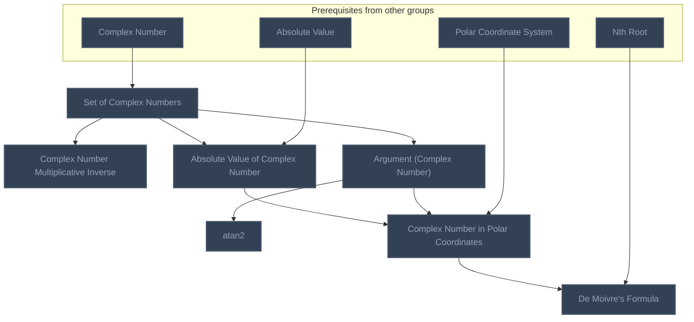

## Fisher Ch. 1.3: Subsets of the Plane
**Mastered:** 0 / 7 · **Discovered:** 7 / 7

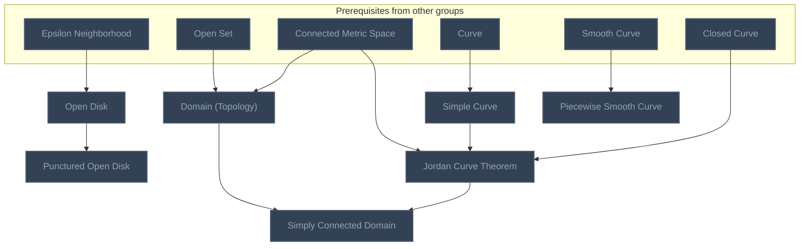

## Fisher Ch. 1.4: Functions and Limits
**Mastered:** 0 / 4 · **Discovered:** 4 / 4

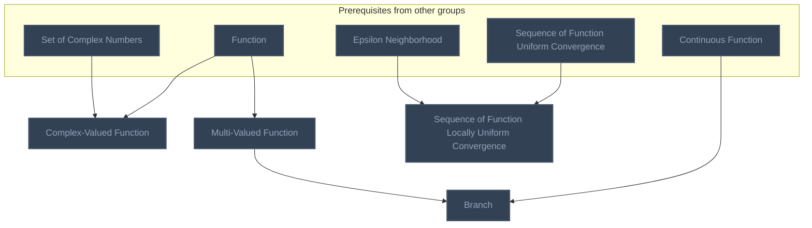

## Fisher Ch. 1.5: Exponential, Logarithm, and Trigonometric Functions
**Mastered:** 0 / 6 · **Discovered:** 3 / 6

```mermaid
flowchart TD
    classDef planned fill:#1E293B,stroke:#64748B,stroke-width:2px,stroke-dasharray:5 5,color:#94A3B8;
    classDef locked fill:#334155,stroke:#475569,stroke-width:2px,color:#94A3B8;
    classDef L0 fill:#F1F5F9,stroke:#94A3B8,stroke-width:2px,color:#000000;
    classDef L1 fill:#22C55E,stroke:#15803D,stroke-width:2px,color:#000000;
    classDef L2 fill:#3B82F6,stroke:#1D4ED8,stroke-width:3px,color:#FFFFFF;
    classDef L3 fill:#A855F7,stroke:#6B21A8,stroke-width:3px,color:#FFFFFF,font-weight:bold;
    classDef L4 fill:#F97316,stroke:#C2410C,stroke-width:4px,color:#000000,font-weight:bold;
    classDef L5 fill:#FFD700,stroke:#FF8C00,stroke-width:5px,color:#000000,font-weight:bold;
    classDef rusty stroke:#8B4513,stroke-width:4px,stroke-dasharray:3 3;
    subgraph sg_prereqs["Prerequisites from other groups"]
        n_complex_number["Complex Number"]
        n_exponential_function["Exponential Function"]
        n_trigonometric_function["Trigonometric Function"]
        n_complex_valued_function["Complex-Valued Function"]
        n_argument_complex_number["Argument (Complex Number)"]
        n_multi_valued_function["Multi-Valued Function"]
        n_logarithm_function["Logarithm Function"]
        n_minkowski_sum["Minkowski Sum"]
    end
    n_euler_s_identity["Euler's Identity"]
    n_complex_exponential_function["Complex Exponential Function"]
    n_complex_trigonometric_function["Complex Trigonometric Function"]
    n_complex_logarithm["Complex Logarithm"]
    n_complex_logarithm_properties["Complex Logarithm Properties"]
    n_complex_exponent_properties["Complex Exponent Properties"]
    n_complex_number --> n_euler_s_identity
    n_exponential_function --> n_euler_s_identity
    n_trigonometric_function --> n_euler_s_identity
    n_euler_s_identity --> n_complex_exponential_function
    n_complex_valued_function --> n_complex_exponential_function
    n_complex_exponential_function --> n_complex_trigonometric_function
    n_complex_exponential_function --> n_complex_logarithm
    n_argument_complex_number --> n_complex_logarithm
    n_multi_valued_function --> n_complex_logarithm
    n_logarithm_function --> n_complex_logarithm
    n_complex_logarithm --> n_complex_logarithm_properties
    n_minkowski_sum --> n_complex_logarithm_properties
    n_complex_logarithm --> n_complex_exponent_properties
    class n_complex_exponential_function,n_complex_trigonometric_function,n_complex_logarithm planned;
    class n_complex_number,n_exponential_function,n_trigonometric_function,n_complex_valued_function,n_argument_complex_number,n_multi_valued_function,n_logarithm_function,n_minkowski_sum,n_euler_s_identity,n_complex_logarithm_properties,n_complex_exponent_properties locked;
    class n_complex_number,n_exponential_function,n_trigonometric_function,n_complex_valued_function,n_argument_complex_number,n_multi_valued_function,n_logarithm_function,n_minkowski_sum,n_euler_s_identity,n_complex_logarithm_properties,n_complex_exponent_properties internal-link;
```

## Fisher Ch. 1.6: Line Integrals and Green's Theorem
**Mastered:** 0 / 4 · **Discovered:** 4 / 4

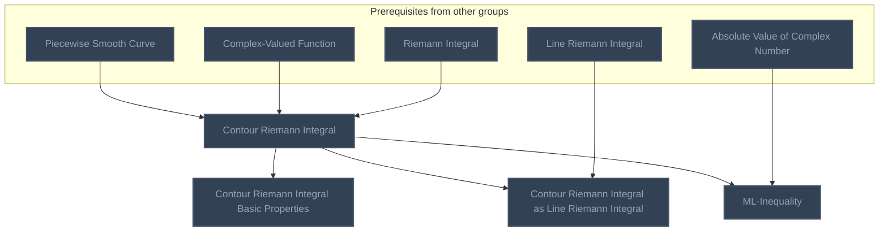

## Fisher Ch. 2.1: Analytic and Harmonic Functions
**Mastered:** 0 / 10 · **Discovered:** 10 / 10

```mermaid
flowchart TD
    classDef planned fill:#1E293B,stroke:#64748B,stroke-width:2px,stroke-dasharray:5 5,color:#94A3B8;
    classDef locked fill:#334155,stroke:#475569,stroke-width:2px,color:#94A3B8;
    classDef L0 fill:#F1F5F9,stroke:#94A3B8,stroke-width:2px,color:#000000;
    classDef L1 fill:#22C55E,stroke:#15803D,stroke-width:2px,color:#000000;
    classDef L2 fill:#3B82F6,stroke:#1D4ED8,stroke-width:3px,color:#FFFFFF;
    classDef L3 fill:#A855F7,stroke:#6B21A8,stroke-width:3px,color:#FFFFFF,font-weight:bold;
    classDef L4 fill:#F97316,stroke:#C2410C,stroke-width:4px,color:#000000,font-weight:bold;
    classDef L5 fill:#FFD700,stroke:#FF8C00,stroke-width:5px,color:#000000,font-weight:bold;
    classDef rusty stroke:#8B4513,stroke-width:4px,stroke-dasharray:3 3;
    subgraph sg_prereqs["Prerequisites from other groups"]
        n_complex_valued_function["Complex-Valued Function"]
        n_differentiable_function["Differentiable Function"]
        n_partial_derivative["Partial Derivative"]
        n_power_series["Power Series"]
        n_open_set["Open Set"]
        n_branch["Branch"]
        n_inverse_function["Inverse Function"]
        n_laplacian_operator["Laplacian Operator"]
    end
    n_holomorphic_function["Holomorphic Function"]
    n_complex_number_derivative["Complex Number Derivative"]
    n_cauchy_riemann_conditions_theorem["Cauchy-Riemann Conditions Theorem"]
    n_analytic_function["Analytic Function"]
    n_complex_analytic_function["Complex Analytic Function"]
    n_operations_on_analytic_function["Operations on Analytic Function"]
    n_entire_function["Entire Function"]
    n_complex_analytic_function_inverse["Complex Analytic Function Inverse"]
    n_harmonic_function["Harmonic Function"]
    n_harmonic_conjugate_function["Harmonic Conjugate Function"]
    n_complex_valued_function --> n_holomorphic_function
    n_differentiable_function --> n_holomorphic_function
    n_holomorphic_function --> n_complex_number_derivative
    n_partial_derivative --> n_complex_number_derivative
    n_complex_number_derivative --> n_cauchy_riemann_conditions_theorem
    n_power_series --> n_analytic_function
    n_open_set --> n_analytic_function
    n_analytic_function --> n_complex_analytic_function
    n_holomorphic_function --> n_complex_analytic_function
    n_complex_analytic_function --> n_operations_on_analytic_function
    n_complex_analytic_function --> n_entire_function
    n_complex_analytic_function --> n_complex_analytic_function_inverse
    n_branch --> n_complex_analytic_function_inverse
    n_inverse_function --> n_complex_analytic_function_inverse
    n_partial_derivative --> n_harmonic_function
    n_laplacian_operator --> n_harmonic_function
    n_open_set --> n_harmonic_function
    n_harmonic_function --> n_harmonic_conjugate_function
    n_complex_analytic_function --> n_harmonic_conjugate_function
    n_cauchy_riemann_conditions_theorem --> n_harmonic_conjugate_function
    class n_complex_valued_function,n_differentiable_function,n_partial_derivative,n_power_series,n_open_set,n_branch,n_inverse_function,n_laplacian_operator,n_holomorphic_function,n_complex_number_derivative,n_cauchy_riemann_conditions_theorem,n_analytic_function,n_complex_analytic_function,n_operations_on_analytic_function,n_entire_function,n_complex_analytic_function_inverse,n_harmonic_function,n_harmonic_conjugate_function locked;
    class n_complex_valued_function,n_differentiable_function,n_partial_derivative,n_power_series,n_open_set,n_branch,n_inverse_function,n_laplacian_operator,n_holomorphic_function,n_complex_number_derivative,n_cauchy_riemann_conditions_theorem,n_analytic_function,n_complex_analytic_function,n_operations_on_analytic_function,n_entire_function,n_complex_analytic_function_inverse,n_harmonic_function,n_harmonic_conjugate_function internal-link;
```

## Fisher Ch. 2.2: Power Series
**Mastered:** 0 / 2 · **Discovered:** 2 / 2

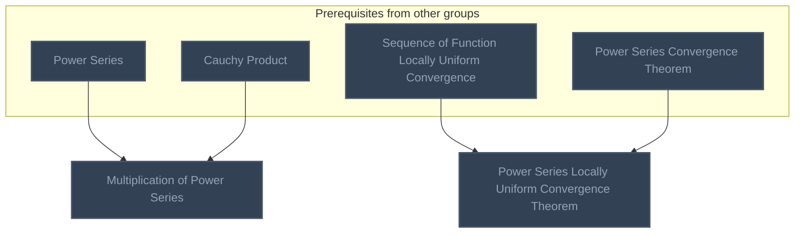

## Fisher Ch. 2.3: Cauchy's Theorem and Cauchy's Formula
**Mastered:** 0 / 6 · **Discovered:** 6 / 6

```mermaid
flowchart TD
    classDef planned fill:#1E293B,stroke:#64748B,stroke-width:2px,stroke-dasharray:5 5,color:#94A3B8;
    classDef locked fill:#334155,stroke:#475569,stroke-width:2px,color:#94A3B8;
    classDef L0 fill:#F1F5F9,stroke:#94A3B8,stroke-width:2px,color:#000000;
    classDef L1 fill:#22C55E,stroke:#15803D,stroke-width:2px,color:#000000;
    classDef L2 fill:#3B82F6,stroke:#1D4ED8,stroke-width:3px,color:#FFFFFF;
    classDef L3 fill:#A855F7,stroke:#6B21A8,stroke-width:3px,color:#FFFFFF,font-weight:bold;
    classDef L4 fill:#F97316,stroke:#C2410C,stroke-width:4px,color:#000000,font-weight:bold;
    classDef L5 fill:#FFD700,stroke:#FF8C00,stroke-width:5px,color:#000000,font-weight:bold;
    classDef rusty stroke:#8B4513,stroke-width:4px,stroke-dasharray:3 3;
    subgraph sg_prereqs["Prerequisites from other groups"]
        n_complex_analytic_function["Complex Analytic Function"]
        n_contour_riemann_integral["Contour Riemann Integral"]
        n_fundamental_theorem_of_calculus["Fundamental Theorem of Calculus"]
        n_green_s_theorem["Green's Theorem"]
        n_cauchy_riemann_conditions_theorem["Cauchy-Riemann Conditions Theorem"]
        n_contour_riemann_integral_as_line_riemann_integral["Contour Riemann Integral as Line Riemann Integral"]
        n_simply_connected_domain["Simply Connected Domain"]
        n_ml_inequality["ML-Inequality"]
    end
    n_primitive["Primitive"]
    n_fundamental_theorem_for_contour_riemann_integral["Fundamental Theorem for Contour Riemann Integral"]
    n_cauchy_s_theorem["Cauchy's Theorem"]
    n_simply_connected_domain_contour_riemann_integral_theorem["Simply Connected Domain Contour Riemann Integral Theorem"]
    n_existence_of_primitives_theorem["Existence of Primitives Theorem"]
    n_cauchy_s_integral_formula["Cauchy's Integral Formula"]
    n_complex_analytic_function --> n_primitive
    n_primitive --> n_fundamental_theorem_for_contour_riemann_integral
    n_contour_riemann_integral --> n_fundamental_theorem_for_contour_riemann_integral
    n_fundamental_theorem_of_calculus --> n_fundamental_theorem_for_contour_riemann_integral
    n_green_s_theorem --> n_cauchy_s_theorem
    n_cauchy_riemann_conditions_theorem --> n_cauchy_s_theorem
    n_contour_riemann_integral_as_line_riemann_integral --> n_cauchy_s_theorem
    n_cauchy_s_theorem --> n_simply_connected_domain_contour_riemann_integral_theorem
    n_simply_connected_domain --> n_simply_connected_domain_contour_riemann_integral_theorem
    n_simply_connected_domain_contour_riemann_integral_theorem --> n_existence_of_primitives_theorem
    n_fundamental_theorem_for_contour_riemann_integral --> n_existence_of_primitives_theorem
    n_cauchy_s_theorem --> n_cauchy_s_integral_formula
    n_ml_inequality --> n_cauchy_s_integral_formula
    class n_complex_analytic_function,n_contour_riemann_integral,n_fundamental_theorem_of_calculus,n_green_s_theorem,n_cauchy_riemann_conditions_theorem,n_contour_riemann_integral_as_line_riemann_integral,n_simply_connected_domain,n_ml_inequality,n_primitive,n_fundamental_theorem_for_contour_riemann_integral,n_cauchy_s_theorem,n_simply_connected_domain_contour_riemann_integral_theorem,n_existence_of_primitives_theorem,n_cauchy_s_integral_formula locked;
    class n_complex_analytic_function,n_contour_riemann_integral,n_fundamental_theorem_of_calculus,n_green_s_theorem,n_cauchy_riemann_conditions_theorem,n_contour_riemann_integral_as_line_riemann_integral,n_simply_connected_domain,n_ml_inequality,n_primitive,n_fundamental_theorem_for_contour_riemann_integral,n_cauchy_s_theorem,n_simply_connected_domain_contour_riemann_integral_theorem,n_existence_of_primitives_theorem,n_cauchy_s_integral_formula internal-link;
```

## Fisher Ch. 2.4: Consequences of Cauchy's Formula
**Mastered:** 0 / 6 · **Discovered:** 6 / 6

```mermaid
flowchart TD
    classDef planned fill:#1E293B,stroke:#64748B,stroke-width:2px,stroke-dasharray:5 5,color:#94A3B8;
    classDef locked fill:#334155,stroke:#475569,stroke-width:2px,color:#94A3B8;
    classDef L0 fill:#F1F5F9,stroke:#94A3B8,stroke-width:2px,color:#000000;
    classDef L1 fill:#22C55E,stroke:#15803D,stroke-width:2px,color:#000000;
    classDef L2 fill:#3B82F6,stroke:#1D4ED8,stroke-width:3px,color:#FFFFFF;
    classDef L3 fill:#A855F7,stroke:#6B21A8,stroke-width:3px,color:#FFFFFF,font-weight:bold;
    classDef L4 fill:#F97316,stroke:#C2410C,stroke-width:4px,color:#000000,font-weight:bold;
    classDef L5 fill:#FFD700,stroke:#FF8C00,stroke-width:5px,color:#000000,font-weight:bold;
    classDef rusty stroke:#8B4513,stroke-width:4px,stroke-dasharray:3 3;
    subgraph sg_prereqs["Prerequisites from other groups"]
        n_cauchy_s_integral_formula["Cauchy's Integral Formula"]
        n_power_series_locally_uniform_convergence_theorem["Power Series Locally Uniform Convergence Theorem"]
        n_entire_function["Entire Function"]
        n_bounded_function["Bounded Function"]
        n_existence_of_primitives_theorem["Existence of Primitives Theorem"]
        n_complex_logarithm["Complex Logarithm"]
        n_branch["Branch"]
    end
    n_complex_infinite_differentiability["Complex Infinite Differentiability"]
    n_complex_derivative_continuity["Complex Derivative Continuity"]
    n_cauchy_s_inequality["Cauchy's Inequality"]
    n_liouville_s_theorem["Liouville's Theorem"]
    n_morera_s_theorem["Morera's Theorem"]
    n_branch_of_logarithm_theorem["Branch of Logarithm Theorem"]
    n_cauchy_s_integral_formula --> n_complex_infinite_differentiability
    n_power_series_locally_uniform_convergence_theorem --> n_complex_infinite_differentiability
    n_complex_infinite_differentiability --> n_complex_derivative_continuity
    n_cauchy_s_integral_formula --> n_cauchy_s_inequality
    n_cauchy_s_inequality --> n_liouville_s_theorem
    n_entire_function --> n_liouville_s_theorem
    n_bounded_function --> n_liouville_s_theorem
    n_complex_infinite_differentiability --> n_morera_s_theorem
    n_existence_of_primitives_theorem --> n_morera_s_theorem
    n_existence_of_primitives_theorem --> n_branch_of_logarithm_theorem
    n_complex_logarithm --> n_branch_of_logarithm_theorem
    n_branch --> n_branch_of_logarithm_theorem
    class n_complex_logarithm planned;
    class n_cauchy_s_integral_formula,n_power_series_locally_uniform_convergence_theorem,n_entire_function,n_bounded_function,n_existence_of_primitives_theorem,n_branch,n_complex_infinite_differentiability,n_complex_derivative_continuity,n_cauchy_s_inequality,n_liouville_s_theorem,n_morera_s_theorem,n_branch_of_logarithm_theorem locked;
    class n_cauchy_s_integral_formula,n_power_series_locally_uniform_convergence_theorem,n_entire_function,n_bounded_function,n_existence_of_primitives_theorem,n_branch,n_complex_infinite_differentiability,n_complex_derivative_continuity,n_cauchy_s_inequality,n_liouville_s_theorem,n_morera_s_theorem,n_branch_of_logarithm_theorem internal-link;
```

## Fisher Ch. 2.5: Isolated Singularities
**Mastered:** 0 / 10 · **Discovered:** 10 / 10

```mermaid
flowchart TD
    classDef planned fill:#1E293B,stroke:#64748B,stroke-width:2px,stroke-dasharray:5 5,color:#94A3B8;
    classDef locked fill:#334155,stroke:#475569,stroke-width:2px,color:#94A3B8;
    classDef L0 fill:#F1F5F9,stroke:#94A3B8,stroke-width:2px,color:#000000;
    classDef L1 fill:#22C55E,stroke:#15803D,stroke-width:2px,color:#000000;
    classDef L2 fill:#3B82F6,stroke:#1D4ED8,stroke-width:3px,color:#FFFFFF;
    classDef L3 fill:#A855F7,stroke:#6B21A8,stroke-width:3px,color:#FFFFFF,font-weight:bold;
    classDef L4 fill:#F97316,stroke:#C2410C,stroke-width:4px,color:#000000,font-weight:bold;
    classDef L5 fill:#FFD700,stroke:#FF8C00,stroke-width:5px,color:#000000,font-weight:bold;
    classDef rusty stroke:#8B4513,stroke-width:4px,stroke-dasharray:3 3;
    subgraph sg_prereqs["Prerequisites from other groups"]
        n_complex_analytic_function["Complex Analytic Function"]
        n_punctured_open_disk["Punctured Open Disk"]
        n_bounded_function["Bounded Function"]
        n_limit["Limit"]
        n_dense_subset["Dense Subset"]
        n_power_series["Power Series"]
        n_infinite_series["Infinite Series"]
        n_cauchy_s_integral_formula["Cauchy's Integral Formula"]
    end
    n_isolated_singularity["Isolated Singularity"]
    n_removable_singularity["Removable Singularity"]
    n_removable_singularity_limit_existence_theorem["Removable Singularity Limit Existence Theorem"]
    n_pole["Pole"]
    n_pole_order["Pole Order"]
    n_essential_singularity["Essential Singularity"]
    n_casorati_weierstrass_theorem["Casorati-Weierstrass Theorem"]
    n_laurent_series["Laurent Series"]
    n_cauchy_s_formula_for_a_ring["Cauchy's Formula for a Ring"]
    n_laurent_series_representation["Laurent Series Representation"]
    n_complex_analytic_function --> n_isolated_singularity
    n_punctured_open_disk --> n_isolated_singularity
    n_isolated_singularity --> n_removable_singularity
    n_bounded_function --> n_removable_singularity
    n_removable_singularity --> n_removable_singularity_limit_existence_theorem
    n_limit --> n_removable_singularity_limit_existence_theorem
    n_isolated_singularity --> n_pole
    n_pole --> n_pole_order
    n_removable_singularity --> n_pole_order
    n_removable_singularity --> n_essential_singularity
    n_pole --> n_essential_singularity
    n_essential_singularity --> n_casorati_weierstrass_theorem
    n_removable_singularity_limit_existence_theorem --> n_casorati_weierstrass_theorem
    n_dense_subset --> n_casorati_weierstrass_theorem
    n_power_series --> n_laurent_series
    n_infinite_series --> n_laurent_series
    n_cauchy_s_integral_formula --> n_cauchy_s_formula_for_a_ring
    n_laurent_series --> n_laurent_series_representation
    n_cauchy_s_formula_for_a_ring --> n_laurent_series_representation
    class n_complex_analytic_function,n_punctured_open_disk,n_bounded_function,n_limit,n_dense_subset,n_power_series,n_infinite_series,n_cauchy_s_integral_formula,n_isolated_singularity,n_removable_singularity,n_removable_singularity_limit_existence_theorem,n_pole,n_pole_order,n_essential_singularity,n_casorati_weierstrass_theorem,n_laurent_series,n_cauchy_s_formula_for_a_ring,n_laurent_series_representation locked;
    class n_complex_analytic_function,n_punctured_open_disk,n_bounded_function,n_limit,n_dense_subset,n_power_series,n_infinite_series,n_cauchy_s_integral_formula,n_isolated_singularity,n_removable_singularity,n_removable_singularity_limit_existence_theorem,n_pole,n_pole_order,n_essential_singularity,n_casorati_weierstrass_theorem,n_laurent_series,n_cauchy_s_formula_for_a_ring,n_laurent_series_representation internal-link;
```

## Fisher Ch. 2.6: The Residue Theorem
**Mastered:** 0 / 2 · **Discovered:** 0 / 2

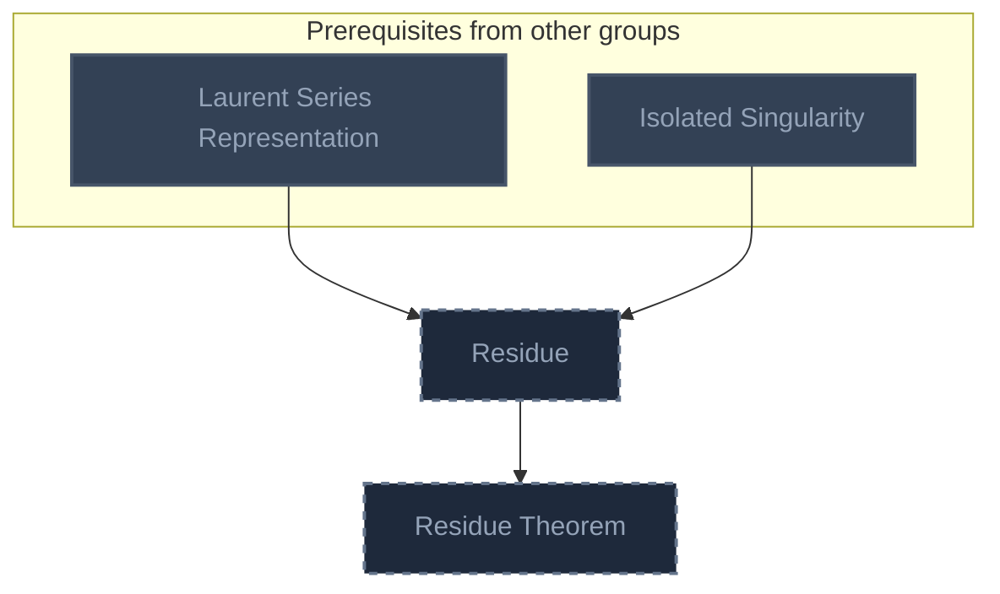

## Fisher Ch. 3.1: Zeros of an Analytic Function
**Mastered:** 0 / 4 · **Discovered:** 1 / 4

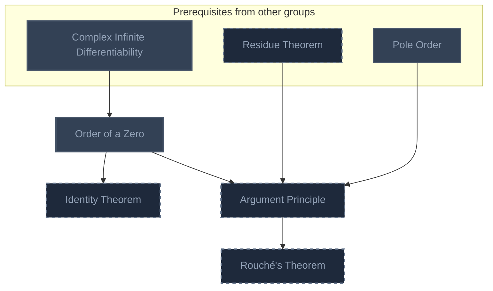

## Fisher Ch. 3.2: Maximum Modulus and Mean Value
**Mastered:** 0 / 3 · **Discovered:** 0 / 3

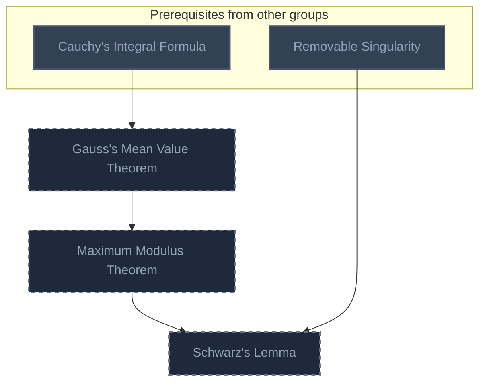

## Fisher Ch. 3.3: Linear Fractional Transformations
**Mastered:** 0 / 2 · **Discovered:** 0 / 2

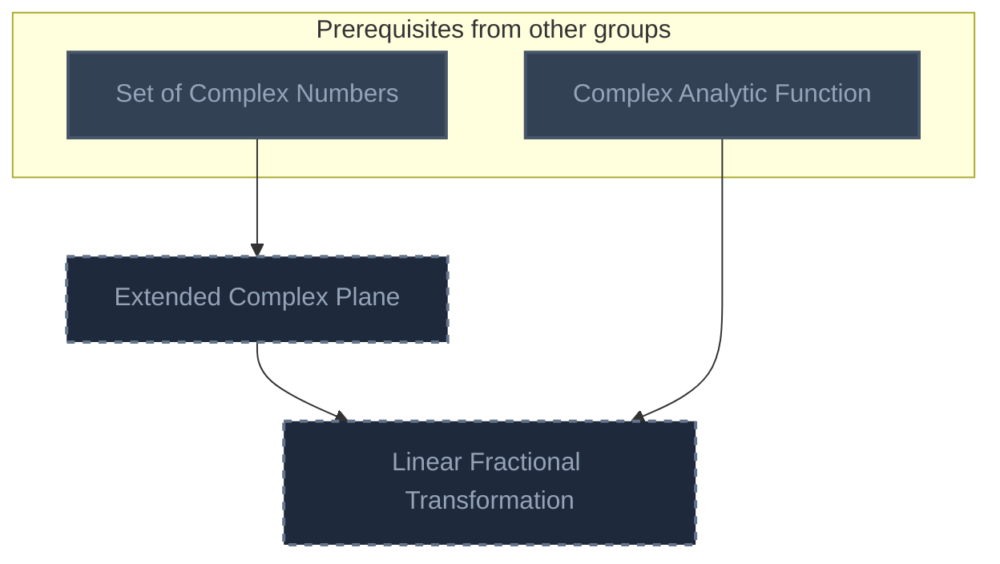

## Fisher Ch. 3.4: Conformal Mapping
**Mastered:** 0 / 1 · **Discovered:** 0 / 1

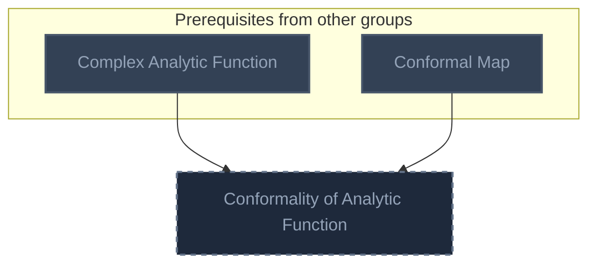

## Fisher Ch. 3.5: Riemann Mapping Theorem and Schwarz-Christoffel
**Mastered:** 0 / 2 · **Discovered:** 0 / 2

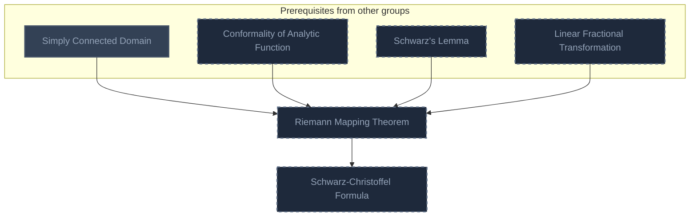

## Fisher Ch. 4.1-4.2: Harmonic Functions and Physical Problems
**Mastered:** 0 / 3 · **Discovered:** 0 / 3

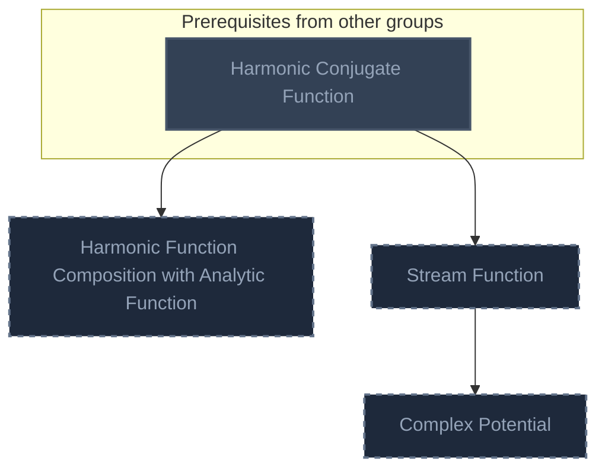

## Fisher Ch. 4.3-4.5: Integral Representations and Boundary-Value Problems
**Mastered:** 0 / 4 · **Discovered:** 0 / 4

```mermaid
flowchart TD
    classDef planned fill:#1E293B,stroke:#64748B,stroke-width:2px,stroke-dasharray:5 5,color:#94A3B8;
    classDef locked fill:#334155,stroke:#475569,stroke-width:2px,color:#94A3B8;
    classDef L0 fill:#F1F5F9,stroke:#94A3B8,stroke-width:2px,color:#000000;
    classDef L1 fill:#22C55E,stroke:#15803D,stroke-width:2px,color:#000000;
    classDef L2 fill:#3B82F6,stroke:#1D4ED8,stroke-width:3px,color:#FFFFFF;
    classDef L3 fill:#A855F7,stroke:#6B21A8,stroke-width:3px,color:#FFFFFF,font-weight:bold;
    classDef L4 fill:#F97316,stroke:#C2410C,stroke-width:4px,color:#000000,font-weight:bold;
    classDef L5 fill:#FFD700,stroke:#FF8C00,stroke-width:5px,color:#000000,font-weight:bold;
    classDef rusty stroke:#8B4513,stroke-width:4px,stroke-dasharray:3 3;
    subgraph sg_prereqs["Prerequisites from other groups"]
        n_cauchy_s_integral_formula["Cauchy's Integral Formula"]
        n_harmonic_function["Harmonic Function"]
        n_poisson_kernel["Poisson Kernel"]
        n_harmonic_function_composition_with_analytic_function["Harmonic Function Composition with Analytic Function"]
        n_dirichlet_boundary_condition["Dirichlet Boundary Condition"]
        n_neumann_boundary_condition["Neumann Boundary Condition"]
    end
    n_poisson_integral_formula_for_upper_half_plane["Poisson Integral Formula for Upper Half-Plane"]
    n_dirichlet_problem["Dirichlet Problem"]
    n_neumann_problem["Neumann Problem"]
    n_green_s_function_of_a_domain["Green's Function of a Domain"]
    n_cauchy_s_integral_formula --> n_poisson_integral_formula_for_upper_half_plane
    n_harmonic_function --> n_poisson_integral_formula_for_upper_half_plane
    n_poisson_kernel --> n_poisson_integral_formula_for_upper_half_plane
    n_harmonic_function_composition_with_analytic_function --> n_dirichlet_problem
    n_dirichlet_boundary_condition --> n_dirichlet_problem
    n_harmonic_function_composition_with_analytic_function --> n_neumann_problem
    n_neumann_boundary_condition --> n_neumann_problem
    n_dirichlet_problem --> n_green_s_function_of_a_domain
    class n_harmonic_function_composition_with_analytic_function,n_poisson_integral_formula_for_upper_half_plane,n_dirichlet_problem,n_neumann_problem,n_green_s_function_of_a_domain planned;
    class n_cauchy_s_integral_formula,n_harmonic_function,n_poisson_kernel,n_dirichlet_boundary_condition,n_neumann_boundary_condition locked;
    class n_cauchy_s_integral_formula,n_harmonic_function,n_poisson_kernel,n_dirichlet_boundary_condition,n_neumann_boundary_condition internal-link;
```

## Fisher Ch. 5: Transform Methods
**Mastered:** 0 / 3 · **Discovered:** 0 / 3

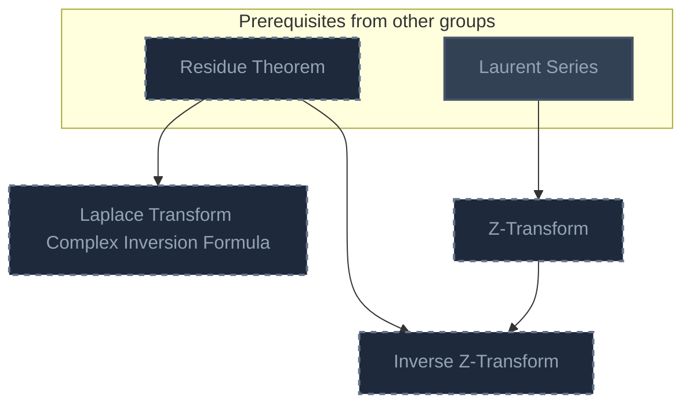

# Source
Graph structure: the single source for the diagrams above, edited by `/note` and `Scripts/skill_trees.py` (`add`, `edge`, `rename`). Everything above this heading is regenerated by `render`.

```skilltree
    %% PREREQUISITES
    n_complex_number["Complex Number"]
    n_absolute_value["Absolute Value"]
    n_polar_coordinate_system["Polar Coordinate System"]
    n_nth_root["Nth Root"]
    n_open_set["Open Set"]
    n_connected_metric_space["Connected Metric Space"]
    n_curve["Curve"]
    n_smooth_curve["Smooth Curve"]
    n_closed_curve["Closed Curve"]
    n_function["Function"]
    n_continuous_function["Continuous Function"]
    n_sequence_of_function_uniform_convergence["Sequence of Function Uniform Convergence"]
    n_exponential_function["Exponential Function"]
    n_trigonometric_function["Trigonometric Function"]
    n_logarithm_function["Logarithm Function"]
    n_partial_derivative["Partial Derivative"]
    n_riemann_integral["Riemann Integral"]
    n_line_riemann_integral["Line Riemann Integral"]
    n_differentiable_function["Differentiable Function"]
    n_power_series["Power Series"]
    n_inverse_function["Inverse Function"]
    n_laplacian_operator["Laplacian Operator"]
    n_infinite_series["Infinite Series"]
    n_cauchy_product["Cauchy Product"]
    n_power_series_convergence_theorem["Power Series Convergence Theorem"]
    n_fundamental_theorem_of_calculus["Fundamental Theorem of Calculus"]
    n_bounded_function["Bounded Function"]
    n_limit["Limit"]
    n_dense_subset["Dense Subset"]
    n_conformal_map["Conformal Map"]
    n_poisson_kernel["Poisson Kernel"]
    n_dirichlet_boundary_condition["Dirichlet Boundary Condition"]
    n_neumann_boundary_condition["Neumann Boundary Condition"]
    n_epsilon_neighborhood["Epsilon Neighborhood"]
    n_minkowski_sum["Minkowski Sum"]
    n_green_s_theorem["Green's Theorem"]
    %% NODES
    %% == Fisher Ch. 1.1-1.2: Complex Numbers and the Complex Plane ==
    n_set_of_complex_numbers["Set of Complex Numbers"]
    n_complex_number_multiplicative_inverse["Complex Number Multiplicative Inverse"]
    n_absolute_value_of_complex_number["Absolute Value of Complex Number"]
    n_argument_complex_number["Argument (Complex Number)"]
    n_atan2["atan2"]
    n_complex_number_in_polar_coordinates["Complex Number in Polar Coordinates"]
    n_de_moivre_s_formula["De Moivre's Formula"]
    %% == Fisher Ch. 1.3: Subsets of the Plane ==
    n_open_disk["Open Disk"]
    n_punctured_open_disk["Punctured Open Disk"]
    n_domain_topology["Domain (Topology)"]
    n_simple_curve["Simple Curve"]
    n_piecewise_smooth_curve["Piecewise Smooth Curve"]
    n_jordan_curve_theorem["Jordan Curve Theorem"]
    n_simply_connected_domain["Simply Connected Domain"]
    %% == Fisher Ch. 1.4: Functions and Limits ==
    n_complex_valued_function["Complex-Valued Function"]
    n_multi_valued_function["Multi-Valued Function"]
    n_branch["Branch"]
    n_sequence_of_function_locally_uniform_convergence["Sequence of Function Locally Uniform Convergence"]
    %% == Fisher Ch. 1.5: Exponential, Logarithm, and Trigonometric Functions ==
    n_euler_s_identity["Euler's Identity"]
    n_complex_exponential_function["Complex Exponential Function"]
    n_complex_trigonometric_function["Complex Trigonometric Function"]
    n_complex_logarithm["Complex Logarithm"]
    n_complex_logarithm_properties["Complex Logarithm Properties"]
    n_complex_exponent_properties["Complex Exponent Properties"]
    %% == Fisher Ch. 1.6: Line Integrals and Green's Theorem ==
    n_contour_riemann_integral["Contour Riemann Integral"]
    n_contour_riemann_integral_basic_properties["Contour Riemann Integral Basic Properties"]
    n_contour_riemann_integral_as_line_riemann_integral["Contour Riemann Integral as Line Riemann Integral"]
    n_ml_inequality["ML-Inequality"]
    %% == Fisher Ch. 2.1: Analytic and Harmonic Functions ==
    n_holomorphic_function["Holomorphic Function"]
    n_complex_number_derivative["Complex Number Derivative"]
    n_cauchy_riemann_conditions_theorem["Cauchy-Riemann Conditions Theorem"]
    n_analytic_function["Analytic Function"]
    n_complex_analytic_function["Complex Analytic Function"]
    n_operations_on_analytic_function["Operations on Analytic Function"]
    n_entire_function["Entire Function"]
    n_complex_analytic_function_inverse["Complex Analytic Function Inverse"]
    n_harmonic_function["Harmonic Function"]
    n_harmonic_conjugate_function["Harmonic Conjugate Function"]
    %% == Fisher Ch. 2.2: Power Series ==
    n_multiplication_of_power_series["Multiplication of Power Series"]
    n_power_series_locally_uniform_convergence_theorem["Power Series Locally Uniform Convergence Theorem"]
    %% == Fisher Ch. 2.3: Cauchy's Theorem and Cauchy's Formula ==
    n_primitive["Primitive"]
    n_fundamental_theorem_for_contour_riemann_integral["Fundamental Theorem for Contour Riemann Integral"]
    n_cauchy_s_theorem["Cauchy's Theorem"]
    n_simply_connected_domain_contour_riemann_integral_theorem["Simply Connected Domain Contour Riemann Integral Theorem"]
    n_existence_of_primitives_theorem["Existence of Primitives Theorem"]
    n_cauchy_s_integral_formula["Cauchy's Integral Formula"]
    %% == Fisher Ch. 2.4: Consequences of Cauchy's Formula ==
    n_complex_infinite_differentiability["Complex Infinite Differentiability"]
    n_complex_derivative_continuity["Complex Derivative Continuity"]
    n_cauchy_s_inequality["Cauchy's Inequality"]
    n_liouville_s_theorem["Liouville's Theorem"]
    n_morera_s_theorem["Morera's Theorem"]
    n_branch_of_logarithm_theorem["Branch of Logarithm Theorem"]
    %% == Fisher Ch. 2.5: Isolated Singularities ==
    n_isolated_singularity["Isolated Singularity"]
    n_removable_singularity["Removable Singularity"]
    n_removable_singularity_limit_existence_theorem["Removable Singularity Limit Existence Theorem"]
    n_pole["Pole"]
    n_pole_order["Pole Order"]
    n_essential_singularity["Essential Singularity"]
    n_casorati_weierstrass_theorem["Casorati-Weierstrass Theorem"]
    n_laurent_series["Laurent Series"]
    n_cauchy_s_formula_for_a_ring["Cauchy's Formula for a Ring"]
    n_laurent_series_representation["Laurent Series Representation"]
    %% == Fisher Ch. 2.6: The Residue Theorem ==
    n_residue["Residue"]
    n_residue_theorem["Residue Theorem"]
    %% == Fisher Ch. 3.1: Zeros of an Analytic Function ==
    n_order_of_a_zero["Order of a Zero"]
    n_identity_theorem["Identity Theorem"]
    n_argument_principle["Argument Principle"]
    n_rouch_s_theorem["Rouché's Theorem"]
    %% == Fisher Ch. 3.2: Maximum Modulus and Mean Value ==
    n_gauss_s_mean_value_theorem["Gauss's Mean Value Theorem"]
    n_maximum_modulus_theorem["Maximum Modulus Theorem"]
    n_schwarz_s_lemma["Schwarz's Lemma"]
    %% == Fisher Ch. 3.3: Linear Fractional Transformations ==
    n_extended_complex_plane["Extended Complex Plane"]
    n_linear_fractional_transformation["Linear Fractional Transformation"]
    %% == Fisher Ch. 3.4: Conformal Mapping ==
    n_conformality_of_analytic_function["Conformality of Analytic Function"]
    %% == Fisher Ch. 3.5: Riemann Mapping Theorem and Schwarz-Christoffel ==
    n_riemann_mapping_theorem["Riemann Mapping Theorem"]
    n_schwarz_christoffel_formula["Schwarz-Christoffel Formula"]
    %% == Fisher Ch. 4.1-4.2: Harmonic Functions and Physical Problems ==
    n_harmonic_function_composition_with_analytic_function["Harmonic Function Composition with Analytic Function"]
    n_stream_function["Stream Function"]
    n_complex_potential["Complex Potential"]
    %% == Fisher Ch. 4.3-4.5: Integral Representations and Boundary-Value Problems ==
    n_poisson_integral_formula_for_upper_half_plane["Poisson Integral Formula for Upper Half-Plane"]
    n_dirichlet_problem["Dirichlet Problem"]
    n_neumann_problem["Neumann Problem"]
    n_green_s_function_of_a_domain["Green's Function of a Domain"]
    %% == Fisher Ch. 5: Transform Methods ==
    n_laplace_transform_complex_inversion_formula["Laplace Transform Complex Inversion Formula"]
    n_z_transform["Z-Transform"]
    n_inverse_z_transform["Inverse Z-Transform"]
    %% EDGES
    n_complex_number --> n_set_of_complex_numbers
    n_set_of_complex_numbers --> n_complex_number_multiplicative_inverse
    n_set_of_complex_numbers --> n_absolute_value_of_complex_number
    n_absolute_value --> n_absolute_value_of_complex_number
    n_set_of_complex_numbers --> n_argument_complex_number
    n_argument_complex_number --> n_atan2
    n_absolute_value_of_complex_number --> n_complex_number_in_polar_coordinates
    n_argument_complex_number --> n_complex_number_in_polar_coordinates
    n_polar_coordinate_system --> n_complex_number_in_polar_coordinates
    n_complex_number_in_polar_coordinates --> n_de_moivre_s_formula
    n_nth_root --> n_de_moivre_s_formula
    n_epsilon_neighborhood --> n_open_disk
    n_open_disk --> n_punctured_open_disk
    n_open_set --> n_domain_topology
    n_connected_metric_space --> n_domain_topology
    n_curve --> n_simple_curve
    n_smooth_curve --> n_piecewise_smooth_curve
    n_simple_curve --> n_jordan_curve_theorem
    n_closed_curve --> n_jordan_curve_theorem
    n_connected_metric_space --> n_jordan_curve_theorem
    n_domain_topology --> n_simply_connected_domain
    n_jordan_curve_theorem --> n_simply_connected_domain
    n_set_of_complex_numbers --> n_complex_valued_function
    n_function --> n_complex_valued_function
    n_function --> n_multi_valued_function
    n_multi_valued_function --> n_branch
    n_continuous_function --> n_branch
    n_epsilon_neighborhood --> n_sequence_of_function_locally_uniform_convergence
    n_sequence_of_function_uniform_convergence --> n_sequence_of_function_locally_uniform_convergence
    n_complex_number --> n_euler_s_identity
    n_exponential_function --> n_euler_s_identity
    n_trigonometric_function --> n_euler_s_identity
    n_euler_s_identity --> n_complex_exponential_function
    n_complex_valued_function --> n_complex_exponential_function
    n_complex_exponential_function --> n_complex_trigonometric_function
    n_complex_exponential_function --> n_complex_logarithm
    n_argument_complex_number --> n_complex_logarithm
    n_multi_valued_function --> n_complex_logarithm
    n_logarithm_function --> n_complex_logarithm
    n_complex_logarithm --> n_complex_logarithm_properties
    n_minkowski_sum --> n_complex_logarithm_properties
    n_complex_logarithm --> n_complex_exponent_properties
    n_piecewise_smooth_curve --> n_contour_riemann_integral
    n_complex_valued_function --> n_contour_riemann_integral
    n_riemann_integral --> n_contour_riemann_integral
    n_contour_riemann_integral --> n_contour_riemann_integral_basic_properties
    n_contour_riemann_integral --> n_contour_riemann_integral_as_line_riemann_integral
    n_line_riemann_integral --> n_contour_riemann_integral_as_line_riemann_integral
    n_contour_riemann_integral --> n_ml_inequality
    n_absolute_value_of_complex_number --> n_ml_inequality
    n_complex_valued_function --> n_holomorphic_function
    n_differentiable_function --> n_holomorphic_function
    n_holomorphic_function --> n_complex_number_derivative
    n_partial_derivative --> n_complex_number_derivative
    n_complex_number_derivative --> n_cauchy_riemann_conditions_theorem
    n_power_series --> n_analytic_function
    n_open_set --> n_analytic_function
    n_analytic_function --> n_complex_analytic_function
    n_holomorphic_function --> n_complex_analytic_function
    n_complex_analytic_function --> n_operations_on_analytic_function
    n_complex_analytic_function --> n_entire_function
    n_complex_analytic_function --> n_complex_analytic_function_inverse
    n_branch --> n_complex_analytic_function_inverse
    n_inverse_function --> n_complex_analytic_function_inverse
    n_partial_derivative --> n_harmonic_function
    n_laplacian_operator --> n_harmonic_function
    n_open_set --> n_harmonic_function
    n_harmonic_function --> n_harmonic_conjugate_function
    n_complex_analytic_function --> n_harmonic_conjugate_function
    n_cauchy_riemann_conditions_theorem --> n_harmonic_conjugate_function
    n_power_series --> n_multiplication_of_power_series
    n_cauchy_product --> n_multiplication_of_power_series
    n_sequence_of_function_locally_uniform_convergence --> n_power_series_locally_uniform_convergence_theorem
    n_power_series_convergence_theorem --> n_power_series_locally_uniform_convergence_theorem
    n_complex_analytic_function --> n_primitive
    n_primitive --> n_fundamental_theorem_for_contour_riemann_integral
    n_contour_riemann_integral --> n_fundamental_theorem_for_contour_riemann_integral
    n_fundamental_theorem_of_calculus --> n_fundamental_theorem_for_contour_riemann_integral
    n_green_s_theorem --> n_cauchy_s_theorem
    n_cauchy_riemann_conditions_theorem --> n_cauchy_s_theorem
    n_contour_riemann_integral_as_line_riemann_integral --> n_cauchy_s_theorem
    n_cauchy_s_theorem --> n_simply_connected_domain_contour_riemann_integral_theorem
    n_simply_connected_domain --> n_simply_connected_domain_contour_riemann_integral_theorem
    n_simply_connected_domain_contour_riemann_integral_theorem --> n_existence_of_primitives_theorem
    n_fundamental_theorem_for_contour_riemann_integral --> n_existence_of_primitives_theorem
    n_cauchy_s_theorem --> n_cauchy_s_integral_formula
    n_ml_inequality --> n_cauchy_s_integral_formula
    n_cauchy_s_integral_formula --> n_complex_infinite_differentiability
    n_power_series_locally_uniform_convergence_theorem --> n_complex_infinite_differentiability
    n_complex_infinite_differentiability --> n_complex_derivative_continuity
    n_cauchy_s_integral_formula --> n_cauchy_s_inequality
    n_cauchy_s_inequality --> n_liouville_s_theorem
    n_entire_function --> n_liouville_s_theorem
    n_bounded_function --> n_liouville_s_theorem
    n_complex_infinite_differentiability --> n_morera_s_theorem
    n_existence_of_primitives_theorem --> n_morera_s_theorem
    n_existence_of_primitives_theorem --> n_branch_of_logarithm_theorem
    n_complex_logarithm --> n_branch_of_logarithm_theorem
    n_branch --> n_branch_of_logarithm_theorem
    n_complex_analytic_function --> n_isolated_singularity
    n_punctured_open_disk --> n_isolated_singularity
    n_isolated_singularity --> n_removable_singularity
    n_bounded_function --> n_removable_singularity
    n_removable_singularity --> n_removable_singularity_limit_existence_theorem
    n_limit --> n_removable_singularity_limit_existence_theorem
    n_isolated_singularity --> n_pole
    n_pole --> n_pole_order
    n_removable_singularity --> n_pole_order
    n_removable_singularity --> n_essential_singularity
    n_pole --> n_essential_singularity
    n_essential_singularity --> n_casorati_weierstrass_theorem
    n_removable_singularity_limit_existence_theorem --> n_casorati_weierstrass_theorem
    n_dense_subset --> n_casorati_weierstrass_theorem
    n_power_series --> n_laurent_series
    n_infinite_series --> n_laurent_series
    n_cauchy_s_integral_formula --> n_cauchy_s_formula_for_a_ring
    n_laurent_series --> n_laurent_series_representation
    n_cauchy_s_formula_for_a_ring --> n_laurent_series_representation
    n_laurent_series_representation --> n_residue
    n_isolated_singularity --> n_residue
    n_residue --> n_residue_theorem
    n_complex_infinite_differentiability --> n_order_of_a_zero
    n_order_of_a_zero --> n_identity_theorem
    n_residue_theorem --> n_argument_principle
    n_order_of_a_zero --> n_argument_principle
    n_pole_order --> n_argument_principle
    n_argument_principle --> n_rouch_s_theorem
    n_cauchy_s_integral_formula --> n_gauss_s_mean_value_theorem
    n_gauss_s_mean_value_theorem --> n_maximum_modulus_theorem
    n_maximum_modulus_theorem --> n_schwarz_s_lemma
    n_removable_singularity --> n_schwarz_s_lemma
    n_set_of_complex_numbers --> n_extended_complex_plane
    n_extended_complex_plane --> n_linear_fractional_transformation
    n_complex_analytic_function --> n_linear_fractional_transformation
    n_complex_analytic_function --> n_conformality_of_analytic_function
    n_conformal_map --> n_conformality_of_analytic_function
    n_simply_connected_domain --> n_riemann_mapping_theorem
    n_conformality_of_analytic_function --> n_riemann_mapping_theorem
    n_schwarz_s_lemma --> n_riemann_mapping_theorem
    n_linear_fractional_transformation --> n_riemann_mapping_theorem
    n_riemann_mapping_theorem --> n_schwarz_christoffel_formula
    n_harmonic_conjugate_function --> n_harmonic_function_composition_with_analytic_function
    n_harmonic_conjugate_function --> n_stream_function
    n_stream_function --> n_complex_potential
    n_cauchy_s_integral_formula --> n_poisson_integral_formula_for_upper_half_plane
    n_harmonic_function --> n_poisson_integral_formula_for_upper_half_plane
    n_poisson_kernel --> n_poisson_integral_formula_for_upper_half_plane
    n_harmonic_function_composition_with_analytic_function --> n_dirichlet_problem
    n_dirichlet_boundary_condition --> n_dirichlet_problem
    n_harmonic_function_composition_with_analytic_function --> n_neumann_problem
    n_neumann_boundary_condition --> n_neumann_problem
    n_dirichlet_problem --> n_green_s_function_of_a_domain
    n_residue_theorem --> n_laplace_transform_complex_inversion_formula
    n_laurent_series --> n_z_transform
    n_z_transform --> n_inverse_z_transform
    n_residue_theorem --> n_inverse_z_transform
```
