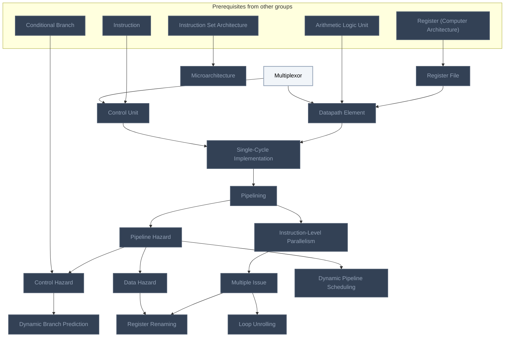
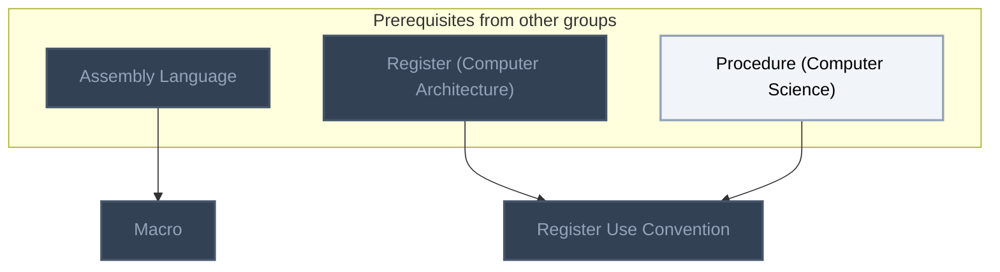
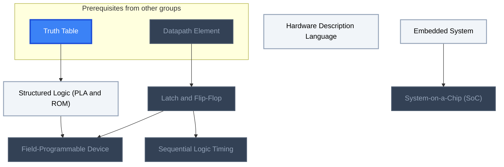

<!-- BEGIN STATS (generated by Scripts/skill_trees.py; do not edit) -->
**Mastered:** 0 / 130 · **Depth:** 0% · **Mastery Depth:** 0% · **Discovered:** 130 · **Planned:** 0 · **Locked:** 107 · **Rusty:** 0

| | L0 Discovered | L1 Recall | L2 Apply | L3 Prove ★ | L4 Wield | L5 Command |
|---|---:|---:|---:|---:|---:|---:|
| **At this level** | 130 | 0 | 0 | 0 | 0 | 0 |
| **Reached (this level or higher)** | 130 | 0 | 0 | 0 | 0 | 0 |

**Next up:** [[Classes of Computers]], [[Abstraction]], [[Great Ideas in Computer Architecture]], [[Make the Common Case Fast]], [[Moore's Law]]

Legend: dashed grey = planned (no note yet) · dark grey = locked · white L0 Discovered · green L1 Recall · blue L2 Apply · purple L3 Prove (Mastered) · orange L4 Wield · gold L5 Command · brown dashed border = rusty
<!-- END STATS -->

## Computer Organization and Design Ch. 1: Computer Abstractions and Technology
**Reached:** L1 0 · L2 0 · L3 0 · L4 0 · L5 0 (of 33 nodes)

```mermaid
flowchart TD
    classDef planned fill:#1E293B,stroke:#64748B,stroke-width:2px,stroke-dasharray:5 5,color:#94A3B8;
    classDef locked fill:#334155,stroke:#475569,stroke-width:2px,color:#94A3B8;
    classDef L0 fill:#F1F5F9,stroke:#94A3B8,stroke-width:2px,color:#000000;
    classDef L1 fill:#22C55E,stroke:#15803D,stroke-width:2px,color:#000000;
    classDef L2 fill:#3B82F6,stroke:#1D4ED8,stroke-width:3px,color:#FFFFFF;
    classDef L3 fill:#A855F7,stroke:#6B21A8,stroke-width:3px,color:#FFFFFF,font-weight:bold;
    classDef L4 fill:#F97316,stroke:#C2410C,stroke-width:4px,color:#000000,font-weight:bold;
    classDef L5 fill:#FFD700,stroke:#FF8C00,stroke-width:5px,color:#000000,font-weight:bold;
    classDef rusty stroke:#8B4513,stroke-width:4px,stroke-dasharray:3 3;
    subgraph sg_prereqs["Prerequisites from other groups"]
        n_operating_system["Operating System"]
    end
    n_classes_of_computers["Classes of Computers"]
    n_abstraction["Abstraction"]
    n_great_ideas_in_computer_architecture["Great Ideas in Computer Architecture"]
    n_make_the_common_case_fast["Make the Common Case Fast"]
    n_moore_s_law["Moore's Law"]
    n_memory_hierarchy["Memory Hierarchy"]
    n_speculative_execution["Speculative Execution"]
    n_dependability_via_redundancy["Dependability via Redundancy"]
    n_systems_software["Systems Software"]
    n_instruction["Instruction"]
    n_machine_language["Machine Language"]
    n_assembly_language["Assembly Language"]
    n_assembler["Assembler"]
    n_high_level_programming_language["High-Level Programming Language"]
    n_compiler["Compiler"]
    n_central_processing_unit["Central Processing Unit"]
    n_five_classic_components_of_a_computer["Five Classic Components of a Computer"]
    n_liquid_crystal_display["Liquid Crystal Display"]
    n_cache_memory["Cache Memory"]
    n_instruction_set_architecture["Instruction Set Architecture"]
    n_application_binary_interface["Application Binary Interface"]
    n_secondary_memory["Secondary Memory"]
    n_integrated_circuit_manufacturing["Integrated Circuit Manufacturing"]
    n_response_time_and_throughput["Response Time and Throughput"]
    n_cpu_performance_equation["CPU Performance Equation"]
    n_dynamic_power_dissipation["Dynamic Power Dissipation"]
    n_multicore_microprocessor["Multicore Microprocessor"]
    n_workload_and_benchmark["Workload and Benchmark"]
    n_amdahl_s_law["Amdahl's Law"]
    n_mips["MIPS"]
    n_bit["Bit"]
    n_main_memory["Main Memory"]
    n_state_computing["State (Computing)"]
    n_main_memory --> n_memory_hierarchy
    n_bit --> n_instruction
    n_instruction --> n_machine_language
    n_machine_language --> n_assembly_language
    n_assembly_language --> n_assembler
    n_assembly_language --> n_compiler
    n_high_level_programming_language --> n_compiler
    n_central_processing_unit --> n_five_classic_components_of_a_computer
    n_main_memory --> n_cache_memory
    n_abstraction --> n_instruction_set_architecture
    n_machine_language --> n_instruction_set_architecture
    n_instruction_set_architecture --> n_application_binary_interface
    n_operating_system --> n_application_binary_interface
    n_memory_hierarchy --> n_secondary_memory
    n_integrated_circuit_manufacturing --> n_dynamic_power_dissipation
    n_response_time_and_throughput --> n_cpu_performance_equation
    n_instruction --> n_cpu_performance_equation
    n_central_processing_unit --> n_multicore_microprocessor
    n_response_time_and_throughput --> n_workload_and_benchmark
    n_response_time_and_throughput --> n_amdahl_s_law
    n_cpu_performance_equation --> n_mips
    n_main_memory --> n_secondary_memory
    n_bit --> n_main_memory
    n_main_memory --> n_state_computing
    class n_operating_system,n_memory_hierarchy,n_instruction,n_machine_language,n_assembly_language,n_assembler,n_compiler,n_five_classic_components_of_a_computer,n_cache_memory,n_instruction_set_architecture,n_application_binary_interface,n_secondary_memory,n_cpu_performance_equation,n_dynamic_power_dissipation,n_multicore_microprocessor,n_workload_and_benchmark,n_amdahl_s_law,n_mips,n_main_memory,n_state_computing locked;
    class n_classes_of_computers,n_abstraction,n_great_ideas_in_computer_architecture,n_make_the_common_case_fast,n_moore_s_law,n_speculative_execution,n_dependability_via_redundancy,n_systems_software,n_high_level_programming_language,n_central_processing_unit,n_liquid_crystal_display,n_integrated_circuit_manufacturing,n_response_time_and_throughput,n_bit L0;
    class n_operating_system,n_classes_of_computers,n_abstraction,n_great_ideas_in_computer_architecture,n_make_the_common_case_fast,n_moore_s_law,n_memory_hierarchy,n_speculative_execution,n_dependability_via_redundancy,n_systems_software,n_instruction,n_machine_language,n_assembly_language,n_assembler,n_high_level_programming_language,n_compiler,n_central_processing_unit,n_five_classic_components_of_a_computer,n_liquid_crystal_display,n_cache_memory,n_instruction_set_architecture,n_application_binary_interface,n_secondary_memory,n_integrated_circuit_manufacturing,n_response_time_and_throughput,n_cpu_performance_equation,n_dynamic_power_dissipation,n_multicore_microprocessor,n_workload_and_benchmark,n_amdahl_s_law,n_mips,n_bit,n_main_memory,n_state_computing internal-link;
```



## Computer Organization and Design Ch. 2: Instructions
**Reached:** L1 0 · L2 0 · L3 0 · L4 0 · L5 0 (of 36 nodes)

```mermaid
flowchart TD
    classDef planned fill:#1E293B,stroke:#64748B,stroke-width:2px,stroke-dasharray:5 5,color:#94A3B8;
    classDef locked fill:#334155,stroke:#475569,stroke-width:2px,color:#94A3B8;
    classDef L0 fill:#F1F5F9,stroke:#94A3B8,stroke-width:2px,color:#000000;
    classDef L1 fill:#22C55E,stroke:#15803D,stroke-width:2px,color:#000000;
    classDef L2 fill:#3B82F6,stroke:#1D4ED8,stroke-width:3px,color:#FFFFFF;
    classDef L3 fill:#A855F7,stroke:#6B21A8,stroke-width:3px,color:#FFFFFF,font-weight:bold;
    classDef L4 fill:#F97316,stroke:#C2410C,stroke-width:4px,color:#000000,font-weight:bold;
    classDef L5 fill:#FFD700,stroke:#FF8C00,stroke-width:5px,color:#000000,font-weight:bold;
    classDef rusty stroke:#8B4513,stroke-width:4px,stroke-dasharray:3 3;
    subgraph sg_prereqs["Prerequisites from other groups"]
        n_instruction["Instruction"]
        n_main_memory["Main Memory"]
        n_central_processing_unit["Central Processing Unit"]
        n_machine_language["Machine Language"]
        n_stack["Stack"]
        n_bit["Bit"]
        n_assembler["Assembler"]
        n_linker["Linker"]
        n_compiler["Compiler"]
        n_instruction_set_architecture["Instruction Set Architecture"]
    end
    n_instruction_set["Instruction Set"]
    n_stored_program_concept["Stored-Program Concept"]
    n_simplicity_favors_regularity["Simplicity Favors Regularity"]
    n_register_computer_architecture["Register (Computer Architecture)"]
    n_word_computer_architecture["Word (Computer Architecture)"]
    n_smaller_is_faster["Smaller Is Faster"]
    n_memory_address["Memory Address"]
    n_data_transfer_instruction["Data Transfer Instruction"]
    n_alignment_restriction["Alignment Restriction"]
    n_endianness["Endianness"]
    n_register_spilling["Register Spilling"]
    n_positional_number_system["Positional Number System"]
    n_arithmetic_overflow["Arithmetic Overflow"]
    n_two_s_complement["Two's Complement"]
    n_sign_extension["Sign Extension"]
    n_one_s_complement["One's Complement"]
    n_biased_notation["Biased Notation"]
    n_instruction_format["Instruction Format"]
    n_good_design_demands_good_compromises["Good Design Demands Good Compromises"]
    n_conditional_branch["Conditional Branch"]
    n_basic_block["Basic Block"]
    n_jump_address_table["Jump Address Table"]
    n_procedure_computer_science["Procedure (Computer Science)"]
    n_call_stack["Call Stack"]
    n_program_counter["Program Counter"]
    n_procedure_frame["Procedure Frame"]
    n_character_encoding["Character Encoding"]
    n_addressing_mode["Addressing Mode"]
    n_pseudoinstruction["Pseudoinstruction"]
    n_object_file["Object File"]
    n_executable_file["Executable File"]
    n_just_in_time_compilation["Just-In-Time Compilation"]
    n_instruction_set_design_principles["Instruction Set Design Principles"]
    n_unicode["Unicode"]
    n_utf_8["UTF-8"]
    n_encoding_and_decoding["Encoding and Decoding"]
    n_instruction --> n_instruction_set
    n_instruction --> n_stored_program_concept
    n_main_memory --> n_stored_program_concept
    n_instruction_set --> n_simplicity_favors_regularity
    n_central_processing_unit --> n_register_computer_architecture
    n_register_computer_architecture --> n_word_computer_architecture
    n_register_computer_architecture --> n_smaller_is_faster
    n_main_memory --> n_memory_address
    n_memory_address --> n_data_transfer_instruction
    n_register_computer_architecture --> n_data_transfer_instruction
    n_instruction --> n_data_transfer_instruction
    n_memory_address --> n_alignment_restriction
    n_word_computer_architecture --> n_alignment_restriction
    n_memory_address --> n_endianness
    n_word_computer_architecture --> n_endianness
    n_data_transfer_instruction --> n_register_spilling
    n_positional_number_system --> n_arithmetic_overflow
    n_positional_number_system --> n_two_s_complement
    n_two_s_complement --> n_sign_extension
    n_positional_number_system --> n_one_s_complement
    n_positional_number_system --> n_biased_notation
    n_machine_language --> n_instruction_format
    n_instruction_format --> n_good_design_demands_good_compromises
    n_instruction --> n_conditional_branch
    n_conditional_branch --> n_basic_block
    n_conditional_branch --> n_jump_address_table
    n_memory_address --> n_jump_address_table
    n_procedure_computer_science --> n_call_stack
    n_stack --> n_call_stack
    n_register_computer_architecture --> n_program_counter
    n_stored_program_concept --> n_program_counter
    n_call_stack --> n_procedure_frame
    n_bit --> n_character_encoding
    n_program_counter --> n_addressing_mode
    n_memory_address --> n_addressing_mode
    n_assembler --> n_pseudoinstruction
    n_assembler --> n_object_file
    n_linker --> n_executable_file
    n_compiler --> n_just_in_time_compilation
    n_instruction_set_architecture --> n_instruction_set_design_principles
    n_main_memory --> n_data_transfer_instruction
    n_character_encoding --> n_unicode
    n_unicode --> n_utf_8
    n_unicode --> n_encoding_and_decoding
    n_character_encoding --> n_encoding_and_decoding
    class n_instruction,n_main_memory,n_machine_language,n_stack,n_assembler,n_linker,n_compiler,n_instruction_set_architecture,n_instruction_set,n_stored_program_concept,n_simplicity_favors_regularity,n_register_computer_architecture,n_word_computer_architecture,n_smaller_is_faster,n_memory_address,n_data_transfer_instruction,n_alignment_restriction,n_endianness,n_register_spilling,n_arithmetic_overflow,n_two_s_complement,n_sign_extension,n_one_s_complement,n_biased_notation,n_instruction_format,n_good_design_demands_good_compromises,n_conditional_branch,n_basic_block,n_jump_address_table,n_call_stack,n_program_counter,n_procedure_frame,n_character_encoding,n_addressing_mode,n_pseudoinstruction,n_object_file,n_executable_file,n_just_in_time_compilation,n_instruction_set_design_principles,n_unicode,n_utf_8,n_encoding_and_decoding locked;
    class n_central_processing_unit,n_bit,n_positional_number_system,n_procedure_computer_science L0;
    class n_instruction,n_main_memory,n_central_processing_unit,n_machine_language,n_stack,n_bit,n_assembler,n_linker,n_compiler,n_instruction_set_architecture,n_instruction_set,n_stored_program_concept,n_simplicity_favors_regularity,n_register_computer_architecture,n_word_computer_architecture,n_smaller_is_faster,n_memory_address,n_data_transfer_instruction,n_alignment_restriction,n_endianness,n_register_spilling,n_positional_number_system,n_arithmetic_overflow,n_two_s_complement,n_sign_extension,n_one_s_complement,n_biased_notation,n_instruction_format,n_good_design_demands_good_compromises,n_conditional_branch,n_basic_block,n_jump_address_table,n_procedure_computer_science,n_call_stack,n_program_counter,n_procedure_frame,n_character_encoding,n_addressing_mode,n_pseudoinstruction,n_object_file,n_executable_file,n_just_in_time_compilation,n_instruction_set_design_principles,n_unicode,n_utf_8,n_encoding_and_decoding internal-link;
```



## Computer Organization and Design Ch. 3: Arithmetic for Computers
**Reached:** L1 0 · L2 0 · L3 0 · L4 0 · L5 0 (of 7 nodes)



```mermaid
flowchart TD
    classDef planned fill:#1E293B,stroke:#64748B,stroke-width:2px,stroke-dasharray:5 5,color:#94A3B8;
    classDef locked fill:#334155,stroke:#475569,stroke-width:2px,color:#94A3B8;
    classDef L0 fill:#F1F5F9,stroke:#94A3B8,stroke-width:2px,color:#000000;
    classDef L1 fill:#22C55E,stroke:#15803D,stroke-width:2px,color:#000000;
    classDef L2 fill:#3B82F6,stroke:#1D4ED8,stroke-width:3px,color:#FFFFFF;
    classDef L3 fill:#A855F7,stroke:#6B21A8,stroke-width:3px,color:#FFFFFF,font-weight:bold;
    classDef L4 fill:#F97316,stroke:#C2410C,stroke-width:4px,color:#000000,font-weight:bold;
    classDef L5 fill:#FFD700,stroke:#FF8C00,stroke-width:5px,color:#000000,font-weight:bold;
    classDef rusty stroke:#8B4513,stroke-width:4px,stroke-dasharray:3 3;
    subgraph sg_prereqs["Prerequisites from other groups"]
        n_procedure_computer_science["Procedure (Computer Science)"]
        n_program_counter["Program Counter"]
        n_central_processing_unit["Central Processing Unit"]
        n_two_s_complement["Two's Complement"]
        n_arithmetic_overflow["Arithmetic Overflow"]
        n_positional_number_system["Positional Number System"]
        n_floating_point_number_system["Floating-Point Number System"]
        n_rounding["Rounding"]
        n_word_computer_architecture["Word (Computer Architecture)"]
    end
    n_exception_computer_architecture["Exception (Computer Architecture)"]
    n_arithmetic_logic_unit["Arithmetic Logic Unit"]
    n_saturating_arithmetic["Saturating Arithmetic"]
    n_binary_multiplication_algorithm["Binary Multiplication Algorithm"]
    n_binary_division_algorithm["Binary Division Algorithm"]
    n_fused_multiply_add["Fused Multiply-Add"]
    n_subword_parallelism["Subword Parallelism"]
    n_procedure_computer_science --> n_exception_computer_architecture
    n_program_counter --> n_exception_computer_architecture
    n_central_processing_unit --> n_arithmetic_logic_unit
    n_two_s_complement --> n_saturating_arithmetic
    n_arithmetic_overflow --> n_saturating_arithmetic
    n_arithmetic_logic_unit --> n_binary_multiplication_algorithm
    n_positional_number_system --> n_binary_multiplication_algorithm
    n_arithmetic_logic_unit --> n_binary_division_algorithm
    n_positional_number_system --> n_binary_division_algorithm
    n_floating_point_number_system --> n_fused_multiply_add
    n_rounding --> n_fused_multiply_add
    n_word_computer_architecture --> n_subword_parallelism
    n_arithmetic_logic_unit --> n_subword_parallelism
    class n_program_counter,n_two_s_complement,n_arithmetic_overflow,n_rounding,n_word_computer_architecture,n_exception_computer_architecture,n_arithmetic_logic_unit,n_saturating_arithmetic,n_binary_multiplication_algorithm,n_binary_division_algorithm,n_fused_multiply_add,n_subword_parallelism locked;
    class n_procedure_computer_science,n_central_processing_unit,n_positional_number_system,n_floating_point_number_system L0;
    class n_procedure_computer_science,n_program_counter,n_central_processing_unit,n_two_s_complement,n_arithmetic_overflow,n_positional_number_system,n_floating_point_number_system,n_rounding,n_word_computer_architecture,n_exception_computer_architecture,n_arithmetic_logic_unit,n_saturating_arithmetic,n_binary_multiplication_algorithm,n_binary_division_algorithm,n_fused_multiply_add,n_subword_parallelism internal-link;
```

## Computer Organization and Design Ch. 4: The Processor
**Reached:** L1 0 · L2 0 · L3 0 · L4 0 · L5 0 (of 16 nodes)



## Computer Organization and Design Ch. 5: Memory Hierarchy
**Reached:** L1 0 · L2 0 · L3 0 · L4 0 · L5 0 (of 16 nodes)



```mermaid
flowchart TD
    classDef planned fill:#1E293B,stroke:#64748B,stroke-width:2px,stroke-dasharray:5 5,color:#94A3B8;
    classDef locked fill:#334155,stroke:#475569,stroke-width:2px,color:#94A3B8;
    classDef L0 fill:#F1F5F9,stroke:#94A3B8,stroke-width:2px,color:#000000;
    classDef L1 fill:#22C55E,stroke:#15803D,stroke-width:2px,color:#000000;
    classDef L2 fill:#3B82F6,stroke:#1D4ED8,stroke-width:3px,color:#FFFFFF;
    classDef L3 fill:#A855F7,stroke:#6B21A8,stroke-width:3px,color:#FFFFFF,font-weight:bold;
    classDef L4 fill:#F97316,stroke:#C2410C,stroke-width:4px,color:#000000,font-weight:bold;
    classDef L5 fill:#FFD700,stroke:#FF8C00,stroke-width:5px,color:#000000,font-weight:bold;
    classDef rusty stroke:#8B4513,stroke-width:4px,stroke-dasharray:3 3;
    subgraph sg_prereqs["Prerequisites from other groups"]
        n_cache_memory["Cache Memory"]
        n_memory_address["Memory Address"]
        n_memory_hierarchy["Memory Hierarchy"]
        n_bit["Bit"]
        n_virtual_memory["Virtual Memory"]
        n_page_table["Page Table"]
        n_multicore_microprocessor["Multicore Microprocessor"]
    end
    n_principle_of_locality["Principle of Locality"]
    n_direct_mapped_cache["Direct-Mapped Cache"]
    n_cache_write_policy["Cache Write Policy"]
    n_average_memory_access_time["Average Memory Access Time"]
    n_set_associative_cache["Set-Associative Cache"]
    n_least_recently_used["Least Recently Used"]
    n_multilevel_cache["Multilevel Cache"]
    n_cache_blocking["Cache Blocking"]
    n_dependability_reliability_and_availability["Dependability (Reliability and Availability)"]
    n_hamming_code["Hamming Code"]
    n_segmentation["Segmentation"]
    n_translation_lookaside_buffer["Translation-Lookaside Buffer"]
    n_three_cs_model["Three Cs Model"]
    n_finite_state_machine["Finite-State Machine"]
    n_cache_coherence["Cache Coherence"]
    n_prefetching["Prefetching"]
    n_cache_memory --> n_direct_mapped_cache
    n_memory_address --> n_direct_mapped_cache
    n_cache_memory --> n_cache_write_policy
    n_memory_hierarchy --> n_cache_write_policy
    n_cache_memory --> n_average_memory_access_time
    n_direct_mapped_cache --> n_set_associative_cache
    n_set_associative_cache --> n_least_recently_used
    n_cache_memory --> n_multilevel_cache
    n_memory_hierarchy --> n_multilevel_cache
    n_principle_of_locality --> n_cache_blocking
    n_cache_memory --> n_cache_blocking
    n_bit --> n_hamming_code
    n_virtual_memory --> n_segmentation
    n_cache_memory --> n_translation_lookaside_buffer
    n_page_table --> n_translation_lookaside_buffer
    n_set_associative_cache --> n_three_cs_model
    n_cache_memory --> n_cache_coherence
    n_multicore_microprocessor --> n_cache_coherence
    n_cache_memory --> n_prefetching
    class n_cache_memory,n_memory_address,n_memory_hierarchy,n_virtual_memory,n_page_table,n_multicore_microprocessor,n_direct_mapped_cache,n_cache_write_policy,n_average_memory_access_time,n_set_associative_cache,n_least_recently_used,n_multilevel_cache,n_cache_blocking,n_hamming_code,n_segmentation,n_translation_lookaside_buffer,n_three_cs_model,n_cache_coherence,n_prefetching locked;
    class n_bit,n_principle_of_locality,n_dependability_reliability_and_availability,n_finite_state_machine L0;
    class n_cache_memory,n_memory_address,n_memory_hierarchy,n_bit,n_virtual_memory,n_page_table,n_multicore_microprocessor,n_principle_of_locality,n_direct_mapped_cache,n_cache_write_policy,n_average_memory_access_time,n_set_associative_cache,n_least_recently_used,n_multilevel_cache,n_cache_blocking,n_dependability_reliability_and_availability,n_hamming_code,n_segmentation,n_translation_lookaside_buffer,n_three_cs_model,n_finite_state_machine,n_cache_coherence,n_prefetching internal-link;
```

## Computer Organization and Design Ch. 6: Parallel Processors
**Reached:** L1 0 · L2 0 · L3 0 · L4 0 · L5 0 (of 13 nodes)

```mermaid
flowchart TD
    classDef planned fill:#1E293B,stroke:#64748B,stroke-width:2px,stroke-dasharray:5 5,color:#94A3B8;
    classDef locked fill:#334155,stroke:#475569,stroke-width:2px,color:#94A3B8;
    classDef L0 fill:#F1F5F9,stroke:#94A3B8,stroke-width:2px,color:#000000;
    classDef L1 fill:#22C55E,stroke:#15803D,stroke-width:2px,color:#000000;
    classDef L2 fill:#3B82F6,stroke:#1D4ED8,stroke-width:3px,color:#FFFFFF;
    classDef L3 fill:#A855F7,stroke:#6B21A8,stroke-width:3px,color:#FFFFFF,font-weight:bold;
    classDef L4 fill:#F97316,stroke:#C2410C,stroke-width:4px,color:#000000,font-weight:bold;
    classDef L5 fill:#FFD700,stroke:#FF8C00,stroke-width:5px,color:#000000,font-weight:bold;
    classDef rusty stroke:#8B4513,stroke-width:4px,stroke-dasharray:3 3;
    subgraph sg_prereqs["Prerequisites from other groups"]
        n_central_processing_unit["Central Processing Unit"]
        n_amdahl_s_law["Amdahl's Law"]
        n_instruction["Instruction"]
        n_thread["Thread"]
        n_pipelining["Pipelining"]
        n_main_memory["Main Memory"]
        n_process_computing["Process (Computing)"]
    end
    n_multiprocessor["Multiprocessor"]
    n_shared_memory_multiprocessor["Shared Memory Multiprocessor"]
    n_message_passing_multiprocessor["Message-Passing Multiprocessor"]
    n_cluster_computing["Cluster (Computing)"]
    n_warehouse_scale_computer["Warehouse-Scale Computer"]
    n_scaling_parallel_computing["Scaling (Parallel Computing)"]
    n_flynn_s_taxonomy["Flynn's Taxonomy"]
    n_vector_architecture["Vector Architecture"]
    n_hardware_multithreading["Hardware Multithreading"]
    n_graphics_processing_unit["Graphics Processing Unit"]
    n_interconnection_network["Interconnection Network"]
    n_arithmetic_intensity["Arithmetic Intensity"]
    n_hyperthreading["Hyperthreading"]
    n_central_processing_unit --> n_multiprocessor
    n_multiprocessor --> n_shared_memory_multiprocessor
    n_multiprocessor --> n_message_passing_multiprocessor
    n_message_passing_multiprocessor --> n_cluster_computing
    n_cluster_computing --> n_warehouse_scale_computer
    n_multiprocessor --> n_scaling_parallel_computing
    n_amdahl_s_law --> n_scaling_parallel_computing
    n_instruction --> n_flynn_s_taxonomy
    n_flynn_s_taxonomy --> n_vector_architecture
    n_thread --> n_hardware_multithreading
    n_pipelining --> n_hardware_multithreading
    n_flynn_s_taxonomy --> n_graphics_processing_unit
    n_hardware_multithreading --> n_graphics_processing_unit
    n_shared_memory_multiprocessor --> n_interconnection_network
    n_cluster_computing --> n_interconnection_network
    n_main_memory --> n_arithmetic_intensity
    n_hardware_multithreading --> n_hyperthreading
    n_process_computing --> n_hyperthreading
    class n_amdahl_s_law,n_instruction,n_thread,n_pipelining,n_main_memory,n_process_computing,n_multiprocessor,n_shared_memory_multiprocessor,n_message_passing_multiprocessor,n_cluster_computing,n_warehouse_scale_computer,n_scaling_parallel_computing,n_flynn_s_taxonomy,n_vector_architecture,n_hardware_multithreading,n_graphics_processing_unit,n_interconnection_network,n_arithmetic_intensity,n_hyperthreading locked;
    class n_central_processing_unit L0;
    class n_central_processing_unit,n_amdahl_s_law,n_instruction,n_thread,n_pipelining,n_main_memory,n_process_computing,n_multiprocessor,n_shared_memory_multiprocessor,n_message_passing_multiprocessor,n_cluster_computing,n_warehouse_scale_computer,n_scaling_parallel_computing,n_flynn_s_taxonomy,n_vector_architecture,n_hardware_multithreading,n_graphics_processing_unit,n_interconnection_network,n_arithmetic_intensity,n_hyperthreading internal-link;
```



## Computer Organization and Design App. A: Assemblers, Linkers
**Reached:** L1 0 · L2 0 · L3 0 · L4 0 · L5 0 (of 2 nodes)



## Computer Organization and Design App. B: Logic Design
**Reached:** L1 0 · L2 0 · L3 0 · L4 0 · L5 0 (of 7 nodes)



# Source
Graph structure: the single source for the diagrams above, edited by `/note` and `Scripts/skill_trees.py` (`add`, `edge`, `rename`). Everything above this heading is regenerated by `render`.

```skilltree
    %% PREREQUISITES
    n_stack["Stack"]
    n_floating_point_number_system["Floating-Point Number System"]
    n_rounding["Rounding"]
    n_virtual_memory["Virtual Memory"]
    n_page_table["Page Table"]
    n_truth_table["Truth Table"]
    n_operating_system["Operating System"]
    n_thread["Thread"]
    n_linker["Linker"]
    n_process_computing["Process (Computing)"]
    %% NODES
    %% == Computer Organization and Design Ch. 1: Computer Abstractions and Technology ==
    n_classes_of_computers["Classes of Computers"]
    n_abstraction["Abstraction"]
    n_great_ideas_in_computer_architecture["Great Ideas in Computer Architecture"]
    n_make_the_common_case_fast["Make the Common Case Fast"]
    n_moore_s_law["Moore's Law"]
    n_memory_hierarchy["Memory Hierarchy"]
    n_speculative_execution["Speculative Execution"]
    n_dependability_via_redundancy["Dependability via Redundancy"]
    n_systems_software["Systems Software"]
    n_instruction["Instruction"]
    n_machine_language["Machine Language"]
    n_assembly_language["Assembly Language"]
    n_assembler["Assembler"]
    n_high_level_programming_language["High-Level Programming Language"]
    n_compiler["Compiler"]
    n_central_processing_unit["Central Processing Unit"]
    n_five_classic_components_of_a_computer["Five Classic Components of a Computer"]
    n_liquid_crystal_display["Liquid Crystal Display"]
    n_cache_memory["Cache Memory"]
    n_instruction_set_architecture["Instruction Set Architecture"]
    n_application_binary_interface["Application Binary Interface"]
    n_secondary_memory["Secondary Memory"]
    n_integrated_circuit_manufacturing["Integrated Circuit Manufacturing"]
    n_response_time_and_throughput["Response Time and Throughput"]
    n_cpu_performance_equation["CPU Performance Equation"]
    n_dynamic_power_dissipation["Dynamic Power Dissipation"]
    n_multicore_microprocessor["Multicore Microprocessor"]
    n_workload_and_benchmark["Workload and Benchmark"]
    n_amdahl_s_law["Amdahl's Law"]
    n_mips["MIPS"]
    n_bit["Bit"]
    n_main_memory["Main Memory"]
    n_state_computing["State (Computing)"]
    %% == Computer Organization and Design Ch. 2: Instructions ==
    n_instruction_set["Instruction Set"]
    n_stored_program_concept["Stored-Program Concept"]
    n_simplicity_favors_regularity["Simplicity Favors Regularity"]
    n_register_computer_architecture["Register (Computer Architecture)"]
    n_word_computer_architecture["Word (Computer Architecture)"]
    n_smaller_is_faster["Smaller Is Faster"]
    n_memory_address["Memory Address"]
    n_data_transfer_instruction["Data Transfer Instruction"]
    n_alignment_restriction["Alignment Restriction"]
    n_endianness["Endianness"]
    n_register_spilling["Register Spilling"]
    n_positional_number_system["Positional Number System"]
    n_arithmetic_overflow["Arithmetic Overflow"]
    n_two_s_complement["Two's Complement"]
    n_sign_extension["Sign Extension"]
    n_one_s_complement["One's Complement"]
    n_biased_notation["Biased Notation"]
    n_instruction_format["Instruction Format"]
    n_good_design_demands_good_compromises["Good Design Demands Good Compromises"]
    n_conditional_branch["Conditional Branch"]
    n_basic_block["Basic Block"]
    n_jump_address_table["Jump Address Table"]
    n_procedure_computer_science["Procedure (Computer Science)"]
    n_call_stack["Call Stack"]
    n_program_counter["Program Counter"]
    n_procedure_frame["Procedure Frame"]
    n_character_encoding["Character Encoding"]
    n_addressing_mode["Addressing Mode"]
    n_pseudoinstruction["Pseudoinstruction"]
    n_object_file["Object File"]
    n_executable_file["Executable File"]
    n_just_in_time_compilation["Just-In-Time Compilation"]
    n_instruction_set_design_principles["Instruction Set Design Principles"]
    n_unicode["Unicode"]
    n_utf_8["UTF-8"]
    n_encoding_and_decoding["Encoding and Decoding"]
    %% == Computer Organization and Design Ch. 3: Arithmetic for Computers ==
    n_exception_computer_architecture["Exception (Computer Architecture)"]
    n_arithmetic_logic_unit["Arithmetic Logic Unit"]
    n_saturating_arithmetic["Saturating Arithmetic"]
    n_binary_multiplication_algorithm["Binary Multiplication Algorithm"]
    n_binary_division_algorithm["Binary Division Algorithm"]
    n_fused_multiply_add["Fused Multiply-Add"]
    n_subword_parallelism["Subword Parallelism"]
    %% == Computer Organization and Design Ch. 4: The Processor ==
    n_multiplexor["Multiplexor"]
    n_control_unit["Control Unit"]
    n_register_file["Register File"]
    n_datapath_element["Datapath Element"]
    n_single_cycle_implementation["Single-Cycle Implementation"]
    n_pipelining["Pipelining"]
    n_pipeline_hazard["Pipeline Hazard"]
    n_data_hazard["Data Hazard"]
    n_control_hazard["Control Hazard"]
    n_dynamic_branch_prediction["Dynamic Branch Prediction"]
    n_instruction_level_parallelism["Instruction-Level Parallelism"]
    n_multiple_issue["Multiple Issue"]
    n_loop_unrolling["Loop Unrolling"]
    n_register_renaming["Register Renaming"]
    n_dynamic_pipeline_scheduling["Dynamic Pipeline Scheduling"]
    n_microarchitecture["Microarchitecture"]
    %% == Computer Organization and Design Ch. 5: Memory Hierarchy ==
    n_principle_of_locality["Principle of Locality"]
    n_direct_mapped_cache["Direct-Mapped Cache"]
    n_cache_write_policy["Cache Write Policy"]
    n_average_memory_access_time["Average Memory Access Time"]
    n_set_associative_cache["Set-Associative Cache"]
    n_least_recently_used["Least Recently Used"]
    n_multilevel_cache["Multilevel Cache"]
    n_cache_blocking["Cache Blocking"]
    n_dependability_reliability_and_availability["Dependability (Reliability and Availability)"]
    n_hamming_code["Hamming Code"]
    n_segmentation["Segmentation"]
    n_translation_lookaside_buffer["Translation-Lookaside Buffer"]
    n_three_cs_model["Three Cs Model"]
    n_finite_state_machine["Finite-State Machine"]
    n_cache_coherence["Cache Coherence"]
    n_prefetching["Prefetching"]
    %% == Computer Organization and Design Ch. 6: Parallel Processors ==
    n_multiprocessor["Multiprocessor"]
    n_shared_memory_multiprocessor["Shared Memory Multiprocessor"]
    n_message_passing_multiprocessor["Message-Passing Multiprocessor"]
    n_cluster_computing["Cluster (Computing)"]
    n_warehouse_scale_computer["Warehouse-Scale Computer"]
    n_scaling_parallel_computing["Scaling (Parallel Computing)"]
    n_flynn_s_taxonomy["Flynn's Taxonomy"]
    n_vector_architecture["Vector Architecture"]
    n_hardware_multithreading["Hardware Multithreading"]
    n_graphics_processing_unit["Graphics Processing Unit"]
    n_interconnection_network["Interconnection Network"]
    n_arithmetic_intensity["Arithmetic Intensity"]
    n_hyperthreading["Hyperthreading"]
    %% == Computer Organization and Design App. A: Assemblers, Linkers ==
    n_macro["Macro"]
    n_register_use_convention["Register Use Convention"]
    %% == Computer Organization and Design App. B: Logic Design ==
    n_structured_logic_pla_and_rom["Structured Logic (PLA and ROM)"]
    n_hardware_description_language["Hardware Description Language"]
    n_latch_and_flip_flop["Latch and Flip-Flop"]
    n_sequential_logic_timing["Sequential Logic Timing"]
    n_field_programmable_device["Field-Programmable Device"]
    n_embedded_system["Embedded System"]
    n_system_on_a_chip_soc["System-on-a-Chip (SoC)"]
    %% EDGES
    n_main_memory --> n_memory_hierarchy
    n_bit --> n_instruction
    n_instruction --> n_machine_language
    n_machine_language --> n_assembly_language
    n_assembly_language --> n_assembler
    n_assembly_language --> n_compiler
    n_high_level_programming_language --> n_compiler
    n_central_processing_unit --> n_five_classic_components_of_a_computer
    n_main_memory --> n_cache_memory
    n_abstraction --> n_instruction_set_architecture
    n_machine_language --> n_instruction_set_architecture
    n_instruction_set_architecture --> n_application_binary_interface
    n_operating_system --> n_application_binary_interface
    n_memory_hierarchy --> n_secondary_memory
    n_integrated_circuit_manufacturing --> n_dynamic_power_dissipation
    n_response_time_and_throughput --> n_cpu_performance_equation
    n_instruction --> n_cpu_performance_equation
    n_central_processing_unit --> n_multicore_microprocessor
    n_response_time_and_throughput --> n_workload_and_benchmark
    n_response_time_and_throughput --> n_amdahl_s_law
    n_cpu_performance_equation --> n_mips
    n_instruction --> n_instruction_set
    n_instruction --> n_stored_program_concept
    n_main_memory --> n_stored_program_concept
    n_instruction_set --> n_simplicity_favors_regularity
    n_central_processing_unit --> n_register_computer_architecture
    n_register_computer_architecture --> n_word_computer_architecture
    n_register_computer_architecture --> n_smaller_is_faster
    n_main_memory --> n_memory_address
    n_memory_address --> n_data_transfer_instruction
    n_register_computer_architecture --> n_data_transfer_instruction
    n_instruction --> n_data_transfer_instruction
    n_memory_address --> n_alignment_restriction
    n_word_computer_architecture --> n_alignment_restriction
    n_memory_address --> n_endianness
    n_word_computer_architecture --> n_endianness
    n_data_transfer_instruction --> n_register_spilling
    n_positional_number_system --> n_arithmetic_overflow
    n_positional_number_system --> n_two_s_complement
    n_two_s_complement --> n_sign_extension
    n_positional_number_system --> n_one_s_complement
    n_positional_number_system --> n_biased_notation
    n_machine_language --> n_instruction_format
    n_instruction_format --> n_good_design_demands_good_compromises
    n_instruction --> n_conditional_branch
    n_conditional_branch --> n_basic_block
    n_conditional_branch --> n_jump_address_table
    n_memory_address --> n_jump_address_table
    n_procedure_computer_science --> n_call_stack
    n_stack --> n_call_stack
    n_register_computer_architecture --> n_program_counter
    n_stored_program_concept --> n_program_counter
    n_call_stack --> n_procedure_frame
    n_bit --> n_character_encoding
    n_program_counter --> n_addressing_mode
    n_memory_address --> n_addressing_mode
    n_assembler --> n_pseudoinstruction
    n_assembler --> n_object_file
    n_linker --> n_executable_file
    n_compiler --> n_just_in_time_compilation
    n_instruction_set_architecture --> n_instruction_set_design_principles
    n_procedure_computer_science --> n_exception_computer_architecture
    n_program_counter --> n_exception_computer_architecture
    n_central_processing_unit --> n_arithmetic_logic_unit
    n_two_s_complement --> n_saturating_arithmetic
    n_arithmetic_overflow --> n_saturating_arithmetic
    n_arithmetic_logic_unit --> n_binary_multiplication_algorithm
    n_positional_number_system --> n_binary_multiplication_algorithm
    n_arithmetic_logic_unit --> n_binary_division_algorithm
    n_positional_number_system --> n_binary_division_algorithm
    n_floating_point_number_system --> n_fused_multiply_add
    n_rounding --> n_fused_multiply_add
    n_word_computer_architecture --> n_subword_parallelism
    n_arithmetic_logic_unit --> n_subword_parallelism
    n_instruction --> n_control_unit
    n_multiplexor --> n_control_unit
    n_register_computer_architecture --> n_register_file
    n_register_file --> n_datapath_element
    n_arithmetic_logic_unit --> n_datapath_element
    n_multiplexor --> n_datapath_element
    n_datapath_element --> n_single_cycle_implementation
    n_control_unit --> n_single_cycle_implementation
    n_single_cycle_implementation --> n_pipelining
    n_pipelining --> n_pipeline_hazard
    n_pipeline_hazard --> n_data_hazard
    n_pipeline_hazard --> n_control_hazard
    n_conditional_branch --> n_control_hazard
    n_control_hazard --> n_dynamic_branch_prediction
    n_pipelining --> n_instruction_level_parallelism
    n_instruction_level_parallelism --> n_multiple_issue
    n_multiple_issue --> n_loop_unrolling
    n_multiple_issue --> n_register_renaming
    n_data_hazard --> n_register_renaming
    n_pipeline_hazard --> n_dynamic_pipeline_scheduling
    n_instruction_set_architecture --> n_microarchitecture
    n_cache_memory --> n_direct_mapped_cache
    n_memory_address --> n_direct_mapped_cache
    n_cache_memory --> n_cache_write_policy
    n_memory_hierarchy --> n_cache_write_policy
    n_cache_memory --> n_average_memory_access_time
    n_direct_mapped_cache --> n_set_associative_cache
    n_set_associative_cache --> n_least_recently_used
    n_cache_memory --> n_multilevel_cache
    n_memory_hierarchy --> n_multilevel_cache
    n_principle_of_locality --> n_cache_blocking
    n_cache_memory --> n_cache_blocking
    n_bit --> n_hamming_code
    n_virtual_memory --> n_segmentation
    n_cache_memory --> n_translation_lookaside_buffer
    n_page_table --> n_translation_lookaside_buffer
    n_set_associative_cache --> n_three_cs_model
    n_cache_memory --> n_cache_coherence
    n_multicore_microprocessor --> n_cache_coherence
    n_cache_memory --> n_prefetching
    n_central_processing_unit --> n_multiprocessor
    n_multiprocessor --> n_shared_memory_multiprocessor
    n_multiprocessor --> n_message_passing_multiprocessor
    n_message_passing_multiprocessor --> n_cluster_computing
    n_cluster_computing --> n_warehouse_scale_computer
    n_multiprocessor --> n_scaling_parallel_computing
    n_amdahl_s_law --> n_scaling_parallel_computing
    n_instruction --> n_flynn_s_taxonomy
    n_flynn_s_taxonomy --> n_vector_architecture
    n_thread --> n_hardware_multithreading
    n_pipelining --> n_hardware_multithreading
    n_flynn_s_taxonomy --> n_graphics_processing_unit
    n_hardware_multithreading --> n_graphics_processing_unit
    n_shared_memory_multiprocessor --> n_interconnection_network
    n_cluster_computing --> n_interconnection_network
    n_main_memory --> n_arithmetic_intensity
    n_assembly_language --> n_macro
    n_register_computer_architecture --> n_register_use_convention
    n_procedure_computer_science --> n_register_use_convention
    n_truth_table --> n_structured_logic_pla_and_rom
    n_datapath_element --> n_latch_and_flip_flop
    n_latch_and_flip_flop --> n_sequential_logic_timing
    n_structured_logic_pla_and_rom --> n_field_programmable_device
    n_latch_and_flip_flop --> n_field_programmable_device
    n_main_memory --> n_data_transfer_instruction
    n_main_memory --> n_secondary_memory
    n_bit --> n_main_memory
    n_main_memory --> n_state_computing
    n_hardware_multithreading --> n_hyperthreading
    n_process_computing --> n_hyperthreading
    n_embedded_system --> n_system_on_a_chip_soc
    n_character_encoding --> n_unicode
    n_unicode --> n_utf_8
    n_unicode --> n_encoding_and_decoding
    n_character_encoding --> n_encoding_and_decoding
```
