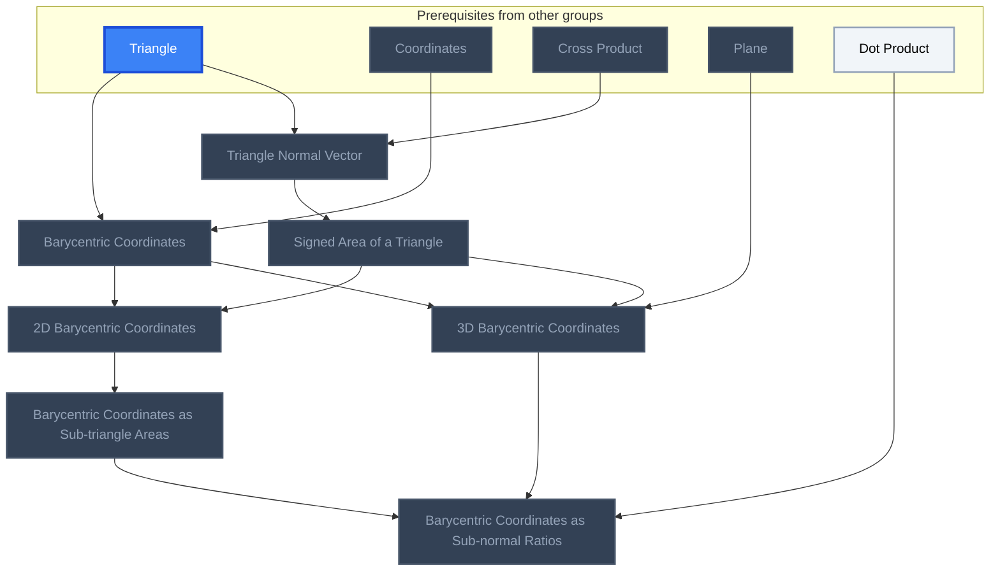
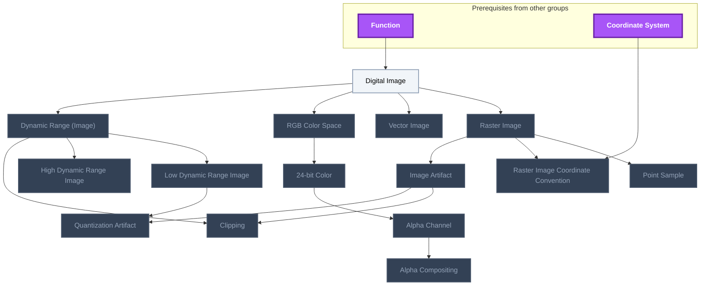
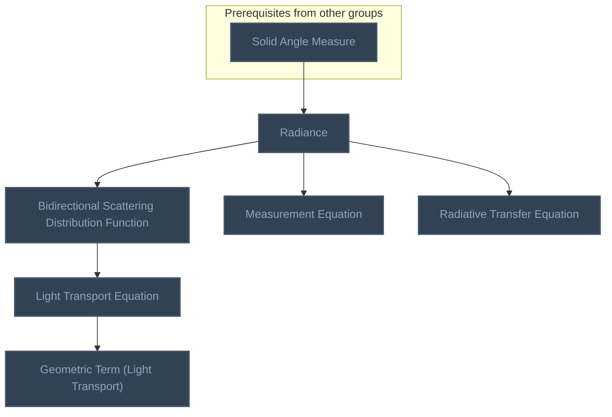

<!-- BEGIN STATS (generated by Scripts/skill_trees.py; do not edit) -->
**Mastered:** 0 / 89 · **Depth:** 0% · **Discovered:** 89 · **Planned:** 0 · **Locked:** 87 · **Rusty:** 0

| | L0 Discovered | L1 Recall | L2 Apply | L3 Prove ★ | L4 Wield | L5 Command |
|---|---:|---:|---:|---:|---:|---:|
| **At this level** | 89 | 0 | 0 | 0 | 0 | 0 |
| **Reached (this level or higher)** | 89 | 0 | 0 | 0 | 0 | 0 |

**Next up:** [[Digital Image]], [[Projection]]

Legend: dashed grey = planned (no note yet) · dark grey = locked · white L0 Discovered · green L1 Recall · blue L2 Apply · purple L3 Prove (Mastered) · orange L4 Wield · gold L5 Command · brown dashed border = rusty
<!-- END STATS -->

## Shirley Ch. 2: Triangles and Barycentric Coordinates
**Reached:** L1 0 · L2 0 · L3 0 · L4 0 · L5 0 (of 7 nodes)



## Shirley Ch. 3: Raster Images
**Reached:** L1 0 · L2 0 · L3 0 · L4 0 · L5 0 (of 15 nodes)



## Shirley Ch. 4: Ray Tracing
**Reached:** L1 0 · L2 0 · L3 0 · L4 0 · L5 0 (of 20 nodes)

```mermaid
flowchart TD
    classDef planned fill:#1E293B,stroke:#64748B,stroke-width:2px,stroke-dasharray:5 5,color:#94A3B8;
    classDef locked fill:#334155,stroke:#475569,stroke-width:2px,color:#94A3B8;
    classDef L0 fill:#F1F5F9,stroke:#94A3B8,stroke-width:2px,color:#000000;
    classDef L1 fill:#22C55E,stroke:#15803D,stroke-width:2px,color:#000000;
    classDef L2 fill:#3B82F6,stroke:#1D4ED8,stroke-width:3px,color:#FFFFFF;
    classDef L3 fill:#A855F7,stroke:#6B21A8,stroke-width:3px,color:#FFFFFF,font-weight:bold;
    classDef L4 fill:#F97316,stroke:#C2410C,stroke-width:4px,color:#000000,font-weight:bold;
    classDef L5 fill:#FFD700,stroke:#FF8C00,stroke-width:5px,color:#000000,font-weight:bold;
    classDef rusty stroke:#8B4513,stroke-width:4px,stroke-dasharray:3 3;
    subgraph sg_prereqs["Prerequisites from other groups"]
        n_raster_image["Raster Image"]
        n_coordinate_system["Coordinate System"]
        n_orthonormal_basis["Orthonormal Basis"]
        n_sphere["Sphere"]
        n_quadratic_formula["Quadratic Formula"]
        n_barycentric_coordinates["Barycentric Coordinates"]
        n_light["Light"]
        n_dot_product["Dot Product"]
        n_law_of_reflection["Law of Reflection"]
    end
    n_rendering["Rendering"]
    n_object_order_rendering["Object-Order Rendering"]
    n_image_order_rendering["Image-Order Rendering"]
    n_ray_tracing["Ray Tracing"]
    n_projection["Projection"]
    n_parallel_projection["Parallel Projection"]
    n_perspective_projection["Perspective Projection"]
    n_camera_frame["Camera Frame"]
    n_ray_generation["Ray Generation"]
    n_focal_length["Focal Length"]
    n_ray_intersection["Ray Intersection"]
    n_ray_sphere_intersection["Ray-Sphere Intersection"]
    n_ray_triangle_intersection["Ray-Triangle Intersection"]
    n_ray_polygon_intersection["Ray-Polygon Intersection"]
    n_shading["Shading"]
    n_lambertian_shading["Lambertian Shading"]
    n_blinn_phong_shading["Blinn-Phong Shading"]
    n_ambient_shading["Ambient Shading"]
    n_shadow_ray["Shadow Ray"]
    n_specular_reflection["Specular Reflection"]
    n_raster_image --> n_rendering
    n_rendering --> n_object_order_rendering
    n_rendering --> n_image_order_rendering
    n_image_order_rendering --> n_ray_tracing
    n_projection --> n_parallel_projection
    n_projection --> n_perspective_projection
    n_coordinate_system --> n_camera_frame
    n_orthonormal_basis --> n_camera_frame
    n_ray_tracing --> n_ray_generation
    n_parallel_projection --> n_ray_generation
    n_perspective_projection --> n_ray_generation
    n_camera_frame --> n_ray_generation
    n_perspective_projection --> n_focal_length
    n_ray_tracing --> n_ray_intersection
    n_sphere --> n_ray_sphere_intersection
    n_quadratic_formula --> n_ray_sphere_intersection
    n_ray_intersection --> n_ray_sphere_intersection
    n_barycentric_coordinates --> n_ray_triangle_intersection
    n_ray_intersection --> n_ray_triangle_intersection
    n_ray_intersection --> n_ray_polygon_intersection
    n_light --> n_shading
    n_ray_tracing --> n_shading
    n_dot_product --> n_lambertian_shading
    n_shading --> n_lambertian_shading
    n_lambertian_shading --> n_blinn_phong_shading
    n_shading --> n_ambient_shading
    n_ray_intersection --> n_shadow_ray
    n_shading --> n_shadow_ray
    n_law_of_reflection --> n_specular_reflection
    n_ray_intersection --> n_specular_reflection
    class n_raster_image,n_orthonormal_basis,n_quadratic_formula,n_barycentric_coordinates,n_law_of_reflection,n_rendering,n_object_order_rendering,n_image_order_rendering,n_ray_tracing,n_parallel_projection,n_perspective_projection,n_camera_frame,n_ray_generation,n_focal_length,n_ray_intersection,n_ray_sphere_intersection,n_ray_triangle_intersection,n_ray_polygon_intersection,n_shading,n_lambertian_shading,n_blinn_phong_shading,n_ambient_shading,n_shadow_ray,n_specular_reflection locked;
    class n_sphere,n_light,n_dot_product,n_projection L0;
    class n_coordinate_system L3;
    class n_raster_image,n_coordinate_system,n_orthonormal_basis,n_sphere,n_quadratic_formula,n_barycentric_coordinates,n_light,n_dot_product,n_law_of_reflection,n_rendering,n_object_order_rendering,n_image_order_rendering,n_ray_tracing,n_projection,n_parallel_projection,n_perspective_projection,n_camera_frame,n_ray_generation,n_focal_length,n_ray_intersection,n_ray_sphere_intersection,n_ray_triangle_intersection,n_ray_polygon_intersection,n_shading,n_lambertian_shading,n_blinn_phong_shading,n_ambient_shading,n_shadow_ray,n_specular_reflection internal-link;
```



## Shirley Ch. 6: Transformation Matrices
**Reached:** L1 0 · L2 0 · L3 0 · L4 0 · L5 0 (of 8 nodes)

```mermaid
flowchart TD
    classDef planned fill:#1E293B,stroke:#64748B,stroke-width:2px,stroke-dasharray:5 5,color:#94A3B8;
    classDef locked fill:#334155,stroke:#475569,stroke-width:2px,color:#94A3B8;
    classDef L0 fill:#F1F5F9,stroke:#94A3B8,stroke-width:2px,color:#000000;
    classDef L1 fill:#22C55E,stroke:#15803D,stroke-width:2px,color:#000000;
    classDef L2 fill:#3B82F6,stroke:#1D4ED8,stroke-width:3px,color:#FFFFFF;
    classDef L3 fill:#A855F7,stroke:#6B21A8,stroke-width:3px,color:#FFFFFF,font-weight:bold;
    classDef L4 fill:#F97316,stroke:#C2410C,stroke-width:4px,color:#000000,font-weight:bold;
    classDef L5 fill:#FFD700,stroke:#FF8C00,stroke-width:5px,color:#000000,font-weight:bold;
    classDef rusty stroke:#8B4513,stroke-width:4px,stroke-dasharray:3 3;
    subgraph sg_prereqs["Prerequisites from other groups"]
        n_matrix["Matrix"]
        n_matrix_inverse["Matrix Inverse"]
        n_affine_transformation["Affine Transformation"]
        n_rotation_matrix["Rotation Matrix"]
        n_orthonormal_basis["Orthonormal Basis"]
    end
    n_geometric_transformation["Geometric Transformation"]
    n_scale_transformation["Scale Transformation"]
    n_shear_transformation["Shear Transformation"]
    n_composition_of_transformations["Composition of Transformations"]
    n_normal_vector_transformation["Normal Vector Transformation"]
    n_homogeneous_coordinates["Homogeneous Coordinates"]
    n_rigid_body_transformation["Rigid-Body Transformation"]
    n_coordinate_frame["Coordinate Frame"]
    n_matrix --> n_geometric_transformation
    n_geometric_transformation --> n_scale_transformation
    n_geometric_transformation --> n_shear_transformation
    n_geometric_transformation --> n_composition_of_transformations
    n_matrix_inverse --> n_normal_vector_transformation
    n_geometric_transformation --> n_normal_vector_transformation
    n_affine_transformation --> n_homogeneous_coordinates
    n_geometric_transformation --> n_homogeneous_coordinates
    n_affine_transformation --> n_rigid_body_transformation
    n_rotation_matrix --> n_rigid_body_transformation
    n_orthonormal_basis --> n_coordinate_frame
    n_homogeneous_coordinates --> n_coordinate_frame
    class n_matrix,n_matrix_inverse,n_affine_transformation,n_rotation_matrix,n_orthonormal_basis,n_geometric_transformation,n_scale_transformation,n_shear_transformation,n_composition_of_transformations,n_normal_vector_transformation,n_homogeneous_coordinates,n_rigid_body_transformation,n_coordinate_frame locked;
    class n_matrix,n_matrix_inverse,n_affine_transformation,n_rotation_matrix,n_orthonormal_basis,n_geometric_transformation,n_scale_transformation,n_shear_transformation,n_composition_of_transformations,n_normal_vector_transformation,n_homogeneous_coordinates,n_rigid_body_transformation,n_coordinate_frame internal-link;
```



## Shirley Ch. 7: Viewing
**Reached:** L1 0 · L2 0 · L3 0 · L4 0 · L5 0 (of 11 nodes)

```mermaid
flowchart TD
    classDef planned fill:#1E293B,stroke:#64748B,stroke-width:2px,stroke-dasharray:5 5,color:#94A3B8;
    classDef locked fill:#334155,stroke:#475569,stroke-width:2px,color:#94A3B8;
    classDef L0 fill:#F1F5F9,stroke:#94A3B8,stroke-width:2px,color:#000000;
    classDef L1 fill:#22C55E,stroke:#15803D,stroke-width:2px,color:#000000;
    classDef L2 fill:#3B82F6,stroke:#1D4ED8,stroke-width:3px,color:#FFFFFF;
    classDef L3 fill:#A855F7,stroke:#6B21A8,stroke-width:3px,color:#FFFFFF,font-weight:bold;
    classDef L4 fill:#F97316,stroke:#C2410C,stroke-width:4px,color:#000000,font-weight:bold;
    classDef L5 fill:#FFD700,stroke:#FF8C00,stroke-width:5px,color:#000000,font-weight:bold;
    classDef rusty stroke:#8B4513,stroke-width:4px,stroke-dasharray:3 3;
    subgraph sg_prereqs["Prerequisites from other groups"]
        n_parallel_projection["Parallel Projection"]
        n_perspective_projection["Perspective Projection"]
        n_composition_of_transformations["Composition of Transformations"]
        n_camera_frame["Camera Frame"]
        n_rigid_body_transformation["Rigid-Body Transformation"]
        n_coordinate_frame["Coordinate Frame"]
        n_affine_transformation["Affine Transformation"]
        n_scale_transformation["Scale Transformation"]
        n_raster_image_coordinate_convention["Raster Image Coordinate Convention"]
        n_homogeneous_coordinates["Homogeneous Coordinates"]
    end
    n_viewing_transformation["Viewing Transformation"]
    n_camera_transformation["Camera Transformation"]
    n_canonical_view_volume["Canonical View Volume"]
    n_windowing_transformation["Windowing Transformation"]
    n_viewport_transformation["Viewport Transformation"]
    n_orthographic_view_volume["Orthographic View Volume"]
    n_orthographic_projection_matrix["Orthographic Projection Matrix"]
    n_projective_transformation["Projective Transformation"]
    n_view_frustum["View Frustum"]
    n_perspective_projection_matrix["Perspective Projection Matrix"]
    n_field_of_view["Field of View"]
    n_parallel_projection --> n_viewing_transformation
    n_perspective_projection --> n_viewing_transformation
    n_composition_of_transformations --> n_viewing_transformation
    n_camera_frame --> n_camera_transformation
    n_rigid_body_transformation --> n_camera_transformation
    n_coordinate_frame --> n_camera_transformation
    n_viewing_transformation --> n_camera_transformation
    n_viewing_transformation --> n_canonical_view_volume
    n_affine_transformation --> n_windowing_transformation
    n_scale_transformation --> n_windowing_transformation
    n_raster_image_coordinate_convention --> n_viewport_transformation
    n_canonical_view_volume --> n_viewport_transformation
    n_windowing_transformation --> n_viewport_transformation
    n_camera_transformation --> n_orthographic_view_volume
    n_canonical_view_volume --> n_orthographic_projection_matrix
    n_windowing_transformation --> n_orthographic_projection_matrix
    n_orthographic_view_volume --> n_orthographic_projection_matrix
    n_homogeneous_coordinates --> n_projective_transformation
    n_orthographic_view_volume --> n_view_frustum
    n_orthographic_projection_matrix --> n_perspective_projection_matrix
    n_projective_transformation --> n_perspective_projection_matrix
    n_view_frustum --> n_perspective_projection_matrix
    n_view_frustum --> n_field_of_view
    class n_parallel_projection,n_perspective_projection,n_composition_of_transformations,n_camera_frame,n_rigid_body_transformation,n_coordinate_frame,n_affine_transformation,n_scale_transformation,n_raster_image_coordinate_convention,n_homogeneous_coordinates,n_viewing_transformation,n_camera_transformation,n_canonical_view_volume,n_windowing_transformation,n_viewport_transformation,n_orthographic_view_volume,n_orthographic_projection_matrix,n_projective_transformation,n_view_frustum,n_perspective_projection_matrix,n_field_of_view locked;
    class n_parallel_projection,n_perspective_projection,n_composition_of_transformations,n_camera_frame,n_rigid_body_transformation,n_coordinate_frame,n_affine_transformation,n_scale_transformation,n_raster_image_coordinate_convention,n_homogeneous_coordinates,n_viewing_transformation,n_camera_transformation,n_canonical_view_volume,n_windowing_transformation,n_viewport_transformation,n_orthographic_view_volume,n_orthographic_projection_matrix,n_projective_transformation,n_view_frustum,n_perspective_projection_matrix,n_field_of_view internal-link;
```



## Shirley Ch. 8: The Graphics Pipeline
**Reached:** L1 0 · L2 0 · L3 0 · L4 0 · L5 0 (of 22 nodes)

```mermaid
flowchart TD
    classDef planned fill:#1E293B,stroke:#64748B,stroke-width:2px,stroke-dasharray:5 5,color:#94A3B8;
    classDef locked fill:#334155,stroke:#475569,stroke-width:2px,color:#94A3B8;
    classDef L0 fill:#F1F5F9,stroke:#94A3B8,stroke-width:2px,color:#000000;
    classDef L1 fill:#22C55E,stroke:#15803D,stroke-width:2px,color:#000000;
    classDef L2 fill:#3B82F6,stroke:#1D4ED8,stroke-width:3px,color:#FFFFFF;
    classDef L3 fill:#A855F7,stroke:#6B21A8,stroke-width:3px,color:#FFFFFF,font-weight:bold;
    classDef L4 fill:#F97316,stroke:#C2410C,stroke-width:4px,color:#000000,font-weight:bold;
    classDef L5 fill:#FFD700,stroke:#FF8C00,stroke-width:5px,color:#000000,font-weight:bold;
    classDef rusty stroke:#8B4513,stroke-width:4px,stroke-dasharray:3 3;
    subgraph sg_prereqs["Prerequisites from other groups"]
        n_object_order_rendering["Object-Order Rendering"]
        n_triangle["Triangle"]
        n_barycentric_coordinates["Barycentric Coordinates"]
        n_view_frustum["View Frustum"]
        n_viewing_transformation["Viewing Transformation"]
        n_shading["Shading"]
        n_point_sample["Point Sample"]
        n_triangle_normal_vector["Triangle Normal Vector"]
    end
    n_graphics_pipeline["Graphics Pipeline"]
    n_primitive_computer_graphics["Primitive (Computer Graphics)"]
    n_rasterization["Rasterization"]
    n_fragment["Fragment"]
    n_gouraud_interpolation["Gouraud Interpolation"]
    n_clipping_computer_graphics["Clipping (Computer Graphics)"]
    n_vertex_processing["Vertex Processing"]
    n_fragment_blending["Fragment Blending"]
    n_hidden_surface_removal["Hidden Surface Removal"]
    n_z_buffer_algorithm["Z-Buffer Algorithm"]
    n_per_vertex_shading["Per-Vertex Shading"]
    n_per_fragment_shading["Per-Fragment Shading"]
    n_shading_frequency["Shading Frequency"]
    n_texture_mapping["Texture Mapping"]
    n_aliasing["Aliasing"]
    n_box_filter_antialiasing["Box Filter Antialiasing"]
    n_supersampling["Supersampling"]
    n_multisample_antialiasing["Multisample Antialiasing"]
    n_culling["Culling"]
    n_view_frustum_culling["View Frustum Culling"]
    n_occlusion_culling["Occlusion Culling"]
    n_backface_culling["Backface Culling"]
    n_object_order_rendering --> n_graphics_pipeline
    n_triangle --> n_primitive_computer_graphics
    n_graphics_pipeline --> n_primitive_computer_graphics
    n_primitive_computer_graphics --> n_rasterization
    n_rasterization --> n_fragment
    n_barycentric_coordinates --> n_gouraud_interpolation
    n_rasterization --> n_gouraud_interpolation
    n_view_frustum --> n_clipping_computer_graphics
    n_primitive_computer_graphics --> n_clipping_computer_graphics
    n_viewing_transformation --> n_vertex_processing
    n_rasterization --> n_vertex_processing
    n_fragment --> n_fragment_blending
    n_fragment_blending --> n_hidden_surface_removal
    n_hidden_surface_removal --> n_z_buffer_algorithm
    n_shading --> n_per_vertex_shading
    n_gouraud_interpolation --> n_per_vertex_shading
    n_fragment --> n_per_fragment_shading
    n_per_vertex_shading --> n_per_fragment_shading
    n_per_fragment_shading --> n_shading_frequency
    n_shading --> n_texture_mapping
    n_point_sample --> n_aliasing
    n_rasterization --> n_aliasing
    n_aliasing --> n_box_filter_antialiasing
    n_box_filter_antialiasing --> n_supersampling
    n_per_fragment_shading --> n_multisample_antialiasing
    n_supersampling --> n_multisample_antialiasing
    n_object_order_rendering --> n_culling
    n_view_frustum --> n_view_frustum_culling
    n_culling --> n_view_frustum_culling
    n_hidden_surface_removal --> n_occlusion_culling
    n_culling --> n_occlusion_culling
    n_triangle_normal_vector --> n_backface_culling
    n_culling --> n_backface_culling
    class n_object_order_rendering,n_barycentric_coordinates,n_view_frustum,n_viewing_transformation,n_shading,n_point_sample,n_triangle_normal_vector,n_graphics_pipeline,n_primitive_computer_graphics,n_rasterization,n_fragment,n_gouraud_interpolation,n_clipping_computer_graphics,n_vertex_processing,n_fragment_blending,n_hidden_surface_removal,n_z_buffer_algorithm,n_per_vertex_shading,n_per_fragment_shading,n_shading_frequency,n_texture_mapping,n_aliasing,n_box_filter_antialiasing,n_supersampling,n_multisample_antialiasing,n_culling,n_view_frustum_culling,n_occlusion_culling,n_backface_culling locked;
    class n_triangle L2;
    class n_object_order_rendering,n_triangle,n_barycentric_coordinates,n_view_frustum,n_viewing_transformation,n_shading,n_point_sample,n_triangle_normal_vector,n_graphics_pipeline,n_primitive_computer_graphics,n_rasterization,n_fragment,n_gouraud_interpolation,n_clipping_computer_graphics,n_vertex_processing,n_fragment_blending,n_hidden_surface_removal,n_z_buffer_algorithm,n_per_vertex_shading,n_per_fragment_shading,n_shading_frequency,n_texture_mapping,n_aliasing,n_box_filter_antialiasing,n_supersampling,n_multisample_antialiasing,n_culling,n_view_frustum_culling,n_occlusion_culling,n_backface_culling internal-link;
```



## Light Transport
**Reached:** L1 0 · L2 0 · L3 0 · L4 0 · L5 0 (of 6 nodes)



# Source
Graph structure: the single source for the diagrams above, edited by `/note` and `Scripts/skill_trees.py` (`add`, `edge`, `rename`). Everything above this heading is regenerated by `render`.

```skilltree
    %% PREREQUISITES
    n_triangle["Triangle"]
    n_coordinates["Coordinates"]
    n_cross_product["Cross Product"]
    n_plane["Plane"]
    n_dot_product["Dot Product"]
    n_function["Function"]
    n_coordinate_system["Coordinate System"]
    n_orthonormal_basis["Orthonormal Basis"]
    n_sphere["Sphere"]
    n_quadratic_formula["Quadratic Formula"]
    n_light["Light"]
    n_law_of_reflection["Law of Reflection"]
    n_matrix["Matrix"]
    n_matrix_inverse["Matrix Inverse"]
    n_affine_transformation["Affine Transformation"]
    n_rotation_matrix["Rotation Matrix"]
    n_solid_angle_measure["Solid Angle Measure"]
    %% NODES
    %% == Shirley Ch. 2: Triangles and Barycentric Coordinates ==
    n_barycentric_coordinates["Barycentric Coordinates"]
    n_triangle_normal_vector["Triangle Normal Vector"]
    n_signed_area_of_a_triangle["Signed Area of a Triangle"]
    n_2d_barycentric_coordinates["2D Barycentric Coordinates"]
    n_barycentric_coordinates_as_sub_triangle_areas["Barycentric Coordinates as Sub-triangle Areas"]
    n_3d_barycentric_coordinates["3D Barycentric Coordinates"]
    n_barycentric_coordinates_as_sub_normal_ratios["Barycentric Coordinates as Sub-normal Ratios"]
    %% == Shirley Ch. 3: Raster Images ==
    n_digital_image["Digital Image"]
    n_raster_image["Raster Image"]
    n_vector_image["Vector Image"]
    n_point_sample["Point Sample"]
    n_raster_image_coordinate_convention["Raster Image Coordinate Convention"]
    n_rgb_color_space["RGB Color Space"]
    n_24_bit_color["24-bit Color"]
    n_alpha_channel["Alpha Channel"]
    n_alpha_compositing["Alpha Compositing"]
    n_dynamic_range_image["Dynamic Range (Image)"]
    n_low_dynamic_range_image["Low Dynamic Range Image"]
    n_high_dynamic_range_image["High Dynamic Range Image"]
    n_image_artifact["Image Artifact"]
    n_clipping["Clipping"]
    n_quantization_artifact["Quantization Artifact"]
    %% == Shirley Ch. 4: Ray Tracing ==
    n_rendering["Rendering"]
    n_object_order_rendering["Object-Order Rendering"]
    n_image_order_rendering["Image-Order Rendering"]
    n_ray_tracing["Ray Tracing"]
    n_projection["Projection"]
    n_parallel_projection["Parallel Projection"]
    n_perspective_projection["Perspective Projection"]
    n_camera_frame["Camera Frame"]
    n_ray_generation["Ray Generation"]
    n_focal_length["Focal Length"]
    n_ray_intersection["Ray Intersection"]
    n_ray_sphere_intersection["Ray-Sphere Intersection"]
    n_ray_triangle_intersection["Ray-Triangle Intersection"]
    n_ray_polygon_intersection["Ray-Polygon Intersection"]
    n_shading["Shading"]
    n_lambertian_shading["Lambertian Shading"]
    n_blinn_phong_shading["Blinn-Phong Shading"]
    n_ambient_shading["Ambient Shading"]
    n_shadow_ray["Shadow Ray"]
    n_specular_reflection["Specular Reflection"]
    %% == Shirley Ch. 6: Transformation Matrices ==
    n_geometric_transformation["Geometric Transformation"]
    n_scale_transformation["Scale Transformation"]
    n_shear_transformation["Shear Transformation"]
    n_composition_of_transformations["Composition of Transformations"]
    n_normal_vector_transformation["Normal Vector Transformation"]
    n_homogeneous_coordinates["Homogeneous Coordinates"]
    n_rigid_body_transformation["Rigid-Body Transformation"]
    n_coordinate_frame["Coordinate Frame"]
    %% == Shirley Ch. 7: Viewing ==
    n_viewing_transformation["Viewing Transformation"]
    n_camera_transformation["Camera Transformation"]
    n_canonical_view_volume["Canonical View Volume"]
    n_windowing_transformation["Windowing Transformation"]
    n_viewport_transformation["Viewport Transformation"]
    n_orthographic_view_volume["Orthographic View Volume"]
    n_orthographic_projection_matrix["Orthographic Projection Matrix"]
    n_projective_transformation["Projective Transformation"]
    n_view_frustum["View Frustum"]
    n_perspective_projection_matrix["Perspective Projection Matrix"]
    n_field_of_view["Field of View"]
    %% == Shirley Ch. 8: The Graphics Pipeline ==
    n_graphics_pipeline["Graphics Pipeline"]
    n_primitive_computer_graphics["Primitive (Computer Graphics)"]
    n_rasterization["Rasterization"]
    n_fragment["Fragment"]
    n_gouraud_interpolation["Gouraud Interpolation"]
    n_clipping_computer_graphics["Clipping (Computer Graphics)"]
    n_vertex_processing["Vertex Processing"]
    n_fragment_blending["Fragment Blending"]
    n_hidden_surface_removal["Hidden Surface Removal"]
    n_z_buffer_algorithm["Z-Buffer Algorithm"]
    n_per_vertex_shading["Per-Vertex Shading"]
    n_per_fragment_shading["Per-Fragment Shading"]
    n_shading_frequency["Shading Frequency"]
    n_texture_mapping["Texture Mapping"]
    n_aliasing["Aliasing"]
    n_box_filter_antialiasing["Box Filter Antialiasing"]
    n_supersampling["Supersampling"]
    n_multisample_antialiasing["Multisample Antialiasing"]
    n_culling["Culling"]
    n_view_frustum_culling["View Frustum Culling"]
    n_occlusion_culling["Occlusion Culling"]
    n_backface_culling["Backface Culling"]
    %% == Light Transport ==
    n_radiance["Radiance"]
    n_bidirectional_scattering_distribution_function["Bidirectional Scattering Distribution Function"]
    n_geometric_term_light_transport["Geometric Term (Light Transport)"]
    n_light_transport_equation["Light Transport Equation"]
    n_measurement_equation["Measurement Equation"]
    n_radiative_transfer_equation["Radiative Transfer Equation"]
    %% EDGES
    n_triangle --> n_barycentric_coordinates
    n_coordinates --> n_barycentric_coordinates
    n_triangle --> n_triangle_normal_vector
    n_cross_product --> n_triangle_normal_vector
    n_triangle_normal_vector --> n_signed_area_of_a_triangle
    n_barycentric_coordinates --> n_2d_barycentric_coordinates
    n_signed_area_of_a_triangle --> n_2d_barycentric_coordinates
    n_2d_barycentric_coordinates --> n_barycentric_coordinates_as_sub_triangle_areas
    n_plane --> n_3d_barycentric_coordinates
    n_barycentric_coordinates --> n_3d_barycentric_coordinates
    n_signed_area_of_a_triangle --> n_3d_barycentric_coordinates
    n_dot_product --> n_barycentric_coordinates_as_sub_normal_ratios
    n_barycentric_coordinates_as_sub_triangle_areas --> n_barycentric_coordinates_as_sub_normal_ratios
    n_3d_barycentric_coordinates --> n_barycentric_coordinates_as_sub_normal_ratios
    n_function --> n_digital_image
    n_digital_image --> n_raster_image
    n_digital_image --> n_vector_image
    n_raster_image --> n_point_sample
    n_coordinate_system --> n_raster_image_coordinate_convention
    n_raster_image --> n_raster_image_coordinate_convention
    n_digital_image --> n_rgb_color_space
    n_rgb_color_space --> n_24_bit_color
    n_24_bit_color --> n_alpha_channel
    n_alpha_channel --> n_alpha_compositing
    n_digital_image --> n_dynamic_range_image
    n_dynamic_range_image --> n_low_dynamic_range_image
    n_dynamic_range_image --> n_high_dynamic_range_image
    n_raster_image --> n_image_artifact
    n_dynamic_range_image --> n_clipping
    n_image_artifact --> n_clipping
    n_low_dynamic_range_image --> n_quantization_artifact
    n_image_artifact --> n_quantization_artifact
    n_raster_image --> n_rendering
    n_rendering --> n_object_order_rendering
    n_rendering --> n_image_order_rendering
    n_image_order_rendering --> n_ray_tracing
    n_projection --> n_parallel_projection
    n_projection --> n_perspective_projection
    n_coordinate_system --> n_camera_frame
    n_orthonormal_basis --> n_camera_frame
    n_ray_tracing --> n_ray_generation
    n_parallel_projection --> n_ray_generation
    n_perspective_projection --> n_ray_generation
    n_camera_frame --> n_ray_generation
    n_perspective_projection --> n_focal_length
    n_ray_tracing --> n_ray_intersection
    n_sphere --> n_ray_sphere_intersection
    n_quadratic_formula --> n_ray_sphere_intersection
    n_ray_intersection --> n_ray_sphere_intersection
    n_barycentric_coordinates --> n_ray_triangle_intersection
    n_ray_intersection --> n_ray_triangle_intersection
    n_ray_intersection --> n_ray_polygon_intersection
    n_light --> n_shading
    n_ray_tracing --> n_shading
    n_dot_product --> n_lambertian_shading
    n_shading --> n_lambertian_shading
    n_lambertian_shading --> n_blinn_phong_shading
    n_shading --> n_ambient_shading
    n_ray_intersection --> n_shadow_ray
    n_shading --> n_shadow_ray
    n_law_of_reflection --> n_specular_reflection
    n_ray_intersection --> n_specular_reflection
    n_matrix --> n_geometric_transformation
    n_geometric_transformation --> n_scale_transformation
    n_geometric_transformation --> n_shear_transformation
    n_geometric_transformation --> n_composition_of_transformations
    n_matrix_inverse --> n_normal_vector_transformation
    n_geometric_transformation --> n_normal_vector_transformation
    n_affine_transformation --> n_homogeneous_coordinates
    n_geometric_transformation --> n_homogeneous_coordinates
    n_affine_transformation --> n_rigid_body_transformation
    n_rotation_matrix --> n_rigid_body_transformation
    n_orthonormal_basis --> n_coordinate_frame
    n_homogeneous_coordinates --> n_coordinate_frame
    n_parallel_projection --> n_viewing_transformation
    n_perspective_projection --> n_viewing_transformation
    n_composition_of_transformations --> n_viewing_transformation
    n_camera_frame --> n_camera_transformation
    n_rigid_body_transformation --> n_camera_transformation
    n_coordinate_frame --> n_camera_transformation
    n_viewing_transformation --> n_camera_transformation
    n_viewing_transformation --> n_canonical_view_volume
    n_affine_transformation --> n_windowing_transformation
    n_scale_transformation --> n_windowing_transformation
    n_raster_image_coordinate_convention --> n_viewport_transformation
    n_canonical_view_volume --> n_viewport_transformation
    n_windowing_transformation --> n_viewport_transformation
    n_camera_transformation --> n_orthographic_view_volume
    n_canonical_view_volume --> n_orthographic_projection_matrix
    n_windowing_transformation --> n_orthographic_projection_matrix
    n_orthographic_view_volume --> n_orthographic_projection_matrix
    n_homogeneous_coordinates --> n_projective_transformation
    n_orthographic_view_volume --> n_view_frustum
    n_orthographic_projection_matrix --> n_perspective_projection_matrix
    n_projective_transformation --> n_perspective_projection_matrix
    n_view_frustum --> n_perspective_projection_matrix
    n_view_frustum --> n_field_of_view
    n_object_order_rendering --> n_graphics_pipeline
    n_triangle --> n_primitive_computer_graphics
    n_graphics_pipeline --> n_primitive_computer_graphics
    n_primitive_computer_graphics --> n_rasterization
    n_rasterization --> n_fragment
    n_barycentric_coordinates --> n_gouraud_interpolation
    n_rasterization --> n_gouraud_interpolation
    n_view_frustum --> n_clipping_computer_graphics
    n_primitive_computer_graphics --> n_clipping_computer_graphics
    n_viewing_transformation --> n_vertex_processing
    n_rasterization --> n_vertex_processing
    n_fragment --> n_fragment_blending
    n_fragment_blending --> n_hidden_surface_removal
    n_hidden_surface_removal --> n_z_buffer_algorithm
    n_shading --> n_per_vertex_shading
    n_gouraud_interpolation --> n_per_vertex_shading
    n_fragment --> n_per_fragment_shading
    n_per_vertex_shading --> n_per_fragment_shading
    n_per_fragment_shading --> n_shading_frequency
    n_shading --> n_texture_mapping
    n_point_sample --> n_aliasing
    n_rasterization --> n_aliasing
    n_aliasing --> n_box_filter_antialiasing
    n_box_filter_antialiasing --> n_supersampling
    n_per_fragment_shading --> n_multisample_antialiasing
    n_supersampling --> n_multisample_antialiasing
    n_object_order_rendering --> n_culling
    n_view_frustum --> n_view_frustum_culling
    n_culling --> n_view_frustum_culling
    n_hidden_surface_removal --> n_occlusion_culling
    n_culling --> n_occlusion_culling
    n_triangle_normal_vector --> n_backface_culling
    n_culling --> n_backface_culling
    n_solid_angle_measure --> n_radiance
    n_bidirectional_scattering_distribution_function --> n_light_transport_equation
    n_radiance --> n_radiative_transfer_equation
    n_radiance --> n_measurement_equation
    n_light_transport_equation --> n_geometric_term_light_transport
    n_radiance --> n_bidirectional_scattering_distribution_function
```
