<!-- BEGIN STATS (generated by Scripts/skill_trees.py; do not edit) -->
**Mastered:** 0 / 116 · **Depth:** 0% · **Discovered:** 116 · **Planned:** 0 · **Locked:** 113 · **Rusty:** 0

**Levels:** L0 116 · L1 0 · L2 0 · L3 0 · L4 0 · L5 0

**Next up:** [[Signal (Signal Processing)]], [[Hermite Polynomial]], [[Sinusoid (Signal Processing)]]

Legend: dashed grey = planned (no note yet) · dark grey = locked · white L0 Discovered · green L1 Recall · blue L2 Apply · purple L3 Prove (Mastered) · orange L4 Wield · gold L5 Command · brown dashed border = rusty
<!-- END STATS -->

## Vision and Its History
**Mastered:** 0 / 13 · **Discovered:** 13 / 13

```mermaid
flowchart TD
    classDef planned fill:#1E293B,stroke:#64748B,stroke-width:2px,stroke-dasharray:5 5,color:#94A3B8;
    classDef locked fill:#334155,stroke:#475569,stroke-width:2px,color:#94A3B8;
    classDef L0 fill:#F1F5F9,stroke:#94A3B8,stroke-width:2px,color:#000000;
    classDef L1 fill:#22C55E,stroke:#15803D,stroke-width:2px,color:#000000;
    classDef L2 fill:#3B82F6,stroke:#1D4ED8,stroke-width:3px,color:#FFFFFF;
    classDef L3 fill:#A855F7,stroke:#6B21A8,stroke-width:3px,color:#FFFFFF,font-weight:bold;
    classDef L4 fill:#F97316,stroke:#C2410C,stroke-width:4px,color:#000000,font-weight:bold;
    classDef L5 fill:#FFD700,stroke:#FF8C00,stroke-width:5px,color:#000000,font-weight:bold;
    classDef rusty stroke:#8B4513,stroke-width:4px,stroke-dasharray:3 3;
    subgraph sg_prereqs["Prerequisites from other groups"]
        n_light["Light"]
        n_ray["Ray"]
        n_reflection["Reflection"]
        n_pinhole_camera["Pinhole Camera"]
        n_lens["Lens"]
    end
    n_vision["Vision"]
    n_visual_experience["Visual Experience"]
    n_computer_vision["Computer Vision"]
    n_disembodied_perspective["Disembodied Perspective"]
    n_occlusion["Occlusion"]
    n_theories_of_vision["Theories of Vision"]
    n_extramission_theory["Extramission Theory"]
    n_intromission_theory["Intromission Theory"]
    n_plato_s_theory_of_vision["Plato's Theory of Vision"]
    n_aristotle_s_theory_of_vision["Aristotle's Theory of Vision"]
    n_euclid_s_theory_of_vision["Euclid's Theory of Vision"]
    n_alhacen_s_theory_of_vision["Alhacen's Theory of Vision"]
    n_kepler_s_theory_of_vision["Kepler's Theory of Vision"]
    n_light --> n_vision
    n_vision --> n_visual_experience
    n_vision --> n_computer_vision
    n_vision --> n_disembodied_perspective
    n_ray --> n_occlusion
    n_vision --> n_occlusion
    n_vision --> n_theories_of_vision
    n_ray --> n_extramission_theory
    n_vision --> n_extramission_theory
    n_vision --> n_intromission_theory
    n_extramission_theory --> n_plato_s_theory_of_vision
    n_intromission_theory --> n_plato_s_theory_of_vision
    n_reflection --> n_aristotle_s_theory_of_vision
    n_extramission_theory --> n_aristotle_s_theory_of_vision
    n_extramission_theory --> n_euclid_s_theory_of_vision
    n_ray --> n_alhacen_s_theory_of_vision
    n_pinhole_camera --> n_alhacen_s_theory_of_vision
    n_lens --> n_kepler_s_theory_of_vision
    class n_pinhole_camera,n_lens,n_vision,n_visual_experience,n_computer_vision,n_disembodied_perspective,n_occlusion,n_theories_of_vision,n_extramission_theory,n_intromission_theory,n_plato_s_theory_of_vision,n_aristotle_s_theory_of_vision,n_euclid_s_theory_of_vision,n_alhacen_s_theory_of_vision,n_kepler_s_theory_of_vision locked;
    class n_light,n_reflection L0;
    class n_ray L3;
    class n_light,n_ray,n_reflection,n_pinhole_camera,n_lens,n_vision,n_visual_experience,n_computer_vision,n_disembodied_perspective,n_occlusion,n_theories_of_vision,n_extramission_theory,n_intromission_theory,n_plato_s_theory_of_vision,n_aristotle_s_theory_of_vision,n_euclid_s_theory_of_vision,n_alhacen_s_theory_of_vision,n_kepler_s_theory_of_vision internal-link;
```

## MIT Vision Book: Imaging
**Mastered:** 0 / 12 · **Discovered:** 12 / 12

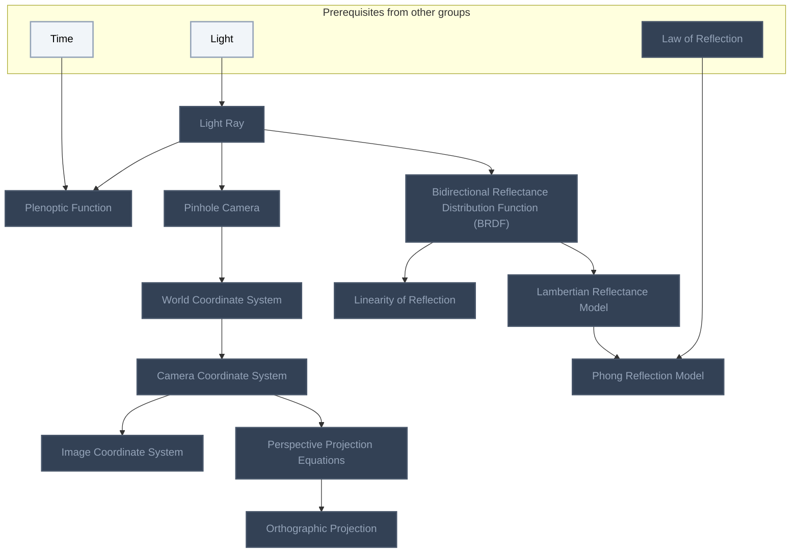

## MIT Vision Book: Lenses
**Mastered:** 0 / 11 · **Discovered:** 11 / 11

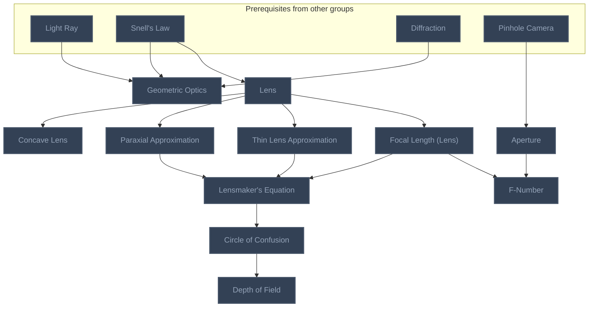

## MIT Vision Book: Linear Image Filtering
**Mastered:** 0 / 14 · **Discovered:** 14 / 14

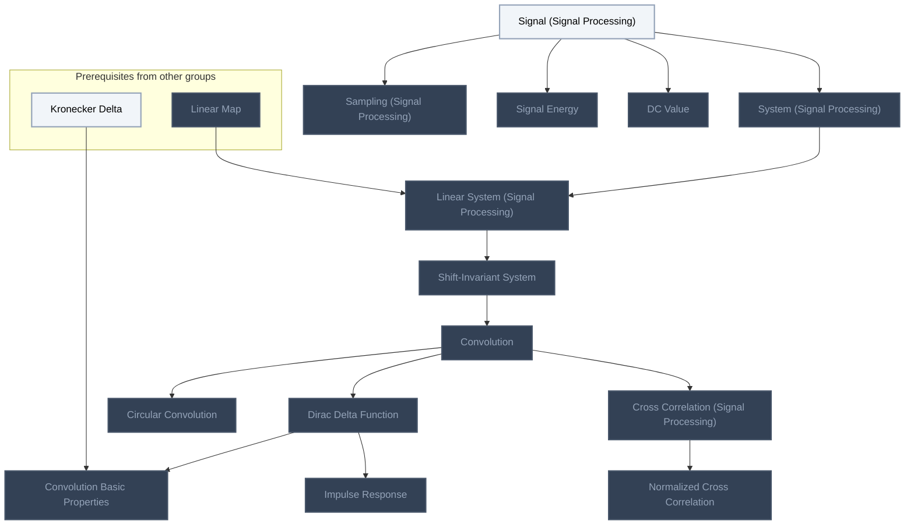

## MIT Vision Book: Fourier Analysis
**Mastered:** 0 / 20 · **Discovered:** 20 / 20

```mermaid
flowchart TD
    classDef planned fill:#1E293B,stroke:#64748B,stroke-width:2px,stroke-dasharray:5 5,color:#94A3B8;
    classDef locked fill:#334155,stroke:#475569,stroke-width:2px,color:#94A3B8;
    classDef L0 fill:#F1F5F9,stroke:#94A3B8,stroke-width:2px,color:#000000;
    classDef L1 fill:#22C55E,stroke:#15803D,stroke-width:2px,color:#000000;
    classDef L2 fill:#3B82F6,stroke:#1D4ED8,stroke-width:3px,color:#FFFFFF;
    classDef L3 fill:#A855F7,stroke:#6B21A8,stroke-width:3px,color:#FFFFFF,font-weight:bold;
    classDef L4 fill:#F97316,stroke:#C2410C,stroke-width:4px,color:#000000,font-weight:bold;
    classDef L5 fill:#FFD700,stroke:#FF8C00,stroke-width:5px,color:#000000,font-weight:bold;
    classDef rusty stroke:#8B4513,stroke-width:4px,stroke-dasharray:3 3;
    subgraph sg_prereqs["Prerequisites from other groups"]
        n_sine_function["Sine Function"]
        n_cosine_function["Cosine Function"]
        n_euler_s_identity["Euler's Identity"]
        n_signal_signal_processing["Signal (Signal Processing)"]
        n_mean_square_convergence["Mean-Square Convergence"]
        n_bessel_s_inequality["Bessel's Inequality"]
        n_symmetric_boundary_condition["Symmetric Boundary Condition"]
        n_circular_convolution["Circular Convolution"]
        n_complex_number_in_polar_coordinates["Complex Number in Polar Coordinates"]
        n_geometric_series["Geometric Series"]
        n_impulse_response["Impulse Response"]
    end
    n_sinusoid_signal_processing["Sinusoid (Signal Processing)"]
    n_discrete_complex_exponential["Discrete Complex Exponential"]
    n_spatial_frequency["Spatial Frequency"]
    n_discrete_fourier_transform["Discrete Fourier Transform"]
    n_dft_matrix["DFT Matrix"]
    n_fast_fourier_transform["Fast Fourier Transform"]
    n_discrete_time_fourier_transform["Discrete-Time Fourier Transform"]
    n_parseval_s_theorem["Parseval's Theorem"]
    n_convolution_theorem["Convolution Theorem"]
    n_fourier_shift_theorem["Fourier Shift Theorem"]
    n_fourier_modulation_theorem["Fourier Modulation Theorem"]
    n_fourier_amplitude_and_phase["Fourier Amplitude and Phase"]
    n_natural_image_amplitude_spectrum["Natural Image Amplitude Spectrum"]
    n_box_function_signal_processing["Box Function (Signal Processing)"]
    n_discrete_sinc_function["Discrete Sinc Function"]
    n_transfer_function_signal_processing["Transfer Function (Signal Processing)"]
    n_low_pass_filter["Low-Pass Filter"]
    n_high_pass_filter["High-Pass Filter"]
    n_band_pass_filter["Band-Pass Filter"]
    n_dc_gain["DC Gain"]
    n_sine_function --> n_sinusoid_signal_processing
    n_cosine_function --> n_sinusoid_signal_processing
    n_euler_s_identity --> n_discrete_complex_exponential
    n_sinusoid_signal_processing --> n_discrete_complex_exponential
    n_signal_signal_processing --> n_spatial_frequency
    n_discrete_complex_exponential --> n_spatial_frequency
    n_spatial_frequency --> n_discrete_fourier_transform
    n_discrete_fourier_transform --> n_dft_matrix
    n_dft_matrix --> n_fast_fourier_transform
    n_discrete_fourier_transform --> n_discrete_time_fourier_transform
    n_mean_square_convergence --> n_parseval_s_theorem
    n_bessel_s_inequality --> n_parseval_s_theorem
    n_symmetric_boundary_condition --> n_parseval_s_theorem
    n_discrete_fourier_transform --> n_parseval_s_theorem
    n_circular_convolution --> n_convolution_theorem
    n_discrete_fourier_transform --> n_convolution_theorem
    n_discrete_fourier_transform --> n_fourier_shift_theorem
    n_convolution_theorem --> n_fourier_modulation_theorem
    n_complex_number_in_polar_coordinates --> n_fourier_amplitude_and_phase
    n_discrete_fourier_transform --> n_fourier_amplitude_and_phase
    n_fourier_amplitude_and_phase --> n_natural_image_amplitude_spectrum
    n_geometric_series --> n_box_function_signal_processing
    n_discrete_fourier_transform --> n_box_function_signal_processing
    n_box_function_signal_processing --> n_discrete_sinc_function
    n_impulse_response --> n_transfer_function_signal_processing
    n_convolution_theorem --> n_transfer_function_signal_processing
    n_transfer_function_signal_processing --> n_low_pass_filter
    n_transfer_function_signal_processing --> n_high_pass_filter
    n_transfer_function_signal_processing --> n_band_pass_filter
    n_discrete_fourier_transform --> n_dc_gain
    class n_euler_s_identity,n_mean_square_convergence,n_bessel_s_inequality,n_symmetric_boundary_condition,n_circular_convolution,n_complex_number_in_polar_coordinates,n_geometric_series,n_impulse_response,n_discrete_complex_exponential,n_spatial_frequency,n_discrete_fourier_transform,n_dft_matrix,n_fast_fourier_transform,n_discrete_time_fourier_transform,n_parseval_s_theorem,n_convolution_theorem,n_fourier_shift_theorem,n_fourier_modulation_theorem,n_fourier_amplitude_and_phase,n_natural_image_amplitude_spectrum,n_box_function_signal_processing,n_discrete_sinc_function,n_transfer_function_signal_processing,n_low_pass_filter,n_high_pass_filter,n_band_pass_filter,n_dc_gain locked;
    class n_signal_signal_processing,n_sinusoid_signal_processing L0;
    class n_cosine_function L2;
    class n_sine_function L3;
    class n_sine_function,n_cosine_function,n_euler_s_identity,n_signal_signal_processing,n_mean_square_convergence,n_bessel_s_inequality,n_symmetric_boundary_condition,n_circular_convolution,n_complex_number_in_polar_coordinates,n_geometric_series,n_impulse_response,n_sinusoid_signal_processing,n_discrete_complex_exponential,n_spatial_frequency,n_discrete_fourier_transform,n_dft_matrix,n_fast_fourier_transform,n_discrete_time_fourier_transform,n_parseval_s_theorem,n_convolution_theorem,n_fourier_shift_theorem,n_fourier_modulation_theorem,n_fourier_amplitude_and_phase,n_natural_image_amplitude_spectrum,n_box_function_signal_processing,n_discrete_sinc_function,n_transfer_function_signal_processing,n_low_pass_filter,n_high_pass_filter,n_band_pass_filter,n_dc_gain internal-link;
```

## MIT Vision Book: Blurring
**Mastered:** 0 / 5 · **Discovered:** 5 / 5

```mermaid
flowchart TD
    classDef planned fill:#1E293B,stroke:#64748B,stroke-width:2px,stroke-dasharray:5 5,color:#94A3B8;
    classDef locked fill:#334155,stroke:#475569,stroke-width:2px,color:#94A3B8;
    classDef L0 fill:#F1F5F9,stroke:#94A3B8,stroke-width:2px,color:#000000;
    classDef L1 fill:#22C55E,stroke:#15803D,stroke-width:2px,color:#000000;
    classDef L2 fill:#3B82F6,stroke:#1D4ED8,stroke-width:3px,color:#FFFFFF;
    classDef L3 fill:#A855F7,stroke:#6B21A8,stroke-width:3px,color:#FFFFFF,font-weight:bold;
    classDef L4 fill:#F97316,stroke:#C2410C,stroke-width:4px,color:#000000,font-weight:bold;
    classDef L5 fill:#FFD700,stroke:#FF8C00,stroke-width:5px,color:#000000,font-weight:bold;
    classDef rusty stroke:#8B4513,stroke-width:4px,stroke-dasharray:3 3;
    subgraph sg_prereqs["Prerequisites from other groups"]
        n_low_pass_filter["Low-Pass Filter"]
        n_dc_gain["DC Gain"]
        n_box_function_signal_processing["Box Function (Signal Processing)"]
        n_normal_distribution["Normal Distribution"]
        n_binomial_theorem["Binomial Theorem"]
        n_pascal_s_identity["Pascal's Identity"]
        n_central_limit_theorem["Central Limit Theorem"]
        n_convolution["Convolution"]
    end
    n_blur_filter["Blur Filter"]
    n_box_filter["Box Filter"]
    n_gaussian_filter["Gaussian Filter"]
    n_binomial_filter["Binomial Filter"]
    n_separable_filter["Separable Filter"]
    n_low_pass_filter --> n_blur_filter
    n_dc_gain --> n_blur_filter
    n_box_function_signal_processing --> n_box_filter
    n_blur_filter --> n_box_filter
    n_normal_distribution --> n_gaussian_filter
    n_blur_filter --> n_gaussian_filter
    n_binomial_theorem --> n_binomial_filter
    n_pascal_s_identity --> n_binomial_filter
    n_central_limit_theorem --> n_binomial_filter
    n_gaussian_filter --> n_binomial_filter
    n_convolution --> n_separable_filter
    class n_low_pass_filter,n_dc_gain,n_box_function_signal_processing,n_normal_distribution,n_binomial_theorem,n_pascal_s_identity,n_central_limit_theorem,n_convolution,n_blur_filter,n_box_filter,n_gaussian_filter,n_binomial_filter,n_separable_filter locked;
    class n_low_pass_filter,n_dc_gain,n_box_function_signal_processing,n_normal_distribution,n_binomial_theorem,n_pascal_s_identity,n_central_limit_theorem,n_convolution,n_blur_filter,n_box_filter,n_gaussian_filter,n_binomial_filter,n_separable_filter internal-link;
```

## MIT Vision Book: Image Derivatives
**Mastered:** 0 / 11 · **Discovered:** 11 / 11

```mermaid
flowchart TD
    classDef planned fill:#1E293B,stroke:#64748B,stroke-width:2px,stroke-dasharray:5 5,color:#94A3B8;
    classDef locked fill:#334155,stroke:#475569,stroke-width:2px,color:#94A3B8;
    classDef L0 fill:#F1F5F9,stroke:#94A3B8,stroke-width:2px,color:#000000;
    classDef L1 fill:#22C55E,stroke:#15803D,stroke-width:2px,color:#000000;
    classDef L2 fill:#3B82F6,stroke:#1D4ED8,stroke-width:3px,color:#FFFFFF;
    classDef L3 fill:#A855F7,stroke:#6B21A8,stroke-width:3px,color:#FFFFFF,font-weight:bold;
    classDef L4 fill:#F97316,stroke:#C2410C,stroke-width:4px,color:#000000,font-weight:bold;
    classDef L5 fill:#FFD700,stroke:#FF8C00,stroke-width:5px,color:#000000,font-weight:bold;
    classDef rusty stroke:#8B4513,stroke-width:4px,stroke-dasharray:3 3;
    subgraph sg_prereqs["Prerequisites from other groups"]
        n_derivative["Derivative"]
        n_convolution["Convolution"]
        n_polynomial["Polynomial"]
        n_gaussian_filter["Gaussian Filter"]
        n_separable_filter["Separable Filter"]
        n_gradient_vector["Gradient Vector"]
        n_laplacian_operator["Laplacian Operator"]
        n_binomial_filter["Binomial Filter"]
        n_pseudoinverse["Pseudoinverse"]
        n_dc_value["DC Value"]
        n_shading["Shading"]
    end
    n_discrete_image_derivative["Discrete Image Derivative"]
    n_hermite_polynomial["Hermite Polynomial"]
    n_gaussian_derivative["Gaussian Derivative"]
    n_image_gradient["Image Gradient"]
    n_laplacian_filter["Laplacian Filter"]
    n_sharpening_filter["Sharpening Filter"]
    n_sobel_operator["Sobel Operator"]
    n_roberts_cross_operator["Roberts Cross Operator"]
    n_signal_reconstruction_from_derivatives["Signal Reconstruction from Derivatives"]
    n_intrinsic_image_decomposition["Intrinsic Image Decomposition"]
    n_retinex_algorithm["Retinex Algorithm"]
    n_derivative --> n_discrete_image_derivative
    n_convolution --> n_discrete_image_derivative
    n_polynomial --> n_hermite_polynomial
    n_gaussian_filter --> n_gaussian_derivative
    n_separable_filter --> n_gaussian_derivative
    n_hermite_polynomial --> n_gaussian_derivative
    n_gradient_vector --> n_image_gradient
    n_discrete_image_derivative --> n_image_gradient
    n_gaussian_derivative --> n_image_gradient
    n_laplacian_operator --> n_laplacian_filter
    n_image_gradient --> n_laplacian_filter
    n_binomial_filter --> n_sharpening_filter
    n_binomial_filter --> n_sobel_operator
    n_separable_filter --> n_sobel_operator
    n_discrete_image_derivative --> n_sobel_operator
    n_discrete_image_derivative --> n_roberts_cross_operator
    n_pseudoinverse --> n_signal_reconstruction_from_derivatives
    n_dc_value --> n_signal_reconstruction_from_derivatives
    n_discrete_image_derivative --> n_signal_reconstruction_from_derivatives
    n_shading --> n_intrinsic_image_decomposition
    n_image_gradient --> n_retinex_algorithm
    n_signal_reconstruction_from_derivatives --> n_retinex_algorithm
    n_intrinsic_image_decomposition --> n_retinex_algorithm
    class n_convolution,n_gaussian_filter,n_separable_filter,n_gradient_vector,n_laplacian_operator,n_binomial_filter,n_pseudoinverse,n_dc_value,n_shading,n_discrete_image_derivative,n_gaussian_derivative,n_image_gradient,n_laplacian_filter,n_sharpening_filter,n_sobel_operator,n_roberts_cross_operator,n_signal_reconstruction_from_derivatives,n_intrinsic_image_decomposition,n_retinex_algorithm locked;
    class n_hermite_polynomial L0;
    class n_polynomial L2;
    class n_derivative L3;
    class n_derivative,n_convolution,n_polynomial,n_gaussian_filter,n_separable_filter,n_gradient_vector,n_laplacian_operator,n_binomial_filter,n_pseudoinverse,n_dc_value,n_shading,n_discrete_image_derivative,n_hermite_polynomial,n_gaussian_derivative,n_image_gradient,n_laplacian_filter,n_sharpening_filter,n_sobel_operator,n_roberts_cross_operator,n_signal_reconstruction_from_derivatives,n_intrinsic_image_decomposition,n_retinex_algorithm internal-link;
```

## MIT Vision Book: Temporal Filters
**Mastered:** 0 / 7 · **Discovered:** 7 / 7

```mermaid
flowchart TD
    classDef planned fill:#1E293B,stroke:#64748B,stroke-width:2px,stroke-dasharray:5 5,color:#94A3B8;
    classDef locked fill:#334155,stroke:#475569,stroke-width:2px,color:#94A3B8;
    classDef L0 fill:#F1F5F9,stroke:#94A3B8,stroke-width:2px,color:#000000;
    classDef L1 fill:#22C55E,stroke:#15803D,stroke-width:2px,color:#000000;
    classDef L2 fill:#3B82F6,stroke:#1D4ED8,stroke-width:3px,color:#FFFFFF;
    classDef L3 fill:#A855F7,stroke:#6B21A8,stroke-width:3px,color:#FFFFFF,font-weight:bold;
    classDef L4 fill:#F97316,stroke:#C2410C,stroke-width:4px,color:#000000,font-weight:bold;
    classDef L5 fill:#FFD700,stroke:#FF8C00,stroke-width:5px,color:#000000,font-weight:bold;
    classDef rusty stroke:#8B4513,stroke-width:4px,stroke-dasharray:3 3;
    subgraph sg_prereqs["Prerequisites from other groups"]
        n_low_pass_filter["Low-Pass Filter"]
        n_high_pass_filter["High-Pass Filter"]
        n_heaviside_function["Heaviside Function"]
        n_impulse_response["Impulse Response"]
        n_gaussian_filter["Gaussian Filter"]
        n_signal_signal_processing["Signal (Signal Processing)"]
        n_dirac_delta_function["Dirac Delta Function"]
        n_fourier_transform["Fourier Transform"]
        n_fourier_shift_theorem["Fourier Shift Theorem"]
    end
    n_spatio_temporal_filter["Spatio-Temporal Filter"]
    n_causal_filter["Causal Filter"]
    n_infinite_impulse_response_filter["Infinite Impulse Response Filter"]
    n_bounded_input_bounded_output_stability["Bounded-Input Bounded-Output Stability"]
    n_spatio_temporal_gaussian_filter["Spatio-Temporal Gaussian Filter"]
    n_brightness_constancy_assumption["Brightness Constancy Assumption"]
    n_fourier_transform_of_moving_image["Fourier Transform of Moving Image"]
    n_low_pass_filter --> n_spatio_temporal_filter
    n_high_pass_filter --> n_spatio_temporal_filter
    n_spatio_temporal_filter --> n_causal_filter
    n_heaviside_function --> n_infinite_impulse_response_filter
    n_impulse_response --> n_infinite_impulse_response_filter
    n_impulse_response --> n_bounded_input_bounded_output_stability
    n_gaussian_filter --> n_spatio_temporal_gaussian_filter
    n_spatio_temporal_filter --> n_spatio_temporal_gaussian_filter
    n_signal_signal_processing --> n_brightness_constancy_assumption
    n_dirac_delta_function --> n_fourier_transform_of_moving_image
    n_fourier_transform --> n_fourier_transform_of_moving_image
    n_fourier_shift_theorem --> n_fourier_transform_of_moving_image
    n_brightness_constancy_assumption --> n_fourier_transform_of_moving_image
    class n_low_pass_filter,n_high_pass_filter,n_impulse_response,n_gaussian_filter,n_dirac_delta_function,n_fourier_transform,n_fourier_shift_theorem,n_spatio_temporal_filter,n_causal_filter,n_infinite_impulse_response_filter,n_bounded_input_bounded_output_stability,n_spatio_temporal_gaussian_filter,n_brightness_constancy_assumption,n_fourier_transform_of_moving_image locked;
    class n_heaviside_function,n_signal_signal_processing L0;
    class n_low_pass_filter,n_high_pass_filter,n_heaviside_function,n_impulse_response,n_gaussian_filter,n_signal_signal_processing,n_dirac_delta_function,n_fourier_transform,n_fourier_shift_theorem,n_spatio_temporal_filter,n_causal_filter,n_infinite_impulse_response_filter,n_bounded_input_bounded_output_stability,n_spatio_temporal_gaussian_filter,n_brightness_constancy_assumption,n_fourier_transform_of_moving_image internal-link;
```

## MIT Vision Book: The Camera as a Linear System
**Mastered:** 0 / 6 · **Discovered:** 6 / 6

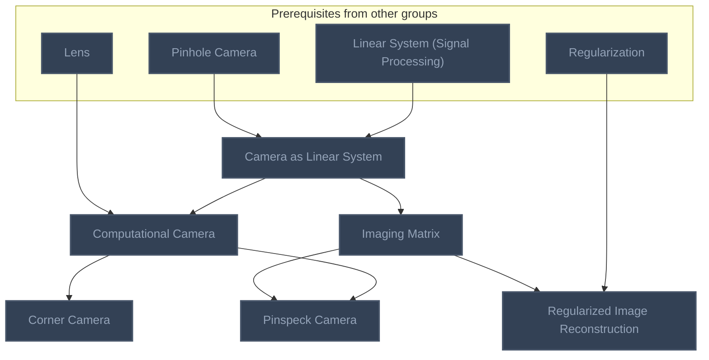

## MIT Vision Book: Color
**Mastered:** 0 / 10 · **Discovered:** 10 / 10

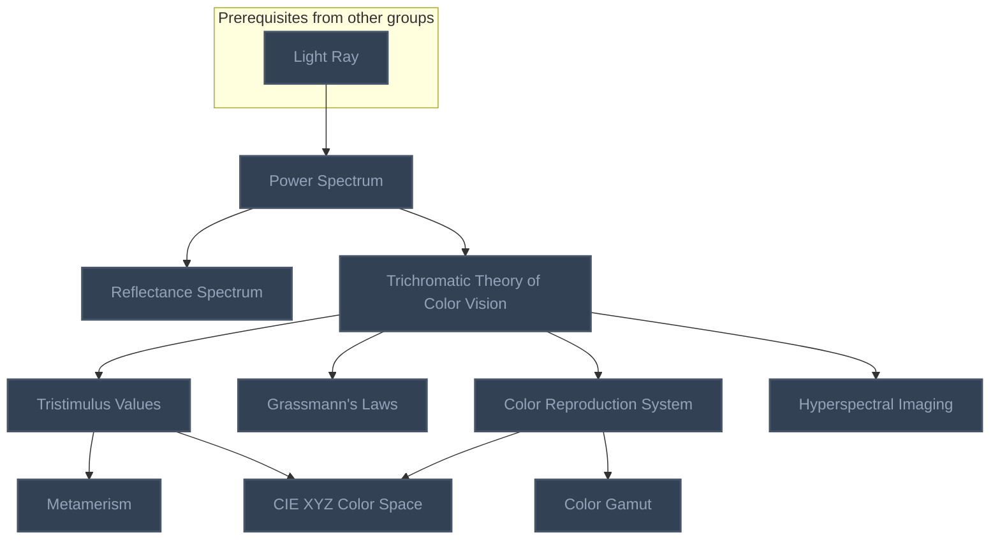

## Wandell: Image Formation
**Mastered:** 0 / 7 · **Discovered:** 7 / 7

```mermaid
flowchart TD
    classDef planned fill:#1E293B,stroke:#64748B,stroke-width:2px,stroke-dasharray:5 5,color:#94A3B8;
    classDef locked fill:#334155,stroke:#475569,stroke-width:2px,color:#94A3B8;
    classDef L0 fill:#F1F5F9,stroke:#94A3B8,stroke-width:2px,color:#000000;
    classDef L1 fill:#22C55E,stroke:#15803D,stroke-width:2px,color:#000000;
    classDef L2 fill:#3B82F6,stroke:#1D4ED8,stroke-width:3px,color:#FFFFFF;
    classDef L3 fill:#A855F7,stroke:#6B21A8,stroke-width:3px,color:#FFFFFF,font-weight:bold;
    classDef L4 fill:#F97316,stroke:#C2410C,stroke-width:4px,color:#000000,font-weight:bold;
    classDef L5 fill:#FFD700,stroke:#FF8C00,stroke-width:5px,color:#000000,font-weight:bold;
    classDef rusty stroke:#8B4513,stroke-width:4px,stroke-dasharray:3 3;
    subgraph sg_prereqs["Prerequisites from other groups"]
        n_shift_invariant_system["Shift-Invariant System"]
        n_impulse_response["Impulse Response"]
        n_transfer_function_signal_processing["Transfer Function (Signal Processing)"]
        n_focal_length_lens["Focal Length (Lens)"]
        n_index_of_refraction["Index of Refraction"]
    end
    n_line_spread_function["Line Spread Function"]
    n_point_spread_function["Point Spread Function"]
    n_optical_transfer_function["Optical Transfer Function"]
    n_modulation_transfer_function["Modulation Transfer Function"]
    n_optical_power["Optical Power"]
    n_chromatic_aberration["Chromatic Aberration"]
    n_astigmatism["Astigmatism"]
    n_shift_invariant_system --> n_line_spread_function
    n_impulse_response --> n_point_spread_function
    n_transfer_function_signal_processing --> n_optical_transfer_function
    n_point_spread_function --> n_optical_transfer_function
    n_line_spread_function --> n_modulation_transfer_function
    n_point_spread_function --> n_modulation_transfer_function
    n_focal_length_lens --> n_optical_power
    n_index_of_refraction --> n_chromatic_aberration
    n_point_spread_function --> n_chromatic_aberration
    n_point_spread_function --> n_astigmatism
    class n_shift_invariant_system,n_impulse_response,n_transfer_function_signal_processing,n_focal_length_lens,n_index_of_refraction,n_line_spread_function,n_point_spread_function,n_optical_transfer_function,n_modulation_transfer_function,n_optical_power,n_chromatic_aberration,n_astigmatism locked;
    class n_shift_invariant_system,n_impulse_response,n_transfer_function_signal_processing,n_focal_length_lens,n_index_of_refraction,n_line_spread_function,n_point_spread_function,n_optical_transfer_function,n_modulation_transfer_function,n_optical_power,n_chromatic_aberration,n_astigmatism internal-link;
```

# Source
Graph structure: the single source for the diagrams above, edited by `/note` and `Scripts/skill_trees.py` (`add`, `edge`, `rename`). Everything above this heading is regenerated by `render`.

```skilltree
    %% PREREQUISITES
    n_ray["Ray"]
    n_reflection["Reflection"]
    n_time["Time"]
    n_linear_map["Linear Map"]
    n_kronecker_delta["Kronecker Delta"]
    n_sine_function["Sine Function"]
    n_cosine_function["Cosine Function"]
    n_euler_s_identity["Euler's Identity"]
    n_mean_square_convergence["Mean-Square Convergence"]
    n_bessel_s_inequality["Bessel's Inequality"]
    n_symmetric_boundary_condition["Symmetric Boundary Condition"]
    n_complex_number_in_polar_coordinates["Complex Number in Polar Coordinates"]
    n_geometric_series["Geometric Series"]
    n_normal_distribution["Normal Distribution"]
    n_binomial_theorem["Binomial Theorem"]
    n_pascal_s_identity["Pascal's Identity"]
    n_central_limit_theorem["Central Limit Theorem"]
    n_derivative["Derivative"]
    n_polynomial["Polynomial"]
    n_laplacian_operator["Laplacian Operator"]
    n_pseudoinverse["Pseudoinverse"]
    n_shading["Shading"]
    n_heaviside_function["Heaviside Function"]
    n_light["Light"]
    n_index_of_refraction["Index of Refraction"]
    n_snell_s_law["Snell's Law"]
    n_diffraction["Diffraction"]
    n_law_of_reflection["Law of Reflection"]
    n_fourier_transform["Fourier Transform"]
    n_gradient_vector["Gradient Vector"]
    n_regularization["Regularization"]
    %% NODES
    %% == Vision and Its History ==
    n_vision["Vision"]
    n_visual_experience["Visual Experience"]
    n_computer_vision["Computer Vision"]
    n_disembodied_perspective["Disembodied Perspective"]
    n_occlusion["Occlusion"]
    n_theories_of_vision["Theories of Vision"]
    n_extramission_theory["Extramission Theory"]
    n_intromission_theory["Intromission Theory"]
    n_plato_s_theory_of_vision["Plato's Theory of Vision"]
    n_aristotle_s_theory_of_vision["Aristotle's Theory of Vision"]
    n_euclid_s_theory_of_vision["Euclid's Theory of Vision"]
    n_alhacen_s_theory_of_vision["Alhacen's Theory of Vision"]
    n_kepler_s_theory_of_vision["Kepler's Theory of Vision"]
    %% == MIT Vision Book: Imaging ==
    n_light_ray["Light Ray"]
    n_plenoptic_function["Plenoptic Function"]
    n_pinhole_camera["Pinhole Camera"]
    n_world_coordinate_system["World Coordinate System"]
    n_camera_coordinate_system["Camera Coordinate System"]
    n_image_coordinate_system["Image Coordinate System"]
    n_perspective_projection_equations["Perspective Projection Equations"]
    n_orthographic_projection["Orthographic Projection"]
    n_bidirectional_reflectance_distribution_function_brdf["Bidirectional Reflectance Distribution Function (BRDF)"]
    n_linearity_of_reflection["Linearity of Reflection"]
    n_lambertian_reflectance_model["Lambertian Reflectance Model"]
    n_phong_reflection_model["Phong Reflection Model"]
    %% == MIT Vision Book: Lenses ==
    n_geometric_optics["Geometric Optics"]
    n_lens["Lens"]
    n_concave_lens["Concave Lens"]
    n_aperture["Aperture"]
    n_paraxial_approximation["Paraxial Approximation"]
    n_thin_lens_approximation["Thin Lens Approximation"]
    n_focal_length_lens["Focal Length (Lens)"]
    n_lensmaker_s_equation["Lensmaker's Equation"]
    n_f_number["F-Number"]
    n_circle_of_confusion["Circle of Confusion"]
    n_depth_of_field["Depth of Field"]
    %% == MIT Vision Book: Linear Image Filtering ==
    n_signal_signal_processing["Signal (Signal Processing)"]
    n_sampling_signal_processing["Sampling (Signal Processing)"]
    n_signal_energy["Signal Energy"]
    n_dc_value["DC Value"]
    n_system_signal_processing["System (Signal Processing)"]
    n_linear_system_signal_processing["Linear System (Signal Processing)"]
    n_shift_invariant_system["Shift-Invariant System"]
    n_convolution["Convolution"]
    n_dirac_delta_function["Dirac Delta Function"]
    n_convolution_basic_properties["Convolution Basic Properties"]
    n_circular_convolution["Circular Convolution"]
    n_impulse_response["Impulse Response"]
    n_cross_correlation_signal_processing["Cross Correlation (Signal Processing)"]
    n_normalized_cross_correlation["Normalized Cross Correlation"]
    %% == MIT Vision Book: Fourier Analysis ==
    n_sinusoid_signal_processing["Sinusoid (Signal Processing)"]
    n_discrete_complex_exponential["Discrete Complex Exponential"]
    n_spatial_frequency["Spatial Frequency"]
    n_discrete_fourier_transform["Discrete Fourier Transform"]
    n_dft_matrix["DFT Matrix"]
    n_fast_fourier_transform["Fast Fourier Transform"]
    n_discrete_time_fourier_transform["Discrete-Time Fourier Transform"]
    n_parseval_s_theorem["Parseval's Theorem"]
    n_convolution_theorem["Convolution Theorem"]
    n_fourier_shift_theorem["Fourier Shift Theorem"]
    n_fourier_modulation_theorem["Fourier Modulation Theorem"]
    n_fourier_amplitude_and_phase["Fourier Amplitude and Phase"]
    n_natural_image_amplitude_spectrum["Natural Image Amplitude Spectrum"]
    n_box_function_signal_processing["Box Function (Signal Processing)"]
    n_discrete_sinc_function["Discrete Sinc Function"]
    n_transfer_function_signal_processing["Transfer Function (Signal Processing)"]
    n_low_pass_filter["Low-Pass Filter"]
    n_high_pass_filter["High-Pass Filter"]
    n_band_pass_filter["Band-Pass Filter"]
    n_dc_gain["DC Gain"]
    %% == MIT Vision Book: Blurring ==
    n_blur_filter["Blur Filter"]
    n_box_filter["Box Filter"]
    n_gaussian_filter["Gaussian Filter"]
    n_binomial_filter["Binomial Filter"]
    n_separable_filter["Separable Filter"]
    %% == MIT Vision Book: Image Derivatives ==
    n_discrete_image_derivative["Discrete Image Derivative"]
    n_hermite_polynomial["Hermite Polynomial"]
    n_gaussian_derivative["Gaussian Derivative"]
    n_image_gradient["Image Gradient"]
    n_laplacian_filter["Laplacian Filter"]
    n_sharpening_filter["Sharpening Filter"]
    n_sobel_operator["Sobel Operator"]
    n_roberts_cross_operator["Roberts Cross Operator"]
    n_signal_reconstruction_from_derivatives["Signal Reconstruction from Derivatives"]
    n_intrinsic_image_decomposition["Intrinsic Image Decomposition"]
    n_retinex_algorithm["Retinex Algorithm"]
    %% == MIT Vision Book: Temporal Filters ==
    n_spatio_temporal_filter["Spatio-Temporal Filter"]
    n_causal_filter["Causal Filter"]
    n_infinite_impulse_response_filter["Infinite Impulse Response Filter"]
    n_bounded_input_bounded_output_stability["Bounded-Input Bounded-Output Stability"]
    n_spatio_temporal_gaussian_filter["Spatio-Temporal Gaussian Filter"]
    n_brightness_constancy_assumption["Brightness Constancy Assumption"]
    n_fourier_transform_of_moving_image["Fourier Transform of Moving Image"]
    %% == MIT Vision Book: The Camera as a Linear System ==
    n_camera_as_linear_system["Camera as Linear System"]
    n_imaging_matrix["Imaging Matrix"]
    n_computational_camera["Computational Camera"]
    n_pinspeck_camera["Pinspeck Camera"]
    n_corner_camera["Corner Camera"]
    n_regularized_image_reconstruction["Regularized Image Reconstruction"]
    %% == MIT Vision Book: Color ==
    n_power_spectrum["Power Spectrum"]
    n_reflectance_spectrum["Reflectance Spectrum"]
    n_trichromatic_theory_of_color_vision["Trichromatic Theory of Color Vision"]
    n_tristimulus_values["Tristimulus Values"]
    n_grassmann_s_laws["Grassmann's Laws"]
    n_metamerism["Metamerism"]
    n_color_reproduction_system["Color Reproduction System"]
    n_cie_xyz_color_space["CIE XYZ Color Space"]
    n_color_gamut["Color Gamut"]
    n_hyperspectral_imaging["Hyperspectral Imaging"]
    %% == Wandell: Image Formation ==
    n_line_spread_function["Line Spread Function"]
    n_point_spread_function["Point Spread Function"]
    n_optical_transfer_function["Optical Transfer Function"]
    n_modulation_transfer_function["Modulation Transfer Function"]
    n_optical_power["Optical Power"]
    n_chromatic_aberration["Chromatic Aberration"]
    n_astigmatism["Astigmatism"]
    %% == Introduction to Learning (MIT Vision Book, Bishop) ==
    %% == The Problem of Generalization (MIT Vision Book, Bishop, Prince) ==
    %% == Gradient Descent (MIT Vision Book, Prince Ch. 6) ==
    %% == Neural Networks (MIT Vision Book, Prince Ch. 3-4) ==
    %% == Backpropagation (MIT Vision Book, Prince Ch. 7) ==
    %% == Normalization and Hypernetworks (Prince Ch. 11-12) ==
    %% EDGES
    n_light --> n_vision
    n_vision --> n_visual_experience
    n_vision --> n_computer_vision
    n_vision --> n_disembodied_perspective
    n_ray --> n_occlusion
    n_vision --> n_occlusion
    n_vision --> n_theories_of_vision
    n_ray --> n_extramission_theory
    n_vision --> n_extramission_theory
    n_vision --> n_intromission_theory
    n_extramission_theory --> n_plato_s_theory_of_vision
    n_intromission_theory --> n_plato_s_theory_of_vision
    n_reflection --> n_aristotle_s_theory_of_vision
    n_extramission_theory --> n_aristotle_s_theory_of_vision
    n_extramission_theory --> n_euclid_s_theory_of_vision
    n_ray --> n_alhacen_s_theory_of_vision
    n_pinhole_camera --> n_alhacen_s_theory_of_vision
    n_lens --> n_kepler_s_theory_of_vision
    n_light --> n_light_ray
    n_time --> n_plenoptic_function
    n_light_ray --> n_plenoptic_function
    n_light_ray --> n_pinhole_camera
    n_pinhole_camera --> n_world_coordinate_system
    n_world_coordinate_system --> n_camera_coordinate_system
    n_camera_coordinate_system --> n_image_coordinate_system
    n_camera_coordinate_system --> n_perspective_projection_equations
    n_perspective_projection_equations --> n_orthographic_projection
    n_light_ray --> n_bidirectional_reflectance_distribution_function_brdf
    n_bidirectional_reflectance_distribution_function_brdf --> n_linearity_of_reflection
    n_bidirectional_reflectance_distribution_function_brdf --> n_lambertian_reflectance_model
    n_lambertian_reflectance_model --> n_phong_reflection_model
    n_law_of_reflection --> n_phong_reflection_model
    n_light_ray --> n_geometric_optics
    n_snell_s_law --> n_geometric_optics
    n_diffraction --> n_geometric_optics
    n_snell_s_law --> n_lens
    n_lens --> n_concave_lens
    n_pinhole_camera --> n_aperture
    n_lens --> n_paraxial_approximation
    n_lens --> n_thin_lens_approximation
    n_lens --> n_focal_length_lens
    n_paraxial_approximation --> n_lensmaker_s_equation
    n_thin_lens_approximation --> n_lensmaker_s_equation
    n_focal_length_lens --> n_lensmaker_s_equation
    n_aperture --> n_f_number
    n_focal_length_lens --> n_f_number
    n_lensmaker_s_equation --> n_circle_of_confusion
    n_circle_of_confusion --> n_depth_of_field
    n_signal_signal_processing --> n_sampling_signal_processing
    n_signal_signal_processing --> n_signal_energy
    n_signal_signal_processing --> n_dc_value
    n_signal_signal_processing --> n_system_signal_processing
    n_linear_map --> n_linear_system_signal_processing
    n_system_signal_processing --> n_linear_system_signal_processing
    n_linear_system_signal_processing --> n_shift_invariant_system
    n_shift_invariant_system --> n_convolution
    n_convolution --> n_dirac_delta_function
    n_kronecker_delta --> n_convolution_basic_properties
    n_dirac_delta_function --> n_convolution_basic_properties
    n_convolution --> n_circular_convolution
    n_dirac_delta_function --> n_impulse_response
    n_convolution --> n_cross_correlation_signal_processing
    n_cross_correlation_signal_processing --> n_normalized_cross_correlation
    n_sine_function --> n_sinusoid_signal_processing
    n_cosine_function --> n_sinusoid_signal_processing
    n_euler_s_identity --> n_discrete_complex_exponential
    n_sinusoid_signal_processing --> n_discrete_complex_exponential
    n_signal_signal_processing --> n_spatial_frequency
    n_discrete_complex_exponential --> n_spatial_frequency
    n_spatial_frequency --> n_discrete_fourier_transform
    n_discrete_fourier_transform --> n_dft_matrix
    n_dft_matrix --> n_fast_fourier_transform
    n_discrete_fourier_transform --> n_discrete_time_fourier_transform
    n_mean_square_convergence --> n_parseval_s_theorem
    n_bessel_s_inequality --> n_parseval_s_theorem
    n_symmetric_boundary_condition --> n_parseval_s_theorem
    n_discrete_fourier_transform --> n_parseval_s_theorem
    n_circular_convolution --> n_convolution_theorem
    n_discrete_fourier_transform --> n_convolution_theorem
    n_discrete_fourier_transform --> n_fourier_shift_theorem
    n_convolution_theorem --> n_fourier_modulation_theorem
    n_complex_number_in_polar_coordinates --> n_fourier_amplitude_and_phase
    n_discrete_fourier_transform --> n_fourier_amplitude_and_phase
    n_fourier_amplitude_and_phase --> n_natural_image_amplitude_spectrum
    n_geometric_series --> n_box_function_signal_processing
    n_discrete_fourier_transform --> n_box_function_signal_processing
    n_box_function_signal_processing --> n_discrete_sinc_function
    n_impulse_response --> n_transfer_function_signal_processing
    n_convolution_theorem --> n_transfer_function_signal_processing
    n_transfer_function_signal_processing --> n_low_pass_filter
    n_transfer_function_signal_processing --> n_high_pass_filter
    n_transfer_function_signal_processing --> n_band_pass_filter
    n_discrete_fourier_transform --> n_dc_gain
    n_low_pass_filter --> n_blur_filter
    n_dc_gain --> n_blur_filter
    n_box_function_signal_processing --> n_box_filter
    n_blur_filter --> n_box_filter
    n_normal_distribution --> n_gaussian_filter
    n_blur_filter --> n_gaussian_filter
    n_binomial_theorem --> n_binomial_filter
    n_pascal_s_identity --> n_binomial_filter
    n_central_limit_theorem --> n_binomial_filter
    n_gaussian_filter --> n_binomial_filter
    n_convolution --> n_separable_filter
    n_derivative --> n_discrete_image_derivative
    n_convolution --> n_discrete_image_derivative
    n_polynomial --> n_hermite_polynomial
    n_gaussian_filter --> n_gaussian_derivative
    n_separable_filter --> n_gaussian_derivative
    n_hermite_polynomial --> n_gaussian_derivative
    n_gradient_vector --> n_image_gradient
    n_discrete_image_derivative --> n_image_gradient
    n_gaussian_derivative --> n_image_gradient
    n_laplacian_operator --> n_laplacian_filter
    n_image_gradient --> n_laplacian_filter
    n_binomial_filter --> n_sharpening_filter
    n_binomial_filter --> n_sobel_operator
    n_separable_filter --> n_sobel_operator
    n_discrete_image_derivative --> n_sobel_operator
    n_discrete_image_derivative --> n_roberts_cross_operator
    n_pseudoinverse --> n_signal_reconstruction_from_derivatives
    n_dc_value --> n_signal_reconstruction_from_derivatives
    n_discrete_image_derivative --> n_signal_reconstruction_from_derivatives
    n_shading --> n_intrinsic_image_decomposition
    n_image_gradient --> n_retinex_algorithm
    n_signal_reconstruction_from_derivatives --> n_retinex_algorithm
    n_intrinsic_image_decomposition --> n_retinex_algorithm
    n_low_pass_filter --> n_spatio_temporal_filter
    n_high_pass_filter --> n_spatio_temporal_filter
    n_spatio_temporal_filter --> n_causal_filter
    n_heaviside_function --> n_infinite_impulse_response_filter
    n_impulse_response --> n_infinite_impulse_response_filter
    n_impulse_response --> n_bounded_input_bounded_output_stability
    n_gaussian_filter --> n_spatio_temporal_gaussian_filter
    n_spatio_temporal_filter --> n_spatio_temporal_gaussian_filter
    n_signal_signal_processing --> n_brightness_constancy_assumption
    n_dirac_delta_function --> n_fourier_transform_of_moving_image
    n_fourier_transform --> n_fourier_transform_of_moving_image
    n_fourier_shift_theorem --> n_fourier_transform_of_moving_image
    n_brightness_constancy_assumption --> n_fourier_transform_of_moving_image
    n_pinhole_camera --> n_camera_as_linear_system
    n_linear_system_signal_processing --> n_camera_as_linear_system
    n_camera_as_linear_system --> n_imaging_matrix
    n_lens --> n_computational_camera
    n_camera_as_linear_system --> n_computational_camera
    n_imaging_matrix --> n_pinspeck_camera
    n_computational_camera --> n_pinspeck_camera
    n_computational_camera --> n_corner_camera
    n_imaging_matrix --> n_regularized_image_reconstruction
    n_regularization --> n_regularized_image_reconstruction
    n_light_ray --> n_power_spectrum
    n_power_spectrum --> n_reflectance_spectrum
    n_power_spectrum --> n_trichromatic_theory_of_color_vision
    n_trichromatic_theory_of_color_vision --> n_tristimulus_values
    n_trichromatic_theory_of_color_vision --> n_grassmann_s_laws
    n_tristimulus_values --> n_metamerism
    n_trichromatic_theory_of_color_vision --> n_color_reproduction_system
    n_tristimulus_values --> n_cie_xyz_color_space
    n_color_reproduction_system --> n_cie_xyz_color_space
    n_color_reproduction_system --> n_color_gamut
    n_trichromatic_theory_of_color_vision --> n_hyperspectral_imaging
    n_shift_invariant_system --> n_line_spread_function
    n_impulse_response --> n_point_spread_function
    n_transfer_function_signal_processing --> n_optical_transfer_function
    n_point_spread_function --> n_optical_transfer_function
    n_line_spread_function --> n_modulation_transfer_function
    n_point_spread_function --> n_modulation_transfer_function
    n_focal_length_lens --> n_optical_power
    n_index_of_refraction --> n_chromatic_aberration
    n_point_spread_function --> n_chromatic_aberration
    n_point_spread_function --> n_astigmatism
```
