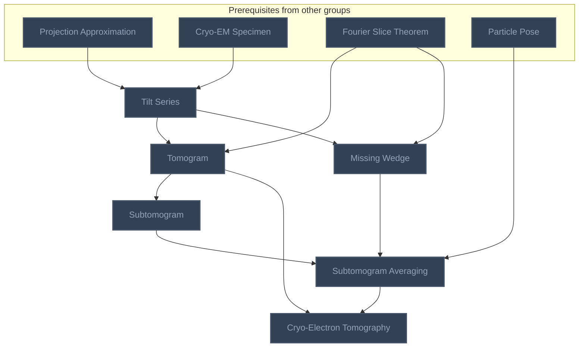
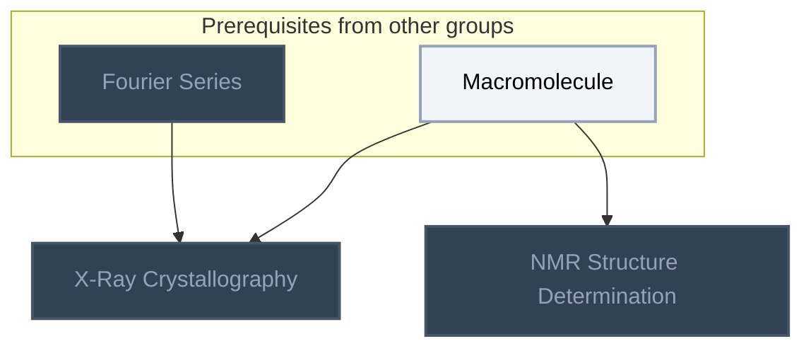
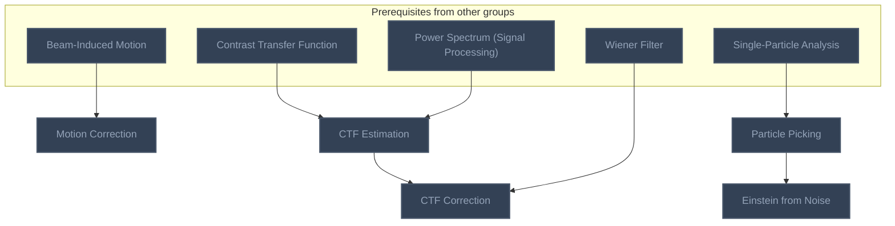
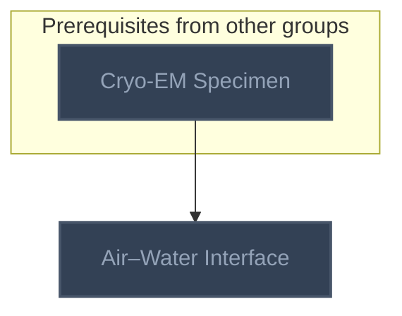
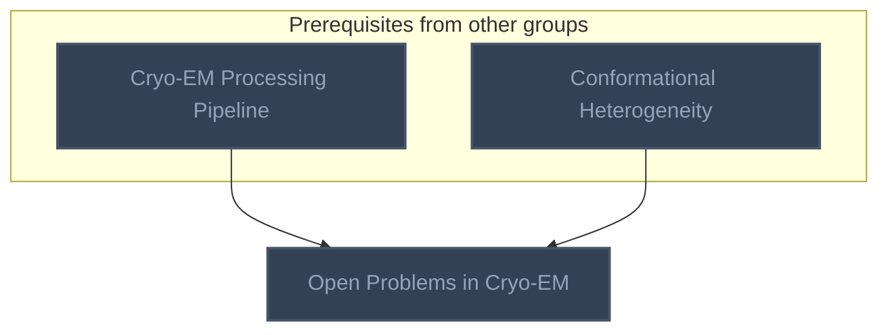

<!-- BEGIN STATS (generated by Scripts/skill_trees.py; do not edit) -->
**Mastered:** 0 / 61 · **Depth:** 0% · **Mastery Depth:** 0% · **Discovered:** 61 · **Planned:** 0 · **Locked:** 58 · **Rusty:** 0

| | L0 Discovered | L1 Recall | L2 Apply | L3 Prove ★ | L4 Wield | L5 Command |
|---|---:|---:|---:|---:|---:|---:|
| **At this level** | 61 | 0 | 0 | 0 | 0 | 0 |
| **Reached (this level or higher)** | 61 | 0 | 0 | 0 | 0 | 0 |

**Next up:** [[Macromolecule]], [[Vitrification]], [[Ångström]]

Legend: dashed grey = planned (no note yet) · dark grey = locked · white L0 Discovered · green L1 Recall · blue L2 Apply · purple L3 Prove (Mastered) · orange L4 Wield · gold L5 Command · brown dashed border = rusty
<!-- END STATS -->

## Imaging
**Reached:** L1 0 · L2 0 · L3 0 · L4 0 · L5 0 (of 12 nodes)

```mermaid
flowchart TD
    classDef planned fill:#1E293B,stroke:#64748B,stroke-width:2px,stroke-dasharray:5 5,color:#94A3B8;
    classDef locked fill:#334155,stroke:#475569,stroke-width:2px,color:#94A3B8;
    classDef L0 fill:#F1F5F9,stroke:#94A3B8,stroke-width:2px,color:#000000;
    classDef L1 fill:#22C55E,stroke:#15803D,stroke-width:2px,color:#000000;
    classDef L2 fill:#3B82F6,stroke:#1D4ED8,stroke-width:3px,color:#FFFFFF;
    classDef L3 fill:#A855F7,stroke:#6B21A8,stroke-width:3px,color:#FFFFFF,font-weight:bold;
    classDef L4 fill:#F97316,stroke:#C2410C,stroke-width:4px,color:#000000,font-weight:bold;
    classDef L5 fill:#FFD700,stroke:#FF8C00,stroke-width:5px,color:#000000,font-weight:bold;
    classDef rusty stroke:#8B4513,stroke-width:4px,stroke-dasharray:3 3;
    subgraph sg_prereqs["Prerequisites from other groups"]
        n_special_euclidean_group["Special Euclidean Group"]
        n_tilt_series["Tilt Series"]
        n_fourier_slice_theorem["Fourier Slice Theorem"]
        n_electric_potential["Electric Potential"]
        n_poisson_equation["Poisson Equation"]
        n_fourier_transform["Fourier Transform"]
        n_phase_shift["Phase Shift"]
        n_schr_dinger_equation["Schrödinger Equation"]
    end
    n_macromolecule["Macromolecule"]
    n_cryo_em_specimen["Cryo-EM Specimen"]
    n_cryo_electron_microscopy["Cryo-Electron Microscopy"]
    n_projection_approximation["Projection Approximation"]
    n_particle_pose["Particle Pose"]
    n_vitrification["Vitrification"]
    n_cryo_em_reference_frames["Cryo-EM Reference Frames"]
    n_ngstr_m["Ångström"]
    n_cryo_em_density_map["Cryo-EM Density Map"]
    n_resolution_cryo_em["Resolution (Cryo-EM)"]
    n_fourier_shell_correlation["Fourier Shell Correlation"]
    n_atomic_model["Atomic Model"]
    n_macromolecule --> n_cryo_em_specimen
    n_cryo_em_specimen --> n_cryo_electron_microscopy
    n_cryo_electron_microscopy --> n_projection_approximation
    n_special_euclidean_group --> n_particle_pose
    n_macromolecule --> n_particle_pose
    n_vitrification --> n_cryo_em_specimen
    n_particle_pose --> n_cryo_em_reference_frames
    n_tilt_series --> n_cryo_em_reference_frames
    n_fourier_slice_theorem --> n_cryo_em_reference_frames
    n_cryo_electron_microscopy --> n_cryo_em_density_map
    n_electric_potential --> n_cryo_em_density_map
    n_poisson_equation --> n_cryo_em_density_map
    n_cryo_em_density_map --> n_resolution_cryo_em
    n_ngstr_m --> n_resolution_cryo_em
    n_fourier_transform --> n_resolution_cryo_em
    n_resolution_cryo_em --> n_fourier_shell_correlation
    n_cryo_em_density_map --> n_atomic_model
    n_macromolecule --> n_atomic_model
    n_phase_shift --> n_projection_approximation
    n_schr_dinger_equation --> n_projection_approximation
    class n_special_euclidean_group,n_tilt_series,n_fourier_slice_theorem,n_electric_potential,n_poisson_equation,n_fourier_transform,n_phase_shift,n_schr_dinger_equation,n_cryo_em_specimen,n_cryo_electron_microscopy,n_projection_approximation,n_particle_pose,n_cryo_em_reference_frames,n_cryo_em_density_map,n_resolution_cryo_em,n_fourier_shell_correlation,n_atomic_model locked;
    class n_macromolecule,n_vitrification,n_ngstr_m L0;
    class n_special_euclidean_group,n_tilt_series,n_fourier_slice_theorem,n_electric_potential,n_poisson_equation,n_fourier_transform,n_phase_shift,n_schr_dinger_equation,n_macromolecule,n_cryo_em_specimen,n_cryo_electron_microscopy,n_projection_approximation,n_particle_pose,n_vitrification,n_cryo_em_reference_frames,n_ngstr_m,n_cryo_em_density_map,n_resolution_cryo_em,n_fourier_shell_correlation,n_atomic_model internal-link;
```



## Tomography
**Reached:** L1 0 · L2 0 · L3 0 · L4 0 · L5 0 (of 6 nodes)



## Single Particle
**Reached:** L1 0 · L2 0 · L3 0 · L4 0 · L5 0 (of 10 nodes)

```mermaid
flowchart TD
    classDef planned fill:#1E293B,stroke:#64748B,stroke-width:2px,stroke-dasharray:5 5,color:#94A3B8;
    classDef locked fill:#334155,stroke:#475569,stroke-width:2px,color:#94A3B8;
    classDef L0 fill:#F1F5F9,stroke:#94A3B8,stroke-width:2px,color:#000000;
    classDef L1 fill:#22C55E,stroke:#15803D,stroke-width:2px,color:#000000;
    classDef L2 fill:#3B82F6,stroke:#1D4ED8,stroke-width:3px,color:#FFFFFF;
    classDef L3 fill:#A855F7,stroke:#6B21A8,stroke-width:3px,color:#FFFFFF,font-weight:bold;
    classDef L4 fill:#F97316,stroke:#C2410C,stroke-width:4px,color:#000000,font-weight:bold;
    classDef L5 fill:#FFD700,stroke:#FF8C00,stroke-width:5px,color:#000000,font-weight:bold;
    classDef rusty stroke:#8B4513,stroke-width:4px,stroke-dasharray:3 3;
    subgraph sg_prereqs["Prerequisites from other groups"]
        n_projection_approximation["Projection Approximation"]
        n_particle_pose["Particle Pose"]
        n_fourier_slice_theorem["Fourier Slice Theorem"]
        n_mixture_distribution["Mixture Distribution"]
        n_expectation_maximization_algorithm["Expectation-Maximization Algorithm"]
        n_resolution_cryo_em["Resolution (Cryo-EM)"]
        n_ctf_envelope_function["CTF Envelope Function"]
        n_principal_component_analysis["Principal Component Analysis"]
        n_covariance_matrix["Covariance Matrix"]
    end
    n_single_particle_analysis["Single-Particle Analysis"]
    n_common_lines["Common Lines"]
    n_2d_classification["2D Classification"]
    n_ab_initio_reconstruction["Ab Initio Reconstruction"]
    n_kam_s_method["Kam's Method"]
    n_handedness_ambiguity["Handedness Ambiguity"]
    n_preferred_orientation["Preferred Orientation"]
    n_rosenthal_henderson_relation["Rosenthal–Henderson Relation"]
    n_cryo_em_processing_pipeline["Cryo-EM Processing Pipeline"]
    n_steerable_pca["Steerable PCA"]
    n_projection_approximation --> n_single_particle_analysis
    n_particle_pose --> n_single_particle_analysis
    n_fourier_slice_theorem --> n_single_particle_analysis
    n_single_particle_analysis --> n_common_lines
    n_fourier_slice_theorem --> n_common_lines
    n_single_particle_analysis --> n_2d_classification
    n_mixture_distribution --> n_2d_classification
    n_expectation_maximization_algorithm --> n_2d_classification
    n_single_particle_analysis --> n_ab_initio_reconstruction
    n_ab_initio_reconstruction --> n_kam_s_method
    n_fourier_slice_theorem --> n_kam_s_method
    n_particle_pose --> n_handedness_ambiguity
    n_projection_approximation --> n_handedness_ambiguity
    n_particle_pose --> n_preferred_orientation
    n_fourier_slice_theorem --> n_preferred_orientation
    n_single_particle_analysis --> n_rosenthal_henderson_relation
    n_resolution_cryo_em --> n_rosenthal_henderson_relation
    n_single_particle_analysis --> n_cryo_em_processing_pipeline
    n_ctf_envelope_function --> n_rosenthal_henderson_relation
    n_principal_component_analysis --> n_steerable_pca
    n_covariance_matrix --> n_steerable_pca
    class n_projection_approximation,n_particle_pose,n_fourier_slice_theorem,n_expectation_maximization_algorithm,n_resolution_cryo_em,n_ctf_envelope_function,n_principal_component_analysis,n_covariance_matrix,n_single_particle_analysis,n_common_lines,n_2d_classification,n_ab_initio_reconstruction,n_kam_s_method,n_handedness_ambiguity,n_preferred_orientation,n_rosenthal_henderson_relation,n_cryo_em_processing_pipeline,n_steerable_pca locked;
    class n_mixture_distribution L0;
    class n_projection_approximation,n_particle_pose,n_fourier_slice_theorem,n_mixture_distribution,n_expectation_maximization_algorithm,n_resolution_cryo_em,n_ctf_envelope_function,n_principal_component_analysis,n_covariance_matrix,n_single_particle_analysis,n_common_lines,n_2d_classification,n_ab_initio_reconstruction,n_kam_s_method,n_handedness_ambiguity,n_preferred_orientation,n_rosenthal_henderson_relation,n_cryo_em_processing_pipeline,n_steerable_pca internal-link;
```



## Heterogeneity
**Reached:** L1 0 · L2 0 · L3 0 · L4 0 · L5 0 (of 4 nodes)

```mermaid
flowchart TD
    classDef planned fill:#1E293B,stroke:#64748B,stroke-width:2px,stroke-dasharray:5 5,color:#94A3B8;
    classDef locked fill:#334155,stroke:#475569,stroke-width:2px,color:#94A3B8;
    classDef L0 fill:#F1F5F9,stroke:#94A3B8,stroke-width:2px,color:#000000;
    classDef L1 fill:#22C55E,stroke:#15803D,stroke-width:2px,color:#000000;
    classDef L2 fill:#3B82F6,stroke:#1D4ED8,stroke-width:3px,color:#FFFFFF;
    classDef L3 fill:#A855F7,stroke:#6B21A8,stroke-width:3px,color:#FFFFFF,font-weight:bold;
    classDef L4 fill:#F97316,stroke:#C2410C,stroke-width:4px,color:#000000,font-weight:bold;
    classDef L5 fill:#FFD700,stroke:#FF8C00,stroke-width:5px,color:#000000,font-weight:bold;
    classDef rusty stroke:#8B4513,stroke-width:4px,stroke-dasharray:3 3;
    subgraph sg_prereqs["Prerequisites from other groups"]
        n_particle_pose["Particle Pose"]
        n_mixture_distribution["Mixture Distribution"]
        n_expectation_maximization_algorithm["Expectation-Maximization Algorithm"]
        n_covariance_matrix["Covariance Matrix"]
        n_principal_component_analysis["Principal Component Analysis"]
        n_missing_wedge["Missing Wedge"]
        n_variational_autoencoder["Variational Autoencoder"]
        n_fourier_slice_theorem["Fourier Slice Theorem"]
    end
    n_conformational_heterogeneity["Conformational Heterogeneity"]
    n_3d_classification["3D Classification"]
    n_cryo_em_covariance_estimation["Cryo-EM Covariance Estimation"]
    n_neural_heterogeneous_reconstruction["Neural Heterogeneous Reconstruction"]
    n_particle_pose --> n_conformational_heterogeneity
    n_conformational_heterogeneity --> n_3d_classification
    n_mixture_distribution --> n_3d_classification
    n_expectation_maximization_algorithm --> n_3d_classification
    n_conformational_heterogeneity --> n_cryo_em_covariance_estimation
    n_covariance_matrix --> n_cryo_em_covariance_estimation
    n_principal_component_analysis --> n_cryo_em_covariance_estimation
    n_missing_wedge --> n_cryo_em_covariance_estimation
    n_conformational_heterogeneity --> n_neural_heterogeneous_reconstruction
    n_variational_autoencoder --> n_neural_heterogeneous_reconstruction
    n_fourier_slice_theorem --> n_neural_heterogeneous_reconstruction
    class n_particle_pose,n_expectation_maximization_algorithm,n_covariance_matrix,n_principal_component_analysis,n_missing_wedge,n_variational_autoencoder,n_fourier_slice_theorem,n_conformational_heterogeneity,n_3d_classification,n_cryo_em_covariance_estimation,n_neural_heterogeneous_reconstruction locked;
    class n_mixture_distribution L0;
    class n_particle_pose,n_mixture_distribution,n_expectation_maximization_algorithm,n_covariance_matrix,n_principal_component_analysis,n_missing_wedge,n_variational_autoencoder,n_fourier_slice_theorem,n_conformational_heterogeneity,n_3d_classification,n_cryo_em_covariance_estimation,n_neural_heterogeneous_reconstruction internal-link;
```



## Structural Biology
**Reached:** L1 0 · L2 0 · L3 0 · L4 0 · L5 0 (of 2 nodes)



## Image Formation
**Reached:** L1 0 · L2 0 · L3 0 · L4 0 · L5 0 (of 13 nodes)

```mermaid
flowchart TD
    classDef planned fill:#1E293B,stroke:#64748B,stroke-width:2px,stroke-dasharray:5 5,color:#94A3B8;
    classDef locked fill:#334155,stroke:#475569,stroke-width:2px,color:#94A3B8;
    classDef L0 fill:#F1F5F9,stroke:#94A3B8,stroke-width:2px,color:#000000;
    classDef L1 fill:#22C55E,stroke:#15803D,stroke-width:2px,color:#000000;
    classDef L2 fill:#3B82F6,stroke:#1D4ED8,stroke-width:3px,color:#FFFFFF;
    classDef L3 fill:#A855F7,stroke:#6B21A8,stroke-width:3px,color:#FFFFFF,font-weight:bold;
    classDef L4 fill:#F97316,stroke:#C2410C,stroke-width:4px,color:#000000,font-weight:bold;
    classDef L5 fill:#FFD700,stroke:#FF8C00,stroke-width:5px,color:#000000,font-weight:bold;
    classDef rusty stroke:#8B4513,stroke-width:4px,stroke-dasharray:3 3;
    subgraph sg_prereqs["Prerequisites from other groups"]
        n_cryo_em_specimen["Cryo-EM Specimen"]
        n_projection_approximation["Projection Approximation"]
        n_point_spread_function["Point Spread Function"]
        n_fourier_transform["Fourier Transform"]
        n_particle_pose["Particle Pose"]
        n_poisson_distribution["Poisson Distribution"]
        n_complex_exponential_function["Complex Exponential Function"]
        n_interference_waves["Interference (Waves)"]
        n_spatial_frequency["Spatial Frequency"]
        n_schr_dinger_equation["Schrödinger Equation"]
        n_conformational_heterogeneity["Conformational Heterogeneity"]
    end
    n_radiation_damage["Radiation Damage"]
    n_contrast_transfer_function["Contrast Transfer Function"]
    n_ctf_envelope_function["CTF Envelope Function"]
    n_beam_induced_motion["Beam-Induced Motion"]
    n_cryo_em_image_formation_model["Cryo-EM Image Formation Model"]
    n_cryo_em_noise_model["Cryo-EM Noise Model"]
    n_weak_phase_approximation["Weak Phase Approximation"]
    n_phase_contrast_imaging["Phase Contrast Imaging"]
    n_defocus_cryo_em["Defocus (Cryo-EM)"]
    n_amplitude_contrast["Amplitude Contrast"]
    n_spherical_aberration["Spherical Aberration"]
    n_wave_aberration_function["Wave Aberration Function"]
    n_cryo_em_forward_model["Cryo-EM Forward Model"]
    n_cryo_em_specimen --> n_radiation_damage
    n_projection_approximation --> n_contrast_transfer_function
    n_point_spread_function --> n_contrast_transfer_function
    n_fourier_transform --> n_contrast_transfer_function
    n_contrast_transfer_function --> n_ctf_envelope_function
    n_radiation_damage --> n_beam_induced_motion
    n_contrast_transfer_function --> n_cryo_em_image_formation_model
    n_particle_pose --> n_cryo_em_image_formation_model
    n_radiation_damage --> n_cryo_em_noise_model
    n_poisson_distribution --> n_cryo_em_noise_model
    n_projection_approximation --> n_weak_phase_approximation
    n_complex_exponential_function --> n_weak_phase_approximation
    n_weak_phase_approximation --> n_phase_contrast_imaging
    n_interference_waves --> n_phase_contrast_imaging
    n_phase_contrast_imaging --> n_defocus_cryo_em
    n_projection_approximation --> n_amplitude_contrast
    n_spatial_frequency --> n_spherical_aberration
    n_defocus_cryo_em --> n_wave_aberration_function
    n_spherical_aberration --> n_wave_aberration_function
    n_wave_aberration_function --> n_contrast_transfer_function
    n_amplitude_contrast --> n_contrast_transfer_function
    n_weak_phase_approximation --> n_contrast_transfer_function
    n_cryo_em_image_formation_model --> n_cryo_em_forward_model
    n_schr_dinger_equation --> n_cryo_em_forward_model
    n_weak_phase_approximation --> n_cryo_em_forward_model
    n_wave_aberration_function --> n_cryo_em_forward_model
    n_cryo_em_noise_model --> n_cryo_em_forward_model
    n_conformational_heterogeneity --> n_cryo_em_forward_model
    class n_cryo_em_specimen,n_projection_approximation,n_point_spread_function,n_fourier_transform,n_particle_pose,n_complex_exponential_function,n_interference_waves,n_spatial_frequency,n_schr_dinger_equation,n_conformational_heterogeneity,n_radiation_damage,n_contrast_transfer_function,n_ctf_envelope_function,n_beam_induced_motion,n_cryo_em_image_formation_model,n_cryo_em_noise_model,n_weak_phase_approximation,n_phase_contrast_imaging,n_defocus_cryo_em,n_amplitude_contrast,n_spherical_aberration,n_wave_aberration_function,n_cryo_em_forward_model locked;
    class n_poisson_distribution L0;
    class n_cryo_em_specimen,n_projection_approximation,n_point_spread_function,n_fourier_transform,n_particle_pose,n_poisson_distribution,n_complex_exponential_function,n_interference_waves,n_spatial_frequency,n_schr_dinger_equation,n_conformational_heterogeneity,n_radiation_damage,n_contrast_transfer_function,n_ctf_envelope_function,n_beam_induced_motion,n_cryo_em_image_formation_model,n_cryo_em_noise_model,n_weak_phase_approximation,n_phase_contrast_imaging,n_defocus_cryo_em,n_amplitude_contrast,n_spherical_aberration,n_wave_aberration_function,n_cryo_em_forward_model internal-link;
```



## Micrograph Processing
**Reached:** L1 0 · L2 0 · L3 0 · L4 0 · L5 0 (of 5 nodes)



## Reconstruction
**Reached:** L1 0 · L2 0 · L3 0 · L4 0 · L5 0 (of 7 nodes)

```mermaid
flowchart TD
    classDef planned fill:#1E293B,stroke:#64748B,stroke-width:2px,stroke-dasharray:5 5,color:#94A3B8;
    classDef locked fill:#334155,stroke:#475569,stroke-width:2px,color:#94A3B8;
    classDef L0 fill:#F1F5F9,stroke:#94A3B8,stroke-width:2px,color:#000000;
    classDef L1 fill:#22C55E,stroke:#15803D,stroke-width:2px,color:#000000;
    classDef L2 fill:#3B82F6,stroke:#1D4ED8,stroke-width:3px,color:#FFFFFF;
    classDef L3 fill:#A855F7,stroke:#6B21A8,stroke-width:3px,color:#FFFFFF,font-weight:bold;
    classDef L4 fill:#F97316,stroke:#C2410C,stroke-width:4px,color:#000000,font-weight:bold;
    classDef L5 fill:#FFD700,stroke:#FF8C00,stroke-width:5px,color:#000000,font-weight:bold;
    classDef rusty stroke:#8B4513,stroke-width:4px,stroke-dasharray:3 3;
    subgraph sg_prereqs["Prerequisites from other groups"]
        n_cryo_em_image_formation_model["Cryo-EM Image Formation Model"]
        n_fourier_slice_theorem["Fourier Slice Theorem"]
        n_maximum_likelihood_estimation["Maximum Likelihood Estimation"]
        n_neyman_scott_problem["Neyman–Scott Problem"]
        n_expectation_maximization_algorithm["Expectation-Maximization Algorithm"]
        n_maximum_a_posteriori_learning["Maximum a Posteriori Learning"]
        n_wiener_filter["Wiener Filter"]
        n_cryo_em_density_map["Cryo-EM Density Map"]
        n_atomic_model["Atomic Model"]
        n_fourier_shell_correlation["Fourier Shell Correlation"]
        n_einstein_from_noise["Einstein from Noise"]
        n_cryo_em_noise_model["Cryo-EM Noise Model"]
    end
    n_tomographic_reconstruction["Tomographic Reconstruction"]
    n_cryo_em_maximum_likelihood_reconstruction["Cryo-EM Maximum Likelihood Reconstruction"]
    n_iterative_refinement_cryo_em["Iterative Refinement (Cryo-EM)"]
    n_map_refinement_cryo_em["MAP Refinement (Cryo-EM)"]
    n_cryo_em_masking["Cryo-EM Masking"]
    n_cryo_em_volume_representations["Cryo-EM Volume Representations"]
    n_cryo_em_validation["Cryo-EM Validation"]
    n_cryo_em_image_formation_model --> n_tomographic_reconstruction
    n_fourier_slice_theorem --> n_tomographic_reconstruction
    n_cryo_em_image_formation_model --> n_cryo_em_maximum_likelihood_reconstruction
    n_maximum_likelihood_estimation --> n_cryo_em_maximum_likelihood_reconstruction
    n_neyman_scott_problem --> n_cryo_em_maximum_likelihood_reconstruction
    n_cryo_em_maximum_likelihood_reconstruction --> n_iterative_refinement_cryo_em
    n_expectation_maximization_algorithm --> n_iterative_refinement_cryo_em
    n_tomographic_reconstruction --> n_iterative_refinement_cryo_em
    n_iterative_refinement_cryo_em --> n_map_refinement_cryo_em
    n_maximum_a_posteriori_learning --> n_map_refinement_cryo_em
    n_wiener_filter --> n_map_refinement_cryo_em
    n_map_refinement_cryo_em --> n_cryo_em_masking
    n_cryo_em_density_map --> n_cryo_em_volume_representations
    n_atomic_model --> n_cryo_em_volume_representations
    n_fourier_shell_correlation --> n_cryo_em_validation
    n_einstein_from_noise --> n_cryo_em_validation
    n_cryo_em_noise_model --> n_cryo_em_maximum_likelihood_reconstruction
    class n_cryo_em_image_formation_model,n_fourier_slice_theorem,n_maximum_likelihood_estimation,n_neyman_scott_problem,n_expectation_maximization_algorithm,n_maximum_a_posteriori_learning,n_wiener_filter,n_cryo_em_density_map,n_atomic_model,n_fourier_shell_correlation,n_einstein_from_noise,n_cryo_em_noise_model,n_tomographic_reconstruction,n_cryo_em_maximum_likelihood_reconstruction,n_iterative_refinement_cryo_em,n_map_refinement_cryo_em,n_cryo_em_masking,n_cryo_em_volume_representations,n_cryo_em_validation locked;
    class n_cryo_em_image_formation_model,n_fourier_slice_theorem,n_maximum_likelihood_estimation,n_neyman_scott_problem,n_expectation_maximization_algorithm,n_maximum_a_posteriori_learning,n_wiener_filter,n_cryo_em_density_map,n_atomic_model,n_fourier_shell_correlation,n_einstein_from_noise,n_cryo_em_noise_model,n_tomographic_reconstruction,n_cryo_em_maximum_likelihood_reconstruction,n_iterative_refinement_cryo_em,n_map_refinement_cryo_em,n_cryo_em_masking,n_cryo_em_volume_representations,n_cryo_em_validation internal-link;
```



## Sample Preparation
**Reached:** L1 0 · L2 0 · L3 0 · L4 0 · L5 0 (of 1 nodes)



## Open Problems
**Reached:** L1 0 · L2 0 · L3 0 · L4 0 · L5 0 (of 1 nodes)



# Source
Graph structure: the single source for the diagrams above, edited by `/note` and `Scripts/skill_trees.py` (`add`, `edge`, `rename`). Everything above this heading is regenerated by `render`.

```skilltree
    %% PREREQUISITES
    n_special_euclidean_group["Special Euclidean Group"]
    n_fourier_slice_theorem["Fourier Slice Theorem"]
    n_mixture_distribution["Mixture Distribution"]
    n_expectation_maximization_algorithm["Expectation-Maximization Algorithm"]
    n_covariance_matrix["Covariance Matrix"]
    n_principal_component_analysis["Principal Component Analysis"]
    n_variational_autoencoder["Variational Autoencoder"]
    n_electric_potential["Electric Potential"]
    n_poisson_equation["Poisson Equation"]
    n_fourier_transform["Fourier Transform"]
    n_fourier_series["Fourier Series"]
    n_point_spread_function["Point Spread Function"]
    n_wiener_filter["Wiener Filter"]
    n_maximum_likelihood_estimation["Maximum Likelihood Estimation"]
    n_neyman_scott_problem["Neyman–Scott Problem"]
    n_maximum_a_posteriori_learning["Maximum a Posteriori Learning"]
    n_poisson_distribution["Poisson Distribution"]
    n_phase_shift["Phase Shift"]
    n_complex_exponential_function["Complex Exponential Function"]
    n_interference_waves["Interference (Waves)"]
    n_spatial_frequency["Spatial Frequency"]
    n_power_spectrum_signal_processing["Power Spectrum (Signal Processing)"]
    n_schr_dinger_equation["Schrödinger Equation"]
    %% NODES
    %% == Imaging ==
    n_macromolecule["Macromolecule"]
    n_cryo_em_specimen["Cryo-EM Specimen"]
    n_cryo_electron_microscopy["Cryo-Electron Microscopy"]
    n_projection_approximation["Projection Approximation"]
    n_particle_pose["Particle Pose"]
    n_vitrification["Vitrification"]
    n_cryo_em_reference_frames["Cryo-EM Reference Frames"]
    n_ngstr_m["Ångström"]
    n_cryo_em_density_map["Cryo-EM Density Map"]
    n_resolution_cryo_em["Resolution (Cryo-EM)"]
    n_fourier_shell_correlation["Fourier Shell Correlation"]
    n_atomic_model["Atomic Model"]
    %% == Tomography ==
    n_tilt_series["Tilt Series"]
    n_tomogram["Tomogram"]
    n_missing_wedge["Missing Wedge"]
    n_subtomogram["Subtomogram"]
    n_subtomogram_averaging["Subtomogram Averaging"]
    n_cryo_electron_tomography["Cryo-Electron Tomography"]
    %% == Single Particle ==
    n_single_particle_analysis["Single-Particle Analysis"]
    n_common_lines["Common Lines"]
    n_2d_classification["2D Classification"]
    n_ab_initio_reconstruction["Ab Initio Reconstruction"]
    n_kam_s_method["Kam's Method"]
    n_handedness_ambiguity["Handedness Ambiguity"]
    n_preferred_orientation["Preferred Orientation"]
    n_rosenthal_henderson_relation["Rosenthal–Henderson Relation"]
    n_cryo_em_processing_pipeline["Cryo-EM Processing Pipeline"]
    n_steerable_pca["Steerable PCA"]
    %% == Heterogeneity ==
    n_conformational_heterogeneity["Conformational Heterogeneity"]
    n_3d_classification["3D Classification"]
    n_cryo_em_covariance_estimation["Cryo-EM Covariance Estimation"]
    n_neural_heterogeneous_reconstruction["Neural Heterogeneous Reconstruction"]
    %% == Structural Biology ==
    n_x_ray_crystallography["X-Ray Crystallography"]
    n_nmr_structure_determination["NMR Structure Determination"]
    %% == Image Formation ==
    n_radiation_damage["Radiation Damage"]
    n_contrast_transfer_function["Contrast Transfer Function"]
    n_ctf_envelope_function["CTF Envelope Function"]
    n_beam_induced_motion["Beam-Induced Motion"]
    n_cryo_em_image_formation_model["Cryo-EM Image Formation Model"]
    n_cryo_em_noise_model["Cryo-EM Noise Model"]
    n_weak_phase_approximation["Weak Phase Approximation"]
    n_phase_contrast_imaging["Phase Contrast Imaging"]
    n_defocus_cryo_em["Defocus (Cryo-EM)"]
    n_amplitude_contrast["Amplitude Contrast"]
    n_spherical_aberration["Spherical Aberration"]
    n_wave_aberration_function["Wave Aberration Function"]
    n_cryo_em_forward_model["Cryo-EM Forward Model"]
    %% == Micrograph Processing ==
    n_motion_correction["Motion Correction"]
    n_ctf_estimation["CTF Estimation"]
    n_ctf_correction["CTF Correction"]
    n_particle_picking["Particle Picking"]
    n_einstein_from_noise["Einstein from Noise"]
    %% == Reconstruction ==
    n_tomographic_reconstruction["Tomographic Reconstruction"]
    n_cryo_em_maximum_likelihood_reconstruction["Cryo-EM Maximum Likelihood Reconstruction"]
    n_iterative_refinement_cryo_em["Iterative Refinement (Cryo-EM)"]
    n_map_refinement_cryo_em["MAP Refinement (Cryo-EM)"]
    n_cryo_em_masking["Cryo-EM Masking"]
    n_cryo_em_volume_representations["Cryo-EM Volume Representations"]
    n_cryo_em_validation["Cryo-EM Validation"]
    %% == Sample Preparation ==
    n_air_water_interface["Air–Water Interface"]
    %% == Open Problems ==
    n_open_problems_in_cryo_em["Open Problems in Cryo-EM"]
    %% EDGES
    n_macromolecule --> n_cryo_em_specimen
    n_cryo_em_specimen --> n_cryo_electron_microscopy
    n_cryo_electron_microscopy --> n_projection_approximation
    n_special_euclidean_group --> n_particle_pose
    n_macromolecule --> n_particle_pose
    n_projection_approximation --> n_tilt_series
    n_cryo_em_specimen --> n_tilt_series
    n_tilt_series --> n_tomogram
    n_fourier_slice_theorem --> n_tomogram
    n_tilt_series --> n_missing_wedge
    n_fourier_slice_theorem --> n_missing_wedge
    n_tomogram --> n_subtomogram
    n_subtomogram --> n_subtomogram_averaging
    n_particle_pose --> n_subtomogram_averaging
    n_missing_wedge --> n_subtomogram_averaging
    n_tomogram --> n_cryo_electron_tomography
    n_subtomogram_averaging --> n_cryo_electron_tomography
    n_projection_approximation --> n_single_particle_analysis
    n_particle_pose --> n_single_particle_analysis
    n_fourier_slice_theorem --> n_single_particle_analysis
    n_particle_pose --> n_conformational_heterogeneity
    n_conformational_heterogeneity --> n_3d_classification
    n_mixture_distribution --> n_3d_classification
    n_expectation_maximization_algorithm --> n_3d_classification
    n_conformational_heterogeneity --> n_cryo_em_covariance_estimation
    n_covariance_matrix --> n_cryo_em_covariance_estimation
    n_principal_component_analysis --> n_cryo_em_covariance_estimation
    n_missing_wedge --> n_cryo_em_covariance_estimation
    n_conformational_heterogeneity --> n_neural_heterogeneous_reconstruction
    n_variational_autoencoder --> n_neural_heterogeneous_reconstruction
    n_fourier_slice_theorem --> n_neural_heterogeneous_reconstruction
    n_vitrification --> n_cryo_em_specimen
    n_particle_pose --> n_cryo_em_reference_frames
    n_tilt_series --> n_cryo_em_reference_frames
    n_fourier_slice_theorem --> n_cryo_em_reference_frames
    n_single_particle_analysis --> n_common_lines
    n_fourier_slice_theorem --> n_common_lines
    n_single_particle_analysis --> n_2d_classification
    n_mixture_distribution --> n_2d_classification
    n_expectation_maximization_algorithm --> n_2d_classification
    n_single_particle_analysis --> n_ab_initio_reconstruction
    n_ab_initio_reconstruction --> n_kam_s_method
    n_fourier_slice_theorem --> n_kam_s_method
    n_particle_pose --> n_handedness_ambiguity
    n_projection_approximation --> n_handedness_ambiguity
    n_particle_pose --> n_preferred_orientation
    n_fourier_slice_theorem --> n_preferred_orientation
    n_single_particle_analysis --> n_rosenthal_henderson_relation
    n_cryo_electron_microscopy --> n_cryo_em_density_map
    n_electric_potential --> n_cryo_em_density_map
    n_poisson_equation --> n_cryo_em_density_map
    n_cryo_em_density_map --> n_resolution_cryo_em
    n_ngstr_m --> n_resolution_cryo_em
    n_fourier_transform --> n_resolution_cryo_em
    n_resolution_cryo_em --> n_fourier_shell_correlation
    n_cryo_em_density_map --> n_atomic_model
    n_macromolecule --> n_atomic_model
    n_resolution_cryo_em --> n_rosenthal_henderson_relation
    n_macromolecule --> n_x_ray_crystallography
    n_fourier_series --> n_x_ray_crystallography
    n_macromolecule --> n_nmr_structure_determination
    n_cryo_em_specimen --> n_radiation_damage
    n_projection_approximation --> n_contrast_transfer_function
    n_point_spread_function --> n_contrast_transfer_function
    n_fourier_transform --> n_contrast_transfer_function
    n_contrast_transfer_function --> n_ctf_envelope_function
    n_radiation_damage --> n_beam_induced_motion
    n_contrast_transfer_function --> n_cryo_em_image_formation_model
    n_particle_pose --> n_cryo_em_image_formation_model
    n_beam_induced_motion --> n_motion_correction
    n_contrast_transfer_function --> n_ctf_estimation
    n_ctf_estimation --> n_ctf_correction
    n_wiener_filter --> n_ctf_correction
    n_single_particle_analysis --> n_particle_picking
    n_particle_picking --> n_einstein_from_noise
    n_cryo_em_image_formation_model --> n_tomographic_reconstruction
    n_fourier_slice_theorem --> n_tomographic_reconstruction
    n_cryo_em_image_formation_model --> n_cryo_em_maximum_likelihood_reconstruction
    n_maximum_likelihood_estimation --> n_cryo_em_maximum_likelihood_reconstruction
    n_neyman_scott_problem --> n_cryo_em_maximum_likelihood_reconstruction
    n_cryo_em_maximum_likelihood_reconstruction --> n_iterative_refinement_cryo_em
    n_expectation_maximization_algorithm --> n_iterative_refinement_cryo_em
    n_tomographic_reconstruction --> n_iterative_refinement_cryo_em
    n_iterative_refinement_cryo_em --> n_map_refinement_cryo_em
    n_maximum_a_posteriori_learning --> n_map_refinement_cryo_em
    n_wiener_filter --> n_map_refinement_cryo_em
    n_map_refinement_cryo_em --> n_cryo_em_masking
    n_cryo_em_density_map --> n_cryo_em_volume_representations
    n_atomic_model --> n_cryo_em_volume_representations
    n_cryo_em_specimen --> n_air_water_interface
    n_single_particle_analysis --> n_cryo_em_processing_pipeline
    n_cryo_em_processing_pipeline --> n_open_problems_in_cryo_em
    n_conformational_heterogeneity --> n_open_problems_in_cryo_em
    n_ctf_envelope_function --> n_rosenthal_henderson_relation
    n_principal_component_analysis --> n_steerable_pca
    n_covariance_matrix --> n_steerable_pca
    n_radiation_damage --> n_cryo_em_noise_model
    n_poisson_distribution --> n_cryo_em_noise_model
    n_fourier_shell_correlation --> n_cryo_em_validation
    n_einstein_from_noise --> n_cryo_em_validation
    n_cryo_em_noise_model --> n_cryo_em_maximum_likelihood_reconstruction
    n_phase_shift --> n_projection_approximation
    n_projection_approximation --> n_weak_phase_approximation
    n_complex_exponential_function --> n_weak_phase_approximation
    n_weak_phase_approximation --> n_phase_contrast_imaging
    n_interference_waves --> n_phase_contrast_imaging
    n_phase_contrast_imaging --> n_defocus_cryo_em
    n_projection_approximation --> n_amplitude_contrast
    n_spatial_frequency --> n_spherical_aberration
    n_defocus_cryo_em --> n_wave_aberration_function
    n_spherical_aberration --> n_wave_aberration_function
    n_wave_aberration_function --> n_contrast_transfer_function
    n_amplitude_contrast --> n_contrast_transfer_function
    n_weak_phase_approximation --> n_contrast_transfer_function
    n_power_spectrum_signal_processing --> n_ctf_estimation
    n_cryo_em_image_formation_model --> n_cryo_em_forward_model
    n_schr_dinger_equation --> n_cryo_em_forward_model
    n_weak_phase_approximation --> n_cryo_em_forward_model
    n_wave_aberration_function --> n_cryo_em_forward_model
    n_cryo_em_noise_model --> n_cryo_em_forward_model
    n_conformational_heterogeneity --> n_cryo_em_forward_model
    n_schr_dinger_equation --> n_projection_approximation
```
