<!-- BEGIN STATS (generated by Scripts/skill_trees.py; do not edit) -->
**Mastered:** 0 / 77 · **Depth:** 0% · **Discovered:** 77 · **Planned:** 0 · **Locked:** 75 · **Rusty:** 0

**Levels:** L0 77 · L1 0 · L2 0 · L3 0 · L4 0 · L5 0

**Next up:** [[Algorithm]], [[Data Structure]]

Legend: dashed grey = planned (no note yet) · dark grey = locked · white L0 Discovered · green L1 Recall · blue L2 Apply · purple L3 Prove (Mastered) · orange L4 Wield · gold L5 Command · brown dashed border = rusty
<!-- END STATS -->

## Introduction to Algorithms (CLRS): Foundations
**Mastered:** 0 / 7 · **Discovered:** 7 / 7

```mermaid
flowchart TD
    classDef planned fill:#1E293B,stroke:#64748B,stroke-width:2px,stroke-dasharray:5 5,color:#94A3B8;
    classDef locked fill:#334155,stroke:#475569,stroke-width:2px,color:#94A3B8;
    classDef L0 fill:#F1F5F9,stroke:#94A3B8,stroke-width:2px,color:#000000;
    classDef L1 fill:#22C55E,stroke:#15803D,stroke-width:2px,color:#000000;
    classDef L2 fill:#3B82F6,stroke:#1D4ED8,stroke-width:3px,color:#FFFFFF;
    classDef L3 fill:#A855F7,stroke:#6B21A8,stroke-width:3px,color:#FFFFFF,font-weight:bold;
    classDef L4 fill:#F97316,stroke:#C2410C,stroke-width:4px,color:#000000,font-weight:bold;
    classDef L5 fill:#FFD700,stroke:#FF8C00,stroke-width:5px,color:#000000,font-weight:bold;
    classDef rusty stroke:#8B4513,stroke-width:4px,stroke-dasharray:3 3;
    subgraph sg_prereqs["Prerequisites from other groups"]
        n_total_order["Total Order"]
    end
    n_algorithm["Algorithm"]
    n_online_algorithm["Online Algorithm"]
    n_data_structure["Data Structure"]
    n_linear_data_structure["Linear Data Structure"]
    n_contiguous_data_structure["Contiguous Data Structure"]
    n_sorting_algorithm["Sorting Algorithm"]
    n_dynamic_programming["Dynamic Programming"]
    n_algorithm --> n_online_algorithm
    n_algorithm --> n_sorting_algorithm
    n_total_order --> n_sorting_algorithm
    n_data_structure --> n_linear_data_structure
    n_data_structure --> n_contiguous_data_structure
    n_algorithm --> n_dynamic_programming
    class n_total_order,n_online_algorithm,n_linear_data_structure,n_contiguous_data_structure,n_sorting_algorithm,n_dynamic_programming locked;
    class n_algorithm,n_data_structure L0;
    class n_total_order,n_algorithm,n_online_algorithm,n_data_structure,n_linear_data_structure,n_contiguous_data_structure,n_sorting_algorithm,n_dynamic_programming internal-link;
```

## Arrays and Searching
**Mastered:** 0 / 4 · **Discovered:** 4 / 4

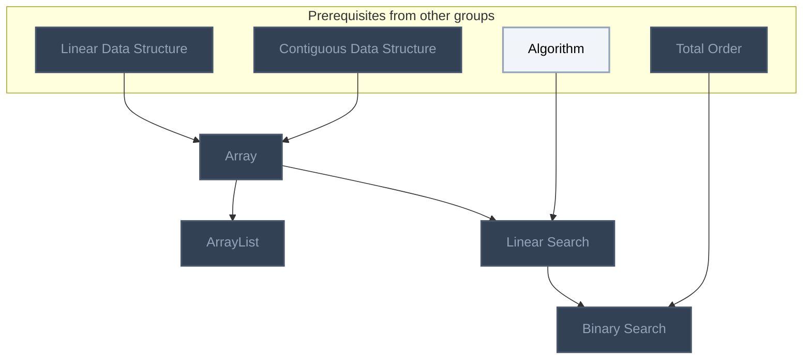

## Algorithms (Erickson) Ch. 1: Recursion
**Mastered:** 0 / 5 · **Discovered:** 5 / 5

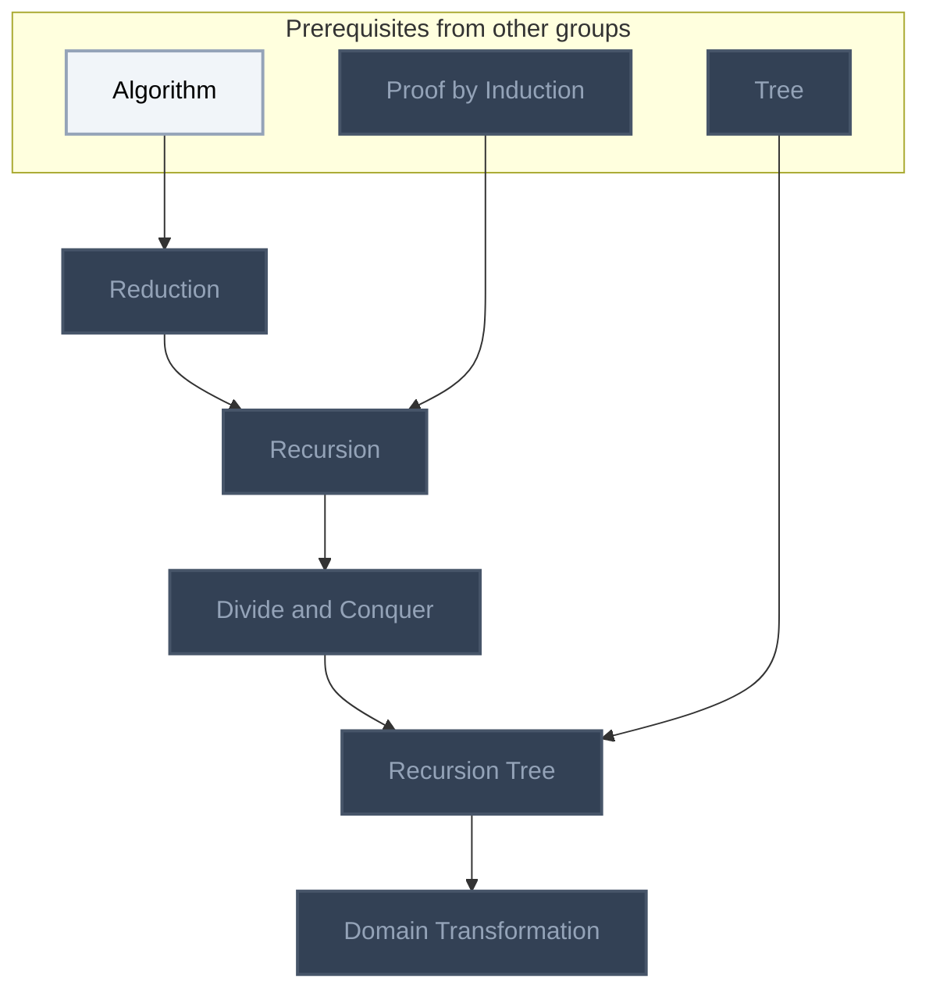

## Open Data Structures (Morin) Ch. 2: Array-Based Lists
**Mastered:** 0 / 8 · **Discovered:** 8 / 8

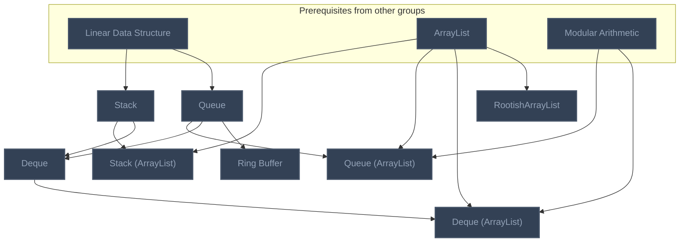

## Open Data Structures (Morin) Ch. 3: Linked Lists
**Mastered:** 0 / 7 · **Discovered:** 7 / 7

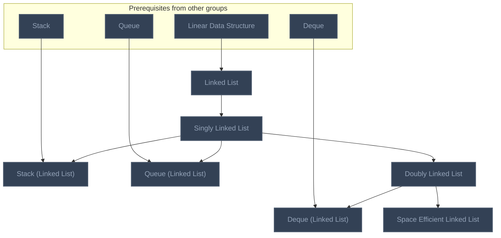

## Open Data Structures (Morin) Ch. 4: Skiplists
**Mastered:** 0 / 1 · **Discovered:** 1 / 1

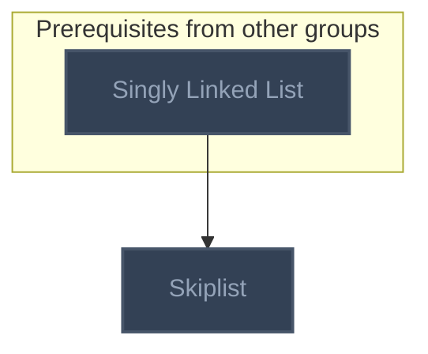

## Open Data Structures (Morin) Ch. 5: Hash Tables
**Mastered:** 0 / 7 · **Discovered:** 7 / 7

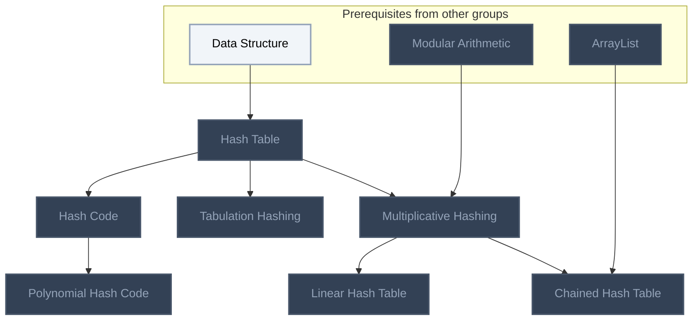

## Open Data Structures (Morin) Ch. 6: Binary Trees
**Mastered:** 0 / 3 · **Discovered:** 3 / 3

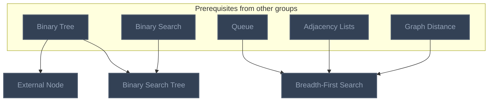

## Open Data Structures (Morin) Ch. 7: Random Binary Search Trees
**Mastered:** 0 / 4 · **Discovered:** 4 / 4

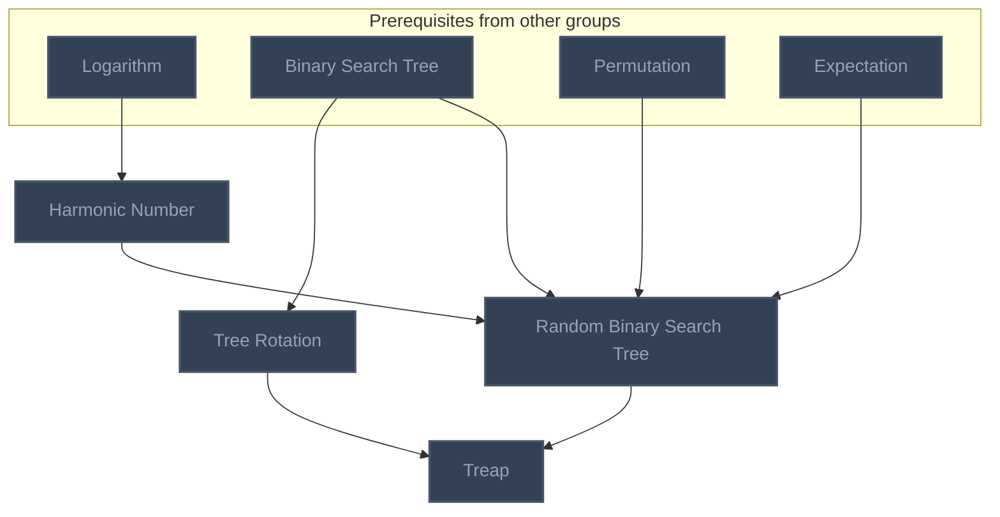

## Open Data Structures (Morin) Ch. 8: Scapegoat Trees
**Mastered:** 0 / 2 · **Discovered:** 2 / 2

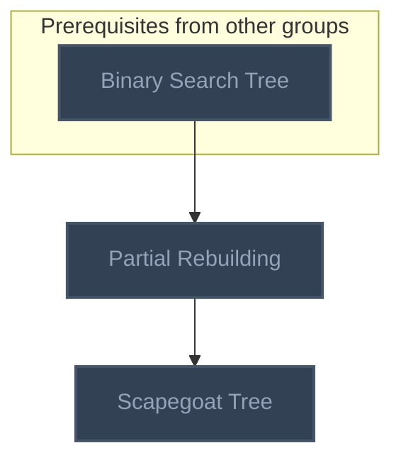

## Open Data Structures (Morin) Ch. 9: Red-Black Trees
**Mastered:** 0 / 3 · **Discovered:** 3 / 3

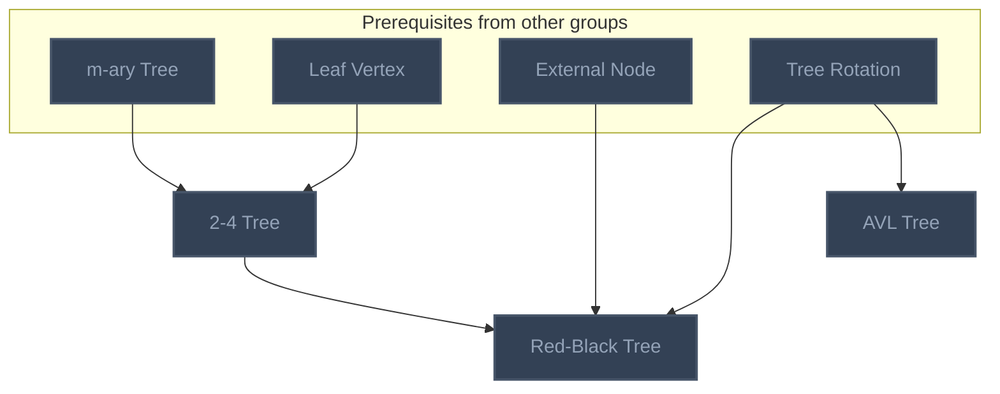

## Open Data Structures (Morin) Ch. 10: Heaps
**Mastered:** 0 / 7 · **Discovered:** 7 / 7

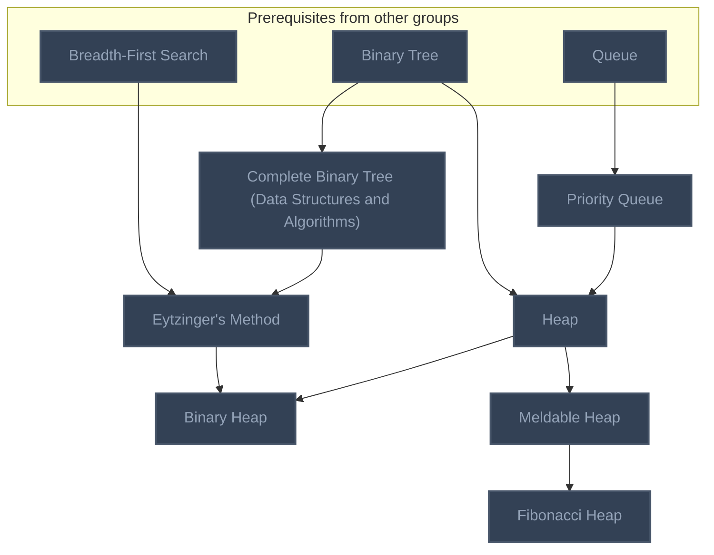

## Open Data Structures (Morin) Ch. 11: Sorting Algorithms
**Mastered:** 0 / 7 · **Discovered:** 7 / 7

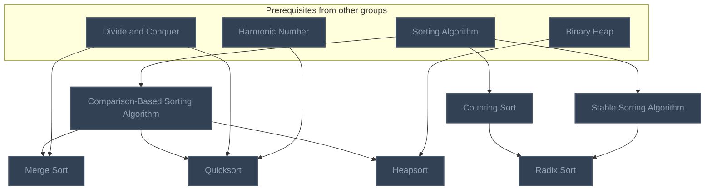

## Algorithms (Erickson) Ch. 1: Selection
**Mastered:** 0 / 2 · **Discovered:** 2 / 2

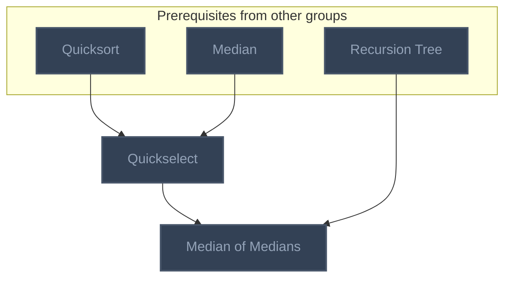

## Open Data Structures (Morin) Ch. 12: Graphs
**Mastered:** 0 / 3 · **Discovered:** 3 / 3

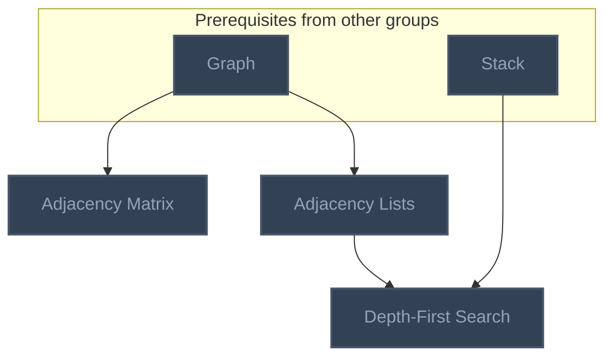

## Open Data Structures (Morin) Ch. 13: Tries
**Mastered:** 0 / 4 · **Discovered:** 4 / 4

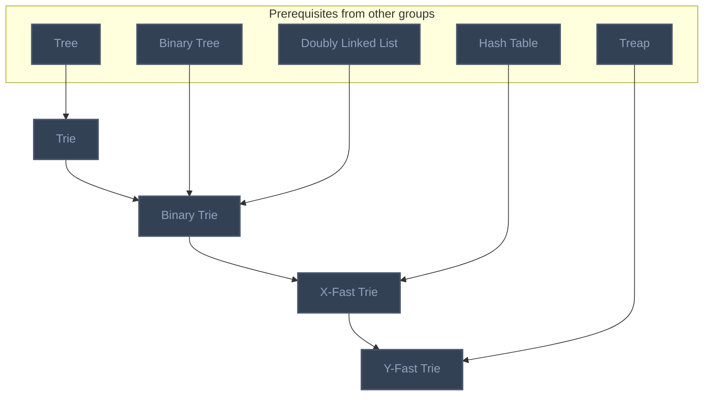

## Open Data Structures (Morin) Ch. 14: External Memory Searching
**Mastered:** 0 / 3 · **Discovered:** 3 / 3

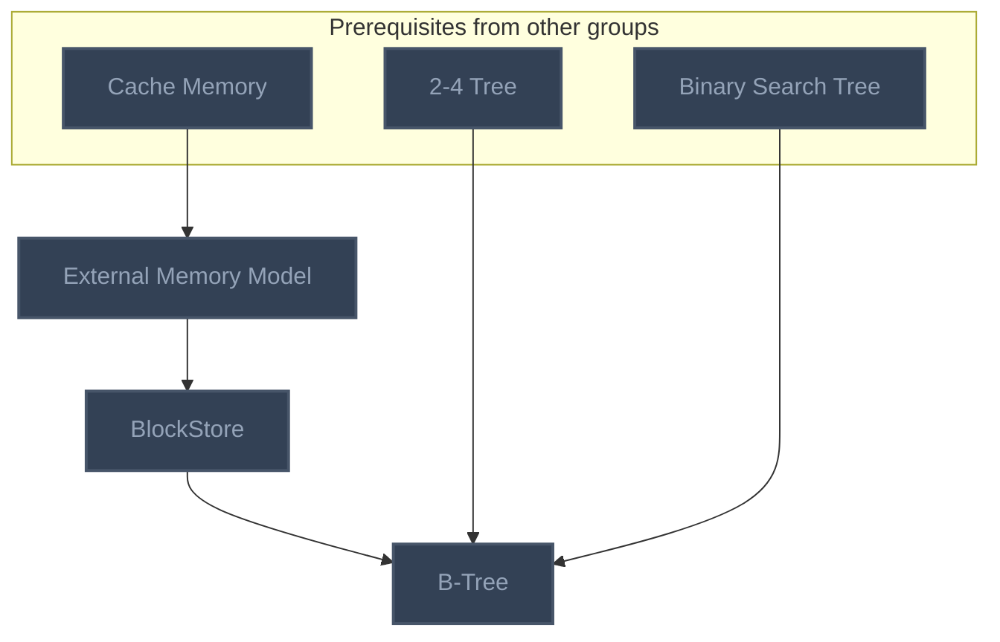

# Source
Graph structure: the single source for the diagrams above, edited by `/note` and `Scripts/skill_trees.py` (`add`, `edge`, `rename`). Everything above this heading is regenerated by `render`.

```skilltree
    %% PREREQUISITES
    n_total_order["Total Order"]
    n_proof_by_induction["Proof by Induction"]
    n_tree["Tree"]
    n_modular_arithmetic["Modular Arithmetic"]
    n_binary_tree["Binary Tree"]
    n_graph_distance["Graph Distance"]
    n_logarithm["Logarithm"]
    n_permutation["Permutation"]
    n_expectation["Expectation"]
    n_m_ary_tree["m-ary Tree"]
    n_leaf_vertex["Leaf Vertex"]
    n_median["Median"]
    n_graph["Graph"]
    n_cache_memory["Cache Memory"]
    %% NODES
    %% == Introduction to Algorithms (CLRS): Foundations ==
    n_algorithm["Algorithm"]
    n_online_algorithm["Online Algorithm"]
    n_data_structure["Data Structure"]
    n_linear_data_structure["Linear Data Structure"]
    n_contiguous_data_structure["Contiguous Data Structure"]
    n_sorting_algorithm["Sorting Algorithm"]
    n_dynamic_programming["Dynamic Programming"]
    %% == Arrays and Searching ==
    n_array["Array"]
    n_arraylist["ArrayList"]
    n_linear_search["Linear Search"]
    n_binary_search["Binary Search"]
    %% == Algorithms (Erickson) Ch. 1: Recursion ==
    n_reduction["Reduction"]
    n_recursion["Recursion"]
    n_divide_and_conquer["Divide and Conquer"]
    n_recursion_tree["Recursion Tree"]
    n_domain_transformation["Domain Transformation"]
    %% == Open Data Structures (Morin) Ch. 2: Array-Based Lists ==
    n_stack["Stack"]
    n_stack_arraylist["Stack (ArrayList)"]
    n_queue["Queue"]
    n_queue_arraylist["Queue (ArrayList)"]
    n_deque["Deque"]
    n_deque_arraylist["Deque (ArrayList)"]
    n_rootisharraylist["RootishArrayList"]
    n_ring_buffer["Ring Buffer"]
    %% == Open Data Structures (Morin) Ch. 3: Linked Lists ==
    n_linked_list["Linked List"]
    n_singly_linked_list["Singly Linked List"]
    n_stack_linked_list["Stack (Linked List)"]
    n_queue_linked_list["Queue (Linked List)"]
    n_doubly_linked_list["Doubly Linked List"]
    n_deque_linked_list["Deque (Linked List)"]
    n_space_efficient_linked_list["Space Efficient Linked List"]
    %% == Open Data Structures (Morin) Ch. 4: Skiplists ==
    n_skiplist["Skiplist"]
    %% == Open Data Structures (Morin) Ch. 5: Hash Tables ==
    n_hash_table["Hash Table"]
    n_multiplicative_hashing["Multiplicative Hashing"]
    n_chained_hash_table["Chained Hash Table"]
    n_linear_hash_table["Linear Hash Table"]
    n_tabulation_hashing["Tabulation Hashing"]
    n_hash_code["Hash Code"]
    n_polynomial_hash_code["Polynomial Hash Code"]
    %% == Open Data Structures (Morin) Ch. 6: Binary Trees ==
    n_external_node["External Node"]
    n_breadth_first_search["Breadth-First Search"]
    n_binary_search_tree["Binary Search Tree"]
    %% == Open Data Structures (Morin) Ch. 7: Random Binary Search Trees ==
    n_harmonic_number["Harmonic Number"]
    n_random_binary_search_tree["Random Binary Search Tree"]
    n_tree_rotation["Tree Rotation"]
    n_treap["Treap"]
    %% == Open Data Structures (Morin) Ch. 8: Scapegoat Trees ==
    n_partial_rebuilding["Partial Rebuilding"]
    n_scapegoat_tree["Scapegoat Tree"]
    %% == Open Data Structures (Morin) Ch. 9: Red-Black Trees ==
    n_2_4_tree["2-4 Tree"]
    n_red_black_tree["Red-Black Tree"]
    n_avl_tree["AVL Tree"]
    %% == Open Data Structures (Morin) Ch. 10: Heaps ==
    n_priority_queue["Priority Queue"]
    n_heap["Heap"]
    n_complete_binary_tree_data_structures_and_algorithms["Complete Binary Tree (Data Structures and Algorithms)"]
    n_eytzinger_s_method["Eytzinger's Method"]
    n_binary_heap["Binary Heap"]
    n_meldable_heap["Meldable Heap"]
    n_fibonacci_heap["Fibonacci Heap"]
    %% == Open Data Structures (Morin) Ch. 11: Sorting Algorithms ==
    n_comparison_based_sorting_algorithm["Comparison-Based Sorting Algorithm"]
    n_merge_sort["Merge Sort"]
    n_quicksort["Quicksort"]
    n_heapsort["Heapsort"]
    n_counting_sort["Counting Sort"]
    n_stable_sorting_algorithm["Stable Sorting Algorithm"]
    n_radix_sort["Radix Sort"]
    %% == Algorithms (Erickson) Ch. 1: Selection ==
    n_quickselect["Quickselect"]
    n_median_of_medians["Median of Medians"]
    %% == Open Data Structures (Morin) Ch. 12: Graphs ==
    n_adjacency_matrix["Adjacency Matrix"]
    n_adjacency_lists["Adjacency Lists"]
    n_depth_first_search["Depth-First Search"]
    %% == Open Data Structures (Morin) Ch. 13: Tries ==
    n_trie["Trie"]
    n_binary_trie["Binary Trie"]
    n_x_fast_trie["X-Fast Trie"]
    n_y_fast_trie["Y-Fast Trie"]
    %% == Open Data Structures (Morin) Ch. 14: External Memory Searching ==
    n_external_memory_model["External Memory Model"]
    n_blockstore["BlockStore"]
    n_b_tree["B-Tree"]
    %% EDGES
    n_algorithm --> n_online_algorithm
    n_algorithm --> n_sorting_algorithm
    n_total_order --> n_sorting_algorithm
    n_data_structure --> n_linear_data_structure
    n_data_structure --> n_contiguous_data_structure
    n_linear_data_structure --> n_array
    n_contiguous_data_structure --> n_array
    n_array --> n_arraylist
    n_array --> n_linear_search
    n_algorithm --> n_linear_search
    n_linear_search --> n_binary_search
    n_total_order --> n_binary_search
    n_algorithm --> n_reduction
    n_reduction --> n_recursion
    n_proof_by_induction --> n_recursion
    n_recursion --> n_divide_and_conquer
    n_divide_and_conquer --> n_recursion_tree
    n_tree --> n_recursion_tree
    n_recursion_tree --> n_domain_transformation
    n_linear_data_structure --> n_stack
    n_arraylist --> n_stack_arraylist
    n_stack --> n_stack_arraylist
    n_linear_data_structure --> n_queue
    n_queue --> n_queue_arraylist
    n_arraylist --> n_queue_arraylist
    n_modular_arithmetic --> n_queue_arraylist
    n_stack --> n_deque
    n_queue --> n_deque
    n_deque --> n_deque_arraylist
    n_arraylist --> n_deque_arraylist
    n_modular_arithmetic --> n_deque_arraylist
    n_arraylist --> n_rootisharraylist
    n_linear_data_structure --> n_linked_list
    n_linked_list --> n_singly_linked_list
    n_singly_linked_list --> n_stack_linked_list
    n_stack --> n_stack_linked_list
    n_singly_linked_list --> n_queue_linked_list
    n_queue --> n_queue_linked_list
    n_singly_linked_list --> n_doubly_linked_list
    n_doubly_linked_list --> n_deque_linked_list
    n_deque --> n_deque_linked_list
    n_doubly_linked_list --> n_space_efficient_linked_list
    n_singly_linked_list --> n_skiplist
    n_data_structure --> n_hash_table
    n_hash_table --> n_multiplicative_hashing
    n_modular_arithmetic --> n_multiplicative_hashing
    n_multiplicative_hashing --> n_chained_hash_table
    n_arraylist --> n_chained_hash_table
    n_multiplicative_hashing --> n_linear_hash_table
    n_hash_table --> n_tabulation_hashing
    n_hash_table --> n_hash_code
    n_hash_code --> n_polynomial_hash_code
    n_binary_tree --> n_external_node
    n_queue --> n_breadth_first_search
    n_adjacency_lists --> n_breadth_first_search
    n_graph_distance --> n_breadth_first_search
    n_binary_tree --> n_binary_search_tree
    n_binary_search --> n_binary_search_tree
    n_logarithm --> n_harmonic_number
    n_binary_search_tree --> n_random_binary_search_tree
    n_permutation --> n_random_binary_search_tree
    n_harmonic_number --> n_random_binary_search_tree
    n_expectation --> n_random_binary_search_tree
    n_binary_search_tree --> n_tree_rotation
    n_random_binary_search_tree --> n_treap
    n_tree_rotation --> n_treap
    n_binary_search_tree --> n_partial_rebuilding
    n_partial_rebuilding --> n_scapegoat_tree
    n_m_ary_tree --> n_2_4_tree
    n_leaf_vertex --> n_2_4_tree
    n_2_4_tree --> n_red_black_tree
    n_external_node --> n_red_black_tree
    n_tree_rotation --> n_red_black_tree
    n_tree_rotation --> n_avl_tree
    n_queue --> n_priority_queue
    n_priority_queue --> n_heap
    n_binary_tree --> n_heap
    n_binary_tree --> n_complete_binary_tree_data_structures_and_algorithms
    n_complete_binary_tree_data_structures_and_algorithms --> n_eytzinger_s_method
    n_breadth_first_search --> n_eytzinger_s_method
    n_heap --> n_binary_heap
    n_eytzinger_s_method --> n_binary_heap
    n_heap --> n_meldable_heap
    n_meldable_heap --> n_fibonacci_heap
    n_sorting_algorithm --> n_comparison_based_sorting_algorithm
    n_comparison_based_sorting_algorithm --> n_merge_sort
    n_divide_and_conquer --> n_merge_sort
    n_comparison_based_sorting_algorithm --> n_quicksort
    n_divide_and_conquer --> n_quicksort
    n_harmonic_number --> n_quicksort
    n_comparison_based_sorting_algorithm --> n_heapsort
    n_binary_heap --> n_heapsort
    n_sorting_algorithm --> n_counting_sort
    n_sorting_algorithm --> n_stable_sorting_algorithm
    n_counting_sort --> n_radix_sort
    n_stable_sorting_algorithm --> n_radix_sort
    n_quicksort --> n_quickselect
    n_median --> n_quickselect
    n_quickselect --> n_median_of_medians
    n_recursion_tree --> n_median_of_medians
    n_graph --> n_adjacency_matrix
    n_graph --> n_adjacency_lists
    n_adjacency_lists --> n_depth_first_search
    n_stack --> n_depth_first_search
    n_tree --> n_trie
    n_trie --> n_binary_trie
    n_binary_tree --> n_binary_trie
    n_doubly_linked_list --> n_binary_trie
    n_binary_trie --> n_x_fast_trie
    n_hash_table --> n_x_fast_trie
    n_x_fast_trie --> n_y_fast_trie
    n_treap --> n_y_fast_trie
    n_cache_memory --> n_external_memory_model
    n_external_memory_model --> n_blockstore
    n_blockstore --> n_b_tree
    n_2_4_tree --> n_b_tree
    n_binary_search_tree --> n_b_tree
    n_algorithm --> n_dynamic_programming
    n_queue --> n_ring_buffer
```
