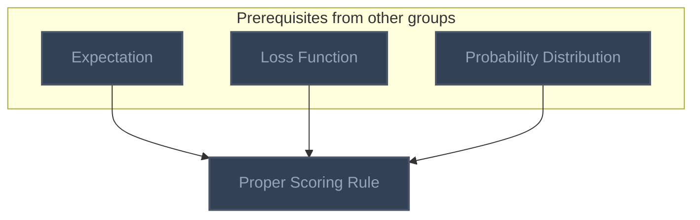

<!-- BEGIN STATS (generated by Scripts/skill_trees.py; do not edit) -->
**Mastered:** 0 / 1 · **Depth:** 0% · **Discovered:** 1 · **Planned:** 0 · **Locked:** 1 · **Rusty:** 0

**Levels:** L0 1 · L1 0 · L2 0 · L3 0 · L4 0 · L5 0

**Next up:** —

Legend: dashed grey = planned (no note yet) · dark grey = locked · white L0 Discovered · green L1 Recall · blue L2 Apply · purple L3 Prove (Mastered) · orange L4 Wield · gold L5 Command · brown dashed border = rusty
<!-- END STATS -->

## Decision Theory
**Mastered:** 0 / 1 · **Discovered:** 1 / 1



# Source
Graph structure: the single source for the diagrams above, edited by `/note` and `Scripts/skill_trees.py` (`add`, `edge`, `rename`). Everything above this heading is regenerated by `render`.

```skilltree
    %% PREREQUISITES
    n_expectation["Expectation"]
    n_loss_function["Loss Function"]
    n_probability_distribution["Probability Distribution"]
    %% NODES
    %% == Decision Theory ==
    n_proper_scoring_rule["Proper Scoring Rule"]
    %% EDGES
    n_expectation --> n_proper_scoring_rule
    n_loss_function --> n_proper_scoring_rule
    n_probability_distribution --> n_proper_scoring_rule
```
