<!-- BEGIN STATS (generated by Scripts/skill_trees.py; do not edit) -->
**Mastered:** 0 / 236 · **Depth:** 0% · **Discovered:** 236 · **Planned:** 0 · **Locked:** 229 · **Rusty:** 0

| | L0 Discovered | L1 Recall | L2 Apply | L3 Prove ★ | L4 Wield | L5 Command |
|---|---:|---:|---:|---:|---:|---:|
| **At this level** | 236 | 0 | 0 | 0 | 0 | 0 |
| **Reached (this level or higher)** | 236 | 0 | 0 | 0 | 0 | 0 |

**Next up:** [[Tabular Data]], [[Softmax Function]], [[Tokenization]], [[Tensor]], [[Linear Layer]]

Legend: dashed grey = planned (no note yet) · dark grey = locked · white L0 Discovered · green L1 Recall · blue L2 Apply · purple L3 Prove (Mastered) · orange L4 Wield · gold L5 Command · brown dashed border = rusty
<!-- END STATS -->

## Prince Ch. 1: Introduction
**Reached:** L1 0 · L2 0 · L3 0 · L4 0 · L5 0 (of 18 nodes)

```mermaid
flowchart TD
    classDef planned fill:#1E293B,stroke:#64748B,stroke-width:2px,stroke-dasharray:5 5,color:#94A3B8;
    classDef locked fill:#334155,stroke:#475569,stroke-width:2px,color:#94A3B8;
    classDef L0 fill:#F1F5F9,stroke:#94A3B8,stroke-width:2px,color:#000000;
    classDef L1 fill:#22C55E,stroke:#15803D,stroke-width:2px,color:#000000;
    classDef L2 fill:#3B82F6,stroke:#1D4ED8,stroke-width:3px,color:#FFFFFF;
    classDef L3 fill:#A855F7,stroke:#6B21A8,stroke-width:3px,color:#FFFFFF,font-weight:bold;
    classDef L4 fill:#F97316,stroke:#C2410C,stroke-width:4px,color:#000000,font-weight:bold;
    classDef L5 fill:#FFD700,stroke:#FF8C00,stroke-width:5px,color:#000000,font-weight:bold;
    classDef rusty stroke:#8B4513,stroke-width:4px,stroke-dasharray:3 3;
    subgraph sg_prereqs["Prerequisites from other groups"]
        n_artificial_intelligence["Artificial Intelligence"]
        n_function["Function"]
        n_categorical_variable["Categorical Variable"]
        n_quantitative_variable["Quantitative Variable"]
        n_tensor["Tensor"]
        n_shallow_neural_network["Shallow Neural Network"]
        n_policy["Policy"]
    end
    n_machine_learning["Machine Learning"]
    n_supervised_learning["Supervised Learning"]
    n_unsupervised_learning["Unsupervised Learning"]
    n_reinforcement_learning["Reinforcement Learning"]
    n_classification["Classification"]
    n_regression["Regression"]
    n_binary_classification["Binary Classification"]
    n_multiclass_classification["Multiclass Classification"]
    n_multivariate_regression["Multivariate Regression"]
    n_tabular_data["Tabular Data"]
    n_deep_neural_network["Deep Neural Network"]
    n_deep_learning["Deep Learning"]
    n_deep_learning_representation_transformation["Deep Learning Representation Transformation"]
    n_yann_lecun_deep_learning_view["Yann LeCun Deep Learning View"]
    n_generative_model["Generative Model"]
    n_latent_variables["Latent Variables"]
    n_temporal_credit_assignment_problem["Temporal Credit Assignment Problem"]
    n_policy_network["Policy Network"]
    n_artificial_intelligence --> n_machine_learning
    n_function --> n_machine_learning
    n_machine_learning --> n_supervised_learning
    n_machine_learning --> n_unsupervised_learning
    n_machine_learning --> n_reinforcement_learning
    n_supervised_learning --> n_classification
    n_categorical_variable --> n_classification
    n_supervised_learning --> n_regression
    n_quantitative_variable --> n_regression
    n_classification --> n_binary_classification
    n_classification --> n_multiclass_classification
    n_regression --> n_multivariate_regression
    n_function --> n_deep_neural_network
    n_tensor --> n_deep_neural_network
    n_shallow_neural_network --> n_deep_neural_network
    n_machine_learning --> n_deep_learning
    n_deep_neural_network --> n_deep_learning
    n_deep_learning --> n_deep_learning_representation_transformation
    n_deep_learning --> n_yann_lecun_deep_learning_view
    n_unsupervised_learning --> n_generative_model
    n_unsupervised_learning --> n_latent_variables
    n_reinforcement_learning --> n_temporal_credit_assignment_problem
    n_deep_neural_network --> n_policy_network
    n_policy --> n_policy_network
    n_reinforcement_learning --> n_policy_network
    class n_shallow_neural_network,n_policy,n_machine_learning,n_supervised_learning,n_unsupervised_learning,n_reinforcement_learning,n_classification,n_regression,n_binary_classification,n_multiclass_classification,n_multivariate_regression,n_deep_neural_network,n_deep_learning,n_deep_learning_representation_transformation,n_yann_lecun_deep_learning_view,n_generative_model,n_latent_variables,n_temporal_credit_assignment_problem,n_policy_network locked;
    class n_artificial_intelligence,n_categorical_variable,n_quantitative_variable,n_tensor,n_tabular_data L0;
    class n_function L3;
    class n_artificial_intelligence,n_function,n_categorical_variable,n_quantitative_variable,n_tensor,n_shallow_neural_network,n_policy,n_machine_learning,n_supervised_learning,n_unsupervised_learning,n_reinforcement_learning,n_classification,n_regression,n_binary_classification,n_multiclass_classification,n_multivariate_regression,n_tabular_data,n_deep_neural_network,n_deep_learning,n_deep_learning_representation_transformation,n_yann_lecun_deep_learning_view,n_generative_model,n_latent_variables,n_temporal_credit_assignment_problem,n_policy_network internal-link;
```

## Prince Ch. 2: Supervised Learning
**Reached:** L1 0 · L2 0 · L3 0 · L4 0 · L5 0 (of 4 nodes)

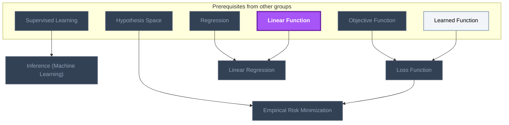

## Prince Ch. 3-4: Shallow and Deep Neural Networks
**Reached:** L1 0 · L2 0 · L3 0 · L4 0 · L5 0 (of 15 nodes)

```mermaid
flowchart TD
    classDef planned fill:#1E293B,stroke:#64748B,stroke-width:2px,stroke-dasharray:5 5,color:#94A3B8;
    classDef locked fill:#334155,stroke:#475569,stroke-width:2px,color:#94A3B8;
    classDef L0 fill:#F1F5F9,stroke:#94A3B8,stroke-width:2px,color:#000000;
    classDef L1 fill:#22C55E,stroke:#15803D,stroke-width:2px,color:#000000;
    classDef L2 fill:#3B82F6,stroke:#1D4ED8,stroke-width:3px,color:#FFFFFF;
    classDef L3 fill:#A855F7,stroke:#6B21A8,stroke-width:3px,color:#FFFFFF,font-weight:bold;
    classDef L4 fill:#F97316,stroke:#C2410C,stroke-width:4px,color:#000000,font-weight:bold;
    classDef L5 fill:#FFD700,stroke:#FF8C00,stroke-width:5px,color:#000000,font-weight:bold;
    classDef rusty stroke:#8B4513,stroke-width:4px,stroke-dasharray:3 3;
    subgraph sg_prereqs["Prerequisites from other groups"]
        n_activation_layer["Activation Layer"]
        n_relu_function["ReLU Function"]
        n_sigmoid_function["Sigmoid Function"]
        n_cumulative_distribution_function["Cumulative Distribution Function"]
        n_gradient_descent["Gradient Descent"]
        n_deep_neural_network["Deep Neural Network"]
    end
    n_shallow_neural_network["Shallow Neural Network"]
    n_feed_forward_neural_network["Feed-Forward Neural Network"]
    n_linear_regions_of_relu_network["Linear Regions of ReLU Network"]
    n_leaky_relu["Leaky ReLU"]
    n_parametric_relu["Parametric ReLU"]
    n_exponential_linear_unit["Exponential Linear Unit"]
    n_scaled_exponential_linear_unit["Scaled Exponential Linear Unit"]
    n_softplus_function["Softplus Function"]
    n_concatenated_relu["Concatenated ReLU"]
    n_swish_function["Swish Function"]
    n_hardswish_function["HardSwish Function"]
    n_gaussian_error_linear_unit["Gaussian Error Linear Unit"]
    n_dying_relu_problem["Dying ReLU Problem"]
    n_neural_network_folding["Neural Network Folding"]
    n_width_efficiency["Width Efficiency"]
    n_activation_layer --> n_shallow_neural_network
    n_shallow_neural_network --> n_feed_forward_neural_network
    n_relu_function --> n_linear_regions_of_relu_network
    n_shallow_neural_network --> n_linear_regions_of_relu_network
    n_relu_function --> n_leaky_relu
    n_leaky_relu --> n_parametric_relu
    n_relu_function --> n_exponential_linear_unit
    n_exponential_linear_unit --> n_scaled_exponential_linear_unit
    n_relu_function --> n_softplus_function
    n_relu_function --> n_concatenated_relu
    n_sigmoid_function --> n_swish_function
    n_swish_function --> n_hardswish_function
    n_cumulative_distribution_function --> n_gaussian_error_linear_unit
    n_relu_function --> n_dying_relu_problem
    n_gradient_descent --> n_dying_relu_problem
    n_linear_regions_of_relu_network --> n_neural_network_folding
    n_deep_neural_network --> n_width_efficiency
    class n_activation_layer,n_relu_function,n_cumulative_distribution_function,n_gradient_descent,n_deep_neural_network,n_shallow_neural_network,n_feed_forward_neural_network,n_linear_regions_of_relu_network,n_leaky_relu,n_parametric_relu,n_exponential_linear_unit,n_scaled_exponential_linear_unit,n_softplus_function,n_concatenated_relu,n_swish_function,n_hardswish_function,n_gaussian_error_linear_unit,n_dying_relu_problem,n_neural_network_folding,n_width_efficiency locked;
    class n_sigmoid_function L0;
    class n_activation_layer,n_relu_function,n_sigmoid_function,n_cumulative_distribution_function,n_gradient_descent,n_deep_neural_network,n_shallow_neural_network,n_feed_forward_neural_network,n_linear_regions_of_relu_network,n_leaky_relu,n_parametric_relu,n_exponential_linear_unit,n_scaled_exponential_linear_unit,n_softplus_function,n_concatenated_relu,n_swish_function,n_hardswish_function,n_gaussian_error_linear_unit,n_dying_relu_problem,n_neural_network_folding,n_width_efficiency internal-link;
```

## Prince Ch. 5: Loss Functions
**Reached:** L1 0 · L2 0 · L3 0 · L4 0 · L5 0 (of 14 nodes)

```mermaid
flowchart TD
    classDef planned fill:#1E293B,stroke:#64748B,stroke-width:2px,stroke-dasharray:5 5,color:#94A3B8;
    classDef locked fill:#334155,stroke:#475569,stroke-width:2px,color:#94A3B8;
    classDef L0 fill:#F1F5F9,stroke:#94A3B8,stroke-width:2px,color:#000000;
    classDef L1 fill:#22C55E,stroke:#15803D,stroke-width:2px,color:#000000;
    classDef L2 fill:#3B82F6,stroke:#1D4ED8,stroke-width:3px,color:#FFFFFF;
    classDef L3 fill:#A855F7,stroke:#6B21A8,stroke-width:3px,color:#FFFFFF,font-weight:bold;
    classDef L4 fill:#F97316,stroke:#C2410C,stroke-width:4px,color:#000000,font-weight:bold;
    classDef L5 fill:#FFD700,stroke:#FF8C00,stroke-width:5px,color:#000000,font-weight:bold;
    classDef rusty stroke:#8B4513,stroke-width:4px,stroke-dasharray:3 3;
    subgraph sg_prereqs["Prerequisites from other groups"]
        n_maximum_likelihood_estimation["Maximum Likelihood Estimation"]
        n_loss_function["Loss Function"]
        n_inference_machine_learning["Inference (Machine Learning)"]
        n_multivariate_regression["Multivariate Regression"]
        n_binary_classification["Binary Classification"]
        n_multiclass_classification["Multiclass Classification"]
        n_proper_scoring_rule["Proper Scoring Rule"]
        n_regression["Regression"]
        n_independent_random_variable["Independent Random Variable"]
        n_vector["Vector"]
        n_categorical_variable["Categorical Variable"]
        n_function["Function"]
        n_probability["Probability"]
        n_probability_mass_function["Probability Mass Function"]
        n_bernoulli_distribution["Bernoulli Distribution"]
        n_sigmoid_function["Sigmoid Function"]
    end
    n_maximum_likelihood_learning["Maximum Likelihood Learning"]
    n_maximum_likelihood_loss_function_recipe["Maximum Likelihood Loss Function Recipe"]
    n_output_distributions_for_loss_functions["Output Distributions for Loss Functions"]
    n_maximum_likelihood_loss_optimality_and_failure_modes["Maximum Likelihood Loss Optimality and Failure Modes"]
    n_loss_function_taxonomy["Loss Function Taxonomy"]
    n_l2_loss["L2 Loss"]
    n_heteroscedasticity_machine_learning["Heteroscedasticity (Machine Learning)"]
    n_loss_function_for_multiple_outputs["Loss Function for Multiple Outputs"]
    n_simplex["Simplex"]
    n_one_hot_encoding["One-Hot Encoding"]
    n_softmax_function["Softmax Function"]
    n_cross_entropy_loss["Cross-Entropy Loss"]
    n_binary_cross_entropy_loss["Binary Cross-Entropy Loss"]
    n_focal_loss["Focal Loss"]
    n_maximum_likelihood_estimation --> n_maximum_likelihood_learning
    n_loss_function --> n_maximum_likelihood_learning
    n_maximum_likelihood_learning --> n_maximum_likelihood_loss_function_recipe
    n_inference_machine_learning --> n_maximum_likelihood_loss_function_recipe
    n_maximum_likelihood_loss_function_recipe --> n_output_distributions_for_loss_functions
    n_multivariate_regression --> n_output_distributions_for_loss_functions
    n_binary_classification --> n_output_distributions_for_loss_functions
    n_multiclass_classification --> n_output_distributions_for_loss_functions
    n_maximum_likelihood_loss_function_recipe --> n_maximum_likelihood_loss_optimality_and_failure_modes
    n_maximum_likelihood_loss_function_recipe --> n_loss_function_taxonomy
    n_proper_scoring_rule --> n_loss_function_taxonomy
    n_loss_function --> n_l2_loss
    n_regression --> n_heteroscedasticity_machine_learning
    n_maximum_likelihood_loss_function_recipe --> n_heteroscedasticity_machine_learning
    n_multivariate_regression --> n_loss_function_for_multiple_outputs
    n_independent_random_variable --> n_loss_function_for_multiple_outputs
    n_maximum_likelihood_loss_function_recipe --> n_loss_function_for_multiple_outputs
    n_vector --> n_simplex
    n_vector --> n_one_hot_encoding
    n_categorical_variable --> n_one_hot_encoding
    n_function --> n_softmax_function
    n_probability --> n_softmax_function
    n_probability_mass_function --> n_cross_entropy_loss
    n_simplex --> n_cross_entropy_loss
    n_binary_classification --> n_binary_cross_entropy_loss
    n_bernoulli_distribution --> n_binary_cross_entropy_loss
    n_sigmoid_function --> n_binary_cross_entropy_loss
    n_cross_entropy_loss --> n_focal_loss
    class n_maximum_likelihood_estimation,n_loss_function,n_inference_machine_learning,n_multivariate_regression,n_binary_classification,n_multiclass_classification,n_proper_scoring_rule,n_regression,n_vector,n_probability_mass_function,n_bernoulli_distribution,n_maximum_likelihood_learning,n_maximum_likelihood_loss_function_recipe,n_output_distributions_for_loss_functions,n_maximum_likelihood_loss_optimality_and_failure_modes,n_loss_function_taxonomy,n_l2_loss,n_heteroscedasticity_machine_learning,n_loss_function_for_multiple_outputs,n_simplex,n_one_hot_encoding,n_cross_entropy_loss,n_binary_cross_entropy_loss,n_focal_loss locked;
    class n_categorical_variable,n_sigmoid_function,n_softmax_function L0;
    class n_independent_random_variable,n_probability L1;
    class n_function L3;
    class n_maximum_likelihood_estimation,n_loss_function,n_inference_machine_learning,n_multivariate_regression,n_binary_classification,n_multiclass_classification,n_proper_scoring_rule,n_regression,n_independent_random_variable,n_vector,n_categorical_variable,n_function,n_probability,n_probability_mass_function,n_bernoulli_distribution,n_sigmoid_function,n_maximum_likelihood_learning,n_maximum_likelihood_loss_function_recipe,n_output_distributions_for_loss_functions,n_maximum_likelihood_loss_optimality_and_failure_modes,n_loss_function_taxonomy,n_l2_loss,n_heteroscedasticity_machine_learning,n_loss_function_for_multiple_outputs,n_simplex,n_one_hot_encoding,n_softmax_function,n_cross_entropy_loss,n_binary_cross_entropy_loss,n_focal_loss internal-link;
```

## Prince Ch. 6: Fitting Models
**Reached:** L1 0 · L2 0 · L3 0 · L4 0 · L5 0 (of 6 nodes)

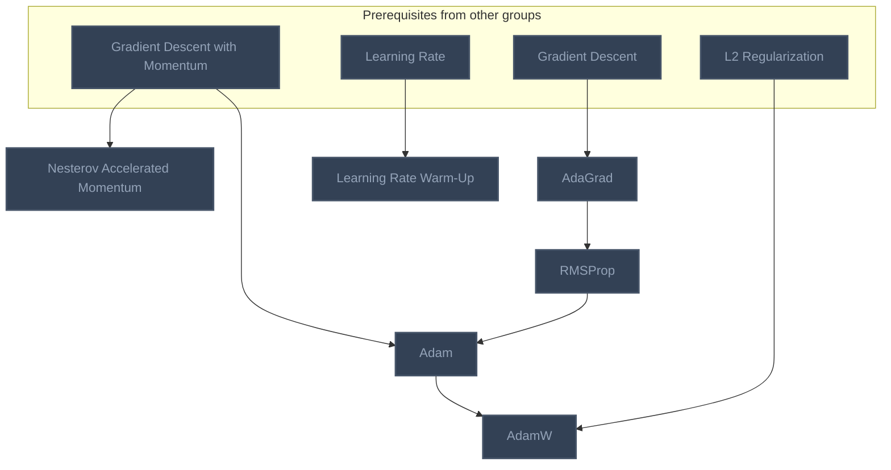

## Prince Ch. 7: Gradients and Initialization
**Reached:** L1 0 · L2 0 · L3 0 · L4 0 · L5 0 (of 5 nodes)

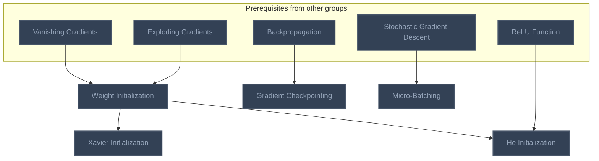

## Prince Ch. 8: Measuring Performance
**Reached:** L1 0 · L2 0 · L3 0 · L4 0 · L5 0 (of 8 nodes)

```mermaid
flowchart TD
    classDef planned fill:#1E293B,stroke:#64748B,stroke-width:2px,stroke-dasharray:5 5,color:#94A3B8;
    classDef locked fill:#334155,stroke:#475569,stroke-width:2px,color:#94A3B8;
    classDef L0 fill:#F1F5F9,stroke:#94A3B8,stroke-width:2px,color:#000000;
    classDef L1 fill:#22C55E,stroke:#15803D,stroke-width:2px,color:#000000;
    classDef L2 fill:#3B82F6,stroke:#1D4ED8,stroke-width:3px,color:#FFFFFF;
    classDef L3 fill:#A855F7,stroke:#6B21A8,stroke-width:3px,color:#FFFFFF,font-weight:bold;
    classDef L4 fill:#F97316,stroke:#C2410C,stroke-width:4px,color:#000000,font-weight:bold;
    classDef L5 fill:#FFD700,stroke:#FF8C00,stroke-width:5px,color:#000000,font-weight:bold;
    classDef rusty stroke:#8B4513,stroke-width:4px,stroke-dasharray:3 3;
    subgraph sg_prereqs["Prerequisites from other groups"]
        n_hyperparameter["Hyperparameter"]
        n_validation_set["Validation Set"]
        n_model_capacity["Model Capacity"]
        n_bias_variance_tradeoff["Bias-Variance Tradeoff"]
        n_hypothesis_space["Hypothesis Space"]
        n_binary_classification["Binary Classification"]
        n_supervised_learning["Supervised Learning"]
    end
    n_hyperparameter_search["Hyperparameter Search"]
    n_hyperband["Hyperband"]
    n_bayesian_optimization["Bayesian Optimization"]
    n_double_descent["Double Descent"]
    n_overparameterized_model["Overparameterized Model"]
    n_rademacher_complexity["Rademacher Complexity"]
    n_vc_dimension["VC Dimension"]
    n_dataset_shift["Dataset Shift"]
    n_hyperparameter --> n_hyperparameter_search
    n_validation_set --> n_hyperparameter_search
    n_hyperparameter_search --> n_hyperband
    n_hyperparameter --> n_bayesian_optimization
    n_model_capacity --> n_double_descent
    n_bias_variance_tradeoff --> n_double_descent
    n_model_capacity --> n_overparameterized_model
    n_model_capacity --> n_rademacher_complexity
    n_hypothesis_space --> n_vc_dimension
    n_binary_classification --> n_vc_dimension
    n_supervised_learning --> n_dataset_shift
    class n_hyperparameter,n_validation_set,n_model_capacity,n_bias_variance_tradeoff,n_hypothesis_space,n_binary_classification,n_supervised_learning,n_hyperparameter_search,n_hyperband,n_bayesian_optimization,n_double_descent,n_overparameterized_model,n_rademacher_complexity,n_vc_dimension,n_dataset_shift locked;
    class n_hyperparameter,n_validation_set,n_model_capacity,n_bias_variance_tradeoff,n_hypothesis_space,n_binary_classification,n_supervised_learning,n_hyperparameter_search,n_hyperband,n_bayesian_optimization,n_double_descent,n_overparameterized_model,n_rademacher_complexity,n_vc_dimension,n_dataset_shift internal-link;
```

## Prince Ch. 9: Regularization
**Reached:** L1 0 · L2 0 · L3 0 · L4 0 · L5 0 (of 13 nodes)

```mermaid
flowchart TD
    classDef planned fill:#1E293B,stroke:#64748B,stroke-width:2px,stroke-dasharray:5 5,color:#94A3B8;
    classDef locked fill:#334155,stroke:#475569,stroke-width:2px,color:#94A3B8;
    classDef L0 fill:#F1F5F9,stroke:#94A3B8,stroke-width:2px,color:#000000;
    classDef L1 fill:#22C55E,stroke:#15803D,stroke-width:2px,color:#000000;
    classDef L2 fill:#3B82F6,stroke:#1D4ED8,stroke-width:3px,color:#FFFFFF;
    classDef L3 fill:#A855F7,stroke:#6B21A8,stroke-width:3px,color:#FFFFFF,font-weight:bold;
    classDef L4 fill:#F97316,stroke:#C2410C,stroke-width:4px,color:#000000,font-weight:bold;
    classDef L5 fill:#FFD700,stroke:#FF8C00,stroke-width:5px,color:#000000,font-weight:bold;
    classDef rusty stroke:#8B4513,stroke-width:4px,stroke-dasharray:3 3;
    subgraph sg_prereqs["Prerequisites from other groups"]
        n_maximum_likelihood_learning["Maximum Likelihood Learning"]
        n_bayes_theorem["Bayes' Theorem"]
        n_stochastic_gradient_descent["Stochastic Gradient Descent"]
        n_regularization["Regularization"]
        n_overfitting["Overfitting"]
        n_supervised_learning["Supervised Learning"]
        n_bootstrap["Bootstrap"]
        n_cross_entropy_loss["Cross-Entropy Loss"]
        n_deep_neural_network["Deep Neural Network"]
        n_hypothesis_space["Hypothesis Space"]
        n_algorithm["Algorithm"]
    end
    n_maximum_a_posteriori_learning["Maximum a Posteriori Learning"]
    n_implicit_regularization["Implicit Regularization"]
    n_early_stopping["Early Stopping"]
    n_ensemble_learning["Ensemble Learning"]
    n_bagging["Bagging"]
    n_dropout["Dropout"]
    n_noise_injection_regularization["Noise Injection (Regularization)"]
    n_label_smoothing["Label Smoothing"]
    n_adversarial_training["Adversarial Training"]
    n_data_augmentation["Data Augmentation"]
    n_transfer_learning["Transfer Learning"]
    n_self_supervised_learning["Self-Supervised Learning"]
    n_metalearning["Metalearning"]
    n_maximum_likelihood_learning --> n_maximum_a_posteriori_learning
    n_bayes_theorem --> n_maximum_a_posteriori_learning
    n_stochastic_gradient_descent --> n_implicit_regularization
    n_regularization --> n_implicit_regularization
    n_overfitting --> n_early_stopping
    n_supervised_learning --> n_ensemble_learning
    n_bootstrap --> n_bagging
    n_ensemble_learning --> n_bagging
    n_regularization --> n_dropout
    n_stochastic_gradient_descent --> n_dropout
    n_dropout --> n_noise_injection_regularization
    n_cross_entropy_loss --> n_label_smoothing
    n_regularization --> n_adversarial_training
    n_regularization --> n_data_augmentation
    n_deep_neural_network --> n_transfer_learning
    n_transfer_learning --> n_self_supervised_learning
    n_hypothesis_space --> n_metalearning
    n_algorithm --> n_metalearning
    class n_maximum_likelihood_learning,n_bayes_theorem,n_stochastic_gradient_descent,n_regularization,n_overfitting,n_supervised_learning,n_bootstrap,n_cross_entropy_loss,n_deep_neural_network,n_hypothesis_space,n_maximum_a_posteriori_learning,n_implicit_regularization,n_early_stopping,n_ensemble_learning,n_bagging,n_dropout,n_noise_injection_regularization,n_label_smoothing,n_adversarial_training,n_data_augmentation,n_transfer_learning,n_self_supervised_learning,n_metalearning locked;
    class n_algorithm L0;
    class n_maximum_likelihood_learning,n_bayes_theorem,n_stochastic_gradient_descent,n_regularization,n_overfitting,n_supervised_learning,n_bootstrap,n_cross_entropy_loss,n_deep_neural_network,n_hypothesis_space,n_algorithm,n_maximum_a_posteriori_learning,n_implicit_regularization,n_early_stopping,n_ensemble_learning,n_bagging,n_dropout,n_noise_injection_regularization,n_label_smoothing,n_adversarial_training,n_data_augmentation,n_transfer_learning,n_self_supervised_learning,n_metalearning internal-link;
```

## Prince Ch. 10: Convolutional Networks
**Reached:** L1 0 · L2 0 · L3 0 · L4 0 · L5 0 (of 20 nodes)

```mermaid
flowchart TD
    classDef planned fill:#1E293B,stroke:#64748B,stroke-width:2px,stroke-dasharray:5 5,color:#94A3B8;
    classDef locked fill:#334155,stroke:#475569,stroke-width:2px,color:#94A3B8;
    classDef L0 fill:#F1F5F9,stroke:#94A3B8,stroke-width:2px,color:#000000;
    classDef L1 fill:#22C55E,stroke:#15803D,stroke-width:2px,color:#000000;
    classDef L2 fill:#3B82F6,stroke:#1D4ED8,stroke-width:3px,color:#FFFFFF;
    classDef L3 fill:#A855F7,stroke:#6B21A8,stroke-width:3px,color:#FFFFFF,font-weight:bold;
    classDef L4 fill:#F97316,stroke:#C2410C,stroke-width:4px,color:#000000,font-weight:bold;
    classDef L5 fill:#FFD700,stroke:#FF8C00,stroke-width:5px,color:#000000,font-weight:bold;
    classDef rusty stroke:#8B4513,stroke-width:4px,stroke-dasharray:3 3;
    subgraph sg_prereqs["Prerequisites from other groups"]
        n_group_action["Group Action"]
        n_activation_layer["Activation Layer"]
        n_linear_layer["Linear Layer"]
        n_deep_neural_network["Deep Neural Network"]
        n_data_augmentation["Data Augmentation"]
        n_dropout["Dropout"]
        n_interpretability_machine_learning["Interpretability (Machine Learning)"]
    end
    n_invariant_function["Invariant Function"]
    n_equivariant_function["Equivariant Function"]
    n_convolutional_layer["Convolutional Layer"]
    n_stride_convolution["Stride (Convolution)"]
    n_padding_convolution["Padding (Convolution)"]
    n_dilated_convolution["Dilated Convolution"]
    n_feature_map["Feature Map"]
    n_receptive_field["Receptive Field"]
    n_1x1_convolution["1x1 Convolution"]
    n_downsampling_deep_learning["Downsampling (Deep Learning)"]
    n_upsampling_deep_learning["Upsampling (Deep Learning)"]
    n_max_pooling["Max Pooling"]
    n_average_pooling["Average Pooling"]
    n_max_unpooling["Max Unpooling"]
    n_transposed_convolution["Transposed Convolution"]
    n_convolutional_neural_network["Convolutional Neural Network"]
    n_cutout["Cutout"]
    n_spatial_dropout["Spatial Dropout"]
    n_object_detection["Object Detection"]
    n_network_dissection["Network Dissection"]
    n_group_action --> n_invariant_function
    n_invariant_function --> n_equivariant_function
    n_activation_layer --> n_convolutional_layer
    n_linear_layer --> n_convolutional_layer
    n_convolutional_layer --> n_stride_convolution
    n_convolutional_layer --> n_padding_convolution
    n_convolutional_layer --> n_dilated_convolution
    n_convolutional_layer --> n_feature_map
    n_convolutional_layer --> n_receptive_field
    n_convolutional_layer --> n_1x1_convolution
    n_feature_map --> n_downsampling_deep_learning
    n_feature_map --> n_upsampling_deep_learning
    n_downsampling_deep_learning --> n_max_pooling
    n_downsampling_deep_learning --> n_average_pooling
    n_upsampling_deep_learning --> n_max_unpooling
    n_max_pooling --> n_max_unpooling
    n_upsampling_deep_learning --> n_transposed_convolution
    n_stride_convolution --> n_transposed_convolution
    n_deep_neural_network --> n_convolutional_neural_network
    n_equivariant_function --> n_convolutional_neural_network
    n_downsampling_deep_learning --> n_convolutional_neural_network
    n_data_augmentation --> n_cutout
    n_dropout --> n_spatial_dropout
    n_feature_map --> n_spatial_dropout
    n_convolutional_neural_network --> n_object_detection
    n_interpretability_machine_learning --> n_network_dissection
    n_convolutional_neural_network --> n_network_dissection
    class n_group_action,n_activation_layer,n_deep_neural_network,n_data_augmentation,n_dropout,n_invariant_function,n_equivariant_function,n_convolutional_layer,n_stride_convolution,n_padding_convolution,n_dilated_convolution,n_feature_map,n_receptive_field,n_1x1_convolution,n_downsampling_deep_learning,n_upsampling_deep_learning,n_max_pooling,n_average_pooling,n_max_unpooling,n_transposed_convolution,n_convolutional_neural_network,n_cutout,n_spatial_dropout,n_object_detection,n_network_dissection locked;
    class n_linear_layer,n_interpretability_machine_learning L0;
    class n_group_action,n_activation_layer,n_linear_layer,n_deep_neural_network,n_data_augmentation,n_dropout,n_interpretability_machine_learning,n_invariant_function,n_equivariant_function,n_convolutional_layer,n_stride_convolution,n_padding_convolution,n_dilated_convolution,n_feature_map,n_receptive_field,n_1x1_convolution,n_downsampling_deep_learning,n_upsampling_deep_learning,n_max_pooling,n_average_pooling,n_max_unpooling,n_transposed_convolution,n_convolutional_neural_network,n_cutout,n_spatial_dropout,n_object_detection,n_network_dissection internal-link;
```

## Prince Ch. 11: Residual Networks
**Reached:** L1 0 · L2 0 · L3 0 · L4 0 · L5 0 (of 8 nodes)

```mermaid
flowchart TD
    classDef planned fill:#1E293B,stroke:#64748B,stroke-width:2px,stroke-dasharray:5 5,color:#94A3B8;
    classDef locked fill:#334155,stroke:#475569,stroke-width:2px,color:#94A3B8;
    classDef L0 fill:#F1F5F9,stroke:#94A3B8,stroke-width:2px,color:#000000;
    classDef L1 fill:#22C55E,stroke:#15803D,stroke-width:2px,color:#000000;
    classDef L2 fill:#3B82F6,stroke:#1D4ED8,stroke-width:3px,color:#FFFFFF;
    classDef L3 fill:#A855F7,stroke:#6B21A8,stroke-width:3px,color:#FFFFFF,font-weight:bold;
    classDef L4 fill:#F97316,stroke:#C2410C,stroke-width:4px,color:#000000,font-weight:bold;
    classDef L5 fill:#FFD700,stroke:#FF8C00,stroke-width:5px,color:#000000,font-weight:bold;
    classDef rusty stroke:#8B4513,stroke-width:4px,stroke-dasharray:3 3;
    subgraph sg_prereqs["Prerequisites from other groups"]
        n_deep_neural_network["Deep Neural Network"]
        n_backpropagation["Backpropagation"]
        n_ensemble_learning["Ensemble Learning"]
        n_he_initialization["He Initialization"]
        n_variance["Variance"]
        n_batch_normalization["Batch Normalization"]
        n_normalization_layer["Normalization Layer"]
    end
    n_residual_connection["Residual Connection"]
    n_shattered_gradients["Shattered Gradients"]
    n_residual_network_as_ensemble["Residual Network as Ensemble"]
    n_residual_network_variance_at_initialization["Residual Network Variance at Initialization"]
    n_internal_covariate_shift["Internal Covariate Shift"]
    n_ghost_batch_normalization["Ghost Batch Normalization"]
    n_instance_normalization["Instance Normalization"]
    n_group_normalization["Group Normalization"]
    n_deep_neural_network --> n_residual_connection
    n_deep_neural_network --> n_shattered_gradients
    n_backpropagation --> n_shattered_gradients
    n_residual_connection --> n_residual_network_as_ensemble
    n_ensemble_learning --> n_residual_network_as_ensemble
    n_residual_connection --> n_residual_network_variance_at_initialization
    n_he_initialization --> n_residual_network_variance_at_initialization
    n_variance --> n_residual_network_variance_at_initialization
    n_backpropagation --> n_residual_network_variance_at_initialization
    n_batch_normalization --> n_internal_covariate_shift
    n_batch_normalization --> n_ghost_batch_normalization
    n_normalization_layer --> n_instance_normalization
    n_normalization_layer --> n_group_normalization
    class n_deep_neural_network,n_backpropagation,n_ensemble_learning,n_he_initialization,n_variance,n_batch_normalization,n_normalization_layer,n_residual_connection,n_shattered_gradients,n_residual_network_as_ensemble,n_residual_network_variance_at_initialization,n_internal_covariate_shift,n_ghost_batch_normalization,n_instance_normalization,n_group_normalization locked;
    class n_deep_neural_network,n_backpropagation,n_ensemble_learning,n_he_initialization,n_variance,n_batch_normalization,n_normalization_layer,n_residual_connection,n_shattered_gradients,n_residual_network_as_ensemble,n_residual_network_variance_at_initialization,n_internal_covariate_shift,n_ghost_batch_normalization,n_instance_normalization,n_group_normalization internal-link;
```

## Prince Ch. 12: Transformers
**Reached:** L1 0 · L2 0 · L3 0 · L4 0 · L5 0 (of 21 nodes)

```mermaid
flowchart TD
    classDef planned fill:#1E293B,stroke:#64748B,stroke-width:2px,stroke-dasharray:5 5,color:#94A3B8;
    classDef locked fill:#334155,stroke:#475569,stroke-width:2px,color:#94A3B8;
    classDef L0 fill:#F1F5F9,stroke:#94A3B8,stroke-width:2px,color:#000000;
    classDef L1 fill:#22C55E,stroke:#15803D,stroke-width:2px,color:#000000;
    classDef L2 fill:#3B82F6,stroke:#1D4ED8,stroke-width:3px,color:#FFFFFF;
    classDef L3 fill:#A855F7,stroke:#6B21A8,stroke-width:3px,color:#FFFFFF,font-weight:bold;
    classDef L4 fill:#F97316,stroke:#C2410C,stroke-width:4px,color:#000000,font-weight:bold;
    classDef L5 fill:#FFD700,stroke:#FF8C00,stroke-width:5px,color:#000000,font-weight:bold;
    classDef rusty stroke:#8B4513,stroke-width:4px,stroke-dasharray:3 3;
    subgraph sg_prereqs["Prerequisites from other groups"]
        n_softmax_function["Softmax Function"]
        n_dot_product["Dot Product"]
        n_equivariant_function["Equivariant Function"]
        n_residual_connection["Residual Connection"]
        n_layer_normalization["Layer Normalization"]
        n_word_embedding["Word Embedding"]
        n_conditional_probability_multiplication_rule["Conditional Probability Multiplication Rule"]
        n_linear_layer["Linear Layer"]
        n_self_supervised_learning["Self-Supervised Learning"]
    end
    n_self_attention["Self-Attention"]
    n_scaled_dot_product_self_attention["Scaled Dot-Product Self-Attention"]
    n_multi_head_self_attention["Multi-Head Self-Attention"]
    n_masked_self_attention["Masked Self-Attention"]
    n_cross_attention["Cross-Attention"]
    n_positional_encoding["Positional Encoding"]
    n_tokenization["Tokenization"]
    n_transformer_layer["Transformer Layer"]
    n_transformer["Transformer"]
    n_transformer_encoder["Transformer Encoder"]
    n_autoregressive_language_model["Autoregressive Language Model"]
    n_transformer_decoder["Transformer Decoder"]
    n_encoder_decoder_transformer["Encoder-Decoder Transformer"]
    n_decoding_language_model["Decoding (Language Model)"]
    n_beam_search["Beam Search"]
    n_top_k_sampling["Top-K Sampling"]
    n_nucleus_sampling["Nucleus Sampling"]
    n_teacher_forcing["Teacher Forcing"]
    n_sparse_attention["Sparse Attention"]
    n_vision_transformer["Vision Transformer"]
    n_contrastive_language_image_pre_training["Contrastive Language-Image Pre-Training"]
    n_softmax_function --> n_self_attention
    n_dot_product --> n_self_attention
    n_self_attention --> n_scaled_dot_product_self_attention
    n_scaled_dot_product_self_attention --> n_multi_head_self_attention
    n_self_attention --> n_masked_self_attention
    n_self_attention --> n_cross_attention
    n_self_attention --> n_positional_encoding
    n_equivariant_function --> n_positional_encoding
    n_multi_head_self_attention --> n_transformer_layer
    n_residual_connection --> n_transformer_layer
    n_layer_normalization --> n_transformer_layer
    n_transformer_layer --> n_transformer
    n_tokenization --> n_transformer
    n_word_embedding --> n_transformer
    n_positional_encoding --> n_transformer
    n_transformer --> n_transformer_encoder
    n_conditional_probability_multiplication_rule --> n_autoregressive_language_model
    n_transformer --> n_transformer_decoder
    n_autoregressive_language_model --> n_transformer_decoder
    n_masked_self_attention --> n_transformer_decoder
    n_linear_layer --> n_transformer_decoder
    n_transformer_encoder --> n_encoder_decoder_transformer
    n_transformer_decoder --> n_encoder_decoder_transformer
    n_cross_attention --> n_encoder_decoder_transformer
    n_transformer_decoder --> n_decoding_language_model
    n_decoding_language_model --> n_beam_search
    n_decoding_language_model --> n_top_k_sampling
    n_decoding_language_model --> n_nucleus_sampling
    n_transformer_decoder --> n_teacher_forcing
    n_transformer --> n_sparse_attention
    n_transformer_encoder --> n_vision_transformer
    n_transformer_encoder --> n_contrastive_language_image_pre_training
    n_self_supervised_learning --> n_contrastive_language_image_pre_training
    class n_equivariant_function,n_residual_connection,n_layer_normalization,n_word_embedding,n_conditional_probability_multiplication_rule,n_self_supervised_learning,n_self_attention,n_scaled_dot_product_self_attention,n_multi_head_self_attention,n_masked_self_attention,n_cross_attention,n_positional_encoding,n_transformer_layer,n_transformer,n_transformer_encoder,n_autoregressive_language_model,n_transformer_decoder,n_encoder_decoder_transformer,n_decoding_language_model,n_beam_search,n_top_k_sampling,n_nucleus_sampling,n_teacher_forcing,n_sparse_attention,n_vision_transformer,n_contrastive_language_image_pre_training locked;
    class n_softmax_function,n_dot_product,n_linear_layer,n_tokenization L0;
    class n_softmax_function,n_dot_product,n_equivariant_function,n_residual_connection,n_layer_normalization,n_word_embedding,n_conditional_probability_multiplication_rule,n_linear_layer,n_self_supervised_learning,n_self_attention,n_scaled_dot_product_self_attention,n_multi_head_self_attention,n_masked_self_attention,n_cross_attention,n_positional_encoding,n_tokenization,n_transformer_layer,n_transformer,n_transformer_encoder,n_autoregressive_language_model,n_transformer_decoder,n_encoder_decoder_transformer,n_decoding_language_model,n_beam_search,n_top_k_sampling,n_nucleus_sampling,n_teacher_forcing,n_sparse_attention,n_vision_transformer,n_contrastive_language_image_pre_training internal-link;
```

## Prince Ch. 13: Graph Neural Networks
**Reached:** L1 0 · L2 0 · L3 0 · L4 0 · L5 0 (of 10 nodes)

```mermaid
flowchart TD
    classDef planned fill:#1E293B,stroke:#64748B,stroke-width:2px,stroke-dasharray:5 5,color:#94A3B8;
    classDef locked fill:#334155,stroke:#475569,stroke-width:2px,color:#94A3B8;
    classDef L0 fill:#F1F5F9,stroke:#94A3B8,stroke-width:2px,color:#000000;
    classDef L1 fill:#22C55E,stroke:#15803D,stroke-width:2px,color:#000000;
    classDef L2 fill:#3B82F6,stroke:#1D4ED8,stroke-width:3px,color:#FFFFFF;
    classDef L3 fill:#A855F7,stroke:#6B21A8,stroke-width:3px,color:#FFFFFF,font-weight:bold;
    classDef L4 fill:#F97316,stroke:#C2410C,stroke-width:4px,color:#000000,font-weight:bold;
    classDef L5 fill:#FFD700,stroke:#FF8C00,stroke-width:5px,color:#000000,font-weight:bold;
    classDef rusty stroke:#8B4513,stroke-width:4px,stroke-dasharray:3 3;
    subgraph sg_prereqs["Prerequisites from other groups"]
        n_adjacency_matrix["Adjacency Matrix"]
        n_equivariant_function["Equivariant Function"]
        n_permutation_matrix["Permutation Matrix"]
        n_deep_neural_network["Deep Neural Network"]
        n_graph_laplacian_matrix["Graph Laplacian Matrix"]
        n_eigendecomposition["Eigendecomposition"]
        n_self_attention["Self-Attention"]
        n_supervised_learning["Supervised Learning"]
        n_receptive_field["Receptive Field"]
        n_activation_layer["Activation Layer"]
    end
    n_graph_neural_network["Graph Neural Network"]
    n_neighborhood_aggregation_graph_neural_network["Neighborhood Aggregation (Graph Neural Network)"]
    n_spectral_graph_convolution["Spectral Graph Convolution"]
    n_graph_convolutional_network["Graph Convolutional Network"]
    n_graph_attention_network["Graph Attention Network"]
    n_transductive_learning["Transductive Learning"]
    n_graph_expansion_problem["Graph Expansion Problem"]
    n_neighborhood_sampling["Neighborhood Sampling"]
    n_oversmoothing["Oversmoothing"]
    n_oversquashing["Oversquashing"]
    n_adjacency_matrix --> n_graph_neural_network
    n_equivariant_function --> n_graph_neural_network
    n_permutation_matrix --> n_graph_neural_network
    n_deep_neural_network --> n_graph_neural_network
    n_graph_neural_network --> n_neighborhood_aggregation_graph_neural_network
    n_graph_laplacian_matrix --> n_spectral_graph_convolution
    n_eigendecomposition --> n_spectral_graph_convolution
    n_neighborhood_aggregation_graph_neural_network --> n_graph_convolutional_network
    n_spectral_graph_convolution --> n_graph_convolutional_network
    n_graph_neural_network --> n_graph_attention_network
    n_self_attention --> n_graph_attention_network
    n_supervised_learning --> n_transductive_learning
    n_graph_neural_network --> n_graph_expansion_problem
    n_receptive_field --> n_graph_expansion_problem
    n_graph_expansion_problem --> n_neighborhood_sampling
    n_graph_neural_network --> n_oversmoothing
    n_graph_neural_network --> n_oversquashing
    n_activation_layer --> n_graph_convolutional_network
    class n_adjacency_matrix,n_equivariant_function,n_permutation_matrix,n_deep_neural_network,n_graph_laplacian_matrix,n_eigendecomposition,n_self_attention,n_supervised_learning,n_receptive_field,n_activation_layer,n_graph_neural_network,n_neighborhood_aggregation_graph_neural_network,n_spectral_graph_convolution,n_graph_convolutional_network,n_graph_attention_network,n_transductive_learning,n_graph_expansion_problem,n_neighborhood_sampling,n_oversmoothing,n_oversquashing locked;
    class n_adjacency_matrix,n_equivariant_function,n_permutation_matrix,n_deep_neural_network,n_graph_laplacian_matrix,n_eigendecomposition,n_self_attention,n_supervised_learning,n_receptive_field,n_activation_layer,n_graph_neural_network,n_neighborhood_aggregation_graph_neural_network,n_spectral_graph_convolution,n_graph_convolutional_network,n_graph_attention_network,n_transductive_learning,n_graph_expansion_problem,n_neighborhood_sampling,n_oversmoothing,n_oversquashing internal-link;
```

## Prince Ch. 14: Unsupervised Learning
**Reached:** L1 0 · L2 0 · L3 0 · L4 0 · L5 0 (of 7 nodes)

```mermaid
flowchart TD
    classDef planned fill:#1E293B,stroke:#64748B,stroke-width:2px,stroke-dasharray:5 5,color:#94A3B8;
    classDef locked fill:#334155,stroke:#475569,stroke-width:2px,color:#94A3B8;
    classDef L0 fill:#F1F5F9,stroke:#94A3B8,stroke-width:2px,color:#000000;
    classDef L1 fill:#22C55E,stroke:#15803D,stroke-width:2px,color:#000000;
    classDef L2 fill:#3B82F6,stroke:#1D4ED8,stroke-width:3px,color:#FFFFFF;
    classDef L3 fill:#A855F7,stroke:#6B21A8,stroke-width:3px,color:#FFFFFF,font-weight:bold;
    classDef L4 fill:#F97316,stroke:#C2410C,stroke-width:4px,color:#000000,font-weight:bold;
    classDef L5 fill:#FFD700,stroke:#FF8C00,stroke-width:5px,color:#000000,font-weight:bold;
    classDef rusty stroke:#8B4513,stroke-width:4px,stroke-dasharray:3 3;
    subgraph sg_prereqs["Prerequisites from other groups"]
        n_generative_model["Generative Model"]
        n_maximum_likelihood_learning["Maximum Likelihood Learning"]
        n_latent_variables["Latent Variables"]
        n_multivariate_normal_distribution["Multivariate Normal Distribution"]
        n_manifold_hypothesis["Manifold Hypothesis"]
        n_maximum_likelihood_estimation["Maximum Likelihood Estimation"]
        n_likelihood_function["Likelihood Function"]
    end
    n_probabilistic_generative_model["Probabilistic Generative Model"]
    n_generative_model_desiderata["Generative Model Desiderata"]
    n_test_likelihood["Test Likelihood"]
    n_inception_score["Inception Score"]
    n_fr_chet_inception_distance["Fréchet Inception Distance"]
    n_manifold_precision_and_recall["Manifold Precision and Recall"]
    n_manifold_overfitting["Manifold Overfitting"]
    n_generative_model --> n_probabilistic_generative_model
    n_maximum_likelihood_learning --> n_probabilistic_generative_model
    n_probabilistic_generative_model --> n_generative_model_desiderata
    n_latent_variables --> n_generative_model_desiderata
    n_probabilistic_generative_model --> n_test_likelihood
    n_generative_model --> n_inception_score
    n_generative_model --> n_fr_chet_inception_distance
    n_multivariate_normal_distribution --> n_fr_chet_inception_distance
    n_generative_model --> n_manifold_precision_and_recall
    n_probabilistic_generative_model --> n_manifold_overfitting
    n_manifold_hypothesis --> n_manifold_overfitting
    n_maximum_likelihood_estimation --> n_manifold_overfitting
    n_likelihood_function --> n_test_likelihood
    class n_generative_model,n_maximum_likelihood_learning,n_latent_variables,n_multivariate_normal_distribution,n_manifold_hypothesis,n_maximum_likelihood_estimation,n_likelihood_function,n_probabilistic_generative_model,n_generative_model_desiderata,n_test_likelihood,n_inception_score,n_fr_chet_inception_distance,n_manifold_precision_and_recall,n_manifold_overfitting locked;
    class n_generative_model,n_maximum_likelihood_learning,n_latent_variables,n_multivariate_normal_distribution,n_manifold_hypothesis,n_maximum_likelihood_estimation,n_likelihood_function,n_probabilistic_generative_model,n_generative_model_desiderata,n_test_likelihood,n_inception_score,n_fr_chet_inception_distance,n_manifold_precision_and_recall,n_manifold_overfitting internal-link;
```

## Prince Ch. 15: Generative Adversarial Networks
**Reached:** L1 0 · L2 0 · L3 0 · L4 0 · L5 0 (of 19 nodes)

```mermaid
flowchart TD
    classDef planned fill:#1E293B,stroke:#64748B,stroke-width:2px,stroke-dasharray:5 5,color:#94A3B8;
    classDef locked fill:#334155,stroke:#475569,stroke-width:2px,color:#94A3B8;
    classDef L0 fill:#F1F5F9,stroke:#94A3B8,stroke-width:2px,color:#000000;
    classDef L1 fill:#22C55E,stroke:#15803D,stroke-width:2px,color:#000000;
    classDef L2 fill:#3B82F6,stroke:#1D4ED8,stroke-width:3px,color:#FFFFFF;
    classDef L3 fill:#A855F7,stroke:#6B21A8,stroke-width:3px,color:#FFFFFF,font-weight:bold;
    classDef L4 fill:#F97316,stroke:#C2410C,stroke-width:4px,color:#000000,font-weight:bold;
    classDef L5 fill:#FFD700,stroke:#FF8C00,stroke-width:5px,color:#000000,font-weight:bold;
    classDef rusty stroke:#8B4513,stroke-width:4px,stroke-dasharray:3 3;
    subgraph sg_prereqs["Prerequisites from other groups"]
        n_generative_model["Generative Model"]
        n_latent_variables["Latent Variables"]
        n_binary_cross_entropy_loss["Binary Cross-Entropy Loss"]
        n_convolutional_neural_network["Convolutional Neural Network"]
        n_transposed_convolution["Transposed Convolution"]
        n_batch_normalization["Batch Normalization"]
        n_leaky_relu["Leaky ReLU"]
        n_adam["Adam"]
        n_wasserstein_distance["Wasserstein Distance"]
        n_upsampling_deep_learning["Upsampling (Deep Learning)"]
        n_softmax_function["Softmax Function"]
        n_mutual_information["Mutual Information"]
        n_l1_norm["L1 Norm"]
        n_receptive_field["Receptive Field"]
        n_loss_function["Loss Function"]
        n_residual_connection["Residual Connection"]
        n_instance_normalization["Instance Normalization"]
        n_sigmoid_function["Sigmoid Function"]
    end
    n_generative_adversarial_network["Generative Adversarial Network"]
    n_dcgan["DCGAN"]
    n_mode_collapse["Mode Collapse"]
    n_minibatch_discrimination["Minibatch Discrimination"]
    n_wasserstein_gan["Wasserstein GAN"]
    n_progressive_growing["Progressive Growing"]
    n_conditional_gan["Conditional GAN"]
    n_auxiliary_classifier_gan["Auxiliary Classifier GAN"]
    n_infogan["InfoGAN"]
    n_truncation_trick["Truncation Trick"]
    n_adversarial_loss["Adversarial Loss"]
    n_pix2pix["Pix2Pix"]
    n_patchgan["PatchGAN"]
    n_cyclegan["CycleGAN"]
    n_perceptual_loss["Perceptual Loss"]
    n_srgan["SRGAN"]
    n_adaptive_instance_normalization["Adaptive Instance Normalization"]
    n_stylegan["StyleGAN"]
    n_gan_inversion["GAN Inversion"]
    n_generative_model --> n_generative_adversarial_network
    n_latent_variables --> n_generative_adversarial_network
    n_binary_cross_entropy_loss --> n_generative_adversarial_network
    n_generative_adversarial_network --> n_dcgan
    n_convolutional_neural_network --> n_dcgan
    n_transposed_convolution --> n_dcgan
    n_batch_normalization --> n_dcgan
    n_leaky_relu --> n_dcgan
    n_adam --> n_dcgan
    n_generative_adversarial_network --> n_mode_collapse
    n_mode_collapse --> n_minibatch_discrimination
    n_generative_adversarial_network --> n_wasserstein_gan
    n_wasserstein_distance --> n_wasserstein_gan
    n_generative_adversarial_network --> n_progressive_growing
    n_upsampling_deep_learning --> n_progressive_growing
    n_generative_adversarial_network --> n_conditional_gan
    n_conditional_gan --> n_auxiliary_classifier_gan
    n_softmax_function --> n_auxiliary_classifier_gan
    n_generative_adversarial_network --> n_infogan
    n_mutual_information --> n_infogan
    n_generative_adversarial_network --> n_truncation_trick
    n_generative_adversarial_network --> n_adversarial_loss
    n_adversarial_loss --> n_pix2pix
    n_l1_norm --> n_pix2pix
    n_adversarial_loss --> n_patchgan
    n_receptive_field --> n_patchgan
    n_adversarial_loss --> n_cyclegan
    n_l1_norm --> n_cyclegan
    n_loss_function --> n_perceptual_loss
    n_convolutional_neural_network --> n_perceptual_loss
    n_residual_connection --> n_srgan
    n_upsampling_deep_learning --> n_srgan
    n_perceptual_loss --> n_srgan
    n_adversarial_loss --> n_srgan
    n_instance_normalization --> n_adaptive_instance_normalization
    n_generative_adversarial_network --> n_stylegan
    n_upsampling_deep_learning --> n_stylegan
    n_adaptive_instance_normalization --> n_stylegan
    n_generative_adversarial_network --> n_gan_inversion
    n_sigmoid_function --> n_generative_adversarial_network
    class n_generative_model,n_latent_variables,n_binary_cross_entropy_loss,n_convolutional_neural_network,n_transposed_convolution,n_batch_normalization,n_leaky_relu,n_adam,n_wasserstein_distance,n_upsampling_deep_learning,n_mutual_information,n_l1_norm,n_receptive_field,n_loss_function,n_residual_connection,n_instance_normalization,n_generative_adversarial_network,n_dcgan,n_mode_collapse,n_minibatch_discrimination,n_wasserstein_gan,n_progressive_growing,n_conditional_gan,n_auxiliary_classifier_gan,n_infogan,n_truncation_trick,n_adversarial_loss,n_pix2pix,n_patchgan,n_cyclegan,n_perceptual_loss,n_srgan,n_adaptive_instance_normalization,n_stylegan,n_gan_inversion locked;
    class n_softmax_function,n_sigmoid_function L0;
    class n_generative_model,n_latent_variables,n_binary_cross_entropy_loss,n_convolutional_neural_network,n_transposed_convolution,n_batch_normalization,n_leaky_relu,n_adam,n_wasserstein_distance,n_upsampling_deep_learning,n_softmax_function,n_mutual_information,n_l1_norm,n_receptive_field,n_loss_function,n_residual_connection,n_instance_normalization,n_sigmoid_function,n_generative_adversarial_network,n_dcgan,n_mode_collapse,n_minibatch_discrimination,n_wasserstein_gan,n_progressive_growing,n_conditional_gan,n_auxiliary_classifier_gan,n_infogan,n_truncation_trick,n_adversarial_loss,n_pix2pix,n_patchgan,n_cyclegan,n_perceptual_loss,n_srgan,n_adaptive_instance_normalization,n_stylegan,n_gan_inversion internal-link;
```

## Prince Ch. 16: Normalizing Flows
**Reached:** L1 0 · L2 0 · L3 0 · L4 0 · L5 0 (of 12 nodes)

```mermaid
flowchart TD
    classDef planned fill:#1E293B,stroke:#64748B,stroke-width:2px,stroke-dasharray:5 5,color:#94A3B8;
    classDef locked fill:#334155,stroke:#475569,stroke-width:2px,color:#94A3B8;
    classDef L0 fill:#F1F5F9,stroke:#94A3B8,stroke-width:2px,color:#000000;
    classDef L1 fill:#22C55E,stroke:#15803D,stroke-width:2px,color:#000000;
    classDef L2 fill:#3B82F6,stroke:#1D4ED8,stroke-width:3px,color:#FFFFFF;
    classDef L3 fill:#A855F7,stroke:#6B21A8,stroke-width:3px,color:#FFFFFF,font-weight:bold;
    classDef L4 fill:#F97316,stroke:#C2410C,stroke-width:4px,color:#000000,font-weight:bold;
    classDef L5 fill:#FFD700,stroke:#FF8C00,stroke-width:5px,color:#000000,font-weight:bold;
    classDef rusty stroke:#8B4513,stroke-width:4px,stroke-dasharray:3 3;
    subgraph sg_prereqs["Prerequisites from other groups"]
        n_probabilistic_generative_model["Probabilistic Generative Model"]
        n_latent_variables["Latent Variables"]
        n_random_vector_transformation["Random Vector Transformation"]
        n_jacobian_matrix["Jacobian Matrix"]
        n_determinant_volume_scaling_theorem["Determinant Volume Scaling Theorem"]
        n_multivariate_normal_distribution["Multivariate Normal Distribution"]
        n_determinant_invertible_matrix_theorem["Determinant Invertible Matrix Theorem"]
        n_diagonal_matrix["Diagonal Matrix"]
        n_residual_connection["Residual Connection"]
        n_lipschitz_continuity["Lipschitz Continuity"]
        n_banach_fixed_point_theorem["Banach Fixed-Point Theorem"]
        n_1x1_convolution["1x1 Convolution"]
        n_lu_decomposition["LU Decomposition"]
        n_kullback_leibler_divergence["Kullback-Leibler Divergence"]
        n_knothe_rosenblatt_rearrangement["Knothe-Rosenblatt Rearrangement"]
        n_ordinary_differential_equation["Ordinary Differential Equation"]
    end
    n_normalizing_flow["Normalizing Flow"]
    n_linear_flow["Linear Flow"]
    n_elementwise_flow["Elementwise Flow"]
    n_coupling_flow["Coupling Flow"]
    n_autoregressive_flow["Autoregressive Flow"]
    n_residual_flow["Residual Flow"]
    n_multi_scale_flow["Multi-Scale Flow"]
    n_glow["Glow"]
    n_dequantization["Dequantization"]
    n_probability_density_distillation["Probability Density Distillation"]
    n_normalizing_flow_expressivity["Normalizing Flow Expressivity"]
    n_continuous_normalizing_flow["Continuous Normalizing Flow"]
    n_probabilistic_generative_model --> n_normalizing_flow
    n_latent_variables --> n_normalizing_flow
    n_random_vector_transformation --> n_normalizing_flow
    n_jacobian_matrix --> n_normalizing_flow
    n_determinant_volume_scaling_theorem --> n_normalizing_flow
    n_multivariate_normal_distribution --> n_normalizing_flow
    n_normalizing_flow --> n_linear_flow
    n_determinant_invertible_matrix_theorem --> n_linear_flow
    n_normalizing_flow --> n_elementwise_flow
    n_diagonal_matrix --> n_elementwise_flow
    n_elementwise_flow --> n_coupling_flow
    n_coupling_flow --> n_autoregressive_flow
    n_normalizing_flow --> n_residual_flow
    n_residual_connection --> n_residual_flow
    n_lipschitz_continuity --> n_residual_flow
    n_banach_fixed_point_theorem --> n_residual_flow
    n_normalizing_flow --> n_multi_scale_flow
    n_linear_flow --> n_glow
    n_1x1_convolution --> n_glow
    n_lu_decomposition --> n_glow
    n_coupling_flow --> n_glow
    n_multi_scale_flow --> n_glow
    n_probabilistic_generative_model --> n_dequantization
    n_normalizing_flow --> n_probability_density_distillation
    n_kullback_leibler_divergence --> n_probability_density_distillation
    n_normalizing_flow --> n_normalizing_flow_expressivity
    n_knothe_rosenblatt_rearrangement --> n_normalizing_flow_expressivity
    n_normalizing_flow --> n_continuous_normalizing_flow
    n_ordinary_differential_equation --> n_continuous_normalizing_flow
    class n_probabilistic_generative_model,n_latent_variables,n_random_vector_transformation,n_jacobian_matrix,n_determinant_volume_scaling_theorem,n_multivariate_normal_distribution,n_determinant_invertible_matrix_theorem,n_diagonal_matrix,n_residual_connection,n_lipschitz_continuity,n_banach_fixed_point_theorem,n_1x1_convolution,n_lu_decomposition,n_kullback_leibler_divergence,n_knothe_rosenblatt_rearrangement,n_ordinary_differential_equation,n_normalizing_flow,n_linear_flow,n_elementwise_flow,n_coupling_flow,n_autoregressive_flow,n_residual_flow,n_multi_scale_flow,n_glow,n_dequantization,n_probability_density_distillation,n_normalizing_flow_expressivity,n_continuous_normalizing_flow locked;
    class n_probabilistic_generative_model,n_latent_variables,n_random_vector_transformation,n_jacobian_matrix,n_determinant_volume_scaling_theorem,n_multivariate_normal_distribution,n_determinant_invertible_matrix_theorem,n_diagonal_matrix,n_residual_connection,n_lipschitz_continuity,n_banach_fixed_point_theorem,n_1x1_convolution,n_lu_decomposition,n_kullback_leibler_divergence,n_knothe_rosenblatt_rearrangement,n_ordinary_differential_equation,n_normalizing_flow,n_linear_flow,n_elementwise_flow,n_coupling_flow,n_autoregressive_flow,n_residual_flow,n_multi_scale_flow,n_glow,n_dequantization,n_probability_density_distillation,n_normalizing_flow_expressivity,n_continuous_normalizing_flow internal-link;
```

## Prince Ch. 17: Variational Autoencoders
**Reached:** L1 0 · L2 0 · L3 0 · L4 0 · L5 0 (of 9 nodes)

```mermaid
flowchart TD
    classDef planned fill:#1E293B,stroke:#64748B,stroke-width:2px,stroke-dasharray:5 5,color:#94A3B8;
    classDef locked fill:#334155,stroke:#475569,stroke-width:2px,color:#94A3B8;
    classDef L0 fill:#F1F5F9,stroke:#94A3B8,stroke-width:2px,color:#000000;
    classDef L1 fill:#22C55E,stroke:#15803D,stroke-width:2px,color:#000000;
    classDef L2 fill:#3B82F6,stroke:#1D4ED8,stroke-width:3px,color:#FFFFFF;
    classDef L3 fill:#A855F7,stroke:#6B21A8,stroke-width:3px,color:#FFFFFF,font-weight:bold;
    classDef L4 fill:#F97316,stroke:#C2410C,stroke-width:4px,color:#000000,font-weight:bold;
    classDef L5 fill:#FFD700,stroke:#FF8C00,stroke-width:5px,color:#000000,font-weight:bold;
    classDef rusty stroke:#8B4513,stroke-width:4px,stroke-dasharray:3 3;
    subgraph sg_prereqs["Prerequisites from other groups"]
        n_latent_variables["Latent Variables"]
        n_marginal_distribution["Marginal Distribution"]
        n_conditional_probability["Conditional Probability"]
        n_mixture_distribution["Mixture Distribution"]
        n_multivariate_normal_distribution["Multivariate Normal Distribution"]
        n_jensen_s_inequality["Jensen's Inequality"]
        n_bayes_theorem["Bayes' Theorem"]
        n_kullback_leibler_divergence["Kullback-Leibler Divergence"]
        n_posterior_distribution["Posterior Distribution"]
        n_backpropagation["Backpropagation"]
        n_interchange_of_differentiation_and_expectation["Interchange of Differentiation and Expectation"]
        n_monte_carlo_estimator["Monte Carlo Estimator"]
    end
    n_latent_variable_model["Latent Variable Model"]
    n_mixture_of_gaussians["Mixture of Gaussians"]
    n_nonlinear_latent_variable_model["Nonlinear Latent Variable Model"]
    n_ancestral_sampling["Ancestral Sampling"]
    n_evidence_lower_bound["Evidence Lower Bound"]
    n_variational_inference["Variational Inference"]
    n_reparameterization_trick["Reparameterization Trick"]
    n_variational_autoencoder["Variational Autoencoder"]
    n_posterior_collapse["Posterior Collapse"]
    n_latent_variables --> n_latent_variable_model
    n_marginal_distribution --> n_latent_variable_model
    n_conditional_probability --> n_latent_variable_model
    n_mixture_distribution --> n_latent_variable_model
    n_latent_variable_model --> n_mixture_of_gaussians
    n_multivariate_normal_distribution --> n_mixture_of_gaussians
    n_mixture_of_gaussians --> n_nonlinear_latent_variable_model
    n_latent_variable_model --> n_ancestral_sampling
    n_latent_variable_model --> n_evidence_lower_bound
    n_jensen_s_inequality --> n_evidence_lower_bound
    n_bayes_theorem --> n_evidence_lower_bound
    n_kullback_leibler_divergence --> n_evidence_lower_bound
    n_posterior_distribution --> n_variational_inference
    n_evidence_lower_bound --> n_variational_inference
    n_multivariate_normal_distribution --> n_variational_inference
    n_backpropagation --> n_reparameterization_trick
    n_interchange_of_differentiation_and_expectation --> n_reparameterization_trick
    n_nonlinear_latent_variable_model --> n_variational_autoencoder
    n_variational_inference --> n_variational_autoencoder
    n_reparameterization_trick --> n_variational_autoencoder
    n_monte_carlo_estimator --> n_variational_autoencoder
    n_variational_autoencoder --> n_posterior_collapse
    class n_latent_variables,n_marginal_distribution,n_mixture_distribution,n_multivariate_normal_distribution,n_jensen_s_inequality,n_bayes_theorem,n_kullback_leibler_divergence,n_posterior_distribution,n_backpropagation,n_interchange_of_differentiation_and_expectation,n_monte_carlo_estimator,n_latent_variable_model,n_mixture_of_gaussians,n_nonlinear_latent_variable_model,n_ancestral_sampling,n_evidence_lower_bound,n_variational_inference,n_reparameterization_trick,n_variational_autoencoder,n_posterior_collapse locked;
    class n_conditional_probability L0;
    class n_latent_variables,n_marginal_distribution,n_conditional_probability,n_mixture_distribution,n_multivariate_normal_distribution,n_jensen_s_inequality,n_bayes_theorem,n_kullback_leibler_divergence,n_posterior_distribution,n_backpropagation,n_interchange_of_differentiation_and_expectation,n_monte_carlo_estimator,n_latent_variable_model,n_mixture_of_gaussians,n_nonlinear_latent_variable_model,n_ancestral_sampling,n_evidence_lower_bound,n_variational_inference,n_reparameterization_trick,n_variational_autoencoder,n_posterior_collapse internal-link;
```

## Prince Ch. 18: Diffusion Models
**Reached:** L1 0 · L2 0 · L3 0 · L4 0 · L5 0 (of 13 nodes)

```mermaid
flowchart TD
    classDef planned fill:#1E293B,stroke:#64748B,stroke-width:2px,stroke-dasharray:5 5,color:#94A3B8;
    classDef locked fill:#334155,stroke:#475569,stroke-width:2px,color:#94A3B8;
    classDef L0 fill:#F1F5F9,stroke:#94A3B8,stroke-width:2px,color:#000000;
    classDef L1 fill:#22C55E,stroke:#15803D,stroke-width:2px,color:#000000;
    classDef L2 fill:#3B82F6,stroke:#1D4ED8,stroke-width:3px,color:#FFFFFF;
    classDef L3 fill:#A855F7,stroke:#6B21A8,stroke-width:3px,color:#FFFFFF,font-weight:bold;
    classDef L4 fill:#F97316,stroke:#C2410C,stroke-width:4px,color:#000000,font-weight:bold;
    classDef L5 fill:#FFD700,stroke:#FF8C00,stroke-width:5px,color:#000000,font-weight:bold;
    classDef rusty stroke:#8B4513,stroke-width:4px,stroke-dasharray:3 3;
    subgraph sg_prereqs["Prerequisites from other groups"]
        n_multivariate_normal_distribution["Multivariate Normal Distribution"]
        n_latent_variable_model["Latent Variable Model"]
        n_multivariate_normal_distribution_affine_transformation["Multivariate Normal Distribution Affine Transformation"]
        n_normal_distribution_linear_combination["Normal Distribution Linear Combination"]
        n_bayes_theorem["Bayes' Theorem"]
        n_evidence_lower_bound["Evidence Lower Bound"]
        n_monte_carlo_estimator["Monte Carlo Estimator"]
        n_probabilistic_generative_model["Probabilistic Generative Model"]
        n_ancestral_sampling["Ancestral Sampling"]
        n_ordinary_differential_equation["Ordinary Differential Equation"]
        n_continuous_normalizing_flow["Continuous Normalizing Flow"]
    end
    n_multivariate_normal_density_product["Multivariate Normal Density Product"]
    n_diffusion_forward_process["Diffusion Forward Process"]
    n_diffusion_kernel["Diffusion Kernel"]
    n_conditional_diffusion_distribution["Conditional Diffusion Distribution"]
    n_diffusion_model_loss_function["Diffusion Model Loss Function"]
    n_diffusion_model["Diffusion Model"]
    n_denoising_diffusion_implicit_model["Denoising Diffusion Implicit Model"]
    n_classifier_guidance["Classifier Guidance"]
    n_classifier_free_guidance["Classifier-Free Guidance"]
    n_cascaded_diffusion_model["Cascaded Diffusion Model"]
    n_latent_diffusion_model["Latent Diffusion Model"]
    n_probability_flow_ode["Probability Flow ODE"]
    n_flow_matching["Flow Matching"]
    n_multivariate_normal_distribution --> n_multivariate_normal_density_product
    n_latent_variable_model --> n_diffusion_forward_process
    n_multivariate_normal_distribution_affine_transformation --> n_diffusion_forward_process
    n_diffusion_forward_process --> n_diffusion_kernel
    n_normal_distribution_linear_combination --> n_diffusion_kernel
    n_diffusion_kernel --> n_conditional_diffusion_distribution
    n_bayes_theorem --> n_conditional_diffusion_distribution
    n_multivariate_normal_density_product --> n_conditional_diffusion_distribution
    n_conditional_diffusion_distribution --> n_diffusion_model_loss_function
    n_evidence_lower_bound --> n_diffusion_model_loss_function
    n_monte_carlo_estimator --> n_diffusion_model_loss_function
    n_probabilistic_generative_model --> n_diffusion_model
    n_diffusion_model_loss_function --> n_diffusion_model
    n_ancestral_sampling --> n_diffusion_model
    n_diffusion_model --> n_denoising_diffusion_implicit_model
    n_diffusion_model --> n_classifier_guidance
    n_diffusion_model --> n_classifier_free_guidance
    n_diffusion_model --> n_cascaded_diffusion_model
    n_diffusion_model --> n_latent_diffusion_model
    n_diffusion_model --> n_probability_flow_ode
    n_ordinary_differential_equation --> n_probability_flow_ode
    n_continuous_normalizing_flow --> n_flow_matching
    n_probability_flow_ode --> n_flow_matching
    class n_multivariate_normal_distribution,n_latent_variable_model,n_multivariate_normal_distribution_affine_transformation,n_normal_distribution_linear_combination,n_bayes_theorem,n_evidence_lower_bound,n_monte_carlo_estimator,n_probabilistic_generative_model,n_ancestral_sampling,n_ordinary_differential_equation,n_continuous_normalizing_flow,n_multivariate_normal_density_product,n_diffusion_forward_process,n_diffusion_kernel,n_conditional_diffusion_distribution,n_diffusion_model_loss_function,n_diffusion_model,n_denoising_diffusion_implicit_model,n_classifier_guidance,n_classifier_free_guidance,n_cascaded_diffusion_model,n_latent_diffusion_model,n_probability_flow_ode,n_flow_matching locked;
    class n_multivariate_normal_distribution,n_latent_variable_model,n_multivariate_normal_distribution_affine_transformation,n_normal_distribution_linear_combination,n_bayes_theorem,n_evidence_lower_bound,n_monte_carlo_estimator,n_probabilistic_generative_model,n_ancestral_sampling,n_ordinary_differential_equation,n_continuous_normalizing_flow,n_multivariate_normal_density_product,n_diffusion_forward_process,n_diffusion_kernel,n_conditional_diffusion_distribution,n_diffusion_model_loss_function,n_diffusion_model,n_denoising_diffusion_implicit_model,n_classifier_guidance,n_classifier_free_guidance,n_cascaded_diffusion_model,n_latent_diffusion_model,n_probability_flow_ode,n_flow_matching internal-link;
```

## Neural Network Basics (MIT Vision Book)
**Reached:** L1 0 · L2 0 · L3 0 · L4 0 · L5 0 (of 17 nodes)

```mermaid
flowchart TD
    classDef planned fill:#1E293B,stroke:#64748B,stroke-width:2px,stroke-dasharray:5 5,color:#94A3B8;
    classDef locked fill:#334155,stroke:#475569,stroke-width:2px,color:#94A3B8;
    classDef L0 fill:#F1F5F9,stroke:#94A3B8,stroke-width:2px,color:#000000;
    classDef L1 fill:#22C55E,stroke:#15803D,stroke-width:2px,color:#000000;
    classDef L2 fill:#3B82F6,stroke:#1D4ED8,stroke-width:3px,color:#FFFFFF;
    classDef L3 fill:#A855F7,stroke:#6B21A8,stroke-width:3px,color:#FFFFFF,font-weight:bold;
    classDef L4 fill:#F97316,stroke:#C2410C,stroke-width:4px,color:#000000,font-weight:bold;
    classDef L5 fill:#FFD700,stroke:#FF8C00,stroke-width:5px,color:#000000,font-weight:bold;
    classDef rusty stroke:#8B4513,stroke-width:4px,stroke-dasharray:3 3;
    subgraph sg_prereqs["Prerequisites from other groups"]
        n_linear_function["Linear Function"]
        n_regularization["Regularization"]
        n_vanishing_gradients["Vanishing Gradients"]
        n_dying_relu_problem["Dying ReLU Problem"]
        n_vector["Vector"]
        n_binary_classification["Binary Classification"]
        n_deep_neural_network["Deep Neural Network"]
        n_cost_function["Cost Function"]
        n_machine_learning["Machine Learning"]
        n_loss_function["Loss Function"]
        n_softmax_function["Softmax Function"]
    end
    n_tensor["Tensor"]
    n_perceptron["Perceptron"]
    n_multilayer_perceptron["Multilayer Perceptron"]
    n_linear_layer["Linear Layer"]
    n_activation_layer["Activation Layer"]
    n_relu_function["ReLU Function"]
    n_relu_function_benefits["ReLU Function Benefits"]
    n_relu_function_downsides["ReLU Function Downsides"]
    n_relu_function_biological_plausibility["ReLU Function Biological Plausibility"]
    n_relu_function_geometric_properties["ReLU Function Geometric Properties"]
    n_output_layer["Output Layer"]
    n_hebbian_learning["Hebbian Learning"]
    n_representation_machine_learning["Representation (Machine Learning)"]
    n_universal_approximation_theorem["Universal Approximation Theorem"]
    n_depth_separation["Depth Separation"]
    n_neural_network_as_distribution_transformer["Neural Network as Distribution Transformer"]
    n_hypernetwork["Hypernetwork"]
    n_linear_function --> n_linear_layer
    n_linear_layer --> n_activation_layer
    n_activation_layer --> n_relu_function
    n_regularization --> n_relu_function_benefits
    n_vanishing_gradients --> n_relu_function_benefits
    n_relu_function --> n_relu_function_benefits
    n_dying_relu_problem --> n_relu_function_downsides
    n_relu_function --> n_relu_function_biological_plausibility
    n_relu_function --> n_relu_function_geometric_properties
    n_representation_machine_learning --> n_relu_function_geometric_properties
    n_vector --> n_perceptron
    n_binary_classification --> n_perceptron
    n_deep_neural_network --> n_multilayer_perceptron
    n_activation_layer --> n_multilayer_perceptron
    n_perceptron --> n_multilayer_perceptron
    n_deep_neural_network --> n_universal_approximation_theorem
    n_deep_neural_network --> n_depth_separation
    n_deep_neural_network --> n_output_layer
    n_cost_function --> n_output_layer
    n_deep_neural_network --> n_hebbian_learning
    n_machine_learning --> n_representation_machine_learning
    n_loss_function --> n_neural_network_as_distribution_transformer
    n_deep_neural_network --> n_neural_network_as_distribution_transformer
    n_softmax_function --> n_neural_network_as_distribution_transformer
    n_representation_machine_learning --> n_neural_network_as_distribution_transformer
    n_deep_neural_network --> n_hypernetwork
    class n_regularization,n_vanishing_gradients,n_dying_relu_problem,n_vector,n_binary_classification,n_deep_neural_network,n_machine_learning,n_loss_function,n_perceptron,n_multilayer_perceptron,n_activation_layer,n_relu_function,n_relu_function_benefits,n_relu_function_downsides,n_relu_function_biological_plausibility,n_relu_function_geometric_properties,n_output_layer,n_hebbian_learning,n_representation_machine_learning,n_universal_approximation_theorem,n_depth_separation,n_neural_network_as_distribution_transformer,n_hypernetwork locked;
    class n_cost_function,n_softmax_function,n_tensor,n_linear_layer L0;
    class n_linear_function L3;
    class n_linear_function,n_regularization,n_vanishing_gradients,n_dying_relu_problem,n_vector,n_binary_classification,n_deep_neural_network,n_cost_function,n_machine_learning,n_loss_function,n_softmax_function,n_tensor,n_perceptron,n_multilayer_perceptron,n_linear_layer,n_activation_layer,n_relu_function,n_relu_function_benefits,n_relu_function_downsides,n_relu_function_biological_plausibility,n_relu_function_geometric_properties,n_output_layer,n_hebbian_learning,n_representation_machine_learning,n_universal_approximation_theorem,n_depth_separation,n_neural_network_as_distribution_transformer,n_hypernetwork internal-link;
```

## Backpropagation and Training (MIT Vision Book)
**Reached:** L1 0 · L2 0 · L3 0 · L4 0 · L5 0 (of 12 nodes)

```mermaid
flowchart TD
    classDef planned fill:#1E293B,stroke:#64748B,stroke-width:2px,stroke-dasharray:5 5,color:#94A3B8;
    classDef locked fill:#334155,stroke:#475569,stroke-width:2px,color:#94A3B8;
    classDef L0 fill:#F1F5F9,stroke:#94A3B8,stroke-width:2px,color:#000000;
    classDef L1 fill:#22C55E,stroke:#15803D,stroke-width:2px,color:#000000;
    classDef L2 fill:#3B82F6,stroke:#1D4ED8,stroke-width:3px,color:#FFFFFF;
    classDef L3 fill:#A855F7,stroke:#6B21A8,stroke-width:3px,color:#FFFFFF,font-weight:bold;
    classDef L4 fill:#F97316,stroke:#C2410C,stroke-width:4px,color:#000000,font-weight:bold;
    classDef L5 fill:#FFD700,stroke:#FF8C00,stroke-width:5px,color:#000000,font-weight:bold;
    classDef rusty stroke:#8B4513,stroke-width:4px,stroke-dasharray:3 3;
    subgraph sg_prereqs["Prerequisites from other groups"]
        n_algorithm["Algorithm"]
        n_first_order_optimization["First-Order Optimization"]
        n_gradient_descent["Gradient Descent"]
        n_function["Function"]
        n_loss_function["Loss Function"]
        n_deep_neural_network["Deep Neural Network"]
        n_jacobian_matrix["Jacobian Matrix"]
        n_gradient_vector["Gradient Vector"]
        n_dynamic_programming["Dynamic Programming"]
        n_mean["Mean"]
        n_variance["Variance"]
        n_tensor["Tensor"]
        n_unit_vector["Unit Vector"]
    end
    n_computation_graph["Computation Graph"]
    n_backpropagation["Backpropagation"]
    n_backpropagation_to_input_data["Backpropagation to Input Data"]
    n_gradient_based_learning["Gradient-Based Learning"]
    n_exploding_gradients["Exploding Gradients"]
    n_vanishing_gradients["Vanishing Gradients"]
    n_gradient_clipping["Gradient Clipping"]
    n_normalization_layer["Normalization Layer"]
    n_batch_normalization["Batch Normalization"]
    n_layer_normalization["Layer Normalization"]
    n_l2_normalization["L2 Normalization"]
    n_data_parallelism["Data Parallelism"]
    n_algorithm --> n_gradient_based_learning
    n_first_order_optimization --> n_gradient_based_learning
    n_gradient_descent --> n_exploding_gradients
    n_exploding_gradients --> n_gradient_clipping
    n_gradient_descent --> n_vanishing_gradients
    n_function --> n_computation_graph
    n_loss_function --> n_backpropagation
    n_deep_neural_network --> n_backpropagation
    n_jacobian_matrix --> n_backpropagation
    n_gradient_vector --> n_backpropagation
    n_computation_graph --> n_backpropagation
    n_dynamic_programming --> n_backpropagation
    n_backpropagation --> n_backpropagation_to_input_data
    n_deep_neural_network --> n_normalization_layer
    n_mean --> n_batch_normalization
    n_variance --> n_batch_normalization
    n_tensor --> n_batch_normalization
    n_normalization_layer --> n_batch_normalization
    n_unit_vector --> n_l2_normalization
    n_normalization_layer --> n_l2_normalization
    n_batch_normalization --> n_layer_normalization
    n_l2_normalization --> n_layer_normalization
    class n_first_order_optimization,n_gradient_descent,n_loss_function,n_deep_neural_network,n_jacobian_matrix,n_gradient_vector,n_dynamic_programming,n_variance,n_unit_vector,n_backpropagation,n_backpropagation_to_input_data,n_gradient_based_learning,n_exploding_gradients,n_vanishing_gradients,n_gradient_clipping,n_normalization_layer,n_batch_normalization,n_layer_normalization,n_l2_normalization locked;
    class n_algorithm,n_mean,n_tensor,n_computation_graph,n_data_parallelism L0;
    class n_function L3;
    class n_algorithm,n_first_order_optimization,n_gradient_descent,n_function,n_loss_function,n_deep_neural_network,n_jacobian_matrix,n_gradient_vector,n_dynamic_programming,n_mean,n_variance,n_tensor,n_unit_vector,n_computation_graph,n_backpropagation,n_backpropagation_to_input_data,n_gradient_based_learning,n_exploding_gradients,n_vanishing_gradients,n_gradient_clipping,n_normalization_layer,n_batch_normalization,n_layer_normalization,n_l2_normalization,n_data_parallelism internal-link;
```

## Interpretability
**Reached:** L1 0 · L2 0 · L3 0 · L4 0 · L5 0 (of 4 nodes)

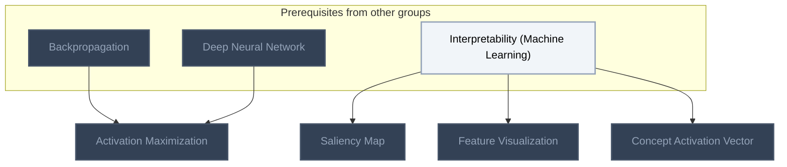

## Representations
**Reached:** L1 0 · L2 0 · L3 0 · L4 0 · L5 0 (of 1 nodes)

```mermaid
flowchart TD
    classDef planned fill:#1E293B,stroke:#64748B,stroke-width:2px,stroke-dasharray:5 5,color:#94A3B8;
    classDef locked fill:#334155,stroke:#475569,stroke-width:2px,color:#94A3B8;
    classDef L0 fill:#F1F5F9,stroke:#94A3B8,stroke-width:2px,color:#000000;
    classDef L1 fill:#22C55E,stroke:#15803D,stroke-width:2px,color:#000000;
    classDef L2 fill:#3B82F6,stroke:#1D4ED8,stroke-width:3px,color:#FFFFFF;
    classDef L3 fill:#A855F7,stroke:#6B21A8,stroke-width:3px,color:#FFFFFF,font-weight:bold;
    classDef L4 fill:#F97316,stroke:#C2410C,stroke-width:4px,color:#000000,font-weight:bold;
    classDef L5 fill:#FFD700,stroke:#FF8C00,stroke-width:5px,color:#000000,font-weight:bold;
    classDef rusty stroke:#8B4513,stroke-width:4px,stroke-dasharray:3 3;
    subgraph sg_prereqs["Prerequisites from other groups"]
        n_representation_machine_learning["Representation (Machine Learning)"]
    end
    n_word_embedding["Word Embedding"]
    n_representation_machine_learning --> n_word_embedding
    class n_representation_machine_learning,n_word_embedding locked;
    class n_representation_machine_learning,n_word_embedding internal-link;
```

# Source
Graph structure: the single source for the diagrams above, edited by `/note` and `Scripts/skill_trees.py` (`add`, `edge`, `rename`). Everything above this heading is regenerated by `render`.

```skilltree
    %% PREREQUISITES
    n_group_action["Group Action"]
    n_objective_function["Objective Function"]
    n_bayes_theorem["Bayes' Theorem"]
    n_posterior_distribution["Posterior Distribution"]
    n_jacobian_matrix["Jacobian Matrix"]
    n_bernoulli_distribution["Bernoulli Distribution"]
    n_categorical_variable["Categorical Variable"]
    n_maximum_likelihood_estimation["Maximum Likelihood Estimation"]
    n_quantitative_variable["Quantitative Variable"]
    n_sigmoid_function["Sigmoid Function"]
    n_gradient_descent["Gradient Descent"]
    n_gradient_descent_with_momentum["Gradient Descent with Momentum"]
    n_hypothesis_space["Hypothesis Space"]
    n_l2_regularization["L2 Regularization"]
    n_learned_function["Learned Function"]
    n_learning_rate["Learning Rate"]
    n_model_capacity["Model Capacity"]
    n_overfitting["Overfitting"]
    n_regularization["Regularization"]
    n_stochastic_gradient_descent["Stochastic Gradient Descent"]
    n_validation_set["Validation Set"]
    n_adjacency_matrix["Adjacency Matrix"]
    n_algorithm["Algorithm"]
    n_proper_scoring_rule["Proper Scoring Rule"]
    n_ordinary_differential_equation["Ordinary Differential Equation"]
    n_conditional_probability["Conditional Probability"]
    n_probability["Probability"]
    n_determinant_invertible_matrix_theorem["Determinant Invertible Matrix Theorem"]
    n_determinant_volume_scaling_theorem["Determinant Volume Scaling Theorem"]
    n_diagonal_matrix["Diagonal Matrix"]
    n_dot_product["Dot Product"]
    n_eigendecomposition["Eigendecomposition"]
    n_l1_norm["L1 Norm"]
    n_lu_decomposition["LU Decomposition"]
    n_permutation_matrix["Permutation Matrix"]
    n_vector["Vector"]
    n_bootstrap["Bootstrap"]
    n_hyperparameter["Hyperparameter"]
    n_kullback_leibler_divergence["Kullback-Leibler Divergence"]
    n_manifold_hypothesis["Manifold Hypothesis"]
    n_mutual_information["Mutual Information"]
    n_conditional_probability_multiplication_rule["Conditional Probability Multiplication Rule"]
    n_cumulative_distribution_function["Cumulative Distribution Function"]
    n_independent_random_variable["Independent Random Variable"]
    n_jensen_s_inequality["Jensen's Inequality"]
    n_marginal_distribution["Marginal Distribution"]
    n_mixture_distribution["Mixture Distribution"]
    n_multivariate_normal_distribution["Multivariate Normal Distribution"]
    n_multivariate_normal_distribution_affine_transformation["Multivariate Normal Distribution Affine Transformation"]
    n_normal_distribution_linear_combination["Normal Distribution Linear Combination"]
    n_probability_mass_function["Probability Mass Function"]
    n_random_vector_transformation["Random Vector Transformation"]
    n_variance["Variance"]
    n_interchange_of_differentiation_and_expectation["Interchange of Differentiation and Expectation"]
    n_monte_carlo_estimator["Monte Carlo Estimator"]
    n_knothe_rosenblatt_rearrangement["Knothe-Rosenblatt Rearrangement"]
    n_wasserstein_distance["Wasserstein Distance"]
    n_interpretability_machine_learning["Interpretability (Machine Learning)"]
    n_linear_function["Linear Function"]
    n_function["Function"]
    n_banach_fixed_point_theorem["Banach Fixed-Point Theorem"]
    n_lipschitz_continuity["Lipschitz Continuity"]
    n_policy["Policy"]
    n_bias_variance_tradeoff["Bias-Variance Tradeoff"]
    n_likelihood_function["Likelihood Function"]
    n_first_order_optimization["First-Order Optimization"]
    n_cost_function["Cost Function"]
    n_gradient_vector["Gradient Vector"]
    n_dynamic_programming["Dynamic Programming"]
    n_mean["Mean"]
    n_unit_vector["Unit Vector"]
    n_graph_laplacian_matrix["Graph Laplacian Matrix"]
    n_artificial_intelligence["Artificial Intelligence"]
    %% NODES
    %% == Prince Ch. 1: Introduction ==
    n_machine_learning["Machine Learning"]
    n_supervised_learning["Supervised Learning"]
    n_unsupervised_learning["Unsupervised Learning"]
    n_reinforcement_learning["Reinforcement Learning"]
    n_classification["Classification"]
    n_regression["Regression"]
    n_binary_classification["Binary Classification"]
    n_multiclass_classification["Multiclass Classification"]
    n_multivariate_regression["Multivariate Regression"]
    n_tabular_data["Tabular Data"]
    n_deep_neural_network["Deep Neural Network"]
    n_deep_learning["Deep Learning"]
    n_deep_learning_representation_transformation["Deep Learning Representation Transformation"]
    n_yann_lecun_deep_learning_view["Yann LeCun Deep Learning View"]
    n_generative_model["Generative Model"]
    n_latent_variables["Latent Variables"]
    n_temporal_credit_assignment_problem["Temporal Credit Assignment Problem"]
    n_policy_network["Policy Network"]
    %% == Prince Ch. 2: Supervised Learning ==
    n_inference_machine_learning["Inference (Machine Learning)"]
    n_loss_function["Loss Function"]
    n_empirical_risk_minimization["Empirical Risk Minimization"]
    n_linear_regression["Linear Regression"]
    %% == Prince Ch. 3-4: Shallow and Deep Neural Networks ==
    n_shallow_neural_network["Shallow Neural Network"]
    n_feed_forward_neural_network["Feed-Forward Neural Network"]
    n_linear_regions_of_relu_network["Linear Regions of ReLU Network"]
    n_leaky_relu["Leaky ReLU"]
    n_parametric_relu["Parametric ReLU"]
    n_exponential_linear_unit["Exponential Linear Unit"]
    n_scaled_exponential_linear_unit["Scaled Exponential Linear Unit"]
    n_softplus_function["Softplus Function"]
    n_concatenated_relu["Concatenated ReLU"]
    n_swish_function["Swish Function"]
    n_hardswish_function["HardSwish Function"]
    n_gaussian_error_linear_unit["Gaussian Error Linear Unit"]
    n_dying_relu_problem["Dying ReLU Problem"]
    n_neural_network_folding["Neural Network Folding"]
    n_width_efficiency["Width Efficiency"]
    %% == Prince Ch. 5: Loss Functions ==
    n_maximum_likelihood_learning["Maximum Likelihood Learning"]
    n_maximum_likelihood_loss_function_recipe["Maximum Likelihood Loss Function Recipe"]
    n_output_distributions_for_loss_functions["Output Distributions for Loss Functions"]
    n_maximum_likelihood_loss_optimality_and_failure_modes["Maximum Likelihood Loss Optimality and Failure Modes"]
    n_loss_function_taxonomy["Loss Function Taxonomy"]
    n_l2_loss["L2 Loss"]
    n_heteroscedasticity_machine_learning["Heteroscedasticity (Machine Learning)"]
    n_loss_function_for_multiple_outputs["Loss Function for Multiple Outputs"]
    n_simplex["Simplex"]
    n_one_hot_encoding["One-Hot Encoding"]
    n_softmax_function["Softmax Function"]
    n_cross_entropy_loss["Cross-Entropy Loss"]
    n_binary_cross_entropy_loss["Binary Cross-Entropy Loss"]
    n_focal_loss["Focal Loss"]
    %% == Prince Ch. 6: Fitting Models ==
    n_nesterov_accelerated_momentum["Nesterov Accelerated Momentum"]
    n_adagrad["AdaGrad"]
    n_rmsprop["RMSProp"]
    n_adam["Adam"]
    n_adamw["AdamW"]
    n_learning_rate_warm_up["Learning Rate Warm-Up"]
    %% == Prince Ch. 7: Gradients and Initialization ==
    n_weight_initialization["Weight Initialization"]
    n_xavier_initialization["Xavier Initialization"]
    n_he_initialization["He Initialization"]
    n_gradient_checkpointing["Gradient Checkpointing"]
    n_micro_batching["Micro-Batching"]
    %% == Prince Ch. 8: Measuring Performance ==
    n_hyperparameter_search["Hyperparameter Search"]
    n_hyperband["Hyperband"]
    n_bayesian_optimization["Bayesian Optimization"]
    n_double_descent["Double Descent"]
    n_overparameterized_model["Overparameterized Model"]
    n_rademacher_complexity["Rademacher Complexity"]
    n_vc_dimension["VC Dimension"]
    n_dataset_shift["Dataset Shift"]
    %% == Prince Ch. 9: Regularization ==
    n_maximum_a_posteriori_learning["Maximum a Posteriori Learning"]
    n_implicit_regularization["Implicit Regularization"]
    n_early_stopping["Early Stopping"]
    n_ensemble_learning["Ensemble Learning"]
    n_bagging["Bagging"]
    n_dropout["Dropout"]
    n_noise_injection_regularization["Noise Injection (Regularization)"]
    n_label_smoothing["Label Smoothing"]
    n_adversarial_training["Adversarial Training"]
    n_data_augmentation["Data Augmentation"]
    n_transfer_learning["Transfer Learning"]
    n_self_supervised_learning["Self-Supervised Learning"]
    n_metalearning["Metalearning"]
    %% == Prince Ch. 10: Convolutional Networks ==
    n_invariant_function["Invariant Function"]
    n_equivariant_function["Equivariant Function"]
    n_convolutional_layer["Convolutional Layer"]
    n_stride_convolution["Stride (Convolution)"]
    n_padding_convolution["Padding (Convolution)"]
    n_dilated_convolution["Dilated Convolution"]
    n_feature_map["Feature Map"]
    n_receptive_field["Receptive Field"]
    n_1x1_convolution["1x1 Convolution"]
    n_downsampling_deep_learning["Downsampling (Deep Learning)"]
    n_upsampling_deep_learning["Upsampling (Deep Learning)"]
    n_max_pooling["Max Pooling"]
    n_average_pooling["Average Pooling"]
    n_max_unpooling["Max Unpooling"]
    n_transposed_convolution["Transposed Convolution"]
    n_convolutional_neural_network["Convolutional Neural Network"]
    n_cutout["Cutout"]
    n_spatial_dropout["Spatial Dropout"]
    n_object_detection["Object Detection"]
    n_network_dissection["Network Dissection"]
    %% == Prince Ch. 11: Residual Networks ==
    n_residual_connection["Residual Connection"]
    n_shattered_gradients["Shattered Gradients"]
    n_residual_network_as_ensemble["Residual Network as Ensemble"]
    n_residual_network_variance_at_initialization["Residual Network Variance at Initialization"]
    n_internal_covariate_shift["Internal Covariate Shift"]
    n_ghost_batch_normalization["Ghost Batch Normalization"]
    n_instance_normalization["Instance Normalization"]
    n_group_normalization["Group Normalization"]
    %% == Prince Ch. 12: Transformers ==
    n_self_attention["Self-Attention"]
    n_scaled_dot_product_self_attention["Scaled Dot-Product Self-Attention"]
    n_multi_head_self_attention["Multi-Head Self-Attention"]
    n_masked_self_attention["Masked Self-Attention"]
    n_cross_attention["Cross-Attention"]
    n_positional_encoding["Positional Encoding"]
    n_tokenization["Tokenization"]
    n_transformer_layer["Transformer Layer"]
    n_transformer["Transformer"]
    n_transformer_encoder["Transformer Encoder"]
    n_autoregressive_language_model["Autoregressive Language Model"]
    n_transformer_decoder["Transformer Decoder"]
    n_encoder_decoder_transformer["Encoder-Decoder Transformer"]
    n_decoding_language_model["Decoding (Language Model)"]
    n_beam_search["Beam Search"]
    n_top_k_sampling["Top-K Sampling"]
    n_nucleus_sampling["Nucleus Sampling"]
    n_teacher_forcing["Teacher Forcing"]
    n_sparse_attention["Sparse Attention"]
    n_vision_transformer["Vision Transformer"]
    n_contrastive_language_image_pre_training["Contrastive Language-Image Pre-Training"]
    %% == Prince Ch. 13: Graph Neural Networks ==
    n_graph_neural_network["Graph Neural Network"]
    n_neighborhood_aggregation_graph_neural_network["Neighborhood Aggregation (Graph Neural Network)"]
    n_spectral_graph_convolution["Spectral Graph Convolution"]
    n_graph_convolutional_network["Graph Convolutional Network"]
    n_graph_attention_network["Graph Attention Network"]
    n_transductive_learning["Transductive Learning"]
    n_graph_expansion_problem["Graph Expansion Problem"]
    n_neighborhood_sampling["Neighborhood Sampling"]
    n_oversmoothing["Oversmoothing"]
    n_oversquashing["Oversquashing"]
    %% == Prince Ch. 14: Unsupervised Learning ==
    n_probabilistic_generative_model["Probabilistic Generative Model"]
    n_generative_model_desiderata["Generative Model Desiderata"]
    n_test_likelihood["Test Likelihood"]
    n_inception_score["Inception Score"]
    n_fr_chet_inception_distance["Fréchet Inception Distance"]
    n_manifold_precision_and_recall["Manifold Precision and Recall"]
    n_manifold_overfitting["Manifold Overfitting"]
    %% == Prince Ch. 15: Generative Adversarial Networks ==
    n_generative_adversarial_network["Generative Adversarial Network"]
    n_dcgan["DCGAN"]
    n_mode_collapse["Mode Collapse"]
    n_minibatch_discrimination["Minibatch Discrimination"]
    n_wasserstein_gan["Wasserstein GAN"]
    n_progressive_growing["Progressive Growing"]
    n_conditional_gan["Conditional GAN"]
    n_auxiliary_classifier_gan["Auxiliary Classifier GAN"]
    n_infogan["InfoGAN"]
    n_truncation_trick["Truncation Trick"]
    n_adversarial_loss["Adversarial Loss"]
    n_pix2pix["Pix2Pix"]
    n_patchgan["PatchGAN"]
    n_cyclegan["CycleGAN"]
    n_perceptual_loss["Perceptual Loss"]
    n_srgan["SRGAN"]
    n_adaptive_instance_normalization["Adaptive Instance Normalization"]
    n_stylegan["StyleGAN"]
    n_gan_inversion["GAN Inversion"]
    %% == Prince Ch. 16: Normalizing Flows ==
    n_normalizing_flow["Normalizing Flow"]
    n_linear_flow["Linear Flow"]
    n_elementwise_flow["Elementwise Flow"]
    n_coupling_flow["Coupling Flow"]
    n_autoregressive_flow["Autoregressive Flow"]
    n_residual_flow["Residual Flow"]
    n_multi_scale_flow["Multi-Scale Flow"]
    n_glow["Glow"]
    n_dequantization["Dequantization"]
    n_probability_density_distillation["Probability Density Distillation"]
    n_normalizing_flow_expressivity["Normalizing Flow Expressivity"]
    n_continuous_normalizing_flow["Continuous Normalizing Flow"]
    %% == Prince Ch. 17: Variational Autoencoders ==
    n_latent_variable_model["Latent Variable Model"]
    n_mixture_of_gaussians["Mixture of Gaussians"]
    n_nonlinear_latent_variable_model["Nonlinear Latent Variable Model"]
    n_ancestral_sampling["Ancestral Sampling"]
    n_evidence_lower_bound["Evidence Lower Bound"]
    n_variational_inference["Variational Inference"]
    n_reparameterization_trick["Reparameterization Trick"]
    n_variational_autoencoder["Variational Autoencoder"]
    n_posterior_collapse["Posterior Collapse"]
    %% == Prince Ch. 18: Diffusion Models ==
    n_multivariate_normal_density_product["Multivariate Normal Density Product"]
    n_diffusion_forward_process["Diffusion Forward Process"]
    n_diffusion_kernel["Diffusion Kernel"]
    n_conditional_diffusion_distribution["Conditional Diffusion Distribution"]
    n_diffusion_model_loss_function["Diffusion Model Loss Function"]
    n_diffusion_model["Diffusion Model"]
    n_denoising_diffusion_implicit_model["Denoising Diffusion Implicit Model"]
    n_classifier_guidance["Classifier Guidance"]
    n_classifier_free_guidance["Classifier-Free Guidance"]
    n_cascaded_diffusion_model["Cascaded Diffusion Model"]
    n_latent_diffusion_model["Latent Diffusion Model"]
    n_probability_flow_ode["Probability Flow ODE"]
    n_flow_matching["Flow Matching"]
    %% == Neural Network Basics (MIT Vision Book) ==
    n_tensor["Tensor"]
    n_perceptron["Perceptron"]
    n_multilayer_perceptron["Multilayer Perceptron"]
    n_linear_layer["Linear Layer"]
    n_activation_layer["Activation Layer"]
    n_relu_function["ReLU Function"]
    n_relu_function_benefits["ReLU Function Benefits"]
    n_relu_function_downsides["ReLU Function Downsides"]
    n_relu_function_biological_plausibility["ReLU Function Biological Plausibility"]
    n_relu_function_geometric_properties["ReLU Function Geometric Properties"]
    n_output_layer["Output Layer"]
    n_hebbian_learning["Hebbian Learning"]
    n_representation_machine_learning["Representation (Machine Learning)"]
    n_universal_approximation_theorem["Universal Approximation Theorem"]
    n_depth_separation["Depth Separation"]
    n_neural_network_as_distribution_transformer["Neural Network as Distribution Transformer"]
    n_hypernetwork["Hypernetwork"]
    %% == Backpropagation and Training (MIT Vision Book) ==
    n_computation_graph["Computation Graph"]
    n_backpropagation["Backpropagation"]
    n_backpropagation_to_input_data["Backpropagation to Input Data"]
    n_gradient_based_learning["Gradient-Based Learning"]
    n_exploding_gradients["Exploding Gradients"]
    n_vanishing_gradients["Vanishing Gradients"]
    n_gradient_clipping["Gradient Clipping"]
    n_normalization_layer["Normalization Layer"]
    n_batch_normalization["Batch Normalization"]
    n_layer_normalization["Layer Normalization"]
    n_l2_normalization["L2 Normalization"]
    n_data_parallelism["Data Parallelism"]
    %% == Interpretability ==
    n_activation_maximization["Activation Maximization"]
    n_saliency_map["Saliency Map"]
    n_feature_visualization["Feature Visualization"]
    n_concept_activation_vector["Concept Activation Vector"]
    %% == Representations ==
    n_word_embedding["Word Embedding"]
    %% EDGES
    n_artificial_intelligence --> n_machine_learning
    n_function --> n_machine_learning
    n_machine_learning --> n_supervised_learning
    n_machine_learning --> n_unsupervised_learning
    n_machine_learning --> n_reinforcement_learning
    n_supervised_learning --> n_classification
    n_categorical_variable --> n_classification
    n_supervised_learning --> n_regression
    n_quantitative_variable --> n_regression
    n_classification --> n_binary_classification
    n_classification --> n_multiclass_classification
    n_regression --> n_multivariate_regression
    n_function --> n_deep_neural_network
    n_tensor --> n_deep_neural_network
    n_shallow_neural_network --> n_deep_neural_network
    n_machine_learning --> n_deep_learning
    n_deep_neural_network --> n_deep_learning
    n_deep_learning --> n_deep_learning_representation_transformation
    n_deep_learning --> n_yann_lecun_deep_learning_view
    n_unsupervised_learning --> n_generative_model
    n_unsupervised_learning --> n_latent_variables
    n_reinforcement_learning --> n_temporal_credit_assignment_problem
    n_deep_neural_network --> n_policy_network
    n_policy --> n_policy_network
    n_reinforcement_learning --> n_policy_network
    n_supervised_learning --> n_inference_machine_learning
    n_objective_function --> n_loss_function
    n_learned_function --> n_loss_function
    n_hypothesis_space --> n_empirical_risk_minimization
    n_loss_function --> n_empirical_risk_minimization
    n_regression --> n_linear_regression
    n_linear_function --> n_linear_regression
    n_activation_layer --> n_shallow_neural_network
    n_shallow_neural_network --> n_feed_forward_neural_network
    n_relu_function --> n_linear_regions_of_relu_network
    n_shallow_neural_network --> n_linear_regions_of_relu_network
    n_relu_function --> n_leaky_relu
    n_leaky_relu --> n_parametric_relu
    n_relu_function --> n_exponential_linear_unit
    n_exponential_linear_unit --> n_scaled_exponential_linear_unit
    n_relu_function --> n_softplus_function
    n_relu_function --> n_concatenated_relu
    n_sigmoid_function --> n_swish_function
    n_swish_function --> n_hardswish_function
    n_cumulative_distribution_function --> n_gaussian_error_linear_unit
    n_relu_function --> n_dying_relu_problem
    n_gradient_descent --> n_dying_relu_problem
    n_linear_regions_of_relu_network --> n_neural_network_folding
    n_deep_neural_network --> n_width_efficiency
    n_maximum_likelihood_estimation --> n_maximum_likelihood_learning
    n_loss_function --> n_maximum_likelihood_learning
    n_maximum_likelihood_learning --> n_maximum_likelihood_loss_function_recipe
    n_inference_machine_learning --> n_maximum_likelihood_loss_function_recipe
    n_maximum_likelihood_loss_function_recipe --> n_output_distributions_for_loss_functions
    n_multivariate_regression --> n_output_distributions_for_loss_functions
    n_binary_classification --> n_output_distributions_for_loss_functions
    n_multiclass_classification --> n_output_distributions_for_loss_functions
    n_maximum_likelihood_loss_function_recipe --> n_maximum_likelihood_loss_optimality_and_failure_modes
    n_maximum_likelihood_loss_function_recipe --> n_loss_function_taxonomy
    n_proper_scoring_rule --> n_loss_function_taxonomy
    n_loss_function --> n_l2_loss
    n_regression --> n_heteroscedasticity_machine_learning
    n_maximum_likelihood_loss_function_recipe --> n_heteroscedasticity_machine_learning
    n_multivariate_regression --> n_loss_function_for_multiple_outputs
    n_independent_random_variable --> n_loss_function_for_multiple_outputs
    n_maximum_likelihood_loss_function_recipe --> n_loss_function_for_multiple_outputs
    n_vector --> n_simplex
    n_vector --> n_one_hot_encoding
    n_categorical_variable --> n_one_hot_encoding
    n_function --> n_softmax_function
    n_probability --> n_softmax_function
    n_probability_mass_function --> n_cross_entropy_loss
    n_simplex --> n_cross_entropy_loss
    n_binary_classification --> n_binary_cross_entropy_loss
    n_bernoulli_distribution --> n_binary_cross_entropy_loss
    n_sigmoid_function --> n_binary_cross_entropy_loss
    n_cross_entropy_loss --> n_focal_loss
    n_gradient_descent_with_momentum --> n_nesterov_accelerated_momentum
    n_gradient_descent --> n_adagrad
    n_adagrad --> n_rmsprop
    n_gradient_descent_with_momentum --> n_adam
    n_rmsprop --> n_adam
    n_adam --> n_adamw
    n_l2_regularization --> n_adamw
    n_learning_rate --> n_learning_rate_warm_up
    n_vanishing_gradients --> n_weight_initialization
    n_exploding_gradients --> n_weight_initialization
    n_weight_initialization --> n_xavier_initialization
    n_weight_initialization --> n_he_initialization
    n_relu_function --> n_he_initialization
    n_backpropagation --> n_gradient_checkpointing
    n_stochastic_gradient_descent --> n_micro_batching
    n_hyperparameter --> n_hyperparameter_search
    n_validation_set --> n_hyperparameter_search
    n_hyperparameter_search --> n_hyperband
    n_hyperparameter --> n_bayesian_optimization
    n_model_capacity --> n_double_descent
    n_bias_variance_tradeoff --> n_double_descent
    n_model_capacity --> n_overparameterized_model
    n_model_capacity --> n_rademacher_complexity
    n_hypothesis_space --> n_vc_dimension
    n_binary_classification --> n_vc_dimension
    n_supervised_learning --> n_dataset_shift
    n_maximum_likelihood_learning --> n_maximum_a_posteriori_learning
    n_bayes_theorem --> n_maximum_a_posteriori_learning
    n_stochastic_gradient_descent --> n_implicit_regularization
    n_regularization --> n_implicit_regularization
    n_overfitting --> n_early_stopping
    n_supervised_learning --> n_ensemble_learning
    n_bootstrap --> n_bagging
    n_ensemble_learning --> n_bagging
    n_regularization --> n_dropout
    n_stochastic_gradient_descent --> n_dropout
    n_dropout --> n_noise_injection_regularization
    n_cross_entropy_loss --> n_label_smoothing
    n_regularization --> n_adversarial_training
    n_regularization --> n_data_augmentation
    n_deep_neural_network --> n_transfer_learning
    n_transfer_learning --> n_self_supervised_learning
    n_hypothesis_space --> n_metalearning
    n_algorithm --> n_metalearning
    n_group_action --> n_invariant_function
    n_invariant_function --> n_equivariant_function
    n_activation_layer --> n_convolutional_layer
    n_linear_layer --> n_convolutional_layer
    n_convolutional_layer --> n_stride_convolution
    n_convolutional_layer --> n_padding_convolution
    n_convolutional_layer --> n_dilated_convolution
    n_convolutional_layer --> n_feature_map
    n_convolutional_layer --> n_receptive_field
    n_convolutional_layer --> n_1x1_convolution
    n_feature_map --> n_downsampling_deep_learning
    n_feature_map --> n_upsampling_deep_learning
    n_downsampling_deep_learning --> n_max_pooling
    n_downsampling_deep_learning --> n_average_pooling
    n_upsampling_deep_learning --> n_max_unpooling
    n_max_pooling --> n_max_unpooling
    n_upsampling_deep_learning --> n_transposed_convolution
    n_stride_convolution --> n_transposed_convolution
    n_deep_neural_network --> n_convolutional_neural_network
    n_equivariant_function --> n_convolutional_neural_network
    n_downsampling_deep_learning --> n_convolutional_neural_network
    n_data_augmentation --> n_cutout
    n_dropout --> n_spatial_dropout
    n_feature_map --> n_spatial_dropout
    n_convolutional_neural_network --> n_object_detection
    n_interpretability_machine_learning --> n_network_dissection
    n_convolutional_neural_network --> n_network_dissection
    n_deep_neural_network --> n_residual_connection
    n_deep_neural_network --> n_shattered_gradients
    n_backpropagation --> n_shattered_gradients
    n_residual_connection --> n_residual_network_as_ensemble
    n_ensemble_learning --> n_residual_network_as_ensemble
    n_residual_connection --> n_residual_network_variance_at_initialization
    n_he_initialization --> n_residual_network_variance_at_initialization
    n_variance --> n_residual_network_variance_at_initialization
    n_backpropagation --> n_residual_network_variance_at_initialization
    n_batch_normalization --> n_internal_covariate_shift
    n_batch_normalization --> n_ghost_batch_normalization
    n_normalization_layer --> n_instance_normalization
    n_normalization_layer --> n_group_normalization
    n_softmax_function --> n_self_attention
    n_dot_product --> n_self_attention
    n_self_attention --> n_scaled_dot_product_self_attention
    n_scaled_dot_product_self_attention --> n_multi_head_self_attention
    n_self_attention --> n_masked_self_attention
    n_self_attention --> n_cross_attention
    n_self_attention --> n_positional_encoding
    n_equivariant_function --> n_positional_encoding
    n_multi_head_self_attention --> n_transformer_layer
    n_residual_connection --> n_transformer_layer
    n_layer_normalization --> n_transformer_layer
    n_transformer_layer --> n_transformer
    n_tokenization --> n_transformer
    n_word_embedding --> n_transformer
    n_positional_encoding --> n_transformer
    n_transformer --> n_transformer_encoder
    n_conditional_probability_multiplication_rule --> n_autoregressive_language_model
    n_transformer --> n_transformer_decoder
    n_autoregressive_language_model --> n_transformer_decoder
    n_masked_self_attention --> n_transformer_decoder
    n_linear_layer --> n_transformer_decoder
    n_transformer_encoder --> n_encoder_decoder_transformer
    n_transformer_decoder --> n_encoder_decoder_transformer
    n_cross_attention --> n_encoder_decoder_transformer
    n_transformer_decoder --> n_decoding_language_model
    n_decoding_language_model --> n_beam_search
    n_decoding_language_model --> n_top_k_sampling
    n_decoding_language_model --> n_nucleus_sampling
    n_transformer_decoder --> n_teacher_forcing
    n_transformer --> n_sparse_attention
    n_transformer_encoder --> n_vision_transformer
    n_transformer_encoder --> n_contrastive_language_image_pre_training
    n_self_supervised_learning --> n_contrastive_language_image_pre_training
    n_adjacency_matrix --> n_graph_neural_network
    n_equivariant_function --> n_graph_neural_network
    n_permutation_matrix --> n_graph_neural_network
    n_deep_neural_network --> n_graph_neural_network
    n_graph_neural_network --> n_neighborhood_aggregation_graph_neural_network
    n_graph_laplacian_matrix --> n_spectral_graph_convolution
    n_eigendecomposition --> n_spectral_graph_convolution
    n_neighborhood_aggregation_graph_neural_network --> n_graph_convolutional_network
    n_spectral_graph_convolution --> n_graph_convolutional_network
    n_graph_neural_network --> n_graph_attention_network
    n_self_attention --> n_graph_attention_network
    n_supervised_learning --> n_transductive_learning
    n_graph_neural_network --> n_graph_expansion_problem
    n_receptive_field --> n_graph_expansion_problem
    n_graph_expansion_problem --> n_neighborhood_sampling
    n_graph_neural_network --> n_oversmoothing
    n_graph_neural_network --> n_oversquashing
    n_generative_model --> n_probabilistic_generative_model
    n_maximum_likelihood_learning --> n_probabilistic_generative_model
    n_probabilistic_generative_model --> n_generative_model_desiderata
    n_latent_variables --> n_generative_model_desiderata
    n_probabilistic_generative_model --> n_test_likelihood
    n_generative_model --> n_inception_score
    n_generative_model --> n_fr_chet_inception_distance
    n_multivariate_normal_distribution --> n_fr_chet_inception_distance
    n_generative_model --> n_manifold_precision_and_recall
    n_probabilistic_generative_model --> n_manifold_overfitting
    n_manifold_hypothesis --> n_manifold_overfitting
    n_generative_model --> n_generative_adversarial_network
    n_latent_variables --> n_generative_adversarial_network
    n_binary_cross_entropy_loss --> n_generative_adversarial_network
    n_generative_adversarial_network --> n_dcgan
    n_convolutional_neural_network --> n_dcgan
    n_transposed_convolution --> n_dcgan
    n_batch_normalization --> n_dcgan
    n_leaky_relu --> n_dcgan
    n_adam --> n_dcgan
    n_generative_adversarial_network --> n_mode_collapse
    n_mode_collapse --> n_minibatch_discrimination
    n_generative_adversarial_network --> n_wasserstein_gan
    n_wasserstein_distance --> n_wasserstein_gan
    n_generative_adversarial_network --> n_progressive_growing
    n_upsampling_deep_learning --> n_progressive_growing
    n_generative_adversarial_network --> n_conditional_gan
    n_conditional_gan --> n_auxiliary_classifier_gan
    n_softmax_function --> n_auxiliary_classifier_gan
    n_generative_adversarial_network --> n_infogan
    n_mutual_information --> n_infogan
    n_generative_adversarial_network --> n_truncation_trick
    n_generative_adversarial_network --> n_adversarial_loss
    n_adversarial_loss --> n_pix2pix
    n_l1_norm --> n_pix2pix
    n_adversarial_loss --> n_patchgan
    n_receptive_field --> n_patchgan
    n_adversarial_loss --> n_cyclegan
    n_l1_norm --> n_cyclegan
    n_loss_function --> n_perceptual_loss
    n_convolutional_neural_network --> n_perceptual_loss
    n_residual_connection --> n_srgan
    n_upsampling_deep_learning --> n_srgan
    n_perceptual_loss --> n_srgan
    n_adversarial_loss --> n_srgan
    n_instance_normalization --> n_adaptive_instance_normalization
    n_generative_adversarial_network --> n_stylegan
    n_upsampling_deep_learning --> n_stylegan
    n_adaptive_instance_normalization --> n_stylegan
    n_generative_adversarial_network --> n_gan_inversion
    n_probabilistic_generative_model --> n_normalizing_flow
    n_latent_variables --> n_normalizing_flow
    n_random_vector_transformation --> n_normalizing_flow
    n_jacobian_matrix --> n_normalizing_flow
    n_determinant_volume_scaling_theorem --> n_normalizing_flow
    n_multivariate_normal_distribution --> n_normalizing_flow
    n_normalizing_flow --> n_linear_flow
    n_determinant_invertible_matrix_theorem --> n_linear_flow
    n_normalizing_flow --> n_elementwise_flow
    n_diagonal_matrix --> n_elementwise_flow
    n_elementwise_flow --> n_coupling_flow
    n_coupling_flow --> n_autoregressive_flow
    n_normalizing_flow --> n_residual_flow
    n_residual_connection --> n_residual_flow
    n_lipschitz_continuity --> n_residual_flow
    n_banach_fixed_point_theorem --> n_residual_flow
    n_normalizing_flow --> n_multi_scale_flow
    n_linear_flow --> n_glow
    n_1x1_convolution --> n_glow
    n_lu_decomposition --> n_glow
    n_coupling_flow --> n_glow
    n_multi_scale_flow --> n_glow
    n_probabilistic_generative_model --> n_dequantization
    n_normalizing_flow --> n_probability_density_distillation
    n_kullback_leibler_divergence --> n_probability_density_distillation
    n_normalizing_flow --> n_normalizing_flow_expressivity
    n_knothe_rosenblatt_rearrangement --> n_normalizing_flow_expressivity
    n_normalizing_flow --> n_continuous_normalizing_flow
    n_ordinary_differential_equation --> n_continuous_normalizing_flow
    n_latent_variables --> n_latent_variable_model
    n_marginal_distribution --> n_latent_variable_model
    n_conditional_probability --> n_latent_variable_model
    n_mixture_distribution --> n_latent_variable_model
    n_latent_variable_model --> n_mixture_of_gaussians
    n_multivariate_normal_distribution --> n_mixture_of_gaussians
    n_mixture_of_gaussians --> n_nonlinear_latent_variable_model
    n_latent_variable_model --> n_ancestral_sampling
    n_latent_variable_model --> n_evidence_lower_bound
    n_jensen_s_inequality --> n_evidence_lower_bound
    n_bayes_theorem --> n_evidence_lower_bound
    n_kullback_leibler_divergence --> n_evidence_lower_bound
    n_posterior_distribution --> n_variational_inference
    n_evidence_lower_bound --> n_variational_inference
    n_multivariate_normal_distribution --> n_variational_inference
    n_backpropagation --> n_reparameterization_trick
    n_interchange_of_differentiation_and_expectation --> n_reparameterization_trick
    n_nonlinear_latent_variable_model --> n_variational_autoencoder
    n_variational_inference --> n_variational_autoencoder
    n_reparameterization_trick --> n_variational_autoencoder
    n_monte_carlo_estimator --> n_variational_autoencoder
    n_variational_autoencoder --> n_posterior_collapse
    n_multivariate_normal_distribution --> n_multivariate_normal_density_product
    n_latent_variable_model --> n_diffusion_forward_process
    n_multivariate_normal_distribution_affine_transformation --> n_diffusion_forward_process
    n_diffusion_forward_process --> n_diffusion_kernel
    n_normal_distribution_linear_combination --> n_diffusion_kernel
    n_diffusion_kernel --> n_conditional_diffusion_distribution
    n_bayes_theorem --> n_conditional_diffusion_distribution
    n_multivariate_normal_density_product --> n_conditional_diffusion_distribution
    n_conditional_diffusion_distribution --> n_diffusion_model_loss_function
    n_evidence_lower_bound --> n_diffusion_model_loss_function
    n_monte_carlo_estimator --> n_diffusion_model_loss_function
    n_probabilistic_generative_model --> n_diffusion_model
    n_diffusion_model_loss_function --> n_diffusion_model
    n_ancestral_sampling --> n_diffusion_model
    n_diffusion_model --> n_denoising_diffusion_implicit_model
    n_diffusion_model --> n_classifier_guidance
    n_diffusion_model --> n_classifier_free_guidance
    n_diffusion_model --> n_cascaded_diffusion_model
    n_diffusion_model --> n_latent_diffusion_model
    n_diffusion_model --> n_probability_flow_ode
    n_ordinary_differential_equation --> n_probability_flow_ode
    n_continuous_normalizing_flow --> n_flow_matching
    n_probability_flow_ode --> n_flow_matching
    n_maximum_likelihood_estimation --> n_manifold_overfitting
    n_likelihood_function --> n_test_likelihood
    n_sigmoid_function --> n_generative_adversarial_network
    n_activation_layer --> n_graph_convolutional_network
    n_algorithm --> n_gradient_based_learning
    n_first_order_optimization --> n_gradient_based_learning
    n_gradient_descent --> n_exploding_gradients
    n_exploding_gradients --> n_gradient_clipping
    n_gradient_descent --> n_vanishing_gradients
    n_linear_function --> n_linear_layer
    n_linear_layer --> n_activation_layer
    n_activation_layer --> n_relu_function
    n_regularization --> n_relu_function_benefits
    n_vanishing_gradients --> n_relu_function_benefits
    n_relu_function --> n_relu_function_benefits
    n_dying_relu_problem --> n_relu_function_downsides
    n_relu_function --> n_relu_function_biological_plausibility
    n_relu_function --> n_relu_function_geometric_properties
    n_representation_machine_learning --> n_relu_function_geometric_properties
    n_vector --> n_perceptron
    n_binary_classification --> n_perceptron
    n_deep_neural_network --> n_multilayer_perceptron
    n_activation_layer --> n_multilayer_perceptron
    n_perceptron --> n_multilayer_perceptron
    n_deep_neural_network --> n_universal_approximation_theorem
    n_deep_neural_network --> n_depth_separation
    n_deep_neural_network --> n_output_layer
    n_cost_function --> n_output_layer
    n_deep_neural_network --> n_hebbian_learning
    n_machine_learning --> n_representation_machine_learning
    n_loss_function --> n_neural_network_as_distribution_transformer
    n_deep_neural_network --> n_neural_network_as_distribution_transformer
    n_softmax_function --> n_neural_network_as_distribution_transformer
    n_representation_machine_learning --> n_neural_network_as_distribution_transformer
    n_function --> n_computation_graph
    n_loss_function --> n_backpropagation
    n_deep_neural_network --> n_backpropagation
    n_jacobian_matrix --> n_backpropagation
    n_gradient_vector --> n_backpropagation
    n_computation_graph --> n_backpropagation
    n_dynamic_programming --> n_backpropagation
    n_backpropagation --> n_activation_maximization
    n_deep_neural_network --> n_activation_maximization
    n_backpropagation --> n_backpropagation_to_input_data
    n_deep_neural_network --> n_normalization_layer
    n_mean --> n_batch_normalization
    n_variance --> n_batch_normalization
    n_tensor --> n_batch_normalization
    n_normalization_layer --> n_batch_normalization
    n_unit_vector --> n_l2_normalization
    n_normalization_layer --> n_l2_normalization
    n_batch_normalization --> n_layer_normalization
    n_l2_normalization --> n_layer_normalization
    n_deep_neural_network --> n_hypernetwork
    n_representation_machine_learning --> n_word_embedding
    n_interpretability_machine_learning --> n_saliency_map
    n_interpretability_machine_learning --> n_feature_visualization
    n_interpretability_machine_learning --> n_concept_activation_vector
```
