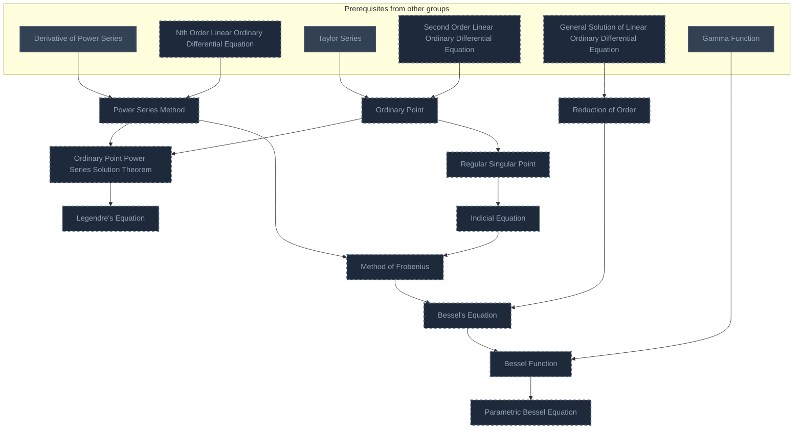
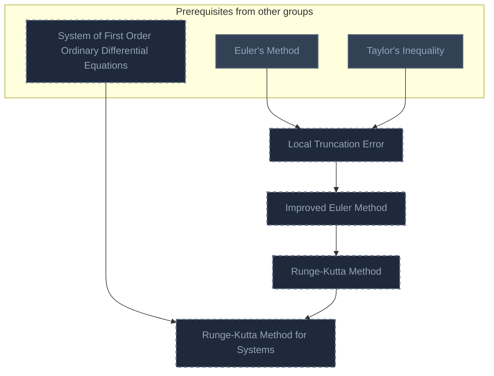

<!-- BEGIN STATS (generated by Scripts/skill_trees.py; do not edit) -->
**Mastered:** 0 / 86 · **Depth:** 0% · **Discovered:** 11 · **Planned:** 75 · **Locked:** 10 · **Rusty:** 0

**Levels:** L0 11 · L1 0 · L2 0 · L3 0 · L4 0 · L5 0

**Next up:** [[Differential Equation]]

Legend: dashed grey = planned (no note yet) · dark grey = locked · white L0 Discovered · green L1 Recall · blue L2 Apply · purple L3 Prove (Mastered) · orange L4 Wield · gold L5 Command · brown dashed border = rusty
<!-- END STATS -->

## DE Ch. 1: First-Order Differential Equations
**Mastered:** 0 / 15 · **Discovered:** 9 / 15

```mermaid
flowchart TD
    classDef planned fill:#1E293B,stroke:#64748B,stroke-width:2px,stroke-dasharray:5 5,color:#94A3B8;
    classDef locked fill:#334155,stroke:#475569,stroke-width:2px,color:#94A3B8;
    classDef L0 fill:#F1F5F9,stroke:#94A3B8,stroke-width:2px,color:#000000;
    classDef L1 fill:#22C55E,stroke:#15803D,stroke-width:2px,color:#000000;
    classDef L2 fill:#3B82F6,stroke:#1D4ED8,stroke-width:3px,color:#FFFFFF;
    classDef L3 fill:#A855F7,stroke:#6B21A8,stroke-width:3px,color:#FFFFFF,font-weight:bold;
    classDef L4 fill:#F97316,stroke:#C2410C,stroke-width:4px,color:#000000,font-weight:bold;
    classDef L5 fill:#FFD700,stroke:#FF8C00,stroke-width:5px,color:#000000,font-weight:bold;
    classDef rusty stroke:#8B4513,stroke-width:4px,stroke-dasharray:3 3;
    subgraph sg_prereqs["Prerequisites from other groups"]
        n_derivative["Derivative"]
        n_nth_derivative["Nth Derivative"]
        n_indefinite_riemann_integral["Indefinite Riemann Integral"]
        n_derivative_product_rule["Derivative Product Rule"]
        n_clairaut_s_theorem["Clairaut's Theorem"]
        n_slope["Slope"]
    end
    n_differential_equation["Differential Equation"]
    n_differential_equation_order["Differential Equation Order"]
    n_ordinary_differential_equation["Ordinary Differential Equation"]
    n_first_order_ordinary_differential_equation["First Order Ordinary Differential Equation"]
    n_second_order_ordinary_differential_equation["Second Order Ordinary Differential Equation"]
    n_first_order_separable_ordinary_differential_equation["First Order Separable Ordinary Differential Equation"]
    n_first_order_linear_ordinary_differential_equation["First Order Linear Ordinary Differential Equation"]
    n_first_order_homogeneous_ordinary_differential_equation["First Order Homogeneous Ordinary Differential Equation"]
    n_bernoulli_differential_equation["Bernoulli Differential Equation"]
    n_first_order_exact_ordinary_differential_equation["First Order Exact Ordinary Differential Equation"]
    n_reducible_second_order_ordinary_differential_equation["Reducible Second Order Ordinary Differential Equation"]
    n_terminal_velocity["Terminal Velocity"]
    n_escape_velocity["Escape Velocity"]
    n_initial_condition["Initial Condition"]
    n_direction_field["Direction Field"]
    n_derivative --> n_differential_equation
    n_nth_derivative --> n_differential_equation_order
    n_differential_equation --> n_differential_equation_order
    n_differential_equation --> n_ordinary_differential_equation
    n_differential_equation_order --> n_first_order_ordinary_differential_equation
    n_ordinary_differential_equation --> n_first_order_ordinary_differential_equation
    n_differential_equation_order --> n_second_order_ordinary_differential_equation
    n_ordinary_differential_equation --> n_second_order_ordinary_differential_equation
    n_indefinite_riemann_integral --> n_first_order_separable_ordinary_differential_equation
    n_first_order_ordinary_differential_equation --> n_first_order_separable_ordinary_differential_equation
    n_derivative_product_rule --> n_first_order_linear_ordinary_differential_equation
    n_indefinite_riemann_integral --> n_first_order_linear_ordinary_differential_equation
    n_first_order_ordinary_differential_equation --> n_first_order_linear_ordinary_differential_equation
    n_first_order_separable_ordinary_differential_equation --> n_first_order_homogeneous_ordinary_differential_equation
    n_first_order_linear_ordinary_differential_equation --> n_bernoulli_differential_equation
    n_clairaut_s_theorem --> n_first_order_exact_ordinary_differential_equation
    n_first_order_ordinary_differential_equation --> n_first_order_exact_ordinary_differential_equation
    n_first_order_ordinary_differential_equation --> n_reducible_second_order_ordinary_differential_equation
    n_second_order_ordinary_differential_equation --> n_reducible_second_order_ordinary_differential_equation
    n_first_order_separable_ordinary_differential_equation --> n_terminal_velocity
    n_first_order_linear_ordinary_differential_equation --> n_terminal_velocity
    n_second_order_ordinary_differential_equation --> n_escape_velocity
    n_first_order_separable_ordinary_differential_equation --> n_escape_velocity
    n_differential_equation --> n_initial_condition
    n_first_order_ordinary_differential_equation --> n_direction_field
    n_slope --> n_direction_field
    class n_first_order_homogeneous_ordinary_differential_equation,n_bernoulli_differential_equation,n_first_order_exact_ordinary_differential_equation,n_reducible_second_order_ordinary_differential_equation,n_terminal_velocity,n_escape_velocity planned;
    class n_nth_derivative,n_indefinite_riemann_integral,n_derivative_product_rule,n_clairaut_s_theorem,n_differential_equation_order,n_ordinary_differential_equation,n_first_order_ordinary_differential_equation,n_second_order_ordinary_differential_equation,n_first_order_separable_ordinary_differential_equation,n_first_order_linear_ordinary_differential_equation,n_initial_condition,n_direction_field locked;
    class n_differential_equation L0;
    class n_derivative,n_slope L3;
    class n_derivative,n_nth_derivative,n_indefinite_riemann_integral,n_derivative_product_rule,n_clairaut_s_theorem,n_slope,n_differential_equation,n_differential_equation_order,n_ordinary_differential_equation,n_first_order_ordinary_differential_equation,n_second_order_ordinary_differential_equation,n_first_order_separable_ordinary_differential_equation,n_first_order_linear_ordinary_differential_equation,n_initial_condition,n_direction_field internal-link;
```



## DE Ch. 2: Linear Equations of Higher Order
**Mastered:** 0 / 18 · **Discovered:** 2 / 18

```mermaid
flowchart TD
    classDef planned fill:#1E293B,stroke:#64748B,stroke-width:2px,stroke-dasharray:5 5,color:#94A3B8;
    classDef locked fill:#334155,stroke:#475569,stroke-width:2px,color:#94A3B8;
    classDef L0 fill:#F1F5F9,stroke:#94A3B8,stroke-width:2px,color:#000000;
    classDef L1 fill:#22C55E,stroke:#15803D,stroke-width:2px,color:#000000;
    classDef L2 fill:#3B82F6,stroke:#1D4ED8,stroke-width:3px,color:#FFFFFF;
    classDef L3 fill:#A855F7,stroke:#6B21A8,stroke-width:3px,color:#FFFFFF,font-weight:bold;
    classDef L4 fill:#F97316,stroke:#C2410C,stroke-width:4px,color:#000000,font-weight:bold;
    classDef L5 fill:#FFD700,stroke:#FF8C00,stroke-width:5px,color:#000000,font-weight:bold;
    classDef rusty stroke:#8B4513,stroke-width:4px,stroke-dasharray:3 3;
    subgraph sg_prereqs["Prerequisites from other groups"]
        n_second_order_ordinary_differential_equation["Second Order Ordinary Differential Equation"]
        n_nth_derivative["Nth Derivative"]
        n_determinant["Determinant"]
        n_linearly_independent["Linearly Independent"]
        n_derivative_of_exponential_function["Derivative of Exponential Function"]
        n_euler_s_identity["Euler's Identity"]
        n_indefinite_riemann_integral["Indefinite Riemann Integral"]
        n_boundary_condition["Boundary Condition"]
        n_initial_condition["Initial Condition"]
        n_linear_approximation["Linear Approximation"]
        n_direction_field["Direction Field"]
    end
    n_second_order_linear_ordinary_differential_equation["Second Order Linear Ordinary Differential Equation"]
    n_superposition_principle_ordinary_differential_equations["Superposition Principle (Ordinary Differential Equations)"]
    n_linear_ordinary_differential_equation_existence_and_uniqueness_theorem["Linear Ordinary Differential Equation Existence and Uniqueness Theorem"]
    n_wronskian["Wronskian"]
    n_nth_order_linear_ordinary_differential_equation["Nth Order Linear Ordinary Differential Equation"]
    n_general_solution_of_linear_ordinary_differential_equation["General Solution of Linear Ordinary Differential Equation"]
    n_linear_ordinary_differential_equation_with_constant_coefficients["Linear Ordinary Differential Equation with Constant Coefficients"]
    n_characteristic_equation_ordinary_differential_equations["Characteristic Equation (Ordinary Differential Equations)"]
    n_mass_spring_dashpot_system["Mass-Spring-Dashpot System"]
    n_damped_harmonic_oscillator["Damped Harmonic Oscillator"]
    n_method_of_undetermined_coefficients["Method of Undetermined Coefficients"]
    n_variation_of_parameters["Variation of Parameters"]
    n_forced_oscillation["Forced Oscillation"]
    n_resonance["Resonance"]
    n_rlc_circuit["RLC Circuit"]
    n_endpoint_value_problem["Endpoint Value Problem"]
    n_initial_value_problem["Initial Value Problem"]
    n_euler_s_method["Euler's Method"]
    n_second_order_ordinary_differential_equation --> n_second_order_linear_ordinary_differential_equation
    n_second_order_linear_ordinary_differential_equation --> n_superposition_principle_ordinary_differential_equations
    n_initial_value_problem --> n_linear_ordinary_differential_equation_existence_and_uniqueness_theorem
    n_second_order_linear_ordinary_differential_equation --> n_linear_ordinary_differential_equation_existence_and_uniqueness_theorem
    n_nth_derivative --> n_wronskian
    n_determinant --> n_wronskian
    n_second_order_linear_ordinary_differential_equation --> n_nth_order_linear_ordinary_differential_equation
    n_linearly_independent --> n_general_solution_of_linear_ordinary_differential_equation
    n_superposition_principle_ordinary_differential_equations --> n_general_solution_of_linear_ordinary_differential_equation
    n_linear_ordinary_differential_equation_existence_and_uniqueness_theorem --> n_general_solution_of_linear_ordinary_differential_equation
    n_wronskian --> n_general_solution_of_linear_ordinary_differential_equation
    n_nth_order_linear_ordinary_differential_equation --> n_general_solution_of_linear_ordinary_differential_equation
    n_nth_order_linear_ordinary_differential_equation --> n_linear_ordinary_differential_equation_with_constant_coefficients
    n_derivative_of_exponential_function --> n_characteristic_equation_ordinary_differential_equations
    n_euler_s_identity --> n_characteristic_equation_ordinary_differential_equations
    n_general_solution_of_linear_ordinary_differential_equation --> n_characteristic_equation_ordinary_differential_equations
    n_linear_ordinary_differential_equation_with_constant_coefficients --> n_characteristic_equation_ordinary_differential_equations
    n_second_order_linear_ordinary_differential_equation --> n_mass_spring_dashpot_system
    n_characteristic_equation_ordinary_differential_equations --> n_damped_harmonic_oscillator
    n_mass_spring_dashpot_system --> n_damped_harmonic_oscillator
    n_characteristic_equation_ordinary_differential_equations --> n_method_of_undetermined_coefficients
    n_indefinite_riemann_integral --> n_variation_of_parameters
    n_general_solution_of_linear_ordinary_differential_equation --> n_variation_of_parameters
    n_damped_harmonic_oscillator --> n_forced_oscillation
    n_method_of_undetermined_coefficients --> n_forced_oscillation
    n_forced_oscillation --> n_resonance
    n_method_of_undetermined_coefficients --> n_rlc_circuit
    n_boundary_condition --> n_endpoint_value_problem
    n_second_order_linear_ordinary_differential_equation --> n_endpoint_value_problem
    n_initial_condition --> n_initial_value_problem
    n_linear_approximation --> n_euler_s_method
    n_initial_value_problem --> n_euler_s_method
    n_direction_field --> n_euler_s_method
    class n_second_order_linear_ordinary_differential_equation,n_superposition_principle_ordinary_differential_equations,n_linear_ordinary_differential_equation_existence_and_uniqueness_theorem,n_wronskian,n_nth_order_linear_ordinary_differential_equation,n_general_solution_of_linear_ordinary_differential_equation,n_linear_ordinary_differential_equation_with_constant_coefficients,n_characteristic_equation_ordinary_differential_equations,n_mass_spring_dashpot_system,n_damped_harmonic_oscillator,n_method_of_undetermined_coefficients,n_variation_of_parameters,n_forced_oscillation,n_resonance,n_rlc_circuit,n_endpoint_value_problem planned;
    class n_second_order_ordinary_differential_equation,n_nth_derivative,n_determinant,n_linearly_independent,n_derivative_of_exponential_function,n_euler_s_identity,n_indefinite_riemann_integral,n_boundary_condition,n_initial_condition,n_direction_field,n_initial_value_problem,n_euler_s_method locked;
    class n_linear_approximation L0;
    class n_second_order_ordinary_differential_equation,n_nth_derivative,n_determinant,n_linearly_independent,n_derivative_of_exponential_function,n_euler_s_identity,n_indefinite_riemann_integral,n_boundary_condition,n_initial_condition,n_linear_approximation,n_direction_field,n_initial_value_problem,n_euler_s_method internal-link;
```



## DE Ch. 3: Power Series Methods
**Mastered:** 0 / 11 · **Discovered:** 0 / 11



## DE Ch. 4: Laplace Transform Methods
**Mastered:** 0 / 11 · **Discovered:** 0 / 11



```mermaid
flowchart TD
    classDef planned fill:#1E293B,stroke:#64748B,stroke-width:2px,stroke-dasharray:5 5,color:#94A3B8;
    classDef locked fill:#334155,stroke:#475569,stroke-width:2px,color:#94A3B8;
    classDef L0 fill:#F1F5F9,stroke:#94A3B8,stroke-width:2px,color:#000000;
    classDef L1 fill:#22C55E,stroke:#15803D,stroke-width:2px,color:#000000;
    classDef L2 fill:#3B82F6,stroke:#1D4ED8,stroke-width:3px,color:#FFFFFF;
    classDef L3 fill:#A855F7,stroke:#6B21A8,stroke-width:3px,color:#FFFFFF,font-weight:bold;
    classDef L4 fill:#F97316,stroke:#C2410C,stroke-width:4px,color:#000000,font-weight:bold;
    classDef L5 fill:#FFD700,stroke:#FF8C00,stroke-width:5px,color:#000000,font-weight:bold;
    classDef rusty stroke:#8B4513,stroke-width:4px,stroke-dasharray:3 3;
    subgraph sg_prereqs["Prerequisites from other groups"]
        n_improper_riemann_integral["Improper Riemann Integral"]
        n_improper_riemann_integral_comparison_theorem["Improper Riemann Integral Comparison Theorem"]
        n_integration_by_parts["Integration by Parts"]
        n_fubini_s_theorem["Fubini's Theorem"]
        n_fundamental_theorem_of_calculus["Fundamental Theorem of Calculus"]
        n_heaviside_function["Heaviside Function"]
    end
    n_laplace_transform["Laplace Transform"]
    n_inverse_laplace_transform["Inverse Laplace Transform"]
    n_laplace_transform_linearity["Laplace Transform Linearity"]
    n_laplace_transform_existence_theorem["Laplace Transform Existence Theorem"]
    n_laplace_transform_of_derivative["Laplace Transform of Derivative"]
    n_laplace_transform_translation_theorem["Laplace Transform Translation Theorem"]
    n_laplace_transform_convolution_theorem["Laplace Transform Convolution Theorem"]
    n_laplace_transform_of_integral["Laplace Transform of Integral"]
    n_laplace_transform_differentiation_theorem["Laplace Transform Differentiation Theorem"]
    n_laplace_transform_time_translation_theorem["Laplace Transform Time Translation Theorem"]
    n_laplace_transform_of_periodic_function["Laplace Transform of Periodic Function"]
    n_improper_riemann_integral --> n_laplace_transform
    n_laplace_transform --> n_inverse_laplace_transform
    n_laplace_transform --> n_laplace_transform_linearity
    n_improper_riemann_integral_comparison_theorem --> n_laplace_transform_existence_theorem
    n_laplace_transform --> n_laplace_transform_existence_theorem
    n_integration_by_parts --> n_laplace_transform_of_derivative
    n_laplace_transform_existence_theorem --> n_laplace_transform_of_derivative
    n_inverse_laplace_transform --> n_laplace_transform_translation_theorem
    n_fubini_s_theorem --> n_laplace_transform_convolution_theorem
    n_inverse_laplace_transform --> n_laplace_transform_convolution_theorem
    n_fundamental_theorem_of_calculus --> n_laplace_transform_of_integral
    n_laplace_transform_of_derivative --> n_laplace_transform_of_integral
    n_laplace_transform_existence_theorem --> n_laplace_transform_differentiation_theorem
    n_heaviside_function --> n_laplace_transform_time_translation_theorem
    n_inverse_laplace_transform --> n_laplace_transform_time_translation_theorem
    n_laplace_transform --> n_laplace_transform_of_periodic_function
    class n_laplace_transform,n_inverse_laplace_transform,n_laplace_transform_linearity,n_laplace_transform_existence_theorem,n_laplace_transform_of_derivative,n_laplace_transform_translation_theorem,n_laplace_transform_convolution_theorem,n_laplace_transform_of_integral,n_laplace_transform_differentiation_theorem,n_laplace_transform_time_translation_theorem,n_laplace_transform_of_periodic_function planned;
    class n_improper_riemann_integral_comparison_theorem,n_integration_by_parts,n_fubini_s_theorem,n_fundamental_theorem_of_calculus locked;
    class n_improper_riemann_integral,n_heaviside_function L0;
    class n_improper_riemann_integral,n_improper_riemann_integral_comparison_theorem,n_integration_by_parts,n_fubini_s_theorem,n_fundamental_theorem_of_calculus,n_heaviside_function internal-link;
```

## DE Ch. 5: Linear Systems of Differential Equations
**Mastered:** 0 / 11 · **Discovered:** 0 / 11



```mermaid
flowchart TD
    classDef planned fill:#1E293B,stroke:#64748B,stroke-width:2px,stroke-dasharray:5 5,color:#94A3B8;
    classDef locked fill:#334155,stroke:#475569,stroke-width:2px,color:#94A3B8;
    classDef L0 fill:#F1F5F9,stroke:#94A3B8,stroke-width:2px,color:#000000;
    classDef L1 fill:#22C55E,stroke:#15803D,stroke-width:2px,color:#000000;
    classDef L2 fill:#3B82F6,stroke:#1D4ED8,stroke-width:3px,color:#FFFFFF;
    classDef L3 fill:#A855F7,stroke:#6B21A8,stroke-width:3px,color:#FFFFFF,font-weight:bold;
    classDef L4 fill:#F97316,stroke:#C2410C,stroke-width:4px,color:#000000,font-weight:bold;
    classDef L5 fill:#FFD700,stroke:#FF8C00,stroke-width:5px,color:#000000,font-weight:bold;
    classDef rusty stroke:#8B4513,stroke-width:4px,stroke-dasharray:3 3;
    subgraph sg_prereqs["Prerequisites from other groups"]
        n_first_order_ordinary_differential_equation["First Order Ordinary Differential Equation"]
        n_linear_ordinary_differential_equation_with_constant_coefficients["Linear Ordinary Differential Equation with Constant Coefficients"]
        n_matrix["Matrix"]
        n_linearly_independent["Linearly Independent"]
        n_superposition_principle_ordinary_differential_equations["Superposition Principle (Ordinary Differential Equations)"]
        n_wronskian["Wronskian"]
        n_euler_s_identity["Euler's Identity"]
        n_characteristic_polynomial["Characteristic Polynomial"]
        n_eigenvector["Eigenvector"]
        n_algebraic_multiplicity_of_eigenvalue["Algebraic Multiplicity of Eigenvalue"]
        n_geometric_multiplicity_of_eigenvalue["Geometric Multiplicity of Eigenvalue"]
        n_matrix_exponential["Matrix Exponential"]
        n_variation_of_parameters["Variation of Parameters"]
        n_method_of_undetermined_coefficients["Method of Undetermined Coefficients"]
    end
    n_system_of_first_order_ordinary_differential_equations["System of First Order Ordinary Differential Equations"]
    n_method_of_elimination["Method of Elimination"]
    n_first_order_linear_system_of_ordinary_differential_equations["First Order Linear System of Ordinary Differential Equations"]
    n_general_solution_of_linear_system_of_ordinary_differential_equations["General Solution of Linear System of Ordinary Differential Equations"]
    n_eigenvalue_method_for_linear_systems["Eigenvalue Method for Linear Systems"]
    n_second_order_linear_system_of_ordinary_differential_equations["Second Order Linear System of Ordinary Differential Equations"]
    n_multiple_eigenvalue_method_for_linear_systems["Multiple Eigenvalue Method for Linear Systems"]
    n_fundamental_matrix["Fundamental Matrix"]
    n_matrix_exponential_solution_of_linear_system["Matrix Exponential Solution of Linear System"]
    n_variation_of_parameters_for_linear_systems["Variation of Parameters for Linear Systems"]
    n_method_of_undetermined_coefficients_for_linear_systems["Method of Undetermined Coefficients for Linear Systems"]
    n_first_order_ordinary_differential_equation --> n_system_of_first_order_ordinary_differential_equations
    n_linear_ordinary_differential_equation_with_constant_coefficients --> n_method_of_elimination
    n_system_of_first_order_ordinary_differential_equations --> n_method_of_elimination
    n_matrix --> n_first_order_linear_system_of_ordinary_differential_equations
    n_system_of_first_order_ordinary_differential_equations --> n_first_order_linear_system_of_ordinary_differential_equations
    n_linearly_independent --> n_general_solution_of_linear_system_of_ordinary_differential_equations
    n_superposition_principle_ordinary_differential_equations --> n_general_solution_of_linear_system_of_ordinary_differential_equations
    n_wronskian --> n_general_solution_of_linear_system_of_ordinary_differential_equations
    n_first_order_linear_system_of_ordinary_differential_equations --> n_general_solution_of_linear_system_of_ordinary_differential_equations
    n_euler_s_identity --> n_eigenvalue_method_for_linear_systems
    n_characteristic_polynomial --> n_eigenvalue_method_for_linear_systems
    n_eigenvector --> n_eigenvalue_method_for_linear_systems
    n_general_solution_of_linear_system_of_ordinary_differential_equations --> n_eigenvalue_method_for_linear_systems
    n_eigenvalue_method_for_linear_systems --> n_second_order_linear_system_of_ordinary_differential_equations
    n_algebraic_multiplicity_of_eigenvalue --> n_multiple_eigenvalue_method_for_linear_systems
    n_geometric_multiplicity_of_eigenvalue --> n_multiple_eigenvalue_method_for_linear_systems
    n_eigenvalue_method_for_linear_systems --> n_multiple_eigenvalue_method_for_linear_systems
    n_general_solution_of_linear_system_of_ordinary_differential_equations --> n_fundamental_matrix
    n_matrix_exponential --> n_matrix_exponential_solution_of_linear_system
    n_fundamental_matrix --> n_matrix_exponential_solution_of_linear_system
    n_variation_of_parameters --> n_variation_of_parameters_for_linear_systems
    n_fundamental_matrix --> n_variation_of_parameters_for_linear_systems
    n_method_of_undetermined_coefficients --> n_method_of_undetermined_coefficients_for_linear_systems
    n_general_solution_of_linear_system_of_ordinary_differential_equations --> n_method_of_undetermined_coefficients_for_linear_systems
    class n_linear_ordinary_differential_equation_with_constant_coefficients,n_superposition_principle_ordinary_differential_equations,n_wronskian,n_variation_of_parameters,n_method_of_undetermined_coefficients,n_system_of_first_order_ordinary_differential_equations,n_method_of_elimination,n_first_order_linear_system_of_ordinary_differential_equations,n_general_solution_of_linear_system_of_ordinary_differential_equations,n_eigenvalue_method_for_linear_systems,n_second_order_linear_system_of_ordinary_differential_equations,n_multiple_eigenvalue_method_for_linear_systems,n_fundamental_matrix,n_matrix_exponential_solution_of_linear_system,n_variation_of_parameters_for_linear_systems,n_method_of_undetermined_coefficients_for_linear_systems planned;
    class n_first_order_ordinary_differential_equation,n_matrix,n_linearly_independent,n_euler_s_identity,n_characteristic_polynomial,n_eigenvector,n_algebraic_multiplicity_of_eigenvalue,n_geometric_multiplicity_of_eigenvalue,n_matrix_exponential locked;
    class n_first_order_ordinary_differential_equation,n_matrix,n_linearly_independent,n_euler_s_identity,n_characteristic_polynomial,n_eigenvector,n_algebraic_multiplicity_of_eigenvalue,n_geometric_multiplicity_of_eigenvalue,n_matrix_exponential internal-link;
```

## DE Ch. 6: Numerical Methods
**Mastered:** 0 / 4 · **Discovered:** 0 / 4



## DE Ch. 7: Nonlinear Systems and Phenomena
**Mastered:** 0 / 16 · **Discovered:** 0 / 16

```mermaid
flowchart TD
    classDef planned fill:#1E293B,stroke:#64748B,stroke-width:2px,stroke-dasharray:5 5,color:#94A3B8;
    classDef locked fill:#334155,stroke:#475569,stroke-width:2px,color:#94A3B8;
    classDef L0 fill:#F1F5F9,stroke:#94A3B8,stroke-width:2px,color:#000000;
    classDef L1 fill:#22C55E,stroke:#15803D,stroke-width:2px,color:#000000;
    classDef L2 fill:#3B82F6,stroke:#1D4ED8,stroke-width:3px,color:#FFFFFF;
    classDef L3 fill:#A855F7,stroke:#6B21A8,stroke-width:3px,color:#FFFFFF,font-weight:bold;
    classDef L4 fill:#F97316,stroke:#C2410C,stroke-width:4px,color:#000000,font-weight:bold;
    classDef L5 fill:#FFD700,stroke:#FF8C00,stroke-width:5px,color:#000000,font-weight:bold;
    classDef rusty stroke:#8B4513,stroke-width:4px,stroke-dasharray:3 3;
    subgraph sg_prereqs["Prerequisites from other groups"]
        n_first_order_ordinary_differential_equation["First Order Ordinary Differential Equation"]
        n_system_of_first_order_ordinary_differential_equations["System of First Order Ordinary Differential Equations"]
        n_eigenvalue_method_for_linear_systems["Eigenvalue Method for Linear Systems"]
        n_jacobian_matrix["Jacobian Matrix"]
        n_first_order_linear_system_of_ordinary_differential_equations["First Order Linear System of Ordinary Differential Equations"]
        n_mass_spring_dashpot_system["Mass-Spring-Dashpot System"]
        n_euler_s_method["Euler's Method"]
    end
    n_autonomous_first_order_ordinary_differential_equation["Autonomous First Order Ordinary Differential Equation"]
    n_equilibrium_solution["Equilibrium Solution"]
    n_stable_equilibrium_solution["Stable Equilibrium Solution"]
    n_bifurcation["Bifurcation"]
    n_autonomous_system_of_ordinary_differential_equations["Autonomous System of Ordinary Differential Equations"]
    n_phase_plane["Phase Plane"]
    n_critical_point_of_autonomous_system["Critical Point of Autonomous System"]
    n_stability_of_critical_point["Stability of Critical Point"]
    n_critical_point_classification_of_linear_systems["Critical Point Classification of Linear Systems"]
    n_almost_linear_system["Almost Linear System"]
    n_almost_linear_system_stability_theorem["Almost Linear System Stability Theorem"]
    n_nonlinear_pendulum["Nonlinear Pendulum"]
    n_nonlinear_spring["Nonlinear Spring"]
    n_logistic_map["Logistic Map"]
    n_period_doubling["Period Doubling"]
    n_lorenz_system["Lorenz System"]
    n_first_order_ordinary_differential_equation --> n_autonomous_first_order_ordinary_differential_equation
    n_autonomous_first_order_ordinary_differential_equation --> n_equilibrium_solution
    n_equilibrium_solution --> n_stable_equilibrium_solution
    n_equilibrium_solution --> n_bifurcation
    n_system_of_first_order_ordinary_differential_equations --> n_autonomous_system_of_ordinary_differential_equations
    n_autonomous_system_of_ordinary_differential_equations --> n_phase_plane
    n_equilibrium_solution --> n_critical_point_of_autonomous_system
    n_autonomous_system_of_ordinary_differential_equations --> n_critical_point_of_autonomous_system
    n_stable_equilibrium_solution --> n_stability_of_critical_point
    n_critical_point_of_autonomous_system --> n_stability_of_critical_point
    n_eigenvalue_method_for_linear_systems --> n_critical_point_classification_of_linear_systems
    n_phase_plane --> n_critical_point_classification_of_linear_systems
    n_critical_point_of_autonomous_system --> n_critical_point_classification_of_linear_systems
    n_jacobian_matrix --> n_almost_linear_system
    n_first_order_linear_system_of_ordinary_differential_equations --> n_almost_linear_system
    n_critical_point_of_autonomous_system --> n_almost_linear_system
    n_stability_of_critical_point --> n_almost_linear_system_stability_theorem
    n_critical_point_classification_of_linear_systems --> n_almost_linear_system_stability_theorem
    n_almost_linear_system --> n_almost_linear_system_stability_theorem
    n_almost_linear_system_stability_theorem --> n_nonlinear_pendulum
    n_mass_spring_dashpot_system --> n_nonlinear_spring
    n_almost_linear_system_stability_theorem --> n_nonlinear_spring
    n_euler_s_method --> n_logistic_map
    n_equilibrium_solution --> n_logistic_map
    n_bifurcation --> n_period_doubling
    n_logistic_map --> n_period_doubling
    n_phase_plane --> n_lorenz_system
    class n_system_of_first_order_ordinary_differential_equations,n_eigenvalue_method_for_linear_systems,n_first_order_linear_system_of_ordinary_differential_equations,n_mass_spring_dashpot_system,n_autonomous_first_order_ordinary_differential_equation,n_equilibrium_solution,n_stable_equilibrium_solution,n_bifurcation,n_autonomous_system_of_ordinary_differential_equations,n_phase_plane,n_critical_point_of_autonomous_system,n_stability_of_critical_point,n_critical_point_classification_of_linear_systems,n_almost_linear_system,n_almost_linear_system_stability_theorem,n_nonlinear_pendulum,n_nonlinear_spring,n_logistic_map,n_period_doubling,n_lorenz_system planned;
    class n_first_order_ordinary_differential_equation,n_jacobian_matrix,n_euler_s_method locked;
    class n_first_order_ordinary_differential_equation,n_jacobian_matrix,n_euler_s_method internal-link;
```



# Source
Graph structure: the single source for the diagrams above, edited by `/note` and `Scripts/skill_trees.py` (`add`, `edge`, `rename`). Everything above this heading is regenerated by `render`.

```skilltree
    %% PREREQUISITES
    n_clairaut_s_theorem["Clairaut's Theorem"]
    n_derivative["Derivative"]
    n_derivative_product_rule["Derivative Product Rule"]
    n_derivative_of_exponential_function["Derivative of Exponential Function"]
    n_derivative_of_power_series["Derivative of Power Series"]
    n_fubini_s_theorem["Fubini's Theorem"]
    n_fundamental_theorem_of_calculus["Fundamental Theorem of Calculus"]
    n_heaviside_function["Heaviside Function"]
    n_improper_riemann_integral["Improper Riemann Integral"]
    n_improper_riemann_integral_comparison_theorem["Improper Riemann Integral Comparison Theorem"]
    n_indefinite_riemann_integral["Indefinite Riemann Integral"]
    n_integration_by_parts["Integration by Parts"]
    n_nth_derivative["Nth Derivative"]
    n_taylor_series["Taylor Series"]
    n_taylor_s_inequality["Taylor's Inequality"]
    n_euler_s_identity["Euler's Identity"]
    n_algebraic_multiplicity_of_eigenvalue["Algebraic Multiplicity of Eigenvalue"]
    n_characteristic_polynomial["Characteristic Polynomial"]
    n_determinant["Determinant"]
    n_eigenvector["Eigenvector"]
    n_geometric_multiplicity_of_eigenvalue["Geometric Multiplicity of Eigenvalue"]
    n_jacobian_matrix["Jacobian Matrix"]
    n_linearly_independent["Linearly Independent"]
    n_matrix["Matrix"]
    n_matrix_exponential["Matrix Exponential"]
    n_gamma_function["Gamma Function"]
    n_boundary_condition["Boundary Condition"]
    n_slope["Slope"]
    n_linear_approximation["Linear Approximation"]
    %% NODES
    %% == DE Ch. 1: First-Order Differential Equations ==
    n_differential_equation["Differential Equation"]
    n_differential_equation_order["Differential Equation Order"]
    n_ordinary_differential_equation["Ordinary Differential Equation"]
    n_first_order_ordinary_differential_equation["First Order Ordinary Differential Equation"]
    n_second_order_ordinary_differential_equation["Second Order Ordinary Differential Equation"]
    n_first_order_separable_ordinary_differential_equation["First Order Separable Ordinary Differential Equation"]
    n_first_order_linear_ordinary_differential_equation["First Order Linear Ordinary Differential Equation"]
    n_first_order_homogeneous_ordinary_differential_equation["First Order Homogeneous Ordinary Differential Equation"]
    n_bernoulli_differential_equation["Bernoulli Differential Equation"]
    n_first_order_exact_ordinary_differential_equation["First Order Exact Ordinary Differential Equation"]
    n_reducible_second_order_ordinary_differential_equation["Reducible Second Order Ordinary Differential Equation"]
    n_terminal_velocity["Terminal Velocity"]
    n_escape_velocity["Escape Velocity"]
    n_initial_condition["Initial Condition"]
    n_direction_field["Direction Field"]
    %% == DE Ch. 2: Linear Equations of Higher Order ==
    n_second_order_linear_ordinary_differential_equation["Second Order Linear Ordinary Differential Equation"]
    n_superposition_principle_ordinary_differential_equations["Superposition Principle (Ordinary Differential Equations)"]
    n_linear_ordinary_differential_equation_existence_and_uniqueness_theorem["Linear Ordinary Differential Equation Existence and Uniqueness Theorem"]
    n_wronskian["Wronskian"]
    n_nth_order_linear_ordinary_differential_equation["Nth Order Linear Ordinary Differential Equation"]
    n_general_solution_of_linear_ordinary_differential_equation["General Solution of Linear Ordinary Differential Equation"]
    n_linear_ordinary_differential_equation_with_constant_coefficients["Linear Ordinary Differential Equation with Constant Coefficients"]
    n_characteristic_equation_ordinary_differential_equations["Characteristic Equation (Ordinary Differential Equations)"]
    n_mass_spring_dashpot_system["Mass-Spring-Dashpot System"]
    n_damped_harmonic_oscillator["Damped Harmonic Oscillator"]
    n_method_of_undetermined_coefficients["Method of Undetermined Coefficients"]
    n_variation_of_parameters["Variation of Parameters"]
    n_forced_oscillation["Forced Oscillation"]
    n_resonance["Resonance"]
    n_rlc_circuit["RLC Circuit"]
    n_endpoint_value_problem["Endpoint Value Problem"]
    n_initial_value_problem["Initial Value Problem"]
    n_euler_s_method["Euler's Method"]
    %% == DE Ch. 3: Power Series Methods ==
    n_power_series_method["Power Series Method"]
    n_ordinary_point["Ordinary Point"]
    n_ordinary_point_power_series_solution_theorem["Ordinary Point Power Series Solution Theorem"]
    n_legendre_s_equation["Legendre's Equation"]
    n_regular_singular_point["Regular Singular Point"]
    n_indicial_equation["Indicial Equation"]
    n_method_of_frobenius["Method of Frobenius"]
    n_reduction_of_order["Reduction of Order"]
    n_bessel_s_equation["Bessel's Equation"]
    n_bessel_function["Bessel Function"]
    n_parametric_bessel_equation["Parametric Bessel Equation"]
    %% == DE Ch. 4: Laplace Transform Methods ==
    n_laplace_transform["Laplace Transform"]
    n_inverse_laplace_transform["Inverse Laplace Transform"]
    n_laplace_transform_linearity["Laplace Transform Linearity"]
    n_laplace_transform_existence_theorem["Laplace Transform Existence Theorem"]
    n_laplace_transform_of_derivative["Laplace Transform of Derivative"]
    n_laplace_transform_translation_theorem["Laplace Transform Translation Theorem"]
    n_laplace_transform_convolution_theorem["Laplace Transform Convolution Theorem"]
    n_laplace_transform_of_integral["Laplace Transform of Integral"]
    n_laplace_transform_differentiation_theorem["Laplace Transform Differentiation Theorem"]
    n_laplace_transform_time_translation_theorem["Laplace Transform Time Translation Theorem"]
    n_laplace_transform_of_periodic_function["Laplace Transform of Periodic Function"]
    %% == DE Ch. 5: Linear Systems of Differential Equations ==
    n_system_of_first_order_ordinary_differential_equations["System of First Order Ordinary Differential Equations"]
    n_method_of_elimination["Method of Elimination"]
    n_first_order_linear_system_of_ordinary_differential_equations["First Order Linear System of Ordinary Differential Equations"]
    n_general_solution_of_linear_system_of_ordinary_differential_equations["General Solution of Linear System of Ordinary Differential Equations"]
    n_eigenvalue_method_for_linear_systems["Eigenvalue Method for Linear Systems"]
    n_second_order_linear_system_of_ordinary_differential_equations["Second Order Linear System of Ordinary Differential Equations"]
    n_multiple_eigenvalue_method_for_linear_systems["Multiple Eigenvalue Method for Linear Systems"]
    n_fundamental_matrix["Fundamental Matrix"]
    n_matrix_exponential_solution_of_linear_system["Matrix Exponential Solution of Linear System"]
    n_variation_of_parameters_for_linear_systems["Variation of Parameters for Linear Systems"]
    n_method_of_undetermined_coefficients_for_linear_systems["Method of Undetermined Coefficients for Linear Systems"]
    %% == DE Ch. 6: Numerical Methods ==
    n_local_truncation_error["Local Truncation Error"]
    n_improved_euler_method["Improved Euler Method"]
    n_runge_kutta_method["Runge-Kutta Method"]
    n_runge_kutta_method_for_systems["Runge-Kutta Method for Systems"]
    %% == DE Ch. 7: Nonlinear Systems and Phenomena ==
    n_autonomous_first_order_ordinary_differential_equation["Autonomous First Order Ordinary Differential Equation"]
    n_equilibrium_solution["Equilibrium Solution"]
    n_stable_equilibrium_solution["Stable Equilibrium Solution"]
    n_bifurcation["Bifurcation"]
    n_autonomous_system_of_ordinary_differential_equations["Autonomous System of Ordinary Differential Equations"]
    n_phase_plane["Phase Plane"]
    n_critical_point_of_autonomous_system["Critical Point of Autonomous System"]
    n_stability_of_critical_point["Stability of Critical Point"]
    n_critical_point_classification_of_linear_systems["Critical Point Classification of Linear Systems"]
    n_almost_linear_system["Almost Linear System"]
    n_almost_linear_system_stability_theorem["Almost Linear System Stability Theorem"]
    n_nonlinear_pendulum["Nonlinear Pendulum"]
    n_nonlinear_spring["Nonlinear Spring"]
    n_logistic_map["Logistic Map"]
    n_period_doubling["Period Doubling"]
    n_lorenz_system["Lorenz System"]
    %% EDGES
    n_derivative --> n_differential_equation
    n_nth_derivative --> n_differential_equation_order
    n_differential_equation --> n_differential_equation_order
    n_differential_equation --> n_ordinary_differential_equation
    n_differential_equation_order --> n_first_order_ordinary_differential_equation
    n_ordinary_differential_equation --> n_first_order_ordinary_differential_equation
    n_differential_equation_order --> n_second_order_ordinary_differential_equation
    n_ordinary_differential_equation --> n_second_order_ordinary_differential_equation
    n_indefinite_riemann_integral --> n_first_order_separable_ordinary_differential_equation
    n_first_order_ordinary_differential_equation --> n_first_order_separable_ordinary_differential_equation
    n_derivative_product_rule --> n_first_order_linear_ordinary_differential_equation
    n_indefinite_riemann_integral --> n_first_order_linear_ordinary_differential_equation
    n_first_order_ordinary_differential_equation --> n_first_order_linear_ordinary_differential_equation
    n_first_order_separable_ordinary_differential_equation --> n_first_order_homogeneous_ordinary_differential_equation
    n_first_order_linear_ordinary_differential_equation --> n_bernoulli_differential_equation
    n_clairaut_s_theorem --> n_first_order_exact_ordinary_differential_equation
    n_first_order_ordinary_differential_equation --> n_first_order_exact_ordinary_differential_equation
    n_first_order_ordinary_differential_equation --> n_reducible_second_order_ordinary_differential_equation
    n_second_order_ordinary_differential_equation --> n_reducible_second_order_ordinary_differential_equation
    n_first_order_separable_ordinary_differential_equation --> n_terminal_velocity
    n_first_order_linear_ordinary_differential_equation --> n_terminal_velocity
    n_second_order_ordinary_differential_equation --> n_escape_velocity
    n_first_order_separable_ordinary_differential_equation --> n_escape_velocity
    n_second_order_ordinary_differential_equation --> n_second_order_linear_ordinary_differential_equation
    n_second_order_linear_ordinary_differential_equation --> n_superposition_principle_ordinary_differential_equations
    n_initial_value_problem --> n_linear_ordinary_differential_equation_existence_and_uniqueness_theorem
    n_second_order_linear_ordinary_differential_equation --> n_linear_ordinary_differential_equation_existence_and_uniqueness_theorem
    n_nth_derivative --> n_wronskian
    n_determinant --> n_wronskian
    n_second_order_linear_ordinary_differential_equation --> n_nth_order_linear_ordinary_differential_equation
    n_linearly_independent --> n_general_solution_of_linear_ordinary_differential_equation
    n_superposition_principle_ordinary_differential_equations --> n_general_solution_of_linear_ordinary_differential_equation
    n_linear_ordinary_differential_equation_existence_and_uniqueness_theorem --> n_general_solution_of_linear_ordinary_differential_equation
    n_wronskian --> n_general_solution_of_linear_ordinary_differential_equation
    n_nth_order_linear_ordinary_differential_equation --> n_general_solution_of_linear_ordinary_differential_equation
    n_nth_order_linear_ordinary_differential_equation --> n_linear_ordinary_differential_equation_with_constant_coefficients
    n_derivative_of_exponential_function --> n_characteristic_equation_ordinary_differential_equations
    n_euler_s_identity --> n_characteristic_equation_ordinary_differential_equations
    n_general_solution_of_linear_ordinary_differential_equation --> n_characteristic_equation_ordinary_differential_equations
    n_linear_ordinary_differential_equation_with_constant_coefficients --> n_characteristic_equation_ordinary_differential_equations
    n_second_order_linear_ordinary_differential_equation --> n_mass_spring_dashpot_system
    n_characteristic_equation_ordinary_differential_equations --> n_damped_harmonic_oscillator
    n_mass_spring_dashpot_system --> n_damped_harmonic_oscillator
    n_characteristic_equation_ordinary_differential_equations --> n_method_of_undetermined_coefficients
    n_indefinite_riemann_integral --> n_variation_of_parameters
    n_general_solution_of_linear_ordinary_differential_equation --> n_variation_of_parameters
    n_damped_harmonic_oscillator --> n_forced_oscillation
    n_method_of_undetermined_coefficients --> n_forced_oscillation
    n_forced_oscillation --> n_resonance
    n_method_of_undetermined_coefficients --> n_rlc_circuit
    n_boundary_condition --> n_endpoint_value_problem
    n_second_order_linear_ordinary_differential_equation --> n_endpoint_value_problem
    n_derivative_of_power_series --> n_power_series_method
    n_nth_order_linear_ordinary_differential_equation --> n_power_series_method
    n_taylor_series --> n_ordinary_point
    n_second_order_linear_ordinary_differential_equation --> n_ordinary_point
    n_power_series_method --> n_ordinary_point_power_series_solution_theorem
    n_ordinary_point --> n_ordinary_point_power_series_solution_theorem
    n_ordinary_point_power_series_solution_theorem --> n_legendre_s_equation
    n_ordinary_point --> n_regular_singular_point
    n_regular_singular_point --> n_indicial_equation
    n_power_series_method --> n_method_of_frobenius
    n_indicial_equation --> n_method_of_frobenius
    n_general_solution_of_linear_ordinary_differential_equation --> n_reduction_of_order
    n_method_of_frobenius --> n_bessel_s_equation
    n_reduction_of_order --> n_bessel_s_equation
    n_gamma_function --> n_bessel_function
    n_bessel_s_equation --> n_bessel_function
    n_bessel_function --> n_parametric_bessel_equation
    n_improper_riemann_integral --> n_laplace_transform
    n_laplace_transform --> n_inverse_laplace_transform
    n_laplace_transform --> n_laplace_transform_linearity
    n_improper_riemann_integral_comparison_theorem --> n_laplace_transform_existence_theorem
    n_laplace_transform --> n_laplace_transform_existence_theorem
    n_integration_by_parts --> n_laplace_transform_of_derivative
    n_laplace_transform_existence_theorem --> n_laplace_transform_of_derivative
    n_inverse_laplace_transform --> n_laplace_transform_translation_theorem
    n_fubini_s_theorem --> n_laplace_transform_convolution_theorem
    n_inverse_laplace_transform --> n_laplace_transform_convolution_theorem
    n_fundamental_theorem_of_calculus --> n_laplace_transform_of_integral
    n_laplace_transform_of_derivative --> n_laplace_transform_of_integral
    n_laplace_transform_existence_theorem --> n_laplace_transform_differentiation_theorem
    n_heaviside_function --> n_laplace_transform_time_translation_theorem
    n_inverse_laplace_transform --> n_laplace_transform_time_translation_theorem
    n_laplace_transform --> n_laplace_transform_of_periodic_function
    n_first_order_ordinary_differential_equation --> n_system_of_first_order_ordinary_differential_equations
    n_linear_ordinary_differential_equation_with_constant_coefficients --> n_method_of_elimination
    n_system_of_first_order_ordinary_differential_equations --> n_method_of_elimination
    n_matrix --> n_first_order_linear_system_of_ordinary_differential_equations
    n_system_of_first_order_ordinary_differential_equations --> n_first_order_linear_system_of_ordinary_differential_equations
    n_linearly_independent --> n_general_solution_of_linear_system_of_ordinary_differential_equations
    n_superposition_principle_ordinary_differential_equations --> n_general_solution_of_linear_system_of_ordinary_differential_equations
    n_wronskian --> n_general_solution_of_linear_system_of_ordinary_differential_equations
    n_first_order_linear_system_of_ordinary_differential_equations --> n_general_solution_of_linear_system_of_ordinary_differential_equations
    n_euler_s_identity --> n_eigenvalue_method_for_linear_systems
    n_characteristic_polynomial --> n_eigenvalue_method_for_linear_systems
    n_eigenvector --> n_eigenvalue_method_for_linear_systems
    n_general_solution_of_linear_system_of_ordinary_differential_equations --> n_eigenvalue_method_for_linear_systems
    n_eigenvalue_method_for_linear_systems --> n_second_order_linear_system_of_ordinary_differential_equations
    n_algebraic_multiplicity_of_eigenvalue --> n_multiple_eigenvalue_method_for_linear_systems
    n_geometric_multiplicity_of_eigenvalue --> n_multiple_eigenvalue_method_for_linear_systems
    n_eigenvalue_method_for_linear_systems --> n_multiple_eigenvalue_method_for_linear_systems
    n_general_solution_of_linear_system_of_ordinary_differential_equations --> n_fundamental_matrix
    n_matrix_exponential --> n_matrix_exponential_solution_of_linear_system
    n_fundamental_matrix --> n_matrix_exponential_solution_of_linear_system
    n_variation_of_parameters --> n_variation_of_parameters_for_linear_systems
    n_fundamental_matrix --> n_variation_of_parameters_for_linear_systems
    n_method_of_undetermined_coefficients --> n_method_of_undetermined_coefficients_for_linear_systems
    n_general_solution_of_linear_system_of_ordinary_differential_equations --> n_method_of_undetermined_coefficients_for_linear_systems
    n_euler_s_method --> n_local_truncation_error
    n_taylor_s_inequality --> n_local_truncation_error
    n_local_truncation_error --> n_improved_euler_method
    n_improved_euler_method --> n_runge_kutta_method
    n_system_of_first_order_ordinary_differential_equations --> n_runge_kutta_method_for_systems
    n_runge_kutta_method --> n_runge_kutta_method_for_systems
    n_first_order_ordinary_differential_equation --> n_autonomous_first_order_ordinary_differential_equation
    n_autonomous_first_order_ordinary_differential_equation --> n_equilibrium_solution
    n_equilibrium_solution --> n_stable_equilibrium_solution
    n_equilibrium_solution --> n_bifurcation
    n_system_of_first_order_ordinary_differential_equations --> n_autonomous_system_of_ordinary_differential_equations
    n_autonomous_system_of_ordinary_differential_equations --> n_phase_plane
    n_equilibrium_solution --> n_critical_point_of_autonomous_system
    n_autonomous_system_of_ordinary_differential_equations --> n_critical_point_of_autonomous_system
    n_stable_equilibrium_solution --> n_stability_of_critical_point
    n_critical_point_of_autonomous_system --> n_stability_of_critical_point
    n_eigenvalue_method_for_linear_systems --> n_critical_point_classification_of_linear_systems
    n_phase_plane --> n_critical_point_classification_of_linear_systems
    n_critical_point_of_autonomous_system --> n_critical_point_classification_of_linear_systems
    n_jacobian_matrix --> n_almost_linear_system
    n_first_order_linear_system_of_ordinary_differential_equations --> n_almost_linear_system
    n_critical_point_of_autonomous_system --> n_almost_linear_system
    n_stability_of_critical_point --> n_almost_linear_system_stability_theorem
    n_critical_point_classification_of_linear_systems --> n_almost_linear_system_stability_theorem
    n_almost_linear_system --> n_almost_linear_system_stability_theorem
    n_almost_linear_system_stability_theorem --> n_nonlinear_pendulum
    n_mass_spring_dashpot_system --> n_nonlinear_spring
    n_almost_linear_system_stability_theorem --> n_nonlinear_spring
    n_euler_s_method --> n_logistic_map
    n_equilibrium_solution --> n_logistic_map
    n_bifurcation --> n_period_doubling
    n_logistic_map --> n_period_doubling
    n_phase_plane --> n_lorenz_system
    n_initial_condition --> n_initial_value_problem
    n_differential_equation --> n_initial_condition
    n_first_order_ordinary_differential_equation --> n_direction_field
    n_slope --> n_direction_field
    n_linear_approximation --> n_euler_s_method
    n_initial_value_problem --> n_euler_s_method
    n_direction_field --> n_euler_s_method
```
