<!-- BEGIN STATS (generated by Scripts/skill_trees.py; do not edit) -->
**Mastered:** 1 / 302 · **Depth:** 0% · **Discovered:** 157 · **Planned:** 145 · **Locked:** 152 · **Rusty:** 0

**Levels:** L0 156 · L1 0 · L2 0 · L3 1 · L4 0 · L5 0

**Next up:** [[Abstract Simplex]], [[Coordinate Function]], [[Point Addition]], [[Point Scalar Multiplication]]

Legend: dashed grey = planned (no note yet) · dark grey = locked · white L0 Discovered · green L1 Recall · blue L2 Apply · purple L3 Prove (Mastered) · orange L4 Wield · gold L5 Command · brown dashed border = rusty
<!-- END STATS -->

## Function Preliminaries
**Mastered:** 0 / 1 · **Discovered:** 1 / 1

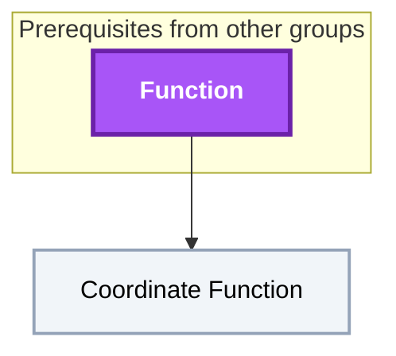

## O'Neill Ch. 1: Calculus on Euclidean Space
**Mastered:** 1 / 73 · **Discovered:** 73 / 73

```mermaid
flowchart TD
    classDef planned fill:#1E293B,stroke:#64748B,stroke-width:2px,stroke-dasharray:5 5,color:#94A3B8;
    classDef locked fill:#334155,stroke:#475569,stroke-width:2px,color:#94A3B8;
    classDef L0 fill:#F1F5F9,stroke:#94A3B8,stroke-width:2px,color:#000000;
    classDef L1 fill:#22C55E,stroke:#15803D,stroke-width:2px,color:#000000;
    classDef L2 fill:#3B82F6,stroke:#1D4ED8,stroke-width:3px,color:#FFFFFF;
    classDef L3 fill:#A855F7,stroke:#6B21A8,stroke-width:3px,color:#FFFFFF,font-weight:bold;
    classDef L4 fill:#F97316,stroke:#C2410C,stroke-width:4px,color:#000000,font-weight:bold;
    classDef L5 fill:#FFD700,stroke:#FF8C00,stroke-width:5px,color:#000000,font-weight:bold;
    classDef rusty stroke:#8B4513,stroke-width:4px,stroke-dasharray:3 3;
    subgraph sg_prereqs["Prerequisites from other groups"]
        n_origin["Origin"]
        n_vector_space["Vector Space"]
        n_coordinate_function["Coordinate Function"]
        n_real_valued_function["Real-Valued Function"]
        n_partial_derivative["Partial Derivative"]
        n_vector["Vector"]
        n_standard_basis_vector["Standard Basis Vector"]
        n_real_vector_valued_function["Real Vector-Valued Function"]
        n_derivative["Derivative"]
        n_derivative_product_rule["Derivative Product Rule"]
        n_derivative_chain_rule["Derivative Chain Rule"]
        n_dual_space["Dual Space"]
        n_jacobian_matrix["Jacobian Matrix"]
        n_open_set["Open Set"]
    end
    n_point["Point"]
    n_euclidean_n_space["Euclidean n-Space"]
    n_euclidean_3_space["Euclidean 3-Space"]
    n_n_dimensional_space["n-Dimensional Space"]
    n_point_addition["Point Addition"]
    n_point_scalar_multiplication["Point Scalar Multiplication"]
    n_natural_coordinate_function["Natural Coordinate Function"]
    n_smooth_function["Smooth Function"]
    n_smooth_function_addition["Smooth Function Addition"]
    n_smooth_function_multiplication["Smooth Function Multiplication"]
    n_tangent_vector["Tangent Vector"]
    n_tangent_vectors_equality["Tangent Vectors Equality"]
    n_tangent_vectors_parallel["Tangent Vectors Parallel"]
    n_tangent_space["Tangent Space"]
    n_tangent_space_linear_isomorphism["Tangent Space Linear Isomorphism"]
    n_tangent_vector_addition["Tangent Vector Addition"]
    n_tangent_vector_scalar_multiplication["Tangent Vector Scalar Multiplication"]
    n_tangent_space_vector_addition["Tangent Space Vector Addition"]
    n_tangent_space_vector_scalar_multiplication["Tangent Space Vector Scalar Multiplication"]
    n_tangent_vector_function_multiplication["Tangent Vector Function Multiplication"]
    n_vector_field["Vector Field"]
    n_standard_unit_vector_field["Standard Unit Vector Field"]
    n_natural_frame_field["Natural Frame Field"]
    n_euclidean_coordinate_function["Euclidean Coordinate Function"]
    n_vector_field_addition["Vector Field Addition"]
    n_vector_field_scalar_multiplication["Vector Field Scalar Multiplication"]
    n_vector_field_function_multiplication["Vector Field Function Multiplication"]
    n_smooth_vector_field["Smooth Vector Field"]
    n_tangent_vector_association_to_line["Tangent Vector Association to Line"]
    n_tangent_vector_associated_to_function_on_line["Tangent Vector Associated to Function on Line"]
    n_directional_derivative["Directional Derivative"]
    n_directional_derivative_linearity["Directional Derivative Linearity"]
    n_directional_derivative_product_rule["Directional Derivative Product Rule"]
    n_directional_derivative_chain_rule["Directional Derivative Chain Rule"]
    n_directional_derivative_vector_field["Directional Derivative Vector Field"]
    n_directional_derivative_natural_frame_field["Directional Derivative Natural Frame Field"]
    n_directional_derivative_vector_field_linearity["Directional Derivative Vector Field Linearity"]
    n_directional_derivative_vector_field_product_rule["Directional Derivative Vector Field Product Rule"]
    n_directional_derivative_vector_field_chain_rule["Directional Derivative Vector Field Chain Rule"]
    n_curve["Curve"]
    n_smooth_curve["Smooth Curve"]
    n_helix["Helix"]
    n_velocity_vector_of_smooth_curve["Velocity Vector of Smooth Curve"]
    n_curve_reparameterization["Curve Reparameterization"]
    n_curve_reparameterization_velocity_vector["Curve Reparameterization Velocity Vector"]
    n_velocity_vector_directional_derivative["Velocity Vector Directional Derivative"]
    n_regular_curve["Regular Curve"]
    n_periodic_curve["Periodic Curve"]
    n_1_form["1-Form"]
    n_differential["Differential"]
    n_1_form_on_vector_field["1-Form on Vector Field"]
    n_1_form_on_vector_field_linearity["1-Form on Vector Field Linearity"]
    n_1_form_addition["1-Form Addition"]
    n_1_form_function_multiplication["1-Form Function Multiplication"]
    n_smooth_1_form_on_vector_field["Smooth 1-Form on Vector Field"]
    n_differential_of_function_addition["Differential of Function Addition"]
    n_differential_of_function_multiplication["Differential of Function Multiplication"]
    n_differential_of_function_composition["Differential of Function Composition"]
    n_differential_form["Differential Form"]
    n_differential_form_alternation_rule["Differential Form Alternation Rule"]
    n_differential_form_wedge_product_alternation_rule["Differential Form Wedge Product Alternation Rule"]
    n_exterior_derivative["Exterior Derivative"]
    n_exterior_derivative_wedge_product_properties["Exterior Derivative Wedge Product Properties"]
    n_exterior_derivative_linearity["Exterior Derivative Linearity"]
    n_mapping["Mapping"]
    n_curve_under_mapping["Curve Under Mapping"]
    n_tangent_map["Tangent Map"]
    n_tangent_map_as_linear_transformation["Tangent Map as Linear Transformation"]
    n_tangent_map_velocity_vector_of_curve["Tangent Map Velocity Vector of Curve"]
    n_tangent_map_on_natural_frame_field["Tangent Map on Natural Frame Field"]
    n_regular_mapping["Regular Mapping"]
    n_diffeomorphism["Diffeomorphism"]
    n_inverse_function_theorem["Inverse Function Theorem"]
    n_origin --> n_point
    n_point --> n_euclidean_n_space
    n_vector_space --> n_euclidean_n_space
    n_euclidean_n_space --> n_euclidean_3_space
    n_euclidean_n_space --> n_n_dimensional_space
    n_point --> n_point_addition
    n_point --> n_point_scalar_multiplication
    n_coordinate_function --> n_natural_coordinate_function
    n_euclidean_n_space --> n_natural_coordinate_function
    n_real_valued_function --> n_smooth_function
    n_partial_derivative --> n_smooth_function
    n_smooth_function --> n_smooth_function_addition
    n_smooth_function --> n_smooth_function_multiplication
    n_point --> n_tangent_vector
    n_vector --> n_tangent_vector
    n_tangent_vector --> n_tangent_vectors_equality
    n_tangent_vector --> n_tangent_vectors_parallel
    n_tangent_vector --> n_tangent_space
    n_vector_space --> n_tangent_space
    n_tangent_space --> n_tangent_space_linear_isomorphism
    n_tangent_vector --> n_tangent_vector_addition
    n_tangent_vector --> n_tangent_vector_scalar_multiplication
    n_tangent_space --> n_tangent_space_vector_addition
    n_tangent_space --> n_tangent_space_vector_scalar_multiplication
    n_tangent_vector --> n_tangent_vector_function_multiplication
    n_smooth_function --> n_tangent_vector_function_multiplication
    n_tangent_vector --> n_vector_field
    n_vector_field --> n_standard_unit_vector_field
    n_standard_basis_vector --> n_standard_unit_vector_field
    n_standard_unit_vector_field --> n_natural_frame_field
    n_natural_frame_field --> n_euclidean_coordinate_function
    n_coordinate_function --> n_euclidean_coordinate_function
    n_vector_field --> n_vector_field_addition
    n_vector_field --> n_vector_field_scalar_multiplication
    n_vector_field --> n_vector_field_function_multiplication
    n_smooth_function --> n_vector_field_function_multiplication
    n_euclidean_coordinate_function --> n_smooth_vector_field
    n_smooth_function --> n_smooth_vector_field
    n_tangent_vector --> n_tangent_vector_association_to_line
    n_tangent_vector_association_to_line --> n_tangent_vector_associated_to_function_on_line
    n_smooth_function --> n_tangent_vector_associated_to_function_on_line
    n_real_vector_valued_function --> n_tangent_vector_associated_to_function_on_line
    n_tangent_vector --> n_directional_derivative
    n_smooth_function --> n_directional_derivative
    n_derivative --> n_directional_derivative
    n_directional_derivative --> n_directional_derivative_linearity
    n_directional_derivative --> n_directional_derivative_product_rule
    n_derivative_product_rule --> n_directional_derivative_product_rule
    n_directional_derivative --> n_directional_derivative_chain_rule
    n_derivative_chain_rule --> n_directional_derivative_chain_rule
    n_directional_derivative --> n_directional_derivative_vector_field
    n_vector_field --> n_directional_derivative_vector_field
    n_directional_derivative_vector_field --> n_directional_derivative_natural_frame_field
    n_natural_frame_field --> n_directional_derivative_natural_frame_field
    n_directional_derivative_vector_field --> n_directional_derivative_vector_field_linearity
    n_directional_derivative_vector_field --> n_directional_derivative_vector_field_product_rule
    n_derivative_product_rule --> n_directional_derivative_vector_field_product_rule
    n_directional_derivative_vector_field --> n_directional_derivative_vector_field_chain_rule
    n_derivative_chain_rule --> n_directional_derivative_vector_field_chain_rule
    n_euclidean_3_space --> n_curve
    n_natural_coordinate_function --> n_curve
    n_curve --> n_smooth_curve
    n_smooth_function --> n_smooth_curve
    n_smooth_curve --> n_helix
    n_smooth_curve --> n_velocity_vector_of_smooth_curve
    n_tangent_vector --> n_velocity_vector_of_smooth_curve
    n_smooth_curve --> n_curve_reparameterization
    n_curve_reparameterization --> n_curve_reparameterization_velocity_vector
    n_velocity_vector_of_smooth_curve --> n_curve_reparameterization_velocity_vector
    n_velocity_vector_of_smooth_curve --> n_velocity_vector_directional_derivative
    n_directional_derivative --> n_velocity_vector_directional_derivative
    n_velocity_vector_of_smooth_curve --> n_regular_curve
    n_smooth_curve --> n_periodic_curve
    n_dual_space --> n_1_form
    n_tangent_space --> n_1_form
    n_1_form --> n_differential
    n_directional_derivative --> n_differential
    n_1_form --> n_1_form_on_vector_field
    n_vector_field --> n_1_form_on_vector_field
    n_1_form_on_vector_field --> n_1_form_on_vector_field_linearity
    n_1_form --> n_1_form_addition
    n_1_form --> n_1_form_function_multiplication
    n_smooth_function --> n_1_form_function_multiplication
    n_1_form_on_vector_field --> n_smooth_1_form_on_vector_field
    n_smooth_vector_field --> n_smooth_1_form_on_vector_field
    n_differential --> n_differential_of_function_addition
    n_differential --> n_differential_of_function_multiplication
    n_differential --> n_differential_of_function_composition
    n_derivative_chain_rule --> n_differential_of_function_composition
    n_differential --> n_differential_form
    n_differential_form --> n_differential_form_alternation_rule
    n_differential_form --> n_differential_form_wedge_product_alternation_rule
    n_differential_form --> n_exterior_derivative
    n_exterior_derivative --> n_exterior_derivative_wedge_product_properties
    n_exterior_derivative --> n_exterior_derivative_linearity
    n_smooth_function --> n_mapping
    n_natural_coordinate_function --> n_mapping
    n_mapping --> n_curve_under_mapping
    n_curve --> n_curve_under_mapping
    n_curve_under_mapping --> n_tangent_map
    n_velocity_vector_of_smooth_curve --> n_tangent_map
    n_directional_derivative --> n_tangent_map
    n_jacobian_matrix --> n_tangent_map
    n_tangent_map --> n_tangent_map_as_linear_transformation
    n_tangent_map --> n_tangent_map_velocity_vector_of_curve
    n_tangent_map --> n_tangent_map_on_natural_frame_field
    n_natural_frame_field --> n_tangent_map_on_natural_frame_field
    n_tangent_map --> n_regular_mapping
    n_mapping --> n_diffeomorphism
    n_regular_mapping --> n_inverse_function_theorem
    n_diffeomorphism --> n_inverse_function_theorem
    n_open_set --> n_inverse_function_theorem
    class n_vector_space,n_real_valued_function,n_vector,n_standard_basis_vector,n_real_vector_valued_function,n_derivative_product_rule,n_dual_space,n_jacobian_matrix,n_open_set,n_euclidean_n_space,n_euclidean_3_space,n_n_dimensional_space,n_natural_coordinate_function,n_smooth_function,n_smooth_function_addition,n_smooth_function_multiplication,n_tangent_vector,n_tangent_vectors_equality,n_tangent_vectors_parallel,n_tangent_space,n_tangent_space_linear_isomorphism,n_tangent_vector_addition,n_tangent_vector_scalar_multiplication,n_tangent_space_vector_addition,n_tangent_space_vector_scalar_multiplication,n_tangent_vector_function_multiplication,n_vector_field,n_standard_unit_vector_field,n_natural_frame_field,n_euclidean_coordinate_function,n_vector_field_addition,n_vector_field_scalar_multiplication,n_vector_field_function_multiplication,n_smooth_vector_field,n_tangent_vector_association_to_line,n_tangent_vector_associated_to_function_on_line,n_directional_derivative,n_directional_derivative_linearity,n_directional_derivative_product_rule,n_directional_derivative_chain_rule,n_directional_derivative_vector_field,n_directional_derivative_natural_frame_field,n_directional_derivative_vector_field_linearity,n_directional_derivative_vector_field_product_rule,n_directional_derivative_vector_field_chain_rule,n_curve,n_smooth_curve,n_helix,n_velocity_vector_of_smooth_curve,n_curve_reparameterization,n_curve_reparameterization_velocity_vector,n_velocity_vector_directional_derivative,n_regular_curve,n_periodic_curve,n_1_form,n_differential,n_1_form_on_vector_field,n_1_form_on_vector_field_linearity,n_1_form_addition,n_1_form_function_multiplication,n_smooth_1_form_on_vector_field,n_differential_of_function_addition,n_differential_of_function_multiplication,n_differential_of_function_composition,n_differential_form,n_differential_form_alternation_rule,n_differential_form_wedge_product_alternation_rule,n_exterior_derivative,n_exterior_derivative_wedge_product_properties,n_exterior_derivative_linearity,n_mapping,n_curve_under_mapping,n_tangent_map,n_tangent_map_as_linear_transformation,n_tangent_map_velocity_vector_of_curve,n_tangent_map_on_natural_frame_field,n_regular_mapping,n_diffeomorphism,n_inverse_function_theorem locked;
    class n_coordinate_function,n_partial_derivative,n_point_addition,n_point_scalar_multiplication L0;
    class n_derivative_chain_rule L2;
    class n_origin,n_derivative,n_point L3;
    class n_origin,n_vector_space,n_coordinate_function,n_real_valued_function,n_partial_derivative,n_vector,n_standard_basis_vector,n_real_vector_valued_function,n_derivative,n_derivative_product_rule,n_derivative_chain_rule,n_dual_space,n_jacobian_matrix,n_open_set,n_point,n_euclidean_n_space,n_euclidean_3_space,n_n_dimensional_space,n_point_addition,n_point_scalar_multiplication,n_natural_coordinate_function,n_smooth_function,n_smooth_function_addition,n_smooth_function_multiplication,n_tangent_vector,n_tangent_vectors_equality,n_tangent_vectors_parallel,n_tangent_space,n_tangent_space_linear_isomorphism,n_tangent_vector_addition,n_tangent_vector_scalar_multiplication,n_tangent_space_vector_addition,n_tangent_space_vector_scalar_multiplication,n_tangent_vector_function_multiplication,n_vector_field,n_standard_unit_vector_field,n_natural_frame_field,n_euclidean_coordinate_function,n_vector_field_addition,n_vector_field_scalar_multiplication,n_vector_field_function_multiplication,n_smooth_vector_field,n_tangent_vector_association_to_line,n_tangent_vector_associated_to_function_on_line,n_directional_derivative,n_directional_derivative_linearity,n_directional_derivative_product_rule,n_directional_derivative_chain_rule,n_directional_derivative_vector_field,n_directional_derivative_natural_frame_field,n_directional_derivative_vector_field_linearity,n_directional_derivative_vector_field_product_rule,n_directional_derivative_vector_field_chain_rule,n_curve,n_smooth_curve,n_helix,n_velocity_vector_of_smooth_curve,n_curve_reparameterization,n_curve_reparameterization_velocity_vector,n_velocity_vector_directional_derivative,n_regular_curve,n_periodic_curve,n_1_form,n_differential,n_1_form_on_vector_field,n_1_form_on_vector_field_linearity,n_1_form_addition,n_1_form_function_multiplication,n_smooth_1_form_on_vector_field,n_differential_of_function_addition,n_differential_of_function_multiplication,n_differential_of_function_composition,n_differential_form,n_differential_form_alternation_rule,n_differential_form_wedge_product_alternation_rule,n_exterior_derivative,n_exterior_derivative_wedge_product_properties,n_exterior_derivative_linearity,n_mapping,n_curve_under_mapping,n_tangent_map,n_tangent_map_as_linear_transformation,n_tangent_map_velocity_vector_of_curve,n_tangent_map_on_natural_frame_field,n_regular_mapping,n_diffeomorphism,n_inverse_function_theorem internal-link;
```

## O'Neill Ch. 2: Frame Fields
**Mastered:** 0 / 45 · **Discovered:** 39 / 45

```mermaid
flowchart TD
    classDef planned fill:#1E293B,stroke:#64748B,stroke-width:2px,stroke-dasharray:5 5,color:#94A3B8;
    classDef locked fill:#334155,stroke:#475569,stroke-width:2px,color:#94A3B8;
    classDef L0 fill:#F1F5F9,stroke:#94A3B8,stroke-width:2px,color:#000000;
    classDef L1 fill:#22C55E,stroke:#15803D,stroke-width:2px,color:#000000;
    classDef L2 fill:#3B82F6,stroke:#1D4ED8,stroke-width:3px,color:#FFFFFF;
    classDef L3 fill:#A855F7,stroke:#6B21A8,stroke-width:3px,color:#FFFFFF,font-weight:bold;
    classDef L4 fill:#F97316,stroke:#C2410C,stroke-width:4px,color:#000000,font-weight:bold;
    classDef L5 fill:#FFD700,stroke:#FF8C00,stroke-width:5px,color:#000000,font-weight:bold;
    classDef rusty stroke:#8B4513,stroke-width:4px,stroke-dasharray:3 3;
    subgraph sg_prereqs["Prerequisites from other groups"]
        n_norm["Norm"]
        n_cauchy_schwarz_inequality["Cauchy-Schwarz Inequality"]
        n_orthogonal_vector["Orthogonal Vector"]
        n_unit_vector["Unit Vector"]
        n_tangent_vector["Tangent Vector"]
        n_orthonormal_basis["Orthonormal Basis"]
        n_orthogonal_matrix["Orthogonal Matrix"]
        n_tangent_space["Tangent Space"]
        n_determinant["Determinant"]
        n_velocity_vector_of_smooth_curve["Velocity Vector of Smooth Curve"]
        n_definite_riemann_integral["Definite Riemann Integral"]
        n_curve_reparameterization["Curve Reparameterization"]
        n_regular_curve["Regular Curve"]
        n_vector_field["Vector Field"]
        n_curve["Curve"]
        n_taylor_series["Taylor Series"]
        n_gram_schmidt_algorithm["Gram-Schmidt Algorithm"]
        n_plane["Plane"]
        n_directional_derivative["Directional Derivative"]
        n_kronecker_delta["Kronecker Delta"]
        n_1_form["1-Form"]
        n_exterior_derivative["Exterior Derivative"]
    end
    n_norm_scalar_multiplication["Norm Scalar Multiplication"]
    n_norm_addition_triangle_inequality["Norm Addition (Triangle Inequality)"]
    n_frame["Frame"]
    n_attitude_matrix["Attitude Matrix"]
    n_cross_product["Cross Product"]
    n_cross_product_alternation_rule["Cross Product Alternation Rule"]
    n_cross_product_linearity["Cross Product Linearity"]
    n_cross_product_norm["Cross Product Norm"]
    n_cross_product_squared_norm["Cross Product Squared Norm"]
    n_curve_speed["Curve Speed"]
    n_unit_speed_curve["Unit Speed Curve"]
    n_curve_arc_length["Curve Arc Length"]
    n_curve_arc_length_function["Curve Arc Length Function"]
    n_orientation_preserving_curve_reparameterization["Orientation Preserving Curve Reparameterization"]
    n_unit_speed_curve_reparameterization["Unit Speed Curve Reparameterization"]
    n_arc_length_curve_reparameterization["Arc Length Curve Reparameterization"]
    n_vector_field_on_curve["Vector Field on Curve"]
    n_acceleration_vector_of_smooth_curve["Acceleration Vector of Smooth Curve"]
    n_line_curve["Line Curve"]
    n_constant_curve["Constant Curve"]
    n_parallel_vector_field_on_curve["Parallel Vector Field on Curve"]
    n_unit_vector_field_on_curve["Unit Vector Field on Curve"]
    n_unit_tangent_vector_field_on_curve["Unit Tangent Vector Field on Curve"]
    n_curvature_vector_field_on_curve["Curvature Vector Field on Curve"]
    n_curvature_function_on_curve["Curvature Function on Curve"]
    n_principal_normal_vector_field_on_curve["Principal Normal Vector Field on Curve"]
    n_binormal_vector_field_on_curve["Binormal Vector Field on Curve"]
    n_frenet_frame_field["Frenet Frame Field"]
    n_torsion_function_on_curve["Torsion Function on Curve"]
    n_frenet_formula["Frenet Formula"]
    n_frenet_approximation_of_curve["Frenet Approximation of Curve"]
    n_frenet_curve["Frenet Curve"]
    n_plane_curve["Plane Curve"]
    n_osculating_circle["Osculating Circle"]
    n_arbitrary_speed_frenet_formulas["Arbitrary-Speed Frenet Formulas"]
    n_cylindrical_helix["Cylindrical Helix"]
    n_covariant_derivative["Covariant Derivative"]
    n_covariant_derivative_linearity["Covariant Derivative Linearity"]
    n_covariant_derivative_product_rule["Covariant Derivative Product Rule"]
    n_covariant_derivative_with_respect_to_vector_field["Covariant Derivative with Respect to Vector Field"]
    n_frame_field["Frame Field"]
    n_dual_1_form_of_frame_field["Dual 1-Form of Frame Field"]
    n_connection_form["Connection Form"]
    n_connection_equations["Connection Equations"]
    n_cartan_structural_equations["Cartan Structural Equations"]
    n_norm --> n_norm_scalar_multiplication
    n_cauchy_schwarz_inequality --> n_norm_addition_triangle_inequality
    n_orthogonal_vector --> n_frame
    n_unit_vector --> n_frame
    n_tangent_vector --> n_frame
    n_orthonormal_basis --> n_frame
    n_frame --> n_attitude_matrix
    n_orthogonal_matrix --> n_attitude_matrix
    n_tangent_space --> n_cross_product
    n_determinant --> n_cross_product
    n_cross_product --> n_cross_product_alternation_rule
    n_cross_product --> n_cross_product_linearity
    n_cross_product --> n_cross_product_norm
    n_norm --> n_cross_product_norm
    n_cross_product --> n_cross_product_squared_norm
    n_norm --> n_cross_product_squared_norm
    n_velocity_vector_of_smooth_curve --> n_curve_speed
    n_norm --> n_curve_speed
    n_curve_speed --> n_unit_speed_curve
    n_curve_speed --> n_curve_arc_length
    n_definite_riemann_integral --> n_curve_arc_length
    n_curve_arc_length --> n_curve_arc_length_function
    n_curve_reparameterization --> n_orientation_preserving_curve_reparameterization
    n_curve_reparameterization --> n_unit_speed_curve_reparameterization
    n_unit_speed_curve --> n_unit_speed_curve_reparameterization
    n_curve_arc_length_function --> n_arc_length_curve_reparameterization
    n_regular_curve --> n_arc_length_curve_reparameterization
    n_unit_speed_curve_reparameterization --> n_arc_length_curve_reparameterization
    n_orientation_preserving_curve_reparameterization --> n_arc_length_curve_reparameterization
    n_vector_field --> n_vector_field_on_curve
    n_curve --> n_vector_field_on_curve
    n_velocity_vector_of_smooth_curve --> n_acceleration_vector_of_smooth_curve
    n_acceleration_vector_of_smooth_curve --> n_line_curve
    n_velocity_vector_of_smooth_curve --> n_constant_curve
    n_vector_field_on_curve --> n_parallel_vector_field_on_curve
    n_vector_field_on_curve --> n_unit_vector_field_on_curve
    n_unit_vector --> n_unit_vector_field_on_curve
    n_unit_speed_curve --> n_unit_tangent_vector_field_on_curve
    n_unit_vector_field_on_curve --> n_unit_tangent_vector_field_on_curve
    n_unit_tangent_vector_field_on_curve --> n_curvature_vector_field_on_curve
    n_curvature_vector_field_on_curve --> n_curvature_function_on_curve
    n_curvature_function_on_curve --> n_principal_normal_vector_field_on_curve
    n_principal_normal_vector_field_on_curve --> n_binormal_vector_field_on_curve
    n_cross_product --> n_binormal_vector_field_on_curve
    n_binormal_vector_field_on_curve --> n_frenet_frame_field
    n_frame --> n_frenet_frame_field
    n_frenet_frame_field --> n_torsion_function_on_curve
    n_torsion_function_on_curve --> n_frenet_formula
    n_frenet_formula --> n_frenet_approximation_of_curve
    n_taylor_series --> n_frenet_approximation_of_curve
    n_frenet_frame_field --> n_frenet_curve
    n_gram_schmidt_algorithm --> n_frenet_curve
    n_unit_speed_curve --> n_plane_curve
    n_plane --> n_plane_curve
    n_plane_curve --> n_osculating_circle
    n_curvature_function_on_curve --> n_osculating_circle
    n_frenet_formula --> n_arbitrary_speed_frenet_formulas
    n_arbitrary_speed_frenet_formulas --> n_cylindrical_helix
    n_vector_field --> n_covariant_derivative
    n_directional_derivative --> n_covariant_derivative
    n_covariant_derivative --> n_covariant_derivative_linearity
    n_covariant_derivative --> n_covariant_derivative_product_rule
    n_covariant_derivative --> n_covariant_derivative_with_respect_to_vector_field
    n_frame --> n_frame_field
    n_vector_field --> n_frame_field
    n_kronecker_delta --> n_frame_field
    n_frame_field --> n_dual_1_form_of_frame_field
    n_1_form --> n_dual_1_form_of_frame_field
    n_frame_field --> n_connection_form
    n_covariant_derivative_with_respect_to_vector_field --> n_connection_form
    n_1_form --> n_connection_form
    n_connection_form --> n_connection_equations
    n_connection_form --> n_cartan_structural_equations
    n_dual_1_form_of_frame_field --> n_cartan_structural_equations
    n_exterior_derivative --> n_cartan_structural_equations
    class n_arbitrary_speed_frenet_formulas,n_cylindrical_helix,n_dual_1_form_of_frame_field,n_connection_form,n_connection_equations,n_cartan_structural_equations planned;
    class n_norm,n_cauchy_schwarz_inequality,n_orthogonal_vector,n_unit_vector,n_tangent_vector,n_orthonormal_basis,n_orthogonal_matrix,n_tangent_space,n_determinant,n_velocity_vector_of_smooth_curve,n_curve_reparameterization,n_regular_curve,n_vector_field,n_curve,n_taylor_series,n_gram_schmidt_algorithm,n_plane,n_directional_derivative,n_1_form,n_exterior_derivative,n_norm_scalar_multiplication,n_norm_addition_triangle_inequality,n_frame,n_attitude_matrix,n_cross_product,n_cross_product_alternation_rule,n_cross_product_linearity,n_cross_product_norm,n_cross_product_squared_norm,n_curve_speed,n_unit_speed_curve,n_curve_arc_length,n_curve_arc_length_function,n_orientation_preserving_curve_reparameterization,n_unit_speed_curve_reparameterization,n_arc_length_curve_reparameterization,n_vector_field_on_curve,n_acceleration_vector_of_smooth_curve,n_line_curve,n_constant_curve,n_parallel_vector_field_on_curve,n_unit_vector_field_on_curve,n_unit_tangent_vector_field_on_curve,n_curvature_vector_field_on_curve,n_curvature_function_on_curve,n_principal_normal_vector_field_on_curve,n_binormal_vector_field_on_curve,n_frenet_frame_field,n_torsion_function_on_curve,n_frenet_formula,n_frenet_approximation_of_curve,n_frenet_curve,n_plane_curve,n_osculating_circle,n_covariant_derivative,n_covariant_derivative_linearity,n_covariant_derivative_product_rule,n_covariant_derivative_with_respect_to_vector_field,n_frame_field locked;
    class n_kronecker_delta L0;
    class n_definite_riemann_integral L2;
    class n_norm,n_cauchy_schwarz_inequality,n_orthogonal_vector,n_unit_vector,n_tangent_vector,n_orthonormal_basis,n_orthogonal_matrix,n_tangent_space,n_determinant,n_velocity_vector_of_smooth_curve,n_definite_riemann_integral,n_curve_reparameterization,n_regular_curve,n_vector_field,n_curve,n_taylor_series,n_gram_schmidt_algorithm,n_plane,n_directional_derivative,n_kronecker_delta,n_1_form,n_exterior_derivative,n_norm_scalar_multiplication,n_norm_addition_triangle_inequality,n_frame,n_attitude_matrix,n_cross_product,n_cross_product_alternation_rule,n_cross_product_linearity,n_cross_product_norm,n_cross_product_squared_norm,n_curve_speed,n_unit_speed_curve,n_curve_arc_length,n_curve_arc_length_function,n_orientation_preserving_curve_reparameterization,n_unit_speed_curve_reparameterization,n_arc_length_curve_reparameterization,n_vector_field_on_curve,n_acceleration_vector_of_smooth_curve,n_line_curve,n_constant_curve,n_parallel_vector_field_on_curve,n_unit_vector_field_on_curve,n_unit_tangent_vector_field_on_curve,n_curvature_vector_field_on_curve,n_curvature_function_on_curve,n_principal_normal_vector_field_on_curve,n_binormal_vector_field_on_curve,n_frenet_frame_field,n_torsion_function_on_curve,n_frenet_formula,n_frenet_approximation_of_curve,n_frenet_curve,n_plane_curve,n_osculating_circle,n_covariant_derivative,n_covariant_derivative_linearity,n_covariant_derivative_product_rule,n_covariant_derivative_with_respect_to_vector_field,n_frame_field internal-link;
```

## Crane: Combinatorial Surfaces
**Mastered:** 0 / 18 · **Discovered:** 18 / 18

```mermaid
flowchart TD
    classDef planned fill:#1E293B,stroke:#64748B,stroke-width:2px,stroke-dasharray:5 5,color:#94A3B8;
    classDef locked fill:#334155,stroke:#475569,stroke-width:2px,color:#94A3B8;
    classDef L0 fill:#F1F5F9,stroke:#94A3B8,stroke-width:2px,color:#000000;
    classDef L1 fill:#22C55E,stroke:#15803D,stroke-width:2px,color:#000000;
    classDef L2 fill:#3B82F6,stroke:#1D4ED8,stroke-width:3px,color:#FFFFFF;
    classDef L3 fill:#A855F7,stroke:#6B21A8,stroke-width:3px,color:#FFFFFF,font-weight:bold;
    classDef L4 fill:#F97316,stroke:#C2410C,stroke-width:4px,color:#000000,font-weight:bold;
    classDef L5 fill:#FFD700,stroke:#FF8C00,stroke-width:5px,color:#000000,font-weight:bold;
    classDef rusty stroke:#8B4513,stroke-width:4px,stroke-dasharray:3 3;
    subgraph sg_prereqs["Prerequisites from other groups"]
        n_euclidean_n_space["Euclidean n-Space"]
        n_equivalence_class["Equivalence Class"]
        n_permutation_parity["Permutation Parity"]
        n_sphere["Sphere"]
        n_permutation["Permutation"]
        n_degree_of_vertex["Degree of Vertex"]
    end
    n_manifold["Manifold"]
    n_topological_disk["Topological Disk"]
    n_combinatorial_surface["Combinatorial Surface"]
    n_abstract_simplex["Abstract Simplex"]
    n_abstract_simplicial_complex["Abstract Simplicial Complex"]
    n_simplicial_star["Simplicial Star"]
    n_simplicial_closure["Simplicial Closure"]
    n_simplicial_link["Simplicial Link"]
    n_boundary_of_simplicial_complex["Boundary of Simplicial Complex"]
    n_oriented_simplex["Oriented Simplex"]
    n_oriented_simplicial_complex["Oriented Simplicial Complex"]
    n_simplicial_surface["Simplicial Surface"]
    n_simplicial_manifold["Simplicial Manifold"]
    n_simplicial_adjacency_matrix["Simplicial Adjacency Matrix"]
    n_halfedge_mesh["Halfedge Mesh"]
    n_genus_topology["Genus (Topology)"]
    n_euler_characteristic["Euler Characteristic"]
    n_vertex_valence["Vertex Valence"]
    n_euclidean_n_space --> n_manifold
    n_manifold --> n_topological_disk
    n_manifold --> n_combinatorial_surface
    n_abstract_simplex --> n_abstract_simplicial_complex
    n_abstract_simplicial_complex --> n_simplicial_star
    n_abstract_simplicial_complex --> n_simplicial_closure
    n_simplicial_star --> n_simplicial_link
    n_simplicial_closure --> n_simplicial_link
    n_simplicial_closure --> n_boundary_of_simplicial_complex
    n_abstract_simplex --> n_oriented_simplex
    n_equivalence_class --> n_oriented_simplex
    n_permutation_parity --> n_oriented_simplex
    n_abstract_simplicial_complex --> n_oriented_simplicial_complex
    n_oriented_simplex --> n_oriented_simplicial_complex
    n_simplicial_link --> n_simplicial_surface
    n_topological_disk --> n_simplicial_surface
    n_combinatorial_surface --> n_simplicial_surface
    n_simplicial_link --> n_simplicial_manifold
    n_topological_disk --> n_simplicial_manifold
    n_sphere --> n_simplicial_manifold
    n_oriented_simplicial_complex --> n_simplicial_adjacency_matrix
    n_combinatorial_surface --> n_halfedge_mesh
    n_permutation --> n_halfedge_mesh
    n_manifold --> n_genus_topology
    n_combinatorial_surface --> n_euler_characteristic
    n_simplicial_surface --> n_vertex_valence
    n_degree_of_vertex --> n_vertex_valence
    class n_euclidean_n_space,n_equivalence_class,n_permutation_parity,n_degree_of_vertex,n_manifold,n_topological_disk,n_combinatorial_surface,n_abstract_simplicial_complex,n_simplicial_star,n_simplicial_closure,n_simplicial_link,n_boundary_of_simplicial_complex,n_oriented_simplex,n_oriented_simplicial_complex,n_simplicial_surface,n_simplicial_manifold,n_simplicial_adjacency_matrix,n_halfedge_mesh,n_genus_topology,n_euler_characteristic,n_vertex_valence locked;
    class n_sphere,n_permutation,n_abstract_simplex L0;
    class n_euclidean_n_space,n_equivalence_class,n_permutation_parity,n_sphere,n_permutation,n_degree_of_vertex,n_manifold,n_topological_disk,n_combinatorial_surface,n_abstract_simplex,n_abstract_simplicial_complex,n_simplicial_star,n_simplicial_closure,n_simplicial_link,n_boundary_of_simplicial_complex,n_oriented_simplex,n_oriented_simplicial_complex,n_simplicial_surface,n_simplicial_manifold,n_simplicial_adjacency_matrix,n_halfedge_mesh,n_genus_topology,n_euler_characteristic,n_vertex_valence internal-link;
```

## Crane: Smooth Surfaces
**Mastered:** 0 / 22 · **Discovered:** 22 / 22

```mermaid
flowchart TD
    classDef planned fill:#1E293B,stroke:#64748B,stroke-width:2px,stroke-dasharray:5 5,color:#94A3B8;
    classDef locked fill:#334155,stroke:#475569,stroke-width:2px,color:#94A3B8;
    classDef L0 fill:#F1F5F9,stroke:#94A3B8,stroke-width:2px,color:#000000;
    classDef L1 fill:#22C55E,stroke:#15803D,stroke-width:2px,color:#000000;
    classDef L2 fill:#3B82F6,stroke:#1D4ED8,stroke-width:3px,color:#FFFFFF;
    classDef L3 fill:#A855F7,stroke:#6B21A8,stroke-width:3px,color:#FFFFFF,font-weight:bold;
    classDef L4 fill:#F97316,stroke:#C2410C,stroke-width:4px,color:#000000,font-weight:bold;
    classDef L5 fill:#FFD700,stroke:#FF8C00,stroke-width:5px,color:#000000,font-weight:bold;
    classDef rusty stroke:#8B4513,stroke-width:4px,stroke-dasharray:3 3;
    subgraph sg_prereqs["Prerequisites from other groups"]
        n_tangent_map["Tangent Map"]
        n_manifold["Manifold"]
        n_tangent_space["Tangent Space"]
        n_inner_product["Inner Product"]
        n_bilinear_form["Bilinear Form"]
        n_dot_product["Dot Product"]
        n_cross_product["Cross Product"]
        n_sphere["Sphere"]
        n_unit_speed_curve["Unit Speed Curve"]
        n_curvature_function_on_curve["Curvature Function on Curve"]
        n_eigenvalue["Eigenvalue"]
        n_self_adjoint_linear_map["Self-Adjoint Linear Map"]
    end
    n_smooth_surface["Smooth Surface"]
    n_riemannian_metric["Riemannian Metric"]
    n_induced_metric["Induced Metric"]
    n_tangent_bundle["Tangent Bundle"]
    n_surface_normal["Surface Normal"]
    n_orientable_surface["Orientable Surface"]
    n_gauss_map["Gauss Map"]
    n_weingarten_map["Weingarten Map"]
    n_isometric_parameterization["Isometric Parameterization"]
    n_conformal_map["Conformal Map"]
    n_uniformization_theorem["Uniformization Theorem"]
    n_shape_operator["Shape Operator"]
    n_first_fundamental_form["First Fundamental Form"]
    n_second_fundamental_form["Second Fundamental Form"]
    n_normal_curvature["Normal Curvature"]
    n_principal_curvature["Principal Curvature"]
    n_euler_s_curvature_formula["Euler's Curvature Formula"]
    n_gaussian_curvature["Gaussian Curvature"]
    n_mean_curvature["Mean Curvature"]
    n_minimal_surface["Minimal Surface"]
    n_developable_surface["Developable Surface"]
    n_umbilic_point["Umbilic Point"]
    n_tangent_map --> n_smooth_surface
    n_manifold --> n_smooth_surface
    n_manifold --> n_riemannian_metric
    n_tangent_space --> n_riemannian_metric
    n_inner_product --> n_riemannian_metric
    n_bilinear_form --> n_riemannian_metric
    n_riemannian_metric --> n_induced_metric
    n_smooth_surface --> n_induced_metric
    n_dot_product --> n_induced_metric
    n_tangent_space --> n_tangent_bundle
    n_manifold --> n_tangent_bundle
    n_smooth_surface --> n_surface_normal
    n_cross_product --> n_surface_normal
    n_surface_normal --> n_orientable_surface
    n_orientable_surface --> n_gauss_map
    n_sphere --> n_gauss_map
    n_gauss_map --> n_weingarten_map
    n_induced_metric --> n_isometric_parameterization
    n_unit_speed_curve --> n_isometric_parameterization
    n_isometric_parameterization --> n_conformal_map
    n_conformal_map --> n_uniformization_theorem
    n_gaussian_curvature --> n_uniformization_theorem
    n_weingarten_map --> n_shape_operator
    n_induced_metric --> n_shape_operator
    n_induced_metric --> n_first_fundamental_form
    n_shape_operator --> n_second_fundamental_form
    n_first_fundamental_form --> n_second_fundamental_form
    n_second_fundamental_form --> n_normal_curvature
    n_curvature_function_on_curve --> n_normal_curvature
    n_normal_curvature --> n_principal_curvature
    n_eigenvalue --> n_principal_curvature
    n_self_adjoint_linear_map --> n_principal_curvature
    n_principal_curvature --> n_euler_s_curvature_formula
    n_principal_curvature --> n_gaussian_curvature
    n_principal_curvature --> n_mean_curvature
    n_mean_curvature --> n_minimal_surface
    n_gaussian_curvature --> n_developable_surface
    n_isometric_parameterization --> n_developable_surface
    n_principal_curvature --> n_umbilic_point
    class n_tangent_map,n_manifold,n_tangent_space,n_inner_product,n_bilinear_form,n_cross_product,n_unit_speed_curve,n_curvature_function_on_curve,n_eigenvalue,n_self_adjoint_linear_map,n_smooth_surface,n_riemannian_metric,n_induced_metric,n_tangent_bundle,n_surface_normal,n_orientable_surface,n_gauss_map,n_weingarten_map,n_isometric_parameterization,n_conformal_map,n_uniformization_theorem,n_shape_operator,n_first_fundamental_form,n_second_fundamental_form,n_normal_curvature,n_principal_curvature,n_euler_s_curvature_formula,n_gaussian_curvature,n_mean_curvature,n_minimal_surface,n_developable_surface,n_umbilic_point locked;
    class n_dot_product,n_sphere L0;
    class n_tangent_map,n_manifold,n_tangent_space,n_inner_product,n_bilinear_form,n_dot_product,n_cross_product,n_sphere,n_unit_speed_curve,n_curvature_function_on_curve,n_eigenvalue,n_self_adjoint_linear_map,n_smooth_surface,n_riemannian_metric,n_induced_metric,n_tangent_bundle,n_surface_normal,n_orientable_surface,n_gauss_map,n_weingarten_map,n_isometric_parameterization,n_conformal_map,n_uniformization_theorem,n_shape_operator,n_first_fundamental_form,n_second_fundamental_form,n_normal_curvature,n_principal_curvature,n_euler_s_curvature_formula,n_gaussian_curvature,n_mean_curvature,n_minimal_surface,n_developable_surface,n_umbilic_point internal-link;
```

## O'Neill Ch. 3: Euclidean Geometry
**Mastered:** 0 / 7 · **Discovered:** 0 / 7

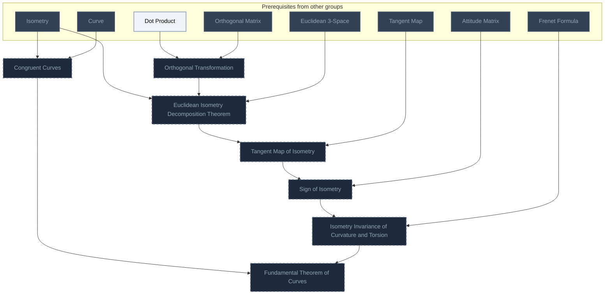

## O'Neill Ch. 4: Calculus on a Surface
**Mastered:** 0 / 10 · **Discovered:** 0 / 10

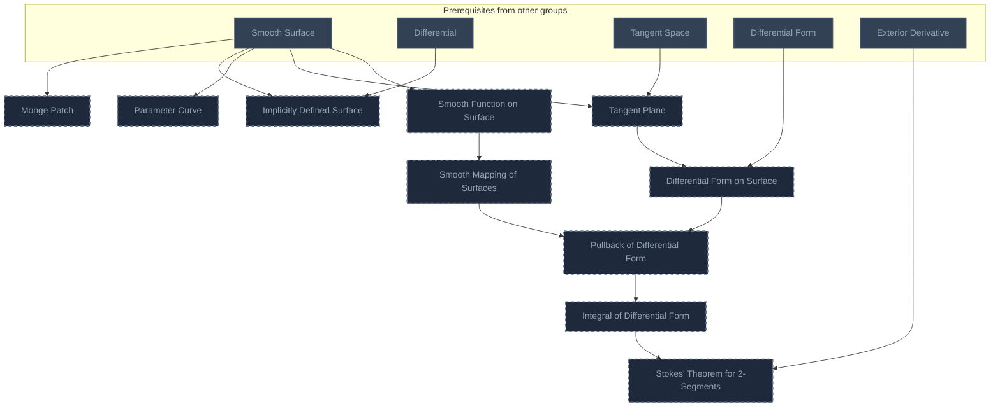

## O'Neill Ch. 5: Shape Operators
**Mastered:** 0 / 5 · **Discovered:** 0 / 5

```mermaid
flowchart TD
    classDef planned fill:#1E293B,stroke:#64748B,stroke-width:2px,stroke-dasharray:5 5,color:#94A3B8;
    classDef locked fill:#334155,stroke:#475569,stroke-width:2px,color:#94A3B8;
    classDef L0 fill:#F1F5F9,stroke:#94A3B8,stroke-width:2px,color:#000000;
    classDef L1 fill:#22C55E,stroke:#15803D,stroke-width:2px,color:#000000;
    classDef L2 fill:#3B82F6,stroke:#1D4ED8,stroke-width:3px,color:#FFFFFF;
    classDef L3 fill:#A855F7,stroke:#6B21A8,stroke-width:3px,color:#FFFFFF,font-weight:bold;
    classDef L4 fill:#F97316,stroke:#C2410C,stroke-width:4px,color:#000000,font-weight:bold;
    classDef L5 fill:#FFD700,stroke:#FF8C00,stroke-width:5px,color:#000000,font-weight:bold;
    classDef rusty stroke:#8B4513,stroke-width:4px,stroke-dasharray:3 3;
    subgraph sg_prereqs["Prerequisites from other groups"]
        n_gaussian_curvature["Gaussian Curvature"]
        n_mean_curvature["Mean Curvature"]
        n_principal_curvature["Principal Curvature"]
        n_normal_curvature["Normal Curvature"]
        n_acceleration_vector_of_smooth_curve["Acceleration Vector of Smooth Curve"]
        n_surface_normal["Surface Normal"]
        n_smooth_surface["Smooth Surface"]
    end
    n_gaussian_and_mean_curvature_in_patch_coordinates["Gaussian and Mean Curvature in Patch Coordinates"]
    n_principal_curve["Principal Curve"]
    n_asymptotic_curve["Asymptotic Curve"]
    n_geodesic["Geodesic"]
    n_surface_of_revolution["Surface of Revolution"]
    n_gaussian_curvature --> n_gaussian_and_mean_curvature_in_patch_coordinates
    n_mean_curvature --> n_gaussian_and_mean_curvature_in_patch_coordinates
    n_principal_curvature --> n_principal_curve
    n_normal_curvature --> n_asymptotic_curve
    n_acceleration_vector_of_smooth_curve --> n_geodesic
    n_surface_normal --> n_geodesic
    n_smooth_surface --> n_surface_of_revolution
    class n_gaussian_and_mean_curvature_in_patch_coordinates,n_principal_curve,n_asymptotic_curve,n_geodesic,n_surface_of_revolution planned;
    class n_gaussian_curvature,n_mean_curvature,n_principal_curvature,n_normal_curvature,n_acceleration_vector_of_smooth_curve,n_surface_normal,n_smooth_surface locked;
    class n_gaussian_curvature,n_mean_curvature,n_principal_curvature,n_normal_curvature,n_acceleration_vector_of_smooth_curve,n_surface_normal,n_smooth_surface internal-link;
```

## O'Neill Ch. 6: Geometry of Surfaces in R^3
**Mastered:** 0 / 11 · **Discovered:** 0 / 11

```mermaid
flowchart TD
    classDef planned fill:#1E293B,stroke:#64748B,stroke-width:2px,stroke-dasharray:5 5,color:#94A3B8;
    classDef locked fill:#334155,stroke:#475569,stroke-width:2px,color:#94A3B8;
    classDef L0 fill:#F1F5F9,stroke:#94A3B8,stroke-width:2px,color:#000000;
    classDef L1 fill:#22C55E,stroke:#15803D,stroke-width:2px,color:#000000;
    classDef L2 fill:#3B82F6,stroke:#1D4ED8,stroke-width:3px,color:#FFFFFF;
    classDef L3 fill:#A855F7,stroke:#6B21A8,stroke-width:3px,color:#FFFFFF,font-weight:bold;
    classDef L4 fill:#F97316,stroke:#C2410C,stroke-width:4px,color:#000000,font-weight:bold;
    classDef L5 fill:#FFD700,stroke:#FF8C00,stroke-width:5px,color:#000000,font-weight:bold;
    classDef rusty stroke:#8B4513,stroke-width:4px,stroke-dasharray:3 3;
    subgraph sg_prereqs["Prerequisites from other groups"]
        n_frame_field["Frame Field"]
        n_surface_normal["Surface Normal"]
        n_cartan_structural_equations["Cartan Structural Equations"]
        n_shape_operator["Shape Operator"]
        n_umbilic_point["Umbilic Point"]
        n_gaussian_curvature["Gaussian Curvature"]
        n_induced_metric["Induced Metric"]
        n_smooth_mapping_of_surfaces["Smooth Mapping of Surfaces"]
        n_gaussian_and_mean_curvature_in_patch_coordinates["Gaussian and Mean Curvature in Patch Coordinates"]
        n_orientable_surface["Orientable Surface"]
        n_differential_form_on_surface["Differential Form on Surface"]
        n_integral_of_differential_form["Integral of Differential Form"]
    end
    n_adapted_frame_field["Adapted Frame Field"]
    n_gauss_equation["Gauss Equation"]
    n_codazzi_equations["Codazzi Equations"]
    n_liebmann_s_theorem["Liebmann's Theorem"]
    n_isometry_of_surfaces["Isometry of Surfaces"]
    n_local_isometry["Local Isometry"]
    n_theorema_egregium["Theorema Egregium"]
    n_gaussian_curvature_in_orthogonal_coordinates["Gaussian Curvature in Orthogonal Coordinates"]
    n_area_form["Area Form"]
    n_total_gaussian_curvature["Total Gaussian Curvature"]
    n_congruence_of_surfaces_theorem["Congruence of Surfaces Theorem"]
    n_frame_field --> n_adapted_frame_field
    n_surface_normal --> n_adapted_frame_field
    n_adapted_frame_field --> n_gauss_equation
    n_cartan_structural_equations --> n_gauss_equation
    n_shape_operator --> n_gauss_equation
    n_adapted_frame_field --> n_codazzi_equations
    n_cartan_structural_equations --> n_codazzi_equations
    n_shape_operator --> n_codazzi_equations
    n_codazzi_equations --> n_liebmann_s_theorem
    n_umbilic_point --> n_liebmann_s_theorem
    n_gaussian_curvature --> n_liebmann_s_theorem
    n_induced_metric --> n_isometry_of_surfaces
    n_smooth_mapping_of_surfaces --> n_isometry_of_surfaces
    n_isometry_of_surfaces --> n_local_isometry
    n_local_isometry --> n_theorema_egregium
    n_gauss_equation --> n_theorema_egregium
    n_theorema_egregium --> n_gaussian_curvature_in_orthogonal_coordinates
    n_gaussian_and_mean_curvature_in_patch_coordinates --> n_gaussian_curvature_in_orthogonal_coordinates
    n_orientable_surface --> n_area_form
    n_differential_form_on_surface --> n_area_form
    n_area_form --> n_total_gaussian_curvature
    n_gaussian_curvature --> n_total_gaussian_curvature
    n_integral_of_differential_form --> n_total_gaussian_curvature
    n_isometry_of_surfaces --> n_congruence_of_surfaces_theorem
    n_shape_operator --> n_congruence_of_surfaces_theorem
    class n_cartan_structural_equations,n_smooth_mapping_of_surfaces,n_gaussian_and_mean_curvature_in_patch_coordinates,n_differential_form_on_surface,n_integral_of_differential_form,n_adapted_frame_field,n_gauss_equation,n_codazzi_equations,n_liebmann_s_theorem,n_isometry_of_surfaces,n_local_isometry,n_theorema_egregium,n_gaussian_curvature_in_orthogonal_coordinates,n_area_form,n_total_gaussian_curvature,n_congruence_of_surfaces_theorem planned;
    class n_frame_field,n_surface_normal,n_shape_operator,n_umbilic_point,n_gaussian_curvature,n_induced_metric,n_orientable_surface locked;
    class n_frame_field,n_surface_normal,n_shape_operator,n_umbilic_point,n_gaussian_curvature,n_induced_metric,n_orientable_surface internal-link;
```

## O'Neill Ch. 7: Riemannian Geometry
**Mastered:** 0 / 8 · **Discovered:** 0 / 8

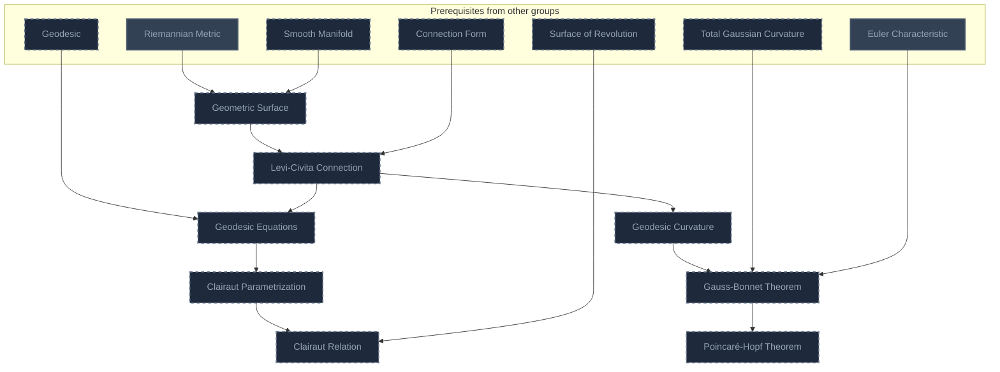

## O'Neill Ch. 8: Global Structure of Surfaces
**Mastered:** 0 / 8 · **Discovered:** 0 / 8

```mermaid
flowchart TD
    classDef planned fill:#1E293B,stroke:#64748B,stroke-width:2px,stroke-dasharray:5 5,color:#94A3B8;
    classDef locked fill:#334155,stroke:#475569,stroke-width:2px,color:#94A3B8;
    classDef L0 fill:#F1F5F9,stroke:#94A3B8,stroke-width:2px,color:#000000;
    classDef L1 fill:#22C55E,stroke:#15803D,stroke-width:2px,color:#000000;
    classDef L2 fill:#3B82F6,stroke:#1D4ED8,stroke-width:3px,color:#FFFFFF;
    classDef L3 fill:#A855F7,stroke:#6B21A8,stroke-width:3px,color:#FFFFFF,font-weight:bold;
    classDef L4 fill:#F97316,stroke:#C2410C,stroke-width:4px,color:#000000,font-weight:bold;
    classDef L5 fill:#FFD700,stroke:#FF8C00,stroke-width:5px,color:#000000,font-weight:bold;
    classDef rusty stroke:#8B4513,stroke-width:4px,stroke-dasharray:3 3;
    subgraph sg_prereqs["Prerequisites from other groups"]
        n_geodesic_equations["Geodesic Equations"]
        n_riemannian_metric["Riemannian Metric"]
        n_curve_arc_length["Curve Arc Length"]
        n_geodesic["Geodesic"]
        n_complete_metric_space["Complete Metric Space"]
        n_local_isometry["Local Isometry"]
        n_gaussian_curvature["Gaussian Curvature"]
    end
    n_riemannian_exponential_map["Riemannian Exponential Map"]
    n_riemannian_distance_function["Riemannian Distance Function"]
    n_geodesic_completeness["Geodesic Completeness"]
    n_hopf_rinow_theorem["Hopf-Rinow Theorem"]
    n_conjugate_point["Conjugate Point"]
    n_minding_s_theorem["Minding's Theorem"]
    n_bonnet_myers_theorem["Bonnet-Myers Theorem"]
    n_cartan_hadamard_theorem["Cartan-Hadamard Theorem"]
    n_geodesic_equations --> n_riemannian_exponential_map
    n_riemannian_metric --> n_riemannian_distance_function
    n_curve_arc_length --> n_riemannian_distance_function
    n_geodesic --> n_geodesic_completeness
    n_geodesic_completeness --> n_hopf_rinow_theorem
    n_riemannian_exponential_map --> n_hopf_rinow_theorem
    n_riemannian_distance_function --> n_hopf_rinow_theorem
    n_complete_metric_space --> n_hopf_rinow_theorem
    n_riemannian_exponential_map --> n_conjugate_point
    n_local_isometry --> n_minding_s_theorem
    n_gaussian_curvature --> n_minding_s_theorem
    n_hopf_rinow_theorem --> n_bonnet_myers_theorem
    n_conjugate_point --> n_bonnet_myers_theorem
    n_hopf_rinow_theorem --> n_cartan_hadamard_theorem
    n_conjugate_point --> n_cartan_hadamard_theorem
    class n_geodesic_equations,n_geodesic,n_local_isometry,n_riemannian_exponential_map,n_riemannian_distance_function,n_geodesic_completeness,n_hopf_rinow_theorem,n_conjugate_point,n_minding_s_theorem,n_bonnet_myers_theorem,n_cartan_hadamard_theorem planned;
    class n_riemannian_metric,n_curve_arc_length,n_complete_metric_space,n_gaussian_curvature locked;
    class n_riemannian_metric,n_curve_arc_length,n_complete_metric_space,n_gaussian_curvature internal-link;
```

## Tu Ch. 1: Euclidean Spaces
**Mastered:** 0 / 12 · **Discovered:** 4 / 12

```mermaid
flowchart TD
    classDef planned fill:#1E293B,stroke:#64748B,stroke-width:2px,stroke-dasharray:5 5,color:#94A3B8;
    classDef locked fill:#334155,stroke:#475569,stroke-width:2px,color:#94A3B8;
    classDef L0 fill:#F1F5F9,stroke:#94A3B8,stroke-width:2px,color:#000000;
    classDef L1 fill:#22C55E,stroke:#15803D,stroke-width:2px,color:#000000;
    classDef L2 fill:#3B82F6,stroke:#1D4ED8,stroke-width:3px,color:#FFFFFF;
    classDef L3 fill:#A855F7,stroke:#6B21A8,stroke-width:3px,color:#FFFFFF,font-weight:bold;
    classDef L4 fill:#F97316,stroke:#C2410C,stroke-width:4px,color:#000000,font-weight:bold;
    classDef L5 fill:#FFD700,stroke:#FF8C00,stroke-width:5px,color:#000000,font-weight:bold;
    classDef rusty stroke:#8B4513,stroke-width:4px,stroke-dasharray:3 3;
    subgraph sg_prereqs["Prerequisites from other groups"]
        n_continuous_function["Continuous Function"]
        n_real_vector_valued_function["Real Vector-Valued Function"]
        n_partial_derivative["Partial Derivative"]
        n_euclidean_n_space["Euclidean n-Space"]
        n_directional_derivative["Directional Derivative"]
        n_vector_field["Vector Field"]
        n_multilinear_function["Multilinear Function"]
        n_alternating_multilinear_function["Alternating Multilinear Function"]
        n_exterior_derivative["Exterior Derivative"]
    end
    n_c_0_function["C_0 Function"]
    n_c_k_function["C_k Function"]
    n_c_infinity_function["C_infinity Function"]
    n_star_shaped_set["Star-Shaped Set"]
    n_taylor_s_theorem_with_integral_remainder["Taylor's Theorem with Integral Remainder"]
    n_germ_of_function["Germ of Function"]
    n_point_derivation["Point-Derivation"]
    n_derivation["Derivation"]
    n_tensor_product_of_multilinear_functions["Tensor Product of Multilinear Functions"]
    n_wedge_product["Wedge Product"]
    n_closed_differential_form["Closed Differential Form"]
    n_exact_differential_form["Exact Differential Form"]
    n_continuous_function --> n_c_0_function
    n_real_vector_valued_function --> n_c_0_function
    n_c_0_function --> n_c_k_function
    n_partial_derivative --> n_c_k_function
    n_c_k_function --> n_c_infinity_function
    n_euclidean_n_space --> n_star_shaped_set
    n_star_shaped_set --> n_taylor_s_theorem_with_integral_remainder
    n_c_infinity_function --> n_taylor_s_theorem_with_integral_remainder
    n_c_infinity_function --> n_germ_of_function
    n_germ_of_function --> n_point_derivation
    n_directional_derivative --> n_point_derivation
    n_point_derivation --> n_derivation
    n_vector_field --> n_derivation
    n_multilinear_function --> n_tensor_product_of_multilinear_functions
    n_tensor_product_of_multilinear_functions --> n_wedge_product
    n_alternating_multilinear_function --> n_wedge_product
    n_exterior_derivative --> n_closed_differential_form
    n_exterior_derivative --> n_exact_differential_form
    class n_taylor_s_theorem_with_integral_remainder,n_germ_of_function,n_point_derivation,n_derivation,n_tensor_product_of_multilinear_functions,n_wedge_product,n_closed_differential_form,n_exact_differential_form planned;
    class n_real_vector_valued_function,n_euclidean_n_space,n_directional_derivative,n_vector_field,n_multilinear_function,n_alternating_multilinear_function,n_exterior_derivative,n_c_0_function,n_c_k_function,n_c_infinity_function,n_star_shaped_set locked;
    class n_partial_derivative L0;
    class n_continuous_function L3;
    class n_continuous_function,n_real_vector_valued_function,n_partial_derivative,n_euclidean_n_space,n_directional_derivative,n_vector_field,n_multilinear_function,n_alternating_multilinear_function,n_exterior_derivative,n_c_0_function,n_c_k_function,n_c_infinity_function,n_star_shaped_set internal-link;
```

## Tu Ch. 2: Manifolds
**Mastered:** 0 / 7 · **Discovered:** 0 / 7

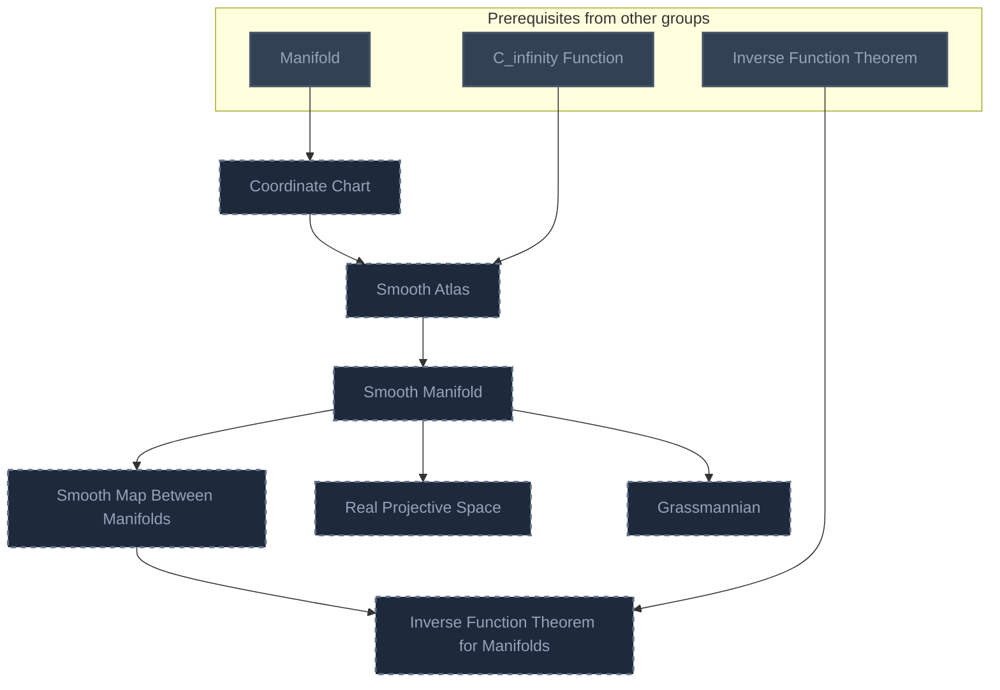

## Tu Ch. 3: The Tangent Space
**Mastered:** 0 / 14 · **Discovered:** 0 / 14

```mermaid
flowchart TD
    classDef planned fill:#1E293B,stroke:#64748B,stroke-width:2px,stroke-dasharray:5 5,color:#94A3B8;
    classDef locked fill:#334155,stroke:#475569,stroke-width:2px,color:#94A3B8;
    classDef L0 fill:#F1F5F9,stroke:#94A3B8,stroke-width:2px,color:#000000;
    classDef L1 fill:#22C55E,stroke:#15803D,stroke-width:2px,color:#000000;
    classDef L2 fill:#3B82F6,stroke:#1D4ED8,stroke-width:3px,color:#FFFFFF;
    classDef L3 fill:#A855F7,stroke:#6B21A8,stroke-width:3px,color:#FFFFFF,font-weight:bold;
    classDef L4 fill:#F97316,stroke:#C2410C,stroke-width:4px,color:#000000,font-weight:bold;
    classDef L5 fill:#FFD700,stroke:#FF8C00,stroke-width:5px,color:#000000,font-weight:bold;
    classDef rusty stroke:#8B4513,stroke-width:4px,stroke-dasharray:3 3;
    subgraph sg_prereqs["Prerequisites from other groups"]
        n_smooth_manifold["Smooth Manifold"]
        n_smooth_map_between_manifolds["Smooth Map Between Manifolds"]
        n_tangent_map["Tangent Map"]
        n_inverse_function_theorem_for_manifolds["Inverse Function Theorem for Manifolds"]
        n_rank["Rank"]
        n_c_infinity_function["C_infinity Function"]
        n_vector_field["Vector Field"]
        n_ordinary_differential_equation["Ordinary Differential Equation"]
        n_derivation["Derivation"]
    end
    n_regular_submanifold["Regular Submanifold"]
    n_regular_value["Regular Value"]
    n_regular_level_set_theorem["Regular Level Set Theorem"]
    n_category_category_theory["Category (Category Theory)"]
    n_functor["Functor"]
    n_immersion["Immersion"]
    n_submersion["Submersion"]
    n_constant_rank_theorem["Constant Rank Theorem"]
    n_vector_bundle["Vector Bundle"]
    n_section_of_vector_bundle["Section of Vector Bundle"]
    n_bump_function["Bump Function"]
    n_partition_of_unity["Partition of Unity"]
    n_integral_curve["Integral Curve"]
    n_lie_bracket["Lie Bracket"]
    n_smooth_manifold --> n_regular_submanifold
    n_smooth_map_between_manifolds --> n_regular_value
    n_tangent_map --> n_regular_value
    n_regular_value --> n_regular_level_set_theorem
    n_regular_submanifold --> n_regular_level_set_theorem
    n_inverse_function_theorem_for_manifolds --> n_regular_level_set_theorem
    n_category_category_theory --> n_functor
    n_smooth_map_between_manifolds --> n_immersion
    n_tangent_map --> n_immersion
    n_smooth_map_between_manifolds --> n_submersion
    n_tangent_map --> n_submersion
    n_inverse_function_theorem_for_manifolds --> n_constant_rank_theorem
    n_rank --> n_constant_rank_theorem
    n_smooth_manifold --> n_vector_bundle
    n_vector_bundle --> n_section_of_vector_bundle
    n_c_infinity_function --> n_bump_function
    n_bump_function --> n_partition_of_unity
    n_smooth_manifold --> n_partition_of_unity
    n_vector_field --> n_integral_curve
    n_smooth_manifold --> n_integral_curve
    n_ordinary_differential_equation --> n_integral_curve
    n_derivation --> n_lie_bracket
    n_smooth_manifold --> n_lie_bracket
    class n_smooth_manifold,n_smooth_map_between_manifolds,n_inverse_function_theorem_for_manifolds,n_derivation,n_regular_submanifold,n_regular_value,n_regular_level_set_theorem,n_category_category_theory,n_functor,n_immersion,n_submersion,n_constant_rank_theorem,n_vector_bundle,n_section_of_vector_bundle,n_bump_function,n_partition_of_unity,n_integral_curve,n_lie_bracket planned;
    class n_tangent_map,n_rank,n_c_infinity_function,n_vector_field,n_ordinary_differential_equation locked;
    class n_tangent_map,n_rank,n_c_infinity_function,n_vector_field,n_ordinary_differential_equation internal-link;
```

## Tu Ch. 4: Lie Groups and Lie Algebras
**Mastered:** 0 / 4 · **Discovered:** 0 / 4

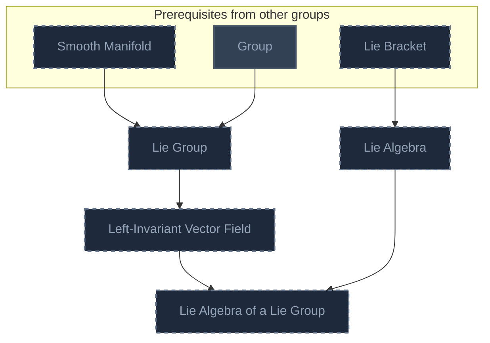

## Tu Ch. 5: Differential Forms
**Mastered:** 0 / 5 · **Discovered:** 0 / 5

```mermaid
flowchart TD
    classDef planned fill:#1E293B,stroke:#64748B,stroke-width:2px,stroke-dasharray:5 5,color:#94A3B8;
    classDef locked fill:#334155,stroke:#475569,stroke-width:2px,color:#94A3B8;
    classDef L0 fill:#F1F5F9,stroke:#94A3B8,stroke-width:2px,color:#000000;
    classDef L1 fill:#22C55E,stroke:#15803D,stroke-width:2px,color:#000000;
    classDef L2 fill:#3B82F6,stroke:#1D4ED8,stroke-width:3px,color:#FFFFFF;
    classDef L3 fill:#A855F7,stroke:#6B21A8,stroke-width:3px,color:#FFFFFF,font-weight:bold;
    classDef L4 fill:#F97316,stroke:#C2410C,stroke-width:4px,color:#000000,font-weight:bold;
    classDef L5 fill:#FFD700,stroke:#FF8C00,stroke-width:5px,color:#000000,font-weight:bold;
    classDef rusty stroke:#8B4513,stroke-width:4px,stroke-dasharray:3 3;
    subgraph sg_prereqs["Prerequisites from other groups"]
        n_dual_space["Dual Space"]
        n_smooth_manifold["Smooth Manifold"]
        n_vector_bundle["Vector Bundle"]
        n_integral_curve["Integral Curve"]
        n_lie_bracket["Lie Bracket"]
        n_differential_form["Differential Form"]
        n_alternating_multilinear_function["Alternating Multilinear Function"]
        n_exterior_derivative["Exterior Derivative"]
    end
    n_cotangent_space["Cotangent Space"]
    n_cotangent_bundle["Cotangent Bundle"]
    n_lie_derivative["Lie Derivative"]
    n_interior_multiplication["Interior Multiplication"]
    n_cartan_homotopy_formula["Cartan Homotopy Formula"]
    n_dual_space --> n_cotangent_space
    n_smooth_manifold --> n_cotangent_space
    n_cotangent_space --> n_cotangent_bundle
    n_vector_bundle --> n_cotangent_bundle
    n_integral_curve --> n_lie_derivative
    n_lie_bracket --> n_lie_derivative
    n_differential_form --> n_interior_multiplication
    n_alternating_multilinear_function --> n_interior_multiplication
    n_lie_derivative --> n_cartan_homotopy_formula
    n_interior_multiplication --> n_cartan_homotopy_formula
    n_exterior_derivative --> n_cartan_homotopy_formula
    class n_smooth_manifold,n_vector_bundle,n_integral_curve,n_lie_bracket,n_cotangent_space,n_cotangent_bundle,n_lie_derivative,n_interior_multiplication,n_cartan_homotopy_formula planned;
    class n_dual_space,n_differential_form,n_alternating_multilinear_function,n_exterior_derivative locked;
    class n_dual_space,n_differential_form,n_alternating_multilinear_function,n_exterior_derivative internal-link;
```

## Tu Ch. 6: Integration
**Mastered:** 0 / 4 · **Discovered:** 0 / 4

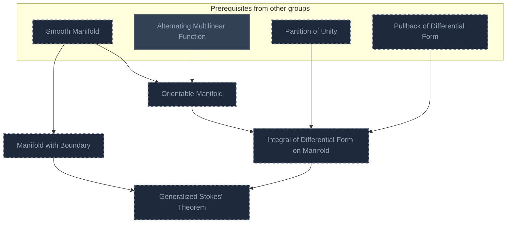

## Tu Ch. 7: De Rham Theory
**Mastered:** 0 / 6 · **Discovered:** 0 / 6

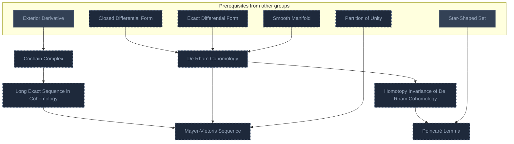

## Lee, Introduction to Topological Manifolds
**Mastered:** 0 / 12 · **Discovered:** 0 / 12

```mermaid
flowchart TD
    classDef planned fill:#1E293B,stroke:#64748B,stroke-width:2px,stroke-dasharray:5 5,color:#94A3B8;
    classDef locked fill:#334155,stroke:#475569,stroke-width:2px,color:#94A3B8;
    classDef L0 fill:#F1F5F9,stroke:#94A3B8,stroke-width:2px,color:#000000;
    classDef L1 fill:#22C55E,stroke:#15803D,stroke-width:2px,color:#000000;
    classDef L2 fill:#3B82F6,stroke:#1D4ED8,stroke-width:3px,color:#FFFFFF;
    classDef L3 fill:#A855F7,stroke:#6B21A8,stroke-width:3px,color:#FFFFFF,font-weight:bold;
    classDef L4 fill:#F97316,stroke:#C2410C,stroke-width:4px,color:#000000,font-weight:bold;
    classDef L5 fill:#FFD700,stroke:#FF8C00,stroke-width:5px,color:#000000,font-weight:bold;
    classDef rusty stroke:#8B4513,stroke-width:4px,stroke-dasharray:3 3;
    subgraph sg_prereqs["Prerequisites from other groups"]
        n_group["Group"]
        n_equivalence_class["Equivalence Class"]
        n_compact_set["Compact Set"]
        n_manifold["Manifold"]
        n_abstract_simplicial_complex["Abstract Simplicial Complex"]
        n_group_action["Group Action"]
        n_abstract_simplex["Abstract Simplex"]
        n_cochain_complex["Cochain Complex"]
    end
    n_adjunction_space["Adjunction Space"]
    n_topological_group["Topological Group"]
    n_proper_map["Proper Map"]
    n_cw_complex["CW Complex"]
    n_classification_of_1_manifolds["Classification of 1-Manifolds"]
    n_euclidean_simplicial_complex["Euclidean Simplicial Complex"]
    n_covering_space_action["Covering Space Action"]
    n_proper_group_action["Proper Group Action"]
    n_singular_homology["Singular Homology"]
    n_hurewicz_theorem["Hurewicz Theorem"]
    n_cellular_homology["Cellular Homology"]
    n_singular_cohomology["Singular Cohomology"]
    n_group --> n_topological_group
    n_equivalence_class --> n_adjunction_space
    n_compact_set --> n_proper_map
    n_adjunction_space --> n_cw_complex
    n_manifold --> n_classification_of_1_manifolds
    n_abstract_simplicial_complex --> n_euclidean_simplicial_complex
    n_group_action --> n_covering_space_action
    n_group_action --> n_proper_group_action
    n_proper_map --> n_proper_group_action
    n_topological_group --> n_proper_group_action
    n_abstract_simplex --> n_singular_homology
    n_singular_homology --> n_hurewicz_theorem
    n_singular_homology --> n_cellular_homology
    n_cw_complex --> n_cellular_homology
    n_singular_homology --> n_singular_cohomology
    n_cochain_complex --> n_singular_cohomology
    class n_cochain_complex,n_adjunction_space,n_topological_group,n_proper_map,n_cw_complex,n_classification_of_1_manifolds,n_euclidean_simplicial_complex,n_covering_space_action,n_proper_group_action,n_singular_homology,n_hurewicz_theorem,n_cellular_homology,n_singular_cohomology planned;
    class n_group,n_equivalence_class,n_compact_set,n_manifold,n_abstract_simplicial_complex,n_group_action locked;
    class n_abstract_simplex L0;
    class n_group,n_equivalence_class,n_compact_set,n_manifold,n_abstract_simplicial_complex,n_group_action,n_abstract_simplex internal-link;
```

## Lee, Introduction to Smooth Manifolds
**Mastered:** 0 / 16 · **Discovered:** 0 / 16

```mermaid
flowchart TD
    classDef planned fill:#1E293B,stroke:#64748B,stroke-width:2px,stroke-dasharray:5 5,color:#94A3B8;
    classDef locked fill:#334155,stroke:#475569,stroke-width:2px,color:#94A3B8;
    classDef L0 fill:#F1F5F9,stroke:#94A3B8,stroke-width:2px,color:#000000;
    classDef L1 fill:#22C55E,stroke:#15803D,stroke-width:2px,color:#000000;
    classDef L2 fill:#3B82F6,stroke:#1D4ED8,stroke-width:3px,color:#FFFFFF;
    classDef L3 fill:#A855F7,stroke:#6B21A8,stroke-width:3px,color:#FFFFFF,font-weight:bold;
    classDef L4 fill:#F97316,stroke:#C2410C,stroke-width:4px,color:#000000,font-weight:bold;
    classDef L5 fill:#FFD700,stroke:#FF8C00,stroke-width:5px,color:#000000,font-weight:bold;
    classDef rusty stroke:#8B4513,stroke-width:4px,stroke-dasharray:3 3;
    subgraph sg_prereqs["Prerequisites from other groups"]
        n_immersion["Immersion"]
        n_regular_value["Regular Value"]
        n_integral_curve["Integral Curve"]
        n_tensor_product_of_multilinear_functions["Tensor Product of Multilinear Functions"]
        n_cotangent_bundle["Cotangent Bundle"]
        n_de_rham_cohomology["De Rham Cohomology"]
        n_singular_cohomology["Singular Cohomology"]
        n_vector_bundle["Vector Bundle"]
        n_tangent_bundle["Tangent Bundle"]
        n_lie_bracket["Lie Bracket"]
        n_lie_group["Lie Group"]
        n_lie_algebra_of_a_lie_group["Lie Algebra of a Lie Group"]
        n_proper_group_action["Proper Group Action"]
        n_group_action["Group Action"]
        n_smooth_manifold["Smooth Manifold"]
        n_closed_differential_form["Closed Differential Form"]
    end
    n_smooth_embedding["Smooth Embedding"]
    n_immersed_submanifold["Immersed Submanifold"]
    n_sard_s_theorem["Sard's Theorem"]
    n_whitney_embedding_theorem["Whitney Embedding Theorem"]
    n_flow_of_vector_field["Flow of Vector Field"]
    n_fundamental_theorem_on_flows["Fundamental Theorem on Flows"]
    n_covariant_tensor_field["Covariant Tensor Field"]
    n_de_rham_theorem["De Rham Theorem"]
    n_tangent_distribution["Tangent Distribution"]
    n_frobenius_theorem["Frobenius Theorem"]
    n_one_parameter_subgroup["One-Parameter Subgroup"]
    n_lie_group_exponential_map["Lie Group Exponential Map"]
    n_quotient_manifold_theorem["Quotient Manifold Theorem"]
    n_homogeneous_space["Homogeneous Space"]
    n_symplectic_manifold["Symplectic Manifold"]
    n_darboux_s_theorem_symplectic_geometry["Darboux's Theorem (Symplectic Geometry)"]
    n_immersion --> n_smooth_embedding
    n_immersion --> n_immersed_submanifold
    n_regular_value --> n_sard_s_theorem
    n_smooth_embedding --> n_whitney_embedding_theorem
    n_sard_s_theorem --> n_whitney_embedding_theorem
    n_integral_curve --> n_flow_of_vector_field
    n_flow_of_vector_field --> n_fundamental_theorem_on_flows
    n_tensor_product_of_multilinear_functions --> n_covariant_tensor_field
    n_cotangent_bundle --> n_covariant_tensor_field
    n_de_rham_cohomology --> n_de_rham_theorem
    n_singular_cohomology --> n_de_rham_theorem
    n_vector_bundle --> n_tangent_distribution
    n_tangent_bundle --> n_tangent_distribution
    n_tangent_distribution --> n_frobenius_theorem
    n_lie_bracket --> n_frobenius_theorem
    n_lie_group --> n_one_parameter_subgroup
    n_integral_curve --> n_one_parameter_subgroup
    n_one_parameter_subgroup --> n_lie_group_exponential_map
    n_lie_algebra_of_a_lie_group --> n_lie_group_exponential_map
    n_lie_group --> n_quotient_manifold_theorem
    n_proper_group_action --> n_quotient_manifold_theorem
    n_lie_group --> n_homogeneous_space
    n_group_action --> n_homogeneous_space
    n_smooth_manifold --> n_symplectic_manifold
    n_closed_differential_form --> n_symplectic_manifold
    n_symplectic_manifold --> n_darboux_s_theorem_symplectic_geometry
    class n_immersion,n_regular_value,n_integral_curve,n_tensor_product_of_multilinear_functions,n_cotangent_bundle,n_de_rham_cohomology,n_singular_cohomology,n_vector_bundle,n_lie_bracket,n_lie_group,n_lie_algebra_of_a_lie_group,n_proper_group_action,n_smooth_manifold,n_closed_differential_form,n_smooth_embedding,n_immersed_submanifold,n_sard_s_theorem,n_whitney_embedding_theorem,n_flow_of_vector_field,n_fundamental_theorem_on_flows,n_covariant_tensor_field,n_de_rham_theorem,n_tangent_distribution,n_frobenius_theorem,n_one_parameter_subgroup,n_lie_group_exponential_map,n_quotient_manifold_theorem,n_homogeneous_space,n_symplectic_manifold,n_darboux_s_theorem_symplectic_geometry planned;
    class n_tangent_bundle,n_group_action locked;
    class n_tangent_bundle,n_group_action internal-link;
```

## Lee, Introduction to Riemannian Manifolds
**Mastered:** 0 / 14 · **Discovered:** 0 / 14

```mermaid
flowchart TD
    classDef planned fill:#1E293B,stroke:#64748B,stroke-width:2px,stroke-dasharray:5 5,color:#94A3B8;
    classDef locked fill:#334155,stroke:#475569,stroke-width:2px,color:#94A3B8;
    classDef L0 fill:#F1F5F9,stroke:#94A3B8,stroke-width:2px,color:#000000;
    classDef L1 fill:#22C55E,stroke:#15803D,stroke-width:2px,color:#000000;
    classDef L2 fill:#3B82F6,stroke:#1D4ED8,stroke-width:3px,color:#FFFFFF;
    classDef L3 fill:#A855F7,stroke:#6B21A8,stroke-width:3px,color:#FFFFFF,font-weight:bold;
    classDef L4 fill:#F97316,stroke:#C2410C,stroke-width:4px,color:#000000,font-weight:bold;
    classDef L5 fill:#FFD700,stroke:#FF8C00,stroke-width:5px,color:#000000,font-weight:bold;
    classDef rusty stroke:#8B4513,stroke-width:4px,stroke-dasharray:3 3;
    subgraph sg_prereqs["Prerequisites from other groups"]
        n_riemannian_metric["Riemannian Metric"]
        n_smooth_manifold["Smooth Manifold"]
        n_vector_bundle["Vector Bundle"]
        n_covariant_derivative["Covariant Derivative"]
        n_levi_civita_connection["Levi-Civita Connection"]
        n_riemannian_exponential_map["Riemannian Exponential Map"]
        n_covariant_tensor_field["Covariant Tensor Field"]
        n_gaussian_curvature["Gaussian Curvature"]
        n_curvature_function_on_curve["Curvature Function on Curve"]
        n_plane_curve["Plane Curve"]
        n_geodesic_equations["Geodesic Equations"]
        n_hopf_rinow_theorem["Hopf-Rinow Theorem"]
    end
    n_hyperbolic_space["Hyperbolic Space"]
    n_affine_connection["Affine Connection"]
    n_parallel_transport["Parallel Transport"]
    n_fundamental_theorem_of_riemannian_geometry["Fundamental Theorem of Riemannian Geometry"]
    n_gauss_lemma["Gauss Lemma"]
    n_normal_coordinates["Normal Coordinates"]
    n_riemann_curvature_tensor["Riemann Curvature Tensor"]
    n_ricci_curvature["Ricci Curvature"]
    n_scalar_curvature["Scalar Curvature"]
    n_sectional_curvature["Sectional Curvature"]
    n_rotation_index_theorem["Rotation Index Theorem"]
    n_jacobi_field["Jacobi Field"]
    n_rauch_comparison_theorem["Rauch Comparison Theorem"]
    n_killing_hopf_theorem["Killing-Hopf Theorem"]
    n_riemannian_metric --> n_hyperbolic_space
    n_smooth_manifold --> n_hyperbolic_space
    n_vector_bundle --> n_affine_connection
    n_covariant_derivative --> n_affine_connection
    n_affine_connection --> n_parallel_transport
    n_affine_connection --> n_fundamental_theorem_of_riemannian_geometry
    n_levi_civita_connection --> n_fundamental_theorem_of_riemannian_geometry
    n_riemannian_exponential_map --> n_gauss_lemma
    n_riemannian_exponential_map --> n_normal_coordinates
    n_affine_connection --> n_riemann_curvature_tensor
    n_covariant_tensor_field --> n_riemann_curvature_tensor
    n_riemann_curvature_tensor --> n_ricci_curvature
    n_ricci_curvature --> n_scalar_curvature
    n_riemann_curvature_tensor --> n_sectional_curvature
    n_gaussian_curvature --> n_sectional_curvature
    n_curvature_function_on_curve --> n_rotation_index_theorem
    n_plane_curve --> n_rotation_index_theorem
    n_riemann_curvature_tensor --> n_jacobi_field
    n_geodesic_equations --> n_jacobi_field
    n_jacobi_field --> n_rauch_comparison_theorem
    n_sectional_curvature --> n_rauch_comparison_theorem
    n_sectional_curvature --> n_killing_hopf_theorem
    n_hopf_rinow_theorem --> n_killing_hopf_theorem
    class n_smooth_manifold,n_vector_bundle,n_levi_civita_connection,n_riemannian_exponential_map,n_covariant_tensor_field,n_geodesic_equations,n_hopf_rinow_theorem,n_hyperbolic_space,n_affine_connection,n_parallel_transport,n_fundamental_theorem_of_riemannian_geometry,n_gauss_lemma,n_normal_coordinates,n_riemann_curvature_tensor,n_ricci_curvature,n_scalar_curvature,n_sectional_curvature,n_rotation_index_theorem,n_jacobi_field,n_rauch_comparison_theorem,n_killing_hopf_theorem planned;
    class n_riemannian_metric,n_covariant_derivative,n_gaussian_curvature,n_curvature_function_on_curve,n_plane_curve locked;
    class n_riemannian_metric,n_covariant_derivative,n_gaussian_curvature,n_curvature_function_on_curve,n_plane_curve internal-link;
```

# Source
Graph structure: the single source for the diagrams above, edited by `/note` and `Scripts/skill_trees.py` (`add`, `edge`, `rename`). Everything above this heading is regenerated by `render`.

```skilltree
    %% PREREQUISITES
    n_function["Function"]
    n_origin["Origin"]
    n_vector_space["Vector Space"]
    n_partial_derivative["Partial Derivative"]
    n_vector["Vector"]
    n_standard_basis_vector["Standard Basis Vector"]
    n_derivative["Derivative"]
    n_derivative_product_rule["Derivative Product Rule"]
    n_derivative_chain_rule["Derivative Chain Rule"]
    n_jacobian_matrix["Jacobian Matrix"]
    n_open_set["Open Set"]
    n_inner_product["Inner Product"]
    n_orthonormal_basis["Orthonormal Basis"]
    n_orthogonal_matrix["Orthogonal Matrix"]
    n_determinant["Determinant"]
    n_definite_riemann_integral["Definite Riemann Integral"]
    n_taylor_series["Taylor Series"]
    n_gram_schmidt_algorithm["Gram-Schmidt Algorithm"]
    n_plane["Plane"]
    n_equivalence_class["Equivalence Class"]
    n_permutation_parity["Permutation Parity"]
    n_sphere["Sphere"]
    n_permutation["Permutation"]
    n_degree_of_vertex["Degree of Vertex"]
    n_bilinear_form["Bilinear Form"]
    n_eigenvalue["Eigenvalue"]
    n_self_adjoint_linear_map["Self-Adjoint Linear Map"]
    n_isometry["Isometry"]
    n_complete_metric_space["Complete Metric Space"]
    n_continuous_function["Continuous Function"]
    n_multilinear_function["Multilinear Function"]
    n_alternating_multilinear_function["Alternating Multilinear Function"]
    n_rank["Rank"]
    n_ordinary_differential_equation["Ordinary Differential Equation"]
    n_group["Group"]
    n_compact_set["Compact Set"]
    n_group_action["Group Action"]
    n_real_valued_function["Real-Valued Function"]
    n_real_vector_valued_function["Real Vector-Valued Function"]
    n_kronecker_delta["Kronecker Delta"]
    n_dual_space["Dual Space"]
    n_dot_product["Dot Product"]
    n_norm["Norm"]
    n_cauchy_schwarz_inequality["Cauchy-Schwarz Inequality"]
    n_orthogonal_vector["Orthogonal Vector"]
    n_unit_vector["Unit Vector"]
    %% NODES
    %% == Function Preliminaries ==
    n_coordinate_function["Coordinate Function"]
    %% == O'Neill Ch. 1: Calculus on Euclidean Space ==
    n_point["Point"]
    n_euclidean_n_space["Euclidean n-Space"]
    n_euclidean_3_space["Euclidean 3-Space"]
    n_n_dimensional_space["n-Dimensional Space"]
    n_point_addition["Point Addition"]
    n_point_scalar_multiplication["Point Scalar Multiplication"]
    n_natural_coordinate_function["Natural Coordinate Function"]
    n_smooth_function["Smooth Function"]
    n_smooth_function_addition["Smooth Function Addition"]
    n_smooth_function_multiplication["Smooth Function Multiplication"]
    n_tangent_vector["Tangent Vector"]
    n_tangent_vectors_equality["Tangent Vectors Equality"]
    n_tangent_vectors_parallel["Tangent Vectors Parallel"]
    n_tangent_space["Tangent Space"]
    n_tangent_space_linear_isomorphism["Tangent Space Linear Isomorphism"]
    n_tangent_vector_addition["Tangent Vector Addition"]
    n_tangent_vector_scalar_multiplication["Tangent Vector Scalar Multiplication"]
    n_tangent_space_vector_addition["Tangent Space Vector Addition"]
    n_tangent_space_vector_scalar_multiplication["Tangent Space Vector Scalar Multiplication"]
    n_tangent_vector_function_multiplication["Tangent Vector Function Multiplication"]
    n_vector_field["Vector Field"]
    n_standard_unit_vector_field["Standard Unit Vector Field"]
    n_natural_frame_field["Natural Frame Field"]
    n_euclidean_coordinate_function["Euclidean Coordinate Function"]
    n_vector_field_addition["Vector Field Addition"]
    n_vector_field_scalar_multiplication["Vector Field Scalar Multiplication"]
    n_vector_field_function_multiplication["Vector Field Function Multiplication"]
    n_smooth_vector_field["Smooth Vector Field"]
    n_tangent_vector_association_to_line["Tangent Vector Association to Line"]
    n_tangent_vector_associated_to_function_on_line["Tangent Vector Associated to Function on Line"]
    n_directional_derivative["Directional Derivative"]
    n_directional_derivative_linearity["Directional Derivative Linearity"]
    n_directional_derivative_product_rule["Directional Derivative Product Rule"]
    n_directional_derivative_chain_rule["Directional Derivative Chain Rule"]
    n_directional_derivative_vector_field["Directional Derivative Vector Field"]
    n_directional_derivative_natural_frame_field["Directional Derivative Natural Frame Field"]
    n_directional_derivative_vector_field_linearity["Directional Derivative Vector Field Linearity"]
    n_directional_derivative_vector_field_product_rule["Directional Derivative Vector Field Product Rule"]
    n_directional_derivative_vector_field_chain_rule["Directional Derivative Vector Field Chain Rule"]
    n_curve["Curve"]
    n_smooth_curve["Smooth Curve"]
    n_helix["Helix"]
    n_velocity_vector_of_smooth_curve["Velocity Vector of Smooth Curve"]
    n_curve_reparameterization["Curve Reparameterization"]
    n_curve_reparameterization_velocity_vector["Curve Reparameterization Velocity Vector"]
    n_velocity_vector_directional_derivative["Velocity Vector Directional Derivative"]
    n_regular_curve["Regular Curve"]
    n_periodic_curve["Periodic Curve"]
    n_1_form["1-Form"]
    n_differential["Differential"]
    n_1_form_on_vector_field["1-Form on Vector Field"]
    n_1_form_on_vector_field_linearity["1-Form on Vector Field Linearity"]
    n_1_form_addition["1-Form Addition"]
    n_1_form_function_multiplication["1-Form Function Multiplication"]
    n_smooth_1_form_on_vector_field["Smooth 1-Form on Vector Field"]
    n_differential_of_function_addition["Differential of Function Addition"]
    n_differential_of_function_multiplication["Differential of Function Multiplication"]
    n_differential_of_function_composition["Differential of Function Composition"]
    n_differential_form["Differential Form"]
    n_differential_form_alternation_rule["Differential Form Alternation Rule"]
    n_differential_form_wedge_product_alternation_rule["Differential Form Wedge Product Alternation Rule"]
    n_exterior_derivative["Exterior Derivative"]
    n_exterior_derivative_wedge_product_properties["Exterior Derivative Wedge Product Properties"]
    n_exterior_derivative_linearity["Exterior Derivative Linearity"]
    n_mapping["Mapping"]
    n_curve_under_mapping["Curve Under Mapping"]
    n_tangent_map["Tangent Map"]
    n_tangent_map_as_linear_transformation["Tangent Map as Linear Transformation"]
    n_tangent_map_velocity_vector_of_curve["Tangent Map Velocity Vector of Curve"]
    n_tangent_map_on_natural_frame_field["Tangent Map on Natural Frame Field"]
    n_regular_mapping["Regular Mapping"]
    n_diffeomorphism["Diffeomorphism"]
    n_inverse_function_theorem["Inverse Function Theorem"]
    %% == O'Neill Ch. 2: Frame Fields ==
    n_norm_scalar_multiplication["Norm Scalar Multiplication"]
    n_norm_addition_triangle_inequality["Norm Addition (Triangle Inequality)"]
    n_frame["Frame"]
    n_attitude_matrix["Attitude Matrix"]
    n_cross_product["Cross Product"]
    n_cross_product_alternation_rule["Cross Product Alternation Rule"]
    n_cross_product_linearity["Cross Product Linearity"]
    n_cross_product_norm["Cross Product Norm"]
    n_cross_product_squared_norm["Cross Product Squared Norm"]
    n_curve_speed["Curve Speed"]
    n_unit_speed_curve["Unit Speed Curve"]
    n_curve_arc_length["Curve Arc Length"]
    n_curve_arc_length_function["Curve Arc Length Function"]
    n_orientation_preserving_curve_reparameterization["Orientation Preserving Curve Reparameterization"]
    n_unit_speed_curve_reparameterization["Unit Speed Curve Reparameterization"]
    n_arc_length_curve_reparameterization["Arc Length Curve Reparameterization"]
    n_vector_field_on_curve["Vector Field on Curve"]
    n_acceleration_vector_of_smooth_curve["Acceleration Vector of Smooth Curve"]
    n_line_curve["Line Curve"]
    n_constant_curve["Constant Curve"]
    n_parallel_vector_field_on_curve["Parallel Vector Field on Curve"]
    n_unit_vector_field_on_curve["Unit Vector Field on Curve"]
    n_unit_tangent_vector_field_on_curve["Unit Tangent Vector Field on Curve"]
    n_curvature_vector_field_on_curve["Curvature Vector Field on Curve"]
    n_curvature_function_on_curve["Curvature Function on Curve"]
    n_principal_normal_vector_field_on_curve["Principal Normal Vector Field on Curve"]
    n_binormal_vector_field_on_curve["Binormal Vector Field on Curve"]
    n_frenet_frame_field["Frenet Frame Field"]
    n_torsion_function_on_curve["Torsion Function on Curve"]
    n_frenet_formula["Frenet Formula"]
    n_frenet_approximation_of_curve["Frenet Approximation of Curve"]
    n_frenet_curve["Frenet Curve"]
    n_plane_curve["Plane Curve"]
    n_osculating_circle["Osculating Circle"]
    n_arbitrary_speed_frenet_formulas["Arbitrary-Speed Frenet Formulas"]
    n_cylindrical_helix["Cylindrical Helix"]
    n_covariant_derivative["Covariant Derivative"]
    n_covariant_derivative_linearity["Covariant Derivative Linearity"]
    n_covariant_derivative_product_rule["Covariant Derivative Product Rule"]
    n_covariant_derivative_with_respect_to_vector_field["Covariant Derivative with Respect to Vector Field"]
    n_frame_field["Frame Field"]
    n_dual_1_form_of_frame_field["Dual 1-Form of Frame Field"]
    n_connection_form["Connection Form"]
    n_connection_equations["Connection Equations"]
    n_cartan_structural_equations["Cartan Structural Equations"]
    %% == Crane: Combinatorial Surfaces ==
    n_manifold["Manifold"]
    n_topological_disk["Topological Disk"]
    n_combinatorial_surface["Combinatorial Surface"]
    n_abstract_simplex["Abstract Simplex"]
    n_abstract_simplicial_complex["Abstract Simplicial Complex"]
    n_simplicial_star["Simplicial Star"]
    n_simplicial_closure["Simplicial Closure"]
    n_simplicial_link["Simplicial Link"]
    n_boundary_of_simplicial_complex["Boundary of Simplicial Complex"]
    n_oriented_simplex["Oriented Simplex"]
    n_oriented_simplicial_complex["Oriented Simplicial Complex"]
    n_simplicial_surface["Simplicial Surface"]
    n_simplicial_manifold["Simplicial Manifold"]
    n_simplicial_adjacency_matrix["Simplicial Adjacency Matrix"]
    n_halfedge_mesh["Halfedge Mesh"]
    n_genus_topology["Genus (Topology)"]
    n_euler_characteristic["Euler Characteristic"]
    n_vertex_valence["Vertex Valence"]
    %% == Crane: Smooth Surfaces ==
    n_smooth_surface["Smooth Surface"]
    n_riemannian_metric["Riemannian Metric"]
    n_induced_metric["Induced Metric"]
    n_tangent_bundle["Tangent Bundle"]
    n_surface_normal["Surface Normal"]
    n_orientable_surface["Orientable Surface"]
    n_gauss_map["Gauss Map"]
    n_weingarten_map["Weingarten Map"]
    n_isometric_parameterization["Isometric Parameterization"]
    n_conformal_map["Conformal Map"]
    n_uniformization_theorem["Uniformization Theorem"]
    n_shape_operator["Shape Operator"]
    n_first_fundamental_form["First Fundamental Form"]
    n_second_fundamental_form["Second Fundamental Form"]
    n_normal_curvature["Normal Curvature"]
    n_principal_curvature["Principal Curvature"]
    n_euler_s_curvature_formula["Euler's Curvature Formula"]
    n_gaussian_curvature["Gaussian Curvature"]
    n_mean_curvature["Mean Curvature"]
    n_minimal_surface["Minimal Surface"]
    n_developable_surface["Developable Surface"]
    n_umbilic_point["Umbilic Point"]
    %% == O'Neill Ch. 3: Euclidean Geometry ==
    n_orthogonal_transformation["Orthogonal Transformation"]
    n_euclidean_isometry_decomposition_theorem["Euclidean Isometry Decomposition Theorem"]
    n_tangent_map_of_isometry["Tangent Map of Isometry"]
    n_sign_of_isometry["Sign of Isometry"]
    n_isometry_invariance_of_curvature_and_torsion["Isometry Invariance of Curvature and Torsion"]
    n_congruent_curves["Congruent Curves"]
    n_fundamental_theorem_of_curves["Fundamental Theorem of Curves"]
    %% == O'Neill Ch. 4: Calculus on a Surface ==
    n_monge_patch["Monge Patch"]
    n_implicitly_defined_surface["Implicitly Defined Surface"]
    n_parameter_curve["Parameter Curve"]
    n_tangent_plane["Tangent Plane"]
    n_smooth_function_on_surface["Smooth Function on Surface"]
    n_differential_form_on_surface["Differential Form on Surface"]
    n_smooth_mapping_of_surfaces["Smooth Mapping of Surfaces"]
    n_pullback_of_differential_form["Pullback of Differential Form"]
    n_integral_of_differential_form["Integral of Differential Form"]
    n_stokes_theorem_for_2_segments["Stokes' Theorem for 2-Segments"]
    %% == O'Neill Ch. 5: Shape Operators ==
    n_gaussian_and_mean_curvature_in_patch_coordinates["Gaussian and Mean Curvature in Patch Coordinates"]
    n_principal_curve["Principal Curve"]
    n_asymptotic_curve["Asymptotic Curve"]
    n_geodesic["Geodesic"]
    n_surface_of_revolution["Surface of Revolution"]
    %% == O'Neill Ch. 6: Geometry of Surfaces in R^3 ==
    n_adapted_frame_field["Adapted Frame Field"]
    n_gauss_equation["Gauss Equation"]
    n_codazzi_equations["Codazzi Equations"]
    n_liebmann_s_theorem["Liebmann's Theorem"]
    n_isometry_of_surfaces["Isometry of Surfaces"]
    n_local_isometry["Local Isometry"]
    n_theorema_egregium["Theorema Egregium"]
    n_gaussian_curvature_in_orthogonal_coordinates["Gaussian Curvature in Orthogonal Coordinates"]
    n_area_form["Area Form"]
    n_total_gaussian_curvature["Total Gaussian Curvature"]
    n_congruence_of_surfaces_theorem["Congruence of Surfaces Theorem"]
    %% == O'Neill Ch. 7: Riemannian Geometry ==
    n_geometric_surface["Geometric Surface"]
    n_levi_civita_connection["Levi-Civita Connection"]
    n_geodesic_equations["Geodesic Equations"]
    n_clairaut_parametrization["Clairaut Parametrization"]
    n_clairaut_relation["Clairaut Relation"]
    n_geodesic_curvature["Geodesic Curvature"]
    n_gauss_bonnet_theorem["Gauss-Bonnet Theorem"]
    n_poincar_hopf_theorem["Poincaré-Hopf Theorem"]
    %% == O'Neill Ch. 8: Global Structure of Surfaces ==
    n_riemannian_exponential_map["Riemannian Exponential Map"]
    n_riemannian_distance_function["Riemannian Distance Function"]
    n_geodesic_completeness["Geodesic Completeness"]
    n_hopf_rinow_theorem["Hopf-Rinow Theorem"]
    n_conjugate_point["Conjugate Point"]
    n_minding_s_theorem["Minding's Theorem"]
    n_bonnet_myers_theorem["Bonnet-Myers Theorem"]
    n_cartan_hadamard_theorem["Cartan-Hadamard Theorem"]
    %% == Tu Ch. 1: Euclidean Spaces ==
    n_c_0_function["C_0 Function"]
    n_c_k_function["C_k Function"]
    n_c_infinity_function["C_infinity Function"]
    n_star_shaped_set["Star-Shaped Set"]
    n_taylor_s_theorem_with_integral_remainder["Taylor's Theorem with Integral Remainder"]
    n_germ_of_function["Germ of Function"]
    n_point_derivation["Point-Derivation"]
    n_derivation["Derivation"]
    n_tensor_product_of_multilinear_functions["Tensor Product of Multilinear Functions"]
    n_wedge_product["Wedge Product"]
    n_closed_differential_form["Closed Differential Form"]
    n_exact_differential_form["Exact Differential Form"]
    %% == Tu Ch. 2: Manifolds ==
    n_coordinate_chart["Coordinate Chart"]
    n_smooth_atlas["Smooth Atlas"]
    n_smooth_manifold["Smooth Manifold"]
    n_smooth_map_between_manifolds["Smooth Map Between Manifolds"]
    n_inverse_function_theorem_for_manifolds["Inverse Function Theorem for Manifolds"]
    n_real_projective_space["Real Projective Space"]
    n_grassmannian["Grassmannian"]
    %% == Tu Ch. 3: The Tangent Space ==
    n_regular_submanifold["Regular Submanifold"]
    n_regular_value["Regular Value"]
    n_regular_level_set_theorem["Regular Level Set Theorem"]
    n_category_category_theory["Category (Category Theory)"]
    n_functor["Functor"]
    n_immersion["Immersion"]
    n_submersion["Submersion"]
    n_constant_rank_theorem["Constant Rank Theorem"]
    n_vector_bundle["Vector Bundle"]
    n_section_of_vector_bundle["Section of Vector Bundle"]
    n_bump_function["Bump Function"]
    n_partition_of_unity["Partition of Unity"]
    n_integral_curve["Integral Curve"]
    n_lie_bracket["Lie Bracket"]
    %% == Tu Ch. 4: Lie Groups and Lie Algebras ==
    n_lie_group["Lie Group"]
    n_left_invariant_vector_field["Left-Invariant Vector Field"]
    n_lie_algebra["Lie Algebra"]
    n_lie_algebra_of_a_lie_group["Lie Algebra of a Lie Group"]
    %% == Tu Ch. 5: Differential Forms ==
    n_cotangent_space["Cotangent Space"]
    n_cotangent_bundle["Cotangent Bundle"]
    n_lie_derivative["Lie Derivative"]
    n_interior_multiplication["Interior Multiplication"]
    n_cartan_homotopy_formula["Cartan Homotopy Formula"]
    %% == Tu Ch. 6: Integration ==
    n_orientable_manifold["Orientable Manifold"]
    n_manifold_with_boundary["Manifold with Boundary"]
    n_integral_of_differential_form_on_manifold["Integral of Differential Form on Manifold"]
    n_generalized_stokes_theorem["Generalized Stokes' Theorem"]
    %% == Tu Ch. 7: De Rham Theory ==
    n_de_rham_cohomology["De Rham Cohomology"]
    n_cochain_complex["Cochain Complex"]
    n_long_exact_sequence_in_cohomology["Long Exact Sequence in Cohomology"]
    n_mayer_vietoris_sequence["Mayer-Vietoris Sequence"]
    n_homotopy_invariance_of_de_rham_cohomology["Homotopy Invariance of De Rham Cohomology"]
    n_poincar_lemma["Poincaré Lemma"]
    %% == Lee, Introduction to Topological Manifolds ==
    n_adjunction_space["Adjunction Space"]
    n_topological_group["Topological Group"]
    n_proper_map["Proper Map"]
    n_cw_complex["CW Complex"]
    n_classification_of_1_manifolds["Classification of 1-Manifolds"]
    n_euclidean_simplicial_complex["Euclidean Simplicial Complex"]
    n_covering_space_action["Covering Space Action"]
    n_proper_group_action["Proper Group Action"]
    n_singular_homology["Singular Homology"]
    n_hurewicz_theorem["Hurewicz Theorem"]
    n_cellular_homology["Cellular Homology"]
    n_singular_cohomology["Singular Cohomology"]
    %% == Lee, Introduction to Smooth Manifolds ==
    n_smooth_embedding["Smooth Embedding"]
    n_immersed_submanifold["Immersed Submanifold"]
    n_sard_s_theorem["Sard's Theorem"]
    n_whitney_embedding_theorem["Whitney Embedding Theorem"]
    n_flow_of_vector_field["Flow of Vector Field"]
    n_fundamental_theorem_on_flows["Fundamental Theorem on Flows"]
    n_covariant_tensor_field["Covariant Tensor Field"]
    n_de_rham_theorem["De Rham Theorem"]
    n_tangent_distribution["Tangent Distribution"]
    n_frobenius_theorem["Frobenius Theorem"]
    n_one_parameter_subgroup["One-Parameter Subgroup"]
    n_lie_group_exponential_map["Lie Group Exponential Map"]
    n_quotient_manifold_theorem["Quotient Manifold Theorem"]
    n_homogeneous_space["Homogeneous Space"]
    n_symplectic_manifold["Symplectic Manifold"]
    n_darboux_s_theorem_symplectic_geometry["Darboux's Theorem (Symplectic Geometry)"]
    %% == Lee, Introduction to Riemannian Manifolds ==
    n_hyperbolic_space["Hyperbolic Space"]
    n_affine_connection["Affine Connection"]
    n_parallel_transport["Parallel Transport"]
    n_fundamental_theorem_of_riemannian_geometry["Fundamental Theorem of Riemannian Geometry"]
    n_gauss_lemma["Gauss Lemma"]
    n_normal_coordinates["Normal Coordinates"]
    n_riemann_curvature_tensor["Riemann Curvature Tensor"]
    n_ricci_curvature["Ricci Curvature"]
    n_scalar_curvature["Scalar Curvature"]
    n_sectional_curvature["Sectional Curvature"]
    n_rotation_index_theorem["Rotation Index Theorem"]
    n_jacobi_field["Jacobi Field"]
    n_rauch_comparison_theorem["Rauch Comparison Theorem"]
    n_killing_hopf_theorem["Killing-Hopf Theorem"]
    %% EDGES
    n_function --> n_coordinate_function
    n_origin --> n_point
    n_point --> n_euclidean_n_space
    n_vector_space --> n_euclidean_n_space
    n_euclidean_n_space --> n_euclidean_3_space
    n_euclidean_n_space --> n_n_dimensional_space
    n_point --> n_point_addition
    n_point --> n_point_scalar_multiplication
    n_coordinate_function --> n_natural_coordinate_function
    n_euclidean_n_space --> n_natural_coordinate_function
    n_real_valued_function --> n_smooth_function
    n_partial_derivative --> n_smooth_function
    n_smooth_function --> n_smooth_function_addition
    n_smooth_function --> n_smooth_function_multiplication
    n_point --> n_tangent_vector
    n_vector --> n_tangent_vector
    n_tangent_vector --> n_tangent_vectors_equality
    n_tangent_vector --> n_tangent_vectors_parallel
    n_tangent_vector --> n_tangent_space
    n_vector_space --> n_tangent_space
    n_tangent_space --> n_tangent_space_linear_isomorphism
    n_tangent_vector --> n_tangent_vector_addition
    n_tangent_vector --> n_tangent_vector_scalar_multiplication
    n_tangent_space --> n_tangent_space_vector_addition
    n_tangent_space --> n_tangent_space_vector_scalar_multiplication
    n_tangent_vector --> n_tangent_vector_function_multiplication
    n_smooth_function --> n_tangent_vector_function_multiplication
    n_tangent_vector --> n_vector_field
    n_vector_field --> n_standard_unit_vector_field
    n_standard_basis_vector --> n_standard_unit_vector_field
    n_standard_unit_vector_field --> n_natural_frame_field
    n_natural_frame_field --> n_euclidean_coordinate_function
    n_coordinate_function --> n_euclidean_coordinate_function
    n_vector_field --> n_vector_field_addition
    n_vector_field --> n_vector_field_scalar_multiplication
    n_vector_field --> n_vector_field_function_multiplication
    n_smooth_function --> n_vector_field_function_multiplication
    n_euclidean_coordinate_function --> n_smooth_vector_field
    n_smooth_function --> n_smooth_vector_field
    n_tangent_vector --> n_tangent_vector_association_to_line
    n_tangent_vector_association_to_line --> n_tangent_vector_associated_to_function_on_line
    n_smooth_function --> n_tangent_vector_associated_to_function_on_line
    n_real_vector_valued_function --> n_tangent_vector_associated_to_function_on_line
    n_tangent_vector --> n_directional_derivative
    n_smooth_function --> n_directional_derivative
    n_derivative --> n_directional_derivative
    n_directional_derivative --> n_directional_derivative_linearity
    n_directional_derivative --> n_directional_derivative_product_rule
    n_derivative_product_rule --> n_directional_derivative_product_rule
    n_directional_derivative --> n_directional_derivative_chain_rule
    n_derivative_chain_rule --> n_directional_derivative_chain_rule
    n_directional_derivative --> n_directional_derivative_vector_field
    n_vector_field --> n_directional_derivative_vector_field
    n_directional_derivative_vector_field --> n_directional_derivative_natural_frame_field
    n_natural_frame_field --> n_directional_derivative_natural_frame_field
    n_directional_derivative_vector_field --> n_directional_derivative_vector_field_linearity
    n_directional_derivative_vector_field --> n_directional_derivative_vector_field_product_rule
    n_derivative_product_rule --> n_directional_derivative_vector_field_product_rule
    n_directional_derivative_vector_field --> n_directional_derivative_vector_field_chain_rule
    n_derivative_chain_rule --> n_directional_derivative_vector_field_chain_rule
    n_euclidean_3_space --> n_curve
    n_natural_coordinate_function --> n_curve
    n_curve --> n_smooth_curve
    n_smooth_function --> n_smooth_curve
    n_smooth_curve --> n_helix
    n_smooth_curve --> n_velocity_vector_of_smooth_curve
    n_tangent_vector --> n_velocity_vector_of_smooth_curve
    n_smooth_curve --> n_curve_reparameterization
    n_curve_reparameterization --> n_curve_reparameterization_velocity_vector
    n_velocity_vector_of_smooth_curve --> n_curve_reparameterization_velocity_vector
    n_velocity_vector_of_smooth_curve --> n_velocity_vector_directional_derivative
    n_directional_derivative --> n_velocity_vector_directional_derivative
    n_velocity_vector_of_smooth_curve --> n_regular_curve
    n_smooth_curve --> n_periodic_curve
    n_dual_space --> n_1_form
    n_tangent_space --> n_1_form
    n_1_form --> n_differential
    n_directional_derivative --> n_differential
    n_1_form --> n_1_form_on_vector_field
    n_vector_field --> n_1_form_on_vector_field
    n_1_form_on_vector_field --> n_1_form_on_vector_field_linearity
    n_1_form --> n_1_form_addition
    n_1_form --> n_1_form_function_multiplication
    n_smooth_function --> n_1_form_function_multiplication
    n_1_form_on_vector_field --> n_smooth_1_form_on_vector_field
    n_smooth_vector_field --> n_smooth_1_form_on_vector_field
    n_differential --> n_differential_of_function_addition
    n_differential --> n_differential_of_function_multiplication
    n_differential --> n_differential_of_function_composition
    n_derivative_chain_rule --> n_differential_of_function_composition
    n_differential --> n_differential_form
    n_differential_form --> n_differential_form_alternation_rule
    n_differential_form --> n_differential_form_wedge_product_alternation_rule
    n_differential_form --> n_exterior_derivative
    n_exterior_derivative --> n_exterior_derivative_wedge_product_properties
    n_exterior_derivative --> n_exterior_derivative_linearity
    n_smooth_function --> n_mapping
    n_natural_coordinate_function --> n_mapping
    n_mapping --> n_curve_under_mapping
    n_curve --> n_curve_under_mapping
    n_curve_under_mapping --> n_tangent_map
    n_velocity_vector_of_smooth_curve --> n_tangent_map
    n_directional_derivative --> n_tangent_map
    n_jacobian_matrix --> n_tangent_map
    n_tangent_map --> n_tangent_map_as_linear_transformation
    n_tangent_map --> n_tangent_map_velocity_vector_of_curve
    n_tangent_map --> n_tangent_map_on_natural_frame_field
    n_natural_frame_field --> n_tangent_map_on_natural_frame_field
    n_tangent_map --> n_regular_mapping
    n_mapping --> n_diffeomorphism
    n_regular_mapping --> n_inverse_function_theorem
    n_diffeomorphism --> n_inverse_function_theorem
    n_open_set --> n_inverse_function_theorem
    n_norm --> n_norm_scalar_multiplication
    n_cauchy_schwarz_inequality --> n_norm_addition_triangle_inequality
    n_orthogonal_vector --> n_frame
    n_unit_vector --> n_frame
    n_tangent_vector --> n_frame
    n_orthonormal_basis --> n_frame
    n_frame --> n_attitude_matrix
    n_orthogonal_matrix --> n_attitude_matrix
    n_tangent_space --> n_cross_product
    n_determinant --> n_cross_product
    n_cross_product --> n_cross_product_alternation_rule
    n_cross_product --> n_cross_product_linearity
    n_cross_product --> n_cross_product_norm
    n_norm --> n_cross_product_norm
    n_cross_product --> n_cross_product_squared_norm
    n_norm --> n_cross_product_squared_norm
    n_velocity_vector_of_smooth_curve --> n_curve_speed
    n_norm --> n_curve_speed
    n_curve_speed --> n_unit_speed_curve
    n_curve_speed --> n_curve_arc_length
    n_definite_riemann_integral --> n_curve_arc_length
    n_curve_arc_length --> n_curve_arc_length_function
    n_curve_reparameterization --> n_orientation_preserving_curve_reparameterization
    n_curve_reparameterization --> n_unit_speed_curve_reparameterization
    n_unit_speed_curve --> n_unit_speed_curve_reparameterization
    n_curve_arc_length_function --> n_arc_length_curve_reparameterization
    n_regular_curve --> n_arc_length_curve_reparameterization
    n_unit_speed_curve_reparameterization --> n_arc_length_curve_reparameterization
    n_orientation_preserving_curve_reparameterization --> n_arc_length_curve_reparameterization
    n_vector_field --> n_vector_field_on_curve
    n_curve --> n_vector_field_on_curve
    n_velocity_vector_of_smooth_curve --> n_acceleration_vector_of_smooth_curve
    n_acceleration_vector_of_smooth_curve --> n_line_curve
    n_velocity_vector_of_smooth_curve --> n_constant_curve
    n_vector_field_on_curve --> n_parallel_vector_field_on_curve
    n_vector_field_on_curve --> n_unit_vector_field_on_curve
    n_unit_vector --> n_unit_vector_field_on_curve
    n_unit_speed_curve --> n_unit_tangent_vector_field_on_curve
    n_unit_vector_field_on_curve --> n_unit_tangent_vector_field_on_curve
    n_unit_tangent_vector_field_on_curve --> n_curvature_vector_field_on_curve
    n_curvature_vector_field_on_curve --> n_curvature_function_on_curve
    n_curvature_function_on_curve --> n_principal_normal_vector_field_on_curve
    n_principal_normal_vector_field_on_curve --> n_binormal_vector_field_on_curve
    n_cross_product --> n_binormal_vector_field_on_curve
    n_binormal_vector_field_on_curve --> n_frenet_frame_field
    n_frame --> n_frenet_frame_field
    n_frenet_frame_field --> n_torsion_function_on_curve
    n_torsion_function_on_curve --> n_frenet_formula
    n_frenet_formula --> n_frenet_approximation_of_curve
    n_taylor_series --> n_frenet_approximation_of_curve
    n_frenet_frame_field --> n_frenet_curve
    n_gram_schmidt_algorithm --> n_frenet_curve
    n_unit_speed_curve --> n_plane_curve
    n_plane --> n_plane_curve
    n_plane_curve --> n_osculating_circle
    n_curvature_function_on_curve --> n_osculating_circle
    n_frenet_formula --> n_arbitrary_speed_frenet_formulas
    n_arbitrary_speed_frenet_formulas --> n_cylindrical_helix
    n_vector_field --> n_covariant_derivative
    n_directional_derivative --> n_covariant_derivative
    n_covariant_derivative --> n_covariant_derivative_linearity
    n_covariant_derivative --> n_covariant_derivative_product_rule
    n_covariant_derivative --> n_covariant_derivative_with_respect_to_vector_field
    n_frame --> n_frame_field
    n_vector_field --> n_frame_field
    n_kronecker_delta --> n_frame_field
    n_frame_field --> n_dual_1_form_of_frame_field
    n_1_form --> n_dual_1_form_of_frame_field
    n_frame_field --> n_connection_form
    n_covariant_derivative_with_respect_to_vector_field --> n_connection_form
    n_1_form --> n_connection_form
    n_connection_form --> n_connection_equations
    n_connection_form --> n_cartan_structural_equations
    n_dual_1_form_of_frame_field --> n_cartan_structural_equations
    n_exterior_derivative --> n_cartan_structural_equations
    n_euclidean_n_space --> n_manifold
    n_manifold --> n_topological_disk
    n_manifold --> n_combinatorial_surface
    n_abstract_simplex --> n_abstract_simplicial_complex
    n_abstract_simplicial_complex --> n_simplicial_star
    n_abstract_simplicial_complex --> n_simplicial_closure
    n_simplicial_star --> n_simplicial_link
    n_simplicial_closure --> n_simplicial_link
    n_simplicial_closure --> n_boundary_of_simplicial_complex
    n_abstract_simplex --> n_oriented_simplex
    n_equivalence_class --> n_oriented_simplex
    n_permutation_parity --> n_oriented_simplex
    n_abstract_simplicial_complex --> n_oriented_simplicial_complex
    n_oriented_simplex --> n_oriented_simplicial_complex
    n_simplicial_link --> n_simplicial_surface
    n_topological_disk --> n_simplicial_surface
    n_combinatorial_surface --> n_simplicial_surface
    n_simplicial_link --> n_simplicial_manifold
    n_topological_disk --> n_simplicial_manifold
    n_sphere --> n_simplicial_manifold
    n_oriented_simplicial_complex --> n_simplicial_adjacency_matrix
    n_combinatorial_surface --> n_halfedge_mesh
    n_permutation --> n_halfedge_mesh
    n_manifold --> n_genus_topology
    n_combinatorial_surface --> n_euler_characteristic
    n_simplicial_surface --> n_vertex_valence
    n_degree_of_vertex --> n_vertex_valence
    n_tangent_map --> n_smooth_surface
    n_manifold --> n_smooth_surface
    n_manifold --> n_riemannian_metric
    n_tangent_space --> n_riemannian_metric
    n_inner_product --> n_riemannian_metric
    n_bilinear_form --> n_riemannian_metric
    n_riemannian_metric --> n_induced_metric
    n_smooth_surface --> n_induced_metric
    n_dot_product --> n_induced_metric
    n_tangent_space --> n_tangent_bundle
    n_manifold --> n_tangent_bundle
    n_smooth_surface --> n_surface_normal
    n_cross_product --> n_surface_normal
    n_surface_normal --> n_orientable_surface
    n_orientable_surface --> n_gauss_map
    n_sphere --> n_gauss_map
    n_gauss_map --> n_weingarten_map
    n_induced_metric --> n_isometric_parameterization
    n_unit_speed_curve --> n_isometric_parameterization
    n_isometric_parameterization --> n_conformal_map
    n_conformal_map --> n_uniformization_theorem
    n_gaussian_curvature --> n_uniformization_theorem
    n_weingarten_map --> n_shape_operator
    n_induced_metric --> n_shape_operator
    n_induced_metric --> n_first_fundamental_form
    n_shape_operator --> n_second_fundamental_form
    n_first_fundamental_form --> n_second_fundamental_form
    n_second_fundamental_form --> n_normal_curvature
    n_curvature_function_on_curve --> n_normal_curvature
    n_normal_curvature --> n_principal_curvature
    n_eigenvalue --> n_principal_curvature
    n_self_adjoint_linear_map --> n_principal_curvature
    n_principal_curvature --> n_euler_s_curvature_formula
    n_principal_curvature --> n_gaussian_curvature
    n_principal_curvature --> n_mean_curvature
    n_mean_curvature --> n_minimal_surface
    n_gaussian_curvature --> n_developable_surface
    n_isometric_parameterization --> n_developable_surface
    n_principal_curvature --> n_umbilic_point
    n_dot_product --> n_orthogonal_transformation
    n_orthogonal_matrix --> n_orthogonal_transformation
    n_isometry --> n_euclidean_isometry_decomposition_theorem
    n_orthogonal_transformation --> n_euclidean_isometry_decomposition_theorem
    n_euclidean_3_space --> n_euclidean_isometry_decomposition_theorem
    n_euclidean_isometry_decomposition_theorem --> n_tangent_map_of_isometry
    n_tangent_map --> n_tangent_map_of_isometry
    n_tangent_map_of_isometry --> n_sign_of_isometry
    n_attitude_matrix --> n_sign_of_isometry
    n_sign_of_isometry --> n_isometry_invariance_of_curvature_and_torsion
    n_frenet_formula --> n_isometry_invariance_of_curvature_and_torsion
    n_isometry --> n_congruent_curves
    n_curve --> n_congruent_curves
    n_congruent_curves --> n_fundamental_theorem_of_curves
    n_isometry_invariance_of_curvature_and_torsion --> n_fundamental_theorem_of_curves
    n_smooth_surface --> n_monge_patch
    n_smooth_surface --> n_implicitly_defined_surface
    n_differential --> n_implicitly_defined_surface
    n_smooth_surface --> n_parameter_curve
    n_smooth_surface --> n_tangent_plane
    n_tangent_space --> n_tangent_plane
    n_smooth_surface --> n_smooth_function_on_surface
    n_differential_form --> n_differential_form_on_surface
    n_tangent_plane --> n_differential_form_on_surface
    n_smooth_function_on_surface --> n_smooth_mapping_of_surfaces
    n_differential_form_on_surface --> n_pullback_of_differential_form
    n_smooth_mapping_of_surfaces --> n_pullback_of_differential_form
    n_pullback_of_differential_form --> n_integral_of_differential_form
    n_integral_of_differential_form --> n_stokes_theorem_for_2_segments
    n_exterior_derivative --> n_stokes_theorem_for_2_segments
    n_gaussian_curvature --> n_gaussian_and_mean_curvature_in_patch_coordinates
    n_mean_curvature --> n_gaussian_and_mean_curvature_in_patch_coordinates
    n_principal_curvature --> n_principal_curve
    n_normal_curvature --> n_asymptotic_curve
    n_acceleration_vector_of_smooth_curve --> n_geodesic
    n_surface_normal --> n_geodesic
    n_smooth_surface --> n_surface_of_revolution
    n_frame_field --> n_adapted_frame_field
    n_surface_normal --> n_adapted_frame_field
    n_adapted_frame_field --> n_gauss_equation
    n_cartan_structural_equations --> n_gauss_equation
    n_shape_operator --> n_gauss_equation
    n_adapted_frame_field --> n_codazzi_equations
    n_cartan_structural_equations --> n_codazzi_equations
    n_shape_operator --> n_codazzi_equations
    n_codazzi_equations --> n_liebmann_s_theorem
    n_umbilic_point --> n_liebmann_s_theorem
    n_gaussian_curvature --> n_liebmann_s_theorem
    n_induced_metric --> n_isometry_of_surfaces
    n_smooth_mapping_of_surfaces --> n_isometry_of_surfaces
    n_isometry_of_surfaces --> n_local_isometry
    n_local_isometry --> n_theorema_egregium
    n_gauss_equation --> n_theorema_egregium
    n_theorema_egregium --> n_gaussian_curvature_in_orthogonal_coordinates
    n_gaussian_and_mean_curvature_in_patch_coordinates --> n_gaussian_curvature_in_orthogonal_coordinates
    n_orientable_surface --> n_area_form
    n_differential_form_on_surface --> n_area_form
    n_area_form --> n_total_gaussian_curvature
    n_gaussian_curvature --> n_total_gaussian_curvature
    n_integral_of_differential_form --> n_total_gaussian_curvature
    n_isometry_of_surfaces --> n_congruence_of_surfaces_theorem
    n_shape_operator --> n_congruence_of_surfaces_theorem
    n_riemannian_metric --> n_geometric_surface
    n_smooth_manifold --> n_geometric_surface
    n_geometric_surface --> n_levi_civita_connection
    n_connection_form --> n_levi_civita_connection
    n_geodesic --> n_geodesic_equations
    n_levi_civita_connection --> n_geodesic_equations
    n_geodesic_equations --> n_clairaut_parametrization
    n_clairaut_parametrization --> n_clairaut_relation
    n_surface_of_revolution --> n_clairaut_relation
    n_levi_civita_connection --> n_geodesic_curvature
    n_geodesic_curvature --> n_gauss_bonnet_theorem
    n_total_gaussian_curvature --> n_gauss_bonnet_theorem
    n_euler_characteristic --> n_gauss_bonnet_theorem
    n_gauss_bonnet_theorem --> n_poincar_hopf_theorem
    n_geodesic_equations --> n_riemannian_exponential_map
    n_riemannian_metric --> n_riemannian_distance_function
    n_curve_arc_length --> n_riemannian_distance_function
    n_geodesic --> n_geodesic_completeness
    n_geodesic_completeness --> n_hopf_rinow_theorem
    n_riemannian_exponential_map --> n_hopf_rinow_theorem
    n_riemannian_distance_function --> n_hopf_rinow_theorem
    n_complete_metric_space --> n_hopf_rinow_theorem
    n_riemannian_exponential_map --> n_conjugate_point
    n_local_isometry --> n_minding_s_theorem
    n_gaussian_curvature --> n_minding_s_theorem
    n_hopf_rinow_theorem --> n_bonnet_myers_theorem
    n_conjugate_point --> n_bonnet_myers_theorem
    n_hopf_rinow_theorem --> n_cartan_hadamard_theorem
    n_conjugate_point --> n_cartan_hadamard_theorem
    n_continuous_function --> n_c_0_function
    n_real_vector_valued_function --> n_c_0_function
    n_c_0_function --> n_c_k_function
    n_partial_derivative --> n_c_k_function
    n_c_k_function --> n_c_infinity_function
    n_euclidean_n_space --> n_star_shaped_set
    n_star_shaped_set --> n_taylor_s_theorem_with_integral_remainder
    n_c_infinity_function --> n_taylor_s_theorem_with_integral_remainder
    n_c_infinity_function --> n_germ_of_function
    n_germ_of_function --> n_point_derivation
    n_directional_derivative --> n_point_derivation
    n_point_derivation --> n_derivation
    n_vector_field --> n_derivation
    n_multilinear_function --> n_tensor_product_of_multilinear_functions
    n_tensor_product_of_multilinear_functions --> n_wedge_product
    n_alternating_multilinear_function --> n_wedge_product
    n_exterior_derivative --> n_closed_differential_form
    n_exterior_derivative --> n_exact_differential_form
    n_manifold --> n_coordinate_chart
    n_coordinate_chart --> n_smooth_atlas
    n_c_infinity_function --> n_smooth_atlas
    n_smooth_atlas --> n_smooth_manifold
    n_smooth_manifold --> n_smooth_map_between_manifolds
    n_smooth_map_between_manifolds --> n_inverse_function_theorem_for_manifolds
    n_inverse_function_theorem --> n_inverse_function_theorem_for_manifolds
    n_smooth_manifold --> n_real_projective_space
    n_smooth_manifold --> n_grassmannian
    n_smooth_manifold --> n_regular_submanifold
    n_smooth_map_between_manifolds --> n_regular_value
    n_tangent_map --> n_regular_value
    n_regular_value --> n_regular_level_set_theorem
    n_regular_submanifold --> n_regular_level_set_theorem
    n_inverse_function_theorem_for_manifolds --> n_regular_level_set_theorem
    n_category_category_theory --> n_functor
    n_smooth_map_between_manifolds --> n_immersion
    n_tangent_map --> n_immersion
    n_smooth_map_between_manifolds --> n_submersion
    n_tangent_map --> n_submersion
    n_inverse_function_theorem_for_manifolds --> n_constant_rank_theorem
    n_rank --> n_constant_rank_theorem
    n_smooth_manifold --> n_vector_bundle
    n_vector_bundle --> n_section_of_vector_bundle
    n_c_infinity_function --> n_bump_function
    n_bump_function --> n_partition_of_unity
    n_smooth_manifold --> n_partition_of_unity
    n_vector_field --> n_integral_curve
    n_smooth_manifold --> n_integral_curve
    n_ordinary_differential_equation --> n_integral_curve
    n_derivation --> n_lie_bracket
    n_smooth_manifold --> n_lie_bracket
    n_smooth_manifold --> n_lie_group
    n_group --> n_lie_group
    n_lie_group --> n_left_invariant_vector_field
    n_lie_bracket --> n_lie_algebra
    n_left_invariant_vector_field --> n_lie_algebra_of_a_lie_group
    n_lie_algebra --> n_lie_algebra_of_a_lie_group
    n_dual_space --> n_cotangent_space
    n_smooth_manifold --> n_cotangent_space
    n_cotangent_space --> n_cotangent_bundle
    n_vector_bundle --> n_cotangent_bundle
    n_integral_curve --> n_lie_derivative
    n_lie_bracket --> n_lie_derivative
    n_differential_form --> n_interior_multiplication
    n_alternating_multilinear_function --> n_interior_multiplication
    n_lie_derivative --> n_cartan_homotopy_formula
    n_interior_multiplication --> n_cartan_homotopy_formula
    n_exterior_derivative --> n_cartan_homotopy_formula
    n_smooth_manifold --> n_orientable_manifold
    n_alternating_multilinear_function --> n_orientable_manifold
    n_smooth_manifold --> n_manifold_with_boundary
    n_orientable_manifold --> n_integral_of_differential_form_on_manifold
    n_partition_of_unity --> n_integral_of_differential_form_on_manifold
    n_pullback_of_differential_form --> n_integral_of_differential_form_on_manifold
    n_integral_of_differential_form_on_manifold --> n_generalized_stokes_theorem
    n_manifold_with_boundary --> n_generalized_stokes_theorem
    n_closed_differential_form --> n_de_rham_cohomology
    n_exact_differential_form --> n_de_rham_cohomology
    n_smooth_manifold --> n_de_rham_cohomology
    n_exterior_derivative --> n_cochain_complex
    n_cochain_complex --> n_long_exact_sequence_in_cohomology
    n_long_exact_sequence_in_cohomology --> n_mayer_vietoris_sequence
    n_de_rham_cohomology --> n_mayer_vietoris_sequence
    n_partition_of_unity --> n_mayer_vietoris_sequence
    n_de_rham_cohomology --> n_homotopy_invariance_of_de_rham_cohomology
    n_homotopy_invariance_of_de_rham_cohomology --> n_poincar_lemma
    n_star_shaped_set --> n_poincar_lemma
    n_group --> n_topological_group
    n_equivalence_class --> n_adjunction_space
    n_compact_set --> n_proper_map
    n_adjunction_space --> n_cw_complex
    n_manifold --> n_classification_of_1_manifolds
    n_abstract_simplicial_complex --> n_euclidean_simplicial_complex
    n_group_action --> n_covering_space_action
    n_group_action --> n_proper_group_action
    n_proper_map --> n_proper_group_action
    n_topological_group --> n_proper_group_action
    n_abstract_simplex --> n_singular_homology
    n_singular_homology --> n_hurewicz_theorem
    n_singular_homology --> n_cellular_homology
    n_cw_complex --> n_cellular_homology
    n_singular_homology --> n_singular_cohomology
    n_cochain_complex --> n_singular_cohomology
    n_immersion --> n_smooth_embedding
    n_immersion --> n_immersed_submanifold
    n_regular_value --> n_sard_s_theorem
    n_smooth_embedding --> n_whitney_embedding_theorem
    n_sard_s_theorem --> n_whitney_embedding_theorem
    n_integral_curve --> n_flow_of_vector_field
    n_flow_of_vector_field --> n_fundamental_theorem_on_flows
    n_tensor_product_of_multilinear_functions --> n_covariant_tensor_field
    n_cotangent_bundle --> n_covariant_tensor_field
    n_de_rham_cohomology --> n_de_rham_theorem
    n_singular_cohomology --> n_de_rham_theorem
    n_vector_bundle --> n_tangent_distribution
    n_tangent_bundle --> n_tangent_distribution
    n_tangent_distribution --> n_frobenius_theorem
    n_lie_bracket --> n_frobenius_theorem
    n_lie_group --> n_one_parameter_subgroup
    n_integral_curve --> n_one_parameter_subgroup
    n_one_parameter_subgroup --> n_lie_group_exponential_map
    n_lie_algebra_of_a_lie_group --> n_lie_group_exponential_map
    n_lie_group --> n_quotient_manifold_theorem
    n_proper_group_action --> n_quotient_manifold_theorem
    n_lie_group --> n_homogeneous_space
    n_group_action --> n_homogeneous_space
    n_smooth_manifold --> n_symplectic_manifold
    n_closed_differential_form --> n_symplectic_manifold
    n_symplectic_manifold --> n_darboux_s_theorem_symplectic_geometry
    n_riemannian_metric --> n_hyperbolic_space
    n_smooth_manifold --> n_hyperbolic_space
    n_vector_bundle --> n_affine_connection
    n_covariant_derivative --> n_affine_connection
    n_affine_connection --> n_parallel_transport
    n_affine_connection --> n_fundamental_theorem_of_riemannian_geometry
    n_levi_civita_connection --> n_fundamental_theorem_of_riemannian_geometry
    n_riemannian_exponential_map --> n_gauss_lemma
    n_riemannian_exponential_map --> n_normal_coordinates
    n_affine_connection --> n_riemann_curvature_tensor
    n_covariant_tensor_field --> n_riemann_curvature_tensor
    n_riemann_curvature_tensor --> n_ricci_curvature
    n_ricci_curvature --> n_scalar_curvature
    n_riemann_curvature_tensor --> n_sectional_curvature
    n_gaussian_curvature --> n_sectional_curvature
    n_curvature_function_on_curve --> n_rotation_index_theorem
    n_plane_curve --> n_rotation_index_theorem
    n_riemann_curvature_tensor --> n_jacobi_field
    n_geodesic_equations --> n_jacobi_field
    n_jacobi_field --> n_rauch_comparison_theorem
    n_sectional_curvature --> n_rauch_comparison_theorem
    n_sectional_curvature --> n_killing_hopf_theorem
    n_hopf_rinow_theorem --> n_killing_hopf_theorem
```
