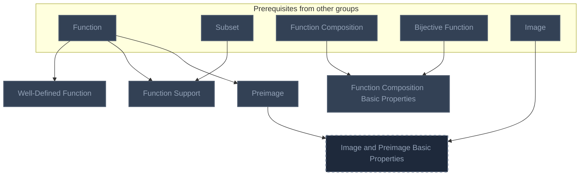
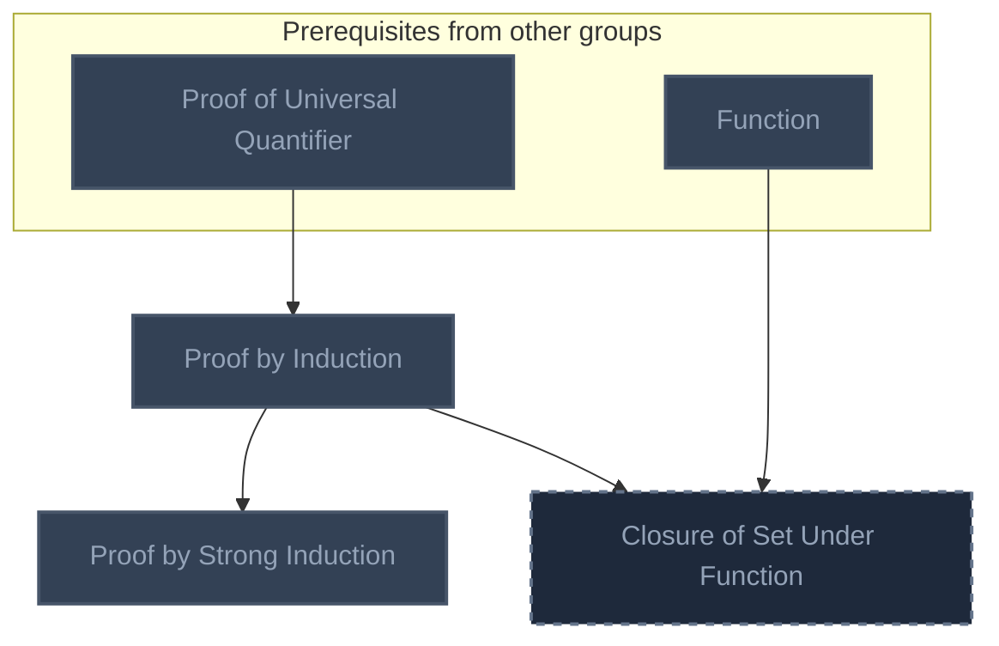

<!-- BEGIN STATS (generated by Scripts/skill_trees.py; do not edit) -->
**Mastered:** 0 / 113 · **Depth:** 0% · **Discovered:** 107 · **Planned:** 6 · **Locked:** 106 · **Rusty:** 0

**Levels:** L0 107 · L1 0 · L2 0 · L3 0 · L4 0 · L5 0

**Next up:** [[Logic]]

Legend: dashed grey = planned (no note yet) · dark grey = locked · white L0 Discovered · green L1 Recall · blue L2 Apply · purple L3 Prove (Mastered) · orange L4 Wield · gold L5 Command · brown dashed border = rusty
<!-- END STATS -->

## HTPI Ch. 1: Sentential Logic
**Mastered:** 0 / 34 · **Discovered:** 34 / 34

```mermaid
flowchart TD
    classDef planned fill:#1E293B,stroke:#64748B,stroke-width:2px,stroke-dasharray:5 5,color:#94A3B8;
    classDef locked fill:#334155,stroke:#475569,stroke-width:2px,color:#94A3B8;
    classDef L0 fill:#F1F5F9,stroke:#94A3B8,stroke-width:2px,color:#000000;
    classDef L1 fill:#22C55E,stroke:#15803D,stroke-width:2px,color:#000000;
    classDef L2 fill:#3B82F6,stroke:#1D4ED8,stroke-width:3px,color:#FFFFFF;
    classDef L3 fill:#A855F7,stroke:#6B21A8,stroke-width:3px,color:#FFFFFF,font-weight:bold;
    classDef L4 fill:#F97316,stroke:#C2410C,stroke-width:4px,color:#000000,font-weight:bold;
    classDef L5 fill:#FFD700,stroke:#FF8C00,stroke-width:5px,color:#000000,font-weight:bold;
    classDef rusty stroke:#8B4513,stroke-width:4px,stroke-dasharray:3 3;
    subgraph sg_prereqs["Prerequisites from other groups"]
        n_variable["Variable"]
        n_set["Set"]
        n_set_union["Set Union"]
        n_set_intersection["Set Intersection"]
    end
    n_logic["Logic"]
    n_proposition["Proposition"]
    n_premise["Premise"]
    n_conclusion["Conclusion"]
    n_argument["Argument"]
    n_not["Not"]
    n_and["And"]
    n_or["Or"]
    n_truth_table["Truth Table"]
    n_double_negation_law["Double Negation Law"]
    n_demorgan_s_laws["DeMorgan's Laws"]
    n_absorption_laws["Absorption Laws"]
    n_idempotent_laws["Idempotent Laws"]
    n_contradiction["Contradiction"]
    n_tautology["Tautology"]
    n_tautology_laws["Tautology Laws"]
    n_contradiction_laws["Contradiction Laws"]
    n_bound_variable["Bound Variable"]
    n_free_variable["Free Variable"]
    n_universe_of_discourse["Universe of Discourse"]
    n_truth_set["Truth Set"]
    n_set_difference["Set Difference"]
    n_symmetric_difference["Symmetric Difference"]
    n_disjoint_sets["Disjoint Sets"]
    n_subset["Subset"]
    n_superset["Superset"]
    n_proper_subset["Proper Subset"]
    n_proper_superset["Proper Superset"]
    n_set_basic_properties["Set Basic Properties"]
    n_conditional_statement["Conditional Statement"]
    n_converse["Converse"]
    n_contrapositive["Contrapositive"]
    n_biconditional_statement["Biconditional Statement"]
    n_logic_operations["Logic Operations"]
    n_logic --> n_proposition
    n_proposition --> n_premise
    n_premise --> n_conclusion
    n_conclusion --> n_argument
    n_proposition --> n_not
    n_proposition --> n_and
    n_proposition --> n_or
    n_not --> n_truth_table
    n_and --> n_truth_table
    n_or --> n_truth_table
    n_truth_table --> n_double_negation_law
    n_truth_table --> n_demorgan_s_laws
    n_truth_table --> n_absorption_laws
    n_truth_table --> n_idempotent_laws
    n_truth_table --> n_contradiction
    n_truth_table --> n_tautology
    n_tautology --> n_tautology_laws
    n_contradiction --> n_contradiction_laws
    n_variable --> n_bound_variable
    n_proposition --> n_bound_variable
    n_variable --> n_free_variable
    n_proposition --> n_free_variable
    n_variable --> n_universe_of_discourse
    n_set --> n_universe_of_discourse
    n_free_variable --> n_truth_set
    n_universe_of_discourse --> n_truth_set
    n_set --> n_set_difference
    n_set_difference --> n_symmetric_difference
    n_set_union --> n_symmetric_difference
    n_set_intersection --> n_disjoint_sets
    n_set --> n_subset
    n_subset --> n_superset
    n_subset --> n_proper_subset
    n_superset --> n_proper_superset
    n_subset --> n_set_basic_properties
    n_set_difference --> n_set_basic_properties
    n_truth_table --> n_conditional_statement
    n_conditional_statement --> n_converse
    n_conditional_statement --> n_contrapositive
    n_conditional_statement --> n_biconditional_statement
    n_biconditional_statement --> n_logic_operations
    class n_variable,n_set_union,n_set_intersection,n_proposition,n_premise,n_conclusion,n_argument,n_not,n_and,n_or,n_truth_table,n_double_negation_law,n_demorgan_s_laws,n_absorption_laws,n_idempotent_laws,n_contradiction,n_tautology,n_tautology_laws,n_contradiction_laws,n_bound_variable,n_free_variable,n_universe_of_discourse,n_truth_set,n_set_difference,n_symmetric_difference,n_disjoint_sets,n_subset,n_superset,n_proper_subset,n_proper_superset,n_set_basic_properties,n_conditional_statement,n_converse,n_contrapositive,n_biconditional_statement,n_logic_operations locked;
    class n_set,n_logic L0;
    class n_variable,n_set,n_set_union,n_set_intersection,n_logic,n_proposition,n_premise,n_conclusion,n_argument,n_not,n_and,n_or,n_truth_table,n_double_negation_law,n_demorgan_s_laws,n_absorption_laws,n_idempotent_laws,n_contradiction,n_tautology,n_tautology_laws,n_contradiction_laws,n_bound_variable,n_free_variable,n_universe_of_discourse,n_truth_set,n_set_difference,n_symmetric_difference,n_disjoint_sets,n_subset,n_superset,n_proper_subset,n_proper_superset,n_set_basic_properties,n_conditional_statement,n_converse,n_contrapositive,n_biconditional_statement,n_logic_operations internal-link;
```



## HTPI Ch. 2: Quantificational Logic
**Mastered:** 0 / 10 · **Discovered:** 10 / 10

```mermaid
flowchart TD
    classDef planned fill:#1E293B,stroke:#64748B,stroke-width:2px,stroke-dasharray:5 5,color:#94A3B8;
    classDef locked fill:#334155,stroke:#475569,stroke-width:2px,color:#94A3B8;
    classDef L0 fill:#F1F5F9,stroke:#94A3B8,stroke-width:2px,color:#000000;
    classDef L1 fill:#22C55E,stroke:#15803D,stroke-width:2px,color:#000000;
    classDef L2 fill:#3B82F6,stroke:#1D4ED8,stroke-width:3px,color:#FFFFFF;
    classDef L3 fill:#A855F7,stroke:#6B21A8,stroke-width:3px,color:#FFFFFF,font-weight:bold;
    classDef L4 fill:#F97316,stroke:#C2410C,stroke-width:4px,color:#000000,font-weight:bold;
    classDef L5 fill:#FFD700,stroke:#FF8C00,stroke-width:5px,color:#000000,font-weight:bold;
    classDef rusty stroke:#8B4513,stroke-width:4px,stroke-dasharray:3 3;
    subgraph sg_prereqs["Prerequisites from other groups"]
        n_bound_variable["Bound Variable"]
        n_free_variable["Free Variable"]
        n_universe_of_discourse["Universe of Discourse"]
        n_conditional_statement["Conditional Statement"]
        n_subset["Subset"]
        n_set["Set"]
    end
    n_quantifier["Quantifier"]
    n_universal_quantifier["Universal Quantifier"]
    n_existential_quantifier["Existential Quantifier"]
    n_quantifier_negation_laws["Quantifier Negation Laws"]
    n_unique_existential_quantifier["Unique Existential Quantifier"]
    n_restricted_quantification_laws["Restricted Quantification Laws"]
    n_quantifier_distributive_laws["Quantifier Distributive Laws"]
    n_set_equality["Set Equality"]
    n_power_set["Power Set"]
    n_collection_of_set["Collection of Set"]
    n_bound_variable --> n_quantifier
    n_free_variable --> n_quantifier
    n_quantifier --> n_universal_quantifier
    n_universe_of_discourse --> n_universal_quantifier
    n_quantifier --> n_existential_quantifier
    n_universe_of_discourse --> n_existential_quantifier
    n_universal_quantifier --> n_quantifier_negation_laws
    n_existential_quantifier --> n_quantifier_negation_laws
    n_universal_quantifier --> n_unique_existential_quantifier
    n_existential_quantifier --> n_unique_existential_quantifier
    n_universal_quantifier --> n_restricted_quantification_laws
    n_existential_quantifier --> n_restricted_quantification_laws
    n_conditional_statement --> n_restricted_quantification_laws
    n_universal_quantifier --> n_quantifier_distributive_laws
    n_existential_quantifier --> n_quantifier_distributive_laws
    n_subset --> n_set_equality
    n_subset --> n_power_set
    n_set --> n_collection_of_set
    class n_bound_variable,n_free_variable,n_universe_of_discourse,n_conditional_statement,n_subset,n_quantifier,n_universal_quantifier,n_existential_quantifier,n_quantifier_negation_laws,n_unique_existential_quantifier,n_restricted_quantification_laws,n_quantifier_distributive_laws,n_set_equality,n_power_set,n_collection_of_set locked;
    class n_set L0;
    class n_bound_variable,n_free_variable,n_universe_of_discourse,n_conditional_statement,n_subset,n_set,n_quantifier,n_universal_quantifier,n_existential_quantifier,n_quantifier_negation_laws,n_unique_existential_quantifier,n_restricted_quantification_laws,n_quantifier_distributive_laws,n_set_equality,n_power_set,n_collection_of_set internal-link;
```



## HTPI Ch. 3: Proofs
**Mastered:** 0 / 21 · **Discovered:** 21 / 21

```mermaid
flowchart TD
    classDef planned fill:#1E293B,stroke:#64748B,stroke-width:2px,stroke-dasharray:5 5,color:#94A3B8;
    classDef locked fill:#334155,stroke:#475569,stroke-width:2px,color:#94A3B8;
    classDef L0 fill:#F1F5F9,stroke:#94A3B8,stroke-width:2px,color:#000000;
    classDef L1 fill:#22C55E,stroke:#15803D,stroke-width:2px,color:#000000;
    classDef L2 fill:#3B82F6,stroke:#1D4ED8,stroke-width:3px,color:#FFFFFF;
    classDef L3 fill:#A855F7,stroke:#6B21A8,stroke-width:3px,color:#FFFFFF,font-weight:bold;
    classDef L4 fill:#F97316,stroke:#C2410C,stroke-width:4px,color:#000000,font-weight:bold;
    classDef L5 fill:#FFD700,stroke:#FF8C00,stroke-width:5px,color:#000000,font-weight:bold;
    classDef rusty stroke:#8B4513,stroke-width:4px,stroke-dasharray:3 3;
    subgraph sg_prereqs["Prerequisites from other groups"]
        n_argument["Argument"]
        n_universal_quantifier["Universal Quantifier"]
        n_conditional_statement["Conditional Statement"]
        n_contrapositive["Contrapositive"]
        n_contradiction["Contradiction"]
        n_existential_quantifier["Existential Quantifier"]
        n_divisible["Divisible"]
        n_integer["Integer"]
        n_biconditional_statement["Biconditional Statement"]
        n_unique_existential_quantifier["Unique Existential Quantifier"]
    end
    n_proof["Proof"]
    n_theorem["Theorem"]
    n_conjecture["Conjecture"]
    n_mathematical_terms["Mathematical Terms"]
    n_proof_by_counterexample["Proof by Counterexample"]
    n_direct_proof["Direct Proof"]
    n_proof_by_contrapositive["Proof by Contrapositive"]
    n_proof_by_contradiction["Proof by Contradiction"]
    n_proof_of_universal_quantifier["Proof of Universal Quantifier"]
    n_proof_of_existential_quantifier["Proof of Existential Quantifier"]
    n_divides["Divides"]
    n_proof_of_conjunction["Proof of Conjunction"]
    n_even_number["Even Number"]
    n_odd_number["Odd Number"]
    n_proof_of_biconditional["Proof of Biconditional"]
    n_proof_using_equivalences["Proof Using Equivalences"]
    n_proof_by_cases["Proof by Cases"]
    n_proof_of_disjunction["Proof of Disjunction"]
    n_proof_of_multiple_biconditionals["Proof of Multiple Biconditionals"]
    n_proof_of_unique_existential_quantifier["Proof of Unique Existential Quantifier"]
    n_list_of_interesting_proofs["List of Interesting Proofs"]
    n_argument --> n_proof
    n_proof --> n_theorem
    n_proof --> n_conjecture
    n_theorem --> n_mathematical_terms
    n_conjecture --> n_mathematical_terms
    n_proof --> n_proof_by_counterexample
    n_universal_quantifier --> n_proof_by_counterexample
    n_proof --> n_direct_proof
    n_conditional_statement --> n_direct_proof
    n_direct_proof --> n_proof_by_contrapositive
    n_contrapositive --> n_proof_by_contrapositive
    n_proof --> n_proof_by_contradiction
    n_contradiction --> n_proof_by_contradiction
    n_proof --> n_proof_of_universal_quantifier
    n_universal_quantifier --> n_proof_of_universal_quantifier
    n_proof --> n_proof_of_existential_quantifier
    n_existential_quantifier --> n_proof_of_existential_quantifier
    n_divisible --> n_divides
    n_existential_quantifier --> n_divides
    n_proof --> n_proof_of_conjunction
    n_integer --> n_even_number
    n_integer --> n_odd_number
    n_direct_proof --> n_proof_of_biconditional
    n_biconditional_statement --> n_proof_of_biconditional
    n_proof_of_biconditional --> n_proof_using_equivalences
    n_proof --> n_proof_by_cases
    n_direct_proof --> n_proof_of_disjunction
    n_proof_of_biconditional --> n_proof_of_multiple_biconditionals
    n_proof_of_existential_quantifier --> n_proof_of_unique_existential_quantifier
    n_unique_existential_quantifier --> n_proof_of_unique_existential_quantifier
    n_proof_by_contradiction --> n_list_of_interesting_proofs
    class n_argument,n_universal_quantifier,n_conditional_statement,n_contrapositive,n_contradiction,n_existential_quantifier,n_divisible,n_integer,n_biconditional_statement,n_unique_existential_quantifier,n_proof,n_theorem,n_conjecture,n_mathematical_terms,n_proof_by_counterexample,n_direct_proof,n_proof_by_contrapositive,n_proof_by_contradiction,n_proof_of_universal_quantifier,n_proof_of_existential_quantifier,n_divides,n_proof_of_conjunction,n_even_number,n_odd_number,n_proof_of_biconditional,n_proof_using_equivalences,n_proof_by_cases,n_proof_of_disjunction,n_proof_of_multiple_biconditionals,n_proof_of_unique_existential_quantifier,n_list_of_interesting_proofs locked;
    class n_argument,n_universal_quantifier,n_conditional_statement,n_contrapositive,n_contradiction,n_existential_quantifier,n_divisible,n_integer,n_biconditional_statement,n_unique_existential_quantifier,n_proof,n_theorem,n_conjecture,n_mathematical_terms,n_proof_by_counterexample,n_direct_proof,n_proof_by_contrapositive,n_proof_by_contradiction,n_proof_of_universal_quantifier,n_proof_of_existential_quantifier,n_divides,n_proof_of_conjunction,n_even_number,n_odd_number,n_proof_of_biconditional,n_proof_using_equivalences,n_proof_by_cases,n_proof_of_disjunction,n_proof_of_multiple_biconditionals,n_proof_of_unique_existential_quantifier,n_list_of_interesting_proofs internal-link;
```



## HTPI Ch. 4: Relations
**Mastered:** 0 / 27 · **Discovered:** 27 / 27

```mermaid
flowchart TD
    classDef planned fill:#1E293B,stroke:#64748B,stroke-width:2px,stroke-dasharray:5 5,color:#94A3B8;
    classDef locked fill:#334155,stroke:#475569,stroke-width:2px,color:#94A3B8;
    classDef L0 fill:#F1F5F9,stroke:#94A3B8,stroke-width:2px,color:#000000;
    classDef L1 fill:#22C55E,stroke:#15803D,stroke-width:2px,color:#000000;
    classDef L2 fill:#3B82F6,stroke:#1D4ED8,stroke-width:3px,color:#FFFFFF;
    classDef L3 fill:#A855F7,stroke:#6B21A8,stroke-width:3px,color:#FFFFFF,font-weight:bold;
    classDef L4 fill:#F97316,stroke:#C2410C,stroke-width:4px,color:#000000,font-weight:bold;
    classDef L5 fill:#FFD700,stroke:#FF8C00,stroke-width:5px,color:#000000,font-weight:bold;
    classDef rusty stroke:#8B4513,stroke-width:4px,stroke-dasharray:3 3;
    subgraph sg_prereqs["Prerequisites from other groups"]
        n_ordered_pair["Ordered Pair"]
        n_set["Set"]
        n_set_union["Set Union"]
        n_set_intersection["Set Intersection"]
        n_symmetric_difference["Symmetric Difference"]
        n_power_set["Power Set"]
        n_relation["Relation"]
        n_partition["Partition"]
    end
    n_cartesian_product["Cartesian Product"]
    n_cartesian_product_basic_properties["Cartesian Product Basic Properties"]
    n_set_operations["Set Operations"]
    n_inverse_relation["Inverse Relation"]
    n_relation_composition["Relation Composition"]
    n_relation_basic_properties["Relation Basic Properties"]
    n_reflexive_relation["Reflexive Relation"]
    n_symmetric_relation["Symmetric Relation"]
    n_transitive_relation["Transitive Relation"]
    n_antisymmetric_relation["Antisymmetric Relation"]
    n_partial_order["Partial Order"]
    n_total_order["Total Order"]
    n_relation_smallest_element["Relation Smallest Element"]
    n_relation_minimal_element["Relation Minimal Element"]
    n_relation_lower_bound["Relation Lower Bound"]
    n_relation_upper_bound["Relation Upper Bound"]
    n_relation_greatest_lower_bound["Relation Greatest Lower Bound"]
    n_relation_least_upper_bound["Relation Least Upper Bound"]
    n_reflexive_closure["Reflexive Closure"]
    n_irreflexive_relation["Irreflexive Relation"]
    n_strict_partial_order["Strict Partial Order"]
    n_strict_total_order["Strict Total Order"]
    n_symmetric_closure["Symmetric Closure"]
    n_transitive_closure["Transitive Closure"]
    n_equivalence_relation["Equivalence Relation"]
    n_equivalence_class["Equivalence Class"]
    n_equivalence_relation_on_set_and_partition_theorem["Equivalence Relation on Set and Partition Theorem"]
    n_ordered_pair --> n_cartesian_product
    n_set --> n_cartesian_product
    n_cartesian_product --> n_cartesian_product_basic_properties
    n_set_union --> n_cartesian_product_basic_properties
    n_set_intersection --> n_cartesian_product_basic_properties
    n_symmetric_difference --> n_set_operations
    n_power_set --> n_set_operations
    n_cartesian_product --> n_set_operations
    n_relation --> n_inverse_relation
    n_relation --> n_relation_composition
    n_inverse_relation --> n_relation_basic_properties
    n_relation_composition --> n_relation_basic_properties
    n_relation --> n_reflexive_relation
    n_relation --> n_symmetric_relation
    n_relation --> n_transitive_relation
    n_relation --> n_antisymmetric_relation
    n_reflexive_relation --> n_partial_order
    n_transitive_relation --> n_partial_order
    n_antisymmetric_relation --> n_partial_order
    n_partial_order --> n_total_order
    n_partial_order --> n_relation_smallest_element
    n_partial_order --> n_relation_minimal_element
    n_partial_order --> n_relation_lower_bound
    n_partial_order --> n_relation_upper_bound
    n_relation_lower_bound --> n_relation_greatest_lower_bound
    n_relation_upper_bound --> n_relation_least_upper_bound
    n_relation_smallest_element --> n_relation_least_upper_bound
    n_reflexive_relation --> n_reflexive_closure
    n_relation --> n_irreflexive_relation
    n_partial_order --> n_strict_partial_order
    n_irreflexive_relation --> n_strict_partial_order
    n_strict_partial_order --> n_strict_total_order
    n_total_order --> n_strict_total_order
    n_symmetric_relation --> n_symmetric_closure
    n_transitive_relation --> n_transitive_closure
    n_reflexive_relation --> n_equivalence_relation
    n_symmetric_relation --> n_equivalence_relation
    n_transitive_relation --> n_equivalence_relation
    n_equivalence_relation --> n_equivalence_class
    n_equivalence_class --> n_equivalence_relation_on_set_and_partition_theorem
    n_partition --> n_equivalence_relation_on_set_and_partition_theorem
    class n_ordered_pair,n_set_union,n_set_intersection,n_symmetric_difference,n_power_set,n_relation,n_cartesian_product,n_cartesian_product_basic_properties,n_set_operations,n_inverse_relation,n_relation_composition,n_relation_basic_properties,n_reflexive_relation,n_symmetric_relation,n_transitive_relation,n_antisymmetric_relation,n_partial_order,n_total_order,n_relation_smallest_element,n_relation_minimal_element,n_relation_lower_bound,n_relation_upper_bound,n_relation_greatest_lower_bound,n_relation_least_upper_bound,n_reflexive_closure,n_irreflexive_relation,n_strict_partial_order,n_strict_total_order,n_symmetric_closure,n_transitive_closure,n_equivalence_relation,n_equivalence_class,n_equivalence_relation_on_set_and_partition_theorem locked;
    class n_set,n_partition L0;
    class n_ordered_pair,n_set,n_set_union,n_set_intersection,n_symmetric_difference,n_power_set,n_relation,n_partition,n_cartesian_product,n_cartesian_product_basic_properties,n_set_operations,n_inverse_relation,n_relation_composition,n_relation_basic_properties,n_reflexive_relation,n_symmetric_relation,n_transitive_relation,n_antisymmetric_relation,n_partial_order,n_total_order,n_relation_smallest_element,n_relation_minimal_element,n_relation_lower_bound,n_relation_upper_bound,n_relation_greatest_lower_bound,n_relation_least_upper_bound,n_reflexive_closure,n_irreflexive_relation,n_strict_partial_order,n_strict_total_order,n_symmetric_closure,n_transitive_closure,n_equivalence_relation,n_equivalence_class,n_equivalence_relation_on_set_and_partition_theorem internal-link;
```



## HTPI Ch. 5: Functions
**Mastered:** 0 / 5 · **Discovered:** 4 / 5



## HTPI Ch. 6: Mathematical Induction
**Mastered:** 0 / 3 · **Discovered:** 2 / 3



## HTPI Ch. 7: Infinite Sets
**Mastered:** 0 / 13 · **Discovered:** 9 / 13

```mermaid
flowchart TD
    classDef planned fill:#1E293B,stroke:#64748B,stroke-width:2px,stroke-dasharray:5 5,color:#94A3B8;
    classDef locked fill:#334155,stroke:#475569,stroke-width:2px,color:#94A3B8;
    classDef L0 fill:#F1F5F9,stroke:#94A3B8,stroke-width:2px,color:#000000;
    classDef L1 fill:#22C55E,stroke:#15803D,stroke-width:2px,color:#000000;
    classDef L2 fill:#3B82F6,stroke:#1D4ED8,stroke-width:3px,color:#FFFFFF;
    classDef L3 fill:#A855F7,stroke:#6B21A8,stroke-width:3px,color:#FFFFFF,font-weight:bold;
    classDef L4 fill:#F97316,stroke:#C2410C,stroke-width:4px,color:#000000,font-weight:bold;
    classDef L5 fill:#FFD700,stroke:#FF8C00,stroke-width:5px,color:#000000,font-weight:bold;
    classDef rusty stroke:#8B4513,stroke-width:4px,stroke-dasharray:3 3;
    subgraph sg_prereqs["Prerequisites from other groups"]
        n_set["Set"]
        n_bijective_function["Bijective Function"]
        n_disjoint_sets["Disjoint Sets"]
        n_cartesian_product["Cartesian Product"]
        n_injective_function["Injective Function"]
        n_surjective_function["Surjective Function"]
        n_collection_of_set["Collection of Set"]
        n_power_set["Power Set"]
        n_proof_by_contradiction["Proof by Contradiction"]
        n_natural_number["Natural Number"]
        n_combination["Combination"]
    end
    n_set_cardinality["Set Cardinality"]
    n_set_cardinality_of_disjoint_union["Set Cardinality of Disjoint Union"]
    n_cartesian_product_set_cardinality["Cartesian Product Set Cardinality"]
    n_equinumerous_sets["Equinumerous Sets"]
    n_set_cardinality_equivalence_theorem["Set Cardinality Equivalence Theorem"]
    n_countable_union_of_countable_sets_theorem["Countable Union of Countable Sets Theorem"]
    n_cantor_s_theorem["Cantor's Theorem"]
    n_cantor_schroder_bernstein_theorem["Cantor-Schroder-Bernstein Theorem"]
    n_set_of_natural_numbers["Set of Natural Numbers"]
    n_well_ordering_principle["Well Ordering Principle"]
    n_pascal_s_identity["Pascal's Identity"]
    n_binomial_theorem["Binomial Theorem"]
    n_countable_set["Countable Set"]
    n_set --> n_set_cardinality
    n_bijective_function --> n_set_cardinality
    n_set_cardinality --> n_set_cardinality_of_disjoint_union
    n_disjoint_sets --> n_set_cardinality_of_disjoint_union
    n_set_cardinality --> n_cartesian_product_set_cardinality
    n_cartesian_product --> n_cartesian_product_set_cardinality
    n_bijective_function --> n_equinumerous_sets
    n_set_cardinality --> n_set_cardinality_equivalence_theorem
    n_equinumerous_sets --> n_set_cardinality_equivalence_theorem
    n_injective_function --> n_set_cardinality_equivalence_theorem
    n_surjective_function --> n_set_cardinality_equivalence_theorem
    n_countable_set --> n_countable_union_of_countable_sets_theorem
    n_collection_of_set --> n_countable_union_of_countable_sets_theorem
    n_power_set --> n_cantor_s_theorem
    n_equinumerous_sets --> n_cantor_s_theorem
    n_proof_by_contradiction --> n_cantor_s_theorem
    n_set_cardinality_equivalence_theorem --> n_cantor_schroder_bernstein_theorem
    n_natural_number --> n_set_of_natural_numbers
    n_set_of_natural_numbers --> n_well_ordering_principle
    n_combination --> n_pascal_s_identity
    n_pascal_s_identity --> n_binomial_theorem
    n_bijective_function --> n_countable_set
    n_set --> n_countable_set
    class n_equinumerous_sets,n_countable_union_of_countable_sets_theorem,n_cantor_s_theorem,n_cantor_schroder_bernstein_theorem planned;
    class n_bijective_function,n_disjoint_sets,n_cartesian_product,n_injective_function,n_surjective_function,n_collection_of_set,n_power_set,n_proof_by_contradiction,n_natural_number,n_combination,n_set_cardinality,n_set_cardinality_of_disjoint_union,n_cartesian_product_set_cardinality,n_set_cardinality_equivalence_theorem,n_set_of_natural_numbers,n_well_ordering_principle,n_pascal_s_identity,n_binomial_theorem,n_countable_set locked;
    class n_set L0;
    class n_set,n_bijective_function,n_disjoint_sets,n_cartesian_product,n_injective_function,n_surjective_function,n_collection_of_set,n_power_set,n_proof_by_contradiction,n_natural_number,n_combination,n_set_cardinality,n_set_cardinality_of_disjoint_union,n_cartesian_product_set_cardinality,n_set_cardinality_equivalence_theorem,n_set_of_natural_numbers,n_well_ordering_principle,n_pascal_s_identity,n_binomial_theorem,n_countable_set internal-link;
```



# Source
Graph structure: the single source for the diagrams above, edited by `/note` and `Scripts/skill_trees.py` (`add`, `edge`, `rename`). Everything above this heading is regenerated by `render`.

```skilltree
    %% PREREQUISITES
    n_variable["Variable"]
    n_set["Set"]
    n_set_union["Set Union"]
    n_set_intersection["Set Intersection"]
    n_divisible["Divisible"]
    n_integer["Integer"]
    n_ordered_pair["Ordered Pair"]
    n_relation["Relation"]
    n_partition["Partition"]
    n_function["Function"]
    n_function_composition["Function Composition"]
    n_bijective_function["Bijective Function"]
    n_image["Image"]
    n_injective_function["Injective Function"]
    n_surjective_function["Surjective Function"]
    n_natural_number["Natural Number"]
    n_combination["Combination"]
    %% NODES
    %% == HTPI Ch. 1: Sentential Logic ==
    n_logic["Logic"]
    n_proposition["Proposition"]
    n_premise["Premise"]
    n_conclusion["Conclusion"]
    n_argument["Argument"]
    n_not["Not"]
    n_and["And"]
    n_or["Or"]
    n_truth_table["Truth Table"]
    n_double_negation_law["Double Negation Law"]
    n_demorgan_s_laws["DeMorgan's Laws"]
    n_absorption_laws["Absorption Laws"]
    n_idempotent_laws["Idempotent Laws"]
    n_contradiction["Contradiction"]
    n_tautology["Tautology"]
    n_tautology_laws["Tautology Laws"]
    n_contradiction_laws["Contradiction Laws"]
    n_bound_variable["Bound Variable"]
    n_free_variable["Free Variable"]
    n_universe_of_discourse["Universe of Discourse"]
    n_truth_set["Truth Set"]
    n_set_difference["Set Difference"]
    n_symmetric_difference["Symmetric Difference"]
    n_disjoint_sets["Disjoint Sets"]
    n_subset["Subset"]
    n_superset["Superset"]
    n_proper_subset["Proper Subset"]
    n_proper_superset["Proper Superset"]
    n_set_basic_properties["Set Basic Properties"]
    n_conditional_statement["Conditional Statement"]
    n_converse["Converse"]
    n_contrapositive["Contrapositive"]
    n_biconditional_statement["Biconditional Statement"]
    n_logic_operations["Logic Operations"]
    %% == HTPI Ch. 2: Quantificational Logic ==
    n_quantifier["Quantifier"]
    n_universal_quantifier["Universal Quantifier"]
    n_existential_quantifier["Existential Quantifier"]
    n_quantifier_negation_laws["Quantifier Negation Laws"]
    n_unique_existential_quantifier["Unique Existential Quantifier"]
    n_restricted_quantification_laws["Restricted Quantification Laws"]
    n_quantifier_distributive_laws["Quantifier Distributive Laws"]
    n_set_equality["Set Equality"]
    n_power_set["Power Set"]
    n_collection_of_set["Collection of Set"]
    %% == HTPI Ch. 3: Proofs ==
    n_proof["Proof"]
    n_theorem["Theorem"]
    n_conjecture["Conjecture"]
    n_mathematical_terms["Mathematical Terms"]
    n_proof_by_counterexample["Proof by Counterexample"]
    n_direct_proof["Direct Proof"]
    n_proof_by_contrapositive["Proof by Contrapositive"]
    n_proof_by_contradiction["Proof by Contradiction"]
    n_proof_of_universal_quantifier["Proof of Universal Quantifier"]
    n_proof_of_existential_quantifier["Proof of Existential Quantifier"]
    n_divides["Divides"]
    n_proof_of_conjunction["Proof of Conjunction"]
    n_even_number["Even Number"]
    n_odd_number["Odd Number"]
    n_proof_of_biconditional["Proof of Biconditional"]
    n_proof_using_equivalences["Proof Using Equivalences"]
    n_proof_by_cases["Proof by Cases"]
    n_proof_of_disjunction["Proof of Disjunction"]
    n_proof_of_multiple_biconditionals["Proof of Multiple Biconditionals"]
    n_proof_of_unique_existential_quantifier["Proof of Unique Existential Quantifier"]
    n_list_of_interesting_proofs["List of Interesting Proofs"]
    %% == HTPI Ch. 4: Relations ==
    n_cartesian_product["Cartesian Product"]
    n_cartesian_product_basic_properties["Cartesian Product Basic Properties"]
    n_set_operations["Set Operations"]
    n_inverse_relation["Inverse Relation"]
    n_relation_composition["Relation Composition"]
    n_relation_basic_properties["Relation Basic Properties"]
    n_reflexive_relation["Reflexive Relation"]
    n_symmetric_relation["Symmetric Relation"]
    n_transitive_relation["Transitive Relation"]
    n_antisymmetric_relation["Antisymmetric Relation"]
    n_partial_order["Partial Order"]
    n_total_order["Total Order"]
    n_relation_smallest_element["Relation Smallest Element"]
    n_relation_minimal_element["Relation Minimal Element"]
    n_relation_lower_bound["Relation Lower Bound"]
    n_relation_upper_bound["Relation Upper Bound"]
    n_relation_greatest_lower_bound["Relation Greatest Lower Bound"]
    n_relation_least_upper_bound["Relation Least Upper Bound"]
    n_reflexive_closure["Reflexive Closure"]
    n_irreflexive_relation["Irreflexive Relation"]
    n_strict_partial_order["Strict Partial Order"]
    n_strict_total_order["Strict Total Order"]
    n_symmetric_closure["Symmetric Closure"]
    n_transitive_closure["Transitive Closure"]
    n_equivalence_relation["Equivalence Relation"]
    n_equivalence_class["Equivalence Class"]
    n_equivalence_relation_on_set_and_partition_theorem["Equivalence Relation on Set and Partition Theorem"]
    %% == HTPI Ch. 5: Functions ==
    n_well_defined_function["Well-Defined Function"]
    n_function_support["Function Support"]
    n_function_composition_basic_properties["Function Composition Basic Properties"]
    n_preimage["Preimage"]
    n_image_and_preimage_basic_properties["Image and Preimage Basic Properties"]
    %% == HTPI Ch. 6: Mathematical Induction ==
    n_proof_by_induction["Proof by Induction"]
    n_proof_by_strong_induction["Proof by Strong Induction"]
    n_closure_of_set_under_function["Closure of Set Under Function"]
    %% == HTPI Ch. 7: Infinite Sets ==
    n_set_cardinality["Set Cardinality"]
    n_set_cardinality_of_disjoint_union["Set Cardinality of Disjoint Union"]
    n_cartesian_product_set_cardinality["Cartesian Product Set Cardinality"]
    n_equinumerous_sets["Equinumerous Sets"]
    n_set_cardinality_equivalence_theorem["Set Cardinality Equivalence Theorem"]
    n_countable_union_of_countable_sets_theorem["Countable Union of Countable Sets Theorem"]
    n_cantor_s_theorem["Cantor's Theorem"]
    n_cantor_schroder_bernstein_theorem["Cantor-Schroder-Bernstein Theorem"]
    n_set_of_natural_numbers["Set of Natural Numbers"]
    n_well_ordering_principle["Well Ordering Principle"]
    n_pascal_s_identity["Pascal's Identity"]
    n_binomial_theorem["Binomial Theorem"]
    n_countable_set["Countable Set"]
    %% EDGES
    n_logic --> n_proposition
    n_proposition --> n_premise
    n_premise --> n_conclusion
    n_conclusion --> n_argument
    n_proposition --> n_not
    n_proposition --> n_and
    n_proposition --> n_or
    n_not --> n_truth_table
    n_and --> n_truth_table
    n_or --> n_truth_table
    n_truth_table --> n_double_negation_law
    n_truth_table --> n_demorgan_s_laws
    n_truth_table --> n_absorption_laws
    n_truth_table --> n_idempotent_laws
    n_truth_table --> n_contradiction
    n_truth_table --> n_tautology
    n_tautology --> n_tautology_laws
    n_contradiction --> n_contradiction_laws
    n_variable --> n_bound_variable
    n_proposition --> n_bound_variable
    n_variable --> n_free_variable
    n_proposition --> n_free_variable
    n_variable --> n_universe_of_discourse
    n_set --> n_universe_of_discourse
    n_free_variable --> n_truth_set
    n_universe_of_discourse --> n_truth_set
    n_set --> n_set_difference
    n_set_difference --> n_symmetric_difference
    n_set_union --> n_symmetric_difference
    n_set_intersection --> n_disjoint_sets
    n_set --> n_subset
    n_subset --> n_superset
    n_subset --> n_proper_subset
    n_superset --> n_proper_superset
    n_subset --> n_set_basic_properties
    n_set_difference --> n_set_basic_properties
    n_truth_table --> n_conditional_statement
    n_conditional_statement --> n_converse
    n_conditional_statement --> n_contrapositive
    n_conditional_statement --> n_biconditional_statement
    n_biconditional_statement --> n_logic_operations
    n_bound_variable --> n_quantifier
    n_free_variable --> n_quantifier
    n_quantifier --> n_universal_quantifier
    n_universe_of_discourse --> n_universal_quantifier
    n_quantifier --> n_existential_quantifier
    n_universe_of_discourse --> n_existential_quantifier
    n_universal_quantifier --> n_quantifier_negation_laws
    n_existential_quantifier --> n_quantifier_negation_laws
    n_universal_quantifier --> n_unique_existential_quantifier
    n_existential_quantifier --> n_unique_existential_quantifier
    n_universal_quantifier --> n_restricted_quantification_laws
    n_existential_quantifier --> n_restricted_quantification_laws
    n_conditional_statement --> n_restricted_quantification_laws
    n_universal_quantifier --> n_quantifier_distributive_laws
    n_existential_quantifier --> n_quantifier_distributive_laws
    n_subset --> n_set_equality
    n_subset --> n_power_set
    n_set --> n_collection_of_set
    n_argument --> n_proof
    n_proof --> n_theorem
    n_proof --> n_conjecture
    n_theorem --> n_mathematical_terms
    n_conjecture --> n_mathematical_terms
    n_proof --> n_proof_by_counterexample
    n_universal_quantifier --> n_proof_by_counterexample
    n_proof --> n_direct_proof
    n_conditional_statement --> n_direct_proof
    n_direct_proof --> n_proof_by_contrapositive
    n_contrapositive --> n_proof_by_contrapositive
    n_proof --> n_proof_by_contradiction
    n_contradiction --> n_proof_by_contradiction
    n_proof --> n_proof_of_universal_quantifier
    n_universal_quantifier --> n_proof_of_universal_quantifier
    n_proof --> n_proof_of_existential_quantifier
    n_existential_quantifier --> n_proof_of_existential_quantifier
    n_divisible --> n_divides
    n_existential_quantifier --> n_divides
    n_proof --> n_proof_of_conjunction
    n_integer --> n_even_number
    n_integer --> n_odd_number
    n_direct_proof --> n_proof_of_biconditional
    n_biconditional_statement --> n_proof_of_biconditional
    n_proof_of_biconditional --> n_proof_using_equivalences
    n_proof --> n_proof_by_cases
    n_direct_proof --> n_proof_of_disjunction
    n_proof_of_biconditional --> n_proof_of_multiple_biconditionals
    n_proof_of_existential_quantifier --> n_proof_of_unique_existential_quantifier
    n_unique_existential_quantifier --> n_proof_of_unique_existential_quantifier
    n_proof_by_contradiction --> n_list_of_interesting_proofs
    n_ordered_pair --> n_cartesian_product
    n_set --> n_cartesian_product
    n_cartesian_product --> n_cartesian_product_basic_properties
    n_set_union --> n_cartesian_product_basic_properties
    n_set_intersection --> n_cartesian_product_basic_properties
    n_symmetric_difference --> n_set_operations
    n_power_set --> n_set_operations
    n_cartesian_product --> n_set_operations
    n_relation --> n_inverse_relation
    n_relation --> n_relation_composition
    n_inverse_relation --> n_relation_basic_properties
    n_relation_composition --> n_relation_basic_properties
    n_relation --> n_reflexive_relation
    n_relation --> n_symmetric_relation
    n_relation --> n_transitive_relation
    n_relation --> n_antisymmetric_relation
    n_reflexive_relation --> n_partial_order
    n_transitive_relation --> n_partial_order
    n_antisymmetric_relation --> n_partial_order
    n_partial_order --> n_total_order
    n_partial_order --> n_relation_smallest_element
    n_partial_order --> n_relation_minimal_element
    n_partial_order --> n_relation_lower_bound
    n_partial_order --> n_relation_upper_bound
    n_relation_lower_bound --> n_relation_greatest_lower_bound
    n_relation_upper_bound --> n_relation_least_upper_bound
    n_relation_smallest_element --> n_relation_least_upper_bound
    n_reflexive_relation --> n_reflexive_closure
    n_relation --> n_irreflexive_relation
    n_partial_order --> n_strict_partial_order
    n_irreflexive_relation --> n_strict_partial_order
    n_strict_partial_order --> n_strict_total_order
    n_total_order --> n_strict_total_order
    n_symmetric_relation --> n_symmetric_closure
    n_transitive_relation --> n_transitive_closure
    n_reflexive_relation --> n_equivalence_relation
    n_symmetric_relation --> n_equivalence_relation
    n_transitive_relation --> n_equivalence_relation
    n_equivalence_relation --> n_equivalence_class
    n_equivalence_class --> n_equivalence_relation_on_set_and_partition_theorem
    n_partition --> n_equivalence_relation_on_set_and_partition_theorem
    n_function --> n_well_defined_function
    n_function --> n_function_support
    n_subset --> n_function_support
    n_function_composition --> n_function_composition_basic_properties
    n_bijective_function --> n_function_composition_basic_properties
    n_function --> n_preimage
    n_preimage --> n_image_and_preimage_basic_properties
    n_image --> n_image_and_preimage_basic_properties
    n_proof_of_universal_quantifier --> n_proof_by_induction
    n_proof_by_induction --> n_proof_by_strong_induction
    n_proof_by_induction --> n_closure_of_set_under_function
    n_function --> n_closure_of_set_under_function
    n_set --> n_set_cardinality
    n_bijective_function --> n_set_cardinality
    n_set_cardinality --> n_set_cardinality_of_disjoint_union
    n_disjoint_sets --> n_set_cardinality_of_disjoint_union
    n_set_cardinality --> n_cartesian_product_set_cardinality
    n_cartesian_product --> n_cartesian_product_set_cardinality
    n_bijective_function --> n_equinumerous_sets
    n_set_cardinality --> n_set_cardinality_equivalence_theorem
    n_equinumerous_sets --> n_set_cardinality_equivalence_theorem
    n_injective_function --> n_set_cardinality_equivalence_theorem
    n_surjective_function --> n_set_cardinality_equivalence_theorem
    n_countable_set --> n_countable_union_of_countable_sets_theorem
    n_collection_of_set --> n_countable_union_of_countable_sets_theorem
    n_power_set --> n_cantor_s_theorem
    n_equinumerous_sets --> n_cantor_s_theorem
    n_proof_by_contradiction --> n_cantor_s_theorem
    n_set_cardinality_equivalence_theorem --> n_cantor_schroder_bernstein_theorem
    n_natural_number --> n_set_of_natural_numbers
    n_set_of_natural_numbers --> n_well_ordering_principle
    n_combination --> n_pascal_s_identity
    n_pascal_s_identity --> n_binomial_theorem
    n_bijective_function --> n_countable_set
    n_set --> n_countable_set
```
