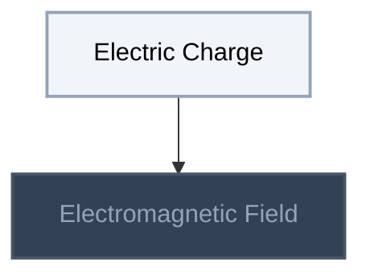
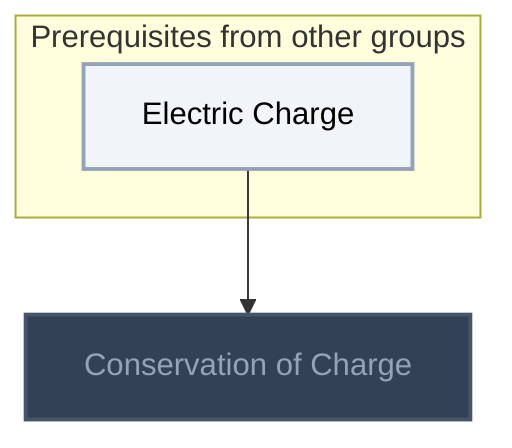
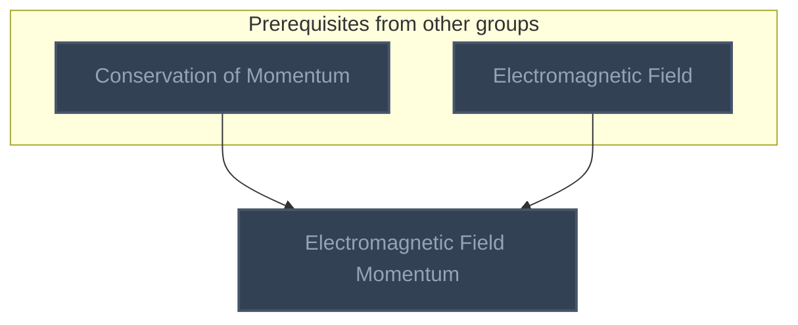
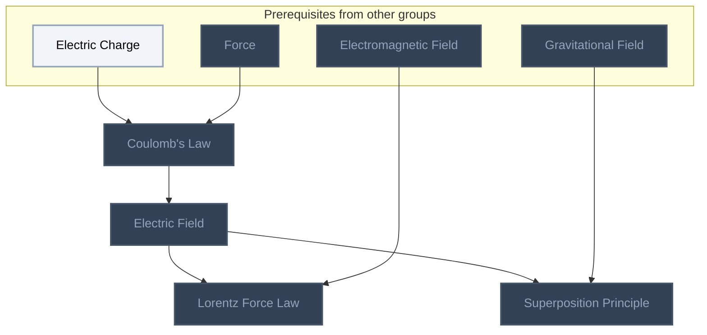
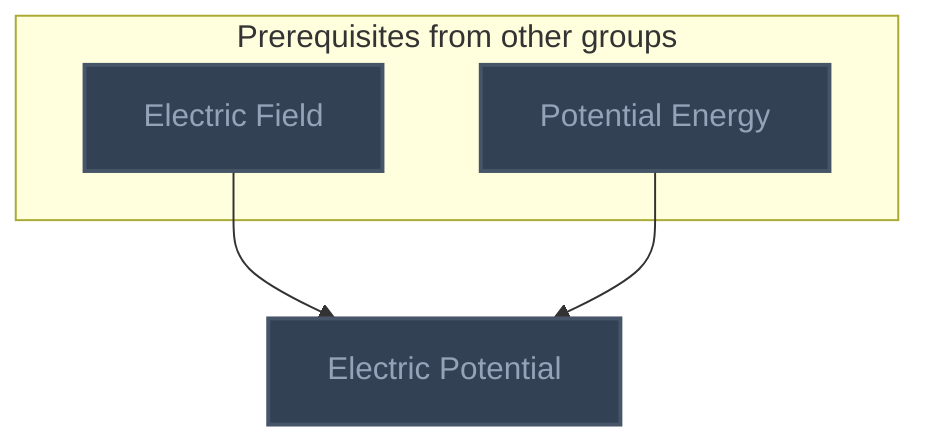
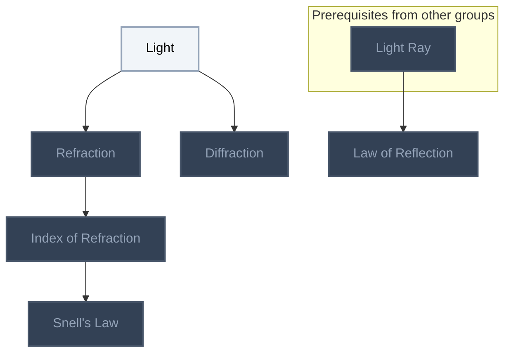

<!-- BEGIN STATS (generated by Scripts/skill_trees.py; do not edit) -->
**Mastered:** 0 / 15 · **Depth:** 0% · **Discovered:** 15 · **Planned:** 0 · **Locked:** 13 · **Rusty:** 0

**Levels:** L0 15 · L1 0 · L2 0 · L3 0 · L4 0 · L5 0

**Next up:** [[Electric Charge]], [[Light]]

Legend: dashed grey = planned (no note yet) · dark grey = locked · white L0 Discovered · green L1 Recall · blue L2 Apply · purple L3 Prove (Mastered) · orange L4 Wield · gold L5 Command · brown dashed border = rusty
<!-- END STATS -->

## Feynman Vol. I Ch. 2: Basic Physics
**Mastered:** 0 / 2 · **Discovered:** 2 / 2



## Feynman Vol. I Ch. 4: Conservation of Energy
**Mastered:** 0 / 1 · **Discovered:** 1 / 1



## Feynman Vol. I Ch. 10: Conservation of Momentum
**Mastered:** 0 / 1 · **Discovered:** 1 / 1



## Feynman Vol. I Ch. 12: Characteristics of Force
**Mastered:** 0 / 4 · **Discovered:** 4 / 4



## Feynman Vol. I Ch. 14: Work and Potential Energy (B)
**Mastered:** 0 / 1 · **Discovered:** 1 / 1



## Optics
**Mastered:** 0 / 6 · **Discovered:** 6 / 6



# Source
Graph structure: the single source for the diagrams above, edited by `/note` and `Scripts/skill_trees.py` (`add`, `edge`, `rename`). Everything above this heading is regenerated by `render`.

```skilltree
    %% PREREQUISITES
    n_conservation_of_momentum["Conservation of Momentum"]
    n_force["Force"]
    n_gravitational_field["Gravitational Field"]
    n_potential_energy["Potential Energy"]
    n_light_ray["Light Ray"]
    %% NODES
    %% == Feynman Vol. I Ch. 2: Basic Physics ==
    n_electric_charge["Electric Charge"]
    n_electromagnetic_field["Electromagnetic Field"]
    %% == Feynman Vol. I Ch. 4: Conservation of Energy ==
    n_conservation_of_charge["Conservation of Charge"]
    %% == Feynman Vol. I Ch. 10: Conservation of Momentum ==
    n_electromagnetic_field_momentum["Electromagnetic Field Momentum"]
    %% == Feynman Vol. I Ch. 12: Characteristics of Force ==
    n_coulomb_s_law["Coulomb's Law"]
    n_electric_field["Electric Field"]
    n_lorentz_force_law["Lorentz Force Law"]
    n_superposition_principle["Superposition Principle"]
    %% == Feynman Vol. I Ch. 14: Work and Potential Energy (B) ==
    n_electric_potential["Electric Potential"]
    %% == Optics ==
    n_light["Light"]
    n_refraction["Refraction"]
    n_index_of_refraction["Index of Refraction"]
    n_snell_s_law["Snell's Law"]
    n_diffraction["Diffraction"]
    n_law_of_reflection["Law of Reflection"]
    %% EDGES
    n_electric_charge --> n_electromagnetic_field
    n_electric_charge --> n_conservation_of_charge
    n_conservation_of_momentum --> n_electromagnetic_field_momentum
    n_electromagnetic_field --> n_electromagnetic_field_momentum
    n_electric_charge --> n_coulomb_s_law
    n_force --> n_coulomb_s_law
    n_coulomb_s_law --> n_electric_field
    n_electric_field --> n_lorentz_force_law
    n_electromagnetic_field --> n_lorentz_force_law
    n_electric_field --> n_superposition_principle
    n_gravitational_field --> n_superposition_principle
    n_electric_field --> n_electric_potential
    n_potential_energy --> n_electric_potential
    n_light --> n_refraction
    n_refraction --> n_index_of_refraction
    n_index_of_refraction --> n_snell_s_law
    n_light --> n_diffraction
    n_light_ray --> n_law_of_reflection
```
