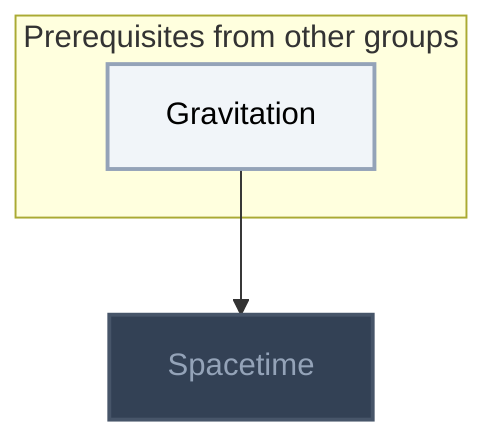
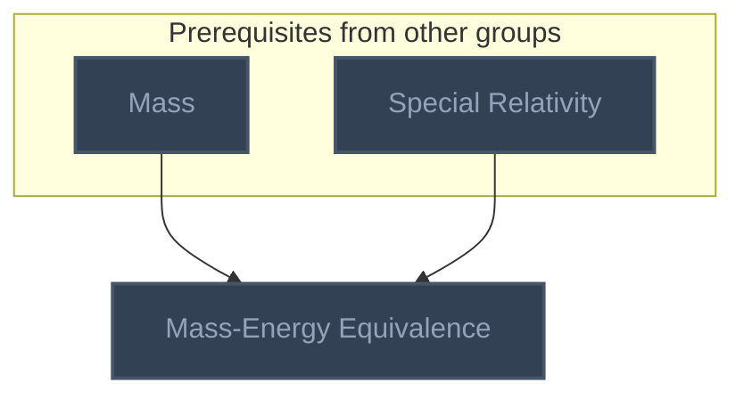
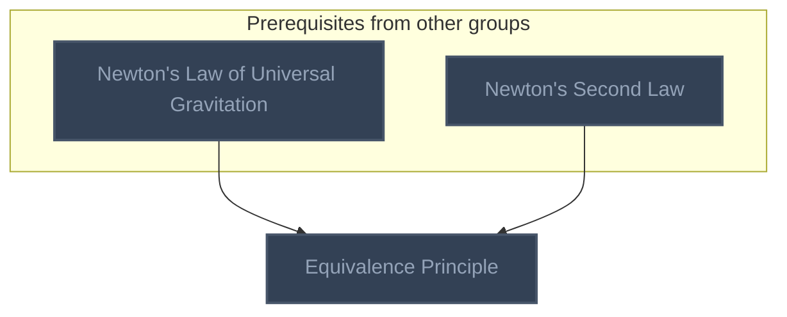
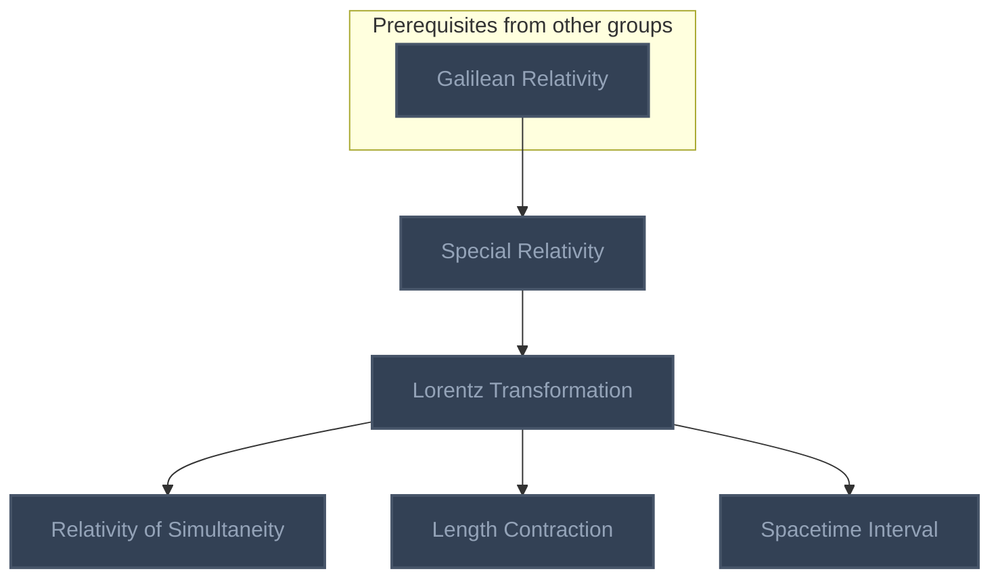
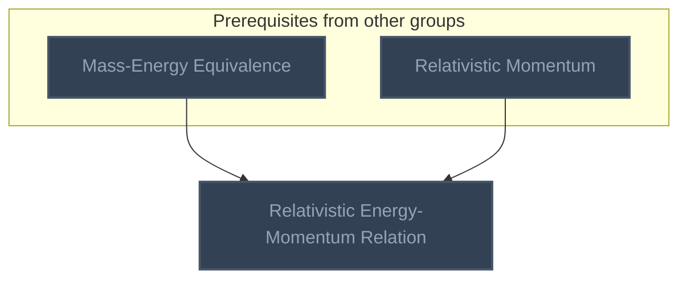
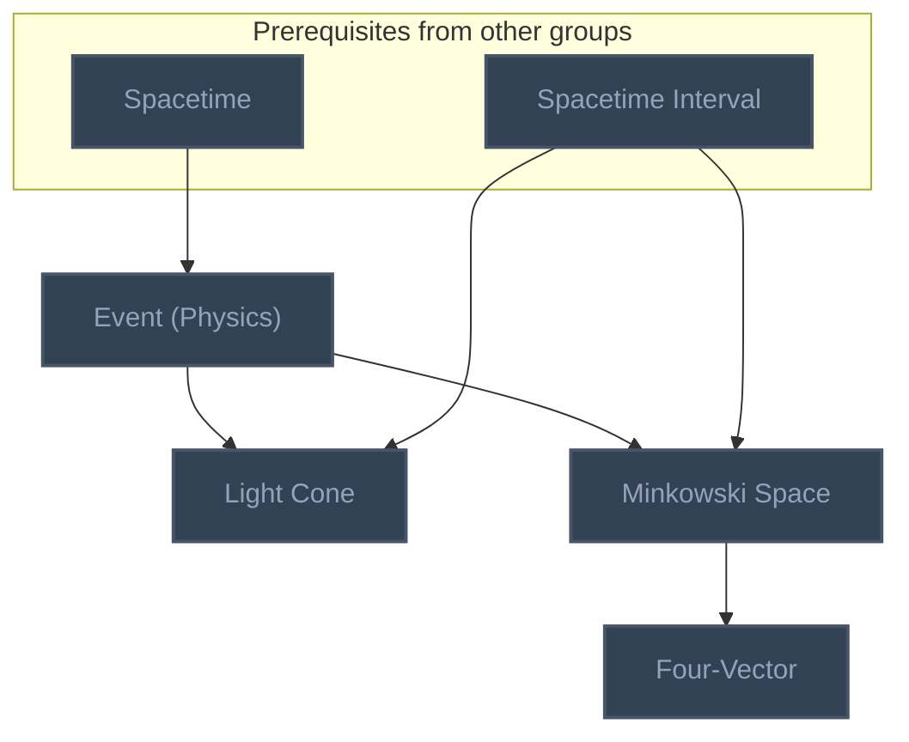
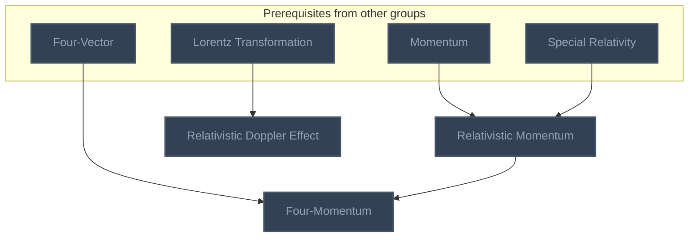

<!-- BEGIN STATS (generated by Scripts/skill_trees.py; do not edit) -->
**Mastered:** 0 / 16 · **Depth:** 0% · **Discovered:** 16 · **Planned:** 0 · **Locked:** 16 · **Rusty:** 0

| | L0 Discovered | L1 Recall | L2 Apply | L3 Prove ★ | L4 Wield | L5 Command |
|---|---:|---:|---:|---:|---:|---:|
| **At this level** | 16 | 0 | 0 | 0 | 0 | 0 |
| **Reached (this level or higher)** | 16 | 0 | 0 | 0 | 0 | 0 |

**Next up:** —

Legend: dashed grey = planned (no note yet) · dark grey = locked · white L0 Discovered · green L1 Recall · blue L2 Apply · purple L3 Prove (Mastered) · orange L4 Wield · gold L5 Command · brown dashed border = rusty
<!-- END STATS -->

## Feynman Vol. I Ch. 2: Basic Physics
**Reached:** L1 0 · L2 0 · L3 0 · L4 0 · L5 0 (of 1 nodes)



## Feynman Vol. I Ch. 4: Conservation of Energy
**Reached:** L1 0 · L2 0 · L3 0 · L4 0 · L5 0 (of 1 nodes)



## Feynman Vol. I Ch. 7: The Theory of Gravitation
**Reached:** L1 0 · L2 0 · L3 0 · L4 0 · L5 0 (of 1 nodes)



## Feynman Vol. I Ch. 15: The Special Theory of Relativity
**Reached:** L1 0 · L2 0 · L3 0 · L4 0 · L5 0 (of 5 nodes)



## Feynman Vol. I Ch. 16: Relativistic Energy and Momentum
**Reached:** L1 0 · L2 0 · L3 0 · L4 0 · L5 0 (of 1 nodes)



## Feynman Vol. I Ch. 17: Space-Time
**Reached:** L1 0 · L2 0 · L3 0 · L4 0 · L5 0 (of 4 nodes)



## Modern Physics and Cosmology
**Reached:** L1 0 · L2 0 · L3 0 · L4 0 · L5 0 (of 3 nodes)



# Source
Graph structure: the single source for the diagrams above, edited by `/note` and `Scripts/skill_trees.py` (`add`, `edge`, `rename`). Everything above this heading is regenerated by `render`.

```skilltree
    %% PREREQUISITES
    n_gravitation["Gravitation"]
    n_mass["Mass"]
    n_newton_s_law_of_universal_gravitation["Newton's Law of Universal Gravitation"]
    n_newton_s_second_law["Newton's Second Law"]
    n_galilean_relativity["Galilean Relativity"]
    n_momentum["Momentum"]
    %% NODES
    %% == Feynman Vol. I Ch. 2: Basic Physics ==
    n_spacetime["Spacetime"]
    %% == Feynman Vol. I Ch. 4: Conservation of Energy ==
    n_mass_energy_equivalence["Mass-Energy Equivalence"]
    %% == Feynman Vol. I Ch. 7: The Theory of Gravitation ==
    n_equivalence_principle["Equivalence Principle"]
    %% == Feynman Vol. I Ch. 15: The Special Theory of Relativity ==
    n_special_relativity["Special Relativity"]
    n_lorentz_transformation["Lorentz Transformation"]
    n_relativity_of_simultaneity["Relativity of Simultaneity"]
    n_length_contraction["Length Contraction"]
    n_spacetime_interval["Spacetime Interval"]
    %% == Feynman Vol. I Ch. 16: Relativistic Energy and Momentum ==
    n_relativistic_energy_momentum_relation["Relativistic Energy-Momentum Relation"]
    %% == Feynman Vol. I Ch. 17: Space-Time ==
    n_event_physics["Event (Physics)"]
    n_light_cone["Light Cone"]
    n_minkowski_space["Minkowski Space"]
    n_four_vector["Four-Vector"]
    %% == Modern Physics and Cosmology ==
    n_relativistic_momentum["Relativistic Momentum"]
    n_relativistic_doppler_effect["Relativistic Doppler Effect"]
    n_four_momentum["Four-Momentum"]
    %% EDGES
    n_gravitation --> n_spacetime
    n_mass --> n_mass_energy_equivalence
    n_special_relativity --> n_mass_energy_equivalence
    n_newton_s_law_of_universal_gravitation --> n_equivalence_principle
    n_newton_s_second_law --> n_equivalence_principle
    n_galilean_relativity --> n_special_relativity
    n_special_relativity --> n_lorentz_transformation
    n_lorentz_transformation --> n_relativity_of_simultaneity
    n_lorentz_transformation --> n_length_contraction
    n_lorentz_transformation --> n_spacetime_interval
    n_mass_energy_equivalence --> n_relativistic_energy_momentum_relation
    n_relativistic_momentum --> n_relativistic_energy_momentum_relation
    n_spacetime --> n_event_physics
    n_event_physics --> n_light_cone
    n_spacetime_interval --> n_light_cone
    n_event_physics --> n_minkowski_space
    n_spacetime_interval --> n_minkowski_space
    n_minkowski_space --> n_four_vector
    n_momentum --> n_relativistic_momentum
    n_special_relativity --> n_relativistic_momentum
    n_lorentz_transformation --> n_relativistic_doppler_effect
    n_four_vector --> n_four_momentum
    n_relativistic_momentum --> n_four_momentum
```
