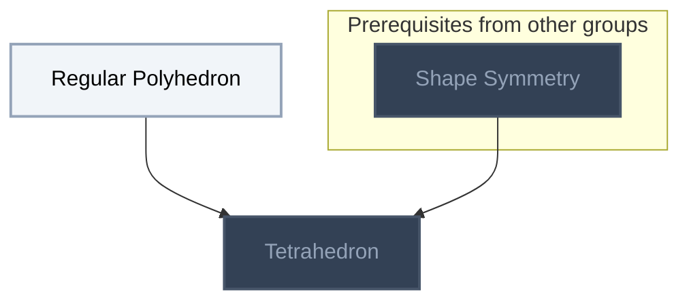
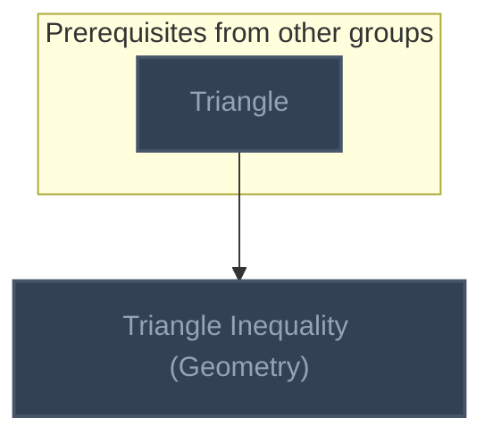
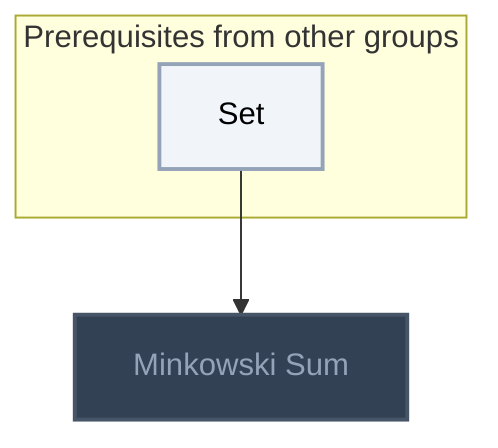

<!-- BEGIN STATS (generated by Scripts/skill_trees.py; do not edit) -->
**Mastered:** 0 / 4 · **Depth:** 0% · **Discovered:** 4 · **Planned:** 0 · **Locked:** 3 · **Rusty:** 0

**Levels:** L0 4 · L1 0 · L2 0 · L3 0 · L4 0 · L5 0

**Next up:** [[Regular Polyhedron]]

Legend: dashed grey = planned (no note yet) · dark grey = locked · white L0 Discovered · green L1 Recall · blue L2 Apply · purple L3 Prove (Mastered) · orange L4 Wield · gold L5 Command · brown dashed border = rusty
<!-- END STATS -->

## Polyhedra
**Mastered:** 0 / 2 · **Discovered:** 2 / 2



## Euclidean Geometry
**Mastered:** 0 / 1 · **Discovered:** 1 / 1



## Convex Geometry
**Mastered:** 0 / 1 · **Discovered:** 1 / 1



# Source
Graph structure: the single source for the diagrams above, edited by `/note` and `Scripts/skill_trees.py` (`add`, `edge`, `rename`). Everything above this heading is regenerated by `render`.

```skilltree
    %% PREREQUISITES
    n_shape_symmetry["Shape Symmetry"]
    n_triangle["Triangle"]
    n_set["Set"]
    %% NODES
    %% == Polyhedra ==
    n_regular_polyhedron["Regular Polyhedron"]
    n_tetrahedron["Tetrahedron"]
    %% == Euclidean Geometry ==
    n_triangle_inequality_geometry["Triangle Inequality (Geometry)"]
    %% == Convex Geometry ==
    n_minkowski_sum["Minkowski Sum"]
    %% EDGES
    n_regular_polyhedron --> n_tetrahedron
    n_shape_symmetry --> n_tetrahedron
    n_triangle --> n_triangle_inequality_geometry
    n_set --> n_minkowski_sum
```
