<!-- BEGIN STATS (generated by Scripts/skill_trees.py; do not edit) -->
**Mastered:** 0 / 111 · **Depth:** 0% · **Discovered:** 111 · **Planned:** 0 · **Locked:** 98 · **Rusty:** 0

**Levels:** L0 111 · L1 0 · L2 0 · L3 0 · L4 0 · L5 0

**Next up:** [[Atomic Hypothesis]], [[Gravitation]], [[Electric Charge]], [[Antiparticle]], [[Conservation of Energy]]

Legend: dashed grey = planned (no note yet) · dark grey = locked · white L0 Discovered · green L1 Recall · blue L2 Apply · purple L3 Prove (Mastered) · orange L4 Wield · gold L5 Command · brown dashed border = rusty
<!-- END STATS -->

## Halliday Physics Vol. 1: Force and Newton's Laws
**Mastered:** 0 / 2 · **Discovered:** 2 / 2

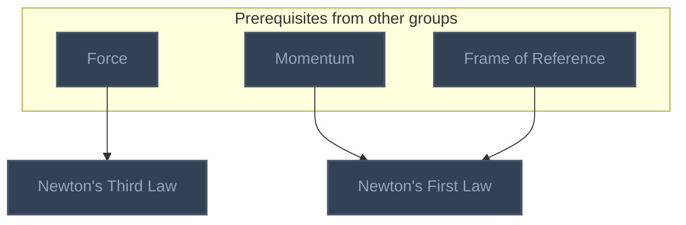

## Feynman Vol. I Ch. 1: Atoms in Motion
**Mastered:** 0 / 12 · **Discovered:** 12 / 12

```mermaid
flowchart TD
    classDef planned fill:#1E293B,stroke:#64748B,stroke-width:2px,stroke-dasharray:5 5,color:#94A3B8;
    classDef locked fill:#334155,stroke:#475569,stroke-width:2px,color:#94A3B8;
    classDef L0 fill:#F1F5F9,stroke:#94A3B8,stroke-width:2px,color:#000000;
    classDef L1 fill:#22C55E,stroke:#15803D,stroke-width:2px,color:#000000;
    classDef L2 fill:#3B82F6,stroke:#1D4ED8,stroke-width:3px,color:#FFFFFF;
    classDef L3 fill:#A855F7,stroke:#6B21A8,stroke-width:3px,color:#FFFFFF,font-weight:bold;
    classDef L4 fill:#F97316,stroke:#C2410C,stroke-width:4px,color:#000000,font-weight:bold;
    classDef L5 fill:#FFD700,stroke:#FF8C00,stroke-width:5px,color:#000000,font-weight:bold;
    classDef rusty stroke:#8B4513,stroke-width:4px,stroke-dasharray:3 3;
    subgraph sg_prereqs["Prerequisites from other groups"]
        n_heisenberg_uncertainty_principle["Heisenberg Uncertainty Principle"]
    end
    n_atomic_hypothesis["Atomic Hypothesis"]
    n_chemical_reaction["Chemical Reaction"]
    n_kinetic_theory_of_pressure["Kinetic Theory of Pressure"]
    n_evaporation["Evaporation"]
    n_ion["Ion"]
    n_dynamic_equilibrium["Dynamic Equilibrium"]
    n_kinetic_theory_of_heat["Kinetic Theory of Heat"]
    n_crystalline_structure["Crystalline Structure"]
    n_melting["Melting"]
    n_adiabatic_compression_and_expansion["Adiabatic Compression and Expansion"]
    n_evaporative_cooling["Evaporative Cooling"]
    n_zero_point_motion["Zero-Point Motion"]
    n_atomic_hypothesis --> n_chemical_reaction
    n_atomic_hypothesis --> n_crystalline_structure
    n_atomic_hypothesis --> n_dynamic_equilibrium
    n_atomic_hypothesis --> n_evaporation
    n_atomic_hypothesis --> n_ion
    n_atomic_hypothesis --> n_kinetic_theory_of_heat
    n_atomic_hypothesis --> n_kinetic_theory_of_pressure
    n_crystalline_structure --> n_melting
    n_evaporation --> n_evaporative_cooling
    n_heisenberg_uncertainty_principle --> n_zero_point_motion
    n_kinetic_theory_of_heat --> n_evaporative_cooling
    n_kinetic_theory_of_heat --> n_melting
    n_kinetic_theory_of_heat --> n_zero_point_motion
    n_kinetic_theory_of_pressure --> n_adiabatic_compression_and_expansion
    class n_heisenberg_uncertainty_principle,n_chemical_reaction,n_kinetic_theory_of_pressure,n_evaporation,n_ion,n_dynamic_equilibrium,n_kinetic_theory_of_heat,n_crystalline_structure,n_melting,n_adiabatic_compression_and_expansion,n_evaporative_cooling,n_zero_point_motion locked;
    class n_atomic_hypothesis L0;
    class n_heisenberg_uncertainty_principle,n_atomic_hypothesis,n_chemical_reaction,n_kinetic_theory_of_pressure,n_evaporation,n_ion,n_dynamic_equilibrium,n_kinetic_theory_of_heat,n_crystalline_structure,n_melting,n_adiabatic_compression_and_expansion,n_evaporative_cooling,n_zero_point_motion internal-link;
```

## Feynman Vol. I Ch. 2: Basic Physics
**Mastered:** 0 / 13 · **Discovered:** 13 / 13

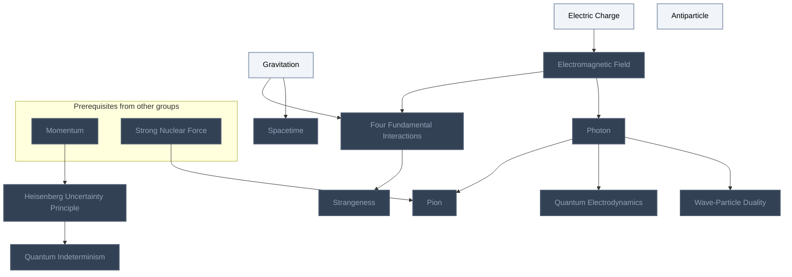

## Feynman Vol. I Ch. 4: Conservation of Energy
**Mastered:** 0 / 9 · **Discovered:** 9 / 9

```mermaid
flowchart TD
    classDef planned fill:#1E293B,stroke:#64748B,stroke-width:2px,stroke-dasharray:5 5,color:#94A3B8;
    classDef locked fill:#334155,stroke:#475569,stroke-width:2px,color:#94A3B8;
    classDef L0 fill:#F1F5F9,stroke:#94A3B8,stroke-width:2px,color:#000000;
    classDef L1 fill:#22C55E,stroke:#15803D,stroke-width:2px,color:#000000;
    classDef L2 fill:#3B82F6,stroke:#1D4ED8,stroke-width:3px,color:#FFFFFF;
    classDef L3 fill:#A855F7,stroke:#6B21A8,stroke-width:3px,color:#FFFFFF,font-weight:bold;
    classDef L4 fill:#F97316,stroke:#C2410C,stroke-width:4px,color:#000000,font-weight:bold;
    classDef L5 fill:#FFD700,stroke:#FF8C00,stroke-width:5px,color:#000000,font-weight:bold;
    classDef rusty stroke:#8B4513,stroke-width:4px,stroke-dasharray:3 3;
    subgraph sg_prereqs["Prerequisites from other groups"]
        n_antiparticle["Antiparticle"]
        n_electric_charge["Electric Charge"]
        n_gravitation["Gravitation"]
        n_mass["Mass"]
        n_special_relativity["Special Relativity"]
        n_symmetry_of_physical_law["Symmetry of Physical Law"]
        n_velocity_vector["Velocity Vector"]
    end
    n_conservation_of_energy["Conservation of Energy"]
    n_conservation_of_baryon_number["Conservation of Baryon Number"]
    n_potential_energy["Potential Energy"]
    n_kinetic_energy["Kinetic Energy"]
    n_conservation_of_lepton_number["Conservation of Lepton Number"]
    n_noether_s_theorem["Noether's Theorem"]
    n_conservation_of_charge["Conservation of Charge"]
    n_gravitational_potential_energy["Gravitational Potential Energy"]
    n_mass_energy_equivalence["Mass-Energy Equivalence"]
    n_antiparticle --> n_conservation_of_baryon_number
    n_antiparticle --> n_conservation_of_lepton_number
    n_conservation_of_energy --> n_kinetic_energy
    n_conservation_of_energy --> n_noether_s_theorem
    n_conservation_of_energy --> n_potential_energy
    n_electric_charge --> n_conservation_of_charge
    n_gravitation --> n_gravitational_potential_energy
    n_mass --> n_kinetic_energy
    n_mass --> n_mass_energy_equivalence
    n_potential_energy --> n_gravitational_potential_energy
    n_special_relativity --> n_mass_energy_equivalence
    n_symmetry_of_physical_law --> n_noether_s_theorem
    n_velocity_vector --> n_kinetic_energy
    class n_mass,n_special_relativity,n_velocity_vector,n_conservation_of_baryon_number,n_potential_energy,n_kinetic_energy,n_conservation_of_lepton_number,n_noether_s_theorem,n_conservation_of_charge,n_gravitational_potential_energy,n_mass_energy_equivalence locked;
    class n_antiparticle,n_electric_charge,n_gravitation,n_symmetry_of_physical_law,n_conservation_of_energy L0;
    class n_antiparticle,n_electric_charge,n_gravitation,n_mass,n_special_relativity,n_symmetry_of_physical_law,n_velocity_vector,n_conservation_of_energy,n_conservation_of_baryon_number,n_potential_energy,n_kinetic_energy,n_conservation_of_lepton_number,n_noether_s_theorem,n_conservation_of_charge,n_gravitational_potential_energy,n_mass_energy_equivalence internal-link;
```

## Feynman Vol. I Ch. 5: Time and Distance
**Mastered:** 0 / 9 · **Discovered:** 9 / 9

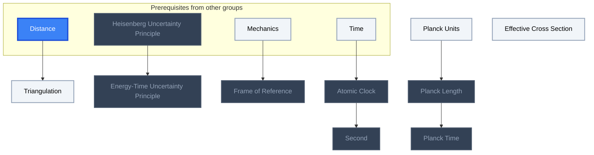

## Feynman Vol. I Ch. 6: Probability
**Mastered:** 0 / 1 · **Discovered:** 1 / 1


## Feynman Vol. I Ch. 7: The Theory of Gravitation
**Mastered:** 0 / 8 · **Discovered:** 8 / 8

```mermaid
flowchart TD
    classDef planned fill:#1E293B,stroke:#64748B,stroke-width:2px,stroke-dasharray:5 5,color:#94A3B8;
    classDef locked fill:#334155,stroke:#475569,stroke-width:2px,color:#94A3B8;
    classDef L0 fill:#F1F5F9,stroke:#94A3B8,stroke-width:2px,color:#000000;
    classDef L1 fill:#22C55E,stroke:#15803D,stroke-width:2px,color:#000000;
    classDef L2 fill:#3B82F6,stroke:#1D4ED8,stroke-width:3px,color:#FFFFFF;
    classDef L3 fill:#A855F7,stroke:#6B21A8,stroke-width:3px,color:#FFFFFF,font-weight:bold;
    classDef L4 fill:#F97316,stroke:#C2410C,stroke-width:4px,color:#000000,font-weight:bold;
    classDef L5 fill:#FFD700,stroke:#FF8C00,stroke-width:5px,color:#000000,font-weight:bold;
    classDef rusty stroke:#8B4513,stroke-width:4px,stroke-dasharray:3 3;
    subgraph sg_prereqs["Prerequisites from other groups"]
        n_center_of_mass["Center of Mass"]
        n_ellipse["Ellipse"]
        n_gravitation["Gravitation"]
        n_mass["Mass"]
        n_newton_s_first_law["Newton's First Law"]
        n_newton_s_second_law["Newton's Second Law"]
    end
    n_kepler_s_second_law["Kepler's Second Law"]
    n_barycenter["Barycenter"]
    n_newton_s_law_of_universal_gravitation["Newton's Law of Universal Gravitation"]
    n_kepler_s_first_law["Kepler's First Law"]
    n_tidal_force["Tidal Force"]
    n_kepler_s_third_law["Kepler's Third Law"]
    n_newton_s_cannonball["Newton's Cannonball"]
    n_equivalence_principle["Equivalence Principle"]
    n_barycenter --> n_tidal_force
    n_center_of_mass --> n_barycenter
    n_ellipse --> n_kepler_s_first_law
    n_gravitation --> n_newton_s_law_of_universal_gravitation
    n_kepler_s_first_law --> n_kepler_s_third_law
    n_mass --> n_newton_s_law_of_universal_gravitation
    n_newton_s_first_law --> n_newton_s_cannonball
    n_newton_s_law_of_universal_gravitation --> n_equivalence_principle
    n_newton_s_law_of_universal_gravitation --> n_newton_s_cannonball
    n_newton_s_law_of_universal_gravitation --> n_tidal_force
    n_newton_s_second_law --> n_equivalence_principle
    class n_center_of_mass,n_ellipse,n_mass,n_newton_s_first_law,n_newton_s_second_law,n_barycenter,n_newton_s_law_of_universal_gravitation,n_kepler_s_first_law,n_tidal_force,n_kepler_s_third_law,n_newton_s_cannonball,n_equivalence_principle locked;
    class n_gravitation,n_kepler_s_second_law L0;
    class n_center_of_mass,n_ellipse,n_gravitation,n_mass,n_newton_s_first_law,n_newton_s_second_law,n_kepler_s_second_law,n_barycenter,n_newton_s_law_of_universal_gravitation,n_kepler_s_first_law,n_tidal_force,n_kepler_s_third_law,n_newton_s_cannonball,n_equivalence_principle internal-link;
```

## Feynman Vol. I Ch. 9: Newton's Laws of Dynamics
**Mastered:** 0 / 6 · **Discovered:** 6 / 6

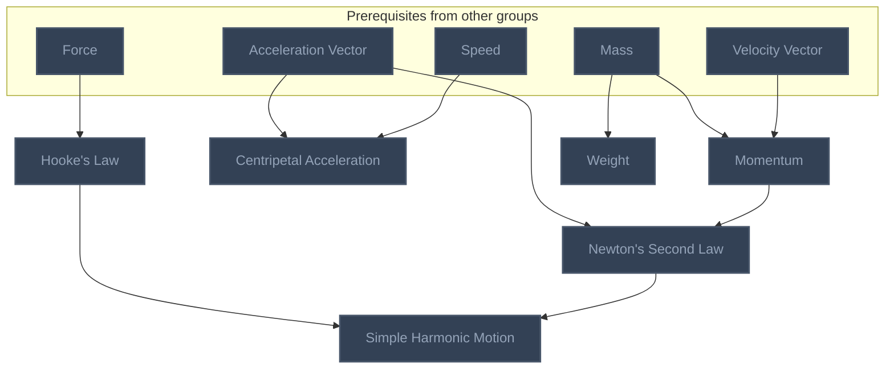

## Feynman Vol. I Ch. 10: Conservation of Momentum
**Mastered:** 0 / 5 · **Discovered:** 5 / 5

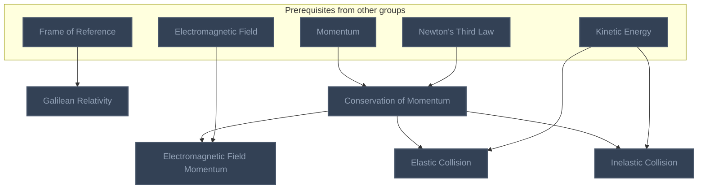

## Feynman Vol. I Ch. 11: Vectors
**Mastered:** 0 / 2 · **Discovered:** 2 / 2

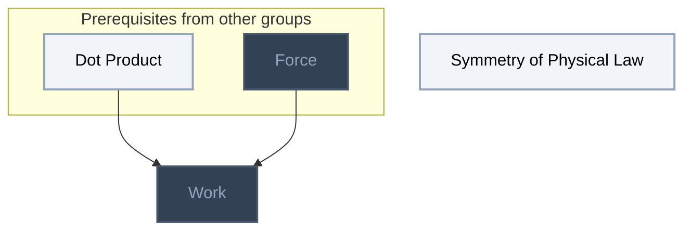

## Feynman Vol. I Ch. 12: Characteristics of Force
**Mastered:** 0 / 10 · **Discovered:** 10 / 10

```mermaid
flowchart TD
    classDef planned fill:#1E293B,stroke:#64748B,stroke-width:2px,stroke-dasharray:5 5,color:#94A3B8;
    classDef locked fill:#334155,stroke:#475569,stroke-width:2px,color:#94A3B8;
    classDef L0 fill:#F1F5F9,stroke:#94A3B8,stroke-width:2px,color:#000000;
    classDef L1 fill:#22C55E,stroke:#15803D,stroke-width:2px,color:#000000;
    classDef L2 fill:#3B82F6,stroke:#1D4ED8,stroke-width:3px,color:#FFFFFF;
    classDef L3 fill:#A855F7,stroke:#6B21A8,stroke-width:3px,color:#FFFFFF,font-weight:bold;
    classDef L4 fill:#F97316,stroke:#C2410C,stroke-width:4px,color:#000000,font-weight:bold;
    classDef L5 fill:#FFD700,stroke:#FF8C00,stroke-width:5px,color:#000000,font-weight:bold;
    classDef rusty stroke:#8B4513,stroke-width:4px,stroke-dasharray:3 3;
    subgraph sg_prereqs["Prerequisites from other groups"]
        n_atomic_hypothesis["Atomic Hypothesis"]
        n_electric_charge["Electric Charge"]
        n_electromagnetic_field["Electromagnetic Field"]
        n_force["Force"]
        n_frame_of_reference["Frame of Reference"]
        n_newton_s_law_of_universal_gravitation["Newton's Law of Universal Gravitation"]
        n_newton_s_second_law["Newton's Second Law"]
    end
    n_coulomb_s_law["Coulomb's Law"]
    n_van_der_waals_force["Van der Waals Force"]
    n_cold_welding["Cold Welding"]
    n_friction["Friction"]
    n_drag_force["Drag Force"]
    n_electric_field["Electric Field"]
    n_gravitational_field["Gravitational Field"]
    n_lorentz_force_law["Lorentz Force Law"]
    n_pseudo_force["Pseudo Force"]
    n_superposition_principle["Superposition Principle"]
    n_atomic_hypothesis --> n_cold_welding
    n_coulomb_s_law --> n_electric_field
    n_electric_charge --> n_coulomb_s_law
    n_electric_field --> n_lorentz_force_law
    n_electric_field --> n_superposition_principle
    n_electromagnetic_field --> n_lorentz_force_law
    n_force --> n_coulomb_s_law
    n_force --> n_drag_force
    n_force --> n_friction
    n_force --> n_van_der_waals_force
    n_frame_of_reference --> n_pseudo_force
    n_gravitational_field --> n_superposition_principle
    n_newton_s_law_of_universal_gravitation --> n_gravitational_field
    n_newton_s_second_law --> n_pseudo_force
    class n_electromagnetic_field,n_force,n_frame_of_reference,n_newton_s_law_of_universal_gravitation,n_newton_s_second_law,n_coulomb_s_law,n_van_der_waals_force,n_cold_welding,n_friction,n_drag_force,n_electric_field,n_gravitational_field,n_lorentz_force_law,n_pseudo_force,n_superposition_principle locked;
    class n_atomic_hypothesis,n_electric_charge L0;
    class n_atomic_hypothesis,n_electric_charge,n_electromagnetic_field,n_force,n_frame_of_reference,n_newton_s_law_of_universal_gravitation,n_newton_s_second_law,n_coulomb_s_law,n_van_der_waals_force,n_cold_welding,n_friction,n_drag_force,n_electric_field,n_gravitational_field,n_lorentz_force_law,n_pseudo_force,n_superposition_principle internal-link;
```

## Feynman Vol. I Ch. 13: Work and Potential Energy (A)
**Mastered:** 0 / 4 · **Discovered:** 4 / 4

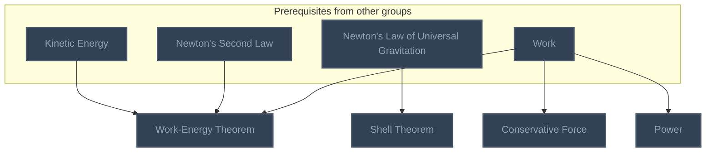

## Feynman Vol. I Ch. 14: Work and Potential Energy (B)
**Mastered:** 0 / 3 · **Discovered:** 3 / 3

```mermaid
flowchart TD
    classDef planned fill:#1E293B,stroke:#64748B,stroke-width:2px,stroke-dasharray:5 5,color:#94A3B8;
    classDef locked fill:#334155,stroke:#475569,stroke-width:2px,color:#94A3B8;
    classDef L0 fill:#F1F5F9,stroke:#94A3B8,stroke-width:2px,color:#000000;
    classDef L1 fill:#22C55E,stroke:#15803D,stroke-width:2px,color:#000000;
    classDef L2 fill:#3B82F6,stroke:#1D4ED8,stroke-width:3px,color:#FFFFFF;
    classDef L3 fill:#A855F7,stroke:#6B21A8,stroke-width:3px,color:#FFFFFF,font-weight:bold;
    classDef L4 fill:#F97316,stroke:#C2410C,stroke-width:4px,color:#000000,font-weight:bold;
    classDef L5 fill:#FFD700,stroke:#FF8C00,stroke-width:5px,color:#000000,font-weight:bold;
    classDef rusty stroke:#8B4513,stroke-width:4px,stroke-dasharray:3 3;
    subgraph sg_prereqs["Prerequisites from other groups"]
        n_conservative_force["Conservative Force"]
        n_electric_field["Electric Field"]
        n_gravitational_field["Gravitational Field"]
        n_gravitational_potential_energy["Gravitational Potential Energy"]
        n_kinetic_energy["Kinetic Energy"]
        n_potential_energy["Potential Energy"]
    end
    n_conservation_of_mechanical_energy["Conservation of Mechanical Energy"]
    n_gravitational_potential["Gravitational Potential"]
    n_electric_potential["Electric Potential"]
    n_conservative_force --> n_conservation_of_mechanical_energy
    n_electric_field --> n_electric_potential
    n_gravitational_field --> n_gravitational_potential
    n_gravitational_potential_energy --> n_gravitational_potential
    n_kinetic_energy --> n_conservation_of_mechanical_energy
    n_potential_energy --> n_conservation_of_mechanical_energy
    n_potential_energy --> n_electric_potential
    class n_conservative_force,n_electric_field,n_gravitational_field,n_gravitational_potential_energy,n_kinetic_energy,n_potential_energy,n_conservation_of_mechanical_energy,n_gravitational_potential,n_electric_potential locked;
    class n_conservative_force,n_electric_field,n_gravitational_field,n_gravitational_potential_energy,n_kinetic_energy,n_potential_energy,n_conservation_of_mechanical_energy,n_gravitational_potential,n_electric_potential internal-link;
```

## Feynman Vol. I Ch. 15: The Special Theory of Relativity
**Mastered:** 0 / 5 · **Discovered:** 5 / 5

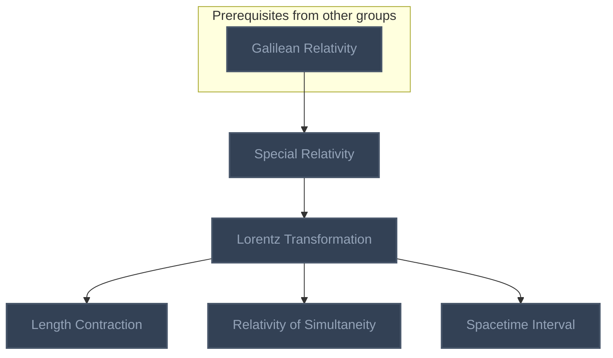

## Feynman Vol. I Ch. 16: Relativistic Energy and Momentum
**Mastered:** 0 / 1 · **Discovered:** 1 / 1

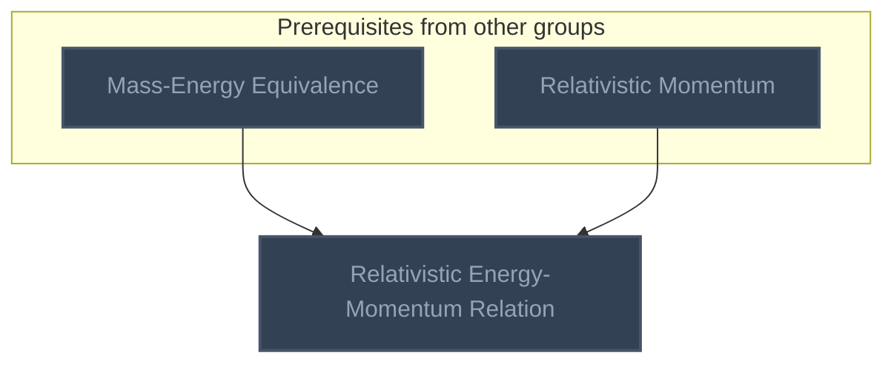

## Feynman Vol. I Ch. 17: Space-Time
**Mastered:** 0 / 4 · **Discovered:** 4 / 4

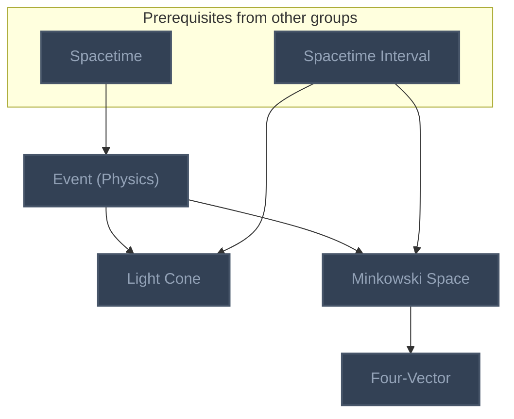

## Modern Physics and Cosmology
**Mastered:** 0 / 11 · **Discovered:** 11 / 11

```mermaid
flowchart TD
    classDef planned fill:#1E293B,stroke:#64748B,stroke-width:2px,stroke-dasharray:5 5,color:#94A3B8;
    classDef locked fill:#334155,stroke:#475569,stroke-width:2px,color:#94A3B8;
    classDef L0 fill:#F1F5F9,stroke:#94A3B8,stroke-width:2px,color:#000000;
    classDef L1 fill:#22C55E,stroke:#15803D,stroke-width:2px,color:#000000;
    classDef L2 fill:#3B82F6,stroke:#1D4ED8,stroke-width:3px,color:#FFFFFF;
    classDef L3 fill:#A855F7,stroke:#6B21A8,stroke-width:3px,color:#FFFFFF,font-weight:bold;
    classDef L4 fill:#F97316,stroke:#C2410C,stroke-width:4px,color:#000000,font-weight:bold;
    classDef L5 fill:#FFD700,stroke:#FF8C00,stroke-width:5px,color:#000000,font-weight:bold;
    classDef rusty stroke:#8B4513,stroke-width:4px,stroke-dasharray:3 3;
    subgraph sg_prereqs["Prerequisites from other groups"]
        n_four_fundamental_interactions["Four Fundamental Interactions"]
        n_four_vector["Four-Vector"]
        n_lorentz_transformation["Lorentz Transformation"]
        n_momentum["Momentum"]
        n_planck_units["Planck Units"]
        n_special_relativity["Special Relativity"]
    end
    n_expansion_of_the_universe["Expansion of the Universe"]
    n_big_bang["Big Bang"]
    n_planck_density["Planck Density"]
    n_dark_energy["Dark Energy"]
    n_hubble_s_law["Hubble's Law"]
    n_cosmic_inflation["Cosmic Inflation"]
    n_weak_nuclear_force["Weak Nuclear Force"]
    n_strong_nuclear_force["Strong Nuclear Force"]
    n_relativistic_momentum["Relativistic Momentum"]
    n_relativistic_doppler_effect["Relativistic Doppler Effect"]
    n_four_momentum["Four-Momentum"]
    n_big_bang --> n_cosmic_inflation
    n_expansion_of_the_universe --> n_big_bang
    n_expansion_of_the_universe --> n_dark_energy
    n_expansion_of_the_universe --> n_hubble_s_law
    n_four_fundamental_interactions --> n_strong_nuclear_force
    n_four_fundamental_interactions --> n_weak_nuclear_force
    n_four_vector --> n_four_momentum
    n_lorentz_transformation --> n_relativistic_doppler_effect
    n_momentum --> n_relativistic_momentum
    n_planck_units --> n_planck_density
    n_relativistic_momentum --> n_four_momentum
    n_special_relativity --> n_relativistic_momentum
    class n_four_fundamental_interactions,n_four_vector,n_lorentz_transformation,n_momentum,n_special_relativity,n_big_bang,n_planck_density,n_dark_energy,n_hubble_s_law,n_cosmic_inflation,n_weak_nuclear_force,n_strong_nuclear_force,n_relativistic_momentum,n_relativistic_doppler_effect,n_four_momentum locked;
    class n_planck_units,n_expansion_of_the_universe L0;
    class n_four_fundamental_interactions,n_four_vector,n_lorentz_transformation,n_momentum,n_planck_units,n_special_relativity,n_expansion_of_the_universe,n_big_bang,n_planck_density,n_dark_energy,n_hubble_s_law,n_cosmic_inflation,n_weak_nuclear_force,n_strong_nuclear_force,n_relativistic_momentum,n_relativistic_doppler_effect,n_four_momentum internal-link;
```

## Optics
**Mastered:** 0 / 6 · **Discovered:** 6 / 6

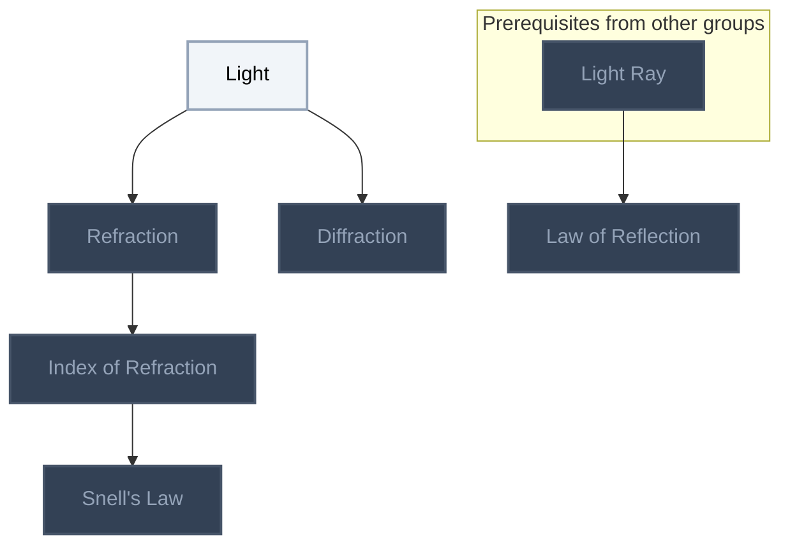

# Source
Graph structure: the single source for the diagrams above, edited by `/note` and `Scripts/skill_trees.py` (`add`, `edge`, `rename`). Everything above this heading is regenerated by `render`.

```skilltree
    %% PREREQUISITES
    n_acceleration_vector["Acceleration Vector"]
    n_center_of_mass["Center of Mass"]
    n_distance["Distance"]
    n_dot_product["Dot Product"]
    n_ellipse["Ellipse"]
    n_force["Force"]
    n_mass["Mass"]
    n_mechanics["Mechanics"]
    n_speed["Speed"]
    n_time["Time"]
    n_velocity_vector["Velocity Vector"]
    n_light_ray["Light Ray"]
    %% NODES
    %% == Halliday Physics Vol. 1: Force and Newton's Laws ==
    n_newton_s_first_law["Newton's First Law"]
    n_newton_s_third_law["Newton's Third Law"]
    %% == Feynman Vol. I Ch. 1: Atoms in Motion ==
    n_atomic_hypothesis["Atomic Hypothesis"]
    n_chemical_reaction["Chemical Reaction"]
    n_kinetic_theory_of_pressure["Kinetic Theory of Pressure"]
    n_evaporation["Evaporation"]
    n_ion["Ion"]
    n_dynamic_equilibrium["Dynamic Equilibrium"]
    n_kinetic_theory_of_heat["Kinetic Theory of Heat"]
    n_crystalline_structure["Crystalline Structure"]
    n_melting["Melting"]
    n_adiabatic_compression_and_expansion["Adiabatic Compression and Expansion"]
    n_evaporative_cooling["Evaporative Cooling"]
    n_zero_point_motion["Zero-Point Motion"]
    %% == Feynman Vol. I Ch. 2: Basic Physics ==
    n_gravitation["Gravitation"]
    n_electric_charge["Electric Charge"]
    n_antiparticle["Antiparticle"]
    n_electromagnetic_field["Electromagnetic Field"]
    n_spacetime["Spacetime"]
    n_photon["Photon"]
    n_heisenberg_uncertainty_principle["Heisenberg Uncertainty Principle"]
    n_four_fundamental_interactions["Four Fundamental Interactions"]
    n_quantum_electrodynamics["Quantum Electrodynamics"]
    n_strangeness["Strangeness"]
    n_wave_particle_duality["Wave-Particle Duality"]
    n_quantum_indeterminism["Quantum Indeterminism"]
    n_pion["Pion"]
    %% == Feynman Vol. I Ch. 4: Conservation of Energy ==
    n_conservation_of_energy["Conservation of Energy"]
    n_conservation_of_baryon_number["Conservation of Baryon Number"]
    n_potential_energy["Potential Energy"]
    n_kinetic_energy["Kinetic Energy"]
    n_conservation_of_lepton_number["Conservation of Lepton Number"]
    n_noether_s_theorem["Noether's Theorem"]
    n_conservation_of_charge["Conservation of Charge"]
    n_gravitational_potential_energy["Gravitational Potential Energy"]
    n_mass_energy_equivalence["Mass-Energy Equivalence"]
    %% == Feynman Vol. I Ch. 5: Time and Distance ==
    n_frame_of_reference["Frame of Reference"]
    n_planck_units["Planck Units"]
    n_effective_cross_section["Effective Cross Section"]
    n_triangulation["Triangulation"]
    n_planck_length["Planck Length"]
    n_atomic_clock["Atomic Clock"]
    n_second["Second"]
    n_planck_time["Planck Time"]
    n_energy_time_uncertainty_principle["Energy-Time Uncertainty Principle"]
    %% == Feynman Vol. I Ch. 6: Probability ==
    n_electron_cloud["Electron Cloud"]
    %% == Feynman Vol. I Ch. 7: The Theory of Gravitation ==
    n_kepler_s_second_law["Kepler's Second Law"]
    n_barycenter["Barycenter"]
    n_newton_s_law_of_universal_gravitation["Newton's Law of Universal Gravitation"]
    n_kepler_s_first_law["Kepler's First Law"]
    n_tidal_force["Tidal Force"]
    n_kepler_s_third_law["Kepler's Third Law"]
    n_newton_s_cannonball["Newton's Cannonball"]
    n_equivalence_principle["Equivalence Principle"]
    %% == Feynman Vol. I Ch. 9: Newton's Laws of Dynamics ==
    n_hooke_s_law["Hooke's Law"]
    n_centripetal_acceleration["Centripetal Acceleration"]
    n_momentum["Momentum"]
    n_weight["Weight"]
    n_newton_s_second_law["Newton's Second Law"]
    n_simple_harmonic_motion["Simple Harmonic Motion"]
    %% == Feynman Vol. I Ch. 10: Conservation of Momentum ==
    n_galilean_relativity["Galilean Relativity"]
    n_conservation_of_momentum["Conservation of Momentum"]
    n_electromagnetic_field_momentum["Electromagnetic Field Momentum"]
    n_inelastic_collision["Inelastic Collision"]
    n_elastic_collision["Elastic Collision"]
    %% == Feynman Vol. I Ch. 11: Vectors ==
    n_symmetry_of_physical_law["Symmetry of Physical Law"]
    n_work["Work"]
    %% == Feynman Vol. I Ch. 12: Characteristics of Force ==
    n_coulomb_s_law["Coulomb's Law"]
    n_van_der_waals_force["Van der Waals Force"]
    n_cold_welding["Cold Welding"]
    n_friction["Friction"]
    n_drag_force["Drag Force"]
    n_electric_field["Electric Field"]
    n_gravitational_field["Gravitational Field"]
    n_lorentz_force_law["Lorentz Force Law"]
    n_pseudo_force["Pseudo Force"]
    n_superposition_principle["Superposition Principle"]
    %% == Feynman Vol. I Ch. 13: Work and Potential Energy (A) ==
    n_conservative_force["Conservative Force"]
    n_power["Power"]
    n_shell_theorem["Shell Theorem"]
    n_work_energy_theorem["Work-Energy Theorem"]
    %% == Feynman Vol. I Ch. 14: Work and Potential Energy (B) ==
    n_conservation_of_mechanical_energy["Conservation of Mechanical Energy"]
    n_gravitational_potential["Gravitational Potential"]
    n_electric_potential["Electric Potential"]
    %% == Feynman Vol. I Ch. 15: The Special Theory of Relativity ==
    n_special_relativity["Special Relativity"]
    n_lorentz_transformation["Lorentz Transformation"]
    n_relativity_of_simultaneity["Relativity of Simultaneity"]
    n_length_contraction["Length Contraction"]
    n_spacetime_interval["Spacetime Interval"]
    %% == Feynman Vol. I Ch. 16: Relativistic Energy and Momentum ==
    n_relativistic_energy_momentum_relation["Relativistic Energy-Momentum Relation"]
    %% == Feynman Vol. I Ch. 17: Space-Time ==
    n_event_physics["Event (Physics)"]
    n_light_cone["Light Cone"]
    n_minkowski_space["Minkowski Space"]
    n_four_vector["Four-Vector"]
    %% == Modern Physics and Cosmology ==
    n_expansion_of_the_universe["Expansion of the Universe"]
    n_big_bang["Big Bang"]
    n_planck_density["Planck Density"]
    n_dark_energy["Dark Energy"]
    n_hubble_s_law["Hubble's Law"]
    n_cosmic_inflation["Cosmic Inflation"]
    n_weak_nuclear_force["Weak Nuclear Force"]
    n_strong_nuclear_force["Strong Nuclear Force"]
    n_relativistic_momentum["Relativistic Momentum"]
    n_relativistic_doppler_effect["Relativistic Doppler Effect"]
    n_four_momentum["Four-Momentum"]
    %% == Optics ==
    n_light["Light"]
    n_refraction["Refraction"]
    n_index_of_refraction["Index of Refraction"]
    n_snell_s_law["Snell's Law"]
    n_diffraction["Diffraction"]
    n_law_of_reflection["Law of Reflection"]
    %% EDGES
    n_acceleration_vector --> n_centripetal_acceleration
    n_acceleration_vector --> n_newton_s_second_law
    n_antiparticle --> n_conservation_of_baryon_number
    n_antiparticle --> n_conservation_of_lepton_number
    n_atomic_clock --> n_second
    n_atomic_hypothesis --> n_chemical_reaction
    n_atomic_hypothesis --> n_cold_welding
    n_atomic_hypothesis --> n_crystalline_structure
    n_atomic_hypothesis --> n_dynamic_equilibrium
    n_atomic_hypothesis --> n_evaporation
    n_atomic_hypothesis --> n_ion
    n_atomic_hypothesis --> n_kinetic_theory_of_heat
    n_atomic_hypothesis --> n_kinetic_theory_of_pressure
    n_barycenter --> n_tidal_force
    n_big_bang --> n_cosmic_inflation
    n_center_of_mass --> n_barycenter
    n_conservation_of_energy --> n_kinetic_energy
    n_conservation_of_energy --> n_noether_s_theorem
    n_conservation_of_energy --> n_potential_energy
    n_conservation_of_momentum --> n_elastic_collision
    n_conservation_of_momentum --> n_electromagnetic_field_momentum
    n_conservation_of_momentum --> n_inelastic_collision
    n_conservative_force --> n_conservation_of_mechanical_energy
    n_coulomb_s_law --> n_electric_field
    n_crystalline_structure --> n_melting
    n_distance --> n_triangulation
    n_dot_product --> n_work
    n_electric_charge --> n_conservation_of_charge
    n_electric_charge --> n_coulomb_s_law
    n_electric_charge --> n_electromagnetic_field
    n_electric_field --> n_electric_potential
    n_electric_field --> n_lorentz_force_law
    n_electric_field --> n_superposition_principle
    n_electromagnetic_field --> n_electromagnetic_field_momentum
    n_electromagnetic_field --> n_four_fundamental_interactions
    n_electromagnetic_field --> n_lorentz_force_law
    n_electromagnetic_field --> n_photon
    n_ellipse --> n_kepler_s_first_law
    n_evaporation --> n_evaporative_cooling
    n_event_physics --> n_light_cone
    n_event_physics --> n_minkowski_space
    n_expansion_of_the_universe --> n_big_bang
    n_expansion_of_the_universe --> n_dark_energy
    n_expansion_of_the_universe --> n_hubble_s_law
    n_force --> n_coulomb_s_law
    n_force --> n_drag_force
    n_force --> n_friction
    n_force --> n_hooke_s_law
    n_force --> n_newton_s_third_law
    n_force --> n_van_der_waals_force
    n_force --> n_work
    n_four_fundamental_interactions --> n_strangeness
    n_four_fundamental_interactions --> n_strong_nuclear_force
    n_four_fundamental_interactions --> n_weak_nuclear_force
    n_four_vector --> n_four_momentum
    n_frame_of_reference --> n_galilean_relativity
    n_frame_of_reference --> n_pseudo_force
    n_galilean_relativity --> n_special_relativity
    n_gravitation --> n_four_fundamental_interactions
    n_gravitation --> n_gravitational_potential_energy
    n_gravitation --> n_newton_s_law_of_universal_gravitation
    n_gravitation --> n_spacetime
    n_gravitational_field --> n_gravitational_potential
    n_gravitational_field --> n_superposition_principle
    n_gravitational_potential_energy --> n_gravitational_potential
    n_heisenberg_uncertainty_principle --> n_energy_time_uncertainty_principle
    n_heisenberg_uncertainty_principle --> n_quantum_indeterminism
    n_heisenberg_uncertainty_principle --> n_zero_point_motion
    n_hooke_s_law --> n_simple_harmonic_motion
    n_kepler_s_first_law --> n_kepler_s_third_law
    n_kinetic_energy --> n_conservation_of_mechanical_energy
    n_kinetic_energy --> n_elastic_collision
    n_kinetic_energy --> n_inelastic_collision
    n_kinetic_energy --> n_work_energy_theorem
    n_kinetic_theory_of_heat --> n_evaporative_cooling
    n_kinetic_theory_of_heat --> n_melting
    n_kinetic_theory_of_heat --> n_zero_point_motion
    n_kinetic_theory_of_pressure --> n_adiabatic_compression_and_expansion
    n_lorentz_transformation --> n_length_contraction
    n_lorentz_transformation --> n_relativistic_doppler_effect
    n_lorentz_transformation --> n_relativity_of_simultaneity
    n_lorentz_transformation --> n_spacetime_interval
    n_mass --> n_kinetic_energy
    n_mass --> n_mass_energy_equivalence
    n_mass --> n_momentum
    n_mass --> n_newton_s_law_of_universal_gravitation
    n_mass --> n_weight
    n_mass_energy_equivalence --> n_relativistic_energy_momentum_relation
    n_mechanics --> n_frame_of_reference
    n_minkowski_space --> n_four_vector
    n_momentum --> n_conservation_of_momentum
    n_momentum --> n_heisenberg_uncertainty_principle
    n_momentum --> n_newton_s_first_law
    n_momentum --> n_newton_s_second_law
    n_momentum --> n_relativistic_momentum
    n_newton_s_first_law --> n_newton_s_cannonball
    n_newton_s_law_of_universal_gravitation --> n_equivalence_principle
    n_newton_s_law_of_universal_gravitation --> n_gravitational_field
    n_newton_s_law_of_universal_gravitation --> n_newton_s_cannonball
    n_newton_s_law_of_universal_gravitation --> n_shell_theorem
    n_newton_s_law_of_universal_gravitation --> n_tidal_force
    n_newton_s_second_law --> n_equivalence_principle
    n_newton_s_second_law --> n_pseudo_force
    n_newton_s_second_law --> n_simple_harmonic_motion
    n_newton_s_second_law --> n_work_energy_theorem
    n_newton_s_third_law --> n_conservation_of_momentum
    n_photon --> n_pion
    n_photon --> n_quantum_electrodynamics
    n_photon --> n_wave_particle_duality
    n_planck_length --> n_planck_time
    n_planck_units --> n_planck_density
    n_planck_units --> n_planck_length
    n_potential_energy --> n_conservation_of_mechanical_energy
    n_potential_energy --> n_electric_potential
    n_potential_energy --> n_gravitational_potential_energy
    n_frame_of_reference --> n_newton_s_first_law
    n_relativistic_momentum --> n_four_momentum
    n_relativistic_momentum --> n_relativistic_energy_momentum_relation
    n_spacetime --> n_event_physics
    n_spacetime_interval --> n_light_cone
    n_spacetime_interval --> n_minkowski_space
    n_special_relativity --> n_lorentz_transformation
    n_special_relativity --> n_mass_energy_equivalence
    n_special_relativity --> n_relativistic_momentum
    n_speed --> n_centripetal_acceleration
    n_strong_nuclear_force --> n_pion
    n_symmetry_of_physical_law --> n_noether_s_theorem
    n_time --> n_atomic_clock
    n_velocity_vector --> n_kinetic_energy
    n_velocity_vector --> n_momentum
    n_work --> n_conservative_force
    n_work --> n_power
    n_work --> n_work_energy_theorem
    n_light_ray --> n_law_of_reflection
    n_light --> n_refraction
    n_refraction --> n_index_of_refraction
    n_index_of_refraction --> n_snell_s_law
    n_light --> n_diffraction
```
