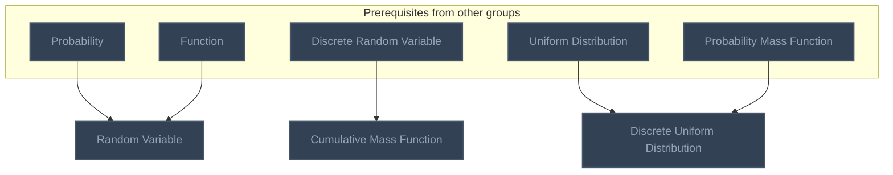
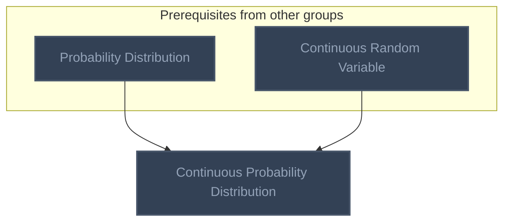
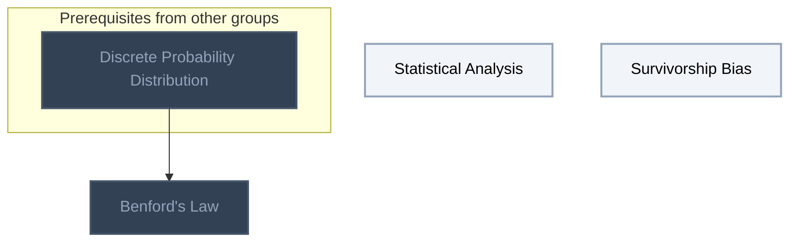

<!-- BEGIN STATS (generated by Scripts/skill_trees.py; do not edit) -->
**Mastered:** 0 / 20 · **Depth:** 0% · **Discovered:** 20 · **Planned:** 0 · **Locked:** 18 · **Rusty:** 0

**Levels:** L0 20 · L1 0 · L2 0 · L3 0 · L4 0 · L5 0

**Next up:** [[Statistical Analysis]], [[Survivorship Bias]]

Legend: dashed grey = planned (no note yet) · dark grey = locked · white L0 Discovered · green L1 Recall · blue L2 Apply · purple L3 Prove (Mastered) · orange L4 Wield · gold L5 Command · brown dashed border = rusty
<!-- END STATS -->

## Probability and Statistical Inference: Probability
**Mastered:** 0 / 13 · **Discovered:** 13 / 13

```mermaid
flowchart TD
    classDef planned fill:#1E293B,stroke:#64748B,stroke-width:2px,stroke-dasharray:5 5,color:#94A3B8;
    classDef locked fill:#334155,stroke:#475569,stroke-width:2px,color:#94A3B8;
    classDef L0 fill:#F1F5F9,stroke:#94A3B8,stroke-width:2px,color:#000000;
    classDef L1 fill:#22C55E,stroke:#15803D,stroke-width:2px,color:#000000;
    classDef L2 fill:#3B82F6,stroke:#1D4ED8,stroke-width:3px,color:#FFFFFF;
    classDef L3 fill:#A855F7,stroke:#6B21A8,stroke-width:3px,color:#FFFFFF,font-weight:bold;
    classDef L4 fill:#F97316,stroke:#C2410C,stroke-width:4px,color:#000000,font-weight:bold;
    classDef L5 fill:#FFD700,stroke:#FF8C00,stroke-width:5px,color:#000000,font-weight:bold;
    classDef rusty stroke:#8B4513,stroke-width:4px,stroke-dasharray:3 3;
    subgraph sg_prereqs["Prerequisites from other groups"]
        n_set["Set"]
        n_universe_of_discourse["Universe of Discourse"]
        n_set_function["Set Function"]
        n_sigma_field["Sigma-Field"]
        n_mutually_exclusive_events["Mutually Exclusive Events"]
        n_event["Event"]
        n_empty_set["Empty Set"]
        n_subset["Subset"]
        n_conditional_probability_multiplication_rule["Conditional Probability Multiplication Rule"]
        n_relative_frequency["Relative Frequency"]
    end
    n_set_complement["Set Complement"]
    n_probability["Probability"]
    n_frequency["Frequency"]
    n_probability_of_complement["Probability of Complement"]
    n_probability_of_empty_set["Probability of Empty Set"]
    n_probability_of_subset["Probability of Subset"]
    n_probability_maximum_value["Probability Maximum Value"]
    n_conditional_probability["Conditional Probability"]
    n_conditional_probability_other_properties["Conditional Probability Other Properties"]
    n_independent_events["Independent Events"]
    n_probability_objective_interpretation["Probability Objective Interpretation"]
    n_probability_subjective_interpretation["Probability Subjective Interpretation"]
    n_probability_frequentist_framework["Probability Frequentist Framework"]
    n_set --> n_set_complement
    n_universe_of_discourse --> n_set_complement
    n_set_function --> n_probability
    n_sigma_field --> n_probability
    n_mutually_exclusive_events --> n_probability
    n_event --> n_frequency
    n_probability --> n_probability_of_complement
    n_set_complement --> n_probability_of_complement
    n_probability_of_complement --> n_probability_of_empty_set
    n_empty_set --> n_probability_of_empty_set
    n_probability --> n_probability_of_subset
    n_subset --> n_probability_of_subset
    n_probability_of_subset --> n_probability_maximum_value
    n_probability --> n_conditional_probability
    n_conditional_probability --> n_conditional_probability_other_properties
    n_conditional_probability_multiplication_rule --> n_independent_events
    n_probability --> n_probability_objective_interpretation
    n_probability --> n_probability_subjective_interpretation
    n_probability --> n_probability_frequentist_framework
    n_relative_frequency --> n_probability_frequentist_framework
    class n_universe_of_discourse,n_set_function,n_sigma_field,n_mutually_exclusive_events,n_event,n_empty_set,n_subset,n_conditional_probability_multiplication_rule,n_relative_frequency,n_set_complement,n_probability,n_frequency,n_probability_of_complement,n_probability_of_empty_set,n_probability_of_subset,n_probability_maximum_value,n_conditional_probability,n_conditional_probability_other_properties,n_independent_events,n_probability_objective_interpretation,n_probability_subjective_interpretation,n_probability_frequentist_framework locked;
    class n_set L0;
    class n_set,n_universe_of_discourse,n_set_function,n_sigma_field,n_mutually_exclusive_events,n_event,n_empty_set,n_subset,n_conditional_probability_multiplication_rule,n_relative_frequency,n_set_complement,n_probability,n_frequency,n_probability_of_complement,n_probability_of_empty_set,n_probability_of_subset,n_probability_maximum_value,n_conditional_probability,n_conditional_probability_other_properties,n_independent_events,n_probability_objective_interpretation,n_probability_subjective_interpretation,n_probability_frequentist_framework internal-link;
```



## Probability and Statistical Inference: Discrete Distributions
**Mastered:** 0 / 3 · **Discovered:** 3 / 3



## Continuous Distributions
**Mastered:** 0 / 1 · **Discovered:** 1 / 1



## Statistical Practice
**Mastered:** 0 / 3 · **Discovered:** 3 / 3



# Source
Graph structure: the single source for the diagrams above, edited by `/note` and `Scripts/skill_trees.py` (`add`, `edge`, `rename`). Everything above this heading is regenerated by `render`.

```skilltree
    %% PREREQUISITES
    n_set["Set"]
    n_universe_of_discourse["Universe of Discourse"]
    n_set_function["Set Function"]
    n_sigma_field["Sigma-Field"]
    n_mutually_exclusive_events["Mutually Exclusive Events"]
    n_event["Event"]
    n_empty_set["Empty Set"]
    n_subset["Subset"]
    n_conditional_probability_multiplication_rule["Conditional Probability Multiplication Rule"]
    n_function["Function"]
    n_discrete_random_variable["Discrete Random Variable"]
    n_uniform_distribution["Uniform Distribution"]
    n_probability_mass_function["Probability Mass Function"]
    n_probability_distribution["Probability Distribution"]
    n_continuous_random_variable["Continuous Random Variable"]
    n_relative_frequency["Relative Frequency"]
    n_discrete_probability_distribution["Discrete Probability Distribution"]
    %% NODES
    %% == Probability and Statistical Inference: Probability ==
    n_set_complement["Set Complement"]
    n_probability["Probability"]
    n_frequency["Frequency"]
    n_probability_of_complement["Probability of Complement"]
    n_probability_of_empty_set["Probability of Empty Set"]
    n_probability_of_subset["Probability of Subset"]
    n_probability_maximum_value["Probability Maximum Value"]
    n_conditional_probability["Conditional Probability"]
    n_conditional_probability_other_properties["Conditional Probability Other Properties"]
    n_independent_events["Independent Events"]
    n_probability_objective_interpretation["Probability Objective Interpretation"]
    n_probability_subjective_interpretation["Probability Subjective Interpretation"]
    n_probability_frequentist_framework["Probability Frequentist Framework"]
    %% == Probability and Statistical Inference: Discrete Distributions ==
    n_random_variable["Random Variable"]
    n_cumulative_mass_function["Cumulative Mass Function"]
    n_discrete_uniform_distribution["Discrete Uniform Distribution"]
    %% == Continuous Distributions ==
    n_continuous_probability_distribution["Continuous Probability Distribution"]
    %% == Statistical Practice ==
    n_statistical_analysis["Statistical Analysis"]
    n_survivorship_bias["Survivorship Bias"]
    n_benford_s_law["Benford's Law"]
    %% EDGES
    n_set --> n_set_complement
    n_universe_of_discourse --> n_set_complement
    n_set_function --> n_probability
    n_sigma_field --> n_probability
    n_mutually_exclusive_events --> n_probability
    n_event --> n_frequency
    n_probability --> n_probability_of_complement
    n_set_complement --> n_probability_of_complement
    n_probability_of_complement --> n_probability_of_empty_set
    n_empty_set --> n_probability_of_empty_set
    n_probability --> n_probability_of_subset
    n_subset --> n_probability_of_subset
    n_probability_of_subset --> n_probability_maximum_value
    n_probability --> n_conditional_probability
    n_conditional_probability --> n_conditional_probability_other_properties
    n_conditional_probability_multiplication_rule --> n_independent_events
    n_probability --> n_random_variable
    n_function --> n_random_variable
    n_discrete_random_variable --> n_cumulative_mass_function
    n_uniform_distribution --> n_discrete_uniform_distribution
    n_probability_mass_function --> n_discrete_uniform_distribution
    n_probability_distribution --> n_continuous_probability_distribution
    n_continuous_random_variable --> n_continuous_probability_distribution
    n_probability --> n_probability_objective_interpretation
    n_probability --> n_probability_subjective_interpretation
    n_probability --> n_probability_frequentist_framework
    n_relative_frequency --> n_probability_frequentist_framework
    n_discrete_probability_distribution --> n_benford_s_law
```
