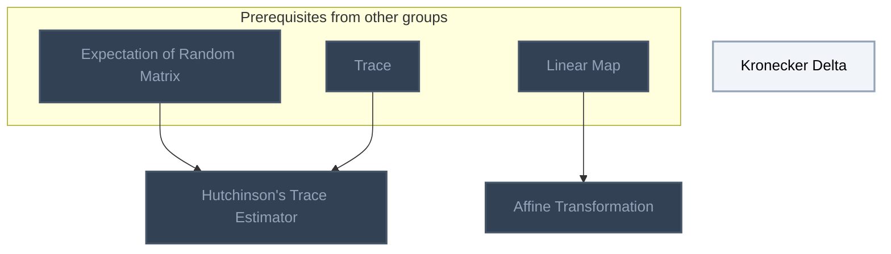

<!-- BEGIN STATS (generated by Scripts/skill_trees.py; do not edit) -->
**Mastered:** 0 / 264 · **Depth:** 0% · **Discovered:** 262 · **Planned:** 2 · **Locked:** 259 · **Rusty:** 0

| | L0 Discovered | L1 Recall | L2 Apply | L3 Prove ★ | L4 Wield | L5 Command |
|---|---:|---:|---:|---:|---:|---:|
| **At this level** | 262 | 0 | 0 | 0 | 0 | 0 |
| **Reached (this level or higher)** | 262 | 0 | 0 | 0 | 0 | 0 |

**Next up:** [[Kronecker Delta]], [[Algebraic Structures]], [[Dot Product]]

Legend: dashed grey = planned (no note yet) · dark grey = locked · white L0 Discovered · green L1 Recall · blue L2 Apply · purple L3 Prove (Mastered) · orange L4 Wield · gold L5 Command · brown dashed border = rusty
<!-- END STATS -->

## Meckes Ch. 1: Linear Systems and Vector Spaces
**Reached:** L1 0 · L2 0 · L3 0 · L4 0 · L5 0 (of 35 nodes)

```mermaid
flowchart TD
    classDef planned fill:#1E293B,stroke:#64748B,stroke-width:2px,stroke-dasharray:5 5,color:#94A3B8;
    classDef locked fill:#334155,stroke:#475569,stroke-width:2px,color:#94A3B8;
    classDef L0 fill:#F1F5F9,stroke:#94A3B8,stroke-width:2px,color:#000000;
    classDef L1 fill:#22C55E,stroke:#15803D,stroke-width:2px,color:#000000;
    classDef L2 fill:#3B82F6,stroke:#1D4ED8,stroke-width:3px,color:#FFFFFF;
    classDef L3 fill:#A855F7,stroke:#6B21A8,stroke-width:3px,color:#FFFFFF,font-weight:bold;
    classDef L4 fill:#F97316,stroke:#C2410C,stroke-width:4px,color:#000000,font-weight:bold;
    classDef L5 fill:#FFD700,stroke:#FF8C00,stroke-width:5px,color:#000000,font-weight:bold;
    classDef rusty stroke:#8B4513,stroke-width:4px,stroke-dasharray:3 3;
    subgraph sg_prereqs["Prerequisites from other groups"]
        n_linear_function["Linear Function"]
        n_dot_product["Dot Product"]
        n_set["Set"]
        n_operation["Operation"]
        n_subset["Subset"]
        n_function["Function"]
        n_orthonormal_basis["Orthonormal Basis"]
        n_linear_map["Linear Map"]
        n_nonsingular_matrix["Nonsingular Matrix"]
    end
    n_linear_system_of_equations["Linear System of Equations"]
    n_homogeneous_linear_system["Homogeneous Linear System"]
    n_solution_of_linear_system["Solution of Linear System"]
    n_matrix["Matrix"]
    n_augmented_matrix["Augmented Matrix"]
    n_coefficient_matrix["Coefficient Matrix"]
    n_lower_triangular_matrix["Lower Triangular Matrix"]
    n_upper_triangular_matrix["Upper Triangular Matrix"]
    n_vector_equality["Vector Equality"]
    n_row_operations["Row Operations"]
    n_row_echelon_form["Row Echelon Form"]
    n_reduced_row_echelon_form["Reduced Row Echelon Form"]
    n_back_substitution["Back-Substitution"]
    n_pivot_variable["Pivot Variable"]
    n_vector["Vector"]
    n_column_vector["Column Vector"]
    n_row_vector["Row Vector"]
    n_vector_scalar_multiplication["Vector Scalar Multiplication"]
    n_standard_basis_vector["Standard Basis Vector"]
    n_vector_addition["Vector Addition"]
    n_linear_combination["Linear Combination"]
    n_span["Span"]
    n_vector_subtraction["Vector Subtraction"]
    n_vector_operations["Vector Operations"]
    n_vector_norm["Vector Norm"]
    n_algebraic_structures["Algebraic Structures"]
    n_field["Field"]
    n_field_basic_properties["Field Basic Properties"]
    n_vector_space["Vector Space"]
    n_vector_subspace["Vector Subspace"]
    n_function_space["Function Space"]
    n_rotation_matrix["Rotation Matrix"]
    n_orthogonal_matrix["Orthogonal Matrix"]
    n_special_orthogonal_matrix["Special Orthogonal Matrix"]
    n_dual_space["Dual Space"]
    n_linear_function --> n_linear_system_of_equations
    n_field --> n_linear_system_of_equations
    n_linear_system_of_equations --> n_homogeneous_linear_system
    n_linear_system_of_equations --> n_solution_of_linear_system
    n_field --> n_matrix
    n_linear_system_of_equations --> n_augmented_matrix
    n_matrix --> n_augmented_matrix
    n_linear_system_of_equations --> n_coefficient_matrix
    n_matrix --> n_coefficient_matrix
    n_matrix --> n_lower_triangular_matrix
    n_matrix --> n_upper_triangular_matrix
    n_vector --> n_vector_equality
    n_augmented_matrix --> n_row_operations
    n_row_operations --> n_row_echelon_form
    n_row_echelon_form --> n_reduced_row_echelon_form
    n_linear_system_of_equations --> n_back_substitution
    n_upper_triangular_matrix --> n_back_substitution
    n_reduced_row_echelon_form --> n_pivot_variable
    n_field --> n_vector
    n_vector --> n_column_vector
    n_vector --> n_row_vector
    n_vector --> n_vector_scalar_multiplication
    n_vector --> n_standard_basis_vector
    n_vector --> n_vector_addition
    n_vector_scalar_multiplication --> n_linear_combination
    n_vector_addition --> n_linear_combination
    n_linear_combination --> n_span
    n_vector_scalar_multiplication --> n_vector_subtraction
    n_vector_addition --> n_vector_subtraction
    n_vector_scalar_multiplication --> n_vector_operations
    n_vector_addition --> n_vector_operations
    n_dot_product --> n_vector_norm
    n_vector --> n_vector_norm
    n_set --> n_algebraic_structures
    n_operation --> n_algebraic_structures
    n_algebraic_structures --> n_field
    n_field --> n_field_basic_properties
    n_vector_operations --> n_vector_space
    n_subset --> n_vector_subspace
    n_vector_space --> n_vector_subspace
    n_function --> n_function_space
    n_vector_space --> n_function_space
    n_matrix --> n_rotation_matrix
    n_matrix --> n_orthogonal_matrix
    n_orthonormal_basis --> n_orthogonal_matrix
    n_orthogonal_matrix --> n_special_orthogonal_matrix
    n_vector_space --> n_dual_space
    n_linear_map --> n_dual_space
    n_nonsingular_matrix --> n_solution_of_linear_system
    class n_orthonormal_basis,n_linear_map,n_nonsingular_matrix,n_linear_system_of_equations,n_homogeneous_linear_system,n_solution_of_linear_system,n_matrix,n_augmented_matrix,n_coefficient_matrix,n_lower_triangular_matrix,n_upper_triangular_matrix,n_vector_equality,n_row_operations,n_row_echelon_form,n_reduced_row_echelon_form,n_back_substitution,n_pivot_variable,n_vector,n_column_vector,n_row_vector,n_vector_scalar_multiplication,n_standard_basis_vector,n_vector_addition,n_linear_combination,n_span,n_vector_subtraction,n_vector_operations,n_vector_norm,n_field,n_field_basic_properties,n_vector_space,n_vector_subspace,n_function_space,n_rotation_matrix,n_orthogonal_matrix,n_special_orthogonal_matrix,n_dual_space locked;
    class n_dot_product,n_algebraic_structures L0;
    class n_subset L2;
    class n_linear_function,n_set,n_operation,n_function L3;
    class n_linear_function,n_dot_product,n_set,n_operation,n_subset,n_function,n_orthonormal_basis,n_linear_map,n_nonsingular_matrix,n_linear_system_of_equations,n_homogeneous_linear_system,n_solution_of_linear_system,n_matrix,n_augmented_matrix,n_coefficient_matrix,n_lower_triangular_matrix,n_upper_triangular_matrix,n_vector_equality,n_row_operations,n_row_echelon_form,n_reduced_row_echelon_form,n_back_substitution,n_pivot_variable,n_vector,n_column_vector,n_row_vector,n_vector_scalar_multiplication,n_standard_basis_vector,n_vector_addition,n_linear_combination,n_span,n_vector_subtraction,n_vector_operations,n_vector_norm,n_algebraic_structures,n_field,n_field_basic_properties,n_vector_space,n_vector_subspace,n_function_space,n_rotation_matrix,n_orthogonal_matrix,n_special_orthogonal_matrix,n_dual_space internal-link;
```



## Meckes Ch. 2: Linear Maps and Matrices
**Reached:** L1 0 · L2 0 · L3 0 · L4 0 · L5 0 (of 47 nodes, 2 planned)

```mermaid
flowchart TD
    classDef planned fill:#1E293B,stroke:#64748B,stroke-width:2px,stroke-dasharray:5 5,color:#94A3B8;
    classDef locked fill:#334155,stroke:#475569,stroke-width:2px,color:#94A3B8;
    classDef L0 fill:#F1F5F9,stroke:#94A3B8,stroke-width:2px,color:#000000;
    classDef L1 fill:#22C55E,stroke:#15803D,stroke-width:2px,color:#000000;
    classDef L2 fill:#3B82F6,stroke:#1D4ED8,stroke-width:3px,color:#FFFFFF;
    classDef L3 fill:#A855F7,stroke:#6B21A8,stroke-width:3px,color:#FFFFFF,font-weight:bold;
    classDef L4 fill:#F97316,stroke:#C2410C,stroke-width:4px,color:#000000,font-weight:bold;
    classDef L5 fill:#FFD700,stroke:#FF8C00,stroke-width:5px,color:#000000,font-weight:bold;
    classDef rusty stroke:#8B4513,stroke-width:4px,stroke-dasharray:3 3;
    subgraph sg_prereqs["Prerequisites from other groups"]
        n_function["Function"]
        n_vector_space["Vector Space"]
        n_matrix["Matrix"]
        n_bijective_function["Bijective Function"]
        n_inverse_function["Inverse Function"]
        n_function_composition["Function Composition"]
        n_standard_basis_vector["Standard Basis Vector"]
        n_continuous_function["Continuous Function"]
        n_integral["Integral"]
        n_function_space["Function Space"]
        n_injective_function["Injective Function"]
        n_conjugate["Conjugate"]
        n_complex_number["Complex Number"]
        n_row_operations["Row Operations"]
        n_reduced_row_echelon_form["Reduced Row Echelon Form"]
        n_lower_triangular_matrix["Lower Triangular Matrix"]
        n_back_substitution["Back-Substitution"]
        n_permutation_matrix["Permutation Matrix"]
        n_vector_subspace["Vector Subspace"]
        n_span["Span"]
        n_solution_of_linear_system["Solution of Linear System"]
        n_pivot_variable["Pivot Variable"]
        n_homogeneous_linear_system["Homogeneous Linear System"]
        n_group_homomorphism["Group Homomorphism"]
        n_gauss_jordan_elimination["Gauss-Jordan Elimination"]
        n_determinant["Determinant"]
        n_rank["Rank"]
    end
    n_linear_map["Linear Map"]
    n_linear_operator["Linear Operator"]
    n_diagonal_matrix["Diagonal Matrix"]
    n_eigenvalue["Eigenvalue"]
    n_eigenvector["Eigenvector"]
    n_linear_map_isomorphism["Linear Map Isomorphism"]
    n_invertible_linear_map["Invertible Linear Map"]
    n_inverse_of_linear_map_is_linear["Inverse of Linear Map is Linear"]
    n_linear_map_invertible_isomorphism_theorem["Linear Map Invertible Isomorphism Theorem"]
    n_linear_map_composition["Linear Map Composition"]
    n_linear_map_of_zero["Linear Map of Zero"]
    n_two_linear_maps_sum_and_product["Two Linear Maps Sum and Product"]
    n_linear_map_distributive_law["Linear Map Distributive Law"]
    n_matrix_of_linear_map["Matrix of Linear Map"]
    n_integral_operator["Integral Operator"]
    n_zero_eigenvalue_linear_map_injectivity["Zero Eigenvalue Linear Map Injectivity"]
    n_eigenvalue_and_eigenvector_of_inverse_linear_map["Eigenvalue and Eigenvector of Inverse Linear Map"]
    n_matrix_multiplication["Matrix Multiplication"]
    n_matrix_multiplication_basic_properties["Matrix Multiplication Basic Properties"]
    n_matrix_transpose["Matrix Transpose"]
    n_matrix_conjugate_transpose["Matrix Conjugate Transpose"]
    n_matrix_transpose_basic_properties["Matrix Transpose Basic Properties"]
    n_matrix_conjugate_transpose_basic_properties["Matrix Conjugate Transpose Basic Properties"]
    n_matrix_inverse["Matrix Inverse"]
    n_matrix_inverse_basic_properties["Matrix Inverse Basic Properties"]
    n_matrix_inverse_of_matrix_transpose["Matrix Inverse of Matrix Transpose"]
    n_elementary_matrix["Elementary Matrix"]
    n_elementary_matrix_reduced_row_echelon_form_theorem["Elementary Matrix Reduced Row Echelon Form Theorem"]
    n_matrix_inverse_algorithm["Matrix Inverse Algorithm"]
    n_matrix_inverse_one_sided_theorem["Matrix Inverse One Sided Theorem"]
    n_lu_decomposition["LU Decomposition"]
    n_lup_decomposition["LUP Decomposition"]
    n_linear_map_image["Linear Map Image"]
    n_matrix_column_space["Matrix Column Space"]
    n_linear_system_of_equations_column_space["Linear System of Equations Column Space"]
    n_matrix_product_column_space["Matrix Product Column Space"]
    n_list_of_vectors_span_vector_space["List of Vectors Span Vector Space"]
    n_kernel_vector_subspace["Kernel Vector Subspace"]
    n_kernel_linear_system["Kernel Linear System"]
    n_linear_map_injective_kernel["Linear Map Injective Kernel"]
    n_eigenspace["Eigenspace"]
    n_eigenvalue_kernel["Eigenvalue Kernel"]
    n_linear_code["Linear Code"]
    n_parity_check_matrix["Parity-Check Matrix"]
    n_image["Image"]
    n_kernel["Kernel"]
    n_nonsingular_matrix["Nonsingular Matrix"]
    n_function --> n_linear_map
    n_vector_space --> n_linear_map
    n_linear_map --> n_linear_operator
    n_matrix --> n_diagonal_matrix
    n_linear_map --> n_eigenvalue
    n_eigenvalue --> n_eigenvector
    n_bijective_function --> n_linear_map_isomorphism
    n_linear_map --> n_linear_map_isomorphism
    n_inverse_function --> n_invertible_linear_map
    n_linear_map --> n_invertible_linear_map
    n_invertible_linear_map --> n_inverse_of_linear_map_is_linear
    n_linear_map_isomorphism --> n_linear_map_invertible_isomorphism_theorem
    n_invertible_linear_map --> n_linear_map_invertible_isomorphism_theorem
    n_function_composition --> n_linear_map_composition
    n_linear_map --> n_linear_map_composition
    n_linear_map --> n_linear_map_of_zero
    n_linear_map --> n_two_linear_maps_sum_and_product
    n_linear_map_composition --> n_linear_map_distributive_law
    n_two_linear_maps_sum_and_product --> n_linear_map_distributive_law
    n_matrix --> n_matrix_of_linear_map
    n_standard_basis_vector --> n_matrix_of_linear_map
    n_linear_map --> n_matrix_of_linear_map
    n_continuous_function --> n_integral_operator
    n_integral --> n_integral_operator
    n_function_space --> n_integral_operator
    n_linear_map --> n_integral_operator
    n_injective_function --> n_zero_eigenvalue_linear_map_injectivity
    n_eigenvalue --> n_zero_eigenvalue_linear_map_injectivity
    n_invertible_linear_map --> n_zero_eigenvalue_linear_map_injectivity
    n_eigenvector --> n_eigenvalue_and_eigenvector_of_inverse_linear_map
    n_invertible_linear_map --> n_eigenvalue_and_eigenvector_of_inverse_linear_map
    n_linear_map_composition --> n_matrix_multiplication
    n_matrix_of_linear_map --> n_matrix_multiplication
    n_matrix_multiplication --> n_matrix_multiplication_basic_properties
    n_matrix --> n_matrix_transpose
    n_conjugate --> n_matrix_conjugate_transpose
    n_complex_number --> n_matrix_conjugate_transpose
    n_matrix_transpose --> n_matrix_conjugate_transpose
    n_matrix_multiplication --> n_matrix_transpose_basic_properties
    n_matrix_transpose --> n_matrix_transpose_basic_properties
    n_matrix_conjugate_transpose --> n_matrix_conjugate_transpose_basic_properties
    n_matrix_transpose_basic_properties --> n_matrix_conjugate_transpose_basic_properties
    n_invertible_linear_map --> n_matrix_inverse
    n_matrix_multiplication --> n_matrix_inverse
    n_matrix_inverse --> n_matrix_inverse_basic_properties
    n_matrix_conjugate_transpose --> n_matrix_inverse_of_matrix_transpose
    n_matrix_inverse --> n_matrix_inverse_of_matrix_transpose
    n_row_operations --> n_elementary_matrix
    n_matrix_multiplication --> n_elementary_matrix
    n_reduced_row_echelon_form --> n_elementary_matrix_reduced_row_echelon_form_theorem
    n_elementary_matrix --> n_elementary_matrix_reduced_row_echelon_form_theorem
    n_matrix_inverse --> n_matrix_inverse_algorithm
    n_elementary_matrix_reduced_row_echelon_form_theorem --> n_matrix_inverse_algorithm
    n_matrix_inverse --> n_matrix_inverse_one_sided_theorem
    n_elementary_matrix_reduced_row_echelon_form_theorem --> n_matrix_inverse_one_sided_theorem
    n_lower_triangular_matrix --> n_lu_decomposition
    n_back_substitution --> n_lu_decomposition
    n_elementary_matrix --> n_lu_decomposition
    n_lu_decomposition --> n_lup_decomposition
    n_permutation_matrix --> n_lup_decomposition
    n_image --> n_linear_map_image
    n_vector_subspace --> n_linear_map_image
    n_linear_map --> n_linear_map_image
    n_span --> n_matrix_column_space
    n_matrix_of_linear_map --> n_matrix_column_space
    n_linear_map_image --> n_matrix_column_space
    n_solution_of_linear_system --> n_linear_system_of_equations_column_space
    n_matrix_column_space --> n_linear_system_of_equations_column_space
    n_matrix_multiplication --> n_matrix_product_column_space
    n_matrix_column_space --> n_matrix_product_column_space
    n_pivot_variable --> n_list_of_vectors_span_vector_space
    n_span --> n_list_of_vectors_span_vector_space
    n_vector_space --> n_list_of_vectors_span_vector_space
    n_kernel --> n_kernel_vector_subspace
    n_vector_subspace --> n_kernel_vector_subspace
    n_linear_map --> n_kernel_vector_subspace
    n_homogeneous_linear_system --> n_kernel_linear_system
    n_kernel_vector_subspace --> n_kernel_linear_system
    n_injective_function --> n_linear_map_injective_kernel
    n_kernel_vector_subspace --> n_linear_map_injective_kernel
    n_vector_subspace --> n_eigenspace
    n_eigenvector --> n_eigenspace
    n_kernel_vector_subspace --> n_eigenvalue_kernel
    n_eigenspace --> n_eigenvalue_kernel
    n_linear_map_image --> n_linear_code
    n_kernel_vector_subspace --> n_parity_check_matrix
    n_linear_code --> n_parity_check_matrix
    n_group_homomorphism --> n_image
    n_group_homomorphism --> n_kernel
    n_gauss_jordan_elimination --> n_matrix_inverse_algorithm
    n_determinant --> n_nonsingular_matrix
    n_kernel --> n_nonsingular_matrix
    n_matrix_inverse --> n_nonsingular_matrix
    n_rank --> n_nonsingular_matrix
    class n_linear_code,n_parity_check_matrix planned;
    class n_vector_space,n_matrix,n_standard_basis_vector,n_function_space,n_complex_number,n_row_operations,n_reduced_row_echelon_form,n_lower_triangular_matrix,n_back_substitution,n_permutation_matrix,n_vector_subspace,n_span,n_solution_of_linear_system,n_pivot_variable,n_homogeneous_linear_system,n_group_homomorphism,n_gauss_jordan_elimination,n_determinant,n_rank,n_linear_map,n_linear_operator,n_diagonal_matrix,n_eigenvalue,n_eigenvector,n_linear_map_isomorphism,n_invertible_linear_map,n_inverse_of_linear_map_is_linear,n_linear_map_invertible_isomorphism_theorem,n_linear_map_composition,n_linear_map_of_zero,n_two_linear_maps_sum_and_product,n_linear_map_distributive_law,n_matrix_of_linear_map,n_integral_operator,n_zero_eigenvalue_linear_map_injectivity,n_eigenvalue_and_eigenvector_of_inverse_linear_map,n_matrix_multiplication,n_matrix_multiplication_basic_properties,n_matrix_transpose,n_matrix_conjugate_transpose,n_matrix_transpose_basic_properties,n_matrix_conjugate_transpose_basic_properties,n_matrix_inverse,n_matrix_inverse_basic_properties,n_matrix_inverse_of_matrix_transpose,n_elementary_matrix,n_elementary_matrix_reduced_row_echelon_form_theorem,n_matrix_inverse_algorithm,n_matrix_inverse_one_sided_theorem,n_lu_decomposition,n_lup_decomposition,n_linear_map_image,n_matrix_column_space,n_linear_system_of_equations_column_space,n_matrix_product_column_space,n_list_of_vectors_span_vector_space,n_kernel_vector_subspace,n_kernel_linear_system,n_linear_map_injective_kernel,n_eigenspace,n_eigenvalue_kernel,n_image,n_kernel,n_nonsingular_matrix locked;
    class n_integral,n_conjugate L0;
    class n_bijective_function,n_inverse_function,n_function_composition,n_injective_function L2;
    class n_function,n_continuous_function L3;
    class n_function,n_vector_space,n_matrix,n_bijective_function,n_inverse_function,n_function_composition,n_standard_basis_vector,n_continuous_function,n_integral,n_function_space,n_injective_function,n_conjugate,n_complex_number,n_row_operations,n_reduced_row_echelon_form,n_lower_triangular_matrix,n_back_substitution,n_permutation_matrix,n_vector_subspace,n_span,n_solution_of_linear_system,n_pivot_variable,n_homogeneous_linear_system,n_group_homomorphism,n_gauss_jordan_elimination,n_determinant,n_rank,n_linear_map,n_linear_operator,n_diagonal_matrix,n_eigenvalue,n_eigenvector,n_linear_map_isomorphism,n_invertible_linear_map,n_inverse_of_linear_map_is_linear,n_linear_map_invertible_isomorphism_theorem,n_linear_map_composition,n_linear_map_of_zero,n_two_linear_maps_sum_and_product,n_linear_map_distributive_law,n_matrix_of_linear_map,n_integral_operator,n_zero_eigenvalue_linear_map_injectivity,n_eigenvalue_and_eigenvector_of_inverse_linear_map,n_matrix_multiplication,n_matrix_multiplication_basic_properties,n_matrix_transpose,n_matrix_conjugate_transpose,n_matrix_transpose_basic_properties,n_matrix_conjugate_transpose_basic_properties,n_matrix_inverse,n_matrix_inverse_basic_properties,n_matrix_inverse_of_matrix_transpose,n_elementary_matrix,n_elementary_matrix_reduced_row_echelon_form_theorem,n_matrix_inverse_algorithm,n_matrix_inverse_one_sided_theorem,n_lu_decomposition,n_lup_decomposition,n_linear_map_image,n_matrix_column_space,n_linear_system_of_equations_column_space,n_matrix_product_column_space,n_list_of_vectors_span_vector_space,n_kernel_vector_subspace,n_kernel_linear_system,n_linear_map_injective_kernel,n_eigenspace,n_eigenvalue_kernel,n_image,n_kernel,n_nonsingular_matrix internal-link;
```



## Meckes Ch. 3: Linear Independence, Bases, and Coordinates
**Reached:** L1 0 · L2 0 · L3 0 · L4 0 · L5 0 (of 75 nodes)

```mermaid
flowchart TD
    classDef planned fill:#1E293B,stroke:#64748B,stroke-width:2px,stroke-dasharray:5 5,color:#94A3B8;
    classDef locked fill:#334155,stroke:#475569,stroke-width:2px,color:#94A3B8;
    classDef L0 fill:#F1F5F9,stroke:#94A3B8,stroke-width:2px,color:#000000;
    classDef L1 fill:#22C55E,stroke:#15803D,stroke-width:2px,color:#000000;
    classDef L2 fill:#3B82F6,stroke:#1D4ED8,stroke-width:3px,color:#FFFFFF;
    classDef L3 fill:#A855F7,stroke:#6B21A8,stroke-width:3px,color:#FFFFFF,font-weight:bold;
    classDef L4 fill:#F97316,stroke:#C2410C,stroke-width:4px,color:#000000,font-weight:bold;
    classDef L5 fill:#FFD700,stroke:#FF8C00,stroke-width:5px,color:#000000,font-weight:bold;
    classDef rusty stroke:#8B4513,stroke-width:4px,stroke-dasharray:3 3;
    subgraph sg_prereqs["Prerequisites from other groups"]
        n_linear_combination["Linear Combination"]
        n_vector_space["Vector Space"]
        n_pivot_variable["Pivot Variable"]
        n_homogeneous_linear_system["Homogeneous Linear System"]
        n_matrix["Matrix"]
        n_span["Span"]
        n_eigenvector["Eigenvector"]
        n_linear_map_injective_kernel["Linear Map Injective Kernel"]
        n_linear_map["Linear Map"]
        n_linear_map_isomorphism["Linear Map Isomorphism"]
        n_matrix_inverse["Matrix Inverse"]
        n_set_intersection["Set Intersection"]
        n_vector_subspace["Vector Subspace"]
        n_linear_map_image["Linear Map Image"]
        n_surjective_function["Surjective Function"]
        n_matrix_column_space["Matrix Column Space"]
        n_matrix_conjugate_transpose["Matrix Conjugate Transpose"]
        n_kernel_vector_subspace["Kernel Vector Subspace"]
        n_eigenvalue["Eigenvalue"]
        n_invertible_linear_map["Invertible Linear Map"]
        n_matrix_of_linear_map["Matrix of Linear Map"]
        n_linear_operator["Linear Operator"]
        n_function_space["Function Space"]
        n_diagonal_matrix["Diagonal Matrix"]
        n_matrix_inverse_of_matrix_transpose["Matrix Inverse of Matrix Transpose"]
        n_equivalence_relation["Equivalence Relation"]
        n_matrix_multiplication["Matrix Multiplication"]
        n_matrix_transpose["Matrix Transpose"]
        n_eigenspace["Eigenspace"]
        n_algebraic_multiplicity_of_eigenvalue["Algebraic Multiplicity of Eigenvalue"]
        n_lower_triangular_matrix["Lower Triangular Matrix"]
        n_upper_triangular_matrix["Upper Triangular Matrix"]
        n_polynomial["Polynomial"]
        n_field["Field"]
        n_subgroup_generated_by_subset["Subgroup Generated by Subset"]
    end
    n_linearly_dependent["Linearly Dependent"]
    n_linearly_independent["Linearly Independent"]
    n_list_of_vectors_linearly_dependent_dimension["List of Vectors Linearly Dependent Dimension"]
    n_matrix_linearly_independent_columns["Matrix Linearly Independent Columns"]
    n_linearly_independent_algorithm["Linearly Independent Algorithm"]
    n_linearly_independent_span["Linearly Independent Span"]
    n_linear_dependence_lemma["Linear Dependence Lemma"]
    n_linear_dependence_lemma_linearly_independent["Linear Dependence Lemma Linearly Independent"]
    n_linear_independence_of_eigenvectors["Linear Independence of Eigenvectors"]
    n_linear_map_injective_linear_independence["Linear Map Injective Linear Independence"]
    n_finite_dimensional_vector_space["Finite-Dimensional Vector Space"]
    n_infinite_dimensional_vector_space["Infinite-Dimensional Vector Space"]
    n_basis_linear_combination["Basis Linear Combination"]
    n_basis_matrix_rref["Basis Matrix RREF"]
    n_basis_sublist["Basis Sublist"]
    n_basis_algorithm["Basis Algorithm"]
    n_basis_finite_dimensional_vector_space["Basis Finite-Dimensional Vector Space"]
    n_basis_unique_linear_map["Basis Unique Linear Map"]
    n_basis_linear_map_isomorphism["Basis Linear Map Isomorphism"]
    n_matrix_equivalence_invertible_basis_rref["Matrix Equivalence Invertible Basis RREF"]
    n_linearly_independent_list_dimension["Linearly Independent List Dimension"]
    n_linearly_independent_infinite_dimensional_vector_space["Linearly Independent Infinite-Dimensional Vector Space"]
    n_two_bases_dimension["Two Bases Dimension"]
    n_dimension["Dimension"]
    n_linear_map_isomorphism_dimension_finite_dimensional_vector_space["Linear Map Isomorphism Dimension Finite-Dimensional Vector Space"]
    n_linearly_independent_dimension_finite_dimensional_vector_space["Linearly Independent Dimension Finite-Dimensional Vector Space"]
    n_span_dimension["Span Dimension"]
    n_vector_subspace_dimension_set_intersection["Vector Subspace Dimension Set Intersection"]
    n_dimension_algorithm["Dimension Algorithm"]
    n_basis_dimension["Basis Dimension"]
    n_linearly_independent_finite_dimensional_vector_space_basis["Linearly Independent Finite-Dimensional Vector Space Basis"]
    n_finite_dimensional_vector_space_vector_subspace_dimension["Finite-Dimensional Vector Space Vector Subspace Dimension"]
    n_linearly_independent_basis_dimension["Linearly Independent Basis Dimension"]
    n_rank["Rank"]
    n_rank_domain_codomain["Rank Domain Codomain"]
    n_rank_surjective["Rank Surjective"]
    n_rank_algorithm["Rank Algorithm"]
    n_rank_matrix_transpose["Rank Matrix Transpose"]
    n_nullity["Nullity"]
    n_rank_nullity_theorem["Rank-Nullity Theorem"]
    n_rank_nullity_injective_surjective_linear_map_isomorphism["Rank-Nullity Injective Surjective Linear Map Isomorphism"]
    n_eigenvalue_matrix_transpose["Eigenvalue Matrix Transpose"]
    n_rank_nullity_invertible_linear_map_equal_dimension["Rank-Nullity Invertible Linear Map Equal Dimension"]
    n_rank_nullity_injective_surjective_dimension["Rank-Nullity Injective Surjective Dimension"]
    n_coordinates["Coordinates"]
    n_coordinates_n_dimensional_space_linear_map_isomorphism["Coordinates n-Dimensional Space Linear Map Isomorphism"]
    n_matrix_simple_representation["Matrix Simple Representation"]
    n_finite_dimensional_linear_operator["Finite-Dimensional Linear Operator"]
    n_infinite_dimensional_linear_operator["Infinite-Dimensional Linear Operator"]
    n_diagonalizable_linear_map["Diagonalizable Linear Map"]
    n_change_of_basis_matrix["Change of Basis Matrix"]
    n_change_of_basis_matrix_to_standard_basis["Change of Basis Matrix to Standard Basis"]
    n_change_of_basis_matrix_inverse["Change of Basis Matrix Inverse"]
    n_change_of_basis_matrix_with_linear_map["Change of Basis Matrix with Linear Map"]
    n_similar_matrix["Similar Matrix"]
    n_similar_matrix_matrix_transpose["Similar Matrix Matrix Transpose"]
    n_diagonalizable_matrix["Diagonalizable Matrix"]
    n_diagonalizable_matrix_linear_map["Diagonalizable Matrix Linear Map"]
    n_eigendecomposition["Eigendecomposition"]
    n_invariant_of_matrix["Invariant of Matrix"]
    n_similar_matrix_eigenvalue["Similar Matrix Eigenvalue"]
    n_similar_matrix_rank_nullity["Similar Matrix Rank-Nullity"]
    n_trace["Trace"]
    n_trace_of_matrix_multiplication["Trace of Matrix Multiplication"]
    n_trace_of_transpose_matrix_multiplication["Trace of Transpose Matrix Multiplication"]
    n_similar_matrix_trace["Similar Matrix Trace"]
    n_geometric_multiplicity_of_eigenvalue["Geometric Multiplicity of Eigenvalue"]
    n_similar_matrix_geometric_multiplicity_of_eigenvalue["Similar Matrix Geometric Multiplicity of Eigenvalue"]
    n_trace_eigenvalue["Trace Eigenvalue"]
    n_triangular_matrix_invertibility["Triangular Matrix Invertibility"]
    n_triangular_matrix_eigenvalue["Triangular Matrix Eigenvalue"]
    n_algebraically_closed_field["Algebraically Closed Field"]
    n_triangular_matrix_lemma["Triangular Matrix Lemma"]
    n_triangular_matrix_algebraically_closed_field_similar_matrix["Triangular Matrix Algebraically Closed Field Similar Matrix"]
    n_basis["Basis"]
    n_linear_combination --> n_linearly_dependent
    n_vector_space --> n_linearly_dependent
    n_linearly_dependent --> n_linearly_independent
    n_pivot_variable --> n_list_of_vectors_linearly_dependent_dimension
    n_linearly_dependent --> n_list_of_vectors_linearly_dependent_dimension
    n_homogeneous_linear_system --> n_matrix_linearly_independent_columns
    n_matrix --> n_matrix_linearly_independent_columns
    n_linearly_independent --> n_matrix_linearly_independent_columns
    n_pivot_variable --> n_linearly_independent_algorithm
    n_linearly_independent --> n_linearly_independent_algorithm
    n_span --> n_linearly_independent_span
    n_linearly_independent --> n_linearly_independent_span
    n_span --> n_linear_dependence_lemma
    n_linearly_dependent --> n_linear_dependence_lemma
    n_linearly_independent --> n_linear_dependence_lemma_linearly_independent
    n_linear_dependence_lemma --> n_linear_dependence_lemma_linearly_independent
    n_eigenvector --> n_linear_independence_of_eigenvectors
    n_linearly_independent --> n_linear_independence_of_eigenvectors
    n_linear_dependence_lemma --> n_linear_independence_of_eigenvectors
    n_linear_map_injective_kernel --> n_linear_map_injective_linear_independence
    n_linearly_independent --> n_linear_map_injective_linear_independence
    n_span --> n_finite_dimensional_vector_space
    n_vector_space --> n_finite_dimensional_vector_space
    n_finite_dimensional_vector_space --> n_infinite_dimensional_vector_space
    n_basis --> n_basis_linear_combination
    n_basis --> n_basis_matrix_rref
    n_pivot_variable --> n_basis_matrix_rref
    n_basis --> n_basis_sublist
    n_linear_dependence_lemma --> n_basis_sublist
    n_pivot_variable --> n_basis_algorithm
    n_basis_sublist --> n_basis_algorithm
    n_finite_dimensional_vector_space --> n_basis_finite_dimensional_vector_space
    n_basis_sublist --> n_basis_finite_dimensional_vector_space
    n_linear_map --> n_basis_unique_linear_map
    n_basis_linear_combination --> n_basis_unique_linear_map
    n_linear_map_isomorphism --> n_basis_linear_map_isomorphism
    n_basis_unique_linear_map --> n_basis_linear_map_isomorphism
    n_matrix_inverse --> n_matrix_equivalence_invertible_basis_rref
    n_basis_matrix_rref --> n_matrix_equivalence_invertible_basis_rref
    n_linear_dependence_lemma_linearly_independent --> n_linearly_independent_list_dimension
    n_finite_dimensional_vector_space --> n_linearly_independent_list_dimension
    n_infinite_dimensional_vector_space --> n_linearly_independent_infinite_dimensional_vector_space
    n_linearly_independent_list_dimension --> n_linearly_independent_infinite_dimensional_vector_space
    n_basis --> n_two_bases_dimension
    n_linearly_independent_list_dimension --> n_two_bases_dimension
    n_basis_finite_dimensional_vector_space --> n_dimension
    n_two_bases_dimension --> n_dimension
    n_basis_linear_map_isomorphism --> n_linear_map_isomorphism_dimension_finite_dimensional_vector_space
    n_dimension --> n_linear_map_isomorphism_dimension_finite_dimensional_vector_space
    n_dimension --> n_linearly_independent_dimension_finite_dimensional_vector_space
    n_dimension --> n_span_dimension
    n_set_intersection --> n_vector_subspace_dimension_set_intersection
    n_vector_subspace --> n_vector_subspace_dimension_set_intersection
    n_dimension --> n_vector_subspace_dimension_set_intersection
    n_basis_algorithm --> n_dimension_algorithm
    n_dimension --> n_dimension_algorithm
    n_dimension --> n_basis_dimension
    n_dimension --> n_linearly_independent_finite_dimensional_vector_space_basis
    n_vector_subspace --> n_finite_dimensional_vector_space_vector_subspace_dimension
    n_dimension --> n_finite_dimensional_vector_space_vector_subspace_dimension
    n_basis_dimension --> n_linearly_independent_basis_dimension
    n_linear_map_image --> n_rank
    n_dimension --> n_rank
    n_rank --> n_rank_domain_codomain
    n_surjective_function --> n_rank_surjective
    n_rank --> n_rank_surjective
    n_matrix_column_space --> n_rank_algorithm
    n_dimension_algorithm --> n_rank_algorithm
    n_rank --> n_rank_algorithm
    n_matrix_conjugate_transpose --> n_rank_matrix_transpose
    n_rank --> n_rank_matrix_transpose
    n_kernel_vector_subspace --> n_nullity
    n_dimension --> n_nullity
    n_rank --> n_rank_nullity_theorem
    n_nullity --> n_rank_nullity_theorem
    n_linear_map_injective_kernel --> n_rank_nullity_injective_surjective_linear_map_isomorphism
    n_rank_surjective --> n_rank_nullity_injective_surjective_linear_map_isomorphism
    n_rank_nullity_theorem --> n_rank_nullity_injective_surjective_linear_map_isomorphism
    n_eigenvalue --> n_eigenvalue_matrix_transpose
    n_rank_matrix_transpose --> n_eigenvalue_matrix_transpose
    n_rank_nullity_theorem --> n_eigenvalue_matrix_transpose
    n_invertible_linear_map --> n_rank_nullity_invertible_linear_map_equal_dimension
    n_rank_nullity_theorem --> n_rank_nullity_invertible_linear_map_equal_dimension
    n_linear_map_injective_kernel --> n_rank_nullity_injective_surjective_dimension
    n_rank_surjective --> n_rank_nullity_injective_surjective_dimension
    n_rank_nullity_theorem --> n_rank_nullity_injective_surjective_dimension
    n_basis_linear_combination --> n_coordinates
    n_basis_linear_map_isomorphism --> n_coordinates_n_dimensional_space_linear_map_isomorphism
    n_coordinates --> n_coordinates_n_dimensional_space_linear_map_isomorphism
    n_matrix_of_linear_map --> n_matrix_simple_representation
    n_rank_nullity_theorem --> n_matrix_simple_representation
    n_coordinates --> n_matrix_simple_representation
    n_linear_operator --> n_finite_dimensional_linear_operator
    n_matrix_of_linear_map --> n_finite_dimensional_linear_operator
    n_finite_dimensional_vector_space --> n_finite_dimensional_linear_operator
    n_coordinates --> n_finite_dimensional_linear_operator
    n_function_space --> n_infinite_dimensional_linear_operator
    n_infinite_dimensional_vector_space --> n_infinite_dimensional_linear_operator
    n_finite_dimensional_linear_operator --> n_infinite_dimensional_linear_operator
    n_diagonal_matrix --> n_diagonalizable_linear_map
    n_eigenvector --> n_diagonalizable_linear_map
    n_matrix_of_linear_map --> n_diagonalizable_linear_map
    n_coordinates --> n_diagonalizable_linear_map
    n_invertible_linear_map --> n_change_of_basis_matrix
    n_matrix_of_linear_map --> n_change_of_basis_matrix
    n_coordinates --> n_change_of_basis_matrix
    n_change_of_basis_matrix --> n_change_of_basis_matrix_to_standard_basis
    n_matrix_inverse --> n_change_of_basis_matrix_inverse
    n_change_of_basis_matrix --> n_change_of_basis_matrix_inverse
    n_change_of_basis_matrix_inverse --> n_change_of_basis_matrix_with_linear_map
    n_change_of_basis_matrix_with_linear_map --> n_similar_matrix
    n_matrix_inverse_of_matrix_transpose --> n_similar_matrix_matrix_transpose
    n_similar_matrix --> n_similar_matrix_matrix_transpose
    n_diagonal_matrix --> n_diagonalizable_matrix
    n_similar_matrix --> n_diagonalizable_matrix
    n_diagonalizable_linear_map --> n_diagonalizable_matrix_linear_map
    n_diagonalizable_matrix --> n_diagonalizable_matrix_linear_map
    n_diagonalizable_matrix_linear_map --> n_eigendecomposition
    n_equivalence_relation --> n_invariant_of_matrix
    n_similar_matrix --> n_invariant_of_matrix
    n_eigenvalue --> n_similar_matrix_eigenvalue
    n_invariant_of_matrix --> n_similar_matrix_eigenvalue
    n_rank_nullity_theorem --> n_similar_matrix_rank_nullity
    n_invariant_of_matrix --> n_similar_matrix_rank_nullity
    n_matrix --> n_trace
    n_matrix_multiplication --> n_trace_of_matrix_multiplication
    n_trace --> n_trace_of_matrix_multiplication
    n_matrix_transpose --> n_trace_of_transpose_matrix_multiplication
    n_trace_of_matrix_multiplication --> n_trace_of_transpose_matrix_multiplication
    n_invariant_of_matrix --> n_similar_matrix_trace
    n_trace_of_matrix_multiplication --> n_similar_matrix_trace
    n_eigenspace --> n_geometric_multiplicity_of_eigenvalue
    n_dimension --> n_geometric_multiplicity_of_eigenvalue
    n_invariant_of_matrix --> n_similar_matrix_geometric_multiplicity_of_eigenvalue
    n_geometric_multiplicity_of_eigenvalue --> n_similar_matrix_geometric_multiplicity_of_eigenvalue
    n_similar_matrix_trace --> n_trace_eigenvalue
    n_triangular_matrix_algebraically_closed_field_similar_matrix --> n_trace_eigenvalue
    n_algebraic_multiplicity_of_eigenvalue --> n_trace_eigenvalue
    n_lower_triangular_matrix --> n_triangular_matrix_invertibility
    n_upper_triangular_matrix --> n_triangular_matrix_invertibility
    n_invertible_linear_map --> n_triangular_matrix_invertibility
    n_eigenvalue --> n_triangular_matrix_eigenvalue
    n_triangular_matrix_invertibility --> n_triangular_matrix_eigenvalue
    n_polynomial --> n_algebraically_closed_field
    n_field --> n_algebraically_closed_field
    n_lower_triangular_matrix --> n_triangular_matrix_lemma
    n_upper_triangular_matrix --> n_triangular_matrix_lemma
    n_matrix_of_linear_map --> n_triangular_matrix_lemma
    n_coordinates --> n_triangular_matrix_lemma
    n_eigenvalue --> n_triangular_matrix_algebraically_closed_field_similar_matrix
    n_similar_matrix --> n_triangular_matrix_algebraically_closed_field_similar_matrix
    n_algebraically_closed_field --> n_triangular_matrix_algebraically_closed_field_similar_matrix
    n_triangular_matrix_lemma --> n_triangular_matrix_algebraically_closed_field_similar_matrix
    n_subgroup_generated_by_subset --> n_basis
    n_linearly_independent --> n_basis
    class n_linear_combination,n_vector_space,n_pivot_variable,n_homogeneous_linear_system,n_matrix,n_span,n_eigenvector,n_linear_map_injective_kernel,n_linear_map,n_linear_map_isomorphism,n_matrix_inverse,n_vector_subspace,n_linear_map_image,n_matrix_column_space,n_matrix_conjugate_transpose,n_kernel_vector_subspace,n_eigenvalue,n_invertible_linear_map,n_matrix_of_linear_map,n_linear_operator,n_function_space,n_diagonal_matrix,n_matrix_inverse_of_matrix_transpose,n_matrix_multiplication,n_matrix_transpose,n_eigenspace,n_algebraic_multiplicity_of_eigenvalue,n_lower_triangular_matrix,n_upper_triangular_matrix,n_field,n_subgroup_generated_by_subset,n_linearly_dependent,n_linearly_independent,n_list_of_vectors_linearly_dependent_dimension,n_matrix_linearly_independent_columns,n_linearly_independent_algorithm,n_linearly_independent_span,n_linear_dependence_lemma,n_linear_dependence_lemma_linearly_independent,n_linear_independence_of_eigenvectors,n_linear_map_injective_linear_independence,n_finite_dimensional_vector_space,n_infinite_dimensional_vector_space,n_basis_linear_combination,n_basis_matrix_rref,n_basis_sublist,n_basis_algorithm,n_basis_finite_dimensional_vector_space,n_basis_unique_linear_map,n_basis_linear_map_isomorphism,n_matrix_equivalence_invertible_basis_rref,n_linearly_independent_list_dimension,n_linearly_independent_infinite_dimensional_vector_space,n_two_bases_dimension,n_dimension,n_linear_map_isomorphism_dimension_finite_dimensional_vector_space,n_linearly_independent_dimension_finite_dimensional_vector_space,n_span_dimension,n_vector_subspace_dimension_set_intersection,n_dimension_algorithm,n_basis_dimension,n_linearly_independent_finite_dimensional_vector_space_basis,n_finite_dimensional_vector_space_vector_subspace_dimension,n_linearly_independent_basis_dimension,n_rank,n_rank_domain_codomain,n_rank_surjective,n_rank_algorithm,n_rank_matrix_transpose,n_nullity,n_rank_nullity_theorem,n_rank_nullity_injective_surjective_linear_map_isomorphism,n_eigenvalue_matrix_transpose,n_rank_nullity_invertible_linear_map_equal_dimension,n_rank_nullity_injective_surjective_dimension,n_coordinates,n_coordinates_n_dimensional_space_linear_map_isomorphism,n_matrix_simple_representation,n_finite_dimensional_linear_operator,n_infinite_dimensional_linear_operator,n_diagonalizable_linear_map,n_change_of_basis_matrix,n_change_of_basis_matrix_to_standard_basis,n_change_of_basis_matrix_inverse,n_change_of_basis_matrix_with_linear_map,n_similar_matrix,n_similar_matrix_matrix_transpose,n_diagonalizable_matrix,n_diagonalizable_matrix_linear_map,n_eigendecomposition,n_invariant_of_matrix,n_similar_matrix_eigenvalue,n_similar_matrix_rank_nullity,n_trace,n_trace_of_matrix_multiplication,n_trace_of_transpose_matrix_multiplication,n_similar_matrix_trace,n_geometric_multiplicity_of_eigenvalue,n_similar_matrix_geometric_multiplicity_of_eigenvalue,n_trace_eigenvalue,n_triangular_matrix_invertibility,n_triangular_matrix_eigenvalue,n_algebraically_closed_field,n_triangular_matrix_lemma,n_triangular_matrix_algebraically_closed_field_similar_matrix,n_basis locked;
    class n_set_intersection L0;
    class n_surjective_function,n_equivalence_relation,n_polynomial L2;
    class n_linear_combination,n_vector_space,n_pivot_variable,n_homogeneous_linear_system,n_matrix,n_span,n_eigenvector,n_linear_map_injective_kernel,n_linear_map,n_linear_map_isomorphism,n_matrix_inverse,n_set_intersection,n_vector_subspace,n_linear_map_image,n_surjective_function,n_matrix_column_space,n_matrix_conjugate_transpose,n_kernel_vector_subspace,n_eigenvalue,n_invertible_linear_map,n_matrix_of_linear_map,n_linear_operator,n_function_space,n_diagonal_matrix,n_matrix_inverse_of_matrix_transpose,n_equivalence_relation,n_matrix_multiplication,n_matrix_transpose,n_eigenspace,n_algebraic_multiplicity_of_eigenvalue,n_lower_triangular_matrix,n_upper_triangular_matrix,n_polynomial,n_field,n_subgroup_generated_by_subset,n_linearly_dependent,n_linearly_independent,n_list_of_vectors_linearly_dependent_dimension,n_matrix_linearly_independent_columns,n_linearly_independent_algorithm,n_linearly_independent_span,n_linear_dependence_lemma,n_linear_dependence_lemma_linearly_independent,n_linear_independence_of_eigenvectors,n_linear_map_injective_linear_independence,n_finite_dimensional_vector_space,n_infinite_dimensional_vector_space,n_basis_linear_combination,n_basis_matrix_rref,n_basis_sublist,n_basis_algorithm,n_basis_finite_dimensional_vector_space,n_basis_unique_linear_map,n_basis_linear_map_isomorphism,n_matrix_equivalence_invertible_basis_rref,n_linearly_independent_list_dimension,n_linearly_independent_infinite_dimensional_vector_space,n_two_bases_dimension,n_dimension,n_linear_map_isomorphism_dimension_finite_dimensional_vector_space,n_linearly_independent_dimension_finite_dimensional_vector_space,n_span_dimension,n_vector_subspace_dimension_set_intersection,n_dimension_algorithm,n_basis_dimension,n_linearly_independent_finite_dimensional_vector_space_basis,n_finite_dimensional_vector_space_vector_subspace_dimension,n_linearly_independent_basis_dimension,n_rank,n_rank_domain_codomain,n_rank_surjective,n_rank_algorithm,n_rank_matrix_transpose,n_nullity,n_rank_nullity_theorem,n_rank_nullity_injective_surjective_linear_map_isomorphism,n_eigenvalue_matrix_transpose,n_rank_nullity_invertible_linear_map_equal_dimension,n_rank_nullity_injective_surjective_dimension,n_coordinates,n_coordinates_n_dimensional_space_linear_map_isomorphism,n_matrix_simple_representation,n_finite_dimensional_linear_operator,n_infinite_dimensional_linear_operator,n_diagonalizable_linear_map,n_change_of_basis_matrix,n_change_of_basis_matrix_to_standard_basis,n_change_of_basis_matrix_inverse,n_change_of_basis_matrix_with_linear_map,n_similar_matrix,n_similar_matrix_matrix_transpose,n_diagonalizable_matrix,n_diagonalizable_matrix_linear_map,n_eigendecomposition,n_invariant_of_matrix,n_similar_matrix_eigenvalue,n_similar_matrix_rank_nullity,n_trace,n_trace_of_matrix_multiplication,n_trace_of_transpose_matrix_multiplication,n_similar_matrix_trace,n_geometric_multiplicity_of_eigenvalue,n_similar_matrix_geometric_multiplicity_of_eigenvalue,n_trace_eigenvalue,n_triangular_matrix_invertibility,n_triangular_matrix_eigenvalue,n_algebraically_closed_field,n_triangular_matrix_lemma,n_triangular_matrix_algebraically_closed_field_similar_matrix,n_basis internal-link;
```

## Meckes Ch. 4: Inner Products
**Reached:** L1 0 · L2 0 · L3 0 · L4 0 · L5 0 (of 62 nodes)

```mermaid
flowchart TD
    classDef planned fill:#1E293B,stroke:#64748B,stroke-width:2px,stroke-dasharray:5 5,color:#94A3B8;
    classDef locked fill:#334155,stroke:#475569,stroke-width:2px,color:#94A3B8;
    classDef L0 fill:#F1F5F9,stroke:#94A3B8,stroke-width:2px,color:#000000;
    classDef L1 fill:#22C55E,stroke:#15803D,stroke-width:2px,color:#000000;
    classDef L2 fill:#3B82F6,stroke:#1D4ED8,stroke-width:3px,color:#FFFFFF;
    classDef L3 fill:#A855F7,stroke:#6B21A8,stroke-width:3px,color:#FFFFFF,font-weight:bold;
    classDef L4 fill:#F97316,stroke:#C2410C,stroke-width:4px,color:#000000,font-weight:bold;
    classDef L5 fill:#FFD700,stroke:#FF8C00,stroke-width:5px,color:#000000,font-weight:bold;
    classDef rusty stroke:#8B4513,stroke-width:4px,stroke-dasharray:3 3;
    subgraph sg_prereqs["Prerequisites from other groups"]
        n_angle["Angle"]
        n_vector_norm["Vector Norm"]
        n_standard_basis_vector["Standard Basis Vector"]
        n_conjugate["Conjugate"]
        n_vector_space["Vector Space"]
        n_matrix["Matrix"]
        n_coordinates["Coordinates"]
        n_pythagorean_theorem["Pythagorean Theorem"]
        n_trace_of_transpose_matrix_multiplication["Trace of Transpose Matrix Multiplication"]
        n_basis["Basis"]
        n_span["Span"]
        n_linearly_independent["Linearly Independent"]
        n_linearly_independent_finite_dimensional_vector_space_basis["Linearly Independent Finite-Dimensional Vector Space Basis"]
        n_vector_subspace["Vector Subspace"]
        n_matrix_of_linear_map["Matrix of Linear Map"]
        n_matrix_conjugate_transpose["Matrix Conjugate Transpose"]
        n_triangle_inequality["Triangle Inequality"]
        n_complete_metric_space["Complete Metric Space"]
        n_integral["Integral"]
        n_function_space["Function Space"]
        n_supremum["Supremum"]
        n_continuous_function["Continuous Function"]
        n_linear_map["Linear Map"]
        n_dual_space["Dual Space"]
        n_matrix_inverse["Matrix Inverse"]
        n_eigenvalue["Eigenvalue"]
        n_rank["Rank"]
        n_linear_map_isomorphism["Linear Map Isomorphism"]
        n_convex_set["Convex Set"]
        n_upper_triangular_matrix["Upper Triangular Matrix"]
        n_point["Point"]
        n_relative_condition_number["Relative Condition Number"]
    end
    n_angle_between_vectors["Angle Between Vectors"]
    n_vector_as_dot_product_with_standard_basis["Vector as Dot Product with Standard Basis"]
    n_inner_product["Inner Product"]
    n_inner_product_space["Inner Product Space"]
    n_bilinear_form["Bilinear Form"]
    n_vector_norm_basic_properties["Vector Norm Basic Properties"]
    n_pythagorean_theorem_for_inner_product_space["Pythagorean Theorem for Inner Product Space"]
    n_vector_orthogonal_representation["Vector Orthogonal Representation"]
    n_frobenius_inner_product_space["Frobenius Inner Product Space"]
    n_frobenius_norm["Frobenius Norm"]
    n_orthogonal_basis["Orthogonal Basis"]
    n_orthonormal_vector["Orthonormal Vector"]
    n_orthonormal_basis["Orthonormal Basis"]
    n_bessel_s_inequality["Bessel's Inequality"]
    n_coordinates_in_orthonormal_basis["Coordinates in Orthonormal Basis"]
    n_inner_product_and_vector_norm_under_orthonormal_basis["Inner Product and Vector Norm under Orthonormal Basis"]
    n_gram_schmidt_algorithm["Gram-Schmidt Algorithm"]
    n_extension_of_orthonormal_list_to_orthonormal_basis["Extension of Orthonormal List to Orthonormal Basis"]
    n_orthonormal_basis_finite_dimensional_inner_product_space["Orthonormal Basis Finite-Dimensional Inner Product Space"]
    n_orthogonal_complement["Orthogonal Complement"]
    n_orthogonal_decomposition_theorem["Orthogonal Decomposition Theorem"]
    n_orthogonal_direct_sum["Orthogonal Direct Sum"]
    n_orthogonal_projection["Orthogonal Projection"]
    n_orthogonal_projection_matrix["Orthogonal Projection Matrix"]
    n_best_approximation_theorem["Best Approximation Theorem"]
    n_normed_space["Normed Space"]
    n_1_norm["1-Norm"]
    n_infinity_norm["Infinity Norm"]
    n_p_norm["p-Norm"]
    n_banach_space["Banach Space"]
    n_hilbert_space["Hilbert Space"]
    n_parallelogram_identity["Parallelogram Identity"]
    n_l1_norm["L1 Norm"]
    n_supremum_norm["Supremum Norm"]
    n_polarization_identity["Polarization Identity"]
    n_jordan_von_neumann_theorem["Jordan-von Neumann Theorem"]
    n_when_banach_space_is_hilbert_space_theorem["When Banach Space is Hilbert Space Theorem"]
    n_linear_map_norm_continuity["Linear Map Norm Continuity"]
    n_operator_norm["Operator Norm"]
    n_dual_norm["Dual Norm"]
    n_h_lder_s_inequality["Hölder's Inequality"]
    n_condition_number_of_a_matrix["Condition Number of a Matrix"]
    n_eigenvalue_bound_by_operator_norm["Eigenvalue Bound by Operator Norm"]
    n_norm_equivalence_inequalities_finite_dimensional["Norm Equivalence Inequalities (Finite-Dimensional)"]
    n_operator_norm_and_frobenius_norm_inequality["Operator Norm and Frobenius Norm Inequality"]
    n_rank_1_matrix_operator_norm["Rank-1 Matrix Operator Norm"]
    n_isometry_linear_algebra["Isometry (Linear Algebra)"]
    n_strictly_convex_space["Strictly Convex Space"]
    n_uniformly_convex_space["Uniformly Convex Space"]
    n_unitary_matrix["Unitary Matrix"]
    n_qr_decomposition["QR Decomposition"]
    n_isometry_eigenvalue_modulus_theorem["Isometry Eigenvalue Modulus Theorem"]
    n_unitary_matrix_norm["Unitary Matrix Norm"]
    n_unitarily_invariant_norm["Unitarily Invariant Norm"]
    n_dot_product["Dot Product"]
    n_inner_product_basic_properties["Inner Product Basic Properties"]
    n_norm["Norm"]
    n_cauchy_schwarz_inequality["Cauchy-Schwarz Inequality"]
    n_orthogonal_vector["Orthogonal Vector"]
    n_unit_vector["Unit Vector"]
    n_orthonormal_expansion["Orthonormal Expansion"]
    n_induced_matrix_norm["Induced Matrix Norm"]
    n_cauchy_schwarz_inequality --> n_angle_between_vectors
    n_angle --> n_angle_between_vectors
    n_vector_norm --> n_angle_between_vectors
    n_dot_product --> n_vector_as_dot_product_with_standard_basis
    n_standard_basis_vector --> n_vector_as_dot_product_with_standard_basis
    n_conjugate --> n_inner_product
    n_dot_product --> n_inner_product
    n_vector_space --> n_inner_product
    n_inner_product --> n_inner_product_space
    n_matrix --> n_bilinear_form
    n_coordinates --> n_bilinear_form
    n_vector_norm --> n_vector_norm_basic_properties
    n_inner_product_space --> n_vector_norm_basic_properties
    n_pythagorean_theorem --> n_pythagorean_theorem_for_inner_product_space
    n_orthogonal_vector --> n_pythagorean_theorem_for_inner_product_space
    n_vector_norm_basic_properties --> n_pythagorean_theorem_for_inner_product_space
    n_orthogonal_vector --> n_vector_orthogonal_representation
    n_vector_norm_basic_properties --> n_vector_orthogonal_representation
    n_trace_of_transpose_matrix_multiplication --> n_frobenius_inner_product_space
    n_inner_product_space --> n_frobenius_inner_product_space
    n_vector_norm_basic_properties --> n_frobenius_norm
    n_frobenius_inner_product_space --> n_frobenius_norm
    n_orthogonal_vector --> n_orthogonal_basis
    n_basis --> n_orthogonal_basis
    n_inner_product_space --> n_orthogonal_basis
    n_orthogonal_vector --> n_orthonormal_vector
    n_vector_norm_basic_properties --> n_orthonormal_vector
    n_basis --> n_orthonormal_basis
    n_orthonormal_vector --> n_orthonormal_basis
    n_pythagorean_theorem_for_inner_product_space --> n_bessel_s_inequality
    n_orthonormal_vector --> n_bessel_s_inequality
    n_coordinates --> n_coordinates_in_orthonormal_basis
    n_orthonormal_basis --> n_coordinates_in_orthonormal_basis
    n_coordinates_in_orthonormal_basis --> n_inner_product_and_vector_norm_under_orthonormal_basis
    n_span --> n_gram_schmidt_algorithm
    n_linearly_independent --> n_gram_schmidt_algorithm
    n_vector_orthogonal_representation --> n_gram_schmidt_algorithm
    n_orthonormal_vector --> n_gram_schmidt_algorithm
    n_linearly_independent_finite_dimensional_vector_space_basis --> n_extension_of_orthonormal_list_to_orthonormal_basis
    n_orthonormal_basis --> n_extension_of_orthonormal_list_to_orthonormal_basis
    n_gram_schmidt_algorithm --> n_extension_of_orthonormal_list_to_orthonormal_basis
    n_extension_of_orthonormal_list_to_orthonormal_basis --> n_orthonormal_basis_finite_dimensional_inner_product_space
    n_orthogonal_vector --> n_orthogonal_complement
    n_vector_subspace --> n_orthogonal_complement
    n_inner_product_space --> n_orthogonal_complement
    n_orthonormal_basis_finite_dimensional_inner_product_space --> n_orthogonal_decomposition_theorem
    n_orthogonal_complement --> n_orthogonal_decomposition_theorem
    n_orthogonal_decomposition_theorem --> n_orthogonal_direct_sum
    n_orthogonal_decomposition_theorem --> n_orthogonal_projection
    n_matrix_of_linear_map --> n_orthogonal_projection_matrix
    n_matrix_conjugate_transpose --> n_orthogonal_projection_matrix
    n_orthogonal_projection --> n_orthogonal_projection_matrix
    n_pythagorean_theorem_for_inner_product_space --> n_best_approximation_theorem
    n_orthogonal_projection --> n_best_approximation_theorem
    n_triangle_inequality --> n_normed_space
    n_vector_norm_basic_properties --> n_normed_space
    n_normed_space --> n_1_norm
    n_normed_space --> n_infinity_norm
    n_normed_space --> n_p_norm
    n_complete_metric_space --> n_banach_space
    n_normed_space --> n_banach_space
    n_banach_space --> n_hilbert_space
    n_normed_space --> n_parallelogram_identity
    n_integral --> n_l1_norm
    n_function_space --> n_l1_norm
    n_1_norm --> n_l1_norm
    n_supremum --> n_supremum_norm
    n_function_space --> n_supremum_norm
    n_infinity_norm --> n_supremum_norm
    n_vector_norm_basic_properties --> n_polarization_identity
    n_parallelogram_identity --> n_jordan_von_neumann_theorem
    n_polarization_identity --> n_jordan_von_neumann_theorem
    n_hilbert_space --> n_when_banach_space_is_hilbert_space_theorem
    n_jordan_von_neumann_theorem --> n_when_banach_space_is_hilbert_space_theorem
    n_continuous_function --> n_linear_map_norm_continuity
    n_linear_map --> n_linear_map_norm_continuity
    n_normed_space --> n_linear_map_norm_continuity
    n_linear_map_norm_continuity --> n_operator_norm
    n_dual_space --> n_dual_norm
    n_operator_norm --> n_dual_norm
    n_p_norm --> n_h_lder_s_inequality
    n_matrix_inverse --> n_condition_number_of_a_matrix
    n_operator_norm --> n_condition_number_of_a_matrix
    n_eigenvalue --> n_eigenvalue_bound_by_operator_norm
    n_operator_norm --> n_eigenvalue_bound_by_operator_norm
    n_1_norm --> n_norm_equivalence_inequalities_finite_dimensional
    n_infinity_norm --> n_norm_equivalence_inequalities_finite_dimensional
    n_p_norm --> n_norm_equivalence_inequalities_finite_dimensional
    n_frobenius_norm --> n_operator_norm_and_frobenius_norm_inequality
    n_operator_norm --> n_operator_norm_and_frobenius_norm_inequality
    n_rank --> n_rank_1_matrix_operator_norm
    n_operator_norm_and_frobenius_norm_inequality --> n_rank_1_matrix_operator_norm
    n_linear_map_isomorphism --> n_isometry_linear_algebra
    n_normed_space --> n_isometry_linear_algebra
    n_convex_set --> n_strictly_convex_space
    n_normed_space --> n_strictly_convex_space
    n_strictly_convex_space --> n_uniformly_convex_space
    n_matrix_conjugate_transpose --> n_unitary_matrix
    n_orthonormal_basis --> n_unitary_matrix
    n_isometry_linear_algebra --> n_unitary_matrix
    n_upper_triangular_matrix --> n_qr_decomposition
    n_gram_schmidt_algorithm --> n_qr_decomposition
    n_unitary_matrix --> n_qr_decomposition
    n_eigenvalue --> n_isometry_eigenvalue_modulus_theorem
    n_isometry_linear_algebra --> n_isometry_eigenvalue_modulus_theorem
    n_frobenius_norm --> n_unitary_matrix_norm
    n_operator_norm --> n_unitary_matrix_norm
    n_unitary_matrix --> n_unitary_matrix_norm
    n_unitary_matrix_norm --> n_unitarily_invariant_norm
    n_point --> n_dot_product
    n_dot_product --> n_inner_product_basic_properties
    n_dot_product --> n_norm
    n_norm --> n_cauchy_schwarz_inequality
    n_dot_product --> n_orthogonal_vector
    n_norm --> n_unit_vector
    n_dot_product --> n_orthonormal_expansion
    n_orthonormal_basis --> n_orthonormal_expansion
    n_induced_matrix_norm --> n_condition_number_of_a_matrix
    n_relative_condition_number --> n_condition_number_of_a_matrix
    n_matrix --> n_induced_matrix_norm
    n_operator_norm --> n_induced_matrix_norm
    class n_vector_norm,n_standard_basis_vector,n_vector_space,n_matrix,n_coordinates,n_trace_of_transpose_matrix_multiplication,n_basis,n_span,n_linearly_independent,n_linearly_independent_finite_dimensional_vector_space_basis,n_vector_subspace,n_matrix_of_linear_map,n_matrix_conjugate_transpose,n_triangle_inequality,n_complete_metric_space,n_function_space,n_linear_map,n_dual_space,n_matrix_inverse,n_eigenvalue,n_rank,n_linear_map_isomorphism,n_convex_set,n_upper_triangular_matrix,n_relative_condition_number,n_angle_between_vectors,n_vector_as_dot_product_with_standard_basis,n_inner_product,n_inner_product_space,n_bilinear_form,n_vector_norm_basic_properties,n_pythagorean_theorem_for_inner_product_space,n_vector_orthogonal_representation,n_frobenius_inner_product_space,n_frobenius_norm,n_orthogonal_basis,n_orthonormal_vector,n_orthonormal_basis,n_bessel_s_inequality,n_coordinates_in_orthonormal_basis,n_inner_product_and_vector_norm_under_orthonormal_basis,n_gram_schmidt_algorithm,n_extension_of_orthonormal_list_to_orthonormal_basis,n_orthonormal_basis_finite_dimensional_inner_product_space,n_orthogonal_complement,n_orthogonal_decomposition_theorem,n_orthogonal_direct_sum,n_orthogonal_projection,n_orthogonal_projection_matrix,n_best_approximation_theorem,n_normed_space,n_1_norm,n_infinity_norm,n_p_norm,n_banach_space,n_hilbert_space,n_parallelogram_identity,n_l1_norm,n_supremum_norm,n_polarization_identity,n_jordan_von_neumann_theorem,n_when_banach_space_is_hilbert_space_theorem,n_linear_map_norm_continuity,n_operator_norm,n_dual_norm,n_h_lder_s_inequality,n_condition_number_of_a_matrix,n_eigenvalue_bound_by_operator_norm,n_norm_equivalence_inequalities_finite_dimensional,n_operator_norm_and_frobenius_norm_inequality,n_rank_1_matrix_operator_norm,n_isometry_linear_algebra,n_strictly_convex_space,n_uniformly_convex_space,n_unitary_matrix,n_qr_decomposition,n_isometry_eigenvalue_modulus_theorem,n_unitary_matrix_norm,n_unitarily_invariant_norm,n_inner_product_basic_properties,n_norm,n_cauchy_schwarz_inequality,n_orthogonal_vector,n_unit_vector,n_orthonormal_expansion,n_induced_matrix_norm locked;
    class n_conjugate,n_integral,n_supremum,n_dot_product L0;
    class n_pythagorean_theorem L2;
    class n_angle,n_continuous_function,n_point L3;
    class n_angle,n_vector_norm,n_standard_basis_vector,n_conjugate,n_vector_space,n_matrix,n_coordinates,n_pythagorean_theorem,n_trace_of_transpose_matrix_multiplication,n_basis,n_span,n_linearly_independent,n_linearly_independent_finite_dimensional_vector_space_basis,n_vector_subspace,n_matrix_of_linear_map,n_matrix_conjugate_transpose,n_triangle_inequality,n_complete_metric_space,n_integral,n_function_space,n_supremum,n_continuous_function,n_linear_map,n_dual_space,n_matrix_inverse,n_eigenvalue,n_rank,n_linear_map_isomorphism,n_convex_set,n_upper_triangular_matrix,n_point,n_relative_condition_number,n_angle_between_vectors,n_vector_as_dot_product_with_standard_basis,n_inner_product,n_inner_product_space,n_bilinear_form,n_vector_norm_basic_properties,n_pythagorean_theorem_for_inner_product_space,n_vector_orthogonal_representation,n_frobenius_inner_product_space,n_frobenius_norm,n_orthogonal_basis,n_orthonormal_vector,n_orthonormal_basis,n_bessel_s_inequality,n_coordinates_in_orthonormal_basis,n_inner_product_and_vector_norm_under_orthonormal_basis,n_gram_schmidt_algorithm,n_extension_of_orthonormal_list_to_orthonormal_basis,n_orthonormal_basis_finite_dimensional_inner_product_space,n_orthogonal_complement,n_orthogonal_decomposition_theorem,n_orthogonal_direct_sum,n_orthogonal_projection,n_orthogonal_projection_matrix,n_best_approximation_theorem,n_normed_space,n_1_norm,n_infinity_norm,n_p_norm,n_banach_space,n_hilbert_space,n_parallelogram_identity,n_l1_norm,n_supremum_norm,n_polarization_identity,n_jordan_von_neumann_theorem,n_when_banach_space_is_hilbert_space_theorem,n_linear_map_norm_continuity,n_operator_norm,n_dual_norm,n_h_lder_s_inequality,n_condition_number_of_a_matrix,n_eigenvalue_bound_by_operator_norm,n_norm_equivalence_inequalities_finite_dimensional,n_operator_norm_and_frobenius_norm_inequality,n_rank_1_matrix_operator_norm,n_isometry_linear_algebra,n_strictly_convex_space,n_uniformly_convex_space,n_unitary_matrix,n_qr_decomposition,n_isometry_eigenvalue_modulus_theorem,n_unitary_matrix_norm,n_unitarily_invariant_norm,n_dot_product,n_inner_product_basic_properties,n_norm,n_cauchy_schwarz_inequality,n_orthogonal_vector,n_unit_vector,n_orthonormal_expansion,n_induced_matrix_norm internal-link;
```

## Meckes Ch. 5: Singular Value Decomposition and the Spectral Theorem
**Reached:** L1 0 · L2 0 · L3 0 · L4 0 · L5 0 (of 17 nodes)

```mermaid
flowchart TD
    classDef planned fill:#1E293B,stroke:#64748B,stroke-width:2px,stroke-dasharray:5 5,color:#94A3B8;
    classDef locked fill:#334155,stroke:#475569,stroke-width:2px,color:#94A3B8;
    classDef L0 fill:#F1F5F9,stroke:#94A3B8,stroke-width:2px,color:#000000;
    classDef L1 fill:#22C55E,stroke:#15803D,stroke-width:2px,color:#000000;
    classDef L2 fill:#3B82F6,stroke:#1D4ED8,stroke-width:3px,color:#FFFFFF;
    classDef L3 fill:#A855F7,stroke:#6B21A8,stroke-width:3px,color:#FFFFFF,font-weight:bold;
    classDef L4 fill:#F97316,stroke:#C2410C,stroke-width:4px,color:#000000,font-weight:bold;
    classDef L5 fill:#FFD700,stroke:#FF8C00,stroke-width:5px,color:#000000,font-weight:bold;
    classDef rusty stroke:#8B4513,stroke-width:4px,stroke-dasharray:3 3;
    subgraph sg_prereqs["Prerequisites from other groups"]
        n_rank["Rank"]
        n_orthonormal_basis_finite_dimensional_inner_product_space["Orthonormal Basis Finite-Dimensional Inner Product Space"]
        n_unitary_matrix["Unitary Matrix"]
        n_unitary_matrix_norm["Unitary Matrix Norm"]
        n_matrix_inverse["Matrix Inverse"]
        n_orthogonal_projection_matrix["Orthogonal Projection Matrix"]
        n_linear_map["Linear Map"]
        n_matrix_conjugate_transpose["Matrix Conjugate Transpose"]
        n_orthonormal_basis["Orthonormal Basis"]
        n_rank_nullity_theorem["Rank-Nullity Theorem"]
        n_orthogonal_complement["Orthogonal Complement"]
        n_eigenvector["Eigenvector"]
        n_eigendecomposition["Eigendecomposition"]
        n_triangular_matrix_algebraically_closed_field_similar_matrix["Triangular Matrix Algebraically Closed Field Similar Matrix"]
        n_qr_decomposition["QR Decomposition"]
        n_lu_decomposition["LU Decomposition"]
    end
    n_singular_value_decomposition_theorem["Singular Value Decomposition Theorem"]
    n_singular_value["Singular Value"]
    n_low_rank_matrix_approximation_theorem["Low-Rank Matrix Approximation Theorem"]
    n_pseudoinverse["Pseudoinverse"]
    n_adjoint["Adjoint"]
    n_self_adjoint_linear_map["Self-Adjoint Linear Map"]
    n_adjoint_kernel_range_theorem["Adjoint Kernel Range Theorem"]
    n_singular_value_decomposition_algorithm["Singular Value Decomposition Algorithm"]
    n_spectral_theorem["Spectral Theorem"]
    n_function_of_a_matrix["Function of a Matrix"]
    n_positive_definite_matrix["Positive Definite Matrix"]
    n_matrix_exponential["Matrix Exponential"]
    n_normal_matrix["Normal Matrix"]
    n_schur_decomposition["Schur Decomposition"]
    n_positive_semidefinite_matrix["Positive Semidefinite Matrix"]
    n_cholesky_decomposition["Cholesky Decomposition"]
    n_matrix_square_root["Matrix Square Root"]
    n_rank --> n_singular_value_decomposition_theorem
    n_orthonormal_basis_finite_dimensional_inner_product_space --> n_singular_value_decomposition_theorem
    n_unitary_matrix --> n_singular_value_decomposition_theorem
    n_singular_value_decomposition_theorem --> n_singular_value
    n_unitary_matrix_norm --> n_low_rank_matrix_approximation_theorem
    n_singular_value --> n_low_rank_matrix_approximation_theorem
    n_matrix_inverse --> n_pseudoinverse
    n_orthogonal_projection_matrix --> n_pseudoinverse
    n_singular_value --> n_pseudoinverse
    n_linear_map --> n_adjoint
    n_matrix_conjugate_transpose --> n_adjoint
    n_orthonormal_basis --> n_adjoint
    n_adjoint --> n_self_adjoint_linear_map
    n_rank_nullity_theorem --> n_adjoint_kernel_range_theorem
    n_orthogonal_complement --> n_adjoint_kernel_range_theorem
    n_adjoint --> n_adjoint_kernel_range_theorem
    n_eigenvector --> n_singular_value_decomposition_algorithm
    n_singular_value --> n_singular_value_decomposition_algorithm
    n_adjoint --> n_singular_value_decomposition_algorithm
    n_eigendecomposition --> n_spectral_theorem
    n_self_adjoint_linear_map --> n_spectral_theorem
    n_normal_matrix --> n_spectral_theorem
    n_schur_decomposition --> n_spectral_theorem
    n_spectral_theorem --> n_function_of_a_matrix
    n_spectral_theorem --> n_positive_definite_matrix
    n_function_of_a_matrix --> n_matrix_exponential
    n_adjoint --> n_normal_matrix
    n_triangular_matrix_algebraically_closed_field_similar_matrix --> n_schur_decomposition
    n_qr_decomposition --> n_schur_decomposition
    n_spectral_theorem --> n_positive_semidefinite_matrix
    n_lu_decomposition --> n_cholesky_decomposition
    n_positive_definite_matrix --> n_cholesky_decomposition
    n_positive_semidefinite_matrix --> n_matrix_square_root
    n_spectral_theorem --> n_matrix_square_root
    class n_rank,n_orthonormal_basis_finite_dimensional_inner_product_space,n_unitary_matrix,n_unitary_matrix_norm,n_matrix_inverse,n_orthogonal_projection_matrix,n_linear_map,n_matrix_conjugate_transpose,n_orthonormal_basis,n_rank_nullity_theorem,n_orthogonal_complement,n_eigenvector,n_eigendecomposition,n_triangular_matrix_algebraically_closed_field_similar_matrix,n_qr_decomposition,n_lu_decomposition,n_singular_value_decomposition_theorem,n_singular_value,n_low_rank_matrix_approximation_theorem,n_pseudoinverse,n_adjoint,n_self_adjoint_linear_map,n_adjoint_kernel_range_theorem,n_singular_value_decomposition_algorithm,n_spectral_theorem,n_function_of_a_matrix,n_positive_definite_matrix,n_matrix_exponential,n_normal_matrix,n_schur_decomposition,n_positive_semidefinite_matrix,n_cholesky_decomposition,n_matrix_square_root locked;
    class n_rank,n_orthonormal_basis_finite_dimensional_inner_product_space,n_unitary_matrix,n_unitary_matrix_norm,n_matrix_inverse,n_orthogonal_projection_matrix,n_linear_map,n_matrix_conjugate_transpose,n_orthonormal_basis,n_rank_nullity_theorem,n_orthogonal_complement,n_eigenvector,n_eigendecomposition,n_triangular_matrix_algebraically_closed_field_similar_matrix,n_qr_decomposition,n_lu_decomposition,n_singular_value_decomposition_theorem,n_singular_value,n_low_rank_matrix_approximation_theorem,n_pseudoinverse,n_adjoint,n_self_adjoint_linear_map,n_adjoint_kernel_range_theorem,n_singular_value_decomposition_algorithm,n_spectral_theorem,n_function_of_a_matrix,n_positive_definite_matrix,n_matrix_exponential,n_normal_matrix,n_schur_decomposition,n_positive_semidefinite_matrix,n_cholesky_decomposition,n_matrix_square_root internal-link;
```



## Meckes Ch. 6: Determinants
**Reached:** L1 0 · L2 0 · L3 0 · L4 0 · L5 0 (of 25 nodes)

```mermaid
flowchart TD
    classDef planned fill:#1E293B,stroke:#64748B,stroke-width:2px,stroke-dasharray:5 5,color:#94A3B8;
    classDef locked fill:#334155,stroke:#475569,stroke-width:2px,color:#94A3B8;
    classDef L0 fill:#F1F5F9,stroke:#94A3B8,stroke-width:2px,color:#000000;
    classDef L1 fill:#22C55E,stroke:#15803D,stroke-width:2px,color:#000000;
    classDef L2 fill:#3B82F6,stroke:#1D4ED8,stroke-width:3px,color:#FFFFFF;
    classDef L3 fill:#A855F7,stroke:#6B21A8,stroke-width:3px,color:#FFFFFF,font-weight:bold;
    classDef L4 fill:#F97316,stroke:#C2410C,stroke-width:4px,color:#000000,font-weight:bold;
    classDef L5 fill:#FFD700,stroke:#FF8C00,stroke-width:5px,color:#000000,font-weight:bold;
    classDef rusty stroke:#8B4513,stroke-width:4px,stroke-dasharray:3 3;
    subgraph sg_prereqs["Prerequisites from other groups"]
        n_matrix_linearly_independent_columns["Matrix Linearly Independent Columns"]
        n_matrix["Matrix"]
        n_linear_map["Linear Map"]
        n_matrix_inverse["Matrix Inverse"]
        n_matrix_multiplication["Matrix Multiplication"]
        n_invariant_of_matrix["Invariant of Matrix"]
        n_triangular_matrix_algebraically_closed_field_similar_matrix["Triangular Matrix Algebraically Closed Field Similar Matrix"]
        n_matrix_transpose["Matrix Transpose"]
        n_lower_triangular_matrix["Lower Triangular Matrix"]
        n_upper_triangular_matrix["Upper Triangular Matrix"]
        n_matrix_conjugate_transpose["Matrix Conjugate Transpose"]
        n_elementary_matrix["Elementary Matrix"]
        n_permutation["Permutation"]
        n_permutation_parity["Permutation Parity"]
        n_diagonal_matrix["Diagonal Matrix"]
        n_lu_decomposition["LU Decomposition"]
        n_qr_decomposition["QR Decomposition"]
        n_polynomial["Polynomial"]
        n_eigenvalue["Eigenvalue"]
        n_algebraically_closed_field["Algebraically Closed Field"]
        n_volume["Volume"]
    end
    n_isoscopic_function["Isoscopic Function"]
    n_multilinear_function["Multilinear Function"]
    n_alternating_multilinear_function["Alternating Multilinear Function"]
    n_determinant["Determinant"]
    n_determinant_invertible_matrix_theorem["Determinant Invertible Matrix Theorem"]
    n_determinant_matrix_multiplication["Determinant Matrix Multiplication"]
    n_matrix_minor["Matrix Minor"]
    n_similar_matrix_determinant["Similar Matrix Determinant"]
    n_determinant_eigenvalue["Determinant Eigenvalue"]
    n_laplace_expansion["Laplace Expansion"]
    n_determinant_matrix_transpose["Determinant Matrix Transpose"]
    n_triangular_matrix_determinant["Triangular Matrix Determinant"]
    n_determinant_conjugate_transpose_theorem["Determinant Conjugate Transpose Theorem"]
    n_determinant_computation_algorithm["Determinant Computation Algorithm"]
    n_permutation_matrix["Permutation Matrix"]
    n_leibniz_formula_for_determinant["Leibniz Formula for Determinant"]
    n_ldu_decomposition["LDU Decomposition"]
    n_hadamard_s_inequality["Hadamard's Inequality"]
    n_characteristic_polynomial["Characteristic Polynomial"]
    n_algebraic_multiplicity_of_eigenvalue["Algebraic Multiplicity of Eigenvalue"]
    n_similar_matrix_characteristic_polynomial["Similar Matrix Characteristic Polynomial"]
    n_cayley_hamilton_theorem["Cayley-Hamilton Theorem"]
    n_determinant_volume_scaling_theorem["Determinant Volume Scaling Theorem"]
    n_cramer_s_rule["Cramer's Rule"]
    n_adjugate_matrix["Adjugate Matrix"]
    n_matrix_linearly_independent_columns --> n_isoscopic_function
    n_multilinear_function --> n_isoscopic_function
    n_matrix --> n_multilinear_function
    n_linear_map --> n_multilinear_function
    n_isoscopic_function --> n_alternating_multilinear_function
    n_alternating_multilinear_function --> n_determinant
    n_matrix_inverse --> n_determinant_invertible_matrix_theorem
    n_determinant --> n_determinant_invertible_matrix_theorem
    n_matrix_multiplication --> n_determinant_matrix_multiplication
    n_determinant --> n_determinant_matrix_multiplication
    n_matrix --> n_matrix_minor
    n_invariant_of_matrix --> n_similar_matrix_determinant
    n_determinant_matrix_multiplication --> n_similar_matrix_determinant
    n_triangular_matrix_algebraically_closed_field_similar_matrix --> n_determinant_eigenvalue
    n_similar_matrix_determinant --> n_determinant_eigenvalue
    n_triangular_matrix_determinant --> n_determinant_eigenvalue
    n_algebraic_multiplicity_of_eigenvalue --> n_determinant_eigenvalue
    n_determinant --> n_laplace_expansion
    n_matrix_minor --> n_laplace_expansion
    n_matrix_transpose --> n_determinant_matrix_transpose
    n_determinant --> n_determinant_matrix_transpose
    n_lower_triangular_matrix --> n_triangular_matrix_determinant
    n_upper_triangular_matrix --> n_triangular_matrix_determinant
    n_determinant_matrix_transpose --> n_triangular_matrix_determinant
    n_matrix_conjugate_transpose --> n_determinant_conjugate_transpose_theorem
    n_determinant_matrix_transpose --> n_determinant_conjugate_transpose_theorem
    n_elementary_matrix --> n_determinant_computation_algorithm
    n_determinant_matrix_multiplication --> n_determinant_computation_algorithm
    n_triangular_matrix_determinant --> n_determinant_computation_algorithm
    n_permutation --> n_permutation_matrix
    n_matrix --> n_permutation_matrix
    n_permutation_parity --> n_leibniz_formula_for_determinant
    n_determinant --> n_leibniz_formula_for_determinant
    n_permutation_matrix --> n_leibniz_formula_for_determinant
    n_diagonal_matrix --> n_ldu_decomposition
    n_lu_decomposition --> n_ldu_decomposition
    n_qr_decomposition --> n_hadamard_s_inequality
    n_determinant_matrix_multiplication --> n_hadamard_s_inequality
    n_triangular_matrix_determinant --> n_hadamard_s_inequality
    n_polynomial --> n_characteristic_polynomial
    n_eigenvalue --> n_characteristic_polynomial
    n_determinant_invertible_matrix_theorem --> n_characteristic_polynomial
    n_algebraically_closed_field --> n_algebraic_multiplicity_of_eigenvalue
    n_characteristic_polynomial --> n_algebraic_multiplicity_of_eigenvalue
    n_similar_matrix_determinant --> n_similar_matrix_characteristic_polynomial
    n_characteristic_polynomial --> n_similar_matrix_characteristic_polynomial
    n_triangular_matrix_algebraically_closed_field_similar_matrix --> n_cayley_hamilton_theorem
    n_characteristic_polynomial --> n_cayley_hamilton_theorem
    n_volume --> n_determinant_volume_scaling_theorem
    n_determinant_matrix_multiplication --> n_determinant_volume_scaling_theorem
    n_determinant_invertible_matrix_theorem --> n_cramer_s_rule
    n_laplace_expansion --> n_adjugate_matrix
    n_cramer_s_rule --> n_adjugate_matrix
    class n_matrix_linearly_independent_columns,n_matrix,n_linear_map,n_matrix_inverse,n_matrix_multiplication,n_invariant_of_matrix,n_triangular_matrix_algebraically_closed_field_similar_matrix,n_matrix_transpose,n_lower_triangular_matrix,n_upper_triangular_matrix,n_matrix_conjugate_transpose,n_elementary_matrix,n_permutation_parity,n_diagonal_matrix,n_lu_decomposition,n_qr_decomposition,n_eigenvalue,n_algebraically_closed_field,n_isoscopic_function,n_multilinear_function,n_alternating_multilinear_function,n_determinant,n_determinant_invertible_matrix_theorem,n_determinant_matrix_multiplication,n_matrix_minor,n_similar_matrix_determinant,n_determinant_eigenvalue,n_laplace_expansion,n_determinant_matrix_transpose,n_triangular_matrix_determinant,n_determinant_conjugate_transpose_theorem,n_determinant_computation_algorithm,n_permutation_matrix,n_leibniz_formula_for_determinant,n_ldu_decomposition,n_hadamard_s_inequality,n_characteristic_polynomial,n_algebraic_multiplicity_of_eigenvalue,n_similar_matrix_characteristic_polynomial,n_cayley_hamilton_theorem,n_determinant_volume_scaling_theorem,n_cramer_s_rule,n_adjugate_matrix locked;
    class n_permutation,n_volume L0;
    class n_polynomial L2;
    class n_matrix_linearly_independent_columns,n_matrix,n_linear_map,n_matrix_inverse,n_matrix_multiplication,n_invariant_of_matrix,n_triangular_matrix_algebraically_closed_field_similar_matrix,n_matrix_transpose,n_lower_triangular_matrix,n_upper_triangular_matrix,n_matrix_conjugate_transpose,n_elementary_matrix,n_permutation,n_permutation_parity,n_diagonal_matrix,n_lu_decomposition,n_qr_decomposition,n_polynomial,n_eigenvalue,n_algebraically_closed_field,n_volume,n_isoscopic_function,n_multilinear_function,n_alternating_multilinear_function,n_determinant,n_determinant_invertible_matrix_theorem,n_determinant_matrix_multiplication,n_matrix_minor,n_similar_matrix_determinant,n_determinant_eigenvalue,n_laplace_expansion,n_determinant_matrix_transpose,n_triangular_matrix_determinant,n_determinant_conjugate_transpose_theorem,n_determinant_computation_algorithm,n_permutation_matrix,n_leibniz_formula_for_determinant,n_ldu_decomposition,n_hadamard_s_inequality,n_characteristic_polynomial,n_algebraic_multiplicity_of_eigenvalue,n_similar_matrix_characteristic_polynomial,n_cayley_hamilton_theorem,n_determinant_volume_scaling_theorem,n_cramer_s_rule,n_adjugate_matrix internal-link;
```



## Other Sources: Applications
**Reached:** L1 0 · L2 0 · L3 0 · L4 0 · L5 0 (of 3 nodes)



# Source
Graph structure: the single source for the diagrams above, edited by `/note` and `Scripts/skill_trees.py` (`add`, `edge`, `rename`). Everything above this heading is regenerated by `render`.

```skilltree
    %% PREREQUISITES
    n_angle["Angle"]
    n_bijective_function["Bijective Function"]
    n_complete_metric_space["Complete Metric Space"]
    n_complex_number["Complex Number"]
    n_conjugate["Conjugate"]
    n_continuous_function["Continuous Function"]
    n_convex_set["Convex Set"]
    n_equivalence_relation["Equivalence Relation"]
    n_expectation_of_random_matrix["Expectation of Random Matrix"]
    n_function["Function"]
    n_function_composition["Function Composition"]
    n_injective_function["Injective Function"]
    n_integral["Integral"]
    n_inverse_function["Inverse Function"]
    n_linear_function["Linear Function"]
    n_operation["Operation"]
    n_permutation["Permutation"]
    n_permutation_parity["Permutation Parity"]
    n_polynomial["Polynomial"]
    n_pythagorean_theorem["Pythagorean Theorem"]
    n_set["Set"]
    n_set_intersection["Set Intersection"]
    n_subset["Subset"]
    n_supremum["Supremum"]
    n_surjective_function["Surjective Function"]
    n_triangle_inequality["Triangle Inequality"]
    n_volume["Volume"]
    n_group_homomorphism["Group Homomorphism"]
    n_subgroup_generated_by_subset["Subgroup Generated by Subset"]
    n_point["Point"]
    n_gauss_jordan_elimination["Gauss-Jordan Elimination"]
    n_relative_condition_number["Relative Condition Number"]
    %% NODES
    %% == Meckes Ch. 1: Linear Systems and Vector Spaces ==
    n_linear_system_of_equations["Linear System of Equations"]
    n_homogeneous_linear_system["Homogeneous Linear System"]
    n_solution_of_linear_system["Solution of Linear System"]
    n_matrix["Matrix"]
    n_augmented_matrix["Augmented Matrix"]
    n_coefficient_matrix["Coefficient Matrix"]
    n_lower_triangular_matrix["Lower Triangular Matrix"]
    n_upper_triangular_matrix["Upper Triangular Matrix"]
    n_vector_equality["Vector Equality"]
    n_row_operations["Row Operations"]
    n_row_echelon_form["Row Echelon Form"]
    n_reduced_row_echelon_form["Reduced Row Echelon Form"]
    n_back_substitution["Back-Substitution"]
    n_pivot_variable["Pivot Variable"]
    n_vector["Vector"]
    n_column_vector["Column Vector"]
    n_row_vector["Row Vector"]
    n_vector_scalar_multiplication["Vector Scalar Multiplication"]
    n_standard_basis_vector["Standard Basis Vector"]
    n_vector_addition["Vector Addition"]
    n_linear_combination["Linear Combination"]
    n_span["Span"]
    n_vector_subtraction["Vector Subtraction"]
    n_vector_operations["Vector Operations"]
    n_vector_norm["Vector Norm"]
    n_algebraic_structures["Algebraic Structures"]
    n_field["Field"]
    n_field_basic_properties["Field Basic Properties"]
    n_vector_space["Vector Space"]
    n_vector_subspace["Vector Subspace"]
    n_function_space["Function Space"]
    n_rotation_matrix["Rotation Matrix"]
    n_orthogonal_matrix["Orthogonal Matrix"]
    n_special_orthogonal_matrix["Special Orthogonal Matrix"]
    n_dual_space["Dual Space"]
    %% == Meckes Ch. 2: Linear Maps and Matrices ==
    n_linear_map["Linear Map"]
    n_linear_operator["Linear Operator"]
    n_diagonal_matrix["Diagonal Matrix"]
    n_eigenvalue["Eigenvalue"]
    n_eigenvector["Eigenvector"]
    n_linear_map_isomorphism["Linear Map Isomorphism"]
    n_invertible_linear_map["Invertible Linear Map"]
    n_inverse_of_linear_map_is_linear["Inverse of Linear Map is Linear"]
    n_linear_map_invertible_isomorphism_theorem["Linear Map Invertible Isomorphism Theorem"]
    n_linear_map_composition["Linear Map Composition"]
    n_linear_map_of_zero["Linear Map of Zero"]
    n_two_linear_maps_sum_and_product["Two Linear Maps Sum and Product"]
    n_linear_map_distributive_law["Linear Map Distributive Law"]
    n_matrix_of_linear_map["Matrix of Linear Map"]
    n_integral_operator["Integral Operator"]
    n_zero_eigenvalue_linear_map_injectivity["Zero Eigenvalue Linear Map Injectivity"]
    n_eigenvalue_and_eigenvector_of_inverse_linear_map["Eigenvalue and Eigenvector of Inverse Linear Map"]
    n_matrix_multiplication["Matrix Multiplication"]
    n_matrix_multiplication_basic_properties["Matrix Multiplication Basic Properties"]
    n_matrix_transpose["Matrix Transpose"]
    n_matrix_conjugate_transpose["Matrix Conjugate Transpose"]
    n_matrix_transpose_basic_properties["Matrix Transpose Basic Properties"]
    n_matrix_conjugate_transpose_basic_properties["Matrix Conjugate Transpose Basic Properties"]
    n_matrix_inverse["Matrix Inverse"]
    n_matrix_inverse_basic_properties["Matrix Inverse Basic Properties"]
    n_matrix_inverse_of_matrix_transpose["Matrix Inverse of Matrix Transpose"]
    n_elementary_matrix["Elementary Matrix"]
    n_elementary_matrix_reduced_row_echelon_form_theorem["Elementary Matrix Reduced Row Echelon Form Theorem"]
    n_matrix_inverse_algorithm["Matrix Inverse Algorithm"]
    n_matrix_inverse_one_sided_theorem["Matrix Inverse One Sided Theorem"]
    n_lu_decomposition["LU Decomposition"]
    n_lup_decomposition["LUP Decomposition"]
    n_linear_map_image["Linear Map Image"]
    n_matrix_column_space["Matrix Column Space"]
    n_linear_system_of_equations_column_space["Linear System of Equations Column Space"]
    n_matrix_product_column_space["Matrix Product Column Space"]
    n_list_of_vectors_span_vector_space["List of Vectors Span Vector Space"]
    n_kernel_vector_subspace["Kernel Vector Subspace"]
    n_kernel_linear_system["Kernel Linear System"]
    n_linear_map_injective_kernel["Linear Map Injective Kernel"]
    n_eigenspace["Eigenspace"]
    n_eigenvalue_kernel["Eigenvalue Kernel"]
    n_linear_code["Linear Code"]
    n_parity_check_matrix["Parity-Check Matrix"]
    n_image["Image"]
    n_kernel["Kernel"]
    n_nonsingular_matrix["Nonsingular Matrix"]
    %% == Meckes Ch. 3: Linear Independence, Bases, and Coordinates ==
    n_linearly_dependent["Linearly Dependent"]
    n_linearly_independent["Linearly Independent"]
    n_list_of_vectors_linearly_dependent_dimension["List of Vectors Linearly Dependent Dimension"]
    n_matrix_linearly_independent_columns["Matrix Linearly Independent Columns"]
    n_linearly_independent_algorithm["Linearly Independent Algorithm"]
    n_linearly_independent_span["Linearly Independent Span"]
    n_linear_dependence_lemma["Linear Dependence Lemma"]
    n_linear_dependence_lemma_linearly_independent["Linear Dependence Lemma Linearly Independent"]
    n_linear_independence_of_eigenvectors["Linear Independence of Eigenvectors"]
    n_linear_map_injective_linear_independence["Linear Map Injective Linear Independence"]
    n_finite_dimensional_vector_space["Finite-Dimensional Vector Space"]
    n_infinite_dimensional_vector_space["Infinite-Dimensional Vector Space"]
    n_basis_linear_combination["Basis Linear Combination"]
    n_basis_matrix_rref["Basis Matrix RREF"]
    n_basis_sublist["Basis Sublist"]
    n_basis_algorithm["Basis Algorithm"]
    n_basis_finite_dimensional_vector_space["Basis Finite-Dimensional Vector Space"]
    n_basis_unique_linear_map["Basis Unique Linear Map"]
    n_basis_linear_map_isomorphism["Basis Linear Map Isomorphism"]
    n_matrix_equivalence_invertible_basis_rref["Matrix Equivalence Invertible Basis RREF"]
    n_linearly_independent_list_dimension["Linearly Independent List Dimension"]
    n_linearly_independent_infinite_dimensional_vector_space["Linearly Independent Infinite-Dimensional Vector Space"]
    n_two_bases_dimension["Two Bases Dimension"]
    n_dimension["Dimension"]
    n_linear_map_isomorphism_dimension_finite_dimensional_vector_space["Linear Map Isomorphism Dimension Finite-Dimensional Vector Space"]
    n_linearly_independent_dimension_finite_dimensional_vector_space["Linearly Independent Dimension Finite-Dimensional Vector Space"]
    n_span_dimension["Span Dimension"]
    n_vector_subspace_dimension_set_intersection["Vector Subspace Dimension Set Intersection"]
    n_dimension_algorithm["Dimension Algorithm"]
    n_basis_dimension["Basis Dimension"]
    n_linearly_independent_finite_dimensional_vector_space_basis["Linearly Independent Finite-Dimensional Vector Space Basis"]
    n_finite_dimensional_vector_space_vector_subspace_dimension["Finite-Dimensional Vector Space Vector Subspace Dimension"]
    n_linearly_independent_basis_dimension["Linearly Independent Basis Dimension"]
    n_rank["Rank"]
    n_rank_domain_codomain["Rank Domain Codomain"]
    n_rank_surjective["Rank Surjective"]
    n_rank_algorithm["Rank Algorithm"]
    n_rank_matrix_transpose["Rank Matrix Transpose"]
    n_nullity["Nullity"]
    n_rank_nullity_theorem["Rank-Nullity Theorem"]
    n_rank_nullity_injective_surjective_linear_map_isomorphism["Rank-Nullity Injective Surjective Linear Map Isomorphism"]
    n_eigenvalue_matrix_transpose["Eigenvalue Matrix Transpose"]
    n_rank_nullity_invertible_linear_map_equal_dimension["Rank-Nullity Invertible Linear Map Equal Dimension"]
    n_rank_nullity_injective_surjective_dimension["Rank-Nullity Injective Surjective Dimension"]
    n_coordinates["Coordinates"]
    n_coordinates_n_dimensional_space_linear_map_isomorphism["Coordinates n-Dimensional Space Linear Map Isomorphism"]
    n_matrix_simple_representation["Matrix Simple Representation"]
    n_finite_dimensional_linear_operator["Finite-Dimensional Linear Operator"]
    n_infinite_dimensional_linear_operator["Infinite-Dimensional Linear Operator"]
    n_diagonalizable_linear_map["Diagonalizable Linear Map"]
    n_change_of_basis_matrix["Change of Basis Matrix"]
    n_change_of_basis_matrix_to_standard_basis["Change of Basis Matrix to Standard Basis"]
    n_change_of_basis_matrix_inverse["Change of Basis Matrix Inverse"]
    n_change_of_basis_matrix_with_linear_map["Change of Basis Matrix with Linear Map"]
    n_similar_matrix["Similar Matrix"]
    n_similar_matrix_matrix_transpose["Similar Matrix Matrix Transpose"]
    n_diagonalizable_matrix["Diagonalizable Matrix"]
    n_diagonalizable_matrix_linear_map["Diagonalizable Matrix Linear Map"]
    n_eigendecomposition["Eigendecomposition"]
    n_invariant_of_matrix["Invariant of Matrix"]
    n_similar_matrix_eigenvalue["Similar Matrix Eigenvalue"]
    n_similar_matrix_rank_nullity["Similar Matrix Rank-Nullity"]
    n_trace["Trace"]
    n_trace_of_matrix_multiplication["Trace of Matrix Multiplication"]
    n_trace_of_transpose_matrix_multiplication["Trace of Transpose Matrix Multiplication"]
    n_similar_matrix_trace["Similar Matrix Trace"]
    n_geometric_multiplicity_of_eigenvalue["Geometric Multiplicity of Eigenvalue"]
    n_similar_matrix_geometric_multiplicity_of_eigenvalue["Similar Matrix Geometric Multiplicity of Eigenvalue"]
    n_trace_eigenvalue["Trace Eigenvalue"]
    n_triangular_matrix_invertibility["Triangular Matrix Invertibility"]
    n_triangular_matrix_eigenvalue["Triangular Matrix Eigenvalue"]
    n_algebraically_closed_field["Algebraically Closed Field"]
    n_triangular_matrix_lemma["Triangular Matrix Lemma"]
    n_triangular_matrix_algebraically_closed_field_similar_matrix["Triangular Matrix Algebraically Closed Field Similar Matrix"]
    n_basis["Basis"]
    %% == Meckes Ch. 4: Inner Products ==
    n_angle_between_vectors["Angle Between Vectors"]
    n_vector_as_dot_product_with_standard_basis["Vector as Dot Product with Standard Basis"]
    n_inner_product["Inner Product"]
    n_inner_product_space["Inner Product Space"]
    n_bilinear_form["Bilinear Form"]
    n_vector_norm_basic_properties["Vector Norm Basic Properties"]
    n_pythagorean_theorem_for_inner_product_space["Pythagorean Theorem for Inner Product Space"]
    n_vector_orthogonal_representation["Vector Orthogonal Representation"]
    n_frobenius_inner_product_space["Frobenius Inner Product Space"]
    n_frobenius_norm["Frobenius Norm"]
    n_orthogonal_basis["Orthogonal Basis"]
    n_orthonormal_vector["Orthonormal Vector"]
    n_orthonormal_basis["Orthonormal Basis"]
    n_bessel_s_inequality["Bessel's Inequality"]
    n_coordinates_in_orthonormal_basis["Coordinates in Orthonormal Basis"]
    n_inner_product_and_vector_norm_under_orthonormal_basis["Inner Product and Vector Norm under Orthonormal Basis"]
    n_gram_schmidt_algorithm["Gram-Schmidt Algorithm"]
    n_extension_of_orthonormal_list_to_orthonormal_basis["Extension of Orthonormal List to Orthonormal Basis"]
    n_orthonormal_basis_finite_dimensional_inner_product_space["Orthonormal Basis Finite-Dimensional Inner Product Space"]
    n_orthogonal_complement["Orthogonal Complement"]
    n_orthogonal_decomposition_theorem["Orthogonal Decomposition Theorem"]
    n_orthogonal_direct_sum["Orthogonal Direct Sum"]
    n_orthogonal_projection["Orthogonal Projection"]
    n_orthogonal_projection_matrix["Orthogonal Projection Matrix"]
    n_best_approximation_theorem["Best Approximation Theorem"]
    n_normed_space["Normed Space"]
    n_1_norm["1-Norm"]
    n_infinity_norm["Infinity Norm"]
    n_p_norm["p-Norm"]
    n_banach_space["Banach Space"]
    n_hilbert_space["Hilbert Space"]
    n_parallelogram_identity["Parallelogram Identity"]
    n_l1_norm["L1 Norm"]
    n_supremum_norm["Supremum Norm"]
    n_polarization_identity["Polarization Identity"]
    n_jordan_von_neumann_theorem["Jordan-von Neumann Theorem"]
    n_when_banach_space_is_hilbert_space_theorem["When Banach Space is Hilbert Space Theorem"]
    n_linear_map_norm_continuity["Linear Map Norm Continuity"]
    n_operator_norm["Operator Norm"]
    n_dual_norm["Dual Norm"]
    n_h_lder_s_inequality["Hölder's Inequality"]
    n_condition_number_of_a_matrix["Condition Number of a Matrix"]
    n_eigenvalue_bound_by_operator_norm["Eigenvalue Bound by Operator Norm"]
    n_norm_equivalence_inequalities_finite_dimensional["Norm Equivalence Inequalities (Finite-Dimensional)"]
    n_operator_norm_and_frobenius_norm_inequality["Operator Norm and Frobenius Norm Inequality"]
    n_rank_1_matrix_operator_norm["Rank-1 Matrix Operator Norm"]
    n_isometry_linear_algebra["Isometry (Linear Algebra)"]
    n_strictly_convex_space["Strictly Convex Space"]
    n_uniformly_convex_space["Uniformly Convex Space"]
    n_unitary_matrix["Unitary Matrix"]
    n_qr_decomposition["QR Decomposition"]
    n_isometry_eigenvalue_modulus_theorem["Isometry Eigenvalue Modulus Theorem"]
    n_unitary_matrix_norm["Unitary Matrix Norm"]
    n_unitarily_invariant_norm["Unitarily Invariant Norm"]
    n_dot_product["Dot Product"]
    n_inner_product_basic_properties["Inner Product Basic Properties"]
    n_norm["Norm"]
    n_cauchy_schwarz_inequality["Cauchy-Schwarz Inequality"]
    n_orthogonal_vector["Orthogonal Vector"]
    n_unit_vector["Unit Vector"]
    n_orthonormal_expansion["Orthonormal Expansion"]
    n_induced_matrix_norm["Induced Matrix Norm"]
    %% == Meckes Ch. 5: Singular Value Decomposition and the Spectral Theorem ==
    n_singular_value_decomposition_theorem["Singular Value Decomposition Theorem"]
    n_singular_value["Singular Value"]
    n_low_rank_matrix_approximation_theorem["Low-Rank Matrix Approximation Theorem"]
    n_pseudoinverse["Pseudoinverse"]
    n_adjoint["Adjoint"]
    n_self_adjoint_linear_map["Self-Adjoint Linear Map"]
    n_adjoint_kernel_range_theorem["Adjoint Kernel Range Theorem"]
    n_singular_value_decomposition_algorithm["Singular Value Decomposition Algorithm"]
    n_spectral_theorem["Spectral Theorem"]
    n_function_of_a_matrix["Function of a Matrix"]
    n_positive_definite_matrix["Positive Definite Matrix"]
    n_matrix_exponential["Matrix Exponential"]
    n_normal_matrix["Normal Matrix"]
    n_schur_decomposition["Schur Decomposition"]
    n_positive_semidefinite_matrix["Positive Semidefinite Matrix"]
    n_cholesky_decomposition["Cholesky Decomposition"]
    n_matrix_square_root["Matrix Square Root"]
    %% == Meckes Ch. 6: Determinants ==
    n_isoscopic_function["Isoscopic Function"]
    n_multilinear_function["Multilinear Function"]
    n_alternating_multilinear_function["Alternating Multilinear Function"]
    n_determinant["Determinant"]
    n_determinant_invertible_matrix_theorem["Determinant Invertible Matrix Theorem"]
    n_determinant_matrix_multiplication["Determinant Matrix Multiplication"]
    n_matrix_minor["Matrix Minor"]
    n_similar_matrix_determinant["Similar Matrix Determinant"]
    n_determinant_eigenvalue["Determinant Eigenvalue"]
    n_laplace_expansion["Laplace Expansion"]
    n_determinant_matrix_transpose["Determinant Matrix Transpose"]
    n_triangular_matrix_determinant["Triangular Matrix Determinant"]
    n_determinant_conjugate_transpose_theorem["Determinant Conjugate Transpose Theorem"]
    n_determinant_computation_algorithm["Determinant Computation Algorithm"]
    n_permutation_matrix["Permutation Matrix"]
    n_leibniz_formula_for_determinant["Leibniz Formula for Determinant"]
    n_ldu_decomposition["LDU Decomposition"]
    n_hadamard_s_inequality["Hadamard's Inequality"]
    n_characteristic_polynomial["Characteristic Polynomial"]
    n_algebraic_multiplicity_of_eigenvalue["Algebraic Multiplicity of Eigenvalue"]
    n_similar_matrix_characteristic_polynomial["Similar Matrix Characteristic Polynomial"]
    n_cayley_hamilton_theorem["Cayley-Hamilton Theorem"]
    n_determinant_volume_scaling_theorem["Determinant Volume Scaling Theorem"]
    n_cramer_s_rule["Cramer's Rule"]
    n_adjugate_matrix["Adjugate Matrix"]
    %% == Other Sources: Applications ==
    n_hutchinson_s_trace_estimator["Hutchinson's Trace Estimator"]
    n_affine_transformation["Affine Transformation"]
    n_kronecker_delta["Kronecker Delta"]
    %% EDGES
    n_linear_function --> n_linear_system_of_equations
    n_field --> n_linear_system_of_equations
    n_linear_system_of_equations --> n_homogeneous_linear_system
    n_linear_system_of_equations --> n_solution_of_linear_system
    n_field --> n_matrix
    n_linear_system_of_equations --> n_augmented_matrix
    n_matrix --> n_augmented_matrix
    n_linear_system_of_equations --> n_coefficient_matrix
    n_matrix --> n_coefficient_matrix
    n_matrix --> n_lower_triangular_matrix
    n_matrix --> n_upper_triangular_matrix
    n_vector --> n_vector_equality
    n_augmented_matrix --> n_row_operations
    n_row_operations --> n_row_echelon_form
    n_row_echelon_form --> n_reduced_row_echelon_form
    n_linear_system_of_equations --> n_back_substitution
    n_upper_triangular_matrix --> n_back_substitution
    n_reduced_row_echelon_form --> n_pivot_variable
    n_field --> n_vector
    n_vector --> n_column_vector
    n_vector --> n_row_vector
    n_vector --> n_vector_scalar_multiplication
    n_vector --> n_standard_basis_vector
    n_vector --> n_vector_addition
    n_vector_scalar_multiplication --> n_linear_combination
    n_vector_addition --> n_linear_combination
    n_linear_combination --> n_span
    n_vector_scalar_multiplication --> n_vector_subtraction
    n_vector_addition --> n_vector_subtraction
    n_vector_scalar_multiplication --> n_vector_operations
    n_vector_addition --> n_vector_operations
    n_dot_product --> n_vector_norm
    n_vector --> n_vector_norm
    n_set --> n_algebraic_structures
    n_operation --> n_algebraic_structures
    n_algebraic_structures --> n_field
    n_field --> n_field_basic_properties
    n_vector_operations --> n_vector_space
    n_subset --> n_vector_subspace
    n_vector_space --> n_vector_subspace
    n_function --> n_function_space
    n_vector_space --> n_function_space
    n_function --> n_linear_map
    n_vector_space --> n_linear_map
    n_linear_map --> n_linear_operator
    n_matrix --> n_diagonal_matrix
    n_linear_map --> n_eigenvalue
    n_eigenvalue --> n_eigenvector
    n_bijective_function --> n_linear_map_isomorphism
    n_linear_map --> n_linear_map_isomorphism
    n_inverse_function --> n_invertible_linear_map
    n_linear_map --> n_invertible_linear_map
    n_invertible_linear_map --> n_inverse_of_linear_map_is_linear
    n_linear_map_isomorphism --> n_linear_map_invertible_isomorphism_theorem
    n_invertible_linear_map --> n_linear_map_invertible_isomorphism_theorem
    n_function_composition --> n_linear_map_composition
    n_linear_map --> n_linear_map_composition
    n_linear_map --> n_linear_map_of_zero
    n_linear_map --> n_two_linear_maps_sum_and_product
    n_linear_map_composition --> n_linear_map_distributive_law
    n_two_linear_maps_sum_and_product --> n_linear_map_distributive_law
    n_matrix --> n_matrix_of_linear_map
    n_standard_basis_vector --> n_matrix_of_linear_map
    n_linear_map --> n_matrix_of_linear_map
    n_continuous_function --> n_integral_operator
    n_integral --> n_integral_operator
    n_function_space --> n_integral_operator
    n_linear_map --> n_integral_operator
    n_injective_function --> n_zero_eigenvalue_linear_map_injectivity
    n_eigenvalue --> n_zero_eigenvalue_linear_map_injectivity
    n_invertible_linear_map --> n_zero_eigenvalue_linear_map_injectivity
    n_eigenvector --> n_eigenvalue_and_eigenvector_of_inverse_linear_map
    n_invertible_linear_map --> n_eigenvalue_and_eigenvector_of_inverse_linear_map
    n_linear_map_composition --> n_matrix_multiplication
    n_matrix_of_linear_map --> n_matrix_multiplication
    n_matrix_multiplication --> n_matrix_multiplication_basic_properties
    n_matrix --> n_matrix_transpose
    n_conjugate --> n_matrix_conjugate_transpose
    n_complex_number --> n_matrix_conjugate_transpose
    n_matrix_transpose --> n_matrix_conjugate_transpose
    n_matrix_multiplication --> n_matrix_transpose_basic_properties
    n_matrix_transpose --> n_matrix_transpose_basic_properties
    n_matrix_conjugate_transpose --> n_matrix_conjugate_transpose_basic_properties
    n_matrix_transpose_basic_properties --> n_matrix_conjugate_transpose_basic_properties
    n_invertible_linear_map --> n_matrix_inverse
    n_matrix_multiplication --> n_matrix_inverse
    n_matrix_inverse --> n_matrix_inverse_basic_properties
    n_matrix_conjugate_transpose --> n_matrix_inverse_of_matrix_transpose
    n_matrix_inverse --> n_matrix_inverse_of_matrix_transpose
    n_row_operations --> n_elementary_matrix
    n_matrix_multiplication --> n_elementary_matrix
    n_reduced_row_echelon_form --> n_elementary_matrix_reduced_row_echelon_form_theorem
    n_elementary_matrix --> n_elementary_matrix_reduced_row_echelon_form_theorem
    n_matrix_inverse --> n_matrix_inverse_algorithm
    n_elementary_matrix_reduced_row_echelon_form_theorem --> n_matrix_inverse_algorithm
    n_matrix_inverse --> n_matrix_inverse_one_sided_theorem
    n_elementary_matrix_reduced_row_echelon_form_theorem --> n_matrix_inverse_one_sided_theorem
    n_lower_triangular_matrix --> n_lu_decomposition
    n_back_substitution --> n_lu_decomposition
    n_elementary_matrix --> n_lu_decomposition
    n_lu_decomposition --> n_lup_decomposition
    n_permutation_matrix --> n_lup_decomposition
    n_image --> n_linear_map_image
    n_vector_subspace --> n_linear_map_image
    n_linear_map --> n_linear_map_image
    n_span --> n_matrix_column_space
    n_matrix_of_linear_map --> n_matrix_column_space
    n_linear_map_image --> n_matrix_column_space
    n_solution_of_linear_system --> n_linear_system_of_equations_column_space
    n_matrix_column_space --> n_linear_system_of_equations_column_space
    n_matrix_multiplication --> n_matrix_product_column_space
    n_matrix_column_space --> n_matrix_product_column_space
    n_pivot_variable --> n_list_of_vectors_span_vector_space
    n_span --> n_list_of_vectors_span_vector_space
    n_vector_space --> n_list_of_vectors_span_vector_space
    n_kernel --> n_kernel_vector_subspace
    n_vector_subspace --> n_kernel_vector_subspace
    n_linear_map --> n_kernel_vector_subspace
    n_homogeneous_linear_system --> n_kernel_linear_system
    n_kernel_vector_subspace --> n_kernel_linear_system
    n_injective_function --> n_linear_map_injective_kernel
    n_kernel_vector_subspace --> n_linear_map_injective_kernel
    n_vector_subspace --> n_eigenspace
    n_eigenvector --> n_eigenspace
    n_kernel_vector_subspace --> n_eigenvalue_kernel
    n_eigenspace --> n_eigenvalue_kernel
    n_linear_map_image --> n_linear_code
    n_kernel_vector_subspace --> n_parity_check_matrix
    n_linear_code --> n_parity_check_matrix
    n_linear_combination --> n_linearly_dependent
    n_vector_space --> n_linearly_dependent
    n_linearly_dependent --> n_linearly_independent
    n_pivot_variable --> n_list_of_vectors_linearly_dependent_dimension
    n_linearly_dependent --> n_list_of_vectors_linearly_dependent_dimension
    n_homogeneous_linear_system --> n_matrix_linearly_independent_columns
    n_matrix --> n_matrix_linearly_independent_columns
    n_linearly_independent --> n_matrix_linearly_independent_columns
    n_pivot_variable --> n_linearly_independent_algorithm
    n_linearly_independent --> n_linearly_independent_algorithm
    n_span --> n_linearly_independent_span
    n_linearly_independent --> n_linearly_independent_span
    n_span --> n_linear_dependence_lemma
    n_linearly_dependent --> n_linear_dependence_lemma
    n_linearly_independent --> n_linear_dependence_lemma_linearly_independent
    n_linear_dependence_lemma --> n_linear_dependence_lemma_linearly_independent
    n_eigenvector --> n_linear_independence_of_eigenvectors
    n_linearly_independent --> n_linear_independence_of_eigenvectors
    n_linear_dependence_lemma --> n_linear_independence_of_eigenvectors
    n_linear_map_injective_kernel --> n_linear_map_injective_linear_independence
    n_linearly_independent --> n_linear_map_injective_linear_independence
    n_span --> n_finite_dimensional_vector_space
    n_vector_space --> n_finite_dimensional_vector_space
    n_finite_dimensional_vector_space --> n_infinite_dimensional_vector_space
    n_basis --> n_basis_linear_combination
    n_basis --> n_basis_matrix_rref
    n_pivot_variable --> n_basis_matrix_rref
    n_basis --> n_basis_sublist
    n_linear_dependence_lemma --> n_basis_sublist
    n_pivot_variable --> n_basis_algorithm
    n_basis_sublist --> n_basis_algorithm
    n_finite_dimensional_vector_space --> n_basis_finite_dimensional_vector_space
    n_basis_sublist --> n_basis_finite_dimensional_vector_space
    n_linear_map --> n_basis_unique_linear_map
    n_basis_linear_combination --> n_basis_unique_linear_map
    n_linear_map_isomorphism --> n_basis_linear_map_isomorphism
    n_basis_unique_linear_map --> n_basis_linear_map_isomorphism
    n_matrix_inverse --> n_matrix_equivalence_invertible_basis_rref
    n_basis_matrix_rref --> n_matrix_equivalence_invertible_basis_rref
    n_linear_dependence_lemma_linearly_independent --> n_linearly_independent_list_dimension
    n_finite_dimensional_vector_space --> n_linearly_independent_list_dimension
    n_infinite_dimensional_vector_space --> n_linearly_independent_infinite_dimensional_vector_space
    n_linearly_independent_list_dimension --> n_linearly_independent_infinite_dimensional_vector_space
    n_basis --> n_two_bases_dimension
    n_linearly_independent_list_dimension --> n_two_bases_dimension
    n_basis_finite_dimensional_vector_space --> n_dimension
    n_two_bases_dimension --> n_dimension
    n_basis_linear_map_isomorphism --> n_linear_map_isomorphism_dimension_finite_dimensional_vector_space
    n_dimension --> n_linear_map_isomorphism_dimension_finite_dimensional_vector_space
    n_dimension --> n_linearly_independent_dimension_finite_dimensional_vector_space
    n_dimension --> n_span_dimension
    n_set_intersection --> n_vector_subspace_dimension_set_intersection
    n_vector_subspace --> n_vector_subspace_dimension_set_intersection
    n_dimension --> n_vector_subspace_dimension_set_intersection
    n_basis_algorithm --> n_dimension_algorithm
    n_dimension --> n_dimension_algorithm
    n_dimension --> n_basis_dimension
    n_dimension --> n_linearly_independent_finite_dimensional_vector_space_basis
    n_vector_subspace --> n_finite_dimensional_vector_space_vector_subspace_dimension
    n_dimension --> n_finite_dimensional_vector_space_vector_subspace_dimension
    n_basis_dimension --> n_linearly_independent_basis_dimension
    n_linear_map_image --> n_rank
    n_dimension --> n_rank
    n_rank --> n_rank_domain_codomain
    n_surjective_function --> n_rank_surjective
    n_rank --> n_rank_surjective
    n_matrix_column_space --> n_rank_algorithm
    n_dimension_algorithm --> n_rank_algorithm
    n_rank --> n_rank_algorithm
    n_matrix_conjugate_transpose --> n_rank_matrix_transpose
    n_rank --> n_rank_matrix_transpose
    n_kernel_vector_subspace --> n_nullity
    n_dimension --> n_nullity
    n_rank --> n_rank_nullity_theorem
    n_nullity --> n_rank_nullity_theorem
    n_linear_map_injective_kernel --> n_rank_nullity_injective_surjective_linear_map_isomorphism
    n_rank_surjective --> n_rank_nullity_injective_surjective_linear_map_isomorphism
    n_rank_nullity_theorem --> n_rank_nullity_injective_surjective_linear_map_isomorphism
    n_eigenvalue --> n_eigenvalue_matrix_transpose
    n_rank_matrix_transpose --> n_eigenvalue_matrix_transpose
    n_rank_nullity_theorem --> n_eigenvalue_matrix_transpose
    n_invertible_linear_map --> n_rank_nullity_invertible_linear_map_equal_dimension
    n_rank_nullity_theorem --> n_rank_nullity_invertible_linear_map_equal_dimension
    n_linear_map_injective_kernel --> n_rank_nullity_injective_surjective_dimension
    n_rank_surjective --> n_rank_nullity_injective_surjective_dimension
    n_rank_nullity_theorem --> n_rank_nullity_injective_surjective_dimension
    n_basis_linear_combination --> n_coordinates
    n_basis_linear_map_isomorphism --> n_coordinates_n_dimensional_space_linear_map_isomorphism
    n_coordinates --> n_coordinates_n_dimensional_space_linear_map_isomorphism
    n_matrix_of_linear_map --> n_matrix_simple_representation
    n_rank_nullity_theorem --> n_matrix_simple_representation
    n_coordinates --> n_matrix_simple_representation
    n_linear_operator --> n_finite_dimensional_linear_operator
    n_matrix_of_linear_map --> n_finite_dimensional_linear_operator
    n_finite_dimensional_vector_space --> n_finite_dimensional_linear_operator
    n_coordinates --> n_finite_dimensional_linear_operator
    n_function_space --> n_infinite_dimensional_linear_operator
    n_infinite_dimensional_vector_space --> n_infinite_dimensional_linear_operator
    n_finite_dimensional_linear_operator --> n_infinite_dimensional_linear_operator
    n_diagonal_matrix --> n_diagonalizable_linear_map
    n_eigenvector --> n_diagonalizable_linear_map
    n_matrix_of_linear_map --> n_diagonalizable_linear_map
    n_coordinates --> n_diagonalizable_linear_map
    n_invertible_linear_map --> n_change_of_basis_matrix
    n_matrix_of_linear_map --> n_change_of_basis_matrix
    n_coordinates --> n_change_of_basis_matrix
    n_change_of_basis_matrix --> n_change_of_basis_matrix_to_standard_basis
    n_matrix_inverse --> n_change_of_basis_matrix_inverse
    n_change_of_basis_matrix --> n_change_of_basis_matrix_inverse
    n_change_of_basis_matrix_inverse --> n_change_of_basis_matrix_with_linear_map
    n_change_of_basis_matrix_with_linear_map --> n_similar_matrix
    n_matrix_inverse_of_matrix_transpose --> n_similar_matrix_matrix_transpose
    n_similar_matrix --> n_similar_matrix_matrix_transpose
    n_diagonal_matrix --> n_diagonalizable_matrix
    n_similar_matrix --> n_diagonalizable_matrix
    n_diagonalizable_linear_map --> n_diagonalizable_matrix_linear_map
    n_diagonalizable_matrix --> n_diagonalizable_matrix_linear_map
    n_diagonalizable_matrix_linear_map --> n_eigendecomposition
    n_equivalence_relation --> n_invariant_of_matrix
    n_similar_matrix --> n_invariant_of_matrix
    n_eigenvalue --> n_similar_matrix_eigenvalue
    n_invariant_of_matrix --> n_similar_matrix_eigenvalue
    n_rank_nullity_theorem --> n_similar_matrix_rank_nullity
    n_invariant_of_matrix --> n_similar_matrix_rank_nullity
    n_matrix --> n_trace
    n_matrix_multiplication --> n_trace_of_matrix_multiplication
    n_trace --> n_trace_of_matrix_multiplication
    n_matrix_transpose --> n_trace_of_transpose_matrix_multiplication
    n_trace_of_matrix_multiplication --> n_trace_of_transpose_matrix_multiplication
    n_invariant_of_matrix --> n_similar_matrix_trace
    n_trace_of_matrix_multiplication --> n_similar_matrix_trace
    n_eigenspace --> n_geometric_multiplicity_of_eigenvalue
    n_dimension --> n_geometric_multiplicity_of_eigenvalue
    n_invariant_of_matrix --> n_similar_matrix_geometric_multiplicity_of_eigenvalue
    n_geometric_multiplicity_of_eigenvalue --> n_similar_matrix_geometric_multiplicity_of_eigenvalue
    n_similar_matrix_trace --> n_trace_eigenvalue
    n_triangular_matrix_algebraically_closed_field_similar_matrix --> n_trace_eigenvalue
    n_algebraic_multiplicity_of_eigenvalue --> n_trace_eigenvalue
    n_lower_triangular_matrix --> n_triangular_matrix_invertibility
    n_upper_triangular_matrix --> n_triangular_matrix_invertibility
    n_invertible_linear_map --> n_triangular_matrix_invertibility
    n_eigenvalue --> n_triangular_matrix_eigenvalue
    n_triangular_matrix_invertibility --> n_triangular_matrix_eigenvalue
    n_polynomial --> n_algebraically_closed_field
    n_field --> n_algebraically_closed_field
    n_lower_triangular_matrix --> n_triangular_matrix_lemma
    n_upper_triangular_matrix --> n_triangular_matrix_lemma
    n_matrix_of_linear_map --> n_triangular_matrix_lemma
    n_coordinates --> n_triangular_matrix_lemma
    n_eigenvalue --> n_triangular_matrix_algebraically_closed_field_similar_matrix
    n_similar_matrix --> n_triangular_matrix_algebraically_closed_field_similar_matrix
    n_algebraically_closed_field --> n_triangular_matrix_algebraically_closed_field_similar_matrix
    n_triangular_matrix_lemma --> n_triangular_matrix_algebraically_closed_field_similar_matrix
    n_cauchy_schwarz_inequality --> n_angle_between_vectors
    n_angle --> n_angle_between_vectors
    n_vector_norm --> n_angle_between_vectors
    n_dot_product --> n_vector_as_dot_product_with_standard_basis
    n_standard_basis_vector --> n_vector_as_dot_product_with_standard_basis
    n_conjugate --> n_inner_product
    n_dot_product --> n_inner_product
    n_vector_space --> n_inner_product
    n_inner_product --> n_inner_product_space
    n_matrix --> n_bilinear_form
    n_coordinates --> n_bilinear_form
    n_vector_norm --> n_vector_norm_basic_properties
    n_inner_product_space --> n_vector_norm_basic_properties
    n_pythagorean_theorem --> n_pythagorean_theorem_for_inner_product_space
    n_orthogonal_vector --> n_pythagorean_theorem_for_inner_product_space
    n_vector_norm_basic_properties --> n_pythagorean_theorem_for_inner_product_space
    n_orthogonal_vector --> n_vector_orthogonal_representation
    n_vector_norm_basic_properties --> n_vector_orthogonal_representation
    n_trace_of_transpose_matrix_multiplication --> n_frobenius_inner_product_space
    n_inner_product_space --> n_frobenius_inner_product_space
    n_vector_norm_basic_properties --> n_frobenius_norm
    n_frobenius_inner_product_space --> n_frobenius_norm
    n_orthogonal_vector --> n_orthogonal_basis
    n_basis --> n_orthogonal_basis
    n_inner_product_space --> n_orthogonal_basis
    n_orthogonal_vector --> n_orthonormal_vector
    n_vector_norm_basic_properties --> n_orthonormal_vector
    n_basis --> n_orthonormal_basis
    n_orthonormal_vector --> n_orthonormal_basis
    n_pythagorean_theorem_for_inner_product_space --> n_bessel_s_inequality
    n_orthonormal_vector --> n_bessel_s_inequality
    n_coordinates --> n_coordinates_in_orthonormal_basis
    n_orthonormal_basis --> n_coordinates_in_orthonormal_basis
    n_coordinates_in_orthonormal_basis --> n_inner_product_and_vector_norm_under_orthonormal_basis
    n_span --> n_gram_schmidt_algorithm
    n_linearly_independent --> n_gram_schmidt_algorithm
    n_vector_orthogonal_representation --> n_gram_schmidt_algorithm
    n_orthonormal_vector --> n_gram_schmidt_algorithm
    n_linearly_independent_finite_dimensional_vector_space_basis --> n_extension_of_orthonormal_list_to_orthonormal_basis
    n_orthonormal_basis --> n_extension_of_orthonormal_list_to_orthonormal_basis
    n_gram_schmidt_algorithm --> n_extension_of_orthonormal_list_to_orthonormal_basis
    n_extension_of_orthonormal_list_to_orthonormal_basis --> n_orthonormal_basis_finite_dimensional_inner_product_space
    n_orthogonal_vector --> n_orthogonal_complement
    n_vector_subspace --> n_orthogonal_complement
    n_inner_product_space --> n_orthogonal_complement
    n_orthonormal_basis_finite_dimensional_inner_product_space --> n_orthogonal_decomposition_theorem
    n_orthogonal_complement --> n_orthogonal_decomposition_theorem
    n_orthogonal_decomposition_theorem --> n_orthogonal_direct_sum
    n_orthogonal_decomposition_theorem --> n_orthogonal_projection
    n_matrix_of_linear_map --> n_orthogonal_projection_matrix
    n_matrix_conjugate_transpose --> n_orthogonal_projection_matrix
    n_orthogonal_projection --> n_orthogonal_projection_matrix
    n_pythagorean_theorem_for_inner_product_space --> n_best_approximation_theorem
    n_orthogonal_projection --> n_best_approximation_theorem
    n_triangle_inequality --> n_normed_space
    n_vector_norm_basic_properties --> n_normed_space
    n_normed_space --> n_1_norm
    n_normed_space --> n_infinity_norm
    n_normed_space --> n_p_norm
    n_complete_metric_space --> n_banach_space
    n_normed_space --> n_banach_space
    n_banach_space --> n_hilbert_space
    n_normed_space --> n_parallelogram_identity
    n_integral --> n_l1_norm
    n_function_space --> n_l1_norm
    n_1_norm --> n_l1_norm
    n_supremum --> n_supremum_norm
    n_function_space --> n_supremum_norm
    n_infinity_norm --> n_supremum_norm
    n_vector_norm_basic_properties --> n_polarization_identity
    n_parallelogram_identity --> n_jordan_von_neumann_theorem
    n_polarization_identity --> n_jordan_von_neumann_theorem
    n_hilbert_space --> n_when_banach_space_is_hilbert_space_theorem
    n_jordan_von_neumann_theorem --> n_when_banach_space_is_hilbert_space_theorem
    n_continuous_function --> n_linear_map_norm_continuity
    n_linear_map --> n_linear_map_norm_continuity
    n_normed_space --> n_linear_map_norm_continuity
    n_linear_map_norm_continuity --> n_operator_norm
    n_dual_space --> n_dual_norm
    n_operator_norm --> n_dual_norm
    n_p_norm --> n_h_lder_s_inequality
    n_matrix_inverse --> n_condition_number_of_a_matrix
    n_operator_norm --> n_condition_number_of_a_matrix
    n_eigenvalue --> n_eigenvalue_bound_by_operator_norm
    n_operator_norm --> n_eigenvalue_bound_by_operator_norm
    n_1_norm --> n_norm_equivalence_inequalities_finite_dimensional
    n_infinity_norm --> n_norm_equivalence_inequalities_finite_dimensional
    n_p_norm --> n_norm_equivalence_inequalities_finite_dimensional
    n_frobenius_norm --> n_operator_norm_and_frobenius_norm_inequality
    n_operator_norm --> n_operator_norm_and_frobenius_norm_inequality
    n_rank --> n_rank_1_matrix_operator_norm
    n_operator_norm_and_frobenius_norm_inequality --> n_rank_1_matrix_operator_norm
    n_linear_map_isomorphism --> n_isometry_linear_algebra
    n_normed_space --> n_isometry_linear_algebra
    n_convex_set --> n_strictly_convex_space
    n_normed_space --> n_strictly_convex_space
    n_strictly_convex_space --> n_uniformly_convex_space
    n_matrix_conjugate_transpose --> n_unitary_matrix
    n_orthonormal_basis --> n_unitary_matrix
    n_isometry_linear_algebra --> n_unitary_matrix
    n_upper_triangular_matrix --> n_qr_decomposition
    n_gram_schmidt_algorithm --> n_qr_decomposition
    n_unitary_matrix --> n_qr_decomposition
    n_eigenvalue --> n_isometry_eigenvalue_modulus_theorem
    n_isometry_linear_algebra --> n_isometry_eigenvalue_modulus_theorem
    n_frobenius_norm --> n_unitary_matrix_norm
    n_operator_norm --> n_unitary_matrix_norm
    n_unitary_matrix --> n_unitary_matrix_norm
    n_unitary_matrix_norm --> n_unitarily_invariant_norm
    n_rank --> n_singular_value_decomposition_theorem
    n_orthonormal_basis_finite_dimensional_inner_product_space --> n_singular_value_decomposition_theorem
    n_unitary_matrix --> n_singular_value_decomposition_theorem
    n_singular_value_decomposition_theorem --> n_singular_value
    n_unitary_matrix_norm --> n_low_rank_matrix_approximation_theorem
    n_singular_value --> n_low_rank_matrix_approximation_theorem
    n_matrix_inverse --> n_pseudoinverse
    n_orthogonal_projection_matrix --> n_pseudoinverse
    n_singular_value --> n_pseudoinverse
    n_linear_map --> n_adjoint
    n_matrix_conjugate_transpose --> n_adjoint
    n_orthonormal_basis --> n_adjoint
    n_adjoint --> n_self_adjoint_linear_map
    n_rank_nullity_theorem --> n_adjoint_kernel_range_theorem
    n_orthogonal_complement --> n_adjoint_kernel_range_theorem
    n_adjoint --> n_adjoint_kernel_range_theorem
    n_eigenvector --> n_singular_value_decomposition_algorithm
    n_singular_value --> n_singular_value_decomposition_algorithm
    n_adjoint --> n_singular_value_decomposition_algorithm
    n_eigendecomposition --> n_spectral_theorem
    n_self_adjoint_linear_map --> n_spectral_theorem
    n_normal_matrix --> n_spectral_theorem
    n_schur_decomposition --> n_spectral_theorem
    n_spectral_theorem --> n_function_of_a_matrix
    n_spectral_theorem --> n_positive_definite_matrix
    n_function_of_a_matrix --> n_matrix_exponential
    n_adjoint --> n_normal_matrix
    n_triangular_matrix_algebraically_closed_field_similar_matrix --> n_schur_decomposition
    n_qr_decomposition --> n_schur_decomposition
    n_spectral_theorem --> n_positive_semidefinite_matrix
    n_lu_decomposition --> n_cholesky_decomposition
    n_positive_definite_matrix --> n_cholesky_decomposition
    n_matrix_linearly_independent_columns --> n_isoscopic_function
    n_multilinear_function --> n_isoscopic_function
    n_matrix --> n_multilinear_function
    n_linear_map --> n_multilinear_function
    n_isoscopic_function --> n_alternating_multilinear_function
    n_alternating_multilinear_function --> n_determinant
    n_matrix_inverse --> n_determinant_invertible_matrix_theorem
    n_determinant --> n_determinant_invertible_matrix_theorem
    n_matrix_multiplication --> n_determinant_matrix_multiplication
    n_determinant --> n_determinant_matrix_multiplication
    n_matrix --> n_matrix_minor
    n_invariant_of_matrix --> n_similar_matrix_determinant
    n_determinant_matrix_multiplication --> n_similar_matrix_determinant
    n_triangular_matrix_algebraically_closed_field_similar_matrix --> n_determinant_eigenvalue
    n_similar_matrix_determinant --> n_determinant_eigenvalue
    n_triangular_matrix_determinant --> n_determinant_eigenvalue
    n_algebraic_multiplicity_of_eigenvalue --> n_determinant_eigenvalue
    n_determinant --> n_laplace_expansion
    n_matrix_minor --> n_laplace_expansion
    n_matrix_transpose --> n_determinant_matrix_transpose
    n_determinant --> n_determinant_matrix_transpose
    n_lower_triangular_matrix --> n_triangular_matrix_determinant
    n_upper_triangular_matrix --> n_triangular_matrix_determinant
    n_determinant_matrix_transpose --> n_triangular_matrix_determinant
    n_matrix_conjugate_transpose --> n_determinant_conjugate_transpose_theorem
    n_determinant_matrix_transpose --> n_determinant_conjugate_transpose_theorem
    n_elementary_matrix --> n_determinant_computation_algorithm
    n_determinant_matrix_multiplication --> n_determinant_computation_algorithm
    n_triangular_matrix_determinant --> n_determinant_computation_algorithm
    n_permutation --> n_permutation_matrix
    n_matrix --> n_permutation_matrix
    n_permutation_parity --> n_leibniz_formula_for_determinant
    n_determinant --> n_leibniz_formula_for_determinant
    n_permutation_matrix --> n_leibniz_formula_for_determinant
    n_diagonal_matrix --> n_ldu_decomposition
    n_lu_decomposition --> n_ldu_decomposition
    n_qr_decomposition --> n_hadamard_s_inequality
    n_determinant_matrix_multiplication --> n_hadamard_s_inequality
    n_triangular_matrix_determinant --> n_hadamard_s_inequality
    n_polynomial --> n_characteristic_polynomial
    n_eigenvalue --> n_characteristic_polynomial
    n_determinant_invertible_matrix_theorem --> n_characteristic_polynomial
    n_algebraically_closed_field --> n_algebraic_multiplicity_of_eigenvalue
    n_characteristic_polynomial --> n_algebraic_multiplicity_of_eigenvalue
    n_similar_matrix_determinant --> n_similar_matrix_characteristic_polynomial
    n_characteristic_polynomial --> n_similar_matrix_characteristic_polynomial
    n_triangular_matrix_algebraically_closed_field_similar_matrix --> n_cayley_hamilton_theorem
    n_characteristic_polynomial --> n_cayley_hamilton_theorem
    n_volume --> n_determinant_volume_scaling_theorem
    n_determinant_matrix_multiplication --> n_determinant_volume_scaling_theorem
    n_determinant_invertible_matrix_theorem --> n_cramer_s_rule
    n_laplace_expansion --> n_adjugate_matrix
    n_cramer_s_rule --> n_adjugate_matrix
    n_expectation_of_random_matrix --> n_hutchinson_s_trace_estimator
    n_trace --> n_hutchinson_s_trace_estimator
    n_linear_map --> n_affine_transformation
    n_matrix --> n_rotation_matrix
    n_matrix --> n_orthogonal_matrix
    n_orthonormal_basis --> n_orthogonal_matrix
    n_orthogonal_matrix --> n_special_orthogonal_matrix
    n_group_homomorphism --> n_image
    n_group_homomorphism --> n_kernel
    n_subgroup_generated_by_subset --> n_basis
    n_linearly_independent --> n_basis
    n_vector_space --> n_dual_space
    n_linear_map --> n_dual_space
    n_point --> n_dot_product
    n_dot_product --> n_inner_product_basic_properties
    n_dot_product --> n_norm
    n_norm --> n_cauchy_schwarz_inequality
    n_dot_product --> n_orthogonal_vector
    n_norm --> n_unit_vector
    n_dot_product --> n_orthonormal_expansion
    n_orthonormal_basis --> n_orthonormal_expansion
    n_positive_semidefinite_matrix --> n_matrix_square_root
    n_spectral_theorem --> n_matrix_square_root
    n_gauss_jordan_elimination --> n_matrix_inverse_algorithm
    n_induced_matrix_norm --> n_condition_number_of_a_matrix
    n_nonsingular_matrix --> n_solution_of_linear_system
    n_relative_condition_number --> n_condition_number_of_a_matrix
    n_determinant --> n_nonsingular_matrix
    n_kernel --> n_nonsingular_matrix
    n_matrix_inverse --> n_nonsingular_matrix
    n_rank --> n_nonsingular_matrix
    n_matrix --> n_induced_matrix_norm
    n_operator_norm --> n_induced_matrix_norm
```
