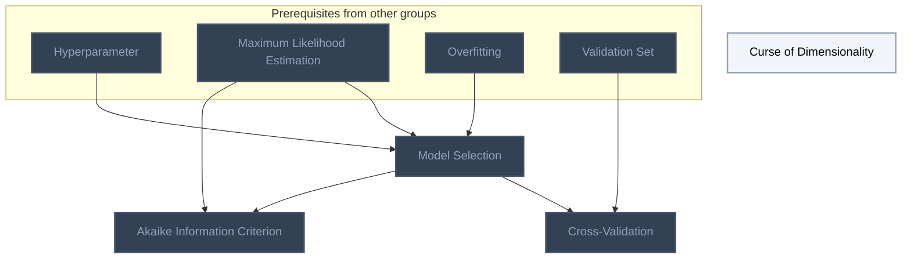
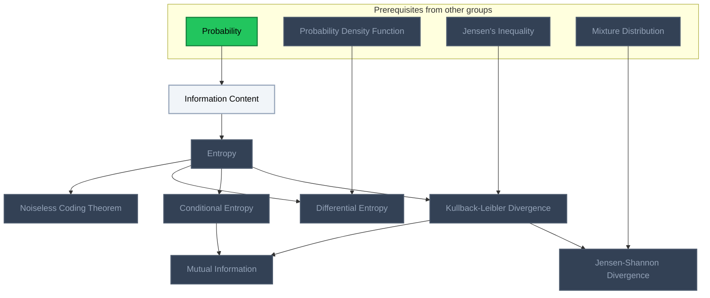
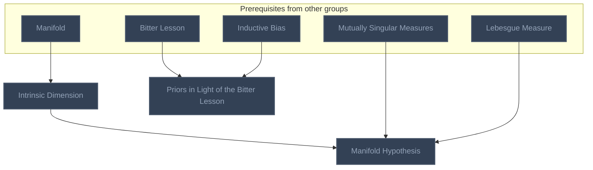
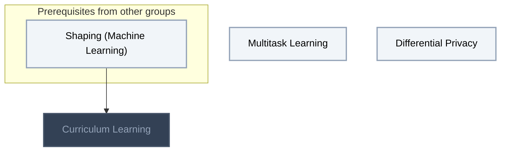
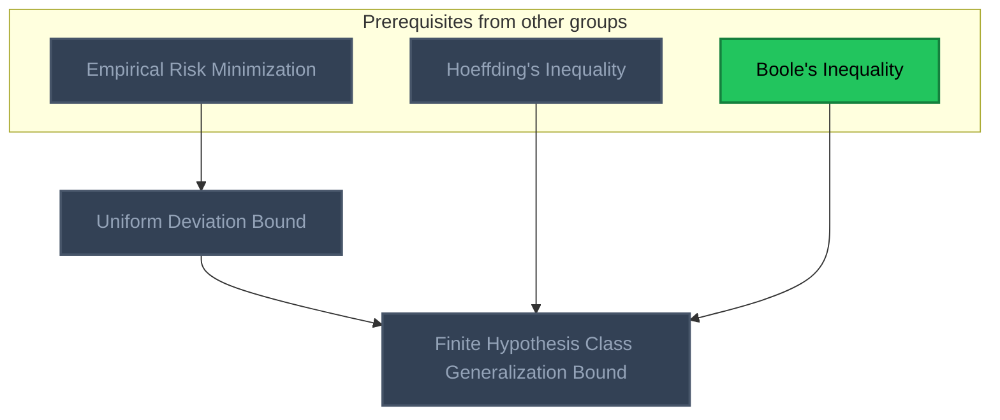

<!-- BEGIN STATS (generated by Scripts/skill_trees.py; do not edit) -->
**Mastered:** 0 / 69 · **Depth:** 0% · **Discovered:** 69 · **Planned:** 0 · **Locked:** 59 · **Rusty:** 0

| | L0 Discovered | L1 Recall | L2 Apply | L3 Prove ★ | L4 Wield | L5 Command |
|---|---:|---:|---:|---:|---:|---:|
| **At this level** | 69 | 0 | 0 | 0 | 0 | 0 |
| **Reached (this level or higher)** | 69 | 0 | 0 | 0 | 0 | 0 |

**Next up:** [[Cox's Theorem]], [[Curse of Dimensionality]], [[Discriminant Function]], [[Information Content]], [[Occam's Razor]]

Legend: dashed grey = planned (no note yet) · dark grey = locked · white L0 Discovered · green L1 Recall · blue L2 Apply · purple L3 Prove (Mastered) · orange L4 Wield · gold L5 Command · brown dashed border = rusty
<!-- END STATS -->

## Bishop Ch. 1.1: Polynomial Curve Fitting
**Reached:** L1 0 · L2 0 · L3 0 · L4 0 · L5 0 (of 7 nodes)

```mermaid
flowchart TD
    classDef planned fill:#1E293B,stroke:#64748B,stroke-width:2px,stroke-dasharray:5 5,color:#94A3B8;
    classDef locked fill:#334155,stroke:#475569,stroke-width:2px,color:#94A3B8;
    classDef L0 fill:#F1F5F9,stroke:#94A3B8,stroke-width:2px,color:#000000;
    classDef L1 fill:#22C55E,stroke:#15803D,stroke-width:2px,color:#000000;
    classDef L2 fill:#3B82F6,stroke:#1D4ED8,stroke-width:3px,color:#FFFFFF;
    classDef L3 fill:#A855F7,stroke:#6B21A8,stroke-width:3px,color:#FFFFFF,font-weight:bold;
    classDef L4 fill:#F97316,stroke:#C2410C,stroke-width:4px,color:#000000,font-weight:bold;
    classDef L5 fill:#FFD700,stroke:#FF8C00,stroke-width:5px,color:#000000,font-weight:bold;
    classDef rusty stroke:#8B4513,stroke-width:4px,stroke-dasharray:3 3;
    subgraph sg_prereqs["Prerequisites from other groups"]
        n_machine_learning["Machine Learning"]
        n_unsupervised_learning["Unsupervised Learning"]
        n_reinforcement_learning["Reinforcement Learning"]
        n_linear_regression["Linear Regression"]
        n_supervised_learning["Supervised Learning"]
        n_loss_function["Loss Function"]
    end
    n_pattern_recognition["Pattern Recognition"]
    n_feature_extraction["Feature Extraction"]
    n_density_estimation["Density Estimation"]
    n_exploration_exploitation_tradeoff["Exploration-Exploitation Tradeoff"]
    n_linear_model["Linear Model"]
    n_hyperparameter["Hyperparameter"]
    n_supervised_learning_formulation_from_machine_learning_perspective["Supervised Learning Formulation from Machine Learning Perspective"]
    n_machine_learning --> n_pattern_recognition
    n_pattern_recognition --> n_feature_extraction
    n_unsupervised_learning --> n_density_estimation
    n_reinforcement_learning --> n_exploration_exploitation_tradeoff
    n_linear_regression --> n_linear_model
    n_machine_learning --> n_hyperparameter
    n_supervised_learning --> n_supervised_learning_formulation_from_machine_learning_perspective
    n_loss_function --> n_supervised_learning_formulation_from_machine_learning_perspective
    class n_machine_learning,n_unsupervised_learning,n_reinforcement_learning,n_linear_regression,n_supervised_learning,n_loss_function,n_pattern_recognition,n_feature_extraction,n_density_estimation,n_exploration_exploitation_tradeoff,n_linear_model,n_hyperparameter,n_supervised_learning_formulation_from_machine_learning_perspective locked;
    class n_machine_learning,n_unsupervised_learning,n_reinforcement_learning,n_linear_regression,n_supervised_learning,n_loss_function,n_pattern_recognition,n_feature_extraction,n_density_estimation,n_exploration_exploitation_tradeoff,n_linear_model,n_hyperparameter,n_supervised_learning_formulation_from_machine_learning_perspective internal-link;
```



## Bishop Ch. 1.2: Probability Theory
**Reached:** L1 0 · L2 0 · L3 0 · L4 0 · L5 0 (of 5 nodes)

```mermaid
flowchart TD
    classDef planned fill:#1E293B,stroke:#64748B,stroke-width:2px,stroke-dasharray:5 5,color:#94A3B8;
    classDef locked fill:#334155,stroke:#475569,stroke-width:2px,color:#94A3B8;
    classDef L0 fill:#F1F5F9,stroke:#94A3B8,stroke-width:2px,color:#000000;
    classDef L1 fill:#22C55E,stroke:#15803D,stroke-width:2px,color:#000000;
    classDef L2 fill:#3B82F6,stroke:#1D4ED8,stroke-width:3px,color:#FFFFFF;
    classDef L3 fill:#A855F7,stroke:#6B21A8,stroke-width:3px,color:#FFFFFF,font-weight:bold;
    classDef L4 fill:#F97316,stroke:#C2410C,stroke-width:4px,color:#000000,font-weight:bold;
    classDef L5 fill:#FFD700,stroke:#FF8C00,stroke-width:5px,color:#000000,font-weight:bold;
    classDef rusty stroke:#8B4513,stroke-width:4px,stroke-dasharray:3 3;
    subgraph sg_prereqs["Prerequisites from other groups"]
        n_probability["Probability"]
        n_independent_and_identically_distributed["Independent and Identically Distributed"]
        n_log_likelihood_function["Log-Likelihood Function"]
        n_unbiased_estimator["Unbiased Estimator"]
        n_maximum_likelihood_estimation["Maximum Likelihood Estimation"]
        n_l2_loss["L2 Loss"]
        n_maximum_a_posteriori_learning["Maximum a Posteriori Learning"]
        n_l2_regularization["L2 Regularization"]
        n_linear_model["Linear Model"]
        n_exchangeability["Exchangeability"]
        n_prior_predictive_distribution["Prior Predictive Distribution"]
        n_law_of_total_expectation["Law of Total Expectation"]
        n_law_of_total_variance["Law of Total Variance"]
        n_bayes_estimator["Bayes Estimator"]
    end
    n_cox_s_theorem["Cox's Theorem"]
    n_normal_distribution_maximum_likelihood_estimation["Normal Distribution Maximum Likelihood Estimation"]
    n_probabilistic_formulation_of_regression["Probabilistic Formulation of Regression"]
    n_predictive_distribution["Predictive Distribution"]
    n_maximum_likelihood_vs_maximum_a_posteriori_estimation["Maximum Likelihood vs Maximum a Posteriori Estimation"]
    n_probability --> n_cox_s_theorem
    n_independent_and_identically_distributed --> n_normal_distribution_maximum_likelihood_estimation
    n_log_likelihood_function --> n_normal_distribution_maximum_likelihood_estimation
    n_unbiased_estimator --> n_normal_distribution_maximum_likelihood_estimation
    n_maximum_likelihood_estimation --> n_probabilistic_formulation_of_regression
    n_l2_loss --> n_probabilistic_formulation_of_regression
    n_maximum_a_posteriori_learning --> n_probabilistic_formulation_of_regression
    n_l2_regularization --> n_probabilistic_formulation_of_regression
    n_probabilistic_formulation_of_regression --> n_predictive_distribution
    n_linear_model --> n_predictive_distribution
    n_exchangeability --> n_predictive_distribution
    n_prior_predictive_distribution --> n_predictive_distribution
    n_law_of_total_expectation --> n_predictive_distribution
    n_law_of_total_variance --> n_predictive_distribution
    n_predictive_distribution --> n_maximum_likelihood_vs_maximum_a_posteriori_estimation
    n_bayes_estimator --> n_maximum_likelihood_vs_maximum_a_posteriori_estimation
    n_maximum_likelihood_estimation --> n_maximum_likelihood_vs_maximum_a_posteriori_estimation
    class n_independent_and_identically_distributed,n_log_likelihood_function,n_maximum_likelihood_estimation,n_l2_loss,n_maximum_a_posteriori_learning,n_l2_regularization,n_linear_model,n_exchangeability,n_prior_predictive_distribution,n_law_of_total_expectation,n_law_of_total_variance,n_bayes_estimator,n_normal_distribution_maximum_likelihood_estimation,n_probabilistic_formulation_of_regression,n_predictive_distribution,n_maximum_likelihood_vs_maximum_a_posteriori_estimation locked;
    class n_cox_s_theorem L0;
    class n_probability,n_unbiased_estimator L1;
    class n_probability,n_independent_and_identically_distributed,n_log_likelihood_function,n_unbiased_estimator,n_maximum_likelihood_estimation,n_l2_loss,n_maximum_a_posteriori_learning,n_l2_regularization,n_linear_model,n_exchangeability,n_prior_predictive_distribution,n_law_of_total_expectation,n_law_of_total_variance,n_bayes_estimator,n_cox_s_theorem,n_normal_distribution_maximum_likelihood_estimation,n_probabilistic_formulation_of_regression,n_predictive_distribution,n_maximum_likelihood_vs_maximum_a_posteriori_estimation internal-link;
```



## Bishop Ch. 1.3-1.4: Model Selection and Dimensionality
**Reached:** L1 0 · L2 0 · L3 0 · L4 0 · L5 0 (of 4 nodes)



## Bishop Ch. 1.5: Decision Theory
**Reached:** L1 0 · L2 0 · L3 0 · L4 0 · L5 0 (of 11 nodes)

```mermaid
flowchart TD
    classDef planned fill:#1E293B,stroke:#64748B,stroke-width:2px,stroke-dasharray:5 5,color:#94A3B8;
    classDef locked fill:#334155,stroke:#475569,stroke-width:2px,color:#94A3B8;
    classDef L0 fill:#F1F5F9,stroke:#94A3B8,stroke-width:2px,color:#000000;
    classDef L1 fill:#22C55E,stroke:#15803D,stroke-width:2px,color:#000000;
    classDef L2 fill:#3B82F6,stroke:#1D4ED8,stroke-width:3px,color:#FFFFFF;
    classDef L3 fill:#A855F7,stroke:#6B21A8,stroke-width:3px,color:#FFFFFF,font-weight:bold;
    classDef L4 fill:#F97316,stroke:#C2410C,stroke-width:4px,color:#000000,font-weight:bold;
    classDef L5 fill:#FFD700,stroke:#FF8C00,stroke-width:5px,color:#000000,font-weight:bold;
    classDef rusty stroke:#8B4513,stroke-width:4px,stroke-dasharray:3 3;
    subgraph sg_prereqs["Prerequisites from other groups"]
        n_loss_function["Loss Function"]
        n_decision_theory["Decision Theory"]
        n_regression["Regression"]
        n_l2_loss["L2 Loss"]
        n_generative_model["Generative Model"]
        n_bayes_theorem["Bayes' Theorem"]
        n_binary_classification["Binary Classification"]
    end
    n_decision_region["Decision Region"]
    n_minimum_misclassification_rate_decision_rule["Minimum Misclassification Rate Decision Rule"]
    n_minimum_expected_loss_decision_rule["Minimum Expected Loss Decision Rule"]
    n_reject_option["Reject Option"]
    n_discriminative_model["Discriminative Model"]
    n_discriminant_function["Discriminant Function"]
    n_regression_function["Regression Function"]
    n_minkowski_loss["Minkowski Loss"]
    n_three_approaches_to_decision_problems["Three Approaches to Decision Problems"]
    n_novelty_detection["Novelty Detection"]
    n_decision_boundary["Decision Boundary"]
    n_decision_boundary --> n_decision_region
    n_decision_region --> n_minimum_misclassification_rate_decision_rule
    n_decision_region --> n_minimum_expected_loss_decision_rule
    n_loss_function --> n_minimum_expected_loss_decision_rule
    n_minimum_misclassification_rate_decision_rule --> n_reject_option
    n_decision_theory --> n_discriminative_model
    n_regression --> n_regression_function
    n_l2_loss --> n_regression_function
    n_regression_function --> n_minkowski_loss
    n_generative_model --> n_three_approaches_to_decision_problems
    n_bayes_theorem --> n_three_approaches_to_decision_problems
    n_discriminative_model --> n_three_approaches_to_decision_problems
    n_discriminant_function --> n_three_approaches_to_decision_problems
    n_generative_model --> n_novelty_detection
    n_binary_classification --> n_decision_boundary
    class n_loss_function,n_decision_theory,n_regression,n_l2_loss,n_generative_model,n_bayes_theorem,n_binary_classification,n_decision_region,n_minimum_misclassification_rate_decision_rule,n_minimum_expected_loss_decision_rule,n_reject_option,n_discriminative_model,n_regression_function,n_minkowski_loss,n_three_approaches_to_decision_problems,n_novelty_detection,n_decision_boundary locked;
    class n_discriminant_function L0;
    class n_loss_function,n_decision_theory,n_regression,n_l2_loss,n_generative_model,n_bayes_theorem,n_binary_classification,n_decision_region,n_minimum_misclassification_rate_decision_rule,n_minimum_expected_loss_decision_rule,n_reject_option,n_discriminative_model,n_discriminant_function,n_regression_function,n_minkowski_loss,n_three_approaches_to_decision_problems,n_novelty_detection,n_decision_boundary internal-link;
```



## Bishop Ch. 1.6: Information Theory
**Reached:** L1 0 · L2 0 · L3 0 · L4 0 · L5 0 (of 8 nodes)



## Manifold Hypothesis and Inductive Bias
**Reached:** L1 0 · L2 0 · L3 0 · L4 0 · L5 0 (of 3 nodes)



## Learning and Generalization (MIT Vision Book, Bishop)
**Reached:** L1 0 · L2 0 · L3 0 · L4 0 · L5 0 (of 26 nodes)

```mermaid
flowchart TD
    classDef planned fill:#1E293B,stroke:#64748B,stroke-width:2px,stroke-dasharray:5 5,color:#94A3B8;
    classDef locked fill:#334155,stroke:#475569,stroke-width:2px,color:#94A3B8;
    classDef L0 fill:#F1F5F9,stroke:#94A3B8,stroke-width:2px,color:#000000;
    classDef L1 fill:#22C55E,stroke:#15803D,stroke-width:2px,color:#000000;
    classDef L2 fill:#3B82F6,stroke:#1D4ED8,stroke-width:3px,color:#FFFFFF;
    classDef L3 fill:#A855F7,stroke:#6B21A8,stroke-width:3px,color:#FFFFFF,font-weight:bold;
    classDef L4 fill:#F97316,stroke:#C2410C,stroke-width:4px,color:#000000,font-weight:bold;
    classDef L5 fill:#FFD700,stroke:#FF8C00,stroke-width:5px,color:#000000,font-weight:bold;
    classDef rusty stroke:#8B4513,stroke-width:4px,stroke-dasharray:3 3;
    subgraph sg_prereqs["Prerequisites from other groups"]
        n_function["Function"]
        n_machine_learning["Machine Learning"]
        n_reinforcement_learning["Reinforcement Learning"]
        n_empirical_risk_minimization["Empirical Risk Minimization"]
        n_bayes_theorem["Bayes' Theorem"]
        n_norm["Norm"]
        n_linear_regression["Linear Regression"]
        n_derivative["Derivative"]
        n_loss_function["Loss Function"]
        n_gradient_vector["Gradient Vector"]
    end
    n_learned_function["Learned Function"]
    n_hypothesis_space["Hypothesis Space"]
    n_training_phase["Training Phase"]
    n_testing_phase["Testing Phase"]
    n_reward_function["Reward Function"]
    n_cost_function["Cost Function"]
    n_objective_function["Objective Function"]
    n_surrogate_loss_function["Surrogate Loss Function"]
    n_generalization["Generalization"]
    n_generalization_error["Generalization Error"]
    n_approximation_error["Approximation Error"]
    n_inductive_bias["Inductive Bias"]
    n_model_capacity["Model Capacity"]
    n_underfitting["Underfitting"]
    n_overfitting["Overfitting"]
    n_occam_s_razor["Occam's Razor"]
    n_bayesian_occam_s_razor["Bayesian Occam's Razor"]
    n_regularization["Regularization"]
    n_lp_regularization["Lp Regularization"]
    n_l1_regularization["L1 Regularization"]
    n_l2_regularization["L2 Regularization"]
    n_validation_set["Validation Set"]
    n_featurization["Featurization"]
    n_data_matrix["Data Matrix"]
    n_polynomial_regression["Polynomial Regression"]
    n_multiple_linear_regression["Multiple Linear Regression"]
    n_function --> n_learned_function
    n_learned_function --> n_hypothesis_space
    n_machine_learning --> n_training_phase
    n_training_phase --> n_testing_phase
    n_machine_learning --> n_testing_phase
    n_reinforcement_learning --> n_reward_function
    n_function --> n_cost_function
    n_machine_learning --> n_generalization
    n_hypothesis_space --> n_generalization
    n_cost_function --> n_generalization_error
    n_generalization --> n_generalization_error
    n_empirical_risk_minimization --> n_approximation_error
    n_cost_function --> n_approximation_error
    n_hypothesis_space --> n_inductive_bias
    n_hypothesis_space --> n_model_capacity
    n_machine_learning --> n_underfitting
    n_objective_function --> n_underfitting
    n_underfitting --> n_overfitting
    n_objective_function --> n_overfitting
    n_bayes_theorem --> n_bayesian_occam_s_razor
    n_hypothesis_space --> n_bayesian_occam_s_razor
    n_occam_s_razor --> n_bayesian_occam_s_razor
    n_overfitting --> n_regularization
    n_occam_s_razor --> n_regularization
    n_objective_function --> n_regularization
    n_norm --> n_lp_regularization
    n_regularization --> n_lp_regularization
    n_lp_regularization --> n_l1_regularization
    n_lp_regularization --> n_l2_regularization
    n_testing_phase --> n_validation_set
    n_generalization_error --> n_validation_set
    n_function --> n_featurization
    n_linear_regression --> n_data_matrix
    n_featurization --> n_data_matrix
    n_linear_regression --> n_polynomial_regression
    n_hypothesis_space --> n_polynomial_regression
    n_featurization --> n_polynomial_regression
    n_derivative --> n_multiple_linear_regression
    n_cost_function --> n_multiple_linear_regression
    n_loss_function --> n_surrogate_loss_function
    n_gradient_vector --> n_surrogate_loss_function
    n_learned_function --> n_objective_function
    class n_machine_learning,n_reinforcement_learning,n_empirical_risk_minimization,n_bayes_theorem,n_norm,n_linear_regression,n_loss_function,n_gradient_vector,n_hypothesis_space,n_training_phase,n_testing_phase,n_reward_function,n_objective_function,n_surrogate_loss_function,n_generalization,n_generalization_error,n_approximation_error,n_inductive_bias,n_model_capacity,n_underfitting,n_overfitting,n_bayesian_occam_s_razor,n_regularization,n_lp_regularization,n_l1_regularization,n_l2_regularization,n_validation_set,n_data_matrix,n_polynomial_regression,n_multiple_linear_regression locked;
    class n_learned_function,n_cost_function,n_occam_s_razor,n_featurization L0;
    class n_function,n_derivative L3;
    class n_function,n_machine_learning,n_reinforcement_learning,n_empirical_risk_minimization,n_bayes_theorem,n_norm,n_linear_regression,n_derivative,n_loss_function,n_gradient_vector,n_learned_function,n_hypothesis_space,n_training_phase,n_testing_phase,n_reward_function,n_cost_function,n_objective_function,n_surrogate_loss_function,n_generalization,n_generalization_error,n_approximation_error,n_inductive_bias,n_model_capacity,n_underfitting,n_overfitting,n_occam_s_razor,n_bayesian_occam_s_razor,n_regularization,n_lp_regularization,n_l1_regularization,n_l2_regularization,n_validation_set,n_featurization,n_data_matrix,n_polynomial_regression,n_multiple_linear_regression internal-link;
```



## Learning Paradigms and Privacy
**Reached:** L1 0 · L2 0 · L3 0 · L4 0 · L5 0 (of 3 nodes)



## Generalization Bounds
**Reached:** L1 0 · L2 0 · L3 0 · L4 0 · L5 0 (of 2 nodes)



# Source
Graph structure: the single source for the diagrams above, edited by `/note` and `Scripts/skill_trees.py` (`add`, `edge`, `rename`). Everything above this heading is regenerated by `render`.

```skilltree
    %% PREREQUISITES
    n_decision_theory["Decision Theory"]
    n_bayes_estimator["Bayes Estimator"]
    n_bayes_theorem["Bayes' Theorem"]
    n_exchangeability["Exchangeability"]
    n_prior_predictive_distribution["Prior Predictive Distribution"]
    n_log_likelihood_function["Log-Likelihood Function"]
    n_maximum_likelihood_estimation["Maximum Likelihood Estimation"]
    n_generative_model["Generative Model"]
    n_l2_loss["L2 Loss"]
    n_linear_regression["Linear Regression"]
    n_loss_function["Loss Function"]
    n_machine_learning["Machine Learning"]
    n_maximum_a_posteriori_learning["Maximum a Posteriori Learning"]
    n_regression["Regression"]
    n_reinforcement_learning["Reinforcement Learning"]
    n_supervised_learning["Supervised Learning"]
    n_unsupervised_learning["Unsupervised Learning"]
    n_manifold["Manifold"]
    n_probability["Probability"]
    n_independent_and_identically_distributed["Independent and Identically Distributed"]
    n_jensen_s_inequality["Jensen's Inequality"]
    n_law_of_total_expectation["Law of Total Expectation"]
    n_law_of_total_variance["Law of Total Variance"]
    n_mixture_distribution["Mixture Distribution"]
    n_probability_density_function["Probability Density Function"]
    n_lebesgue_measure["Lebesgue Measure"]
    n_mutually_singular_measures["Mutually Singular Measures"]
    n_bitter_lesson["Bitter Lesson"]
    n_unbiased_estimator["Unbiased Estimator"]
    n_function["Function"]
    n_empirical_risk_minimization["Empirical Risk Minimization"]
    n_norm["Norm"]
    n_derivative["Derivative"]
    n_gradient_vector["Gradient Vector"]
    n_binary_classification["Binary Classification"]
    n_shaping_machine_learning["Shaping (Machine Learning)"]
    n_hoeffding_s_inequality["Hoeffding's Inequality"]
    n_boole_s_inequality["Boole's Inequality"]
    %% NODES
    %% == Bishop Ch. 1.1: Polynomial Curve Fitting ==
    n_pattern_recognition["Pattern Recognition"]
    n_feature_extraction["Feature Extraction"]
    n_density_estimation["Density Estimation"]
    n_exploration_exploitation_tradeoff["Exploration-Exploitation Tradeoff"]
    n_linear_model["Linear Model"]
    n_hyperparameter["Hyperparameter"]
    n_supervised_learning_formulation_from_machine_learning_perspective["Supervised Learning Formulation from Machine Learning Perspective"]
    %% == Bishop Ch. 1.2: Probability Theory ==
    n_cox_s_theorem["Cox's Theorem"]
    n_normal_distribution_maximum_likelihood_estimation["Normal Distribution Maximum Likelihood Estimation"]
    n_probabilistic_formulation_of_regression["Probabilistic Formulation of Regression"]
    n_predictive_distribution["Predictive Distribution"]
    n_maximum_likelihood_vs_maximum_a_posteriori_estimation["Maximum Likelihood vs Maximum a Posteriori Estimation"]
    %% == Bishop Ch. 1.3-1.4: Model Selection and Dimensionality ==
    n_model_selection["Model Selection"]
    n_cross_validation["Cross-Validation"]
    n_akaike_information_criterion["Akaike Information Criterion"]
    n_curse_of_dimensionality["Curse of Dimensionality"]
    %% == Bishop Ch. 1.5: Decision Theory ==
    n_decision_region["Decision Region"]
    n_minimum_misclassification_rate_decision_rule["Minimum Misclassification Rate Decision Rule"]
    n_minimum_expected_loss_decision_rule["Minimum Expected Loss Decision Rule"]
    n_reject_option["Reject Option"]
    n_discriminative_model["Discriminative Model"]
    n_discriminant_function["Discriminant Function"]
    n_regression_function["Regression Function"]
    n_minkowski_loss["Minkowski Loss"]
    n_three_approaches_to_decision_problems["Three Approaches to Decision Problems"]
    n_novelty_detection["Novelty Detection"]
    n_decision_boundary["Decision Boundary"]
    %% == Bishop Ch. 1.6: Information Theory ==
    n_information_content["Information Content"]
    n_entropy["Entropy"]
    n_noiseless_coding_theorem["Noiseless Coding Theorem"]
    n_differential_entropy["Differential Entropy"]
    n_conditional_entropy["Conditional Entropy"]
    n_kullback_leibler_divergence["Kullback-Leibler Divergence"]
    n_mutual_information["Mutual Information"]
    n_jensen_shannon_divergence["Jensen-Shannon Divergence"]
    %% == Manifold Hypothesis and Inductive Bias ==
    n_intrinsic_dimension["Intrinsic Dimension"]
    n_manifold_hypothesis["Manifold Hypothesis"]
    n_priors_in_light_of_the_bitter_lesson["Priors in Light of the Bitter Lesson"]
    %% == Learning and Generalization (MIT Vision Book, Bishop) ==
    n_learned_function["Learned Function"]
    n_hypothesis_space["Hypothesis Space"]
    n_training_phase["Training Phase"]
    n_testing_phase["Testing Phase"]
    n_reward_function["Reward Function"]
    n_cost_function["Cost Function"]
    n_objective_function["Objective Function"]
    n_surrogate_loss_function["Surrogate Loss Function"]
    n_generalization["Generalization"]
    n_generalization_error["Generalization Error"]
    n_approximation_error["Approximation Error"]
    n_inductive_bias["Inductive Bias"]
    n_model_capacity["Model Capacity"]
    n_underfitting["Underfitting"]
    n_overfitting["Overfitting"]
    n_occam_s_razor["Occam's Razor"]
    n_bayesian_occam_s_razor["Bayesian Occam's Razor"]
    n_regularization["Regularization"]
    n_lp_regularization["Lp Regularization"]
    n_l1_regularization["L1 Regularization"]
    n_l2_regularization["L2 Regularization"]
    n_validation_set["Validation Set"]
    n_featurization["Featurization"]
    n_data_matrix["Data Matrix"]
    n_polynomial_regression["Polynomial Regression"]
    n_multiple_linear_regression["Multiple Linear Regression"]
    %% == Learning Paradigms and Privacy ==
    n_multitask_learning["Multitask Learning"]
    n_curriculum_learning["Curriculum Learning"]
    n_differential_privacy["Differential Privacy"]
    %% == Generalization Bounds ==
    n_uniform_deviation_bound["Uniform Deviation Bound"]
    n_finite_hypothesis_class_generalization_bound["Finite Hypothesis Class Generalization Bound"]
    %% EDGES
    n_machine_learning --> n_pattern_recognition
    n_pattern_recognition --> n_feature_extraction
    n_unsupervised_learning --> n_density_estimation
    n_reinforcement_learning --> n_exploration_exploitation_tradeoff
    n_linear_regression --> n_linear_model
    n_machine_learning --> n_hyperparameter
    n_supervised_learning --> n_supervised_learning_formulation_from_machine_learning_perspective
    n_loss_function --> n_supervised_learning_formulation_from_machine_learning_perspective
    n_probability --> n_cox_s_theorem
    n_independent_and_identically_distributed --> n_normal_distribution_maximum_likelihood_estimation
    n_log_likelihood_function --> n_normal_distribution_maximum_likelihood_estimation
    n_unbiased_estimator --> n_normal_distribution_maximum_likelihood_estimation
    n_maximum_likelihood_estimation --> n_probabilistic_formulation_of_regression
    n_l2_loss --> n_probabilistic_formulation_of_regression
    n_maximum_a_posteriori_learning --> n_probabilistic_formulation_of_regression
    n_l2_regularization --> n_probabilistic_formulation_of_regression
    n_probabilistic_formulation_of_regression --> n_predictive_distribution
    n_linear_model --> n_predictive_distribution
    n_exchangeability --> n_predictive_distribution
    n_prior_predictive_distribution --> n_predictive_distribution
    n_law_of_total_expectation --> n_predictive_distribution
    n_law_of_total_variance --> n_predictive_distribution
    n_predictive_distribution --> n_maximum_likelihood_vs_maximum_a_posteriori_estimation
    n_bayes_estimator --> n_maximum_likelihood_vs_maximum_a_posteriori_estimation
    n_hyperparameter --> n_model_selection
    n_maximum_likelihood_estimation --> n_model_selection
    n_overfitting --> n_model_selection
    n_model_selection --> n_cross_validation
    n_validation_set --> n_cross_validation
    n_model_selection --> n_akaike_information_criterion
    n_decision_boundary --> n_decision_region
    n_decision_region --> n_minimum_misclassification_rate_decision_rule
    n_decision_region --> n_minimum_expected_loss_decision_rule
    n_loss_function --> n_minimum_expected_loss_decision_rule
    n_minimum_misclassification_rate_decision_rule --> n_reject_option
    n_decision_theory --> n_discriminative_model
    n_regression --> n_regression_function
    n_l2_loss --> n_regression_function
    n_regression_function --> n_minkowski_loss
    n_generative_model --> n_three_approaches_to_decision_problems
    n_bayes_theorem --> n_three_approaches_to_decision_problems
    n_discriminative_model --> n_three_approaches_to_decision_problems
    n_discriminant_function --> n_three_approaches_to_decision_problems
    n_generative_model --> n_novelty_detection
    n_probability --> n_information_content
    n_information_content --> n_entropy
    n_entropy --> n_noiseless_coding_theorem
    n_entropy --> n_differential_entropy
    n_probability_density_function --> n_differential_entropy
    n_entropy --> n_conditional_entropy
    n_entropy --> n_kullback_leibler_divergence
    n_jensen_s_inequality --> n_kullback_leibler_divergence
    n_kullback_leibler_divergence --> n_mutual_information
    n_conditional_entropy --> n_mutual_information
    n_kullback_leibler_divergence --> n_jensen_shannon_divergence
    n_mixture_distribution --> n_jensen_shannon_divergence
    n_manifold --> n_intrinsic_dimension
    n_intrinsic_dimension --> n_manifold_hypothesis
    n_mutually_singular_measures --> n_manifold_hypothesis
    n_lebesgue_measure --> n_manifold_hypothesis
    n_bitter_lesson --> n_priors_in_light_of_the_bitter_lesson
    n_inductive_bias --> n_priors_in_light_of_the_bitter_lesson
    n_maximum_likelihood_estimation --> n_akaike_information_criterion
    n_maximum_likelihood_estimation --> n_maximum_likelihood_vs_maximum_a_posteriori_estimation
    n_function --> n_learned_function
    n_learned_function --> n_hypothesis_space
    n_machine_learning --> n_training_phase
    n_training_phase --> n_testing_phase
    n_machine_learning --> n_testing_phase
    n_reinforcement_learning --> n_reward_function
    n_function --> n_cost_function
    n_machine_learning --> n_generalization
    n_hypothesis_space --> n_generalization
    n_cost_function --> n_generalization_error
    n_generalization --> n_generalization_error
    n_empirical_risk_minimization --> n_approximation_error
    n_cost_function --> n_approximation_error
    n_hypothesis_space --> n_inductive_bias
    n_hypothesis_space --> n_model_capacity
    n_machine_learning --> n_underfitting
    n_objective_function --> n_underfitting
    n_underfitting --> n_overfitting
    n_objective_function --> n_overfitting
    n_bayes_theorem --> n_bayesian_occam_s_razor
    n_hypothesis_space --> n_bayesian_occam_s_razor
    n_occam_s_razor --> n_bayesian_occam_s_razor
    n_overfitting --> n_regularization
    n_occam_s_razor --> n_regularization
    n_objective_function --> n_regularization
    n_norm --> n_lp_regularization
    n_regularization --> n_lp_regularization
    n_lp_regularization --> n_l1_regularization
    n_lp_regularization --> n_l2_regularization
    n_testing_phase --> n_validation_set
    n_generalization_error --> n_validation_set
    n_function --> n_featurization
    n_linear_regression --> n_data_matrix
    n_featurization --> n_data_matrix
    n_linear_regression --> n_polynomial_regression
    n_hypothesis_space --> n_polynomial_regression
    n_featurization --> n_polynomial_regression
    n_derivative --> n_multiple_linear_regression
    n_cost_function --> n_multiple_linear_regression
    n_loss_function --> n_surrogate_loss_function
    n_gradient_vector --> n_surrogate_loss_function
    n_binary_classification --> n_decision_boundary
    n_shaping_machine_learning --> n_curriculum_learning
    n_learned_function --> n_objective_function
    n_empirical_risk_minimization --> n_uniform_deviation_bound
    n_uniform_deviation_bound --> n_finite_hypothesis_class_generalization_bound
    n_hoeffding_s_inequality --> n_finite_hypothesis_class_generalization_bound
    n_boole_s_inequality --> n_finite_hypothesis_class_generalization_bound
```
