<!-- BEGIN STATS (generated by Scripts/skill_trees.py; do not edit) -->
**Mastered:** 0 / 264 · **Depth:** 0% · **Discovered:** 243 · **Planned:** 21 · **Locked:** 239 · **Rusty:** 0

**Levels:** L0 243 · L1 0 · L2 0 · L3 0 · L4 0 · L5 0

**Next up:** [[Random Experiment]], [[Statistical Analysis]], [[Survivorship Bias]], [[Set Complement]]

Legend: dashed grey = planned (no note yet) · dark grey = locked · white L0 Discovered · green L1 Recall · blue L2 Apply · purple L3 Prove (Mastered) · orange L4 Wield · gold L5 Command · brown dashed border = rusty
<!-- END STATS -->

## Hogg/Tanis/Zimmerman Ch. 1: Probability
**Mastered:** 0 / 13 · **Discovered:** 13 / 13

```mermaid
flowchart TD
    classDef planned fill:#1E293B,stroke:#64748B,stroke-width:2px,stroke-dasharray:5 5,color:#94A3B8;
    classDef locked fill:#334155,stroke:#475569,stroke-width:2px,color:#94A3B8;
    classDef L0 fill:#F1F5F9,stroke:#94A3B8,stroke-width:2px,color:#000000;
    classDef L1 fill:#22C55E,stroke:#15803D,stroke-width:2px,color:#000000;
    classDef L2 fill:#3B82F6,stroke:#1D4ED8,stroke-width:3px,color:#FFFFFF;
    classDef L3 fill:#A855F7,stroke:#6B21A8,stroke-width:3px,color:#FFFFFF,font-weight:bold;
    classDef L4 fill:#F97316,stroke:#C2410C,stroke-width:4px,color:#000000,font-weight:bold;
    classDef L5 fill:#FFD700,stroke:#FF8C00,stroke-width:5px,color:#000000,font-weight:bold;
    classDef rusty stroke:#8B4513,stroke-width:4px,stroke-dasharray:3 3;
    subgraph sg_prereqs["Prerequisites from other groups"]
        n_set["Set"]
        n_universe_of_discourse["Universe of Discourse"]
        n_set_function["Set Function"]
        n_sigma_field["Sigma-Field"]
        n_mutually_exclusive_events["Mutually Exclusive Events"]
        n_event["Event"]
        n_empty_set["Empty Set"]
        n_subset["Subset"]
        n_conditional_probability_multiplication_rule["Conditional Probability Multiplication Rule"]
        n_relative_frequency["Relative Frequency"]
    end
    n_set_complement["Set Complement"]
    n_probability["Probability"]
    n_frequency["Frequency"]
    n_probability_of_complement["Probability of Complement"]
    n_probability_of_empty_set["Probability of Empty Set"]
    n_probability_of_subset["Probability of Subset"]
    n_probability_maximum_value["Probability Maximum Value"]
    n_conditional_probability["Conditional Probability"]
    n_conditional_probability_other_properties["Conditional Probability Other Properties"]
    n_independent_events["Independent Events"]
    n_probability_objective_interpretation["Probability Objective Interpretation"]
    n_probability_subjective_interpretation["Probability Subjective Interpretation"]
    n_probability_frequentist_framework["Probability Frequentist Framework"]
    n_set --> n_set_complement
    n_universe_of_discourse --> n_set_complement
    n_set_function --> n_probability
    n_sigma_field --> n_probability
    n_mutually_exclusive_events --> n_probability
    n_event --> n_frequency
    n_probability --> n_probability_of_complement
    n_set_complement --> n_probability_of_complement
    n_probability_of_complement --> n_probability_of_empty_set
    n_empty_set --> n_probability_of_empty_set
    n_probability --> n_probability_of_subset
    n_subset --> n_probability_of_subset
    n_probability_of_subset --> n_probability_maximum_value
    n_probability --> n_conditional_probability
    n_conditional_probability --> n_conditional_probability_other_properties
    n_conditional_probability_multiplication_rule --> n_independent_events
    n_probability --> n_probability_objective_interpretation
    n_probability --> n_probability_subjective_interpretation
    n_probability --> n_probability_frequentist_framework
    n_relative_frequency --> n_probability_frequentist_framework
    class n_set_function,n_sigma_field,n_mutually_exclusive_events,n_event,n_conditional_probability_multiplication_rule,n_relative_frequency,n_probability,n_frequency,n_probability_of_complement,n_probability_of_empty_set,n_probability_of_subset,n_probability_maximum_value,n_conditional_probability,n_conditional_probability_other_properties,n_independent_events,n_probability_objective_interpretation,n_probability_subjective_interpretation,n_probability_frequentist_framework locked;
    class n_empty_set,n_subset,n_set_complement L0;
    class n_universe_of_discourse L2;
    class n_set L3;
    class n_set,n_universe_of_discourse,n_set_function,n_sigma_field,n_mutually_exclusive_events,n_event,n_empty_set,n_subset,n_conditional_probability_multiplication_rule,n_relative_frequency,n_set_complement,n_probability,n_frequency,n_probability_of_complement,n_probability_of_empty_set,n_probability_of_subset,n_probability_maximum_value,n_conditional_probability,n_conditional_probability_other_properties,n_independent_events,n_probability_objective_interpretation,n_probability_subjective_interpretation,n_probability_frequentist_framework internal-link;
```

## Hogg/Tanis/Zimmerman Ch. 2: Discrete Distributions
**Mastered:** 0 / 3 · **Discovered:** 3 / 3

```mermaid
flowchart TD
    classDef planned fill:#1E293B,stroke:#64748B,stroke-width:2px,stroke-dasharray:5 5,color:#94A3B8;
    classDef locked fill:#334155,stroke:#475569,stroke-width:2px,color:#94A3B8;
    classDef L0 fill:#F1F5F9,stroke:#94A3B8,stroke-width:2px,color:#000000;
    classDef L1 fill:#22C55E,stroke:#15803D,stroke-width:2px,color:#000000;
    classDef L2 fill:#3B82F6,stroke:#1D4ED8,stroke-width:3px,color:#FFFFFF;
    classDef L3 fill:#A855F7,stroke:#6B21A8,stroke-width:3px,color:#FFFFFF,font-weight:bold;
    classDef L4 fill:#F97316,stroke:#C2410C,stroke-width:4px,color:#000000,font-weight:bold;
    classDef L5 fill:#FFD700,stroke:#FF8C00,stroke-width:5px,color:#000000,font-weight:bold;
    classDef rusty stroke:#8B4513,stroke-width:4px,stroke-dasharray:3 3;
    subgraph sg_prereqs["Prerequisites from other groups"]
        n_probability["Probability"]
        n_function["Function"]
        n_discrete_random_variable["Discrete Random Variable"]
        n_uniform_distribution["Uniform Distribution"]
        n_probability_mass_function["Probability Mass Function"]
    end
    n_random_variable["Random Variable"]
    n_cumulative_mass_function["Cumulative Mass Function"]
    n_discrete_uniform_distribution["Discrete Uniform Distribution"]
    n_probability --> n_random_variable
    n_function --> n_random_variable
    n_discrete_random_variable --> n_cumulative_mass_function
    n_uniform_distribution --> n_discrete_uniform_distribution
    n_probability_mass_function --> n_discrete_uniform_distribution
    class n_probability,n_discrete_random_variable,n_uniform_distribution,n_probability_mass_function,n_random_variable,n_cumulative_mass_function,n_discrete_uniform_distribution locked;
    class n_function L3;
    class n_probability,n_function,n_discrete_random_variable,n_uniform_distribution,n_probability_mass_function,n_random_variable,n_cumulative_mass_function,n_discrete_uniform_distribution internal-link;
```

## Hogg/Tanis/Zimmerman Ch. 3: Continuous Distributions
**Mastered:** 0 / 3 · **Discovered:** 1 / 3

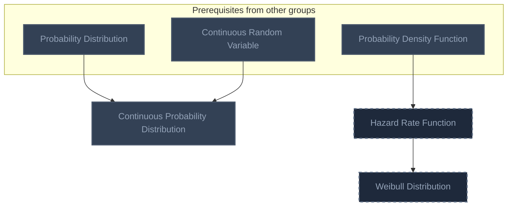

## Hogg/McKean/Craig Ch. 1: Probability and Distributions
**Mastered:** 0 / 62 · **Discovered:** 62 / 62

```mermaid
flowchart TD
    classDef planned fill:#1E293B,stroke:#64748B,stroke-width:2px,stroke-dasharray:5 5,color:#94A3B8;
    classDef locked fill:#334155,stroke:#475569,stroke-width:2px,color:#94A3B8;
    classDef L0 fill:#F1F5F9,stroke:#94A3B8,stroke-width:2px,color:#000000;
    classDef L1 fill:#22C55E,stroke:#15803D,stroke-width:2px,color:#000000;
    classDef L2 fill:#3B82F6,stroke:#1D4ED8,stroke-width:3px,color:#FFFFFF;
    classDef L3 fill:#A855F7,stroke:#6B21A8,stroke-width:3px,color:#FFFFFF,font-weight:bold;
    classDef L4 fill:#F97316,stroke:#C2410C,stroke-width:4px,color:#000000,font-weight:bold;
    classDef L5 fill:#FFD700,stroke:#FF8C00,stroke-width:5px,color:#000000,font-weight:bold;
    classDef rusty stroke:#8B4513,stroke-width:4px,stroke-dasharray:3 3;
    subgraph sg_prereqs["Prerequisites from other groups"]
        n_set["Set"]
        n_set_operations["Set Operations"]
        n_disjoint_sets["Disjoint Sets"]
        n_set_union["Set Union"]
        n_sequence["Sequence"]
        n_cartesian_product_set_cardinality["Cartesian Product Set Cardinality"]
        n_subset["Subset"]
        n_demorgan_s_laws["DeMorgan's Laws"]
        n_continuous_function["Continuous Function"]
        n_injective_function["Injective Function"]
        n_function_support["Function Support"]
        n_change_of_variables["Change of Variables"]
        n_convex_function["Convex Function"]
        n_inverse_function["Inverse Function"]
        n_function["Function"]
        n_countable_set["Countable Set"]
        n_sigma_field["Sigma-Field"]
        n_fundamental_theorem_of_calculus["Fundamental Theorem of Calculus"]
        n_probability_distribution["Probability Distribution"]
        n_probability["Probability"]
        n_frequency["Frequency"]
        n_conditional_probability["Conditional Probability"]
        n_independent_events["Independent Events"]
        n_random_variable["Random Variable"]
        n_geometric_mean["Geometric Mean"]
        n_continuous_uniform_distribution["Continuous Uniform Distribution"]
        n_normal_distribution["Normal Distribution"]
        n_gamma_distribution["Gamma Distribution"]
        n_estimator["Estimator"]
    end
    n_sample_space["Sample Space"]
    n_venn_diagram["Venn Diagram"]
    n_disjoint_set_union["Disjoint Set Union"]
    n_nondecreasing_sequence_of_sets["Nondecreasing Sequence of Sets"]
    n_nonincreasing_sequence_of_sets["Nonincreasing Sequence of Sets"]
    n_permutation_combinatorics["Permutation (Combinatorics)"]
    n_combination["Combination"]
    n_continuity_theorem_of_probability["Continuity Theorem of Probability"]
    n_boole_s_inequality["Boole's Inequality"]
    n_bonferroni_s_inequality["Bonferroni's Inequality"]
    n_random_variables_equal_in_distribution["Random Variables Equal in Distribution"]
    n_cumulative_distribution_function_basic_properties["Cumulative Distribution Function Basic Properties"]
    n_random_variable_transformation["Random Variable Transformation"]
    n_continuous_random_variable["Continuous Random Variable"]
    n_random_variable_support["Random Variable Support"]
    n_continuous_random_variable_probability_inequality_theorem["Continuous Random Variable Probability Inequality Theorem"]
    n_interquartile_range["Interquartile Range"]
    n_cumulative_distribution_function_transformation_technique["Cumulative Distribution Function Transformation Technique"]
    n_mixture_random_variable["Mixture Random Variable"]
    n_variance_basic_properties["Variance Basic Properties"]
    n_moment_statistics["Moment (Statistics)"]
    n_moment_generating_function["Moment Generating Function"]
    n_moment_generating_function_equal_distribution_theorem["Moment Generating Function Equal Distribution Theorem"]
    n_characteristic_function_probability["Characteristic Function (Probability)"]
    n_degenerate_distribution["Degenerate Distribution"]
    n_factorial_moment_generating_function["Factorial Moment Generating Function"]
    n_kurtosis["Kurtosis"]
    n_cumulant_generating_function["Cumulant Generating Function"]
    n_laplace_distribution["Laplace Distribution"]
    n_mth_moment_existence_theorem["mth Moment Existence Theorem"]
    n_markov_s_inequality["Markov's Inequality"]
    n_chebyshev_s_inequality["Chebyshev's Inequality"]
    n_jensen_s_inequality["Jensen's Inequality"]
    n_cumulative_distribution_function["Cumulative Distribution Function"]
    n_quantile_function["Quantile Function"]
    n_expectation["Expectation"]
    n_variance["Variance"]
    n_random_experiment["Random Experiment"]
    n_event["Event"]
    n_relative_frequency["Relative Frequency"]
    n_set_function["Set Function"]
    n_mutually_exclusive_events["Mutually Exclusive Events"]
    n_exhaustive_events["Exhaustive Events"]
    n_probability_of_set_union["Probability of Set Union"]
    n_probability_of_equally_likely_outcomes["Probability of Equally Likely Outcomes"]
    n_conditional_probability_primary_properties["Conditional Probability Primary Properties"]
    n_conditional_probability_multiplication_rule["Conditional Probability Multiplication Rule"]
    n_law_of_total_probability["Law of Total Probability"]
    n_mutually_independent_events["Mutually Independent Events"]
    n_discrete_random_variable["Discrete Random Variable"]
    n_probability_mass_function["Probability Mass Function"]
    n_probability_density_function["Probability Density Function"]
    n_probability_function["Probability Function"]
    n_probability_mass_function_definitional_properties["Probability Mass Function Definitional Properties"]
    n_probability_density_function_definitional_properties["Probability Density Function Definitional Properties"]
    n_standard_deviation["Standard Deviation"]
    n_coefficient_of_variation["Coefficient of Variation"]
    n_geometric_standard_deviation["Geometric Standard Deviation"]
    n_continuous_uniform_distribution_variance["Continuous Uniform Distribution Variance"]
    n_normal_distribution_variance["Normal Distribution Variance"]
    n_gamma_distribution_variance["Gamma Distribution Variance"]
    n_standard_error["Standard Error"]
    n_set --> n_sample_space
    n_random_experiment --> n_sample_space
    n_set_operations --> n_venn_diagram
    n_event --> n_venn_diagram
    n_disjoint_sets --> n_disjoint_set_union
    n_set_union --> n_disjoint_set_union
    n_sequence --> n_nondecreasing_sequence_of_sets
    n_set --> n_nondecreasing_sequence_of_sets
    n_sequence --> n_nonincreasing_sequence_of_sets
    n_set --> n_nonincreasing_sequence_of_sets
    n_cartesian_product_set_cardinality --> n_permutation_combinatorics
    n_subset --> n_combination
    n_permutation_combinatorics --> n_combination
    n_nondecreasing_sequence_of_sets --> n_continuity_theorem_of_probability
    n_nonincreasing_sequence_of_sets --> n_continuity_theorem_of_probability
    n_probability_of_set_union --> n_continuity_theorem_of_probability
    n_continuity_theorem_of_probability --> n_boole_s_inequality
    n_demorgan_s_laws --> n_bonferroni_s_inequality
    n_boole_s_inequality --> n_bonferroni_s_inequality
    n_cumulative_distribution_function --> n_random_variables_equal_in_distribution
    n_continuous_function --> n_cumulative_distribution_function_basic_properties
    n_continuity_theorem_of_probability --> n_cumulative_distribution_function_basic_properties
    n_cumulative_distribution_function --> n_cumulative_distribution_function_basic_properties
    n_injective_function --> n_random_variable_transformation
    n_probability_mass_function --> n_random_variable_transformation
    n_cumulative_distribution_function_basic_properties --> n_continuous_random_variable
    n_function_support --> n_random_variable_support
    n_probability_mass_function --> n_random_variable_support
    n_probability_density_function --> n_random_variable_support
    n_continuous_random_variable --> n_continuous_random_variable_probability_inequality_theorem
    n_quantile_function --> n_interquartile_range
    n_change_of_variables --> n_cumulative_distribution_function_transformation_technique
    n_random_variable_support --> n_cumulative_distribution_function_transformation_technique
    n_probability_mass_function --> n_mixture_random_variable
    n_probability_density_function --> n_mixture_random_variable
    n_variance --> n_variance_basic_properties
    n_expectation --> n_moment_statistics
    n_moment_statistics --> n_moment_generating_function
    n_random_variables_equal_in_distribution --> n_moment_generating_function_equal_distribution_theorem
    n_moment_generating_function --> n_moment_generating_function_equal_distribution_theorem
    n_moment_generating_function --> n_characteristic_function_probability
    n_expectation --> n_degenerate_distribution
    n_moment_generating_function --> n_factorial_moment_generating_function
    n_variance --> n_kurtosis
    n_moment_statistics --> n_kurtosis
    n_moment_generating_function --> n_cumulant_generating_function
    n_probability_density_function --> n_laplace_distribution
    n_moment_statistics --> n_mth_moment_existence_theorem
    n_expectation --> n_markov_s_inequality
    n_variance --> n_chebyshev_s_inequality
    n_markov_s_inequality --> n_chebyshev_s_inequality
    n_expectation --> n_jensen_s_inequality
    n_convex_function --> n_jensen_s_inequality
    n_set_function --> n_cumulative_distribution_function
    n_inverse_function --> n_quantile_function
    n_cumulative_distribution_function_basic_properties --> n_quantile_function
    n_probability_mass_function --> n_expectation
    n_probability_density_function --> n_expectation
    n_expectation --> n_variance
    n_subset --> n_event
    n_sample_space --> n_event
    n_event --> n_relative_frequency
    n_function --> n_set_function
    n_event --> n_set_function
    n_disjoint_sets --> n_mutually_exclusive_events
    n_event --> n_mutually_exclusive_events
    n_countable_set --> n_mutually_exclusive_events
    n_mutually_exclusive_events --> n_exhaustive_events
    n_venn_diagram --> n_probability_of_set_union
    n_disjoint_set_union --> n_probability_of_set_union
    n_set_function --> n_probability_of_set_union
    n_mutually_exclusive_events --> n_probability_of_set_union
    n_sigma_field --> n_probability_of_set_union
    n_probability_of_set_union --> n_probability_of_equally_likely_outcomes
    n_probability_of_set_union --> n_conditional_probability_primary_properties
    n_conditional_probability_primary_properties --> n_conditional_probability_multiplication_rule
    n_exhaustive_events --> n_law_of_total_probability
    n_conditional_probability_multiplication_rule --> n_law_of_total_probability
    n_conditional_probability_multiplication_rule --> n_mutually_independent_events
    n_countable_set --> n_discrete_random_variable
    n_set_function --> n_discrete_random_variable
    n_discrete_random_variable --> n_probability_mass_function
    n_fundamental_theorem_of_calculus --> n_probability_density_function
    n_continuous_random_variable --> n_probability_density_function
    n_probability_distribution --> n_random_variables_equal_in_distribution
    n_probability_function --> n_probability_mass_function
    n_probability_function --> n_probability_density_function
    n_probability --> n_continuity_theorem_of_probability
    n_probability --> n_boole_s_inequality
    n_probability --> n_probability_of_set_union
    n_probability --> n_probability_of_equally_likely_outcomes
    n_frequency --> n_relative_frequency
    n_conditional_probability --> n_conditional_probability_multiplication_rule
    n_conditional_probability --> n_conditional_probability_primary_properties
    n_independent_events --> n_mutually_independent_events
    n_random_variable --> n_cumulative_distribution_function
    n_random_variable --> n_discrete_random_variable
    n_random_variable --> n_random_variable_transformation
    n_probability_distribution --> n_probability_function
    n_probability_mass_function --> n_probability_mass_function_definitional_properties
    n_probability_density_function --> n_probability_density_function_definitional_properties
    n_variance --> n_standard_deviation
    n_standard_deviation --> n_coefficient_of_variation
    n_standard_deviation --> n_geometric_standard_deviation
    n_geometric_mean --> n_geometric_standard_deviation
    n_continuous_uniform_distribution --> n_continuous_uniform_distribution_variance
    n_variance --> n_continuous_uniform_distribution_variance
    n_normal_distribution --> n_normal_distribution_variance
    n_variance --> n_normal_distribution_variance
    n_gamma_distribution --> n_gamma_distribution_variance
    n_variance --> n_gamma_distribution_variance
    n_estimator --> n_standard_error
    n_standard_deviation --> n_standard_error
    class n_set_operations,n_disjoint_sets,n_cartesian_product_set_cardinality,n_demorgan_s_laws,n_function_support,n_change_of_variables,n_sigma_field,n_fundamental_theorem_of_calculus,n_probability_distribution,n_probability,n_frequency,n_conditional_probability,n_independent_events,n_random_variable,n_geometric_mean,n_continuous_uniform_distribution,n_normal_distribution,n_gamma_distribution,n_estimator,n_sample_space,n_venn_diagram,n_disjoint_set_union,n_nondecreasing_sequence_of_sets,n_nonincreasing_sequence_of_sets,n_permutation_combinatorics,n_combination,n_continuity_theorem_of_probability,n_boole_s_inequality,n_bonferroni_s_inequality,n_random_variables_equal_in_distribution,n_cumulative_distribution_function_basic_properties,n_random_variable_transformation,n_continuous_random_variable,n_random_variable_support,n_continuous_random_variable_probability_inequality_theorem,n_interquartile_range,n_cumulative_distribution_function_transformation_technique,n_mixture_random_variable,n_variance_basic_properties,n_moment_statistics,n_moment_generating_function,n_moment_generating_function_equal_distribution_theorem,n_characteristic_function_probability,n_degenerate_distribution,n_factorial_moment_generating_function,n_kurtosis,n_cumulant_generating_function,n_laplace_distribution,n_mth_moment_existence_theorem,n_markov_s_inequality,n_chebyshev_s_inequality,n_jensen_s_inequality,n_cumulative_distribution_function,n_quantile_function,n_expectation,n_variance,n_event,n_relative_frequency,n_set_function,n_mutually_exclusive_events,n_exhaustive_events,n_probability_of_set_union,n_probability_of_equally_likely_outcomes,n_conditional_probability_primary_properties,n_conditional_probability_multiplication_rule,n_law_of_total_probability,n_mutually_independent_events,n_discrete_random_variable,n_probability_mass_function,n_probability_density_function,n_probability_function,n_probability_mass_function_definitional_properties,n_probability_density_function_definitional_properties,n_standard_deviation,n_coefficient_of_variation,n_geometric_standard_deviation,n_continuous_uniform_distribution_variance,n_normal_distribution_variance,n_gamma_distribution_variance,n_standard_error locked;
    class n_set_union,n_sequence,n_subset,n_convex_function,n_countable_set,n_random_experiment L0;
    class n_injective_function,n_inverse_function L2;
    class n_set,n_continuous_function,n_function L3;
    class n_set,n_set_operations,n_disjoint_sets,n_set_union,n_sequence,n_cartesian_product_set_cardinality,n_subset,n_demorgan_s_laws,n_continuous_function,n_injective_function,n_function_support,n_change_of_variables,n_convex_function,n_inverse_function,n_function,n_countable_set,n_sigma_field,n_fundamental_theorem_of_calculus,n_probability_distribution,n_probability,n_frequency,n_conditional_probability,n_independent_events,n_random_variable,n_geometric_mean,n_continuous_uniform_distribution,n_normal_distribution,n_gamma_distribution,n_estimator,n_sample_space,n_venn_diagram,n_disjoint_set_union,n_nondecreasing_sequence_of_sets,n_nonincreasing_sequence_of_sets,n_permutation_combinatorics,n_combination,n_continuity_theorem_of_probability,n_boole_s_inequality,n_bonferroni_s_inequality,n_random_variables_equal_in_distribution,n_cumulative_distribution_function_basic_properties,n_random_variable_transformation,n_continuous_random_variable,n_random_variable_support,n_continuous_random_variable_probability_inequality_theorem,n_interquartile_range,n_cumulative_distribution_function_transformation_technique,n_mixture_random_variable,n_variance_basic_properties,n_moment_statistics,n_moment_generating_function,n_moment_generating_function_equal_distribution_theorem,n_characteristic_function_probability,n_degenerate_distribution,n_factorial_moment_generating_function,n_kurtosis,n_cumulant_generating_function,n_laplace_distribution,n_mth_moment_existence_theorem,n_markov_s_inequality,n_chebyshev_s_inequality,n_jensen_s_inequality,n_cumulative_distribution_function,n_quantile_function,n_expectation,n_variance,n_random_experiment,n_event,n_relative_frequency,n_set_function,n_mutually_exclusive_events,n_exhaustive_events,n_probability_of_set_union,n_probability_of_equally_likely_outcomes,n_conditional_probability_primary_properties,n_conditional_probability_multiplication_rule,n_law_of_total_probability,n_mutually_independent_events,n_discrete_random_variable,n_probability_mass_function,n_probability_density_function,n_probability_function,n_probability_mass_function_definitional_properties,n_probability_density_function_definitional_properties,n_standard_deviation,n_coefficient_of_variation,n_geometric_standard_deviation,n_continuous_uniform_distribution_variance,n_normal_distribution_variance,n_gamma_distribution_variance,n_standard_error internal-link;
```

## Hogg/McKean/Craig Ch. 2: Multivariate Distributions
**Mastered:** 0 / 37 · **Discovered:** 37 / 37

```mermaid
flowchart TD
    classDef planned fill:#1E293B,stroke:#64748B,stroke-width:2px,stroke-dasharray:5 5,color:#94A3B8;
    classDef locked fill:#334155,stroke:#475569,stroke-width:2px,color:#94A3B8;
    classDef L0 fill:#F1F5F9,stroke:#94A3B8,stroke-width:2px,color:#000000;
    classDef L1 fill:#22C55E,stroke:#15803D,stroke-width:2px,color:#000000;
    classDef L2 fill:#3B82F6,stroke:#1D4ED8,stroke-width:3px,color:#FFFFFF;
    classDef L3 fill:#A855F7,stroke:#6B21A8,stroke-width:3px,color:#FFFFFF,font-weight:bold;
    classDef L4 fill:#F97316,stroke:#C2410C,stroke-width:4px,color:#000000,font-weight:bold;
    classDef L5 fill:#FFD700,stroke:#FF8C00,stroke-width:5px,color:#000000,font-weight:bold;
    classDef rusty stroke:#8B4513,stroke-width:4px,stroke-dasharray:3 3;
    subgraph sg_prereqs["Prerequisites from other groups"]
        n_cumulative_distribution_function["Cumulative Distribution Function"]
        n_moment_generating_function["Moment Generating Function"]
        n_cumulative_distribution_function_transformation_technique["Cumulative Distribution Function Transformation Technique"]
        n_jacobian_matrix["Jacobian Matrix"]
        n_random_variable_support["Random Variable Support"]
        n_expectation["Expectation"]
        n_moment_generating_function_equal_distribution_theorem["Moment Generating Function Equal Distribution Theorem"]
        n_matrix["Matrix"]
        n_probability_density_function["Probability Density Function"]
        n_probability_mass_function["Probability Mass Function"]
        n_double_riemann_integral["Double Riemann Integral"]
        n_fubini_s_theorem["Fubini's Theorem"]
        n_variance["Variance"]
        n_cauchy_schwarz_inequality["Cauchy-Schwarz Inequality"]
        n_vector["Vector"]
        n_sample_space["Sample Space"]
        n_law_of_total_probability["Law of Total Probability"]
        n_conditional_probability["Conditional Probability"]
        n_independent_events["Independent Events"]
        n_random_variable["Random Variable"]
        n_probability_distribution["Probability Distribution"]
    end
    n_joint_cumulative_distribution_function["Joint Cumulative Distribution Function"]
    n_moment_generating_function_of_random_vector["Moment Generating Function of Random Vector"]
    n_cumulative_distribution_function_method["Cumulative Distribution Function Method"]
    n_random_vector_transformation["Random Vector Transformation"]
    n_convolution_formula["Convolution Formula"]
    n_conditional_distribution["Conditional Distribution"]
    n_independent_random_variable_factorization_theorem["Independent Random Variable Factorization Theorem"]
    n_independent_random_variable_equivalent_conditions["Independent Random Variable Equivalent Conditions"]
    n_expectation_of_product_of_independent_random_variables["Expectation of Product of Independent Random Variables"]
    n_moment_generating_function_technique["Moment Generating Function Technique"]
    n_linear_conditional_expectation_theorem["Linear Conditional Expectation Theorem"]
    n_mutually_independent_random_variables["Mutually Independent Random Variables"]
    n_expectation_of_random_matrix["Expectation of Random Matrix"]
    n_independent_and_identically_distributed["Independent and Identically Distributed"]
    n_cauchy_distribution["Cauchy Distribution"]
    n_linear_combination_of_random_variables["Linear Combination of Random Variables"]
    n_random_sample["Random Sample"]
    n_sample_mean["Sample Mean"]
    n_sample_variance["Sample Variance"]
    n_multivariate_discrete_probability_distribution["Multivariate Discrete Probability Distribution"]
    n_multivariate_continuous_probability_distribution["Multivariate Continuous Probability Distribution"]
    n_marginal_distribution["Marginal Distribution"]
    n_conditional_expectation["Conditional Expectation"]
    n_conditional_variance["Conditional Variance"]
    n_independent_random_variable["Independent Random Variable"]
    n_covariance["Covariance"]
    n_correlation["Correlation"]
    n_random_vector["Random Vector"]
    n_mean_vector["Mean Vector"]
    n_law_of_total_expectation["Law of Total Expectation"]
    n_law_of_total_variance["Law of Total Variance"]
    n_covariance_matrix["Covariance Matrix"]
    n_multivariate_probability_distribution["Multivariate Probability Distribution"]
    n_multivariate_discrete_probability_distribution_definitional_properties["Multivariate Discrete Probability Distribution Definitional Properties"]
    n_multivariate_continuous_probability_distribution_definitional_properties["Multivariate Continuous Probability Distribution Definitional Properties"]
    n_joint_probability_distribution["Joint Probability Distribution"]
    n_joint_probability["Joint Probability"]
    n_cumulative_distribution_function --> n_joint_cumulative_distribution_function
    n_random_vector --> n_joint_cumulative_distribution_function
    n_moment_generating_function --> n_moment_generating_function_of_random_vector
    n_random_vector --> n_moment_generating_function_of_random_vector
    n_cumulative_distribution_function_transformation_technique --> n_cumulative_distribution_function_method
    n_multivariate_continuous_probability_distribution --> n_cumulative_distribution_function_method
    n_jacobian_matrix --> n_random_vector_transformation
    n_cumulative_distribution_function_transformation_technique --> n_random_vector_transformation
    n_multivariate_continuous_probability_distribution --> n_random_vector_transformation
    n_marginal_distribution --> n_convolution_formula
    n_random_vector_transformation --> n_convolution_formula
    n_random_variable_support --> n_conditional_distribution
    n_marginal_distribution --> n_conditional_distribution
    n_random_variable_support --> n_independent_random_variable_factorization_theorem
    n_independent_random_variable --> n_independent_random_variable_factorization_theorem
    n_moment_generating_function_of_random_vector --> n_independent_random_variable_equivalent_conditions
    n_independent_random_variable --> n_independent_random_variable_equivalent_conditions
    n_expectation --> n_expectation_of_product_of_independent_random_variables
    n_independent_random_variable --> n_expectation_of_product_of_independent_random_variables
    n_moment_generating_function_equal_distribution_theorem --> n_moment_generating_function_technique
    n_expectation_of_product_of_independent_random_variables --> n_moment_generating_function_technique
    n_law_of_total_expectation --> n_linear_conditional_expectation_theorem
    n_correlation --> n_linear_conditional_expectation_theorem
    n_independent_random_variable --> n_mutually_independent_random_variables
    n_matrix --> n_expectation_of_random_matrix
    n_mean_vector --> n_expectation_of_random_matrix
    n_mutually_independent_random_variables --> n_independent_and_identically_distributed
    n_probability_density_function --> n_cauchy_distribution
    n_covariance --> n_linear_combination_of_random_variables
    n_mutually_independent_random_variables --> n_linear_combination_of_random_variables
    n_independent_and_identically_distributed --> n_random_sample
    n_linear_combination_of_random_variables --> n_sample_mean
    n_random_sample --> n_sample_mean
    n_sample_mean --> n_sample_variance
    n_probability_mass_function --> n_multivariate_discrete_probability_distribution
    n_joint_cumulative_distribution_function --> n_multivariate_discrete_probability_distribution
    n_double_riemann_integral --> n_multivariate_continuous_probability_distribution
    n_fubini_s_theorem --> n_multivariate_continuous_probability_distribution
    n_probability_density_function --> n_multivariate_continuous_probability_distribution
    n_joint_cumulative_distribution_function --> n_multivariate_continuous_probability_distribution
    n_multivariate_discrete_probability_distribution --> n_marginal_distribution
    n_multivariate_continuous_probability_distribution --> n_marginal_distribution
    n_expectation --> n_conditional_expectation
    n_conditional_distribution --> n_conditional_expectation
    n_variance --> n_conditional_variance
    n_conditional_expectation --> n_conditional_variance
    n_marginal_distribution --> n_independent_random_variable
    n_variance --> n_covariance
    n_mean_vector --> n_covariance
    n_cauchy_schwarz_inequality --> n_correlation
    n_covariance --> n_correlation
    n_vector --> n_random_vector
    n_sample_space --> n_random_vector
    n_expectation --> n_mean_vector
    n_random_vector --> n_mean_vector
    n_law_of_total_probability --> n_law_of_total_expectation
    n_conditional_expectation --> n_law_of_total_expectation
    n_conditional_variance --> n_law_of_total_variance
    n_law_of_total_expectation --> n_law_of_total_variance
    n_covariance --> n_covariance_matrix
    n_expectation_of_random_matrix --> n_covariance_matrix
    n_multivariate_probability_distribution --> n_multivariate_discrete_probability_distribution
    n_multivariate_probability_distribution --> n_multivariate_continuous_probability_distribution
    n_joint_probability_distribution --> n_marginal_distribution
    n_joint_probability_distribution --> n_independent_random_variable
    n_conditional_probability --> n_conditional_distribution
    n_independent_events --> n_independent_random_variable
    n_random_variable --> n_random_vector
    n_probability_distribution --> n_multivariate_probability_distribution
    n_multivariate_discrete_probability_distribution --> n_multivariate_discrete_probability_distribution_definitional_properties
    n_multivariate_continuous_probability_distribution --> n_multivariate_continuous_probability_distribution_definitional_properties
    n_conditional_probability --> n_joint_probability
    n_random_vector --> n_joint_probability_distribution
    n_joint_cumulative_distribution_function --> n_joint_probability_distribution
    n_multivariate_probability_distribution --> n_joint_probability_distribution
    class n_cumulative_distribution_function,n_moment_generating_function,n_cumulative_distribution_function_transformation_technique,n_jacobian_matrix,n_random_variable_support,n_expectation,n_moment_generating_function_equal_distribution_theorem,n_matrix,n_probability_density_function,n_probability_mass_function,n_fubini_s_theorem,n_variance,n_cauchy_schwarz_inequality,n_vector,n_sample_space,n_law_of_total_probability,n_conditional_probability,n_independent_events,n_random_variable,n_probability_distribution,n_joint_cumulative_distribution_function,n_moment_generating_function_of_random_vector,n_cumulative_distribution_function_method,n_random_vector_transformation,n_convolution_formula,n_conditional_distribution,n_independent_random_variable_factorization_theorem,n_independent_random_variable_equivalent_conditions,n_expectation_of_product_of_independent_random_variables,n_moment_generating_function_technique,n_linear_conditional_expectation_theorem,n_mutually_independent_random_variables,n_expectation_of_random_matrix,n_independent_and_identically_distributed,n_cauchy_distribution,n_linear_combination_of_random_variables,n_random_sample,n_sample_mean,n_sample_variance,n_multivariate_discrete_probability_distribution,n_multivariate_continuous_probability_distribution,n_marginal_distribution,n_conditional_expectation,n_conditional_variance,n_independent_random_variable,n_covariance,n_correlation,n_random_vector,n_mean_vector,n_law_of_total_expectation,n_law_of_total_variance,n_covariance_matrix,n_multivariate_probability_distribution,n_multivariate_discrete_probability_distribution_definitional_properties,n_multivariate_continuous_probability_distribution_definitional_properties,n_joint_probability_distribution,n_joint_probability locked;
    class n_double_riemann_integral L2;
    class n_cumulative_distribution_function,n_moment_generating_function,n_cumulative_distribution_function_transformation_technique,n_jacobian_matrix,n_random_variable_support,n_expectation,n_moment_generating_function_equal_distribution_theorem,n_matrix,n_probability_density_function,n_probability_mass_function,n_double_riemann_integral,n_fubini_s_theorem,n_variance,n_cauchy_schwarz_inequality,n_vector,n_sample_space,n_law_of_total_probability,n_conditional_probability,n_independent_events,n_random_variable,n_probability_distribution,n_joint_cumulative_distribution_function,n_moment_generating_function_of_random_vector,n_cumulative_distribution_function_method,n_random_vector_transformation,n_convolution_formula,n_conditional_distribution,n_independent_random_variable_factorization_theorem,n_independent_random_variable_equivalent_conditions,n_expectation_of_product_of_independent_random_variables,n_moment_generating_function_technique,n_linear_conditional_expectation_theorem,n_mutually_independent_random_variables,n_expectation_of_random_matrix,n_independent_and_identically_distributed,n_cauchy_distribution,n_linear_combination_of_random_variables,n_random_sample,n_sample_mean,n_sample_variance,n_multivariate_discrete_probability_distribution,n_multivariate_continuous_probability_distribution,n_marginal_distribution,n_conditional_expectation,n_conditional_variance,n_independent_random_variable,n_covariance,n_correlation,n_random_vector,n_mean_vector,n_law_of_total_expectation,n_law_of_total_variance,n_covariance_matrix,n_multivariate_probability_distribution,n_multivariate_discrete_probability_distribution_definitional_properties,n_multivariate_continuous_probability_distribution_definitional_properties,n_joint_probability_distribution,n_joint_probability internal-link;
```

## Hogg/McKean/Craig Ch. 3: Some Special Distributions
**Mastered:** 0 / 46 · **Discovered:** 46 / 46

```mermaid
flowchart TD
    classDef planned fill:#1E293B,stroke:#64748B,stroke-width:2px,stroke-dasharray:5 5,color:#94A3B8;
    classDef locked fill:#334155,stroke:#475569,stroke-width:2px,color:#94A3B8;
    classDef L0 fill:#F1F5F9,stroke:#94A3B8,stroke-width:2px,color:#000000;
    classDef L1 fill:#22C55E,stroke:#15803D,stroke-width:2px,color:#000000;
    classDef L2 fill:#3B82F6,stroke:#1D4ED8,stroke-width:3px,color:#FFFFFF;
    classDef L3 fill:#A855F7,stroke:#6B21A8,stroke-width:3px,color:#FFFFFF,font-weight:bold;
    classDef L4 fill:#F97316,stroke:#C2410C,stroke-width:4px,color:#000000,font-weight:bold;
    classDef L5 fill:#FFD700,stroke:#FF8C00,stroke-width:5px,color:#000000,font-weight:bold;
    classDef rusty stroke:#8B4513,stroke-width:4px,stroke-dasharray:3 3;
    subgraph sg_prereqs["Prerequisites from other groups"]
        n_moment_generating_function_technique["Moment Generating Function Technique"]
        n_mutually_independent_random_variables["Mutually Independent Random Variables"]
        n_combination["Combination"]
        n_probability_mass_function["Probability Mass Function"]
        n_probability_of_equally_likely_outcomes["Probability of Equally Likely Outcomes"]
        n_little_o["Little O"]
        n_random_vector_transformation["Random Vector Transformation"]
        n_probability_density_function["Probability Density Function"]
        n_law_of_total_probability["Law of Total Probability"]
        n_linear_combination_of_random_variables["Linear Combination of Random Variables"]
        n_moment_generating_function_of_random_vector["Moment Generating Function of Random Vector"]
        n_covariance_matrix["Covariance Matrix"]
        n_matrix_square_root["Matrix Square Root"]
        n_correlation["Correlation"]
        n_independent_random_variable_equivalent_conditions["Independent Random Variable Equivalent Conditions"]
        n_conditional_distribution["Conditional Distribution"]
        n_sample_variance["Sample Variance"]
        n_cumulative_distribution_function_transformation_technique["Cumulative Distribution Function Transformation Technique"]
        n_gamma_function["Gamma Function"]
        n_bernoulli_distribution["Bernoulli Distribution"]
        n_binomial_distribution["Binomial Distribution"]
        n_random_variable["Random Variable"]
        n_continuous_probability_distribution["Continuous Probability Distribution"]
        n_expectation["Expectation"]
        n_variance["Variance"]
        n_statistical_learning["Statistical Learning"]
    end
    n_binomial_distribution_addition["Binomial Distribution Addition"]
    n_negative_binomial_distribution["Negative Binomial Distribution"]
    n_geometric_distribution["Geometric Distribution"]
    n_hypergeometric_distribution["Hypergeometric Distribution"]
    n_poisson_process["Poisson Process"]
    n_gamma_distribution_addition["Gamma Distribution Addition"]
    n_dirichlet_distribution["Dirichlet Distribution"]
    n_location_parameter["Location Parameter"]
    n_scale_parameter["Scale Parameter"]
    n_shape_parameter["Shape Parameter"]
    n_contaminated_normal_distribution["Contaminated Normal Distribution"]
    n_normal_distribution_linear_combination["Normal Distribution Linear Combination"]
    n_multivariate_normal_distribution["Multivariate Normal Distribution"]
    n_bivariate_normal_distribution["Bivariate Normal Distribution"]
    n_multivariate_normal_distribution_affine_transformation["Multivariate Normal Distribution Affine Transformation"]
    n_multivariate_normal_distribution_independence["Multivariate Normal Distribution Independence"]
    n_multivariate_normal_distribution_conditional_distribution["Multivariate Normal Distribution Conditional Distribution"]
    n_principal_component_analysis["Principal Component Analysis"]
    n_f_distribution["F-Distribution"]
    n_student_s_theorem["Student's Theorem"]
    n_mixture_distribution["Mixture Distribution"]
    n_loggamma_distribution["Loggamma Distribution"]
    n_pareto_distribution["Pareto Distribution"]
    n_burr_distribution["Burr Distribution"]
    n_gamma_distribution["Gamma Distribution"]
    n_normal_distribution["Normal Distribution"]
    n_poisson_distribution["Poisson Distribution"]
    n_chi_squared_distribution["Chi-Squared Distribution"]
    n_t_distribution["t-Distribution"]
    n_probability_distribution["Probability Distribution"]
    n_univariate_probability_distribution["Univariate Probability Distribution"]
    n_cumulative_function["Cumulative Function"]
    n_uniform_distribution["Uniform Distribution"]
    n_continuous_uniform_distribution["Continuous Uniform Distribution"]
    n_continuous_uniform_distribution_expectation["Continuous Uniform Distribution Expectation"]
    n_normal_distribution_expectation["Normal Distribution Expectation"]
    n_gamma_distribution_expectation["Gamma Distribution Expectation"]
    n_exponential_distribution["Exponential Distribution"]
    n_exponential_distribution_expectation["Exponential Distribution Expectation"]
    n_exponential_distribution_variance["Exponential Distribution Variance"]
    n_chi_squared_distribution_expectation["Chi-Squared Distribution Expectation"]
    n_chi_squared_distribution_variance["Chi-Squared Distribution Variance"]
    n_beta_distribution["Beta Distribution"]
    n_beta_distribution_expectation["Beta Distribution Expectation"]
    n_beta_distribution_variance["Beta Distribution Variance"]
    n_degree_of_freedom["Degree of Freedom"]
    n_moment_generating_function_technique --> n_binomial_distribution_addition
    n_mutually_independent_random_variables --> n_binomial_distribution_addition
    n_combination --> n_negative_binomial_distribution
    n_probability_mass_function --> n_negative_binomial_distribution
    n_negative_binomial_distribution --> n_geometric_distribution
    n_probability_of_equally_likely_outcomes --> n_hypergeometric_distribution
    n_combination --> n_hypergeometric_distribution
    n_poisson_distribution --> n_poisson_process
    n_little_o --> n_poisson_process
    n_moment_generating_function_technique --> n_gamma_distribution_addition
    n_gamma_distribution --> n_gamma_distribution_addition
    n_random_vector_transformation --> n_dirichlet_distribution
    n_gamma_distribution --> n_dirichlet_distribution
    n_probability_density_function --> n_location_parameter
    n_probability_density_function --> n_scale_parameter
    n_location_parameter --> n_shape_parameter
    n_scale_parameter --> n_shape_parameter
    n_law_of_total_probability --> n_contaminated_normal_distribution
    n_normal_distribution --> n_contaminated_normal_distribution
    n_moment_generating_function_technique --> n_normal_distribution_linear_combination
    n_linear_combination_of_random_variables --> n_normal_distribution_linear_combination
    n_normal_distribution --> n_normal_distribution_linear_combination
    n_moment_generating_function_of_random_vector --> n_multivariate_normal_distribution
    n_covariance_matrix --> n_multivariate_normal_distribution
    n_normal_distribution_linear_combination --> n_multivariate_normal_distribution
    n_matrix_square_root --> n_multivariate_normal_distribution
    n_correlation --> n_bivariate_normal_distribution
    n_multivariate_normal_distribution --> n_bivariate_normal_distribution
    n_multivariate_normal_distribution --> n_multivariate_normal_distribution_affine_transformation
    n_independent_random_variable_equivalent_conditions --> n_multivariate_normal_distribution_independence
    n_multivariate_normal_distribution_affine_transformation --> n_multivariate_normal_distribution_independence
    n_conditional_distribution --> n_multivariate_normal_distribution_conditional_distribution
    n_multivariate_normal_distribution_independence --> n_multivariate_normal_distribution_conditional_distribution
    n_multivariate_normal_distribution_independence --> n_principal_component_analysis
    n_random_vector_transformation --> n_f_distribution
    n_chi_squared_distribution --> n_f_distribution
    n_sample_variance --> n_student_s_theorem
    n_multivariate_normal_distribution_independence --> n_student_s_theorem
    n_t_distribution --> n_student_s_theorem
    n_law_of_total_probability --> n_mixture_distribution
    n_conditional_distribution --> n_mixture_distribution
    n_cumulative_distribution_function_transformation_technique --> n_loggamma_distribution
    n_gamma_distribution --> n_loggamma_distribution
    n_gamma_distribution --> n_pareto_distribution
    n_mixture_distribution --> n_pareto_distribution
    n_pareto_distribution --> n_burr_distribution
    n_probability_density_function --> n_gamma_distribution
    n_gamma_function --> n_gamma_distribution
    n_probability_density_function --> n_normal_distribution
    n_probability_mass_function --> n_poisson_distribution
    n_gamma_distribution --> n_chi_squared_distribution
    n_random_vector_transformation --> n_t_distribution
    n_chi_squared_distribution --> n_t_distribution
    n_normal_distribution --> n_t_distribution
    n_probability_distribution --> n_gamma_distribution
    n_probability_distribution --> n_normal_distribution
    n_probability_distribution --> n_poisson_distribution
    n_exponential_distribution --> n_pareto_distribution
    n_bernoulli_distribution --> n_contaminated_normal_distribution
    n_binomial_distribution --> n_negative_binomial_distribution
    n_random_variable --> n_probability_distribution
    n_probability_distribution --> n_univariate_probability_distribution
    n_probability_distribution --> n_cumulative_function
    n_probability_distribution --> n_uniform_distribution
    n_uniform_distribution --> n_continuous_uniform_distribution
    n_continuous_probability_distribution --> n_continuous_uniform_distribution
    n_continuous_uniform_distribution --> n_continuous_uniform_distribution_expectation
    n_expectation --> n_continuous_uniform_distribution_expectation
    n_normal_distribution --> n_normal_distribution_expectation
    n_expectation --> n_normal_distribution_expectation
    n_gamma_distribution --> n_gamma_distribution_expectation
    n_expectation --> n_gamma_distribution_expectation
    n_gamma_distribution --> n_exponential_distribution
    n_exponential_distribution --> n_exponential_distribution_expectation
    n_expectation --> n_exponential_distribution_expectation
    n_exponential_distribution --> n_exponential_distribution_variance
    n_variance --> n_exponential_distribution_variance
    n_chi_squared_distribution --> n_chi_squared_distribution_expectation
    n_expectation --> n_chi_squared_distribution_expectation
    n_chi_squared_distribution --> n_chi_squared_distribution_variance
    n_variance --> n_chi_squared_distribution_variance
    n_continuous_probability_distribution --> n_beta_distribution
    n_gamma_function --> n_beta_distribution
    n_shape_parameter --> n_beta_distribution
    n_beta_distribution --> n_beta_distribution_expectation
    n_expectation --> n_beta_distribution_expectation
    n_beta_distribution --> n_beta_distribution_variance
    n_variance --> n_beta_distribution_variance
    n_statistical_learning --> n_degree_of_freedom
    class n_moment_generating_function_technique,n_mutually_independent_random_variables,n_combination,n_probability_mass_function,n_probability_of_equally_likely_outcomes,n_little_o,n_random_vector_transformation,n_probability_density_function,n_law_of_total_probability,n_linear_combination_of_random_variables,n_moment_generating_function_of_random_vector,n_covariance_matrix,n_matrix_square_root,n_correlation,n_independent_random_variable_equivalent_conditions,n_conditional_distribution,n_sample_variance,n_cumulative_distribution_function_transformation_technique,n_gamma_function,n_bernoulli_distribution,n_binomial_distribution,n_random_variable,n_continuous_probability_distribution,n_expectation,n_variance,n_binomial_distribution_addition,n_negative_binomial_distribution,n_geometric_distribution,n_hypergeometric_distribution,n_poisson_process,n_gamma_distribution_addition,n_dirichlet_distribution,n_location_parameter,n_scale_parameter,n_shape_parameter,n_contaminated_normal_distribution,n_normal_distribution_linear_combination,n_multivariate_normal_distribution,n_bivariate_normal_distribution,n_multivariate_normal_distribution_affine_transformation,n_multivariate_normal_distribution_independence,n_multivariate_normal_distribution_conditional_distribution,n_principal_component_analysis,n_f_distribution,n_student_s_theorem,n_mixture_distribution,n_loggamma_distribution,n_pareto_distribution,n_burr_distribution,n_gamma_distribution,n_normal_distribution,n_poisson_distribution,n_chi_squared_distribution,n_t_distribution,n_probability_distribution,n_univariate_probability_distribution,n_cumulative_function,n_uniform_distribution,n_continuous_uniform_distribution,n_continuous_uniform_distribution_expectation,n_normal_distribution_expectation,n_gamma_distribution_expectation,n_exponential_distribution,n_exponential_distribution_expectation,n_exponential_distribution_variance,n_chi_squared_distribution_expectation,n_chi_squared_distribution_variance,n_beta_distribution,n_beta_distribution_expectation,n_beta_distribution_variance,n_degree_of_freedom locked;
    class n_statistical_learning L0;
    class n_moment_generating_function_technique,n_mutually_independent_random_variables,n_combination,n_probability_mass_function,n_probability_of_equally_likely_outcomes,n_little_o,n_random_vector_transformation,n_probability_density_function,n_law_of_total_probability,n_linear_combination_of_random_variables,n_moment_generating_function_of_random_vector,n_covariance_matrix,n_matrix_square_root,n_correlation,n_independent_random_variable_equivalent_conditions,n_conditional_distribution,n_sample_variance,n_cumulative_distribution_function_transformation_technique,n_gamma_function,n_bernoulli_distribution,n_binomial_distribution,n_random_variable,n_continuous_probability_distribution,n_expectation,n_variance,n_statistical_learning,n_binomial_distribution_addition,n_negative_binomial_distribution,n_geometric_distribution,n_hypergeometric_distribution,n_poisson_process,n_gamma_distribution_addition,n_dirichlet_distribution,n_location_parameter,n_scale_parameter,n_shape_parameter,n_contaminated_normal_distribution,n_normal_distribution_linear_combination,n_multivariate_normal_distribution,n_bivariate_normal_distribution,n_multivariate_normal_distribution_affine_transformation,n_multivariate_normal_distribution_independence,n_multivariate_normal_distribution_conditional_distribution,n_principal_component_analysis,n_f_distribution,n_student_s_theorem,n_mixture_distribution,n_loggamma_distribution,n_pareto_distribution,n_burr_distribution,n_gamma_distribution,n_normal_distribution,n_poisson_distribution,n_chi_squared_distribution,n_t_distribution,n_probability_distribution,n_univariate_probability_distribution,n_cumulative_function,n_uniform_distribution,n_continuous_uniform_distribution,n_continuous_uniform_distribution_expectation,n_normal_distribution_expectation,n_gamma_distribution_expectation,n_exponential_distribution,n_exponential_distribution_expectation,n_exponential_distribution_variance,n_chi_squared_distribution_expectation,n_chi_squared_distribution_variance,n_beta_distribution,n_beta_distribution_expectation,n_beta_distribution_variance,n_degree_of_freedom internal-link;
```

## Hogg/McKean/Craig Ch. 4: Some Elementary Statistical Inferences
**Mastered:** 0 / 31 · **Discovered:** 31 / 31

```mermaid
flowchart TD
    classDef planned fill:#1E293B,stroke:#64748B,stroke-width:2px,stroke-dasharray:5 5,color:#94A3B8;
    classDef locked fill:#334155,stroke:#475569,stroke-width:2px,color:#94A3B8;
    classDef L0 fill:#F1F5F9,stroke:#94A3B8,stroke-width:2px,color:#000000;
    classDef L1 fill:#22C55E,stroke:#15803D,stroke-width:2px,color:#000000;
    classDef L2 fill:#3B82F6,stroke:#1D4ED8,stroke-width:3px,color:#FFFFFF;
    classDef L3 fill:#A855F7,stroke:#6B21A8,stroke-width:3px,color:#FFFFFF,font-weight:bold;
    classDef L4 fill:#F97316,stroke:#C2410C,stroke-width:4px,color:#000000,font-weight:bold;
    classDef L5 fill:#FFD700,stroke:#FF8C00,stroke-width:5px,color:#000000,font-weight:bold;
    classDef rusty stroke:#8B4513,stroke-width:4px,stroke-dasharray:3 3;
    subgraph sg_prereqs["Prerequisites from other groups"]
        n_probability_mass_function["Probability Mass Function"]
        n_probability_density_function["Probability Density Function"]
        n_random_sample["Random Sample"]
        n_relative_frequency["Relative Frequency"]
        n_student_s_theorem["Student's Theorem"]
        n_random_vector_transformation["Random Vector Transformation"]
        n_quantile_function["Quantile Function"]
        n_location_parameter["Location Parameter"]
        n_scale_parameter["Scale Parameter"]
        n_binomial_distribution["Binomial Distribution"]
        n_multinomial_distribution["Multinomial Distribution"]
    end
    n_parameter_space["Parameter Space"]
    n_statistic["Statistic"]
    n_estimator["Estimator"]
    n_histogram["Histogram"]
    n_kernel_density_estimation["Kernel Density Estimation"]
    n_two_sample_confidence_interval_for_difference_of_means["Two-Sample Confidence Interval for Difference of Means"]
    n_exact_confidence_interval_for_discrete_distribution["Exact Confidence Interval for Discrete Distribution"]
    n_order_statistic["Order Statistic"]
    n_sample_quantile["Sample Quantile"]
    n_five_number_summary["Five-Number Summary"]
    n_boxplot["Boxplot"]
    n_q_q_plot["Q-Q Plot"]
    n_distribution_free_confidence_interval_for_quantile["Distribution-Free Confidence Interval for Quantile"]
    n_statistical_hypothesis_test["Statistical Hypothesis Test"]
    n_critical_region["Critical Region"]
    n_test_statistic["Test Statistic"]
    n_type_i_and_type_ii_errors["Type I and Type II Errors"]
    n_size_of_a_test["Size of a Test"]
    n_power_function_statistics["Power Function (Statistics)"]
    n_simple_hypothesis["Simple Hypothesis"]
    n_randomized_test["Randomized Test"]
    n_empirical_distribution_function["Empirical Distribution Function"]
    n_percentile_bootstrap_confidence_interval["Percentile Bootstrap Confidence Interval"]
    n_bootstrap_hypothesis_test["Bootstrap Hypothesis Test"]
    n_probability_integral_transform["Probability Integral Transform"]
    n_tolerance_interval["Tolerance Interval"]
    n_p_value["P-Value"]
    n_bootstrap["Bootstrap"]
    n_unbiased_estimator["Unbiased Estimator"]
    n_mean_squared_error["Mean Squared Error"]
    n_confidence_interval["Confidence Interval"]
    n_probability_mass_function --> n_parameter_space
    n_probability_density_function --> n_parameter_space
    n_random_sample --> n_statistic
    n_parameter_space --> n_estimator
    n_statistic --> n_estimator
    n_relative_frequency --> n_histogram
    n_random_sample --> n_histogram
    n_histogram --> n_kernel_density_estimation
    n_student_s_theorem --> n_two_sample_confidence_interval_for_difference_of_means
    n_estimator --> n_two_sample_confidence_interval_for_difference_of_means
    n_estimator --> n_exact_confidence_interval_for_discrete_distribution
    n_random_vector_transformation --> n_order_statistic
    n_random_sample --> n_order_statistic
    n_quantile_function --> n_sample_quantile
    n_order_statistic --> n_sample_quantile
    n_sample_quantile --> n_five_number_summary
    n_five_number_summary --> n_boxplot
    n_location_parameter --> n_q_q_plot
    n_scale_parameter --> n_q_q_plot
    n_sample_quantile --> n_q_q_plot
    n_quantile_function --> n_distribution_free_confidence_interval_for_quantile
    n_order_statistic --> n_distribution_free_confidence_interval_for_quantile
    n_parameter_space --> n_statistical_hypothesis_test
    n_statistical_hypothesis_test --> n_critical_region
    n_statistic --> n_test_statistic
    n_critical_region --> n_test_statistic
    n_critical_region --> n_type_i_and_type_ii_errors
    n_type_i_and_type_ii_errors --> n_size_of_a_test
    n_type_i_and_type_ii_errors --> n_power_function_statistics
    n_statistical_hypothesis_test --> n_simple_hypothesis
    n_size_of_a_test --> n_randomized_test
    n_random_sample --> n_empirical_distribution_function
    n_estimator --> n_percentile_bootstrap_confidence_interval
    n_sample_quantile --> n_percentile_bootstrap_confidence_interval
    n_empirical_distribution_function --> n_percentile_bootstrap_confidence_interval
    n_p_value --> n_bootstrap_hypothesis_test
    n_percentile_bootstrap_confidence_interval --> n_bootstrap_hypothesis_test
    n_quantile_function --> n_probability_integral_transform
    n_order_statistic --> n_probability_integral_transform
    n_probability_integral_transform --> n_tolerance_interval
    n_test_statistic --> n_p_value
    n_size_of_a_test --> n_p_value
    n_binomial_distribution --> n_distribution_free_confidence_interval_for_quantile
    n_multinomial_distribution --> n_order_statistic
    n_bootstrap --> n_percentile_bootstrap_confidence_interval
    n_confidence_interval --> n_exact_confidence_interval_for_discrete_distribution
    n_confidence_interval --> n_distribution_free_confidence_interval_for_quantile
    n_empirical_distribution_function --> n_bootstrap
    n_estimator --> n_unbiased_estimator
    n_estimator --> n_mean_squared_error
    n_estimator --> n_confidence_interval
    class n_probability_mass_function,n_probability_density_function,n_random_sample,n_relative_frequency,n_student_s_theorem,n_random_vector_transformation,n_quantile_function,n_location_parameter,n_scale_parameter,n_binomial_distribution,n_multinomial_distribution,n_parameter_space,n_statistic,n_estimator,n_histogram,n_kernel_density_estimation,n_two_sample_confidence_interval_for_difference_of_means,n_exact_confidence_interval_for_discrete_distribution,n_order_statistic,n_sample_quantile,n_five_number_summary,n_boxplot,n_q_q_plot,n_distribution_free_confidence_interval_for_quantile,n_statistical_hypothesis_test,n_critical_region,n_test_statistic,n_type_i_and_type_ii_errors,n_size_of_a_test,n_power_function_statistics,n_simple_hypothesis,n_randomized_test,n_empirical_distribution_function,n_percentile_bootstrap_confidence_interval,n_bootstrap_hypothesis_test,n_probability_integral_transform,n_tolerance_interval,n_p_value,n_bootstrap,n_unbiased_estimator,n_mean_squared_error,n_confidence_interval locked;
    class n_probability_mass_function,n_probability_density_function,n_random_sample,n_relative_frequency,n_student_s_theorem,n_random_vector_transformation,n_quantile_function,n_location_parameter,n_scale_parameter,n_binomial_distribution,n_multinomial_distribution,n_parameter_space,n_statistic,n_estimator,n_histogram,n_kernel_density_estimation,n_two_sample_confidence_interval_for_difference_of_means,n_exact_confidence_interval_for_discrete_distribution,n_order_statistic,n_sample_quantile,n_five_number_summary,n_boxplot,n_q_q_plot,n_distribution_free_confidence_interval_for_quantile,n_statistical_hypothesis_test,n_critical_region,n_test_statistic,n_type_i_and_type_ii_errors,n_size_of_a_test,n_power_function_statistics,n_simple_hypothesis,n_randomized_test,n_empirical_distribution_function,n_percentile_bootstrap_confidence_interval,n_bootstrap_hypothesis_test,n_probability_integral_transform,n_tolerance_interval,n_p_value,n_bootstrap,n_unbiased_estimator,n_mean_squared_error,n_confidence_interval internal-link;
```

## Hogg/McKean/Craig Ch. 5: Consistency and Limiting Distributions
**Mastered:** 0 / 9 · **Discovered:** 9 / 9

```mermaid
flowchart TD
    classDef planned fill:#1E293B,stroke:#64748B,stroke-width:2px,stroke-dasharray:5 5,color:#94A3B8;
    classDef locked fill:#334155,stroke:#475569,stroke-width:2px,color:#94A3B8;
    classDef L0 fill:#F1F5F9,stroke:#94A3B8,stroke-width:2px,color:#000000;
    classDef L1 fill:#22C55E,stroke:#15803D,stroke-width:2px,color:#000000;
    classDef L2 fill:#3B82F6,stroke:#1D4ED8,stroke-width:3px,color:#FFFFFF;
    classDef L3 fill:#A855F7,stroke:#6B21A8,stroke-width:3px,color:#FFFFFF,font-weight:bold;
    classDef L4 fill:#F97316,stroke:#C2410C,stroke-width:4px,color:#000000,font-weight:bold;
    classDef L5 fill:#FFD700,stroke:#FF8C00,stroke-width:5px,color:#000000,font-weight:bold;
    classDef rusty stroke:#8B4513,stroke-width:4px,stroke-dasharray:3 3;
    subgraph sg_prereqs["Prerequisites from other groups"]
        n_sequence["Sequence"]
        n_random_vector["Random Vector"]
        n_chebyshev_s_inequality["Chebyshev's Inequality"]
        n_sample_mean["Sample Mean"]
        n_estimator["Estimator"]
        n_cumulative_distribution_function["Cumulative Distribution Function"]
        n_big_o["Big O"]
        n_jacobian_matrix["Jacobian Matrix"]
        n_covariance_matrix["Covariance Matrix"]
        n_little_o["Little O"]
        n_normal_distribution["Normal Distribution"]
    end
    n_convergence_in_probability["Convergence in Probability"]
    n_weak_law_of_large_numbers["Weak Law of Large Numbers"]
    n_consistent_estimator["Consistent Estimator"]
    n_convergence_in_distribution["Convergence in Distribution"]
    n_bounded_in_probability["Bounded in Probability"]
    n_slutsky_s_theorem["Slutsky's Theorem"]
    n_delta_method["Delta Method"]
    n_central_limit_theorem["Central Limit Theorem"]
    n_strong_law_of_large_numbers["Strong Law of Large Numbers"]
    n_sequence --> n_convergence_in_probability
    n_random_vector --> n_convergence_in_probability
    n_chebyshev_s_inequality --> n_weak_law_of_large_numbers
    n_sample_mean --> n_weak_law_of_large_numbers
    n_convergence_in_probability --> n_weak_law_of_large_numbers
    n_estimator --> n_consistent_estimator
    n_convergence_in_probability --> n_consistent_estimator
    n_cumulative_distribution_function --> n_convergence_in_distribution
    n_convergence_in_probability --> n_convergence_in_distribution
    n_big_o --> n_bounded_in_probability
    n_convergence_in_distribution --> n_bounded_in_probability
    n_convergence_in_distribution --> n_slutsky_s_theorem
    n_jacobian_matrix --> n_delta_method
    n_covariance_matrix --> n_delta_method
    n_little_o --> n_delta_method
    n_bounded_in_probability --> n_delta_method
    n_slutsky_s_theorem --> n_delta_method
    n_sample_mean --> n_central_limit_theorem
    n_normal_distribution --> n_central_limit_theorem
    n_convergence_in_distribution --> n_central_limit_theorem
    n_weak_law_of_large_numbers --> n_strong_law_of_large_numbers
    class n_random_vector,n_chebyshev_s_inequality,n_sample_mean,n_estimator,n_cumulative_distribution_function,n_big_o,n_jacobian_matrix,n_covariance_matrix,n_little_o,n_normal_distribution,n_convergence_in_probability,n_weak_law_of_large_numbers,n_consistent_estimator,n_convergence_in_distribution,n_bounded_in_probability,n_slutsky_s_theorem,n_delta_method,n_central_limit_theorem,n_strong_law_of_large_numbers locked;
    class n_sequence L0;
    class n_sequence,n_random_vector,n_chebyshev_s_inequality,n_sample_mean,n_estimator,n_cumulative_distribution_function,n_big_o,n_jacobian_matrix,n_covariance_matrix,n_little_o,n_normal_distribution,n_convergence_in_probability,n_weak_law_of_large_numbers,n_consistent_estimator,n_convergence_in_distribution,n_bounded_in_probability,n_slutsky_s_theorem,n_delta_method,n_central_limit_theorem,n_strong_law_of_large_numbers internal-link;
```

## Hogg/McKean/Craig Ch. 6: Maximum Likelihood Methods
**Mastered:** 0 / 8 · **Discovered:** 8 / 8

```mermaid
flowchart TD
    classDef planned fill:#1E293B,stroke:#64748B,stroke-width:2px,stroke-dasharray:5 5,color:#94A3B8;
    classDef locked fill:#334155,stroke:#475569,stroke-width:2px,color:#94A3B8;
    classDef L0 fill:#F1F5F9,stroke:#94A3B8,stroke-width:2px,color:#000000;
    classDef L1 fill:#22C55E,stroke:#15803D,stroke-width:2px,color:#000000;
    classDef L2 fill:#3B82F6,stroke:#1D4ED8,stroke-width:3px,color:#FFFFFF;
    classDef L3 fill:#A855F7,stroke:#6B21A8,stroke-width:3px,color:#FFFFFF,font-weight:bold;
    classDef L4 fill:#F97316,stroke:#C2410C,stroke-width:4px,color:#000000,font-weight:bold;
    classDef L5 fill:#FFD700,stroke:#FF8C00,stroke-width:5px,color:#000000,font-weight:bold;
    classDef rusty stroke:#8B4513,stroke-width:4px,stroke-dasharray:3 3;
    subgraph sg_prereqs["Prerequisites from other groups"]
        n_random_variable_support["Random Variable Support"]
        n_random_sample["Random Sample"]
        n_parameter_space["Parameter Space"]
        n_jensen_s_inequality["Jensen's Inequality"]
        n_weak_law_of_large_numbers["Weak Law of Large Numbers"]
        n_estimator["Estimator"]
        n_correlation["Correlation"]
        n_consistent_estimator["Consistent Estimator"]
        n_slutsky_s_theorem["Slutsky's Theorem"]
        n_central_limit_theorem["Central Limit Theorem"]
        n_convergence_in_distribution["Convergence in Distribution"]
        n_conditional_expectation["Conditional Expectation"]
        n_likelihood_function["Likelihood Function"]
        n_fisher_information["Fisher Information"]
        n_latent_variables["Latent Variables"]
        n_kullback_leibler_divergence["Kullback-Leibler Divergence"]
        n_interchange_of_differentiation_and_expectation["Interchange of Differentiation and Expectation"]
        n_unbiased_estimator["Unbiased Estimator"]
    end
    n_maximum_likelihood_regularity_conditions["Maximum Likelihood Regularity Conditions"]
    n_likelihood_maximization_at_true_parameter_theorem["Likelihood Maximization at True Parameter Theorem"]
    n_maximum_likelihood_estimator_invariance["Maximum Likelihood Estimator Invariance"]
    n_rao_cram_r_lower_bound["Rao-Cramér Lower Bound"]
    n_efficient_estimator["Efficient Estimator"]
    n_maximum_likelihood_estimator_asymptotic_normality["Maximum Likelihood Estimator Asymptotic Normality"]
    n_asymptotic_relative_efficiency["Asymptotic Relative Efficiency"]
    n_expectation_maximization_algorithm["Expectation-Maximization Algorithm"]
    n_random_variable_support --> n_maximum_likelihood_regularity_conditions
    n_random_sample --> n_maximum_likelihood_regularity_conditions
    n_parameter_space --> n_maximum_likelihood_regularity_conditions
    n_jensen_s_inequality --> n_likelihood_maximization_at_true_parameter_theorem
    n_weak_law_of_large_numbers --> n_likelihood_maximization_at_true_parameter_theorem
    n_maximum_likelihood_regularity_conditions --> n_likelihood_maximization_at_true_parameter_theorem
    n_estimator --> n_maximum_likelihood_estimator_invariance
    n_correlation --> n_rao_cram_r_lower_bound
    n_estimator --> n_rao_cram_r_lower_bound
    n_maximum_likelihood_regularity_conditions --> n_rao_cram_r_lower_bound
    n_rao_cram_r_lower_bound --> n_efficient_estimator
    n_consistent_estimator --> n_maximum_likelihood_estimator_asymptotic_normality
    n_slutsky_s_theorem --> n_maximum_likelihood_estimator_asymptotic_normality
    n_central_limit_theorem --> n_maximum_likelihood_estimator_asymptotic_normality
    n_likelihood_maximization_at_true_parameter_theorem --> n_maximum_likelihood_estimator_asymptotic_normality
    n_efficient_estimator --> n_maximum_likelihood_estimator_asymptotic_normality
    n_convergence_in_distribution --> n_asymptotic_relative_efficiency
    n_efficient_estimator --> n_asymptotic_relative_efficiency
    n_jensen_s_inequality --> n_expectation_maximization_algorithm
    n_conditional_expectation --> n_expectation_maximization_algorithm
    n_estimator --> n_expectation_maximization_algorithm
    n_likelihood_function --> n_likelihood_maximization_at_true_parameter_theorem
    n_likelihood_function --> n_expectation_maximization_algorithm
    n_fisher_information --> n_rao_cram_r_lower_bound
    n_fisher_information --> n_maximum_likelihood_estimator_asymptotic_normality
    n_latent_variables --> n_expectation_maximization_algorithm
    n_kullback_leibler_divergence --> n_expectation_maximization_algorithm
    n_interchange_of_differentiation_and_expectation --> n_maximum_likelihood_regularity_conditions
    n_unbiased_estimator --> n_rao_cram_r_lower_bound
    class n_random_variable_support,n_random_sample,n_parameter_space,n_jensen_s_inequality,n_weak_law_of_large_numbers,n_estimator,n_correlation,n_consistent_estimator,n_slutsky_s_theorem,n_central_limit_theorem,n_convergence_in_distribution,n_conditional_expectation,n_likelihood_function,n_fisher_information,n_latent_variables,n_kullback_leibler_divergence,n_interchange_of_differentiation_and_expectation,n_unbiased_estimator,n_maximum_likelihood_regularity_conditions,n_likelihood_maximization_at_true_parameter_theorem,n_maximum_likelihood_estimator_invariance,n_rao_cram_r_lower_bound,n_efficient_estimator,n_maximum_likelihood_estimator_asymptotic_normality,n_asymptotic_relative_efficiency,n_expectation_maximization_algorithm locked;
    class n_random_variable_support,n_random_sample,n_parameter_space,n_jensen_s_inequality,n_weak_law_of_large_numbers,n_estimator,n_correlation,n_consistent_estimator,n_slutsky_s_theorem,n_central_limit_theorem,n_convergence_in_distribution,n_conditional_expectation,n_likelihood_function,n_fisher_information,n_latent_variables,n_kullback_leibler_divergence,n_interchange_of_differentiation_and_expectation,n_unbiased_estimator,n_maximum_likelihood_regularity_conditions,n_likelihood_maximization_at_true_parameter_theorem,n_maximum_likelihood_estimator_invariance,n_rao_cram_r_lower_bound,n_efficient_estimator,n_maximum_likelihood_estimator_asymptotic_normality,n_asymptotic_relative_efficiency,n_expectation_maximization_algorithm internal-link;
```

## Hogg/McKean/Craig Ch. 7: Sufficiency
**Mastered:** 0 / 17 · **Discovered:** 17 / 17

```mermaid
flowchart TD
    classDef planned fill:#1E293B,stroke:#64748B,stroke-width:2px,stroke-dasharray:5 5,color:#94A3B8;
    classDef locked fill:#334155,stroke:#475569,stroke-width:2px,color:#94A3B8;
    classDef L0 fill:#F1F5F9,stroke:#94A3B8,stroke-width:2px,color:#000000;
    classDef L1 fill:#22C55E,stroke:#15803D,stroke-width:2px,color:#000000;
    classDef L2 fill:#3B82F6,stroke:#1D4ED8,stroke-width:3px,color:#FFFFFF;
    classDef L3 fill:#A855F7,stroke:#6B21A8,stroke-width:3px,color:#FFFFFF,font-weight:bold;
    classDef L4 fill:#F97316,stroke:#C2410C,stroke-width:4px,color:#000000,font-weight:bold;
    classDef L5 fill:#FFD700,stroke:#FF8C00,stroke-width:5px,color:#000000,font-weight:bold;
    classDef rusty stroke:#8B4513,stroke-width:4px,stroke-dasharray:3 3;
    subgraph sg_prereqs["Prerequisites from other groups"]
        n_variance["Variance"]
        n_estimator["Estimator"]
        n_median["Median"]
        n_frequentist_vs_bayesian_inference["Frequentist vs Bayesian Inference"]
        n_multivariate_normal_distribution["Multivariate Normal Distribution"]
        n_conditional_distribution["Conditional Distribution"]
        n_parameter_space["Parameter Space"]
        n_statistic["Statistic"]
        n_law_of_total_variance["Law of Total Variance"]
        n_empirical_distribution_function["Empirical Distribution Function"]
        n_location_parameter["Location Parameter"]
        n_scale_parameter["Scale Parameter"]
        n_exponential_family["Exponential Family"]
        n_loss_function["Loss Function"]
        n_l2_loss["L2 Loss"]
        n_bootstrap["Bootstrap"]
        n_unbiased_estimator["Unbiased Estimator"]
        n_standard_error["Standard Error"]
    end
    n_minimum_variance_unbiased_estimator["Minimum Variance Unbiased Estimator"]
    n_risk_function_statistics["Risk Function (Statistics)"]
    n_minimax_decision_rule["Minimax Decision Rule"]
    n_bias_variance_decomposition_specificity_to_squared_error_loss["Bias-Variance Decomposition Specificity to Squared Error Loss"]
    n_admissible_decision_rule["Admissible Decision Rule"]
    n_bayes_risk["Bayes Risk"]
    n_james_stein_estimator["James-Stein Estimator"]
    n_sufficient_statistic["Sufficient Statistic"]
    n_neyman_factorization_theorem["Neyman Factorization Theorem"]
    n_rao_blackwell_theorem["Rao-Blackwell Theorem"]
    n_complete_family_statistics["Complete Family (Statistics)"]
    n_lehmann_scheff_theorem["Lehmann-Scheffé Theorem"]
    n_regular_exponential_class["Regular Exponential Class"]
    n_bootstrap_standard_error["Bootstrap Standard Error"]
    n_minimal_sufficient_statistic["Minimal Sufficient Statistic"]
    n_ancillary_statistic["Ancillary Statistic"]
    n_basu_s_theorem["Basu's Theorem"]
    n_variance --> n_minimum_variance_unbiased_estimator
    n_estimator --> n_minimum_variance_unbiased_estimator
    n_estimator --> n_risk_function_statistics
    n_risk_function_statistics --> n_minimax_decision_rule
    n_median --> n_bias_variance_decomposition_specificity_to_squared_error_loss
    n_variance --> n_bias_variance_decomposition_specificity_to_squared_error_loss
    n_estimator --> n_bias_variance_decomposition_specificity_to_squared_error_loss
    n_risk_function_statistics --> n_admissible_decision_rule
    n_risk_function_statistics --> n_bayes_risk
    n_frequentist_vs_bayesian_inference --> n_bayes_risk
    n_multivariate_normal_distribution --> n_james_stein_estimator
    n_admissible_decision_rule --> n_james_stein_estimator
    n_conditional_distribution --> n_sufficient_statistic
    n_parameter_space --> n_sufficient_statistic
    n_statistic --> n_sufficient_statistic
    n_sufficient_statistic --> n_neyman_factorization_theorem
    n_law_of_total_variance --> n_rao_blackwell_theorem
    n_minimum_variance_unbiased_estimator --> n_rao_blackwell_theorem
    n_sufficient_statistic --> n_rao_blackwell_theorem
    n_sufficient_statistic --> n_complete_family_statistics
    n_rao_blackwell_theorem --> n_lehmann_scheff_theorem
    n_complete_family_statistics --> n_lehmann_scheff_theorem
    n_neyman_factorization_theorem --> n_regular_exponential_class
    n_complete_family_statistics --> n_regular_exponential_class
    n_estimator --> n_bootstrap_standard_error
    n_empirical_distribution_function --> n_bootstrap_standard_error
    n_sufficient_statistic --> n_minimal_sufficient_statistic
    n_location_parameter --> n_ancillary_statistic
    n_scale_parameter --> n_ancillary_statistic
    n_parameter_space --> n_ancillary_statistic
    n_statistic --> n_ancillary_statistic
    n_complete_family_statistics --> n_basu_s_theorem
    n_ancillary_statistic --> n_basu_s_theorem
    n_exponential_family --> n_regular_exponential_class
    n_loss_function --> n_risk_function_statistics
    n_l2_loss --> n_bias_variance_decomposition_specificity_to_squared_error_loss
    n_bootstrap --> n_bootstrap_standard_error
    n_unbiased_estimator --> n_minimum_variance_unbiased_estimator
    n_standard_error --> n_bootstrap_standard_error
    class n_variance,n_estimator,n_frequentist_vs_bayesian_inference,n_multivariate_normal_distribution,n_conditional_distribution,n_parameter_space,n_statistic,n_law_of_total_variance,n_empirical_distribution_function,n_location_parameter,n_scale_parameter,n_exponential_family,n_loss_function,n_l2_loss,n_bootstrap,n_unbiased_estimator,n_standard_error,n_minimum_variance_unbiased_estimator,n_risk_function_statistics,n_minimax_decision_rule,n_bias_variance_decomposition_specificity_to_squared_error_loss,n_admissible_decision_rule,n_bayes_risk,n_james_stein_estimator,n_sufficient_statistic,n_neyman_factorization_theorem,n_rao_blackwell_theorem,n_complete_family_statistics,n_lehmann_scheff_theorem,n_regular_exponential_class,n_bootstrap_standard_error,n_minimal_sufficient_statistic,n_ancillary_statistic,n_basu_s_theorem locked;
    class n_median L0;
    class n_variance,n_estimator,n_median,n_frequentist_vs_bayesian_inference,n_multivariate_normal_distribution,n_conditional_distribution,n_parameter_space,n_statistic,n_law_of_total_variance,n_empirical_distribution_function,n_location_parameter,n_scale_parameter,n_exponential_family,n_loss_function,n_l2_loss,n_bootstrap,n_unbiased_estimator,n_standard_error,n_minimum_variance_unbiased_estimator,n_risk_function_statistics,n_minimax_decision_rule,n_bias_variance_decomposition_specificity_to_squared_error_loss,n_admissible_decision_rule,n_bayes_risk,n_james_stein_estimator,n_sufficient_statistic,n_neyman_factorization_theorem,n_rao_blackwell_theorem,n_complete_family_statistics,n_lehmann_scheff_theorem,n_regular_exponential_class,n_bootstrap_standard_error,n_minimal_sufficient_statistic,n_ancillary_statistic,n_basu_s_theorem internal-link;
```

## Owen Ch. 2: Simple Monte Carlo
**Mastered:** 0 / 3 · **Discovered:** 3 / 3

```mermaid
flowchart TD
    classDef planned fill:#1E293B,stroke:#64748B,stroke-width:2px,stroke-dasharray:5 5,color:#94A3B8;
    classDef locked fill:#334155,stroke:#475569,stroke-width:2px,color:#94A3B8;
    classDef L0 fill:#F1F5F9,stroke:#94A3B8,stroke-width:2px,color:#000000;
    classDef L1 fill:#22C55E,stroke:#15803D,stroke-width:2px,color:#000000;
    classDef L2 fill:#3B82F6,stroke:#1D4ED8,stroke-width:3px,color:#FFFFFF;
    classDef L3 fill:#A855F7,stroke:#6B21A8,stroke-width:3px,color:#FFFFFF,font-weight:bold;
    classDef L4 fill:#F97316,stroke:#C2410C,stroke-width:4px,color:#000000,font-weight:bold;
    classDef L5 fill:#FFD700,stroke:#FF8C00,stroke-width:5px,color:#000000,font-weight:bold;
    classDef rusty stroke:#8B4513,stroke-width:4px,stroke-dasharray:3 3;
    subgraph sg_prereqs["Prerequisites from other groups"]
        n_exact_confidence_interval_for_discrete_distribution["Exact Confidence Interval for Discrete Distribution"]
        n_delta_method["Delta Method"]
        n_moment_generating_function["Moment Generating Function"]
        n_markov_s_inequality["Markov's Inequality"]
        n_sample_mean["Sample Mean"]
    end
    n_rule_of_three_statistics["Rule of Three (Statistics)"]
    n_ratio_estimator["Ratio Estimator"]
    n_hoeffding_s_inequality["Hoeffding's Inequality"]
    n_exact_confidence_interval_for_discrete_distribution --> n_rule_of_three_statistics
    n_delta_method --> n_ratio_estimator
    n_moment_generating_function --> n_hoeffding_s_inequality
    n_markov_s_inequality --> n_hoeffding_s_inequality
    n_sample_mean --> n_hoeffding_s_inequality
    class n_exact_confidence_interval_for_discrete_distribution,n_delta_method,n_moment_generating_function,n_markov_s_inequality,n_sample_mean,n_rule_of_three_statistics,n_ratio_estimator,n_hoeffding_s_inequality locked;
    class n_exact_confidence_interval_for_discrete_distribution,n_delta_method,n_moment_generating_function,n_markov_s_inequality,n_sample_mean,n_rule_of_three_statistics,n_ratio_estimator,n_hoeffding_s_inequality internal-link;
```

## Owen Ch. 4-5: Non-Uniform Random Variables and Random Vectors
**Mastered:** 0 / 3 · **Discovered:** 3 / 3

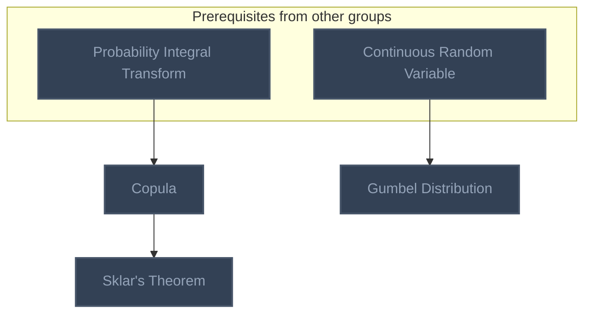

## Foundations of Inference: Frequentist vs Bayesian
**Mastered:** 0 / 5 · **Discovered:** 5 / 5

```mermaid
flowchart TD
    classDef planned fill:#1E293B,stroke:#64748B,stroke-width:2px,stroke-dasharray:5 5,color:#94A3B8;
    classDef locked fill:#334155,stroke:#475569,stroke-width:2px,color:#94A3B8;
    classDef L0 fill:#F1F5F9,stroke:#94A3B8,stroke-width:2px,color:#000000;
    classDef L1 fill:#22C55E,stroke:#15803D,stroke-width:2px,color:#000000;
    classDef L2 fill:#3B82F6,stroke:#1D4ED8,stroke-width:3px,color:#FFFFFF;
    classDef L3 fill:#A855F7,stroke:#6B21A8,stroke-width:3px,color:#FFFFFF,font-weight:bold;
    classDef L4 fill:#F97316,stroke:#C2410C,stroke-width:4px,color:#000000,font-weight:bold;
    classDef L5 fill:#FFD700,stroke:#FF8C00,stroke-width:5px,color:#000000,font-weight:bold;
    classDef rusty stroke:#8B4513,stroke-width:4px,stroke-dasharray:3 3;
    subgraph sg_prereqs["Prerequisites from other groups"]
        n_conditional_distribution["Conditional Distribution"]
        n_estimator["Estimator"]
        n_negative_binomial_distribution["Negative Binomial Distribution"]
        n_p_value["P-Value"]
        n_sufficient_statistic["Sufficient Statistic"]
        n_ancillary_statistic["Ancillary Statistic"]
        n_maximum_likelihood_estimator_asymptotic_normality["Maximum Likelihood Estimator Asymptotic Normality"]
        n_posterior_distribution["Posterior Distribution"]
        n_maximum_likelihood_estimation["Maximum Likelihood Estimation"]
        n_likelihood_function["Likelihood Function"]
        n_fisher_information_matrix["Fisher Information Matrix"]
    end
    n_frequentist_vs_bayesian_inference["Frequentist vs Bayesian Inference"]
    n_likelihood_principle["Likelihood Principle"]
    n_birnbaum_s_theorem["Birnbaum's Theorem"]
    n_probability_matching_prior["Probability Matching Prior"]
    n_bernstein_von_mises_theorem["Bernstein-von Mises Theorem"]
    n_conditional_distribution --> n_frequentist_vs_bayesian_inference
    n_estimator --> n_frequentist_vs_bayesian_inference
    n_negative_binomial_distribution --> n_likelihood_principle
    n_p_value --> n_likelihood_principle
    n_frequentist_vs_bayesian_inference --> n_likelihood_principle
    n_sufficient_statistic --> n_birnbaum_s_theorem
    n_ancillary_statistic --> n_birnbaum_s_theorem
    n_likelihood_principle --> n_birnbaum_s_theorem
    n_frequentist_vs_bayesian_inference --> n_probability_matching_prior
    n_maximum_likelihood_estimator_asymptotic_normality --> n_bernstein_von_mises_theorem
    n_frequentist_vs_bayesian_inference --> n_bernstein_von_mises_theorem
    n_posterior_distribution --> n_bernstein_von_mises_theorem
    n_maximum_likelihood_estimation --> n_bernstein_von_mises_theorem
    n_likelihood_function --> n_frequentist_vs_bayesian_inference
    n_fisher_information_matrix --> n_bernstein_von_mises_theorem
    class n_conditional_distribution,n_estimator,n_negative_binomial_distribution,n_p_value,n_sufficient_statistic,n_ancillary_statistic,n_maximum_likelihood_estimator_asymptotic_normality,n_posterior_distribution,n_maximum_likelihood_estimation,n_likelihood_function,n_fisher_information_matrix,n_frequentist_vs_bayesian_inference,n_likelihood_principle,n_birnbaum_s_theorem,n_probability_matching_prior,n_bernstein_von_mises_theorem locked;
    class n_conditional_distribution,n_estimator,n_negative_binomial_distribution,n_p_value,n_sufficient_statistic,n_ancillary_statistic,n_maximum_likelihood_estimator_asymptotic_normality,n_posterior_distribution,n_maximum_likelihood_estimation,n_likelihood_function,n_fisher_information_matrix,n_frequentist_vs_bayesian_inference,n_likelihood_principle,n_birnbaum_s_theorem,n_probability_matching_prior,n_bernstein_von_mises_theorem internal-link;
```

## Hogg/Tanis/Zimmerman Ch. 5: Distributions of Functions of Random Variables (planned)
**Mastered:** 0 / 2 · **Discovered:** 0 / 2

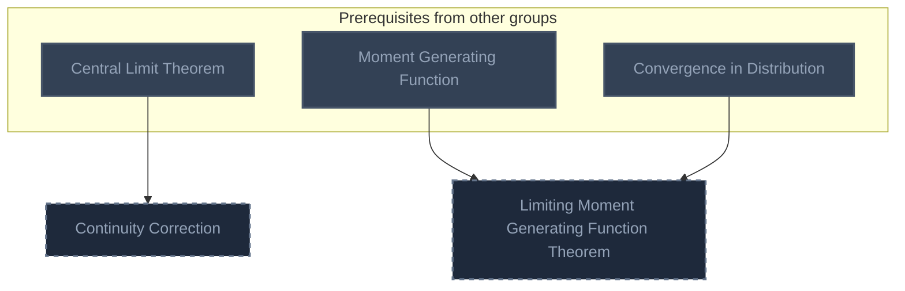

## Hogg/Tanis/Zimmerman Ch. 6: Point Estimation (planned)
**Mastered:** 0 / 2 · **Discovered:** 0 / 2

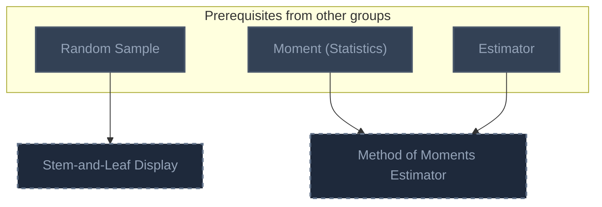

## Hogg/Tanis/Zimmerman Ch. 7: Interval Estimation (planned)
**Mastered:** 0 / 2 · **Discovered:** 0 / 2

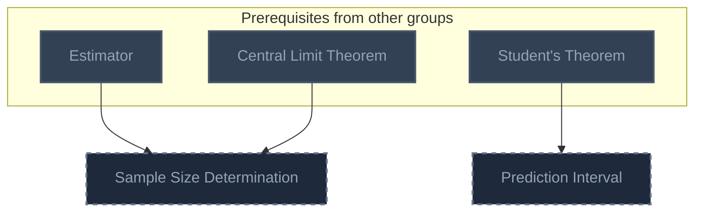

## Hogg/Tanis/Zimmerman Ch. 8: Tests of Statistical Hypotheses (planned)
**Mastered:** 0 / 6 · **Discovered:** 0 / 6

```mermaid
flowchart TD
    classDef planned fill:#1E293B,stroke:#64748B,stroke-width:2px,stroke-dasharray:5 5,color:#94A3B8;
    classDef locked fill:#334155,stroke:#475569,stroke-width:2px,color:#94A3B8;
    classDef L0 fill:#F1F5F9,stroke:#94A3B8,stroke-width:2px,color:#000000;
    classDef L1 fill:#22C55E,stroke:#15803D,stroke-width:2px,color:#000000;
    classDef L2 fill:#3B82F6,stroke:#1D4ED8,stroke-width:3px,color:#FFFFFF;
    classDef L3 fill:#A855F7,stroke:#6B21A8,stroke-width:3px,color:#FFFFFF,font-weight:bold;
    classDef L4 fill:#F97316,stroke:#C2410C,stroke-width:4px,color:#000000,font-weight:bold;
    classDef L5 fill:#FFD700,stroke:#FF8C00,stroke-width:5px,color:#000000,font-weight:bold;
    classDef rusty stroke:#8B4513,stroke-width:4px,stroke-dasharray:3 3;
    subgraph sg_prereqs["Prerequisites from other groups"]
        n_two_sample_confidence_interval_for_difference_of_means["Two-Sample Confidence Interval for Difference of Means"]
        n_test_statistic["Test Statistic"]
        n_median["Median"]
        n_order_statistic["Order Statistic"]
        n_size_of_a_test["Size of a Test"]
        n_power_function_statistics["Power Function (Statistics)"]
        n_simple_hypothesis["Simple Hypothesis"]
    end
    n_two_sample_t_test["Two-Sample t-Test"]
    n_sign_test["Sign Test"]
    n_wilcoxon_signed_rank_test["Wilcoxon Signed Rank Test"]
    n_wilcoxon_rank_sum_test["Wilcoxon Rank Sum Test"]
    n_neyman_pearson_lemma["Neyman-Pearson Lemma"]
    n_uniformly_most_powerful_test["Uniformly Most Powerful Test"]
    n_two_sample_confidence_interval_for_difference_of_means --> n_two_sample_t_test
    n_test_statistic --> n_two_sample_t_test
    n_median --> n_sign_test
    n_test_statistic --> n_sign_test
    n_order_statistic --> n_wilcoxon_signed_rank_test
    n_sign_test --> n_wilcoxon_signed_rank_test
    n_order_statistic --> n_wilcoxon_rank_sum_test
    n_test_statistic --> n_wilcoxon_rank_sum_test
    n_size_of_a_test --> n_neyman_pearson_lemma
    n_power_function_statistics --> n_neyman_pearson_lemma
    n_simple_hypothesis --> n_neyman_pearson_lemma
    n_neyman_pearson_lemma --> n_uniformly_most_powerful_test
    class n_two_sample_t_test,n_sign_test,n_wilcoxon_signed_rank_test,n_wilcoxon_rank_sum_test,n_neyman_pearson_lemma,n_uniformly_most_powerful_test planned;
    class n_two_sample_confidence_interval_for_difference_of_means,n_test_statistic,n_order_statistic,n_size_of_a_test,n_power_function_statistics,n_simple_hypothesis locked;
    class n_median L0;
    class n_two_sample_confidence_interval_for_difference_of_means,n_test_statistic,n_median,n_order_statistic,n_size_of_a_test,n_power_function_statistics,n_simple_hypothesis internal-link;
```

## Hogg/Tanis/Zimmerman Ch. 9: More Tests (planned)
**Mastered:** 0 / 7 · **Discovered:** 0 / 7

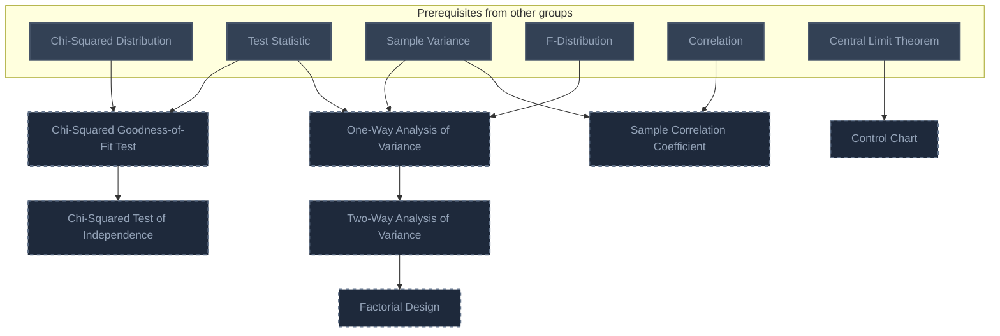

## Concentration Inequalities
**Mastered:** 0 / 2 · **Discovered:** 2 / 2

```mermaid
flowchart TD
    classDef planned fill:#1E293B,stroke:#64748B,stroke-width:2px,stroke-dasharray:5 5,color:#94A3B8;
    classDef locked fill:#334155,stroke:#475569,stroke-width:2px,color:#94A3B8;
    classDef L0 fill:#F1F5F9,stroke:#94A3B8,stroke-width:2px,color:#000000;
    classDef L1 fill:#22C55E,stroke:#15803D,stroke-width:2px,color:#000000;
    classDef L2 fill:#3B82F6,stroke:#1D4ED8,stroke-width:3px,color:#FFFFFF;
    classDef L3 fill:#A855F7,stroke:#6B21A8,stroke-width:3px,color:#FFFFFF,font-weight:bold;
    classDef L4 fill:#F97316,stroke:#C2410C,stroke-width:4px,color:#000000,font-weight:bold;
    classDef L5 fill:#FFD700,stroke:#FF8C00,stroke-width:5px,color:#000000,font-weight:bold;
    classDef rusty stroke:#8B4513,stroke-width:4px,stroke-dasharray:3 3;
    subgraph sg_prereqs["Prerequisites from other groups"]
        n_hoeffding_s_inequality["Hoeffding's Inequality"]
        n_boole_s_inequality["Boole's Inequality"]
        n_multinomial_distribution_maximum_likelihood_estimation["Multinomial Distribution Maximum Likelihood Estimation"]
        n_1_norm["1-Norm"]
        n_markov_s_inequality["Markov's Inequality"]
        n_moment_generating_function["Moment Generating Function"]
    end
    n_empirical_distribution_l1_concentration_bound["Empirical Distribution L1 Concentration Bound"]
    n_bernstein_s_inequality["Bernstein's Inequality"]
    n_hoeffding_s_inequality --> n_empirical_distribution_l1_concentration_bound
    n_boole_s_inequality --> n_empirical_distribution_l1_concentration_bound
    n_multinomial_distribution_maximum_likelihood_estimation --> n_empirical_distribution_l1_concentration_bound
    n_1_norm --> n_empirical_distribution_l1_concentration_bound
    n_markov_s_inequality --> n_bernstein_s_inequality
    n_moment_generating_function --> n_bernstein_s_inequality
    class n_hoeffding_s_inequality,n_boole_s_inequality,n_multinomial_distribution_maximum_likelihood_estimation,n_1_norm,n_markov_s_inequality,n_moment_generating_function,n_empirical_distribution_l1_concentration_bound,n_bernstein_s_inequality locked;
    class n_hoeffding_s_inequality,n_boole_s_inequality,n_multinomial_distribution_maximum_likelihood_estimation,n_1_norm,n_markov_s_inequality,n_moment_generating_function,n_empirical_distribution_l1_concentration_bound,n_bernstein_s_inequality internal-link;
```

## Statistical Practice
**Mastered:** 0 / 3 · **Discovered:** 3 / 3

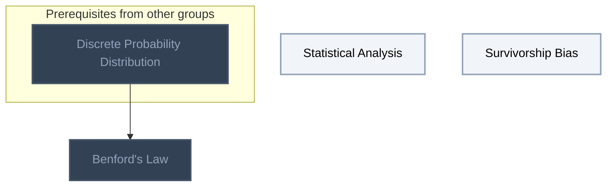

# Source
Graph structure: the single source for the diagrams above, edited by `/note` and `Scripts/skill_trees.py` (`add`, `edge`, `rename`). Everything above this heading is regenerated by `render`.

```skilltree
    %% PREREQUISITES
    n_change_of_variables["Change of Variables"]
    n_continuous_function["Continuous Function"]
    n_cartesian_product_set_cardinality["Cartesian Product Set Cardinality"]
    n_demorgan_s_laws["DeMorgan's Laws"]
    n_disjoint_sets["Disjoint Sets"]
    n_function_support["Function Support"]
    n_set_operations["Set Operations"]
    n_subset["Subset"]
    n_jacobian_matrix["Jacobian Matrix"]
    n_matrix["Matrix"]
    n_median["Median"]
    n_injective_function["Injective Function"]
    n_set["Set"]
    n_set_union["Set Union"]
    n_sequence["Sequence"]
    n_big_o["Big O"]
    n_convex_function["Convex Function"]
    n_little_o["Little O"]
    n_matrix_square_root["Matrix Square Root"]
    n_inverse_function["Inverse Function"]
    n_double_riemann_integral["Double Riemann Integral"]
    n_fubini_s_theorem["Fubini's Theorem"]
    n_cauchy_schwarz_inequality["Cauchy-Schwarz Inequality"]
    n_gamma_function["Gamma Function"]
    n_vector["Vector"]
    n_function["Function"]
    n_countable_set["Countable Set"]
    n_sigma_field["Sigma-Field"]
    n_fundamental_theorem_of_calculus["Fundamental Theorem of Calculus"]
    n_posterior_distribution["Posterior Distribution"]
    n_bernoulli_distribution["Bernoulli Distribution"]
    n_binomial_distribution["Binomial Distribution"]
    n_multinomial_distribution["Multinomial Distribution"]
    n_maximum_likelihood_estimation["Maximum Likelihood Estimation"]
    n_likelihood_function["Likelihood Function"]
    n_exponential_family["Exponential Family"]
    n_fisher_information["Fisher Information"]
    n_fisher_information_matrix["Fisher Information Matrix"]
    n_loss_function["Loss Function"]
    n_l2_loss["L2 Loss"]
    n_latent_variables["Latent Variables"]
    n_kullback_leibler_divergence["Kullback-Leibler Divergence"]
    n_interchange_of_differentiation_and_expectation["Interchange of Differentiation and Expectation"]
    n_geometric_mean["Geometric Mean"]
    n_statistical_learning["Statistical Learning"]
    n_multinomial_distribution_maximum_likelihood_estimation["Multinomial Distribution Maximum Likelihood Estimation"]
    n_1_norm["1-Norm"]
    n_universe_of_discourse["Universe of Discourse"]
    n_empty_set["Empty Set"]
    n_discrete_probability_distribution["Discrete Probability Distribution"]
    %% NODES
    %% == Hogg/Tanis/Zimmerman Ch. 1: Probability ==
    n_set_complement["Set Complement"]
    n_probability["Probability"]
    n_frequency["Frequency"]
    n_probability_of_complement["Probability of Complement"]
    n_probability_of_empty_set["Probability of Empty Set"]
    n_probability_of_subset["Probability of Subset"]
    n_probability_maximum_value["Probability Maximum Value"]
    n_conditional_probability["Conditional Probability"]
    n_conditional_probability_other_properties["Conditional Probability Other Properties"]
    n_independent_events["Independent Events"]
    n_probability_objective_interpretation["Probability Objective Interpretation"]
    n_probability_subjective_interpretation["Probability Subjective Interpretation"]
    n_probability_frequentist_framework["Probability Frequentist Framework"]
    %% == Hogg/Tanis/Zimmerman Ch. 2: Discrete Distributions ==
    n_random_variable["Random Variable"]
    n_cumulative_mass_function["Cumulative Mass Function"]
    n_discrete_uniform_distribution["Discrete Uniform Distribution"]
    %% == Hogg/Tanis/Zimmerman Ch. 3: Continuous Distributions ==
    n_continuous_probability_distribution["Continuous Probability Distribution"]
    n_hazard_rate_function["Hazard Rate Function"]
    n_weibull_distribution["Weibull Distribution"]
    %% == Hogg/McKean/Craig Ch. 1: Probability and Distributions ==
    n_sample_space["Sample Space"]
    n_venn_diagram["Venn Diagram"]
    n_disjoint_set_union["Disjoint Set Union"]
    n_nondecreasing_sequence_of_sets["Nondecreasing Sequence of Sets"]
    n_nonincreasing_sequence_of_sets["Nonincreasing Sequence of Sets"]
    n_permutation_combinatorics["Permutation (Combinatorics)"]
    n_combination["Combination"]
    n_continuity_theorem_of_probability["Continuity Theorem of Probability"]
    n_boole_s_inequality["Boole's Inequality"]
    n_bonferroni_s_inequality["Bonferroni's Inequality"]
    n_random_variables_equal_in_distribution["Random Variables Equal in Distribution"]
    n_cumulative_distribution_function_basic_properties["Cumulative Distribution Function Basic Properties"]
    n_random_variable_transformation["Random Variable Transformation"]
    n_continuous_random_variable["Continuous Random Variable"]
    n_random_variable_support["Random Variable Support"]
    n_continuous_random_variable_probability_inequality_theorem["Continuous Random Variable Probability Inequality Theorem"]
    n_interquartile_range["Interquartile Range"]
    n_cumulative_distribution_function_transformation_technique["Cumulative Distribution Function Transformation Technique"]
    n_mixture_random_variable["Mixture Random Variable"]
    n_variance_basic_properties["Variance Basic Properties"]
    n_moment_statistics["Moment (Statistics)"]
    n_moment_generating_function["Moment Generating Function"]
    n_moment_generating_function_equal_distribution_theorem["Moment Generating Function Equal Distribution Theorem"]
    n_characteristic_function_probability["Characteristic Function (Probability)"]
    n_degenerate_distribution["Degenerate Distribution"]
    n_factorial_moment_generating_function["Factorial Moment Generating Function"]
    n_kurtosis["Kurtosis"]
    n_cumulant_generating_function["Cumulant Generating Function"]
    n_laplace_distribution["Laplace Distribution"]
    n_mth_moment_existence_theorem["mth Moment Existence Theorem"]
    n_markov_s_inequality["Markov's Inequality"]
    n_chebyshev_s_inequality["Chebyshev's Inequality"]
    n_jensen_s_inequality["Jensen's Inequality"]
    n_cumulative_distribution_function["Cumulative Distribution Function"]
    n_quantile_function["Quantile Function"]
    n_expectation["Expectation"]
    n_variance["Variance"]
    n_random_experiment["Random Experiment"]
    n_event["Event"]
    n_relative_frequency["Relative Frequency"]
    n_set_function["Set Function"]
    n_mutually_exclusive_events["Mutually Exclusive Events"]
    n_exhaustive_events["Exhaustive Events"]
    n_probability_of_set_union["Probability of Set Union"]
    n_probability_of_equally_likely_outcomes["Probability of Equally Likely Outcomes"]
    n_conditional_probability_primary_properties["Conditional Probability Primary Properties"]
    n_conditional_probability_multiplication_rule["Conditional Probability Multiplication Rule"]
    n_law_of_total_probability["Law of Total Probability"]
    n_mutually_independent_events["Mutually Independent Events"]
    n_discrete_random_variable["Discrete Random Variable"]
    n_probability_mass_function["Probability Mass Function"]
    n_probability_density_function["Probability Density Function"]
    n_probability_function["Probability Function"]
    n_probability_mass_function_definitional_properties["Probability Mass Function Definitional Properties"]
    n_probability_density_function_definitional_properties["Probability Density Function Definitional Properties"]
    n_standard_deviation["Standard Deviation"]
    n_coefficient_of_variation["Coefficient of Variation"]
    n_geometric_standard_deviation["Geometric Standard Deviation"]
    n_continuous_uniform_distribution_variance["Continuous Uniform Distribution Variance"]
    n_normal_distribution_variance["Normal Distribution Variance"]
    n_gamma_distribution_variance["Gamma Distribution Variance"]
    n_standard_error["Standard Error"]
    %% == Hogg/McKean/Craig Ch. 2: Multivariate Distributions ==
    n_joint_cumulative_distribution_function["Joint Cumulative Distribution Function"]
    n_moment_generating_function_of_random_vector["Moment Generating Function of Random Vector"]
    n_cumulative_distribution_function_method["Cumulative Distribution Function Method"]
    n_random_vector_transformation["Random Vector Transformation"]
    n_convolution_formula["Convolution Formula"]
    n_conditional_distribution["Conditional Distribution"]
    n_independent_random_variable_factorization_theorem["Independent Random Variable Factorization Theorem"]
    n_independent_random_variable_equivalent_conditions["Independent Random Variable Equivalent Conditions"]
    n_expectation_of_product_of_independent_random_variables["Expectation of Product of Independent Random Variables"]
    n_moment_generating_function_technique["Moment Generating Function Technique"]
    n_linear_conditional_expectation_theorem["Linear Conditional Expectation Theorem"]
    n_mutually_independent_random_variables["Mutually Independent Random Variables"]
    n_expectation_of_random_matrix["Expectation of Random Matrix"]
    n_independent_and_identically_distributed["Independent and Identically Distributed"]
    n_cauchy_distribution["Cauchy Distribution"]
    n_linear_combination_of_random_variables["Linear Combination of Random Variables"]
    n_random_sample["Random Sample"]
    n_sample_mean["Sample Mean"]
    n_sample_variance["Sample Variance"]
    n_multivariate_discrete_probability_distribution["Multivariate Discrete Probability Distribution"]
    n_multivariate_continuous_probability_distribution["Multivariate Continuous Probability Distribution"]
    n_marginal_distribution["Marginal Distribution"]
    n_conditional_expectation["Conditional Expectation"]
    n_conditional_variance["Conditional Variance"]
    n_independent_random_variable["Independent Random Variable"]
    n_covariance["Covariance"]
    n_correlation["Correlation"]
    n_random_vector["Random Vector"]
    n_mean_vector["Mean Vector"]
    n_law_of_total_expectation["Law of Total Expectation"]
    n_law_of_total_variance["Law of Total Variance"]
    n_covariance_matrix["Covariance Matrix"]
    n_multivariate_probability_distribution["Multivariate Probability Distribution"]
    n_multivariate_discrete_probability_distribution_definitional_properties["Multivariate Discrete Probability Distribution Definitional Properties"]
    n_multivariate_continuous_probability_distribution_definitional_properties["Multivariate Continuous Probability Distribution Definitional Properties"]
    n_joint_probability_distribution["Joint Probability Distribution"]
    n_joint_probability["Joint Probability"]
    %% == Hogg/McKean/Craig Ch. 3: Some Special Distributions ==
    n_binomial_distribution_addition["Binomial Distribution Addition"]
    n_negative_binomial_distribution["Negative Binomial Distribution"]
    n_geometric_distribution["Geometric Distribution"]
    n_hypergeometric_distribution["Hypergeometric Distribution"]
    n_poisson_process["Poisson Process"]
    n_gamma_distribution_addition["Gamma Distribution Addition"]
    n_dirichlet_distribution["Dirichlet Distribution"]
    n_location_parameter["Location Parameter"]
    n_scale_parameter["Scale Parameter"]
    n_shape_parameter["Shape Parameter"]
    n_contaminated_normal_distribution["Contaminated Normal Distribution"]
    n_normal_distribution_linear_combination["Normal Distribution Linear Combination"]
    n_multivariate_normal_distribution["Multivariate Normal Distribution"]
    n_bivariate_normal_distribution["Bivariate Normal Distribution"]
    n_multivariate_normal_distribution_affine_transformation["Multivariate Normal Distribution Affine Transformation"]
    n_multivariate_normal_distribution_independence["Multivariate Normal Distribution Independence"]
    n_multivariate_normal_distribution_conditional_distribution["Multivariate Normal Distribution Conditional Distribution"]
    n_principal_component_analysis["Principal Component Analysis"]
    n_f_distribution["F-Distribution"]
    n_student_s_theorem["Student's Theorem"]
    n_mixture_distribution["Mixture Distribution"]
    n_loggamma_distribution["Loggamma Distribution"]
    n_pareto_distribution["Pareto Distribution"]
    n_burr_distribution["Burr Distribution"]
    n_gamma_distribution["Gamma Distribution"]
    n_normal_distribution["Normal Distribution"]
    n_poisson_distribution["Poisson Distribution"]
    n_chi_squared_distribution["Chi-Squared Distribution"]
    n_t_distribution["t-Distribution"]
    n_probability_distribution["Probability Distribution"]
    n_univariate_probability_distribution["Univariate Probability Distribution"]
    n_cumulative_function["Cumulative Function"]
    n_uniform_distribution["Uniform Distribution"]
    n_continuous_uniform_distribution["Continuous Uniform Distribution"]
    n_continuous_uniform_distribution_expectation["Continuous Uniform Distribution Expectation"]
    n_normal_distribution_expectation["Normal Distribution Expectation"]
    n_gamma_distribution_expectation["Gamma Distribution Expectation"]
    n_exponential_distribution["Exponential Distribution"]
    n_exponential_distribution_expectation["Exponential Distribution Expectation"]
    n_exponential_distribution_variance["Exponential Distribution Variance"]
    n_chi_squared_distribution_expectation["Chi-Squared Distribution Expectation"]
    n_chi_squared_distribution_variance["Chi-Squared Distribution Variance"]
    n_beta_distribution["Beta Distribution"]
    n_beta_distribution_expectation["Beta Distribution Expectation"]
    n_beta_distribution_variance["Beta Distribution Variance"]
    n_degree_of_freedom["Degree of Freedom"]
    %% == Hogg/McKean/Craig Ch. 4: Some Elementary Statistical Inferences ==
    n_parameter_space["Parameter Space"]
    n_statistic["Statistic"]
    n_estimator["Estimator"]
    n_histogram["Histogram"]
    n_kernel_density_estimation["Kernel Density Estimation"]
    n_two_sample_confidence_interval_for_difference_of_means["Two-Sample Confidence Interval for Difference of Means"]
    n_exact_confidence_interval_for_discrete_distribution["Exact Confidence Interval for Discrete Distribution"]
    n_order_statistic["Order Statistic"]
    n_sample_quantile["Sample Quantile"]
    n_five_number_summary["Five-Number Summary"]
    n_boxplot["Boxplot"]
    n_q_q_plot["Q-Q Plot"]
    n_distribution_free_confidence_interval_for_quantile["Distribution-Free Confidence Interval for Quantile"]
    n_statistical_hypothesis_test["Statistical Hypothesis Test"]
    n_critical_region["Critical Region"]
    n_test_statistic["Test Statistic"]
    n_type_i_and_type_ii_errors["Type I and Type II Errors"]
    n_size_of_a_test["Size of a Test"]
    n_power_function_statistics["Power Function (Statistics)"]
    n_simple_hypothesis["Simple Hypothesis"]
    n_randomized_test["Randomized Test"]
    n_empirical_distribution_function["Empirical Distribution Function"]
    n_percentile_bootstrap_confidence_interval["Percentile Bootstrap Confidence Interval"]
    n_bootstrap_hypothesis_test["Bootstrap Hypothesis Test"]
    n_probability_integral_transform["Probability Integral Transform"]
    n_tolerance_interval["Tolerance Interval"]
    n_p_value["P-Value"]
    n_bootstrap["Bootstrap"]
    n_unbiased_estimator["Unbiased Estimator"]
    n_mean_squared_error["Mean Squared Error"]
    n_confidence_interval["Confidence Interval"]
    %% == Hogg/McKean/Craig Ch. 5: Consistency and Limiting Distributions ==
    n_convergence_in_probability["Convergence in Probability"]
    n_weak_law_of_large_numbers["Weak Law of Large Numbers"]
    n_consistent_estimator["Consistent Estimator"]
    n_convergence_in_distribution["Convergence in Distribution"]
    n_bounded_in_probability["Bounded in Probability"]
    n_slutsky_s_theorem["Slutsky's Theorem"]
    n_delta_method["Delta Method"]
    n_central_limit_theorem["Central Limit Theorem"]
    n_strong_law_of_large_numbers["Strong Law of Large Numbers"]
    %% == Hogg/McKean/Craig Ch. 6: Maximum Likelihood Methods ==
    n_maximum_likelihood_regularity_conditions["Maximum Likelihood Regularity Conditions"]
    n_likelihood_maximization_at_true_parameter_theorem["Likelihood Maximization at True Parameter Theorem"]
    n_maximum_likelihood_estimator_invariance["Maximum Likelihood Estimator Invariance"]
    n_rao_cram_r_lower_bound["Rao-Cramér Lower Bound"]
    n_efficient_estimator["Efficient Estimator"]
    n_maximum_likelihood_estimator_asymptotic_normality["Maximum Likelihood Estimator Asymptotic Normality"]
    n_asymptotic_relative_efficiency["Asymptotic Relative Efficiency"]
    n_expectation_maximization_algorithm["Expectation-Maximization Algorithm"]
    %% == Hogg/McKean/Craig Ch. 7: Sufficiency ==
    n_minimum_variance_unbiased_estimator["Minimum Variance Unbiased Estimator"]
    n_risk_function_statistics["Risk Function (Statistics)"]
    n_minimax_decision_rule["Minimax Decision Rule"]
    n_bias_variance_decomposition_specificity_to_squared_error_loss["Bias-Variance Decomposition Specificity to Squared Error Loss"]
    n_admissible_decision_rule["Admissible Decision Rule"]
    n_bayes_risk["Bayes Risk"]
    n_james_stein_estimator["James-Stein Estimator"]
    n_sufficient_statistic["Sufficient Statistic"]
    n_neyman_factorization_theorem["Neyman Factorization Theorem"]
    n_rao_blackwell_theorem["Rao-Blackwell Theorem"]
    n_complete_family_statistics["Complete Family (Statistics)"]
    n_lehmann_scheff_theorem["Lehmann-Scheffé Theorem"]
    n_regular_exponential_class["Regular Exponential Class"]
    n_bootstrap_standard_error["Bootstrap Standard Error"]
    n_minimal_sufficient_statistic["Minimal Sufficient Statistic"]
    n_ancillary_statistic["Ancillary Statistic"]
    n_basu_s_theorem["Basu's Theorem"]
    %% == Owen Ch. 2: Simple Monte Carlo ==
    n_rule_of_three_statistics["Rule of Three (Statistics)"]
    n_ratio_estimator["Ratio Estimator"]
    n_hoeffding_s_inequality["Hoeffding's Inequality"]
    %% == Owen Ch. 4-5: Non-Uniform Random Variables and Random Vectors ==
    n_copula["Copula"]
    n_sklar_s_theorem["Sklar's Theorem"]
    n_gumbel_distribution["Gumbel Distribution"]
    %% == Foundations of Inference: Frequentist vs Bayesian ==
    n_frequentist_vs_bayesian_inference["Frequentist vs Bayesian Inference"]
    n_likelihood_principle["Likelihood Principle"]
    n_birnbaum_s_theorem["Birnbaum's Theorem"]
    n_probability_matching_prior["Probability Matching Prior"]
    n_bernstein_von_mises_theorem["Bernstein-von Mises Theorem"]
    %% == Hogg/Tanis/Zimmerman Ch. 5: Distributions of Functions of Random Variables (planned) ==
    n_continuity_correction["Continuity Correction"]
    n_limiting_moment_generating_function_theorem["Limiting Moment Generating Function Theorem"]
    %% == Hogg/Tanis/Zimmerman Ch. 6: Point Estimation (planned) ==
    n_stem_and_leaf_display["Stem-and-Leaf Display"]
    n_method_of_moments_estimator["Method of Moments Estimator"]
    %% == Hogg/Tanis/Zimmerman Ch. 7: Interval Estimation (planned) ==
    n_sample_size_determination["Sample Size Determination"]
    n_prediction_interval["Prediction Interval"]
    %% == Hogg/Tanis/Zimmerman Ch. 8: Tests of Statistical Hypotheses (planned) ==
    n_two_sample_t_test["Two-Sample t-Test"]
    n_sign_test["Sign Test"]
    n_wilcoxon_signed_rank_test["Wilcoxon Signed Rank Test"]
    n_wilcoxon_rank_sum_test["Wilcoxon Rank Sum Test"]
    n_neyman_pearson_lemma["Neyman-Pearson Lemma"]
    n_uniformly_most_powerful_test["Uniformly Most Powerful Test"]
    %% == Hogg/Tanis/Zimmerman Ch. 9: More Tests (planned) ==
    n_chi_squared_goodness_of_fit_test["Chi-Squared Goodness-of-Fit Test"]
    n_chi_squared_test_of_independence["Chi-Squared Test of Independence"]
    n_one_way_analysis_of_variance["One-Way Analysis of Variance"]
    n_two_way_analysis_of_variance["Two-Way Analysis of Variance"]
    n_factorial_design["Factorial Design"]
    n_sample_correlation_coefficient["Sample Correlation Coefficient"]
    n_control_chart["Control Chart"]
    %% == Concentration Inequalities ==
    n_empirical_distribution_l1_concentration_bound["Empirical Distribution L1 Concentration Bound"]
    n_bernstein_s_inequality["Bernstein's Inequality"]
    %% == Statistical Practice ==
    n_statistical_analysis["Statistical Analysis"]
    n_survivorship_bias["Survivorship Bias"]
    n_benford_s_law["Benford's Law"]
    %% EDGES
    n_set --> n_sample_space
    n_random_experiment --> n_sample_space
    n_set_operations --> n_venn_diagram
    n_event --> n_venn_diagram
    n_disjoint_sets --> n_disjoint_set_union
    n_set_union --> n_disjoint_set_union
    n_sequence --> n_nondecreasing_sequence_of_sets
    n_set --> n_nondecreasing_sequence_of_sets
    n_sequence --> n_nonincreasing_sequence_of_sets
    n_set --> n_nonincreasing_sequence_of_sets
    n_cartesian_product_set_cardinality --> n_permutation_combinatorics
    n_subset --> n_combination
    n_permutation_combinatorics --> n_combination
    n_nondecreasing_sequence_of_sets --> n_continuity_theorem_of_probability
    n_nonincreasing_sequence_of_sets --> n_continuity_theorem_of_probability
    n_probability_of_set_union --> n_continuity_theorem_of_probability
    n_continuity_theorem_of_probability --> n_boole_s_inequality
    n_demorgan_s_laws --> n_bonferroni_s_inequality
    n_boole_s_inequality --> n_bonferroni_s_inequality
    n_cumulative_distribution_function --> n_random_variables_equal_in_distribution
    n_continuous_function --> n_cumulative_distribution_function_basic_properties
    n_continuity_theorem_of_probability --> n_cumulative_distribution_function_basic_properties
    n_cumulative_distribution_function --> n_cumulative_distribution_function_basic_properties
    n_injective_function --> n_random_variable_transformation
    n_probability_mass_function --> n_random_variable_transformation
    n_cumulative_distribution_function_basic_properties --> n_continuous_random_variable
    n_function_support --> n_random_variable_support
    n_probability_mass_function --> n_random_variable_support
    n_probability_density_function --> n_random_variable_support
    n_continuous_random_variable --> n_continuous_random_variable_probability_inequality_theorem
    n_quantile_function --> n_interquartile_range
    n_change_of_variables --> n_cumulative_distribution_function_transformation_technique
    n_random_variable_support --> n_cumulative_distribution_function_transformation_technique
    n_probability_mass_function --> n_mixture_random_variable
    n_probability_density_function --> n_mixture_random_variable
    n_variance --> n_variance_basic_properties
    n_expectation --> n_moment_statistics
    n_moment_statistics --> n_moment_generating_function
    n_random_variables_equal_in_distribution --> n_moment_generating_function_equal_distribution_theorem
    n_moment_generating_function --> n_moment_generating_function_equal_distribution_theorem
    n_moment_generating_function --> n_characteristic_function_probability
    n_expectation --> n_degenerate_distribution
    n_moment_generating_function --> n_factorial_moment_generating_function
    n_variance --> n_kurtosis
    n_moment_statistics --> n_kurtosis
    n_moment_generating_function --> n_cumulant_generating_function
    n_probability_density_function --> n_laplace_distribution
    n_moment_statistics --> n_mth_moment_existence_theorem
    n_expectation --> n_markov_s_inequality
    n_variance --> n_chebyshev_s_inequality
    n_markov_s_inequality --> n_chebyshev_s_inequality
    n_expectation --> n_jensen_s_inequality
    n_convex_function --> n_jensen_s_inequality
    n_cumulative_distribution_function --> n_joint_cumulative_distribution_function
    n_random_vector --> n_joint_cumulative_distribution_function
    n_moment_generating_function --> n_moment_generating_function_of_random_vector
    n_random_vector --> n_moment_generating_function_of_random_vector
    n_cumulative_distribution_function_transformation_technique --> n_cumulative_distribution_function_method
    n_multivariate_continuous_probability_distribution --> n_cumulative_distribution_function_method
    n_jacobian_matrix --> n_random_vector_transformation
    n_cumulative_distribution_function_transformation_technique --> n_random_vector_transformation
    n_multivariate_continuous_probability_distribution --> n_random_vector_transformation
    n_marginal_distribution --> n_convolution_formula
    n_random_vector_transformation --> n_convolution_formula
    n_random_variable_support --> n_conditional_distribution
    n_marginal_distribution --> n_conditional_distribution
    n_random_variable_support --> n_independent_random_variable_factorization_theorem
    n_independent_random_variable --> n_independent_random_variable_factorization_theorem
    n_moment_generating_function_of_random_vector --> n_independent_random_variable_equivalent_conditions
    n_independent_random_variable --> n_independent_random_variable_equivalent_conditions
    n_expectation --> n_expectation_of_product_of_independent_random_variables
    n_independent_random_variable --> n_expectation_of_product_of_independent_random_variables
    n_moment_generating_function_equal_distribution_theorem --> n_moment_generating_function_technique
    n_expectation_of_product_of_independent_random_variables --> n_moment_generating_function_technique
    n_law_of_total_expectation --> n_linear_conditional_expectation_theorem
    n_correlation --> n_linear_conditional_expectation_theorem
    n_independent_random_variable --> n_mutually_independent_random_variables
    n_matrix --> n_expectation_of_random_matrix
    n_mean_vector --> n_expectation_of_random_matrix
    n_mutually_independent_random_variables --> n_independent_and_identically_distributed
    n_probability_density_function --> n_cauchy_distribution
    n_covariance --> n_linear_combination_of_random_variables
    n_mutually_independent_random_variables --> n_linear_combination_of_random_variables
    n_independent_and_identically_distributed --> n_random_sample
    n_linear_combination_of_random_variables --> n_sample_mean
    n_random_sample --> n_sample_mean
    n_sample_mean --> n_sample_variance
    n_moment_generating_function_technique --> n_binomial_distribution_addition
    n_mutually_independent_random_variables --> n_binomial_distribution_addition
    n_combination --> n_negative_binomial_distribution
    n_probability_mass_function --> n_negative_binomial_distribution
    n_negative_binomial_distribution --> n_geometric_distribution
    n_probability_of_equally_likely_outcomes --> n_hypergeometric_distribution
    n_combination --> n_hypergeometric_distribution
    n_poisson_distribution --> n_poisson_process
    n_little_o --> n_poisson_process
    n_moment_generating_function_technique --> n_gamma_distribution_addition
    n_gamma_distribution --> n_gamma_distribution_addition
    n_random_vector_transformation --> n_dirichlet_distribution
    n_gamma_distribution --> n_dirichlet_distribution
    n_probability_density_function --> n_location_parameter
    n_probability_density_function --> n_scale_parameter
    n_location_parameter --> n_shape_parameter
    n_scale_parameter --> n_shape_parameter
    n_law_of_total_probability --> n_contaminated_normal_distribution
    n_normal_distribution --> n_contaminated_normal_distribution
    n_moment_generating_function_technique --> n_normal_distribution_linear_combination
    n_linear_combination_of_random_variables --> n_normal_distribution_linear_combination
    n_normal_distribution --> n_normal_distribution_linear_combination
    n_moment_generating_function_of_random_vector --> n_multivariate_normal_distribution
    n_covariance_matrix --> n_multivariate_normal_distribution
    n_normal_distribution_linear_combination --> n_multivariate_normal_distribution
    n_matrix_square_root --> n_multivariate_normal_distribution
    n_correlation --> n_bivariate_normal_distribution
    n_multivariate_normal_distribution --> n_bivariate_normal_distribution
    n_multivariate_normal_distribution --> n_multivariate_normal_distribution_affine_transformation
    n_independent_random_variable_equivalent_conditions --> n_multivariate_normal_distribution_independence
    n_multivariate_normal_distribution_affine_transformation --> n_multivariate_normal_distribution_independence
    n_conditional_distribution --> n_multivariate_normal_distribution_conditional_distribution
    n_multivariate_normal_distribution_independence --> n_multivariate_normal_distribution_conditional_distribution
    n_multivariate_normal_distribution_independence --> n_principal_component_analysis
    n_random_vector_transformation --> n_f_distribution
    n_chi_squared_distribution --> n_f_distribution
    n_sample_variance --> n_student_s_theorem
    n_multivariate_normal_distribution_independence --> n_student_s_theorem
    n_t_distribution --> n_student_s_theorem
    n_law_of_total_probability --> n_mixture_distribution
    n_conditional_distribution --> n_mixture_distribution
    n_cumulative_distribution_function_transformation_technique --> n_loggamma_distribution
    n_gamma_distribution --> n_loggamma_distribution
    n_gamma_distribution --> n_pareto_distribution
    n_mixture_distribution --> n_pareto_distribution
    n_pareto_distribution --> n_burr_distribution
    n_probability_mass_function --> n_parameter_space
    n_probability_density_function --> n_parameter_space
    n_random_sample --> n_statistic
    n_parameter_space --> n_estimator
    n_statistic --> n_estimator
    n_relative_frequency --> n_histogram
    n_random_sample --> n_histogram
    n_histogram --> n_kernel_density_estimation
    n_student_s_theorem --> n_two_sample_confidence_interval_for_difference_of_means
    n_estimator --> n_two_sample_confidence_interval_for_difference_of_means
    n_estimator --> n_exact_confidence_interval_for_discrete_distribution
    n_random_vector_transformation --> n_order_statistic
    n_random_sample --> n_order_statistic
    n_quantile_function --> n_sample_quantile
    n_order_statistic --> n_sample_quantile
    n_sample_quantile --> n_five_number_summary
    n_five_number_summary --> n_boxplot
    n_location_parameter --> n_q_q_plot
    n_scale_parameter --> n_q_q_plot
    n_sample_quantile --> n_q_q_plot
    n_quantile_function --> n_distribution_free_confidence_interval_for_quantile
    n_order_statistic --> n_distribution_free_confidence_interval_for_quantile
    n_parameter_space --> n_statistical_hypothesis_test
    n_statistical_hypothesis_test --> n_critical_region
    n_statistic --> n_test_statistic
    n_critical_region --> n_test_statistic
    n_critical_region --> n_type_i_and_type_ii_errors
    n_type_i_and_type_ii_errors --> n_size_of_a_test
    n_type_i_and_type_ii_errors --> n_power_function_statistics
    n_statistical_hypothesis_test --> n_simple_hypothesis
    n_size_of_a_test --> n_randomized_test
    n_random_sample --> n_empirical_distribution_function
    n_estimator --> n_percentile_bootstrap_confidence_interval
    n_sample_quantile --> n_percentile_bootstrap_confidence_interval
    n_empirical_distribution_function --> n_percentile_bootstrap_confidence_interval
    n_p_value --> n_bootstrap_hypothesis_test
    n_percentile_bootstrap_confidence_interval --> n_bootstrap_hypothesis_test
    n_quantile_function --> n_probability_integral_transform
    n_order_statistic --> n_probability_integral_transform
    n_probability_integral_transform --> n_tolerance_interval
    n_sequence --> n_convergence_in_probability
    n_random_vector --> n_convergence_in_probability
    n_chebyshev_s_inequality --> n_weak_law_of_large_numbers
    n_sample_mean --> n_weak_law_of_large_numbers
    n_convergence_in_probability --> n_weak_law_of_large_numbers
    n_estimator --> n_consistent_estimator
    n_convergence_in_probability --> n_consistent_estimator
    n_cumulative_distribution_function --> n_convergence_in_distribution
    n_convergence_in_probability --> n_convergence_in_distribution
    n_big_o --> n_bounded_in_probability
    n_convergence_in_distribution --> n_bounded_in_probability
    n_convergence_in_distribution --> n_slutsky_s_theorem
    n_jacobian_matrix --> n_delta_method
    n_covariance_matrix --> n_delta_method
    n_little_o --> n_delta_method
    n_bounded_in_probability --> n_delta_method
    n_slutsky_s_theorem --> n_delta_method
    n_sample_mean --> n_central_limit_theorem
    n_normal_distribution --> n_central_limit_theorem
    n_convergence_in_distribution --> n_central_limit_theorem
    n_random_variable_support --> n_maximum_likelihood_regularity_conditions
    n_random_sample --> n_maximum_likelihood_regularity_conditions
    n_parameter_space --> n_maximum_likelihood_regularity_conditions
    n_jensen_s_inequality --> n_likelihood_maximization_at_true_parameter_theorem
    n_weak_law_of_large_numbers --> n_likelihood_maximization_at_true_parameter_theorem
    n_maximum_likelihood_regularity_conditions --> n_likelihood_maximization_at_true_parameter_theorem
    n_estimator --> n_maximum_likelihood_estimator_invariance
    n_correlation --> n_rao_cram_r_lower_bound
    n_estimator --> n_rao_cram_r_lower_bound
    n_maximum_likelihood_regularity_conditions --> n_rao_cram_r_lower_bound
    n_rao_cram_r_lower_bound --> n_efficient_estimator
    n_consistent_estimator --> n_maximum_likelihood_estimator_asymptotic_normality
    n_slutsky_s_theorem --> n_maximum_likelihood_estimator_asymptotic_normality
    n_central_limit_theorem --> n_maximum_likelihood_estimator_asymptotic_normality
    n_likelihood_maximization_at_true_parameter_theorem --> n_maximum_likelihood_estimator_asymptotic_normality
    n_efficient_estimator --> n_maximum_likelihood_estimator_asymptotic_normality
    n_convergence_in_distribution --> n_asymptotic_relative_efficiency
    n_efficient_estimator --> n_asymptotic_relative_efficiency
    n_jensen_s_inequality --> n_expectation_maximization_algorithm
    n_conditional_expectation --> n_expectation_maximization_algorithm
    n_estimator --> n_expectation_maximization_algorithm
    n_variance --> n_minimum_variance_unbiased_estimator
    n_estimator --> n_minimum_variance_unbiased_estimator
    n_estimator --> n_risk_function_statistics
    n_risk_function_statistics --> n_minimax_decision_rule
    n_median --> n_bias_variance_decomposition_specificity_to_squared_error_loss
    n_variance --> n_bias_variance_decomposition_specificity_to_squared_error_loss
    n_estimator --> n_bias_variance_decomposition_specificity_to_squared_error_loss
    n_risk_function_statistics --> n_admissible_decision_rule
    n_risk_function_statistics --> n_bayes_risk
    n_frequentist_vs_bayesian_inference --> n_bayes_risk
    n_multivariate_normal_distribution --> n_james_stein_estimator
    n_admissible_decision_rule --> n_james_stein_estimator
    n_conditional_distribution --> n_sufficient_statistic
    n_parameter_space --> n_sufficient_statistic
    n_statistic --> n_sufficient_statistic
    n_sufficient_statistic --> n_neyman_factorization_theorem
    n_law_of_total_variance --> n_rao_blackwell_theorem
    n_minimum_variance_unbiased_estimator --> n_rao_blackwell_theorem
    n_sufficient_statistic --> n_rao_blackwell_theorem
    n_sufficient_statistic --> n_complete_family_statistics
    n_rao_blackwell_theorem --> n_lehmann_scheff_theorem
    n_complete_family_statistics --> n_lehmann_scheff_theorem
    n_neyman_factorization_theorem --> n_regular_exponential_class
    n_complete_family_statistics --> n_regular_exponential_class
    n_estimator --> n_bootstrap_standard_error
    n_empirical_distribution_function --> n_bootstrap_standard_error
    n_sufficient_statistic --> n_minimal_sufficient_statistic
    n_location_parameter --> n_ancillary_statistic
    n_scale_parameter --> n_ancillary_statistic
    n_parameter_space --> n_ancillary_statistic
    n_statistic --> n_ancillary_statistic
    n_complete_family_statistics --> n_basu_s_theorem
    n_ancillary_statistic --> n_basu_s_theorem
    n_exact_confidence_interval_for_discrete_distribution --> n_rule_of_three_statistics
    n_delta_method --> n_ratio_estimator
    n_moment_generating_function --> n_hoeffding_s_inequality
    n_markov_s_inequality --> n_hoeffding_s_inequality
    n_sample_mean --> n_hoeffding_s_inequality
    n_probability_integral_transform --> n_copula
    n_copula --> n_sklar_s_theorem
    n_continuous_random_variable --> n_gumbel_distribution
    n_conditional_distribution --> n_frequentist_vs_bayesian_inference
    n_estimator --> n_frequentist_vs_bayesian_inference
    n_negative_binomial_distribution --> n_likelihood_principle
    n_p_value --> n_likelihood_principle
    n_frequentist_vs_bayesian_inference --> n_likelihood_principle
    n_sufficient_statistic --> n_birnbaum_s_theorem
    n_ancillary_statistic --> n_birnbaum_s_theorem
    n_likelihood_principle --> n_birnbaum_s_theorem
    n_frequentist_vs_bayesian_inference --> n_probability_matching_prior
    n_maximum_likelihood_estimator_asymptotic_normality --> n_bernstein_von_mises_theorem
    n_frequentist_vs_bayesian_inference --> n_bernstein_von_mises_theorem
    n_probability_density_function --> n_hazard_rate_function
    n_hazard_rate_function --> n_weibull_distribution
    n_central_limit_theorem --> n_continuity_correction
    n_moment_generating_function --> n_limiting_moment_generating_function_theorem
    n_convergence_in_distribution --> n_limiting_moment_generating_function_theorem
    n_random_sample --> n_stem_and_leaf_display
    n_moment_statistics --> n_method_of_moments_estimator
    n_estimator --> n_method_of_moments_estimator
    n_estimator --> n_sample_size_determination
    n_central_limit_theorem --> n_sample_size_determination
    n_student_s_theorem --> n_prediction_interval
    n_two_sample_confidence_interval_for_difference_of_means --> n_two_sample_t_test
    n_test_statistic --> n_two_sample_t_test
    n_median --> n_sign_test
    n_test_statistic --> n_sign_test
    n_order_statistic --> n_wilcoxon_signed_rank_test
    n_sign_test --> n_wilcoxon_signed_rank_test
    n_order_statistic --> n_wilcoxon_rank_sum_test
    n_test_statistic --> n_wilcoxon_rank_sum_test
    n_size_of_a_test --> n_neyman_pearson_lemma
    n_power_function_statistics --> n_neyman_pearson_lemma
    n_simple_hypothesis --> n_neyman_pearson_lemma
    n_neyman_pearson_lemma --> n_uniformly_most_powerful_test
    n_chi_squared_distribution --> n_chi_squared_goodness_of_fit_test
    n_test_statistic --> n_chi_squared_goodness_of_fit_test
    n_chi_squared_goodness_of_fit_test --> n_chi_squared_test_of_independence
    n_sample_variance --> n_one_way_analysis_of_variance
    n_f_distribution --> n_one_way_analysis_of_variance
    n_test_statistic --> n_one_way_analysis_of_variance
    n_one_way_analysis_of_variance --> n_two_way_analysis_of_variance
    n_two_way_analysis_of_variance --> n_factorial_design
    n_correlation --> n_sample_correlation_coefficient
    n_sample_variance --> n_sample_correlation_coefficient
    n_central_limit_theorem --> n_control_chart
    n_set_function --> n_cumulative_distribution_function
    n_inverse_function --> n_quantile_function
    n_cumulative_distribution_function_basic_properties --> n_quantile_function
    n_probability_mass_function --> n_expectation
    n_probability_density_function --> n_expectation
    n_probability_mass_function --> n_multivariate_discrete_probability_distribution
    n_joint_cumulative_distribution_function --> n_multivariate_discrete_probability_distribution
    n_double_riemann_integral --> n_multivariate_continuous_probability_distribution
    n_fubini_s_theorem --> n_multivariate_continuous_probability_distribution
    n_probability_density_function --> n_multivariate_continuous_probability_distribution
    n_joint_cumulative_distribution_function --> n_multivariate_continuous_probability_distribution
    n_multivariate_discrete_probability_distribution --> n_marginal_distribution
    n_multivariate_continuous_probability_distribution --> n_marginal_distribution
    n_expectation --> n_conditional_expectation
    n_conditional_distribution --> n_conditional_expectation
    n_variance --> n_conditional_variance
    n_conditional_expectation --> n_conditional_variance
    n_marginal_distribution --> n_independent_random_variable
    n_variance --> n_covariance
    n_mean_vector --> n_covariance
    n_cauchy_schwarz_inequality --> n_correlation
    n_covariance --> n_correlation
    n_probability_density_function --> n_gamma_distribution
    n_gamma_function --> n_gamma_distribution
    n_probability_density_function --> n_normal_distribution
    n_expectation --> n_variance
    n_vector --> n_random_vector
    n_sample_space --> n_random_vector
    n_expectation --> n_mean_vector
    n_random_vector --> n_mean_vector
    n_law_of_total_probability --> n_law_of_total_expectation
    n_conditional_expectation --> n_law_of_total_expectation
    n_conditional_variance --> n_law_of_total_variance
    n_law_of_total_expectation --> n_law_of_total_variance
    n_covariance --> n_covariance_matrix
    n_expectation_of_random_matrix --> n_covariance_matrix
    n_probability_mass_function --> n_poisson_distribution
    n_gamma_distribution --> n_chi_squared_distribution
    n_test_statistic --> n_p_value
    n_size_of_a_test --> n_p_value
    n_subset --> n_event
    n_sample_space --> n_event
    n_event --> n_relative_frequency
    n_function --> n_set_function
    n_event --> n_set_function
    n_disjoint_sets --> n_mutually_exclusive_events
    n_event --> n_mutually_exclusive_events
    n_countable_set --> n_mutually_exclusive_events
    n_mutually_exclusive_events --> n_exhaustive_events
    n_venn_diagram --> n_probability_of_set_union
    n_disjoint_set_union --> n_probability_of_set_union
    n_set_function --> n_probability_of_set_union
    n_mutually_exclusive_events --> n_probability_of_set_union
    n_sigma_field --> n_probability_of_set_union
    n_probability_of_set_union --> n_probability_of_equally_likely_outcomes
    n_probability_of_set_union --> n_conditional_probability_primary_properties
    n_conditional_probability_primary_properties --> n_conditional_probability_multiplication_rule
    n_exhaustive_events --> n_law_of_total_probability
    n_conditional_probability_multiplication_rule --> n_law_of_total_probability
    n_conditional_probability_multiplication_rule --> n_mutually_independent_events
    n_countable_set --> n_discrete_random_variable
    n_set_function --> n_discrete_random_variable
    n_discrete_random_variable --> n_probability_mass_function
    n_fundamental_theorem_of_calculus --> n_probability_density_function
    n_continuous_random_variable --> n_probability_density_function
    n_random_vector_transformation --> n_t_distribution
    n_chi_squared_distribution --> n_t_distribution
    n_normal_distribution --> n_t_distribution
    n_probability_distribution --> n_random_variables_equal_in_distribution
    n_probability_distribution --> n_gamma_distribution
    n_probability_distribution --> n_normal_distribution
    n_probability_distribution --> n_poisson_distribution
    n_probability_function --> n_probability_mass_function
    n_probability_function --> n_probability_density_function
    n_multivariate_probability_distribution --> n_multivariate_discrete_probability_distribution
    n_multivariate_probability_distribution --> n_multivariate_continuous_probability_distribution
    n_joint_probability_distribution --> n_marginal_distribution
    n_joint_probability_distribution --> n_independent_random_variable
    n_exponential_distribution --> n_pareto_distribution
    n_posterior_distribution --> n_bernstein_von_mises_theorem
    n_bernoulli_distribution --> n_contaminated_normal_distribution
    n_binomial_distribution --> n_negative_binomial_distribution
    n_binomial_distribution --> n_distribution_free_confidence_interval_for_quantile
    n_multinomial_distribution --> n_order_statistic
    n_maximum_likelihood_estimation --> n_bernstein_von_mises_theorem
    n_likelihood_function --> n_likelihood_maximization_at_true_parameter_theorem
    n_likelihood_function --> n_expectation_maximization_algorithm
    n_likelihood_function --> n_frequentist_vs_bayesian_inference
    n_exponential_family --> n_regular_exponential_class
    n_fisher_information --> n_rao_cram_r_lower_bound
    n_fisher_information --> n_maximum_likelihood_estimator_asymptotic_normality
    n_fisher_information_matrix --> n_bernstein_von_mises_theorem
    n_loss_function --> n_risk_function_statistics
    n_l2_loss --> n_bias_variance_decomposition_specificity_to_squared_error_loss
    n_latent_variables --> n_expectation_maximization_algorithm
    n_probability --> n_continuity_theorem_of_probability
    n_probability --> n_boole_s_inequality
    n_probability --> n_probability_of_set_union
    n_probability --> n_probability_of_equally_likely_outcomes
    n_frequency --> n_relative_frequency
    n_conditional_probability --> n_conditional_probability_multiplication_rule
    n_conditional_probability --> n_conditional_probability_primary_properties
    n_conditional_probability --> n_conditional_distribution
    n_independent_events --> n_mutually_independent_events
    n_independent_events --> n_independent_random_variable
    n_random_variable --> n_cumulative_distribution_function
    n_random_variable --> n_discrete_random_variable
    n_random_variable --> n_random_vector
    n_random_variable --> n_random_variable_transformation
    n_bootstrap --> n_percentile_bootstrap_confidence_interval
    n_bootstrap --> n_bootstrap_standard_error
    n_kullback_leibler_divergence --> n_expectation_maximization_algorithm
    n_interchange_of_differentiation_and_expectation --> n_maximum_likelihood_regularity_conditions
    n_unbiased_estimator --> n_rao_cram_r_lower_bound
    n_unbiased_estimator --> n_minimum_variance_unbiased_estimator
    n_confidence_interval --> n_exact_confidence_interval_for_discrete_distribution
    n_confidence_interval --> n_distribution_free_confidence_interval_for_quantile
    n_standard_error --> n_bootstrap_standard_error
    n_random_variable --> n_probability_distribution
    n_probability_distribution --> n_univariate_probability_distribution
    n_probability_distribution --> n_multivariate_probability_distribution
    n_probability_distribution --> n_probability_function
    n_probability_distribution --> n_cumulative_function
    n_probability_mass_function --> n_probability_mass_function_definitional_properties
    n_probability_density_function --> n_probability_density_function_definitional_properties
    n_multivariate_discrete_probability_distribution --> n_multivariate_discrete_probability_distribution_definitional_properties
    n_multivariate_continuous_probability_distribution --> n_multivariate_continuous_probability_distribution_definitional_properties
    n_conditional_probability --> n_joint_probability
    n_random_vector --> n_joint_probability_distribution
    n_joint_cumulative_distribution_function --> n_joint_probability_distribution
    n_multivariate_probability_distribution --> n_joint_probability_distribution
    n_variance --> n_standard_deviation
    n_standard_deviation --> n_coefficient_of_variation
    n_standard_deviation --> n_geometric_standard_deviation
    n_geometric_mean --> n_geometric_standard_deviation
    n_probability_distribution --> n_uniform_distribution
    n_uniform_distribution --> n_continuous_uniform_distribution
    n_continuous_probability_distribution --> n_continuous_uniform_distribution
    n_continuous_uniform_distribution --> n_continuous_uniform_distribution_expectation
    n_expectation --> n_continuous_uniform_distribution_expectation
    n_continuous_uniform_distribution --> n_continuous_uniform_distribution_variance
    n_variance --> n_continuous_uniform_distribution_variance
    n_normal_distribution --> n_normal_distribution_expectation
    n_expectation --> n_normal_distribution_expectation
    n_normal_distribution --> n_normal_distribution_variance
    n_variance --> n_normal_distribution_variance
    n_gamma_distribution --> n_gamma_distribution_expectation
    n_expectation --> n_gamma_distribution_expectation
    n_gamma_distribution --> n_gamma_distribution_variance
    n_variance --> n_gamma_distribution_variance
    n_gamma_distribution --> n_exponential_distribution
    n_exponential_distribution --> n_exponential_distribution_expectation
    n_expectation --> n_exponential_distribution_expectation
    n_exponential_distribution --> n_exponential_distribution_variance
    n_variance --> n_exponential_distribution_variance
    n_chi_squared_distribution --> n_chi_squared_distribution_expectation
    n_expectation --> n_chi_squared_distribution_expectation
    n_chi_squared_distribution --> n_chi_squared_distribution_variance
    n_variance --> n_chi_squared_distribution_variance
    n_continuous_probability_distribution --> n_beta_distribution
    n_gamma_function --> n_beta_distribution
    n_shape_parameter --> n_beta_distribution
    n_beta_distribution --> n_beta_distribution_expectation
    n_expectation --> n_beta_distribution_expectation
    n_beta_distribution --> n_beta_distribution_variance
    n_variance --> n_beta_distribution_variance
    n_empirical_distribution_function --> n_bootstrap
    n_estimator --> n_unbiased_estimator
    n_estimator --> n_mean_squared_error
    n_estimator --> n_confidence_interval
    n_estimator --> n_standard_error
    n_standard_deviation --> n_standard_error
    n_weak_law_of_large_numbers --> n_strong_law_of_large_numbers
    n_statistical_learning --> n_degree_of_freedom
    n_hoeffding_s_inequality --> n_empirical_distribution_l1_concentration_bound
    n_boole_s_inequality --> n_empirical_distribution_l1_concentration_bound
    n_multinomial_distribution_maximum_likelihood_estimation --> n_empirical_distribution_l1_concentration_bound
    n_1_norm --> n_empirical_distribution_l1_concentration_bound
    n_markov_s_inequality --> n_bernstein_s_inequality
    n_moment_generating_function --> n_bernstein_s_inequality
    n_set --> n_set_complement
    n_universe_of_discourse --> n_set_complement
    n_set_function --> n_probability
    n_sigma_field --> n_probability
    n_mutually_exclusive_events --> n_probability
    n_event --> n_frequency
    n_probability --> n_probability_of_complement
    n_set_complement --> n_probability_of_complement
    n_probability_of_complement --> n_probability_of_empty_set
    n_empty_set --> n_probability_of_empty_set
    n_probability --> n_probability_of_subset
    n_subset --> n_probability_of_subset
    n_probability_of_subset --> n_probability_maximum_value
    n_probability --> n_conditional_probability
    n_conditional_probability --> n_conditional_probability_other_properties
    n_conditional_probability_multiplication_rule --> n_independent_events
    n_probability --> n_probability_objective_interpretation
    n_probability --> n_probability_subjective_interpretation
    n_probability --> n_probability_frequentist_framework
    n_relative_frequency --> n_probability_frequentist_framework
    n_probability --> n_random_variable
    n_function --> n_random_variable
    n_discrete_random_variable --> n_cumulative_mass_function
    n_uniform_distribution --> n_discrete_uniform_distribution
    n_probability_mass_function --> n_discrete_uniform_distribution
    n_probability_distribution --> n_continuous_probability_distribution
    n_continuous_random_variable --> n_continuous_probability_distribution
    n_discrete_probability_distribution --> n_benford_s_law
```
