<!-- BEGIN STATS (generated by Scripts/skill_trees.py; do not edit) -->
**Mastered:** 0 / 60 · **Depth:** 0% · **Discovered:** 60 · **Planned:** 0 · **Locked:** 60 · **Rusty:** 0

**Levels:** L0 60 · L1 0 · L2 0 · L3 0 · L4 0 · L5 0

**Next up:** —

Legend: dashed grey = planned (no note yet) · dark grey = locked · white L0 Discovered · green L1 Recall · blue L2 Apply · purple L3 Prove (Mastered) · orange L4 Wield · gold L5 Command · brown dashed border = rusty
<!-- END STATS -->

## Folland 0.1: The Language of Set Theory
**Mastered:** 0 / 1 · **Discovered:** 1 / 1

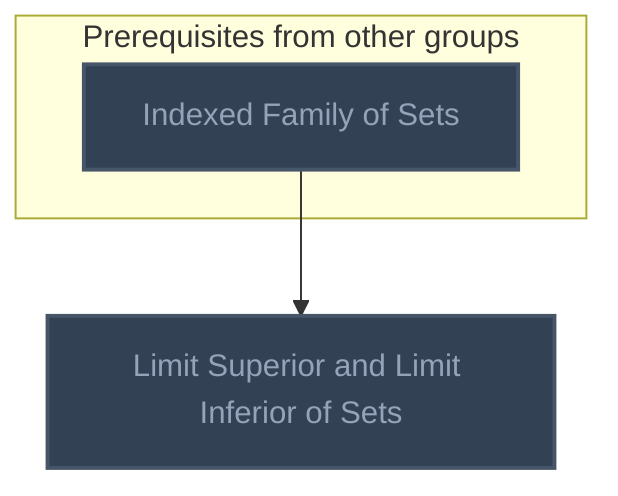

## Folland 0.2: Orderings (Munkres §3, §10, §11)
**Mastered:** 0 / 6 · **Discovered:** 6 / 6

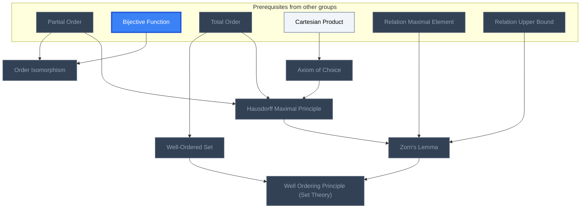

## Folland 0.3: Cardinality
**Mastered:** 0 / 2 · **Discovered:** 2 / 2

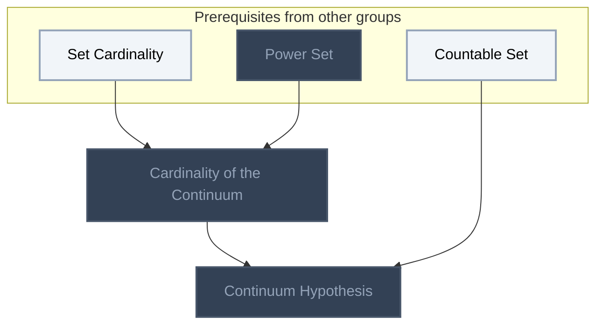

## Folland 0.4: More About Well Ordering
**Mastered:** 0 / 4 · **Discovered:** 4 / 4

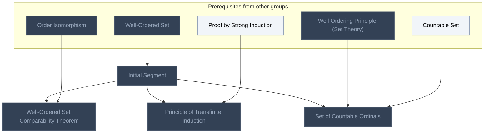

## Folland 0.5: The Extended Real Number System
**Mastered:** 0 / 2 · **Discovered:** 2 / 2

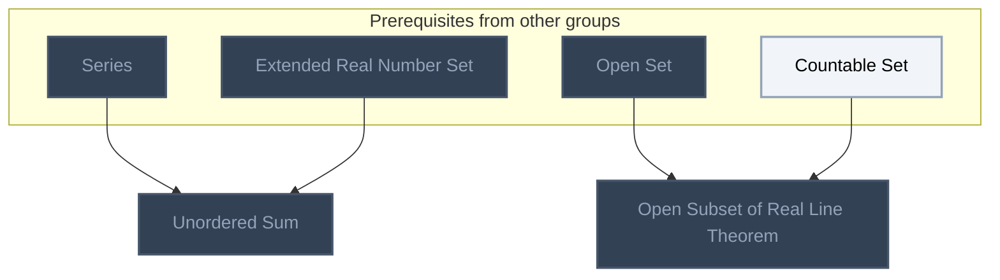

## Folland 0.6: Metric Spaces
**Mastered:** 0 / 1 · **Discovered:** 1 / 1

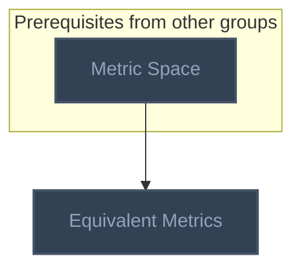

## Folland 1.1: Introduction
**Mastered:** 0 / 2 · **Discovered:** 2 / 2

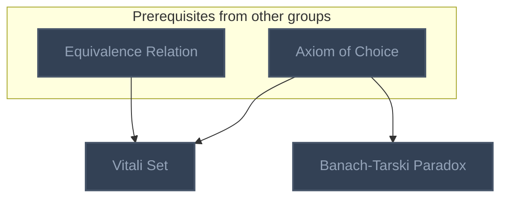

## Folland 1.2: Sigma-Algebras
**Mastered:** 0 / 10 · **Discovered:** 10 / 10

```mermaid
flowchart TD
    classDef planned fill:#1E293B,stroke:#64748B,stroke-width:2px,stroke-dasharray:5 5,color:#94A3B8;
    classDef locked fill:#334155,stroke:#475569,stroke-width:2px,color:#94A3B8;
    classDef L0 fill:#F1F5F9,stroke:#94A3B8,stroke-width:2px,color:#000000;
    classDef L1 fill:#22C55E,stroke:#15803D,stroke-width:2px,color:#000000;
    classDef L2 fill:#3B82F6,stroke:#1D4ED8,stroke-width:3px,color:#FFFFFF;
    classDef L3 fill:#A855F7,stroke:#6B21A8,stroke-width:3px,color:#FFFFFF,font-weight:bold;
    classDef L4 fill:#F97316,stroke:#C2410C,stroke-width:4px,color:#000000,font-weight:bold;
    classDef L5 fill:#FFD700,stroke:#FF8C00,stroke-width:5px,color:#000000,font-weight:bold;
    classDef rusty stroke:#8B4513,stroke-width:4px,stroke-dasharray:3 3;
    subgraph sg_prereqs["Prerequisites from other groups"]
        n_collection_of_set["Collection of Set"]
        n_countable_set["Countable Set"]
        n_closed_set["Closed Set"]
        n_open_set["Open Set"]
        n_cartesian_product["Cartesian Product"]
        n_disjoint_set_union["Disjoint Set Union"]
        n_symmetric_difference["Symmetric Difference"]
        n_power_set["Power Set"]
        n_event["Event"]
        n_set_complement["Set Complement"]
    end
    n_algebra_of_sets["Algebra of Sets"]
    n_countable_cocountable_sigma_algebra["Countable-Cocountable Sigma-Algebra"]
    n_generated_sigma_algebra["Generated Sigma-Algebra"]
    n_f_sigma_set["F-Sigma Set"]
    n_g_delta_set["G-Delta Set"]
    n_borel_sigma_algebra["Borel Sigma-Algebra"]
    n_product_sigma_algebra["Product Sigma-Algebra"]
    n_elementary_family["Elementary Family"]
    n_ring_of_sets["Ring of Sets"]
    n_sigma_field["Sigma-Field"]
    n_collection_of_set --> n_algebra_of_sets
    n_sigma_field --> n_countable_cocountable_sigma_algebra
    n_countable_set --> n_countable_cocountable_sigma_algebra
    n_sigma_field --> n_generated_sigma_algebra
    n_closed_set --> n_f_sigma_set
    n_open_set --> n_g_delta_set
    n_generated_sigma_algebra --> n_borel_sigma_algebra
    n_open_set --> n_borel_sigma_algebra
    n_generated_sigma_algebra --> n_product_sigma_algebra
    n_cartesian_product --> n_product_sigma_algebra
    n_disjoint_set_union --> n_elementary_family
    n_algebra_of_sets --> n_ring_of_sets
    n_symmetric_difference --> n_ring_of_sets
    n_power_set --> n_sigma_field
    n_event --> n_sigma_field
    n_countable_set --> n_sigma_field
    n_set_complement --> n_algebra_of_sets
    n_set_complement --> n_countable_cocountable_sigma_algebra
    n_set_complement --> n_sigma_field
    class n_closed_set,n_open_set,n_disjoint_set_union,n_symmetric_difference,n_power_set,n_event,n_algebra_of_sets,n_countable_cocountable_sigma_algebra,n_generated_sigma_algebra,n_f_sigma_set,n_g_delta_set,n_borel_sigma_algebra,n_product_sigma_algebra,n_elementary_family,n_ring_of_sets,n_sigma_field locked;
    class n_collection_of_set,n_countable_set,n_cartesian_product,n_set_complement L0;
    class n_collection_of_set,n_countable_set,n_closed_set,n_open_set,n_cartesian_product,n_disjoint_set_union,n_symmetric_difference,n_power_set,n_event,n_set_complement,n_algebra_of_sets,n_countable_cocountable_sigma_algebra,n_generated_sigma_algebra,n_f_sigma_set,n_g_delta_set,n_borel_sigma_algebra,n_product_sigma_algebra,n_elementary_family,n_ring_of_sets,n_sigma_field internal-link;
```

## Folland 1.3: Measures
**Mastered:** 0 / 16 · **Discovered:** 16 / 16

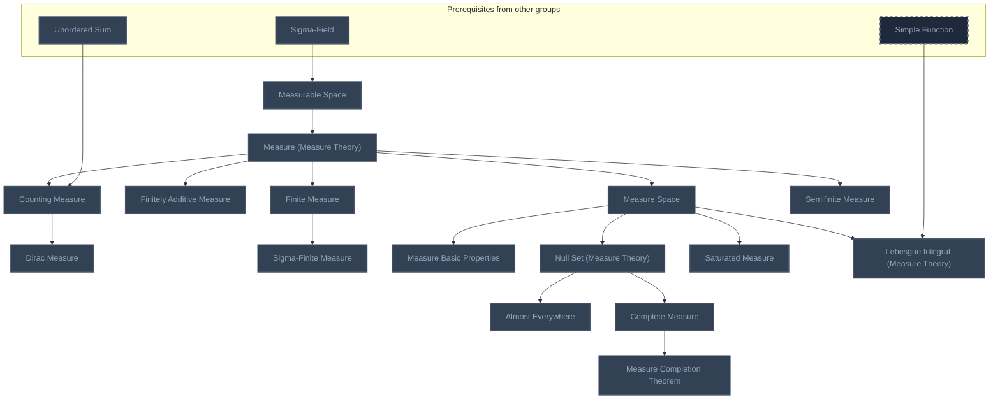

## Folland 1.4: Outer Measures
**Mastered:** 0 / 6 · **Discovered:** 6 / 6

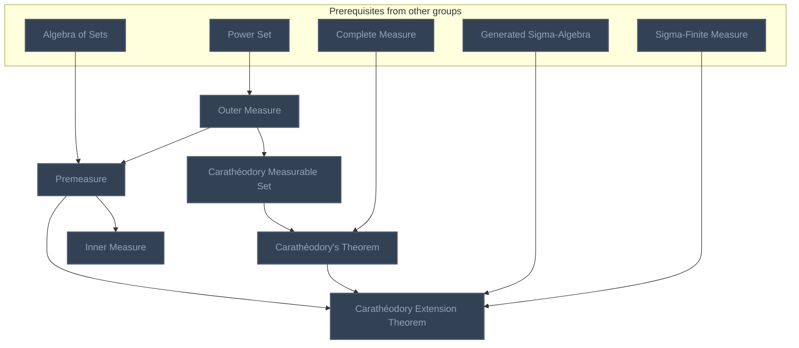

## Folland 1.5: Borel Measures on the Real Line
**Mastered:** 0 / 6 · **Discovered:** 6 / 6

```mermaid
flowchart TD
    classDef planned fill:#1E293B,stroke:#64748B,stroke-width:2px,stroke-dasharray:5 5,color:#94A3B8;
    classDef locked fill:#334155,stroke:#475569,stroke-width:2px,color:#94A3B8;
    classDef L0 fill:#F1F5F9,stroke:#94A3B8,stroke-width:2px,color:#000000;
    classDef L1 fill:#22C55E,stroke:#15803D,stroke-width:2px,color:#000000;
    classDef L2 fill:#3B82F6,stroke:#1D4ED8,stroke-width:3px,color:#FFFFFF;
    classDef L3 fill:#A855F7,stroke:#6B21A8,stroke-width:3px,color:#FFFFFF,font-weight:bold;
    classDef L4 fill:#F97316,stroke:#C2410C,stroke-width:4px,color:#000000,font-weight:bold;
    classDef L5 fill:#FFD700,stroke:#FF8C00,stroke-width:5px,color:#000000,font-weight:bold;
    classDef rusty stroke:#8B4513,stroke-width:4px,stroke-dasharray:3 3;
    subgraph sg_prereqs["Prerequisites from other groups"]
        n_carath_odory_extension_theorem["Carathéodory Extension Theorem"]
        n_elementary_family["Elementary Family"]
        n_measure_completion_theorem["Measure Completion Theorem"]
        n_increasing_function["Increasing Function"]
        n_g_delta_set["G-Delta Set"]
        n_f_sigma_set["F-Sigma Set"]
        n_open_subset_of_real_line_theorem["Open Subset of Real Line Theorem"]
        n_cantor_set["Cantor Set"]
        n_borel_sigma_algebra["Borel Sigma-Algebra"]
        n_measure_measure_theory["Measure (Measure Theory)"]
    end
    n_lebesgue_stieltjes_measure["Lebesgue-Stieltjes Measure"]
    n_lebesgue_stieltjes_measure_regularity["Lebesgue-Stieltjes Measure Regularity"]
    n_cantor_function["Cantor Function"]
    n_generalized_cantor_set["Generalized Cantor Set"]
    n_borel_measure["Borel Measure"]
    n_lebesgue_measure["Lebesgue Measure"]
    n_borel_measure --> n_lebesgue_stieltjes_measure
    n_carath_odory_extension_theorem --> n_lebesgue_stieltjes_measure
    n_elementary_family --> n_lebesgue_stieltjes_measure
    n_measure_completion_theorem --> n_lebesgue_stieltjes_measure
    n_increasing_function --> n_lebesgue_stieltjes_measure
    n_lebesgue_stieltjes_measure --> n_lebesgue_stieltjes_measure_regularity
    n_g_delta_set --> n_lebesgue_stieltjes_measure_regularity
    n_f_sigma_set --> n_lebesgue_stieltjes_measure_regularity
    n_open_subset_of_real_line_theorem --> n_lebesgue_stieltjes_measure_regularity
    n_cantor_set --> n_cantor_function
    n_increasing_function --> n_cantor_function
    n_cantor_set --> n_generalized_cantor_set
    n_lebesgue_measure --> n_generalized_cantor_set
    n_borel_sigma_algebra --> n_borel_measure
    n_measure_measure_theory --> n_borel_measure
    n_lebesgue_stieltjes_measure_regularity --> n_lebesgue_measure
    class n_carath_odory_extension_theorem,n_elementary_family,n_measure_completion_theorem,n_g_delta_set,n_f_sigma_set,n_open_subset_of_real_line_theorem,n_cantor_set,n_borel_sigma_algebra,n_measure_measure_theory,n_lebesgue_stieltjes_measure,n_lebesgue_stieltjes_measure_regularity,n_cantor_function,n_generalized_cantor_set,n_borel_measure,n_lebesgue_measure locked;
    class n_increasing_function L0;
    class n_carath_odory_extension_theorem,n_elementary_family,n_measure_completion_theorem,n_increasing_function,n_g_delta_set,n_f_sigma_set,n_open_subset_of_real_line_theorem,n_cantor_set,n_borel_sigma_algebra,n_measure_measure_theory,n_lebesgue_stieltjes_measure,n_lebesgue_stieltjes_measure_regularity,n_cantor_function,n_generalized_cantor_set,n_borel_measure,n_lebesgue_measure internal-link;
```

## Absolute Continuity and Transport Maps (no source)
**Mastered:** 0 / 2 · **Discovered:** 2 / 2

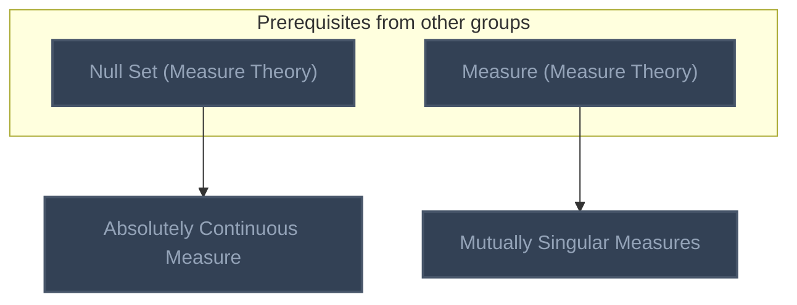

## Probability on Measure Spaces
**Mastered:** 0 / 2 · **Discovered:** 2 / 2

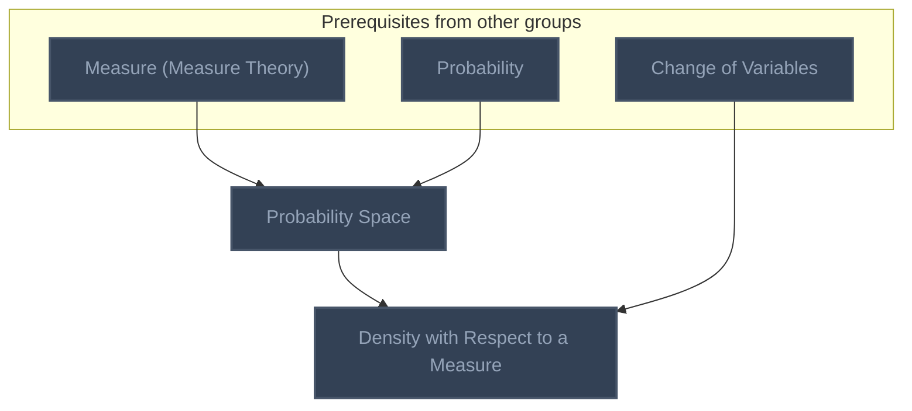

# Source
Graph structure: the single source for the diagrams above, edited by `/note` and `Scripts/skill_trees.py` (`add`, `edge`, `rename`). Everything above this heading is regenerated by `render`.

```skilltree
    %% PREREQUISITES
    n_indexed_family_of_sets["Indexed Family of Sets"]
    n_partial_order["Partial Order"]
    n_bijective_function["Bijective Function"]
    n_total_order["Total Order"]
    n_cartesian_product["Cartesian Product"]
    n_relation_maximal_element["Relation Maximal Element"]
    n_relation_upper_bound["Relation Upper Bound"]
    n_set_cardinality["Set Cardinality"]
    n_power_set["Power Set"]
    n_countable_set["Countable Set"]
    n_proof_by_strong_induction["Proof by Strong Induction"]
    n_series["Series"]
    n_extended_real_number_set["Extended Real Number Set"]
    n_open_set["Open Set"]
    n_metric_space["Metric Space"]
    n_equivalence_relation["Equivalence Relation"]
    n_collection_of_set["Collection of Set"]
    n_closed_set["Closed Set"]
    n_disjoint_set_union["Disjoint Set Union"]
    n_symmetric_difference["Symmetric Difference"]
    n_increasing_function["Increasing Function"]
    n_cantor_set["Cantor Set"]
    n_event["Event"]
    n_simple_function["Simple Function"]
    n_set_complement["Set Complement"]
    n_probability["Probability"]
    n_change_of_variables["Change of Variables"]
    %% NODES
    %% == Folland 0.1: The Language of Set Theory ==
    n_limit_superior_and_limit_inferior_of_sets["Limit Superior and Limit Inferior of Sets"]
    %% == Folland 0.2: Orderings (Munkres §3, §10, §11) ==
    n_order_isomorphism["Order Isomorphism"]
    n_well_ordered_set["Well-Ordered Set"]
    n_axiom_of_choice["Axiom of Choice"]
    n_hausdorff_maximal_principle["Hausdorff Maximal Principle"]
    n_zorn_s_lemma["Zorn's Lemma"]
    n_well_ordering_principle_set_theory["Well Ordering Principle (Set Theory)"]
    %% == Folland 0.3: Cardinality ==
    n_cardinality_of_the_continuum["Cardinality of the Continuum"]
    n_continuum_hypothesis["Continuum Hypothesis"]
    %% == Folland 0.4: More About Well Ordering ==
    n_initial_segment["Initial Segment"]
    n_well_ordered_set_comparability_theorem["Well-Ordered Set Comparability Theorem"]
    n_principle_of_transfinite_induction["Principle of Transfinite Induction"]
    n_set_of_countable_ordinals["Set of Countable Ordinals"]
    %% == Folland 0.5: The Extended Real Number System ==
    n_unordered_sum["Unordered Sum"]
    n_open_subset_of_real_line_theorem["Open Subset of Real Line Theorem"]
    %% == Folland 0.6: Metric Spaces ==
    n_equivalent_metrics["Equivalent Metrics"]
    %% == Folland 1.1: Introduction ==
    n_vitali_set["Vitali Set"]
    n_banach_tarski_paradox["Banach-Tarski Paradox"]
    %% == Folland 1.2: Sigma-Algebras ==
    n_algebra_of_sets["Algebra of Sets"]
    n_countable_cocountable_sigma_algebra["Countable-Cocountable Sigma-Algebra"]
    n_generated_sigma_algebra["Generated Sigma-Algebra"]
    n_f_sigma_set["F-Sigma Set"]
    n_g_delta_set["G-Delta Set"]
    n_borel_sigma_algebra["Borel Sigma-Algebra"]
    n_product_sigma_algebra["Product Sigma-Algebra"]
    n_elementary_family["Elementary Family"]
    n_ring_of_sets["Ring of Sets"]
    n_sigma_field["Sigma-Field"]
    %% == Folland 1.3: Measures ==
    n_measurable_space["Measurable Space"]
    n_measure_space["Measure Space"]
    n_finitely_additive_measure["Finitely Additive Measure"]
    n_counting_measure["Counting Measure"]
    n_dirac_measure["Dirac Measure"]
    n_finite_measure["Finite Measure"]
    n_sigma_finite_measure["Sigma-Finite Measure"]
    n_semifinite_measure["Semifinite Measure"]
    n_measure_basic_properties["Measure Basic Properties"]
    n_null_set_measure_theory["Null Set (Measure Theory)"]
    n_almost_everywhere["Almost Everywhere"]
    n_complete_measure["Complete Measure"]
    n_measure_completion_theorem["Measure Completion Theorem"]
    n_saturated_measure["Saturated Measure"]
    n_lebesgue_integral_measure_theory["Lebesgue Integral (Measure Theory)"]
    n_measure_measure_theory["Measure (Measure Theory)"]
    %% == Folland 1.4: Outer Measures ==
    n_outer_measure["Outer Measure"]
    n_carath_odory_measurable_set["Carathéodory Measurable Set"]
    n_carath_odory_s_theorem["Carathéodory's Theorem"]
    n_premeasure["Premeasure"]
    n_carath_odory_extension_theorem["Carathéodory Extension Theorem"]
    n_inner_measure["Inner Measure"]
    %% == Folland 1.5: Borel Measures on the Real Line ==
    n_lebesgue_stieltjes_measure["Lebesgue-Stieltjes Measure"]
    n_lebesgue_stieltjes_measure_regularity["Lebesgue-Stieltjes Measure Regularity"]
    n_cantor_function["Cantor Function"]
    n_generalized_cantor_set["Generalized Cantor Set"]
    n_borel_measure["Borel Measure"]
    n_lebesgue_measure["Lebesgue Measure"]
    %% == Absolute Continuity and Transport Maps (no source) ==
    n_absolutely_continuous_measure["Absolutely Continuous Measure"]
    n_mutually_singular_measures["Mutually Singular Measures"]
    %% == Probability on Measure Spaces ==
    n_probability_space["Probability Space"]
    n_density_with_respect_to_a_measure["Density with Respect to a Measure"]
    %% EDGES
    n_indexed_family_of_sets --> n_limit_superior_and_limit_inferior_of_sets
    n_partial_order --> n_order_isomorphism
    n_bijective_function --> n_order_isomorphism
    n_total_order --> n_well_ordered_set
    n_cartesian_product --> n_axiom_of_choice
    n_axiom_of_choice --> n_hausdorff_maximal_principle
    n_partial_order --> n_hausdorff_maximal_principle
    n_total_order --> n_hausdorff_maximal_principle
    n_hausdorff_maximal_principle --> n_zorn_s_lemma
    n_relation_maximal_element --> n_zorn_s_lemma
    n_relation_upper_bound --> n_zorn_s_lemma
    n_zorn_s_lemma --> n_well_ordering_principle_set_theory
    n_well_ordered_set --> n_well_ordering_principle_set_theory
    n_set_cardinality --> n_cardinality_of_the_continuum
    n_power_set --> n_cardinality_of_the_continuum
    n_cardinality_of_the_continuum --> n_continuum_hypothesis
    n_countable_set --> n_continuum_hypothesis
    n_well_ordered_set --> n_initial_segment
    n_initial_segment --> n_well_ordered_set_comparability_theorem
    n_order_isomorphism --> n_well_ordered_set_comparability_theorem
    n_initial_segment --> n_principle_of_transfinite_induction
    n_proof_by_strong_induction --> n_principle_of_transfinite_induction
    n_initial_segment --> n_set_of_countable_ordinals
    n_well_ordering_principle_set_theory --> n_set_of_countable_ordinals
    n_countable_set --> n_set_of_countable_ordinals
    n_series --> n_unordered_sum
    n_extended_real_number_set --> n_unordered_sum
    n_open_set --> n_open_subset_of_real_line_theorem
    n_countable_set --> n_open_subset_of_real_line_theorem
    n_metric_space --> n_equivalent_metrics
    n_axiom_of_choice --> n_vitali_set
    n_equivalence_relation --> n_vitali_set
    n_axiom_of_choice --> n_banach_tarski_paradox
    n_collection_of_set --> n_algebra_of_sets
    n_sigma_field --> n_countable_cocountable_sigma_algebra
    n_countable_set --> n_countable_cocountable_sigma_algebra
    n_sigma_field --> n_generated_sigma_algebra
    n_closed_set --> n_f_sigma_set
    n_open_set --> n_g_delta_set
    n_generated_sigma_algebra --> n_borel_sigma_algebra
    n_open_set --> n_borel_sigma_algebra
    n_generated_sigma_algebra --> n_product_sigma_algebra
    n_cartesian_product --> n_product_sigma_algebra
    n_disjoint_set_union --> n_elementary_family
    n_algebra_of_sets --> n_ring_of_sets
    n_symmetric_difference --> n_ring_of_sets
    n_sigma_field --> n_measurable_space
    n_measure_measure_theory --> n_measure_space
    n_measure_measure_theory --> n_finitely_additive_measure
    n_measure_measure_theory --> n_counting_measure
    n_unordered_sum --> n_counting_measure
    n_counting_measure --> n_dirac_measure
    n_measure_measure_theory --> n_finite_measure
    n_finite_measure --> n_sigma_finite_measure
    n_measure_measure_theory --> n_semifinite_measure
    n_measure_space --> n_measure_basic_properties
    n_measure_space --> n_null_set_measure_theory
    n_null_set_measure_theory --> n_almost_everywhere
    n_null_set_measure_theory --> n_complete_measure
    n_complete_measure --> n_measure_completion_theorem
    n_measure_space --> n_saturated_measure
    n_power_set --> n_outer_measure
    n_outer_measure --> n_carath_odory_measurable_set
    n_carath_odory_measurable_set --> n_carath_odory_s_theorem
    n_complete_measure --> n_carath_odory_s_theorem
    n_algebra_of_sets --> n_premeasure
    n_outer_measure --> n_premeasure
    n_premeasure --> n_carath_odory_extension_theorem
    n_carath_odory_s_theorem --> n_carath_odory_extension_theorem
    n_generated_sigma_algebra --> n_carath_odory_extension_theorem
    n_sigma_finite_measure --> n_carath_odory_extension_theorem
    n_premeasure --> n_inner_measure
    n_borel_measure --> n_lebesgue_stieltjes_measure
    n_carath_odory_extension_theorem --> n_lebesgue_stieltjes_measure
    n_elementary_family --> n_lebesgue_stieltjes_measure
    n_measure_completion_theorem --> n_lebesgue_stieltjes_measure
    n_increasing_function --> n_lebesgue_stieltjes_measure
    n_lebesgue_stieltjes_measure --> n_lebesgue_stieltjes_measure_regularity
    n_g_delta_set --> n_lebesgue_stieltjes_measure_regularity
    n_f_sigma_set --> n_lebesgue_stieltjes_measure_regularity
    n_open_subset_of_real_line_theorem --> n_lebesgue_stieltjes_measure_regularity
    n_cantor_set --> n_cantor_function
    n_increasing_function --> n_cantor_function
    n_cantor_set --> n_generalized_cantor_set
    n_lebesgue_measure --> n_generalized_cantor_set
    n_null_set_measure_theory --> n_absolutely_continuous_measure
    n_measure_measure_theory --> n_mutually_singular_measures
    n_power_set --> n_sigma_field
    n_event --> n_sigma_field
    n_countable_set --> n_sigma_field
    n_measure_space --> n_lebesgue_integral_measure_theory
    n_simple_function --> n_lebesgue_integral_measure_theory
    n_measurable_space --> n_measure_measure_theory
    n_borel_sigma_algebra --> n_borel_measure
    n_measure_measure_theory --> n_borel_measure
    n_lebesgue_stieltjes_measure_regularity --> n_lebesgue_measure
    n_set_complement --> n_algebra_of_sets
    n_set_complement --> n_countable_cocountable_sigma_algebra
    n_set_complement --> n_sigma_field
    n_measure_measure_theory --> n_probability_space
    n_probability --> n_probability_space
    n_probability_space --> n_density_with_respect_to_a_measure
    n_change_of_variables --> n_density_with_respect_to_a_measure
```
