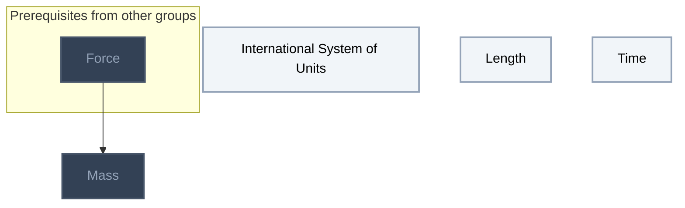
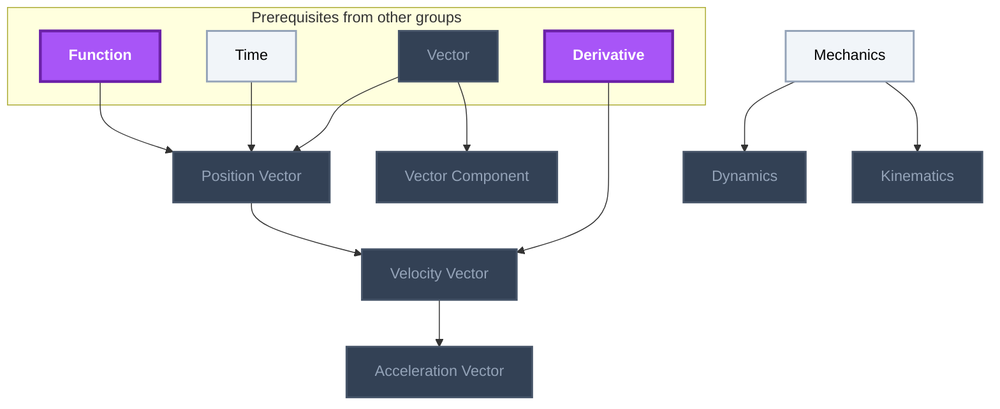
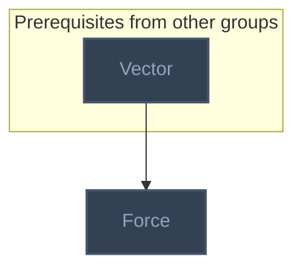
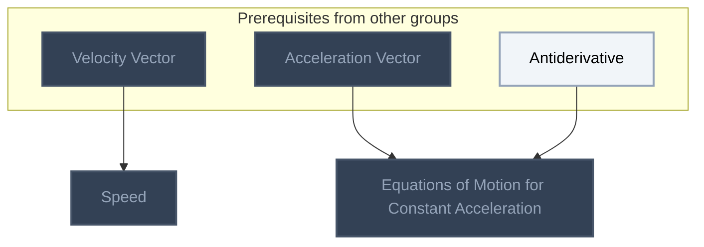
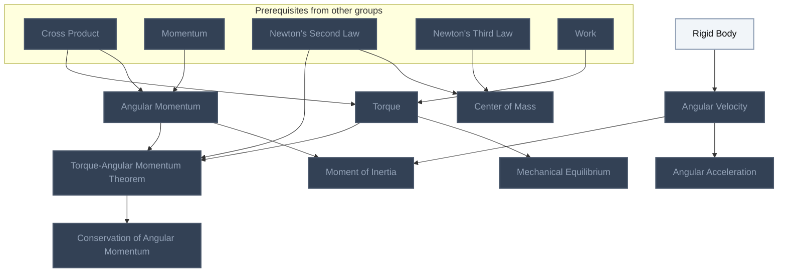

<!-- BEGIN STATS (generated by Scripts/skill_trees.py; do not edit) -->
**Mastered:** 0 / 24 · **Depth:** 0% · **Discovered:** 24 · **Planned:** 0 · **Locked:** 19 · **Rusty:** 0

**Levels:** L0 24 · L1 0 · L2 0 · L3 0 · L4 0 · L5 0

**Next up:** [[International System of Units]], [[Length]], [[Time]], [[Mechanics]], [[Rigid Body]]

Legend: dashed grey = planned (no note yet) · dark grey = locked · white L0 Discovered · green L1 Recall · blue L2 Apply · purple L3 Prove (Mastered) · orange L4 Wield · gold L5 Command · brown dashed border = rusty
<!-- END STATS -->

## Halliday Physics Vol. 1: Measurement
**Mastered:** 0 / 4 · **Discovered:** 4 / 4



## Halliday Physics Vol. 1: Motion
**Mastered:** 0 / 7 · **Discovered:** 7 / 7



## Halliday Physics Vol. 1: Force and Newton's Laws
**Mastered:** 0 / 1 · **Discovered:** 1 / 1



## Feynman Vol. I Ch. 8: Motion
**Mastered:** 0 / 2 · **Discovered:** 2 / 2



## Feynman Vol. I Ch. 18: Rotation in Two Dimensions
**Mastered:** 0 / 10 · **Discovered:** 10 / 10



# Source
Graph structure: the single source for the diagrams above, edited by `/note` and `Scripts/skill_trees.py` (`add`, `edge`, `rename`). Everything above this heading is regenerated by `render`.

```skilltree
    %% PREREQUISITES
    n_antiderivative["Antiderivative"]
    n_cross_product["Cross Product"]
    n_derivative["Derivative"]
    n_function["Function"]
    n_momentum["Momentum"]
    n_newton_s_second_law["Newton's Second Law"]
    n_newton_s_third_law["Newton's Third Law"]
    n_vector["Vector"]
    n_work["Work"]
    %% NODES
    %% == Halliday Physics Vol. 1: Measurement ==
    n_international_system_of_units["International System of Units"]
    n_length["Length"]
    n_mass["Mass"]
    n_time["Time"]
    %% == Halliday Physics Vol. 1: Motion ==
    n_mechanics["Mechanics"]
    n_dynamics["Dynamics"]
    n_kinematics["Kinematics"]
    n_vector_component["Vector Component"]
    n_position_vector["Position Vector"]
    n_velocity_vector["Velocity Vector"]
    n_acceleration_vector["Acceleration Vector"]
    %% == Halliday Physics Vol. 1: Force and Newton's Laws ==
    n_force["Force"]
    %% == Feynman Vol. I Ch. 8: Motion ==
    n_speed["Speed"]
    n_equations_of_motion_for_constant_acceleration["Equations of Motion for Constant Acceleration"]
    %% == Feynman Vol. I Ch. 18: Rotation in Two Dimensions ==
    n_rigid_body["Rigid Body"]
    n_torque["Torque"]
    n_center_of_mass["Center of Mass"]
    n_angular_velocity["Angular Velocity"]
    n_angular_momentum["Angular Momentum"]
    n_moment_of_inertia["Moment of Inertia"]
    n_angular_acceleration["Angular Acceleration"]
    n_mechanical_equilibrium["Mechanical Equilibrium"]
    n_torque_angular_momentum_theorem["Torque-Angular Momentum Theorem"]
    n_conservation_of_angular_momentum["Conservation of Angular Momentum"]
    %% EDGES
    n_cross_product --> n_angular_momentum
    n_momentum --> n_angular_momentum
    n_rigid_body --> n_angular_velocity
    n_newton_s_second_law --> n_center_of_mass
    n_newton_s_third_law --> n_center_of_mass
    n_mechanics --> n_dynamics
    n_vector --> n_force
    n_mechanics --> n_kinematics
    n_function --> n_position_vector
    n_time --> n_position_vector
    n_vector --> n_position_vector
    n_cross_product --> n_torque
    n_work --> n_torque
    n_vector --> n_vector_component
    n_angular_velocity --> n_angular_acceleration
    n_force --> n_mass
    n_torque --> n_mechanical_equilibrium
    n_angular_momentum --> n_moment_of_inertia
    n_angular_velocity --> n_moment_of_inertia
    n_angular_momentum --> n_torque_angular_momentum_theorem
    n_newton_s_second_law --> n_torque_angular_momentum_theorem
    n_torque --> n_torque_angular_momentum_theorem
    n_derivative --> n_velocity_vector
    n_position_vector --> n_velocity_vector
    n_velocity_vector --> n_acceleration_vector
    n_torque_angular_momentum_theorem --> n_conservation_of_angular_momentum
    n_velocity_vector --> n_speed
    n_acceleration_vector --> n_equations_of_motion_for_constant_acceleration
    n_antiderivative --> n_equations_of_motion_for_constant_acceleration
```
