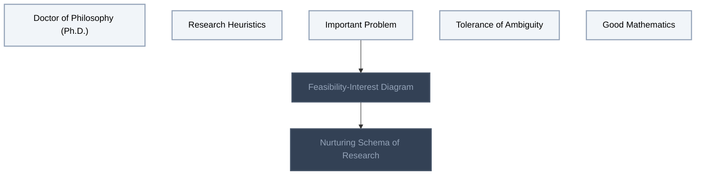
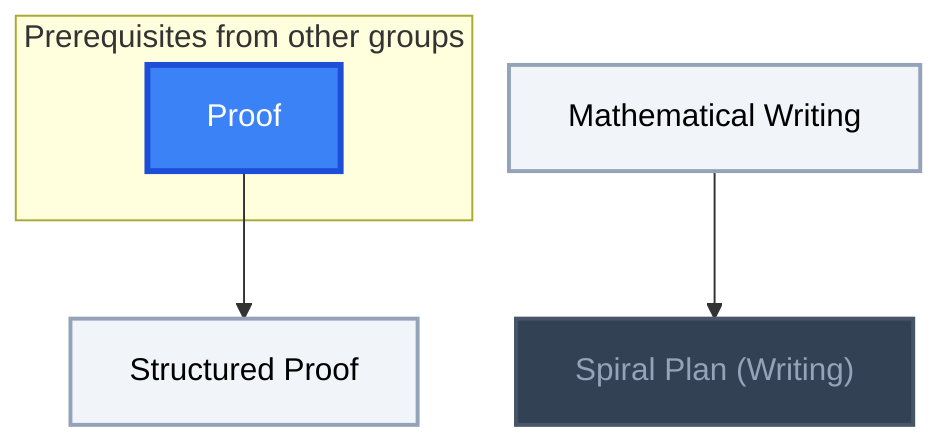

<!-- BEGIN STATS (generated by Scripts/skill_trees.py; do not edit) -->
**Mastered:** 0 / 11 · **Depth:** 0% · **Discovered:** 11 · **Planned:** 0 · **Locked:** 3 · **Rusty:** 0

**Levels:** L0 11 · L1 0 · L2 0 · L3 0 · L4 0 · L5 0

**Next up:** [[Doctor of Philosophy (Ph.D.)]], [[Research Heuristics]], [[Important Problem]], [[Tolerance of Ambiguity]], [[Good Mathematics]]

Legend: dashed grey = planned (no note yet) · dark grey = locked · white L0 Discovered · green L1 Recall · blue L2 Apply · purple L3 Prove (Mastered) · orange L4 Wield · gold L5 Command · brown dashed border = rusty
<!-- END STATS -->

## Research Practice
**Mastered:** 0 / 7 · **Discovered:** 7 / 7



## Learning Mathematics
**Mastered:** 0 / 1 · **Discovered:** 1 / 1


## Mathematical Writing
**Mastered:** 0 / 3 · **Discovered:** 3 / 3



# Source
Graph structure: the single source for the diagrams above, edited by `/note` and `Scripts/skill_trees.py` (`add`, `edge`, `rename`). Everything above this heading is regenerated by `render`.

```skilltree
    %% PREREQUISITES
    n_proof["Proof"]
    %% NODES
    %% == Research Practice ==
    n_doctor_of_philosophy_ph_d["Doctor of Philosophy (Ph.D.)"]
    n_research_heuristics["Research Heuristics"]
    n_important_problem["Important Problem"]
    n_feasibility_interest_diagram["Feasibility-Interest Diagram"]
    n_nurturing_schema_of_research["Nurturing Schema of Research"]
    n_tolerance_of_ambiguity["Tolerance of Ambiguity"]
    n_good_mathematics["Good Mathematics"]
    %% == Learning Mathematics ==
    n_productive_struggle["Productive Struggle"]
    %% == Mathematical Writing ==
    n_mathematical_writing["Mathematical Writing"]
    n_spiral_plan_writing["Spiral Plan (Writing)"]
    n_structured_proof["Structured Proof"]
    %% EDGES
    n_important_problem --> n_feasibility_interest_diagram
    n_feasibility_interest_diagram --> n_nurturing_schema_of_research
    n_mathematical_writing --> n_spiral_plan_writing
    n_proof --> n_structured_proof
```
