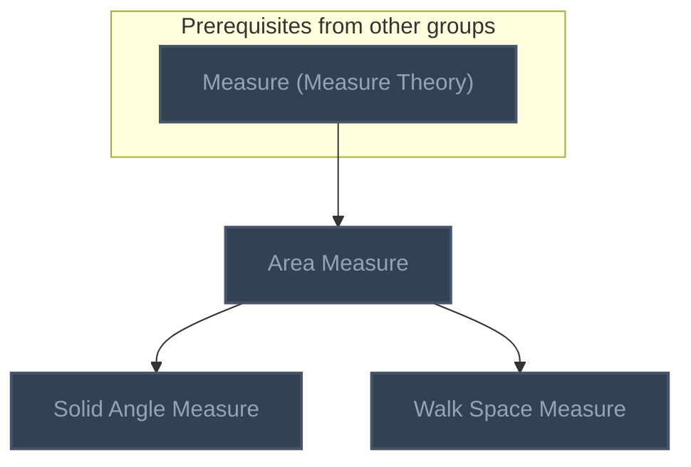
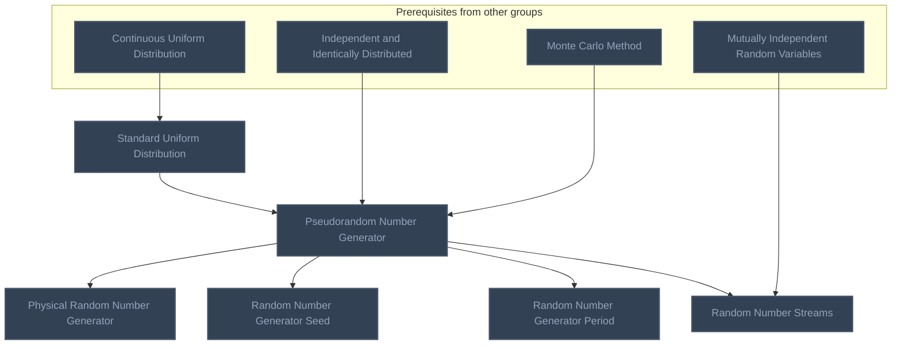
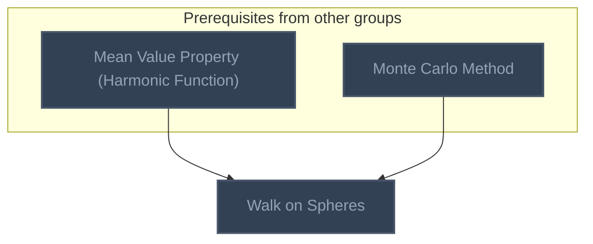

<!-- BEGIN STATS (generated by Scripts/skill_trees.py; do not edit) -->
**Mastered:** 0 / 78 · **Depth:** 0% · **Discovered:** 78 · **Planned:** 0 · **Locked:** 78 · **Rusty:** 0

**Levels:** L0 78 · L1 0 · L2 0 · L3 0 · L4 0 · L5 0

**Next up:** —

Legend: dashed grey = planned (no note yet) · dark grey = locked · white L0 Discovered · green L1 Recall · blue L2 Apply · purple L3 Prove (Mastered) · orange L4 Wield · gold L5 Command · brown dashed border = rusty
<!-- END STATS -->

## Measure-Theoretic Foundations
**Mastered:** 0 / 3 · **Discovered:** 3 / 3



## Monte Carlo Basics (Owen Ch 1-2)
**Mastered:** 0 / 16 · **Discovered:** 16 / 16

```mermaid
flowchart TD
    classDef planned fill:#1E293B,stroke:#64748B,stroke-width:2px,stroke-dasharray:5 5,color:#94A3B8;
    classDef locked fill:#334155,stroke:#475569,stroke-width:2px,color:#94A3B8;
    classDef L0 fill:#F1F5F9,stroke:#94A3B8,stroke-width:2px,color:#000000;
    classDef L1 fill:#22C55E,stroke:#15803D,stroke-width:2px,color:#000000;
    classDef L2 fill:#3B82F6,stroke:#1D4ED8,stroke-width:3px,color:#FFFFFF;
    classDef L3 fill:#A855F7,stroke:#6B21A8,stroke-width:3px,color:#FFFFFF,font-weight:bold;
    classDef L4 fill:#F97316,stroke:#C2410C,stroke-width:4px,color:#000000,font-weight:bold;
    classDef L5 fill:#FFD700,stroke:#FF8C00,stroke-width:5px,color:#000000,font-weight:bold;
    classDef rusty stroke:#8B4513,stroke-width:4px,stroke-dasharray:3 3;
    subgraph sg_prereqs["Prerequisites from other groups"]
        n_expectation["Expectation"]
        n_sample_mean["Sample Mean"]
        n_independent_and_identically_distributed["Independent and Identically Distributed"]
        n_strong_law_of_large_numbers["Strong Law of Large Numbers"]
        n_density_with_respect_to_a_measure["Density with Respect to a Measure"]
        n_unbiased_estimator["Unbiased Estimator"]
        n_variance["Variance"]
        n_consistent_estimator["Consistent Estimator"]
        n_sample_variance["Sample Variance"]
        n_central_limit_theorem["Central Limit Theorem"]
        n_slutsky_s_theorem["Slutsky's Theorem"]
        n_confidence_interval["Confidence Interval"]
        n_chebyshev_s_inequality["Chebyshev's Inequality"]
        n_catastrophic_cancellation["Catastrophic Cancellation"]
        n_binomial_distribution["Binomial Distribution"]
        n_exact_confidence_interval_for_discrete_distribution["Exact Confidence Interval for Discrete Distribution"]
        n_ratio_estimator["Ratio Estimator"]
    end
    n_monte_carlo_method["Monte Carlo Method"]
    n_simple_monte_carlo["Simple Monte Carlo"]
    n_monte_carlo_estimator["Monte Carlo Estimator"]
    n_monte_carlo_estimator_variance["Monte Carlo Estimator Variance"]
    n_bias_variance_mse_decomposition_of_an_estimator["Bias-Variance-MSE Decomposition of an Estimator"]
    n_expected_squared_error_loss_of_a_noisy_monte_carlo_estimator["Expected Squared-Error Loss of a Noisy Monte Carlo Estimator"]
    n_bias_and_consistency_of_an_estimator["Bias and Consistency of an Estimator"]
    n_monte_carlo_convergence_rate["Monte Carlo Convergence Rate"]
    n_monte_carlo_estimator_efficiency["Monte Carlo Estimator Efficiency"]
    n_monte_carlo_confidence_interval["Monte Carlo Confidence Interval"]
    n_chebyshev_confidence_interval["Chebyshev Confidence Interval"]
    n_welford_s_algorithm["Welford's Algorithm"]
    n_paired_difference_variance_estimator["Paired Difference Variance Estimator"]
    n_monte_carlo_estimation_of_a_probability["Monte Carlo Estimation of a Probability"]
    n_monte_carlo_estimation_of_a_conditional_expectation["Monte Carlo Estimation of a Conditional Expectation"]
    n_infinite_moments_in_monte_carlo["Infinite Moments in Monte Carlo"]
    n_expectation --> n_monte_carlo_method
    n_sample_mean --> n_monte_carlo_method
    n_monte_carlo_method --> n_simple_monte_carlo
    n_independent_and_identically_distributed --> n_simple_monte_carlo
    n_strong_law_of_large_numbers --> n_simple_monte_carlo
    n_monte_carlo_method --> n_monte_carlo_estimator
    n_density_with_respect_to_a_measure --> n_monte_carlo_estimator
    n_unbiased_estimator --> n_monte_carlo_estimator
    n_monte_carlo_estimator --> n_monte_carlo_estimator_variance
    n_variance --> n_monte_carlo_estimator_variance
    n_variance --> n_bias_variance_mse_decomposition_of_an_estimator
    n_bias_variance_mse_decomposition_of_an_estimator --> n_expected_squared_error_loss_of_a_noisy_monte_carlo_estimator
    n_monte_carlo_estimator --> n_bias_and_consistency_of_an_estimator
    n_consistent_estimator --> n_bias_and_consistency_of_an_estimator
    n_monte_carlo_estimator_variance --> n_monte_carlo_convergence_rate
    n_simple_monte_carlo --> n_monte_carlo_convergence_rate
    n_monte_carlo_estimator_variance --> n_monte_carlo_estimator_efficiency
    n_simple_monte_carlo --> n_monte_carlo_confidence_interval
    n_sample_variance --> n_monte_carlo_confidence_interval
    n_central_limit_theorem --> n_monte_carlo_confidence_interval
    n_slutsky_s_theorem --> n_monte_carlo_confidence_interval
    n_confidence_interval --> n_monte_carlo_confidence_interval
    n_simple_monte_carlo --> n_chebyshev_confidence_interval
    n_chebyshev_s_inequality --> n_chebyshev_confidence_interval
    n_confidence_interval --> n_chebyshev_confidence_interval
    n_sample_variance --> n_welford_s_algorithm
    n_catastrophic_cancellation --> n_welford_s_algorithm
    n_simple_monte_carlo --> n_paired_difference_variance_estimator
    n_sample_variance --> n_paired_difference_variance_estimator
    n_simple_monte_carlo --> n_monte_carlo_estimation_of_a_probability
    n_binomial_distribution --> n_monte_carlo_estimation_of_a_probability
    n_exact_confidence_interval_for_discrete_distribution --> n_monte_carlo_estimation_of_a_probability
    n_monte_carlo_confidence_interval --> n_monte_carlo_estimation_of_a_conditional_expectation
    n_ratio_estimator --> n_monte_carlo_estimation_of_a_conditional_expectation
    n_simple_monte_carlo --> n_infinite_moments_in_monte_carlo
    n_central_limit_theorem --> n_infinite_moments_in_monte_carlo
    n_monte_carlo_estimator_variance --> n_infinite_moments_in_monte_carlo
    class n_expectation,n_sample_mean,n_independent_and_identically_distributed,n_strong_law_of_large_numbers,n_density_with_respect_to_a_measure,n_unbiased_estimator,n_variance,n_consistent_estimator,n_sample_variance,n_central_limit_theorem,n_slutsky_s_theorem,n_confidence_interval,n_chebyshev_s_inequality,n_catastrophic_cancellation,n_binomial_distribution,n_exact_confidence_interval_for_discrete_distribution,n_ratio_estimator,n_monte_carlo_method,n_simple_monte_carlo,n_monte_carlo_estimator,n_monte_carlo_estimator_variance,n_bias_variance_mse_decomposition_of_an_estimator,n_expected_squared_error_loss_of_a_noisy_monte_carlo_estimator,n_bias_and_consistency_of_an_estimator,n_monte_carlo_convergence_rate,n_monte_carlo_estimator_efficiency,n_monte_carlo_confidence_interval,n_chebyshev_confidence_interval,n_welford_s_algorithm,n_paired_difference_variance_estimator,n_monte_carlo_estimation_of_a_probability,n_monte_carlo_estimation_of_a_conditional_expectation,n_infinite_moments_in_monte_carlo locked;
    class n_expectation,n_sample_mean,n_independent_and_identically_distributed,n_strong_law_of_large_numbers,n_density_with_respect_to_a_measure,n_unbiased_estimator,n_variance,n_consistent_estimator,n_sample_variance,n_central_limit_theorem,n_slutsky_s_theorem,n_confidence_interval,n_chebyshev_s_inequality,n_catastrophic_cancellation,n_binomial_distribution,n_exact_confidence_interval_for_discrete_distribution,n_ratio_estimator,n_monte_carlo_method,n_simple_monte_carlo,n_monte_carlo_estimator,n_monte_carlo_estimator_variance,n_bias_variance_mse_decomposition_of_an_estimator,n_expected_squared_error_loss_of_a_noisy_monte_carlo_estimator,n_bias_and_consistency_of_an_estimator,n_monte_carlo_convergence_rate,n_monte_carlo_estimator_efficiency,n_monte_carlo_confidence_interval,n_chebyshev_confidence_interval,n_welford_s_algorithm,n_paired_difference_variance_estimator,n_monte_carlo_estimation_of_a_probability,n_monte_carlo_estimation_of_a_conditional_expectation,n_infinite_moments_in_monte_carlo internal-link;
```



## Uniform Random Numbers (Owen Ch 3)
**Mastered:** 0 / 6 · **Discovered:** 6 / 6



## Non-Uniform Random Variates (Owen Ch 4-5)
**Mastered:** 0 / 15 · **Discovered:** 15 / 15

```mermaid
flowchart TD
    classDef planned fill:#1E293B,stroke:#64748B,stroke-width:2px,stroke-dasharray:5 5,color:#94A3B8;
    classDef locked fill:#334155,stroke:#475569,stroke-width:2px,color:#94A3B8;
    classDef L0 fill:#F1F5F9,stroke:#94A3B8,stroke-width:2px,color:#000000;
    classDef L1 fill:#22C55E,stroke:#15803D,stroke-width:2px,color:#000000;
    classDef L2 fill:#3B82F6,stroke:#1D4ED8,stroke-width:3px,color:#FFFFFF;
    classDef L3 fill:#A855F7,stroke:#6B21A8,stroke-width:3px,color:#FFFFFF,font-weight:bold;
    classDef L4 fill:#F97316,stroke:#C2410C,stroke-width:4px,color:#000000,font-weight:bold;
    classDef L5 fill:#FFD700,stroke:#FF8C00,stroke-width:5px,color:#000000,font-weight:bold;
    classDef rusty stroke:#8B4513,stroke-width:4px,stroke-dasharray:3 3;
    subgraph sg_prereqs["Prerequisites from other groups"]
        n_quantile_function["Quantile Function"]
        n_standard_uniform_distribution["Standard Uniform Distribution"]
        n_pseudorandom_number_generator["Pseudorandom Number Generator"]
        n_probability_integral_transform["Probability Integral Transform"]
        n_simple_monte_carlo["Simple Monte Carlo"]
        n_normal_distribution["Normal Distribution"]
        n_discrete_uniform_distribution["Discrete Uniform Distribution"]
        n_gumbel_distribution["Gumbel Distribution"]
        n_probability_density_function["Probability Density Function"]
        n_conditional_distribution["Conditional Distribution"]
        n_copula["Copula"]
        n_cholesky_decomposition["Cholesky Decomposition"]
        n_multivariate_normal_distribution_affine_transformation["Multivariate Normal Distribution Affine Transformation"]
    end
    n_inverse_transform_sampling["Inverse Transform Sampling"]
    n_non_uniform_random_variate_generation["Non-Uniform Random Variate Generation"]
    n_qq_transformation["QQ Transformation"]
    n_common_random_numbers["Common Random Numbers"]
    n_box_muller_transform["Box-Muller Transform"]
    n_one_liner_random_variate_generation["One-Liner (Random Variate Generation)"]
    n_array_sampling_method["Array Sampling Method"]
    n_gumbel_max_trick["Gumbel-Max Trick"]
    n_rejection_sampling["Rejection Sampling"]
    n_squeeze_function_rejection_sampling["Squeeze Function (Rejection Sampling)"]
    n_adaptive_rejection_sampling["Adaptive Rejection Sampling"]
    n_ziggurat_algorithm["Ziggurat Algorithm"]
    n_sequential_inversion["Sequential Inversion"]
    n_copula_marginal_sampling["Copula-Marginal Sampling"]
    n_multivariate_normal_sampling_cholesky_factorization["Multivariate Normal Sampling (Cholesky Factorization)"]
    n_quantile_function --> n_inverse_transform_sampling
    n_standard_uniform_distribution --> n_inverse_transform_sampling
    n_pseudorandom_number_generator --> n_non_uniform_random_variate_generation
    n_inverse_transform_sampling --> n_qq_transformation
    n_probability_integral_transform --> n_qq_transformation
    n_inverse_transform_sampling --> n_common_random_numbers
    n_simple_monte_carlo --> n_common_random_numbers
    n_standard_uniform_distribution --> n_box_muller_transform
    n_normal_distribution --> n_box_muller_transform
    n_inverse_transform_sampling --> n_one_liner_random_variate_generation
    n_discrete_uniform_distribution --> n_array_sampling_method
    n_gumbel_distribution --> n_gumbel_max_trick
    n_inverse_transform_sampling --> n_gumbel_max_trick
    n_standard_uniform_distribution --> n_rejection_sampling
    n_probability_density_function --> n_rejection_sampling
    n_rejection_sampling --> n_squeeze_function_rejection_sampling
    n_squeeze_function_rejection_sampling --> n_adaptive_rejection_sampling
    n_rejection_sampling --> n_ziggurat_algorithm
    n_inverse_transform_sampling --> n_sequential_inversion
    n_conditional_distribution --> n_sequential_inversion
    n_copula --> n_copula_marginal_sampling
    n_qq_transformation --> n_copula_marginal_sampling
    n_cholesky_decomposition --> n_multivariate_normal_sampling_cholesky_factorization
    n_multivariate_normal_distribution_affine_transformation --> n_multivariate_normal_sampling_cholesky_factorization
    n_box_muller_transform --> n_multivariate_normal_sampling_cholesky_factorization
    class n_quantile_function,n_standard_uniform_distribution,n_pseudorandom_number_generator,n_probability_integral_transform,n_simple_monte_carlo,n_normal_distribution,n_discrete_uniform_distribution,n_gumbel_distribution,n_probability_density_function,n_conditional_distribution,n_copula,n_cholesky_decomposition,n_multivariate_normal_distribution_affine_transformation,n_inverse_transform_sampling,n_non_uniform_random_variate_generation,n_qq_transformation,n_common_random_numbers,n_box_muller_transform,n_one_liner_random_variate_generation,n_array_sampling_method,n_gumbel_max_trick,n_rejection_sampling,n_squeeze_function_rejection_sampling,n_adaptive_rejection_sampling,n_ziggurat_algorithm,n_sequential_inversion,n_copula_marginal_sampling,n_multivariate_normal_sampling_cholesky_factorization locked;
    class n_quantile_function,n_standard_uniform_distribution,n_pseudorandom_number_generator,n_probability_integral_transform,n_simple_monte_carlo,n_normal_distribution,n_discrete_uniform_distribution,n_gumbel_distribution,n_probability_density_function,n_conditional_distribution,n_copula,n_cholesky_decomposition,n_multivariate_normal_distribution_affine_transformation,n_inverse_transform_sampling,n_non_uniform_random_variate_generation,n_qq_transformation,n_common_random_numbers,n_box_muller_transform,n_one_liner_random_variate_generation,n_array_sampling_method,n_gumbel_max_trick,n_rejection_sampling,n_squeeze_function_rejection_sampling,n_adaptive_rejection_sampling,n_ziggurat_algorithm,n_sequential_inversion,n_copula_marginal_sampling,n_multivariate_normal_sampling_cholesky_factorization internal-link;
```



## Importance Sampling and Variance Reduction
**Mastered:** 0 / 7 · **Discovered:** 7 / 7



```mermaid
flowchart TD
    classDef planned fill:#1E293B,stroke:#64748B,stroke-width:2px,stroke-dasharray:5 5,color:#94A3B8;
    classDef locked fill:#334155,stroke:#475569,stroke-width:2px,color:#94A3B8;
    classDef L0 fill:#F1F5F9,stroke:#94A3B8,stroke-width:2px,color:#000000;
    classDef L1 fill:#22C55E,stroke:#15803D,stroke-width:2px,color:#000000;
    classDef L2 fill:#3B82F6,stroke:#1D4ED8,stroke-width:3px,color:#FFFFFF;
    classDef L3 fill:#A855F7,stroke:#6B21A8,stroke-width:3px,color:#FFFFFF,font-weight:bold;
    classDef L4 fill:#F97316,stroke:#C2410C,stroke-width:4px,color:#000000,font-weight:bold;
    classDef L5 fill:#FFD700,stroke:#FF8C00,stroke-width:5px,color:#000000,font-weight:bold;
    classDef rusty stroke:#8B4513,stroke-width:4px,stroke-dasharray:3 3;
    subgraph sg_prereqs["Prerequisites from other groups"]
        n_monte_carlo_estimator_variance["Monte Carlo Estimator Variance"]
        n_monte_carlo_estimator["Monte Carlo Estimator"]
        n_law_of_total_variance["Law of Total Variance"]
        n_correlation["Correlation"]
        n_simple_monte_carlo["Simple Monte Carlo"]
        n_monte_carlo_convergence_rate["Monte Carlo Convergence Rate"]
    end
    n_optimal_importance_sampling_distribution["Optimal Importance Sampling Distribution"]
    n_zero_density_bias_importance_sampling["Zero-Density Bias (Importance Sampling)"]
    n_stratified_sampling["Stratified Sampling"]
    n_latin_hypercube_sampling["Latin Hypercube Sampling"]
    n_control_variates["Control Variates"]
    n_antithetic_variates["Antithetic Variates"]
    n_quasi_monte_carlo["Quasi-Monte Carlo"]
    n_monte_carlo_estimator_variance --> n_optimal_importance_sampling_distribution
    n_monte_carlo_estimator --> n_zero_density_bias_importance_sampling
    n_monte_carlo_estimator_variance --> n_stratified_sampling
    n_law_of_total_variance --> n_stratified_sampling
    n_stratified_sampling --> n_latin_hypercube_sampling
    n_monte_carlo_estimator_variance --> n_control_variates
    n_correlation --> n_control_variates
    n_simple_monte_carlo --> n_antithetic_variates
    n_correlation --> n_antithetic_variates
    n_monte_carlo_convergence_rate --> n_quasi_monte_carlo
    class n_monte_carlo_estimator_variance,n_monte_carlo_estimator,n_law_of_total_variance,n_correlation,n_simple_monte_carlo,n_monte_carlo_convergence_rate,n_optimal_importance_sampling_distribution,n_zero_density_bias_importance_sampling,n_stratified_sampling,n_latin_hypercube_sampling,n_control_variates,n_antithetic_variates,n_quasi_monte_carlo locked;
    class n_monte_carlo_estimator_variance,n_monte_carlo_estimator,n_law_of_total_variance,n_correlation,n_simple_monte_carlo,n_monte_carlo_convergence_rate,n_optimal_importance_sampling_distribution,n_zero_density_bias_importance_sampling,n_stratified_sampling,n_latin_hypercube_sampling,n_control_variates,n_antithetic_variates,n_quasi_monte_carlo internal-link;
```

## Markov Chain and Sequential Monte Carlo
**Mastered:** 0 / 7 · **Discovered:** 7 / 7



```mermaid
flowchart TD
    classDef planned fill:#1E293B,stroke:#64748B,stroke-width:2px,stroke-dasharray:5 5,color:#94A3B8;
    classDef locked fill:#334155,stroke:#475569,stroke-width:2px,color:#94A3B8;
    classDef L0 fill:#F1F5F9,stroke:#94A3B8,stroke-width:2px,color:#000000;
    classDef L1 fill:#22C55E,stroke:#15803D,stroke-width:2px,color:#000000;
    classDef L2 fill:#3B82F6,stroke:#1D4ED8,stroke-width:3px,color:#FFFFFF;
    classDef L3 fill:#A855F7,stroke:#6B21A8,stroke-width:3px,color:#FFFFFF,font-weight:bold;
    classDef L4 fill:#F97316,stroke:#C2410C,stroke-width:4px,color:#000000,font-weight:bold;
    classDef L5 fill:#FFD700,stroke:#FF8C00,stroke-width:5px,color:#000000,font-weight:bold;
    classDef rusty stroke:#8B4513,stroke-width:4px,stroke-dasharray:3 3;
    subgraph sg_prereqs["Prerequisites from other groups"]
        n_monte_carlo_method["Monte Carlo Method"]
        n_stochastic_process["Stochastic Process"]
        n_conditional_distribution["Conditional Distribution"]
        n_potential_energy["Potential Energy"]
        n_kinetic_energy["Kinetic Energy"]
        n_monte_carlo_estimator["Monte Carlo Estimator"]
    end
    n_markov_chain_monte_carlo["Markov Chain Monte Carlo"]
    n_metropolis_hastings_algorithm["Metropolis-Hastings Algorithm"]
    n_gibbs_sampling["Gibbs Sampling"]
    n_metropolis_adjusted_langevin_algorithm["Metropolis-Adjusted Langevin Algorithm"]
    n_hamiltonian_monte_carlo["Hamiltonian Monte Carlo"]
    n_annealed_importance_sampling["Annealed Importance Sampling"]
    n_sequential_monte_carlo["Sequential Monte Carlo"]
    n_monte_carlo_method --> n_markov_chain_monte_carlo
    n_stochastic_process --> n_markov_chain_monte_carlo
    n_markov_chain_monte_carlo --> n_metropolis_hastings_algorithm
    n_markov_chain_monte_carlo --> n_gibbs_sampling
    n_conditional_distribution --> n_gibbs_sampling
    n_metropolis_hastings_algorithm --> n_metropolis_adjusted_langevin_algorithm
    n_metropolis_hastings_algorithm --> n_hamiltonian_monte_carlo
    n_potential_energy --> n_hamiltonian_monte_carlo
    n_kinetic_energy --> n_hamiltonian_monte_carlo
    n_markov_chain_monte_carlo --> n_annealed_importance_sampling
    n_monte_carlo_estimator --> n_annealed_importance_sampling
    n_monte_carlo_estimator --> n_sequential_monte_carlo
    class n_monte_carlo_method,n_stochastic_process,n_conditional_distribution,n_potential_energy,n_kinetic_energy,n_monte_carlo_estimator,n_markov_chain_monte_carlo,n_metropolis_hastings_algorithm,n_gibbs_sampling,n_metropolis_adjusted_langevin_algorithm,n_hamiltonian_monte_carlo,n_annealed_importance_sampling,n_sequential_monte_carlo locked;
    class n_monte_carlo_method,n_stochastic_process,n_conditional_distribution,n_potential_energy,n_kinetic_energy,n_monte_carlo_estimator,n_markov_chain_monte_carlo,n_metropolis_hastings_algorithm,n_gibbs_sampling,n_metropolis_adjusted_langevin_algorithm,n_hamiltonian_monte_carlo,n_annealed_importance_sampling,n_sequential_monte_carlo internal-link;
```

## Light Transport
**Mastered:** 0 / 13 · **Discovered:** 13 / 13

```mermaid
flowchart TD
    classDef planned fill:#1E293B,stroke:#64748B,stroke-width:2px,stroke-dasharray:5 5,color:#94A3B8;
    classDef locked fill:#334155,stroke:#475569,stroke-width:2px,color:#94A3B8;
    classDef L0 fill:#F1F5F9,stroke:#94A3B8,stroke-width:2px,color:#000000;
    classDef L1 fill:#22C55E,stroke:#15803D,stroke-width:2px,color:#000000;
    classDef L2 fill:#3B82F6,stroke:#1D4ED8,stroke-width:3px,color:#FFFFFF;
    classDef L3 fill:#A855F7,stroke:#6B21A8,stroke-width:3px,color:#FFFFFF,font-weight:bold;
    classDef L4 fill:#F97316,stroke:#C2410C,stroke-width:4px,color:#000000,font-weight:bold;
    classDef L5 fill:#FFD700,stroke:#FF8C00,stroke-width:5px,color:#000000,font-weight:bold;
    classDef rusty stroke:#8B4513,stroke-width:4px,stroke-dasharray:3 3;
    subgraph sg_prereqs["Prerequisites from other groups"]
        n_radiative_transfer_equation["Radiative Transfer Equation"]
        n_geometric_term_light_transport["Geometric Term (Light Transport)"]
        n_measurement_equation["Measurement Equation"]
        n_walk_space_measure["Walk Space Measure"]
        n_monte_carlo_estimator["Monte Carlo Estimator"]
        n_light_transport_equation["Light Transport Equation"]
        n_optimal_importance_sampling_distribution["Optimal Importance Sampling Distribution"]
        n_inverse_transform_sampling["Inverse Transform Sampling"]
    end
    n_integral_form_of_the_radiative_transfer_equation["Integral Form of the Radiative Transfer Equation"]
    n_three_point_form_of_the_light_transport_equation["Three-Point Form of the Light Transport Equation"]
    n_path_space["Path Space"]
    n_path_integral_light_transport["Path Integral (Light Transport)"]
    n_generalized_path_integral_surfaces_and_volumes["Generalized Path Integral (Surfaces and Volumes)"]
    n_path_tracing_recursive_estimator["Path Tracing (Recursive Estimator)"]
    n_russian_roulette["Russian Roulette"]
    n_bsdf_importance_sampling["BSDF Importance Sampling"]
    n_free_flight_distance_sampling["Free-Flight Distance Sampling"]
    n_local_path_sampling["Local Path Sampling"]
    n_next_event_estimation["Next-Event Estimation"]
    n_multiple_importance_sampling["Multiple Importance Sampling"]
    n_bidirectional_path_tracing["Bidirectional Path Tracing"]
    n_radiative_transfer_equation --> n_integral_form_of_the_radiative_transfer_equation
    n_geometric_term_light_transport --> n_three_point_form_of_the_light_transport_equation
    n_measurement_equation --> n_three_point_form_of_the_light_transport_equation
    n_walk_space_measure --> n_path_space
    n_three_point_form_of_the_light_transport_equation --> n_path_integral_light_transport
    n_path_space --> n_path_integral_light_transport
    n_path_integral_light_transport --> n_generalized_path_integral_surfaces_and_volumes
    n_integral_form_of_the_radiative_transfer_equation --> n_generalized_path_integral_surfaces_and_volumes
    n_monte_carlo_estimator --> n_path_tracing_recursive_estimator
    n_light_transport_equation --> n_path_tracing_recursive_estimator
    n_path_tracing_recursive_estimator --> n_russian_roulette
    n_path_tracing_recursive_estimator --> n_bsdf_importance_sampling
    n_optimal_importance_sampling_distribution --> n_bsdf_importance_sampling
    n_inverse_transform_sampling --> n_free_flight_distance_sampling
    n_integral_form_of_the_radiative_transfer_equation --> n_free_flight_distance_sampling
    n_path_tracing_recursive_estimator --> n_local_path_sampling
    n_free_flight_distance_sampling --> n_local_path_sampling
    n_local_path_sampling --> n_next_event_estimation
    n_geometric_term_light_transport --> n_next_event_estimation
    n_next_event_estimation --> n_multiple_importance_sampling
    n_optimal_importance_sampling_distribution --> n_multiple_importance_sampling
    n_multiple_importance_sampling --> n_bidirectional_path_tracing
    n_path_integral_light_transport --> n_bidirectional_path_tracing
    class n_radiative_transfer_equation,n_geometric_term_light_transport,n_measurement_equation,n_walk_space_measure,n_monte_carlo_estimator,n_light_transport_equation,n_optimal_importance_sampling_distribution,n_inverse_transform_sampling,n_integral_form_of_the_radiative_transfer_equation,n_three_point_form_of_the_light_transport_equation,n_path_space,n_path_integral_light_transport,n_generalized_path_integral_surfaces_and_volumes,n_path_tracing_recursive_estimator,n_russian_roulette,n_bsdf_importance_sampling,n_free_flight_distance_sampling,n_local_path_sampling,n_next_event_estimation,n_multiple_importance_sampling,n_bidirectional_path_tracing locked;
    class n_radiative_transfer_equation,n_geometric_term_light_transport,n_measurement_equation,n_walk_space_measure,n_monte_carlo_estimator,n_light_transport_equation,n_optimal_importance_sampling_distribution,n_inverse_transform_sampling,n_integral_form_of_the_radiative_transfer_equation,n_three_point_form_of_the_light_transport_equation,n_path_space,n_path_integral_light_transport,n_generalized_path_integral_surfaces_and_volumes,n_path_tracing_recursive_estimator,n_russian_roulette,n_bsdf_importance_sampling,n_free_flight_distance_sampling,n_local_path_sampling,n_next_event_estimation,n_multiple_importance_sampling,n_bidirectional_path_tracing internal-link;
```



## Monte Carlo PDE Solvers
**Mastered:** 0 / 1 · **Discovered:** 1 / 1



## Differentiable Monte Carlo
**Mastered:** 0 / 10 · **Discovered:** 10 / 10

```mermaid
flowchart TD
    classDef planned fill:#1E293B,stroke:#64748B,stroke-width:2px,stroke-dasharray:5 5,color:#94A3B8;
    classDef locked fill:#334155,stroke:#475569,stroke-width:2px,color:#94A3B8;
    classDef L0 fill:#F1F5F9,stroke:#94A3B8,stroke-width:2px,color:#000000;
    classDef L1 fill:#22C55E,stroke:#15803D,stroke-width:2px,color:#000000;
    classDef L2 fill:#3B82F6,stroke:#1D4ED8,stroke-width:3px,color:#FFFFFF;
    classDef L3 fill:#A855F7,stroke:#6B21A8,stroke-width:3px,color:#FFFFFF,font-weight:bold;
    classDef L4 fill:#F97316,stroke:#C2410C,stroke-width:4px,color:#000000,font-weight:bold;
    classDef L5 fill:#FFD700,stroke:#FF8C00,stroke-width:5px,color:#000000,font-weight:bold;
    classDef rusty stroke:#8B4513,stroke-width:4px,stroke-dasharray:3 3;
    subgraph sg_prereqs["Prerequisites from other groups"]
        n_monte_carlo_estimator["Monte Carlo Estimator"]
        n_gradient_descent["Gradient Descent"]
        n_zeroth_order_optimization["Zeroth-Order Optimization"]
        n_dominated_convergence_theorem["Dominated Convergence Theorem"]
        n_change_of_variables["Change of Variables"]
    end
    n_forward_problem_simulation["Forward Problem (Simulation)"]
    n_inverse_problem_analysis_by_synthesis["Inverse Problem (Analysis by Synthesis)"]
    n_three_uses_of_a_differentiable_simulator_s_gradient["Three Uses of a Differentiable Simulator's Gradient"]
    n_reverse_mode_automatic_differentiation_for_high_dimensional_gradients["Reverse-Mode Automatic Differentiation for High-Dimensional Gradients"]
    n_interchange_of_differentiation_and_expectation["Interchange of Differentiation and Expectation"]
    n_reynolds_transport_theorem["Reynolds Transport Theorem"]
    n_five_obstacles_to_differentiating_monte_carlo_estimators["Five Obstacles to Differentiating Monte Carlo Estimators"]
    n_differentiable_monte_carlo["Differentiable Monte Carlo"]
    n_reparameterization_differentiable_monte_carlo["Reparameterization (Differentiable Monte Carlo)"]
    n_edge_sampling_differentiable_monte_carlo["Edge Sampling (Differentiable Monte Carlo)"]
    n_monte_carlo_estimator --> n_forward_problem_simulation
    n_forward_problem_simulation --> n_inverse_problem_analysis_by_synthesis
    n_inverse_problem_analysis_by_synthesis --> n_three_uses_of_a_differentiable_simulator_s_gradient
    n_gradient_descent --> n_three_uses_of_a_differentiable_simulator_s_gradient
    n_three_uses_of_a_differentiable_simulator_s_gradient --> n_reverse_mode_automatic_differentiation_for_high_dimensional_gradients
    n_zeroth_order_optimization --> n_reverse_mode_automatic_differentiation_for_high_dimensional_gradients
    n_dominated_convergence_theorem --> n_interchange_of_differentiation_and_expectation
    n_forward_problem_simulation --> n_interchange_of_differentiation_and_expectation
    n_change_of_variables --> n_reynolds_transport_theorem
    n_interchange_of_differentiation_and_expectation --> n_five_obstacles_to_differentiating_monte_carlo_estimators
    n_reynolds_transport_theorem --> n_five_obstacles_to_differentiating_monte_carlo_estimators
    n_reynolds_transport_theorem --> n_differentiable_monte_carlo
    n_forward_problem_simulation --> n_differentiable_monte_carlo
    n_differentiable_monte_carlo --> n_reparameterization_differentiable_monte_carlo
    n_differentiable_monte_carlo --> n_edge_sampling_differentiable_monte_carlo
    class n_monte_carlo_estimator,n_gradient_descent,n_zeroth_order_optimization,n_dominated_convergence_theorem,n_change_of_variables,n_forward_problem_simulation,n_inverse_problem_analysis_by_synthesis,n_three_uses_of_a_differentiable_simulator_s_gradient,n_reverse_mode_automatic_differentiation_for_high_dimensional_gradients,n_interchange_of_differentiation_and_expectation,n_reynolds_transport_theorem,n_five_obstacles_to_differentiating_monte_carlo_estimators,n_differentiable_monte_carlo,n_reparameterization_differentiable_monte_carlo,n_edge_sampling_differentiable_monte_carlo locked;
    class n_monte_carlo_estimator,n_gradient_descent,n_zeroth_order_optimization,n_dominated_convergence_theorem,n_change_of_variables,n_forward_problem_simulation,n_inverse_problem_analysis_by_synthesis,n_three_uses_of_a_differentiable_simulator_s_gradient,n_reverse_mode_automatic_differentiation_for_high_dimensional_gradients,n_interchange_of_differentiation_and_expectation,n_reynolds_transport_theorem,n_five_obstacles_to_differentiating_monte_carlo_estimators,n_differentiable_monte_carlo,n_reparameterization_differentiable_monte_carlo,n_edge_sampling_differentiable_monte_carlo internal-link;
```



# Source
Graph structure: the single source for the diagrams above, edited by `/note` and `Scripts/skill_trees.py` (`add`, `edge`, `rename`). Everything above this heading is regenerated by `render`.

```skilltree
    %% PREREQUISITES
    n_measure_measure_theory["Measure (Measure Theory)"]
    n_change_of_variables["Change of Variables"]
    n_expectation["Expectation"]
    n_sample_mean["Sample Mean"]
    n_independent_and_identically_distributed["Independent and Identically Distributed"]
    n_unbiased_estimator["Unbiased Estimator"]
    n_variance["Variance"]
    n_consistent_estimator["Consistent Estimator"]
    n_sample_variance["Sample Variance"]
    n_central_limit_theorem["Central Limit Theorem"]
    n_slutsky_s_theorem["Slutsky's Theorem"]
    n_confidence_interval["Confidence Interval"]
    n_chebyshev_s_inequality["Chebyshev's Inequality"]
    n_catastrophic_cancellation["Catastrophic Cancellation"]
    n_binomial_distribution["Binomial Distribution"]
    n_exact_confidence_interval_for_discrete_distribution["Exact Confidence Interval for Discrete Distribution"]
    n_ratio_estimator["Ratio Estimator"]
    n_continuous_uniform_distribution["Continuous Uniform Distribution"]
    n_mutually_independent_random_variables["Mutually Independent Random Variables"]
    n_quantile_function["Quantile Function"]
    n_probability_integral_transform["Probability Integral Transform"]
    n_normal_distribution["Normal Distribution"]
    n_discrete_uniform_distribution["Discrete Uniform Distribution"]
    n_gumbel_distribution["Gumbel Distribution"]
    n_probability_density_function["Probability Density Function"]
    n_conditional_distribution["Conditional Distribution"]
    n_copula["Copula"]
    n_cholesky_decomposition["Cholesky Decomposition"]
    n_multivariate_normal_distribution_affine_transformation["Multivariate Normal Distribution Affine Transformation"]
    n_law_of_total_variance["Law of Total Variance"]
    n_correlation["Correlation"]
    n_stochastic_process["Stochastic Process"]
    n_potential_energy["Potential Energy"]
    n_kinetic_energy["Kinetic Energy"]
    n_mean_value_property_harmonic_function["Mean Value Property (Harmonic Function)"]
    n_gradient_descent["Gradient Descent"]
    n_zeroth_order_optimization["Zeroth-Order Optimization"]
    n_dominated_convergence_theorem["Dominated Convergence Theorem"]
    n_strong_law_of_large_numbers["Strong Law of Large Numbers"]
    n_density_with_respect_to_a_measure["Density with Respect to a Measure"]
    n_light_transport_equation["Light Transport Equation"]
    n_radiative_transfer_equation["Radiative Transfer Equation"]
    n_measurement_equation["Measurement Equation"]
    n_geometric_term_light_transport["Geometric Term (Light Transport)"]
    %% NODES
    %% == Measure-Theoretic Foundations ==
    n_area_measure["Area Measure"]
    n_solid_angle_measure["Solid Angle Measure"]
    n_walk_space_measure["Walk Space Measure"]
    %% == Monte Carlo Basics (Owen Ch 1-2) ==
    n_monte_carlo_method["Monte Carlo Method"]
    n_simple_monte_carlo["Simple Monte Carlo"]
    n_monte_carlo_estimator["Monte Carlo Estimator"]
    n_monte_carlo_estimator_variance["Monte Carlo Estimator Variance"]
    n_bias_variance_mse_decomposition_of_an_estimator["Bias-Variance-MSE Decomposition of an Estimator"]
    n_expected_squared_error_loss_of_a_noisy_monte_carlo_estimator["Expected Squared-Error Loss of a Noisy Monte Carlo Estimator"]
    n_bias_and_consistency_of_an_estimator["Bias and Consistency of an Estimator"]
    n_monte_carlo_convergence_rate["Monte Carlo Convergence Rate"]
    n_monte_carlo_estimator_efficiency["Monte Carlo Estimator Efficiency"]
    n_monte_carlo_confidence_interval["Monte Carlo Confidence Interval"]
    n_chebyshev_confidence_interval["Chebyshev Confidence Interval"]
    n_welford_s_algorithm["Welford's Algorithm"]
    n_paired_difference_variance_estimator["Paired Difference Variance Estimator"]
    n_monte_carlo_estimation_of_a_probability["Monte Carlo Estimation of a Probability"]
    n_monte_carlo_estimation_of_a_conditional_expectation["Monte Carlo Estimation of a Conditional Expectation"]
    n_infinite_moments_in_monte_carlo["Infinite Moments in Monte Carlo"]
    %% == Uniform Random Numbers (Owen Ch 3) ==
    n_standard_uniform_distribution["Standard Uniform Distribution"]
    n_pseudorandom_number_generator["Pseudorandom Number Generator"]
    n_physical_random_number_generator["Physical Random Number Generator"]
    n_random_number_generator_seed["Random Number Generator Seed"]
    n_random_number_generator_period["Random Number Generator Period"]
    n_random_number_streams["Random Number Streams"]
    %% == Non-Uniform Random Variates (Owen Ch 4-5) ==
    n_inverse_transform_sampling["Inverse Transform Sampling"]
    n_non_uniform_random_variate_generation["Non-Uniform Random Variate Generation"]
    n_qq_transformation["QQ Transformation"]
    n_common_random_numbers["Common Random Numbers"]
    n_box_muller_transform["Box-Muller Transform"]
    n_one_liner_random_variate_generation["One-Liner (Random Variate Generation)"]
    n_array_sampling_method["Array Sampling Method"]
    n_gumbel_max_trick["Gumbel-Max Trick"]
    n_rejection_sampling["Rejection Sampling"]
    n_squeeze_function_rejection_sampling["Squeeze Function (Rejection Sampling)"]
    n_adaptive_rejection_sampling["Adaptive Rejection Sampling"]
    n_ziggurat_algorithm["Ziggurat Algorithm"]
    n_sequential_inversion["Sequential Inversion"]
    n_copula_marginal_sampling["Copula-Marginal Sampling"]
    n_multivariate_normal_sampling_cholesky_factorization["Multivariate Normal Sampling (Cholesky Factorization)"]
    %% == Importance Sampling and Variance Reduction ==
    n_optimal_importance_sampling_distribution["Optimal Importance Sampling Distribution"]
    n_zero_density_bias_importance_sampling["Zero-Density Bias (Importance Sampling)"]
    n_stratified_sampling["Stratified Sampling"]
    n_latin_hypercube_sampling["Latin Hypercube Sampling"]
    n_control_variates["Control Variates"]
    n_antithetic_variates["Antithetic Variates"]
    n_quasi_monte_carlo["Quasi-Monte Carlo"]
    %% == Markov Chain and Sequential Monte Carlo ==
    n_markov_chain_monte_carlo["Markov Chain Monte Carlo"]
    n_metropolis_hastings_algorithm["Metropolis-Hastings Algorithm"]
    n_gibbs_sampling["Gibbs Sampling"]
    n_metropolis_adjusted_langevin_algorithm["Metropolis-Adjusted Langevin Algorithm"]
    n_hamiltonian_monte_carlo["Hamiltonian Monte Carlo"]
    n_annealed_importance_sampling["Annealed Importance Sampling"]
    n_sequential_monte_carlo["Sequential Monte Carlo"]
    %% == Light Transport ==
    n_integral_form_of_the_radiative_transfer_equation["Integral Form of the Radiative Transfer Equation"]
    n_three_point_form_of_the_light_transport_equation["Three-Point Form of the Light Transport Equation"]
    n_path_space["Path Space"]
    n_path_integral_light_transport["Path Integral (Light Transport)"]
    n_generalized_path_integral_surfaces_and_volumes["Generalized Path Integral (Surfaces and Volumes)"]
    n_path_tracing_recursive_estimator["Path Tracing (Recursive Estimator)"]
    n_russian_roulette["Russian Roulette"]
    n_bsdf_importance_sampling["BSDF Importance Sampling"]
    n_free_flight_distance_sampling["Free-Flight Distance Sampling"]
    n_local_path_sampling["Local Path Sampling"]
    n_next_event_estimation["Next-Event Estimation"]
    n_multiple_importance_sampling["Multiple Importance Sampling"]
    n_bidirectional_path_tracing["Bidirectional Path Tracing"]
    %% == Monte Carlo PDE Solvers ==
    n_walk_on_spheres["Walk on Spheres"]
    %% == Differentiable Monte Carlo ==
    n_forward_problem_simulation["Forward Problem (Simulation)"]
    n_inverse_problem_analysis_by_synthesis["Inverse Problem (Analysis by Synthesis)"]
    n_three_uses_of_a_differentiable_simulator_s_gradient["Three Uses of a Differentiable Simulator's Gradient"]
    n_reverse_mode_automatic_differentiation_for_high_dimensional_gradients["Reverse-Mode Automatic Differentiation for High-Dimensional Gradients"]
    n_interchange_of_differentiation_and_expectation["Interchange of Differentiation and Expectation"]
    n_reynolds_transport_theorem["Reynolds Transport Theorem"]
    n_five_obstacles_to_differentiating_monte_carlo_estimators["Five Obstacles to Differentiating Monte Carlo Estimators"]
    n_differentiable_monte_carlo["Differentiable Monte Carlo"]
    n_reparameterization_differentiable_monte_carlo["Reparameterization (Differentiable Monte Carlo)"]
    n_edge_sampling_differentiable_monte_carlo["Edge Sampling (Differentiable Monte Carlo)"]
    %% EDGES
    n_measure_measure_theory --> n_area_measure
    n_area_measure --> n_solid_angle_measure
    n_area_measure --> n_walk_space_measure
    n_expectation --> n_monte_carlo_method
    n_sample_mean --> n_monte_carlo_method
    n_monte_carlo_method --> n_simple_monte_carlo
    n_independent_and_identically_distributed --> n_simple_monte_carlo
    n_strong_law_of_large_numbers --> n_simple_monte_carlo
    n_monte_carlo_method --> n_monte_carlo_estimator
    n_density_with_respect_to_a_measure --> n_monte_carlo_estimator
    n_unbiased_estimator --> n_monte_carlo_estimator
    n_monte_carlo_estimator --> n_monte_carlo_estimator_variance
    n_variance --> n_monte_carlo_estimator_variance
    n_variance --> n_bias_variance_mse_decomposition_of_an_estimator
    n_bias_variance_mse_decomposition_of_an_estimator --> n_expected_squared_error_loss_of_a_noisy_monte_carlo_estimator
    n_monte_carlo_estimator --> n_bias_and_consistency_of_an_estimator
    n_consistent_estimator --> n_bias_and_consistency_of_an_estimator
    n_monte_carlo_estimator_variance --> n_monte_carlo_convergence_rate
    n_simple_monte_carlo --> n_monte_carlo_convergence_rate
    n_monte_carlo_estimator_variance --> n_monte_carlo_estimator_efficiency
    n_simple_monte_carlo --> n_monte_carlo_confidence_interval
    n_sample_variance --> n_monte_carlo_confidence_interval
    n_central_limit_theorem --> n_monte_carlo_confidence_interval
    n_slutsky_s_theorem --> n_monte_carlo_confidence_interval
    n_confidence_interval --> n_monte_carlo_confidence_interval
    n_simple_monte_carlo --> n_chebyshev_confidence_interval
    n_chebyshev_s_inequality --> n_chebyshev_confidence_interval
    n_confidence_interval --> n_chebyshev_confidence_interval
    n_sample_variance --> n_welford_s_algorithm
    n_catastrophic_cancellation --> n_welford_s_algorithm
    n_simple_monte_carlo --> n_paired_difference_variance_estimator
    n_sample_variance --> n_paired_difference_variance_estimator
    n_simple_monte_carlo --> n_monte_carlo_estimation_of_a_probability
    n_binomial_distribution --> n_monte_carlo_estimation_of_a_probability
    n_exact_confidence_interval_for_discrete_distribution --> n_monte_carlo_estimation_of_a_probability
    n_monte_carlo_confidence_interval --> n_monte_carlo_estimation_of_a_conditional_expectation
    n_ratio_estimator --> n_monte_carlo_estimation_of_a_conditional_expectation
    n_simple_monte_carlo --> n_infinite_moments_in_monte_carlo
    n_central_limit_theorem --> n_infinite_moments_in_monte_carlo
    n_monte_carlo_estimator_variance --> n_infinite_moments_in_monte_carlo
    n_continuous_uniform_distribution --> n_standard_uniform_distribution
    n_standard_uniform_distribution --> n_pseudorandom_number_generator
    n_independent_and_identically_distributed --> n_pseudorandom_number_generator
    n_monte_carlo_method --> n_pseudorandom_number_generator
    n_pseudorandom_number_generator --> n_physical_random_number_generator
    n_pseudorandom_number_generator --> n_random_number_generator_seed
    n_pseudorandom_number_generator --> n_random_number_generator_period
    n_pseudorandom_number_generator --> n_random_number_streams
    n_mutually_independent_random_variables --> n_random_number_streams
    n_quantile_function --> n_inverse_transform_sampling
    n_standard_uniform_distribution --> n_inverse_transform_sampling
    n_pseudorandom_number_generator --> n_non_uniform_random_variate_generation
    n_inverse_transform_sampling --> n_qq_transformation
    n_probability_integral_transform --> n_qq_transformation
    n_inverse_transform_sampling --> n_common_random_numbers
    n_simple_monte_carlo --> n_common_random_numbers
    n_standard_uniform_distribution --> n_box_muller_transform
    n_normal_distribution --> n_box_muller_transform
    n_inverse_transform_sampling --> n_one_liner_random_variate_generation
    n_discrete_uniform_distribution --> n_array_sampling_method
    n_gumbel_distribution --> n_gumbel_max_trick
    n_inverse_transform_sampling --> n_gumbel_max_trick
    n_standard_uniform_distribution --> n_rejection_sampling
    n_probability_density_function --> n_rejection_sampling
    n_rejection_sampling --> n_squeeze_function_rejection_sampling
    n_squeeze_function_rejection_sampling --> n_adaptive_rejection_sampling
    n_rejection_sampling --> n_ziggurat_algorithm
    n_inverse_transform_sampling --> n_sequential_inversion
    n_conditional_distribution --> n_sequential_inversion
    n_copula --> n_copula_marginal_sampling
    n_qq_transformation --> n_copula_marginal_sampling
    n_cholesky_decomposition --> n_multivariate_normal_sampling_cholesky_factorization
    n_multivariate_normal_distribution_affine_transformation --> n_multivariate_normal_sampling_cholesky_factorization
    n_box_muller_transform --> n_multivariate_normal_sampling_cholesky_factorization
    n_monte_carlo_estimator_variance --> n_optimal_importance_sampling_distribution
    n_monte_carlo_estimator --> n_zero_density_bias_importance_sampling
    n_monte_carlo_estimator_variance --> n_stratified_sampling
    n_law_of_total_variance --> n_stratified_sampling
    n_stratified_sampling --> n_latin_hypercube_sampling
    n_monte_carlo_estimator_variance --> n_control_variates
    n_correlation --> n_control_variates
    n_simple_monte_carlo --> n_antithetic_variates
    n_correlation --> n_antithetic_variates
    n_monte_carlo_convergence_rate --> n_quasi_monte_carlo
    n_monte_carlo_method --> n_markov_chain_monte_carlo
    n_stochastic_process --> n_markov_chain_monte_carlo
    n_markov_chain_monte_carlo --> n_metropolis_hastings_algorithm
    n_markov_chain_monte_carlo --> n_gibbs_sampling
    n_conditional_distribution --> n_gibbs_sampling
    n_metropolis_hastings_algorithm --> n_metropolis_adjusted_langevin_algorithm
    n_metropolis_hastings_algorithm --> n_hamiltonian_monte_carlo
    n_potential_energy --> n_hamiltonian_monte_carlo
    n_kinetic_energy --> n_hamiltonian_monte_carlo
    n_markov_chain_monte_carlo --> n_annealed_importance_sampling
    n_monte_carlo_estimator --> n_annealed_importance_sampling
    n_monte_carlo_estimator --> n_sequential_monte_carlo
    n_radiative_transfer_equation --> n_integral_form_of_the_radiative_transfer_equation
    n_geometric_term_light_transport --> n_three_point_form_of_the_light_transport_equation
    n_measurement_equation --> n_three_point_form_of_the_light_transport_equation
    n_walk_space_measure --> n_path_space
    n_three_point_form_of_the_light_transport_equation --> n_path_integral_light_transport
    n_path_space --> n_path_integral_light_transport
    n_path_integral_light_transport --> n_generalized_path_integral_surfaces_and_volumes
    n_integral_form_of_the_radiative_transfer_equation --> n_generalized_path_integral_surfaces_and_volumes
    n_monte_carlo_estimator --> n_path_tracing_recursive_estimator
    n_light_transport_equation --> n_path_tracing_recursive_estimator
    n_path_tracing_recursive_estimator --> n_russian_roulette
    n_path_tracing_recursive_estimator --> n_bsdf_importance_sampling
    n_optimal_importance_sampling_distribution --> n_bsdf_importance_sampling
    n_inverse_transform_sampling --> n_free_flight_distance_sampling
    n_integral_form_of_the_radiative_transfer_equation --> n_free_flight_distance_sampling
    n_path_tracing_recursive_estimator --> n_local_path_sampling
    n_free_flight_distance_sampling --> n_local_path_sampling
    n_local_path_sampling --> n_next_event_estimation
    n_geometric_term_light_transport --> n_next_event_estimation
    n_next_event_estimation --> n_multiple_importance_sampling
    n_optimal_importance_sampling_distribution --> n_multiple_importance_sampling
    n_multiple_importance_sampling --> n_bidirectional_path_tracing
    n_path_integral_light_transport --> n_bidirectional_path_tracing
    n_mean_value_property_harmonic_function --> n_walk_on_spheres
    n_monte_carlo_method --> n_walk_on_spheres
    n_monte_carlo_estimator --> n_forward_problem_simulation
    n_forward_problem_simulation --> n_inverse_problem_analysis_by_synthesis
    n_inverse_problem_analysis_by_synthesis --> n_three_uses_of_a_differentiable_simulator_s_gradient
    n_gradient_descent --> n_three_uses_of_a_differentiable_simulator_s_gradient
    n_three_uses_of_a_differentiable_simulator_s_gradient --> n_reverse_mode_automatic_differentiation_for_high_dimensional_gradients
    n_zeroth_order_optimization --> n_reverse_mode_automatic_differentiation_for_high_dimensional_gradients
    n_dominated_convergence_theorem --> n_interchange_of_differentiation_and_expectation
    n_forward_problem_simulation --> n_interchange_of_differentiation_and_expectation
    n_change_of_variables --> n_reynolds_transport_theorem
    n_interchange_of_differentiation_and_expectation --> n_five_obstacles_to_differentiating_monte_carlo_estimators
    n_reynolds_transport_theorem --> n_five_obstacles_to_differentiating_monte_carlo_estimators
    n_reynolds_transport_theorem --> n_differentiable_monte_carlo
    n_forward_problem_simulation --> n_differentiable_monte_carlo
    n_differentiable_monte_carlo --> n_reparameterization_differentiable_monte_carlo
    n_differentiable_monte_carlo --> n_edge_sampling_differentiable_monte_carlo
```
