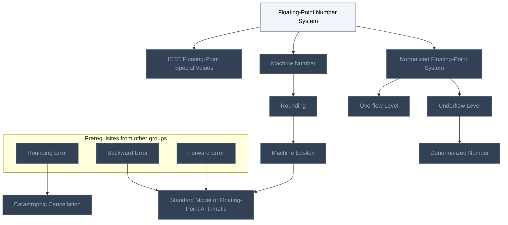
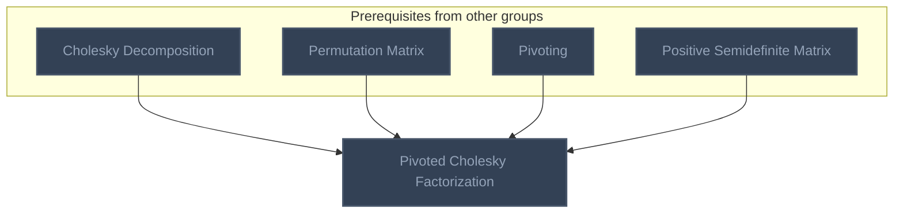

<!-- BEGIN STATS (generated by Scripts/skill_trees.py; do not edit) -->
**Mastered:** 0 / 64 · **Depth:** 0% · **Discovered:** 64 · **Planned:** 0 · **Locked:** 57 · **Rusty:** 0

**Levels:** L0 64 · L1 0 · L2 0 · L3 0 · L4 0 · L5 0

**Next up:** [[Absolute Error]], [[Truncation Error]], [[Propagated Data Error]], [[Well-Posed Problem]], [[Inverse Problem]]

Legend: dashed grey = planned (no note yet) · dark grey = locked · white L0 Discovered · green L1 Recall · blue L2 Apply · purple L3 Prove (Mastered) · orange L4 Wield · gold L5 Command · brown dashed border = rusty
<!-- END STATS -->

## Heath Ch 1: Error Analysis
**Mastered:** 0 / 20 · **Discovered:** 20 / 20

```mermaid
flowchart TD
    classDef planned fill:#1E293B,stroke:#64748B,stroke-width:2px,stroke-dasharray:5 5,color:#94A3B8;
    classDef locked fill:#334155,stroke:#475569,stroke-width:2px,color:#94A3B8;
    classDef L0 fill:#F1F5F9,stroke:#94A3B8,stroke-width:2px,color:#000000;
    classDef L1 fill:#22C55E,stroke:#15803D,stroke-width:2px,color:#000000;
    classDef L2 fill:#3B82F6,stroke:#1D4ED8,stroke-width:3px,color:#FFFFFF;
    classDef L3 fill:#A855F7,stroke:#6B21A8,stroke-width:3px,color:#FFFFFF,font-weight:bold;
    classDef L4 fill:#F97316,stroke:#C2410C,stroke-width:4px,color:#000000,font-weight:bold;
    classDef L5 fill:#FFD700,stroke:#FF8C00,stroke-width:5px,color:#000000,font-weight:bold;
    classDef rusty stroke:#8B4513,stroke-width:4px,stroke-dasharray:3 3;
    subgraph sg_prereqs["Prerequisites from other groups"]
        n_function["Function"]
        n_percent["Percent"]
        n_rounding["Rounding"]
    end
    n_absolute_error["Absolute Error"]
    n_truncation_error["Truncation Error"]
    n_relative_error["Relative Error"]
    n_percent_error["Percent Error"]
    n_rounding_error["Rounding Error"]
    n_numerical_analysis_error["Numerical Analysis Error"]
    n_propagated_data_error["Propagated Data Error"]
    n_computational_error["Computational Error"]
    n_total_error["Total Error"]
    n_backward_error["Backward Error"]
    n_forward_error["Forward Error"]
    n_well_posed_problem["Well-Posed Problem"]
    n_relative_condition_number["Relative Condition Number"]
    n_absolute_condition_number["Absolute Condition Number"]
    n_significant_digits["Significant Digits"]
    n_precision["Precision"]
    n_sensitivity["Sensitivity"]
    n_inverse_problem["Inverse Problem"]
    n_stable_algorithm["Stable Algorithm"]
    n_accuracy["Accuracy"]
    n_function --> n_backward_error
    n_propagated_data_error --> n_backward_error
    n_absolute_error --> n_forward_error
    n_function --> n_forward_error
    n_absolute_error --> n_relative_error
    n_propagated_data_error --> n_sensitivity
    n_absolute_error --> n_absolute_condition_number
    n_sensitivity --> n_absolute_condition_number
    n_percent --> n_percent_error
    n_relative_error --> n_percent_error
    n_inverse_problem --> n_relative_condition_number
    n_relative_error --> n_relative_condition_number
    n_sensitivity --> n_relative_condition_number
    n_relative_error --> n_significant_digits
    n_significant_digits --> n_precision
    n_rounding --> n_rounding_error
    n_rounding_error --> n_computational_error
    n_truncation_error --> n_computational_error
    n_computational_error --> n_stable_algorithm
    n_sensitivity --> n_stable_algorithm
    n_computational_error --> n_total_error
    n_propagated_data_error --> n_total_error
    n_precision --> n_accuracy
    n_stable_algorithm --> n_accuracy
    n_accuracy --> n_numerical_analysis_error
    n_total_error --> n_numerical_analysis_error
    class n_function,n_percent,n_rounding,n_relative_error,n_percent_error,n_rounding_error,n_numerical_analysis_error,n_computational_error,n_total_error,n_backward_error,n_forward_error,n_relative_condition_number,n_absolute_condition_number,n_significant_digits,n_precision,n_sensitivity,n_stable_algorithm,n_accuracy locked;
    class n_absolute_error,n_truncation_error,n_propagated_data_error,n_well_posed_problem,n_inverse_problem L0;
    class n_function,n_percent,n_rounding,n_absolute_error,n_truncation_error,n_relative_error,n_percent_error,n_rounding_error,n_numerical_analysis_error,n_propagated_data_error,n_computational_error,n_total_error,n_backward_error,n_forward_error,n_well_posed_problem,n_relative_condition_number,n_absolute_condition_number,n_significant_digits,n_precision,n_sensitivity,n_inverse_problem,n_stable_algorithm,n_accuracy internal-link;
```



## Heath Ch 1: Floating-Point Arithmetic
**Mastered:** 0 / 11 · **Discovered:** 11 / 11



## Heath Ch 2: Systems of Linear Equations
**Mastered:** 0 / 19 · **Discovered:** 19 / 19

```mermaid
flowchart TD
    classDef planned fill:#1E293B,stroke:#64748B,stroke-width:2px,stroke-dasharray:5 5,color:#94A3B8;
    classDef locked fill:#334155,stroke:#475569,stroke-width:2px,color:#94A3B8;
    classDef L0 fill:#F1F5F9,stroke:#94A3B8,stroke-width:2px,color:#000000;
    classDef L1 fill:#22C55E,stroke:#15803D,stroke-width:2px,color:#000000;
    classDef L2 fill:#3B82F6,stroke:#1D4ED8,stroke-width:3px,color:#FFFFFF;
    classDef L3 fill:#A855F7,stroke:#6B21A8,stroke-width:3px,color:#FFFFFF,font-weight:bold;
    classDef L4 fill:#F97316,stroke:#C2410C,stroke-width:4px,color:#000000,font-weight:bold;
    classDef L5 fill:#FFD700,stroke:#FF8C00,stroke-width:5px,color:#000000,font-weight:bold;
    classDef rusty stroke:#8B4513,stroke-width:4px,stroke-dasharray:3 3;
    subgraph sg_prereqs["Prerequisites from other groups"]
        n_matrix["Matrix"]
        n_elementary_matrix["Elementary Matrix"]
        n_triangular_matrix_invertibility["Triangular Matrix Invertibility"]
        n_cholesky_decomposition["Cholesky Decomposition"]
        n_lu_decomposition["LU Decomposition"]
        n_matrix_inverse["Matrix Inverse"]
        n_rank["Rank"]
        n_graph["Graph"]
        n_diagonal_matrix["Diagonal Matrix"]
        n_permutation_matrix["Permutation Matrix"]
        n_condition_number_of_a_matrix["Condition Number of a Matrix"]
        n_backward_error["Backward Error"]
        n_nonsingular_matrix["Nonsingular Matrix"]
        n_stable_algorithm["Stable Algorithm"]
    end
    n_residual_of_linear_system["Residual of Linear System"]
    n_forward_substitution["Forward-Substitution"]
    n_gaussian_elimination["Gaussian Elimination"]
    n_elementary_elimination_matrix["Elementary Elimination Matrix"]
    n_pivoting["Pivoting"]
    n_partial_pivoting["Partial Pivoting"]
    n_complete_pivoting["Complete Pivoting"]
    n_growth_factor["Growth Factor"]
    n_scaling_of_linear_system["Scaling of Linear System"]
    n_diagonally_dominant_matrix["Diagonally Dominant Matrix"]
    n_gauss_jordan_elimination["Gauss-Jordan Elimination"]
    n_sherman_morrison_formula["Sherman-Morrison Formula"]
    n_woodbury_formula["Woodbury Formula"]
    n_iterative_refinement["Iterative Refinement"]
    n_sparse_matrix["Sparse Matrix"]
    n_banded_matrix["Banded Matrix"]
    n_tridiagonal_matrix["Tridiagonal Matrix"]
    n_ldlt_factorization["LDLT Factorization"]
    n_symmetric_indefinite_factorization["Symmetric Indefinite Factorization"]
    n_matrix --> n_banded_matrix
    n_matrix --> n_diagonally_dominant_matrix
    n_elementary_matrix --> n_elementary_elimination_matrix
    n_triangular_matrix_invertibility --> n_forward_substitution
    n_cholesky_decomposition --> n_ldlt_factorization
    n_lu_decomposition --> n_sherman_morrison_formula
    n_matrix_inverse --> n_sherman_morrison_formula
    n_rank --> n_sherman_morrison_formula
    n_graph --> n_sparse_matrix
    n_matrix --> n_sparse_matrix
    n_elementary_elimination_matrix --> n_gaussian_elimination
    n_forward_substitution --> n_gaussian_elimination
    n_lu_decomposition --> n_gaussian_elimination
    n_sherman_morrison_formula --> n_woodbury_formula
    n_diagonal_matrix --> n_gauss_jordan_elimination
    n_gaussian_elimination --> n_gauss_jordan_elimination
    n_gaussian_elimination --> n_growth_factor
    n_gaussian_elimination --> n_pivoting
    n_banded_matrix --> n_tridiagonal_matrix
    n_gaussian_elimination --> n_tridiagonal_matrix
    n_permutation_matrix --> n_complete_pivoting
    n_pivoting --> n_complete_pivoting
    n_permutation_matrix --> n_partial_pivoting
    n_pivoting --> n_partial_pivoting
    n_condition_number_of_a_matrix --> n_scaling_of_linear_system
    n_diagonal_matrix --> n_scaling_of_linear_system
    n_pivoting --> n_scaling_of_linear_system
    n_cholesky_decomposition --> n_symmetric_indefinite_factorization
    n_permutation_matrix --> n_symmetric_indefinite_factorization
    n_pivoting --> n_symmetric_indefinite_factorization
    n_tridiagonal_matrix --> n_symmetric_indefinite_factorization
    n_backward_error --> n_residual_of_linear_system
    n_condition_number_of_a_matrix --> n_residual_of_linear_system
    n_nonsingular_matrix --> n_residual_of_linear_system
    n_stable_algorithm --> n_residual_of_linear_system
    n_lu_decomposition --> n_iterative_refinement
    n_residual_of_linear_system --> n_iterative_refinement
    class n_matrix,n_elementary_matrix,n_triangular_matrix_invertibility,n_cholesky_decomposition,n_lu_decomposition,n_matrix_inverse,n_rank,n_graph,n_diagonal_matrix,n_permutation_matrix,n_condition_number_of_a_matrix,n_backward_error,n_nonsingular_matrix,n_stable_algorithm,n_residual_of_linear_system,n_forward_substitution,n_gaussian_elimination,n_elementary_elimination_matrix,n_pivoting,n_partial_pivoting,n_complete_pivoting,n_growth_factor,n_scaling_of_linear_system,n_diagonally_dominant_matrix,n_gauss_jordan_elimination,n_sherman_morrison_formula,n_woodbury_formula,n_iterative_refinement,n_sparse_matrix,n_banded_matrix,n_tridiagonal_matrix,n_ldlt_factorization,n_symmetric_indefinite_factorization locked;
    class n_matrix,n_elementary_matrix,n_triangular_matrix_invertibility,n_cholesky_decomposition,n_lu_decomposition,n_matrix_inverse,n_rank,n_graph,n_diagonal_matrix,n_permutation_matrix,n_condition_number_of_a_matrix,n_backward_error,n_nonsingular_matrix,n_stable_algorithm,n_residual_of_linear_system,n_forward_substitution,n_gaussian_elimination,n_elementary_elimination_matrix,n_pivoting,n_partial_pivoting,n_complete_pivoting,n_growth_factor,n_scaling_of_linear_system,n_diagonally_dominant_matrix,n_gauss_jordan_elimination,n_sherman_morrison_formula,n_woodbury_formula,n_iterative_refinement,n_sparse_matrix,n_banded_matrix,n_tridiagonal_matrix,n_ldlt_factorization,n_symmetric_indefinite_factorization internal-link;
```



## Higham: Pivoted Cholesky
**Mastered:** 0 / 1 · **Discovered:** 1 / 1



## Heath Ch 3: Linear Least Squares
**Mastered:** 0 / 12 · **Discovered:** 12 / 12

```mermaid
flowchart TD
    classDef planned fill:#1E293B,stroke:#64748B,stroke-width:2px,stroke-dasharray:5 5,color:#94A3B8;
    classDef locked fill:#334155,stroke:#475569,stroke-width:2px,color:#94A3B8;
    classDef L0 fill:#F1F5F9,stroke:#94A3B8,stroke-width:2px,color:#000000;
    classDef L1 fill:#22C55E,stroke:#15803D,stroke-width:2px,color:#000000;
    classDef L2 fill:#3B82F6,stroke:#1D4ED8,stroke-width:3px,color:#FFFFFF;
    classDef L3 fill:#A855F7,stroke:#6B21A8,stroke-width:3px,color:#FFFFFF,font-weight:bold;
    classDef L4 fill:#F97316,stroke:#C2410C,stroke-width:4px,color:#000000,font-weight:bold;
    classDef L5 fill:#FFD700,stroke:#FF8C00,stroke-width:5px,color:#000000,font-weight:bold;
    classDef rusty stroke:#8B4513,stroke-width:4px,stroke-dasharray:3 3;
    subgraph sg_prereqs["Prerequisites from other groups"]
        n_low_rank_matrix_approximation_theorem["Low-Rank Matrix Approximation Theorem"]
        n_orthogonal_matrix["Orthogonal Matrix"]
        n_overflow_level["Overflow Level"]
        n_qr_decomposition["QR Decomposition"]
        n_rotation_matrix["Rotation Matrix"]
        n_underflow_level["Underflow Level"]
        n_best_approximation_theorem["Best Approximation Theorem"]
        n_convex_function["Convex Function"]
        n_convex_set["Convex Set"]
        n_matrix_column_space["Matrix Column Space"]
        n_residual_of_linear_system["Residual of Linear System"]
        n_cholesky_decomposition["Cholesky Decomposition"]
        n_orthogonal_projection_matrix["Orthogonal Projection Matrix"]
        n_symmetric_indefinite_factorization["Symmetric Indefinite Factorization"]
        n_catastrophic_cancellation["Catastrophic Cancellation"]
        n_back_substitution["Back-Substitution"]
        n_permutation_matrix["Permutation Matrix"]
        n_hessian_matrix["Hessian Matrix"]
    end
    n_linear_least_squares_problem["Linear Least Squares Problem"]
    n_normal_equations["Normal Equations"]
    n_projector["Projector"]
    n_sensitivity_of_linear_least_squares_problem["Sensitivity of Linear Least Squares Problem"]
    n_augmented_system_method["Augmented System Method"]
    n_householder_transformation["Householder Transformation"]
    n_householder_qr_factorization["Householder QR Factorization"]
    n_givens_rotation["Givens Rotation"]
    n_modified_gram_schmidt_algorithm["Modified Gram-Schmidt Algorithm"]
    n_numerical_rank["Numerical Rank"]
    n_qr_factorization_with_column_pivoting["QR Factorization with Column Pivoting"]
    n_total_least_squares["Total Least Squares"]
    n_low_rank_matrix_approximation_theorem --> n_numerical_rank
    n_orthogonal_matrix --> n_givens_rotation
    n_overflow_level --> n_givens_rotation
    n_qr_decomposition --> n_givens_rotation
    n_rotation_matrix --> n_givens_rotation
    n_underflow_level --> n_givens_rotation
    n_best_approximation_theorem --> n_linear_least_squares_problem
    n_convex_function --> n_linear_least_squares_problem
    n_convex_set --> n_linear_least_squares_problem
    n_matrix_column_space --> n_linear_least_squares_problem
    n_residual_of_linear_system --> n_linear_least_squares_problem
    n_linear_least_squares_problem --> n_modified_gram_schmidt_algorithm
    n_qr_decomposition --> n_modified_gram_schmidt_algorithm
    n_cholesky_decomposition --> n_normal_equations
    n_linear_least_squares_problem --> n_normal_equations
    n_linear_least_squares_problem --> n_projector
    n_orthogonal_projection_matrix --> n_projector
    n_linear_least_squares_problem --> n_total_least_squares
    n_low_rank_matrix_approximation_theorem --> n_total_least_squares
    n_normal_equations --> n_augmented_system_method
    n_symmetric_indefinite_factorization --> n_augmented_system_method
    n_catastrophic_cancellation --> n_householder_transformation
    n_orthogonal_matrix --> n_householder_transformation
    n_overflow_level --> n_householder_transformation
    n_projector --> n_householder_transformation
    n_underflow_level --> n_householder_transformation
    n_normal_equations --> n_sensitivity_of_linear_least_squares_problem
    n_back_substitution --> n_householder_qr_factorization
    n_householder_transformation --> n_householder_qr_factorization
    n_qr_decomposition --> n_householder_qr_factorization
    n_givens_rotation --> n_qr_factorization_with_column_pivoting
    n_householder_qr_factorization --> n_qr_factorization_with_column_pivoting
    n_modified_gram_schmidt_algorithm --> n_qr_factorization_with_column_pivoting
    n_permutation_matrix --> n_qr_factorization_with_column_pivoting
    n_hessian_matrix --> n_normal_equations
    class n_low_rank_matrix_approximation_theorem,n_orthogonal_matrix,n_overflow_level,n_qr_decomposition,n_rotation_matrix,n_underflow_level,n_best_approximation_theorem,n_convex_function,n_convex_set,n_matrix_column_space,n_residual_of_linear_system,n_cholesky_decomposition,n_orthogonal_projection_matrix,n_symmetric_indefinite_factorization,n_catastrophic_cancellation,n_back_substitution,n_permutation_matrix,n_hessian_matrix,n_linear_least_squares_problem,n_normal_equations,n_projector,n_sensitivity_of_linear_least_squares_problem,n_augmented_system_method,n_householder_transformation,n_householder_qr_factorization,n_givens_rotation,n_modified_gram_schmidt_algorithm,n_numerical_rank,n_qr_factorization_with_column_pivoting,n_total_least_squares locked;
    class n_low_rank_matrix_approximation_theorem,n_orthogonal_matrix,n_overflow_level,n_qr_decomposition,n_rotation_matrix,n_underflow_level,n_best_approximation_theorem,n_convex_function,n_convex_set,n_matrix_column_space,n_residual_of_linear_system,n_cholesky_decomposition,n_orthogonal_projection_matrix,n_symmetric_indefinite_factorization,n_catastrophic_cancellation,n_back_substitution,n_permutation_matrix,n_hessian_matrix,n_linear_least_squares_problem,n_normal_equations,n_projector,n_sensitivity_of_linear_least_squares_problem,n_augmented_system_method,n_householder_transformation,n_householder_qr_factorization,n_givens_rotation,n_modified_gram_schmidt_algorithm,n_numerical_rank,n_qr_factorization_with_column_pivoting,n_total_least_squares internal-link;
```



## Owen: Numerical Integration
**Mastered:** 0 / 1 · **Discovered:** 1 / 1



```mermaid
flowchart TD
    classDef planned fill:#1E293B,stroke:#64748B,stroke-width:2px,stroke-dasharray:5 5,color:#94A3B8;
    classDef locked fill:#334155,stroke:#475569,stroke-width:2px,color:#94A3B8;
    classDef L0 fill:#F1F5F9,stroke:#94A3B8,stroke-width:2px,color:#000000;
    classDef L1 fill:#22C55E,stroke:#15803D,stroke-width:2px,color:#000000;
    classDef L2 fill:#3B82F6,stroke:#1D4ED8,stroke-width:3px,color:#FFFFFF;
    classDef L3 fill:#A855F7,stroke:#6B21A8,stroke-width:3px,color:#FFFFFF,font-weight:bold;
    classDef L4 fill:#F97316,stroke:#C2410C,stroke-width:4px,color:#000000,font-weight:bold;
    classDef L5 fill:#FFD700,stroke:#FF8C00,stroke-width:5px,color:#000000,font-weight:bold;
    classDef rusty stroke:#8B4513,stroke-width:4px,stroke-dasharray:3 3;
    n_simpson_s_rule["Simpson's Rule"]
    class n_simpson_s_rule L0;
    class n_simpson_s_rule internal-link;
```

# Source
Graph structure: the single source for the diagrams above, edited by `/note` and `Scripts/skill_trees.py` (`add`, `edge`, `rename`). Everything above this heading is regenerated by `render`.

```skilltree
    %% PREREQUISITES
    n_back_substitution["Back-Substitution"]
    n_best_approximation_theorem["Best Approximation Theorem"]
    n_cholesky_decomposition["Cholesky Decomposition"]
    n_condition_number_of_a_matrix["Condition Number of a Matrix"]
    n_convex_function["Convex Function"]
    n_convex_set["Convex Set"]
    n_diagonal_matrix["Diagonal Matrix"]
    n_elementary_matrix["Elementary Matrix"]
    n_function["Function"]
    n_graph["Graph"]
    n_lu_decomposition["LU Decomposition"]
    n_low_rank_matrix_approximation_theorem["Low-Rank Matrix Approximation Theorem"]
    n_matrix["Matrix"]
    n_matrix_column_space["Matrix Column Space"]
    n_matrix_inverse["Matrix Inverse"]
    n_orthogonal_matrix["Orthogonal Matrix"]
    n_orthogonal_projection_matrix["Orthogonal Projection Matrix"]
    n_percent["Percent"]
    n_permutation_matrix["Permutation Matrix"]
    n_positive_semidefinite_matrix["Positive Semidefinite Matrix"]
    n_qr_decomposition["QR Decomposition"]
    n_rank["Rank"]
    n_rotation_matrix["Rotation Matrix"]
    n_triangular_matrix_invertibility["Triangular Matrix Invertibility"]
    n_hessian_matrix["Hessian Matrix"]
    n_nonsingular_matrix["Nonsingular Matrix"]
    %% NODES
    %% == Heath Ch 1: Error Analysis ==
    n_absolute_error["Absolute Error"]
    n_truncation_error["Truncation Error"]
    n_relative_error["Relative Error"]
    n_percent_error["Percent Error"]
    n_rounding_error["Rounding Error"]
    n_numerical_analysis_error["Numerical Analysis Error"]
    n_propagated_data_error["Propagated Data Error"]
    n_computational_error["Computational Error"]
    n_total_error["Total Error"]
    n_backward_error["Backward Error"]
    n_forward_error["Forward Error"]
    n_well_posed_problem["Well-Posed Problem"]
    n_relative_condition_number["Relative Condition Number"]
    n_absolute_condition_number["Absolute Condition Number"]
    n_significant_digits["Significant Digits"]
    n_precision["Precision"]
    n_sensitivity["Sensitivity"]
    n_inverse_problem["Inverse Problem"]
    n_stable_algorithm["Stable Algorithm"]
    n_accuracy["Accuracy"]
    %% == Heath Ch 1: Floating-Point Arithmetic ==
    n_floating_point_number_system["Floating-Point Number System"]
    n_normalized_floating_point_system["Normalized Floating-Point System"]
    n_overflow_level["Overflow Level"]
    n_underflow_level["Underflow Level"]
    n_machine_number["Machine Number"]
    n_rounding["Rounding"]
    n_machine_epsilon["Machine Epsilon"]
    n_ieee_floating_point_special_values["IEEE Floating-Point Special Values"]
    n_catastrophic_cancellation["Catastrophic Cancellation"]
    n_standard_model_of_floating_point_arithmetic["Standard Model of Floating-Point Arithmetic"]
    n_denormalized_number["Denormalized Number"]
    %% == Heath Ch 2: Systems of Linear Equations ==
    n_residual_of_linear_system["Residual of Linear System"]
    n_forward_substitution["Forward-Substitution"]
    n_gaussian_elimination["Gaussian Elimination"]
    n_elementary_elimination_matrix["Elementary Elimination Matrix"]
    n_pivoting["Pivoting"]
    n_partial_pivoting["Partial Pivoting"]
    n_complete_pivoting["Complete Pivoting"]
    n_growth_factor["Growth Factor"]
    n_scaling_of_linear_system["Scaling of Linear System"]
    n_diagonally_dominant_matrix["Diagonally Dominant Matrix"]
    n_gauss_jordan_elimination["Gauss-Jordan Elimination"]
    n_sherman_morrison_formula["Sherman-Morrison Formula"]
    n_woodbury_formula["Woodbury Formula"]
    n_iterative_refinement["Iterative Refinement"]
    n_sparse_matrix["Sparse Matrix"]
    n_banded_matrix["Banded Matrix"]
    n_tridiagonal_matrix["Tridiagonal Matrix"]
    n_ldlt_factorization["LDLT Factorization"]
    n_symmetric_indefinite_factorization["Symmetric Indefinite Factorization"]
    %% == Higham: Pivoted Cholesky ==
    n_pivoted_cholesky_factorization["Pivoted Cholesky Factorization"]
    %% == Heath Ch 3: Linear Least Squares ==
    n_linear_least_squares_problem["Linear Least Squares Problem"]
    n_normal_equations["Normal Equations"]
    n_projector["Projector"]
    n_sensitivity_of_linear_least_squares_problem["Sensitivity of Linear Least Squares Problem"]
    n_augmented_system_method["Augmented System Method"]
    n_householder_transformation["Householder Transformation"]
    n_householder_qr_factorization["Householder QR Factorization"]
    n_givens_rotation["Givens Rotation"]
    n_modified_gram_schmidt_algorithm["Modified Gram-Schmidt Algorithm"]
    n_numerical_rank["Numerical Rank"]
    n_qr_factorization_with_column_pivoting["QR Factorization with Column Pivoting"]
    n_total_least_squares["Total Least Squares"]
    %% == Owen: Numerical Integration ==
    n_simpson_s_rule["Simpson's Rule"]
    %% EDGES
    n_function --> n_backward_error
    n_propagated_data_error --> n_backward_error
    n_matrix --> n_banded_matrix
    n_matrix --> n_diagonally_dominant_matrix
    n_elementary_matrix --> n_elementary_elimination_matrix
    n_absolute_error --> n_forward_error
    n_function --> n_forward_error
    n_triangular_matrix_invertibility --> n_forward_substitution
    n_floating_point_number_system --> n_ieee_floating_point_special_values
    n_cholesky_decomposition --> n_ldlt_factorization
    n_floating_point_number_system --> n_machine_number
    n_floating_point_number_system --> n_normalized_floating_point_system
    n_low_rank_matrix_approximation_theorem --> n_numerical_rank
    n_absolute_error --> n_relative_error
    n_propagated_data_error --> n_sensitivity
    n_lu_decomposition --> n_sherman_morrison_formula
    n_matrix_inverse --> n_sherman_morrison_formula
    n_rank --> n_sherman_morrison_formula
    n_graph --> n_sparse_matrix
    n_matrix --> n_sparse_matrix
    n_absolute_error --> n_absolute_condition_number
    n_sensitivity --> n_absolute_condition_number
    n_elementary_elimination_matrix --> n_gaussian_elimination
    n_forward_substitution --> n_gaussian_elimination
    n_lu_decomposition --> n_gaussian_elimination
    n_normalized_floating_point_system --> n_overflow_level
    n_percent --> n_percent_error
    n_relative_error --> n_percent_error
    n_inverse_problem --> n_relative_condition_number
    n_relative_error --> n_relative_condition_number
    n_sensitivity --> n_relative_condition_number
    n_machine_number --> n_rounding
    n_relative_error --> n_significant_digits
    n_normalized_floating_point_system --> n_underflow_level
    n_sherman_morrison_formula --> n_woodbury_formula
    n_underflow_level --> n_denormalized_number
    n_diagonal_matrix --> n_gauss_jordan_elimination
    n_gaussian_elimination --> n_gauss_jordan_elimination
    n_orthogonal_matrix --> n_givens_rotation
    n_overflow_level --> n_givens_rotation
    n_qr_decomposition --> n_givens_rotation
    n_rotation_matrix --> n_givens_rotation
    n_underflow_level --> n_givens_rotation
    n_gaussian_elimination --> n_growth_factor
    n_rounding --> n_machine_epsilon
    n_gaussian_elimination --> n_pivoting
    n_significant_digits --> n_precision
    n_rounding --> n_rounding_error
    n_banded_matrix --> n_tridiagonal_matrix
    n_gaussian_elimination --> n_tridiagonal_matrix
    n_rounding_error --> n_catastrophic_cancellation
    n_permutation_matrix --> n_complete_pivoting
    n_pivoting --> n_complete_pivoting
    n_rounding_error --> n_computational_error
    n_truncation_error --> n_computational_error
    n_permutation_matrix --> n_partial_pivoting
    n_pivoting --> n_partial_pivoting
    n_cholesky_decomposition --> n_pivoted_cholesky_factorization
    n_permutation_matrix --> n_pivoted_cholesky_factorization
    n_pivoting --> n_pivoted_cholesky_factorization
    n_positive_semidefinite_matrix --> n_pivoted_cholesky_factorization
    n_condition_number_of_a_matrix --> n_scaling_of_linear_system
    n_diagonal_matrix --> n_scaling_of_linear_system
    n_pivoting --> n_scaling_of_linear_system
    n_backward_error --> n_standard_model_of_floating_point_arithmetic
    n_forward_error --> n_standard_model_of_floating_point_arithmetic
    n_machine_epsilon --> n_standard_model_of_floating_point_arithmetic
    n_cholesky_decomposition --> n_symmetric_indefinite_factorization
    n_permutation_matrix --> n_symmetric_indefinite_factorization
    n_pivoting --> n_symmetric_indefinite_factorization
    n_tridiagonal_matrix --> n_symmetric_indefinite_factorization
    n_computational_error --> n_stable_algorithm
    n_sensitivity --> n_stable_algorithm
    n_computational_error --> n_total_error
    n_propagated_data_error --> n_total_error
    n_precision --> n_accuracy
    n_stable_algorithm --> n_accuracy
    n_backward_error --> n_residual_of_linear_system
    n_condition_number_of_a_matrix --> n_residual_of_linear_system
    n_nonsingular_matrix --> n_residual_of_linear_system
    n_stable_algorithm --> n_residual_of_linear_system
    n_lu_decomposition --> n_iterative_refinement
    n_residual_of_linear_system --> n_iterative_refinement
    n_best_approximation_theorem --> n_linear_least_squares_problem
    n_convex_function --> n_linear_least_squares_problem
    n_convex_set --> n_linear_least_squares_problem
    n_matrix_column_space --> n_linear_least_squares_problem
    n_residual_of_linear_system --> n_linear_least_squares_problem
    n_accuracy --> n_numerical_analysis_error
    n_total_error --> n_numerical_analysis_error
    n_linear_least_squares_problem --> n_modified_gram_schmidt_algorithm
    n_qr_decomposition --> n_modified_gram_schmidt_algorithm
    n_cholesky_decomposition --> n_normal_equations
    n_linear_least_squares_problem --> n_normal_equations
    n_linear_least_squares_problem --> n_projector
    n_orthogonal_projection_matrix --> n_projector
    n_linear_least_squares_problem --> n_total_least_squares
    n_low_rank_matrix_approximation_theorem --> n_total_least_squares
    n_normal_equations --> n_augmented_system_method
    n_symmetric_indefinite_factorization --> n_augmented_system_method
    n_catastrophic_cancellation --> n_householder_transformation
    n_orthogonal_matrix --> n_householder_transformation
    n_overflow_level --> n_householder_transformation
    n_projector --> n_householder_transformation
    n_underflow_level --> n_householder_transformation
    n_normal_equations --> n_sensitivity_of_linear_least_squares_problem
    n_back_substitution --> n_householder_qr_factorization
    n_householder_transformation --> n_householder_qr_factorization
    n_qr_decomposition --> n_householder_qr_factorization
    n_givens_rotation --> n_qr_factorization_with_column_pivoting
    n_householder_qr_factorization --> n_qr_factorization_with_column_pivoting
    n_modified_gram_schmidt_algorithm --> n_qr_factorization_with_column_pivoting
    n_permutation_matrix --> n_qr_factorization_with_column_pivoting
    n_hessian_matrix --> n_normal_equations
```
