<!-- BEGIN STATS (generated by Scripts/skill_trees.py; do not edit) -->
**Mastered:** 0 / 161 · **Depth:** 0% · **Mastery Depth:** 0% · **Discovered:** 161 · **Planned:** 0 · **Locked:** 157 · **Rusty:** 0

| | L0 Discovered | L1 Recall | L2 Apply | L3 Prove ★ | L4 Wield | L5 Command |
|---|---:|---:|---:|---:|---:|---:|
| **At this level** | 161 | 0 | 0 | 0 | 0 | 0 |
| **Reached (this level or higher)** | 161 | 0 | 0 | 0 | 0 | 0 |

**Next up:** [[Abstraction Layer]], [[Path (Unix)]], [[Computer Network]], [[Graphical Toolkit]]

Legend: dashed grey = planned (no note yet) · dark grey = locked · white L0 Discovered · green L1 Recall · blue L2 Apply · purple L3 Prove (Mastered) · orange L4 Wield · gold L5 Command · brown dashed border = rusty
<!-- END STATS -->

## How Linux Works Ch1: The Big Picture
**Reached:** L1 0 · L2 0 · L3 0 · L4 0 · L5 0 (of 23 nodes)

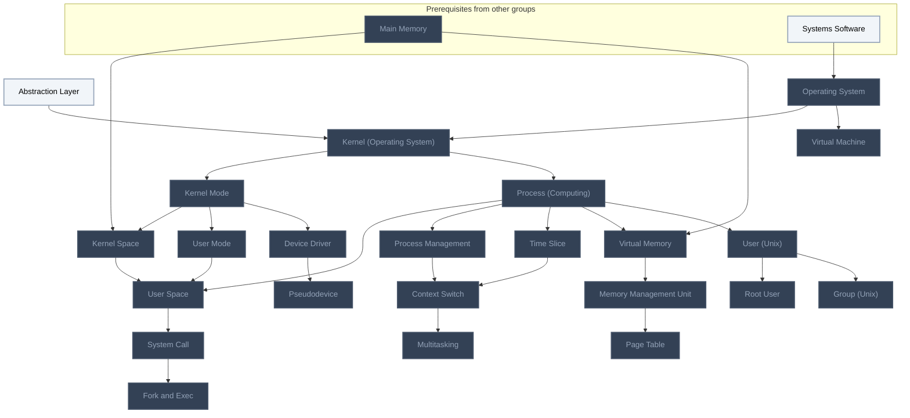

## How Linux Works Ch2: Basic Commands and Directory Hierarchy
**Reached:** L1 0 · L2 0 · L3 0 · L4 0 · L5 0 (of 14 nodes)

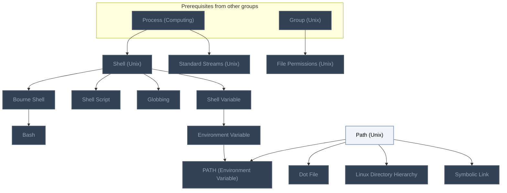

## How Linux Works Ch3: Devices
**Reached:** L1 0 · L2 0 · L3 0 · L4 0 · L5 0 (of 13 nodes)

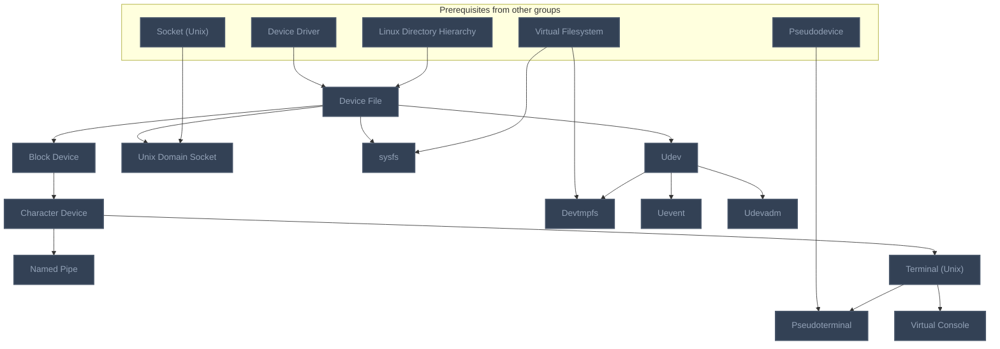

## How Linux Works Ch4: Disks and Filesystems
**Reached:** L1 0 · L2 0 · L3 0 · L4 0 · L5 0 (of 16 nodes)

```mermaid
flowchart TD
    classDef planned fill:#1E293B,stroke:#64748B,stroke-width:2px,stroke-dasharray:5 5,color:#94A3B8;
    classDef locked fill:#334155,stroke:#475569,stroke-width:2px,color:#94A3B8;
    classDef L0 fill:#F1F5F9,stroke:#94A3B8,stroke-width:2px,color:#000000;
    classDef L1 fill:#22C55E,stroke:#15803D,stroke-width:2px,color:#000000;
    classDef L2 fill:#3B82F6,stroke:#1D4ED8,stroke-width:3px,color:#FFFFFF;
    classDef L3 fill:#A855F7,stroke:#6B21A8,stroke-width:3px,color:#FFFFFF,font-weight:bold;
    classDef L4 fill:#F97316,stroke:#C2410C,stroke-width:4px,color:#000000,font-weight:bold;
    classDef L5 fill:#FFD700,stroke:#FF8C00,stroke-width:5px,color:#000000,font-weight:bold;
    classDef rusty stroke:#8B4513,stroke-width:4px,stroke-dasharray:3 3;
    subgraph sg_prereqs["Prerequisites from other groups"]
        n_main_memory["Main Memory"]
        n_process_computing["Process (Computing)"]
        n_virtual_memory["Virtual Memory"]
        n_block_device["Block Device"]
        n_virtual_filesystem["Virtual Filesystem"]
        n_disk["Disk"]
        n_filesystem["Filesystem"]
        n_inode["Inode"]
    end
    n_partition_operating_systems["Partition (Operating Systems)"]
    n_partition_table["Partition Table"]
    n_partition_alignment["Partition Alignment"]
    n_fuse_filesystem_in_userspace["FUSE (Filesystem in Userspace)"]
    n_virtual_file_system_vfs["Virtual File System (VFS)"]
    n_mounting_unix["Mounting (Unix)"]
    n_universally_unique_identifier_uuid["Universally Unique Identifier (UUID)"]
    n_write_back_caching_disk["Write-Back Caching (Disk)"]
    n_fstab["Fstab"]
    n_procfs["Procfs"]
    n_tmpfs["Tmpfs"]
    n_swap_space["Swap Space"]
    n_out_of_memory_killer["Out-of-Memory Killer"]
    n_superblock["Superblock"]
    n_block_bitmap["Block Bitmap"]
    n_filesystem_check_fsck["Filesystem Check (fsck)"]
    n_main_memory --> n_write_back_caching_disk
    n_process_computing --> n_procfs
    n_virtual_memory --> n_swap_space
    n_block_device --> n_partition_operating_systems
    n_virtual_filesystem --> n_procfs
    n_virtual_filesystem --> n_tmpfs
    n_disk --> n_partition_operating_systems
    n_disk --> n_write_back_caching_disk
    n_partition_operating_systems --> n_partition_table
    n_partition_operating_systems --> n_partition_alignment
    n_filesystem --> n_fuse_filesystem_in_userspace
    n_filesystem --> n_virtual_file_system_vfs
    n_filesystem --> n_mounting_unix
    n_filesystem --> n_block_bitmap
    n_mounting_unix --> n_universally_unique_identifier_uuid
    n_mounting_unix --> n_fstab
    n_swap_space --> n_tmpfs
    n_swap_space --> n_out_of_memory_killer
    n_inode --> n_superblock
    n_inode --> n_filesystem_check_fsck
    n_block_bitmap --> n_filesystem_check_fsck
    class n_main_memory,n_process_computing,n_virtual_memory,n_block_device,n_virtual_filesystem,n_disk,n_filesystem,n_inode,n_partition_operating_systems,n_partition_table,n_partition_alignment,n_fuse_filesystem_in_userspace,n_virtual_file_system_vfs,n_mounting_unix,n_universally_unique_identifier_uuid,n_write_back_caching_disk,n_fstab,n_procfs,n_tmpfs,n_swap_space,n_out_of_memory_killer,n_superblock,n_block_bitmap,n_filesystem_check_fsck locked;
    class n_main_memory,n_process_computing,n_virtual_memory,n_block_device,n_virtual_filesystem,n_disk,n_filesystem,n_inode,n_partition_operating_systems,n_partition_table,n_partition_alignment,n_fuse_filesystem_in_userspace,n_virtual_file_system_vfs,n_mounting_unix,n_universally_unique_identifier_uuid,n_write_back_caching_disk,n_fstab,n_procfs,n_tmpfs,n_swap_space,n_out_of_memory_killer,n_superblock,n_block_bitmap,n_filesystem_check_fsck internal-link;
```

## How Linux Works Ch5: How the Linux Kernel Boots
**Reached:** L1 0 · L2 0 · L3 0 · L4 0 · L5 0 (of 13 nodes)

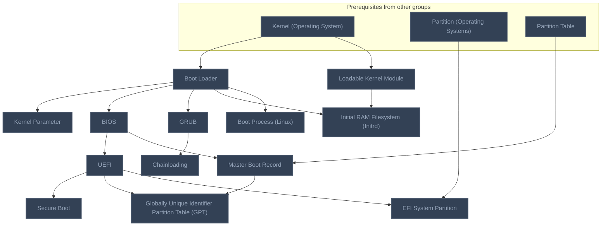

## How Linux Works Ch6: How User Space Starts
**Reached:** L1 0 · L2 0 · L3 0 · L4 0 · L5 0 (of 11 nodes)

```mermaid
flowchart TD
    classDef planned fill:#1E293B,stroke:#64748B,stroke-width:2px,stroke-dasharray:5 5,color:#94A3B8;
    classDef locked fill:#334155,stroke:#475569,stroke-width:2px,color:#94A3B8;
    classDef L0 fill:#F1F5F9,stroke:#94A3B8,stroke-width:2px,color:#000000;
    classDef L1 fill:#22C55E,stroke:#15803D,stroke-width:2px,color:#000000;
    classDef L2 fill:#3B82F6,stroke:#1D4ED8,stroke-width:3px,color:#FFFFFF;
    classDef L3 fill:#A855F7,stroke:#6B21A8,stroke-width:3px,color:#FFFFFF,font-weight:bold;
    classDef L4 fill:#F97316,stroke:#C2410C,stroke-width:4px,color:#000000,font-weight:bold;
    classDef L5 fill:#FFD700,stroke:#FF8C00,stroke-width:5px,color:#000000,font-weight:bold;
    classDef rusty stroke:#8B4513,stroke-width:4px,stroke-dasharray:3 3;
    subgraph sg_prereqs["Prerequisites from other groups"]
        n_process_computing["Process (Computing)"]
        n_process_management["Process Management"]
        n_socket_unix["Socket (Unix)"]
        n_boot_loader["Boot Loader"]
        n_init_process["Init Process"]
        n_boot_process_linux["Boot Process (Linux)"]
    end
    n_daemon_computing["Daemon (Computing)"]
    n_system_v_init["System V Init"]
    n_runlevel["Runlevel"]
    n_upstart["Upstart"]
    n_systemd["systemd"]
    n_systemd_unit["Systemd Unit"]
    n_control_group_cgroups["Control Group (Cgroups)"]
    n_systemd_socket_activation["Systemd Socket Activation"]
    n_shutdown_process_linux["Shutdown Process (Linux)"]
    n_live_image_linux["Live Image (Linux)"]
    n_single_user_mode["Single-User Mode"]
    n_process_computing --> n_daemon_computing
    n_process_management --> n_control_group_cgroups
    n_socket_unix --> n_systemd_socket_activation
    n_boot_loader --> n_single_user_mode
    n_init_process --> n_system_v_init
    n_init_process --> n_upstart
    n_init_process --> n_systemd
    n_init_process --> n_shutdown_process_linux
    n_system_v_init --> n_runlevel
    n_runlevel --> n_single_user_mode
    n_systemd --> n_systemd_unit
    n_systemd_unit --> n_systemd_socket_activation
    n_boot_process_linux --> n_live_image_linux
    class n_process_computing,n_process_management,n_socket_unix,n_boot_loader,n_init_process,n_boot_process_linux,n_daemon_computing,n_system_v_init,n_runlevel,n_upstart,n_systemd,n_systemd_unit,n_control_group_cgroups,n_systemd_socket_activation,n_shutdown_process_linux,n_live_image_linux,n_single_user_mode locked;
    class n_process_computing,n_process_management,n_socket_unix,n_boot_loader,n_init_process,n_boot_process_linux,n_daemon_computing,n_system_v_init,n_runlevel,n_upstart,n_systemd,n_systemd_unit,n_control_group_cgroups,n_systemd_socket_activation,n_shutdown_process_linux,n_live_image_linux,n_single_user_mode internal-link;
```

## How Linux Works Ch7: System Configuration
**Reached:** L1 0 · L2 0 · L3 0 · L4 0 · L5 0 (of 19 nodes)

```mermaid
flowchart TD
    classDef planned fill:#1E293B,stroke:#64748B,stroke-width:2px,stroke-dasharray:5 5,color:#94A3B8;
    classDef locked fill:#334155,stroke:#475569,stroke-width:2px,color:#94A3B8;
    classDef L0 fill:#F1F5F9,stroke:#94A3B8,stroke-width:2px,color:#000000;
    classDef L1 fill:#22C55E,stroke:#15803D,stroke-width:2px,color:#000000;
    classDef L2 fill:#3B82F6,stroke:#1D4ED8,stroke-width:3px,color:#FFFFFF;
    classDef L3 fill:#A855F7,stroke:#6B21A8,stroke-width:3px,color:#FFFFFF,font-weight:bold;
    classDef L4 fill:#F97316,stroke:#C2410C,stroke-width:4px,color:#000000,font-weight:bold;
    classDef L5 fill:#FFD700,stroke:#FF8C00,stroke-width:5px,color:#000000,font-weight:bold;
    classDef rusty stroke:#8B4513,stroke-width:4px,stroke-dasharray:3 3;
    subgraph sg_prereqs["Prerequisites from other groups"]
        n_kernel_operating_system["Kernel (Operating System)"]
        n_system_call["System Call"]
        n_user_unix["User (Unix)"]
        n_linux_directory_hierarchy["Linux Directory Hierarchy"]
        n_daemon_computing["Daemon (Computing)"]
        n_atomic_clock["Atomic Clock"]
    end
    n_system_configuration_directory["System Configuration Directory"]
    n_syslog["Syslog"]
    n_syslog_rule["Syslog Rule"]
    n_passwd_file["Passwd File"]
    n_shadow_file["Shadow File"]
    n_account_unix["Account (Unix)"]
    n_pseudo_user["Pseudo-User"]
    n_system_clock["System Clock"]
    n_real_time_clock_rtc["Real-Time Clock (RTC)"]
    n_time_drift["Time Drift"]
    n_network_time_protocol_ntp["Network Time Protocol (NTP)"]
    n_cron["Cron"]
    n_crontab["Crontab"]
    n_process_user_id["Process User ID"]
    n_effective_user_id["Effective User ID"]
    n_real_user_id["Real User ID"]
    n_saved_user_id["Saved User ID"]
    n_filesystem_user_id["Filesystem User ID"]
    n_setuid["Setuid"]
    n_kernel_operating_system --> n_system_clock
    n_system_call --> n_setuid
    n_user_unix --> n_passwd_file
    n_user_unix --> n_pseudo_user
    n_user_unix --> n_process_user_id
    n_linux_directory_hierarchy --> n_system_configuration_directory
    n_system_configuration_directory --> n_passwd_file
    n_daemon_computing --> n_syslog
    n_daemon_computing --> n_cron
    n_syslog --> n_syslog_rule
    n_passwd_file --> n_shadow_file
    n_passwd_file --> n_account_unix
    n_system_clock --> n_real_time_clock_rtc
    n_system_clock --> n_time_drift
    n_atomic_clock --> n_time_drift
    n_time_drift --> n_network_time_protocol_ntp
    n_cron --> n_crontab
    n_process_user_id --> n_effective_user_id
    n_process_user_id --> n_real_user_id
    n_process_user_id --> n_filesystem_user_id
    n_effective_user_id --> n_saved_user_id
    n_effective_user_id --> n_setuid
    class n_kernel_operating_system,n_system_call,n_user_unix,n_linux_directory_hierarchy,n_daemon_computing,n_atomic_clock,n_system_configuration_directory,n_syslog,n_syslog_rule,n_passwd_file,n_shadow_file,n_account_unix,n_pseudo_user,n_system_clock,n_real_time_clock_rtc,n_time_drift,n_network_time_protocol_ntp,n_cron,n_crontab,n_process_user_id,n_effective_user_id,n_real_user_id,n_saved_user_id,n_filesystem_user_id,n_setuid locked;
    class n_kernel_operating_system,n_system_call,n_user_unix,n_linux_directory_hierarchy,n_daemon_computing,n_atomic_clock,n_system_configuration_directory,n_syslog,n_syslog_rule,n_passwd_file,n_shadow_file,n_account_unix,n_pseudo_user,n_system_clock,n_real_time_clock_rtc,n_time_drift,n_network_time_protocol_ntp,n_cron,n_crontab,n_process_user_id,n_effective_user_id,n_real_user_id,n_saved_user_id,n_filesystem_user_id,n_setuid internal-link;
```

## How Linux Works Ch8: Processes and Resource Utilization
**Reached:** L1 0 · L2 0 · L3 0 · L4 0 · L5 0 (of 9 nodes)

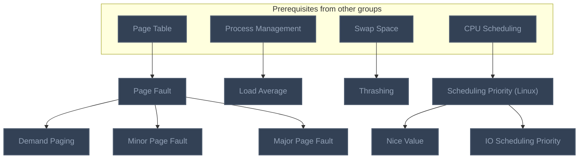

## How Linux Works Ch9: Network and Configuration
**Reached:** L1 0 · L2 0 · L3 0 · L4 0 · L5 0 (of 14 nodes)

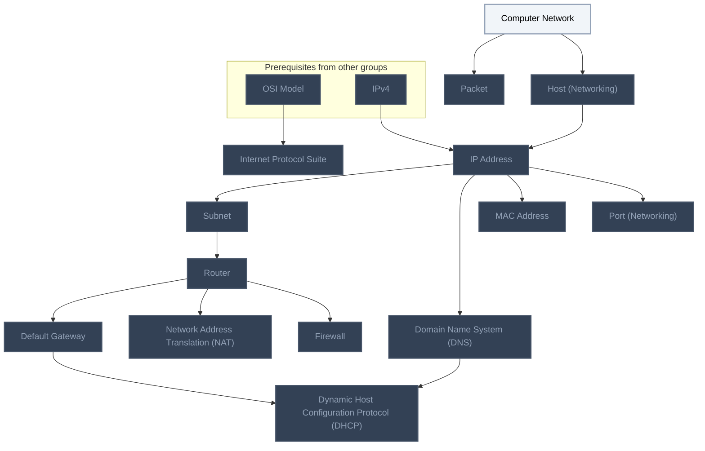

## How Linux Works Ch10: Network Applications and Services
**Reached:** L1 0 · L2 0 · L3 0 · L4 0 · L5 0 (of 2 nodes)

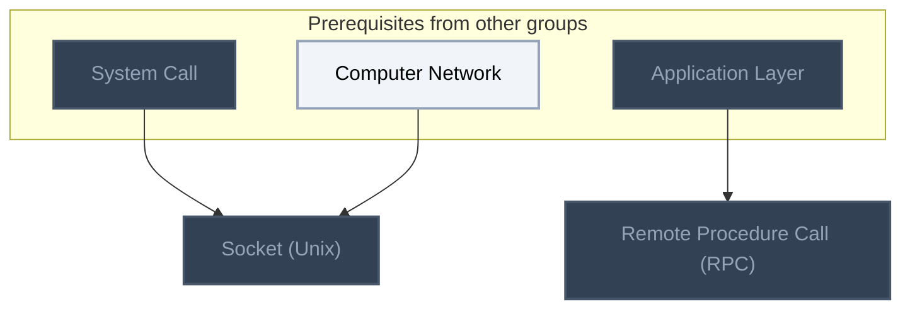

## How Linux Works Ch12: Network File Transfer and Sharing
**Reached:** L1 0 · L2 0 · L3 0 · L4 0 · L5 0 (of 1 nodes)

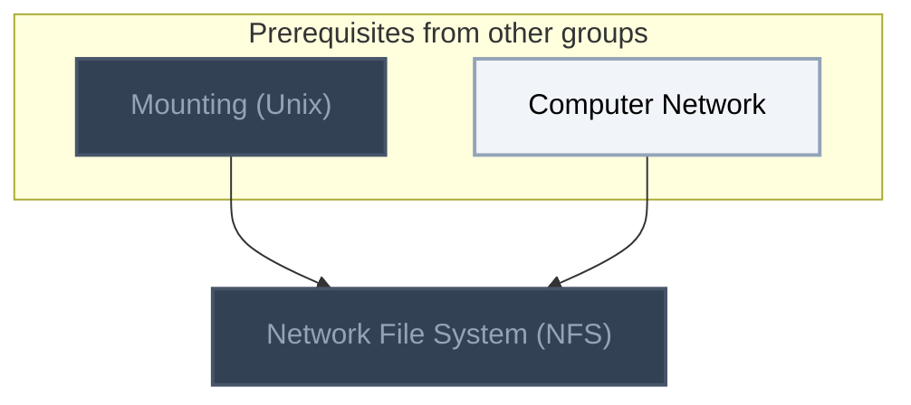

## How Linux Works Ch13: User Environments
**Reached:** L1 0 · L2 0 · L3 0 · L4 0 · L5 0 (of 3 nodes)

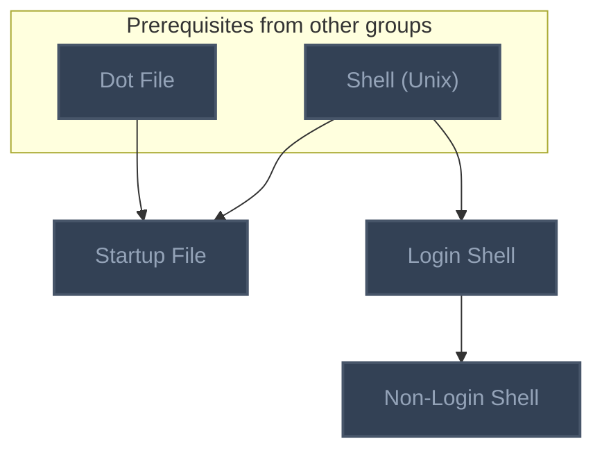

## How Linux Works Ch14: The Linux Desktop
**Reached:** L1 0 · L2 0 · L3 0 · L4 0 · L5 0 (of 8 nodes)

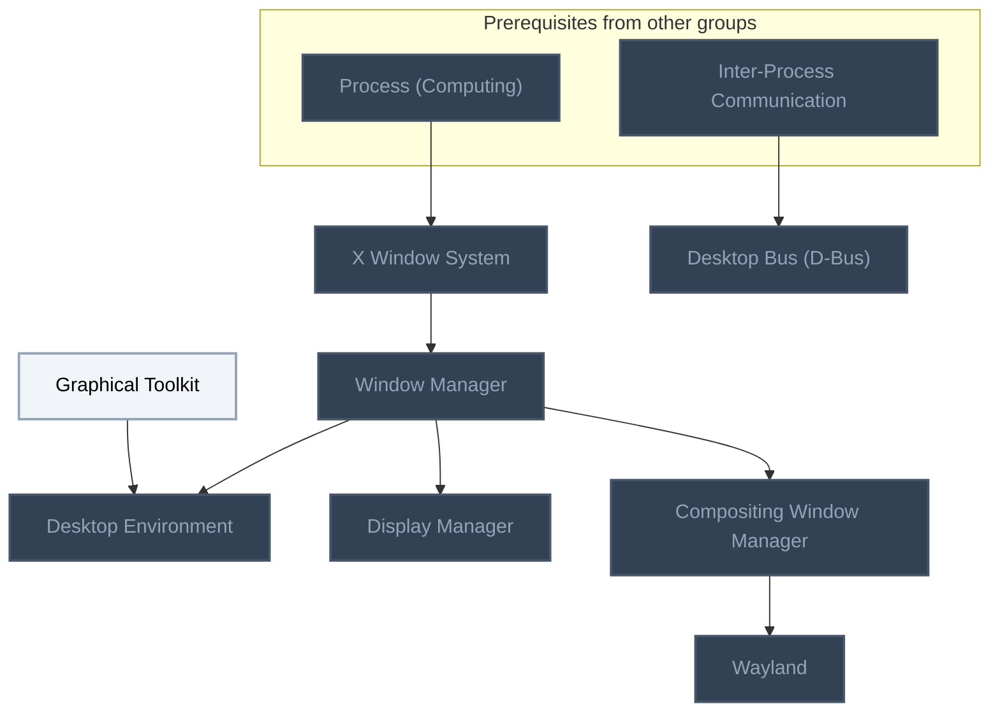

## Linux Journey: Getting Started
**Reached:** L1 0 · L2 0 · L3 0 · L4 0 · L5 0 (of 1 nodes)

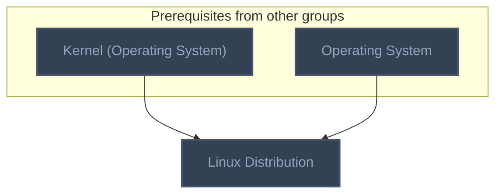

## Linux Journey: Packages
**Reached:** L1 0 · L2 0 · L3 0 · L4 0 · L5 0 (of 5 nodes)

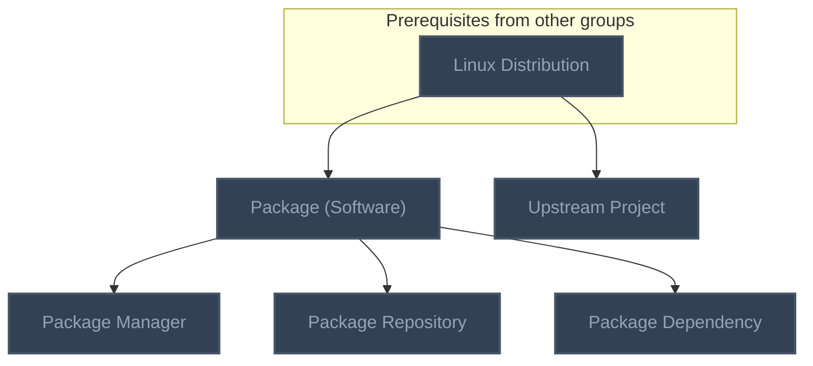

## Linux Journey: Permissions
**Reached:** L1 0 · L2 0 · L3 0 · L4 0 · L5 0 (of 5 nodes)

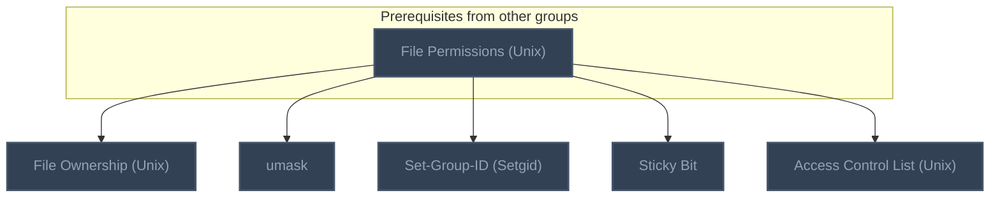

## Linux Journey: Text-Fu
**Reached:** L1 0 · L2 0 · L3 0 · L4 0 · L5 0 (of 2 nodes)

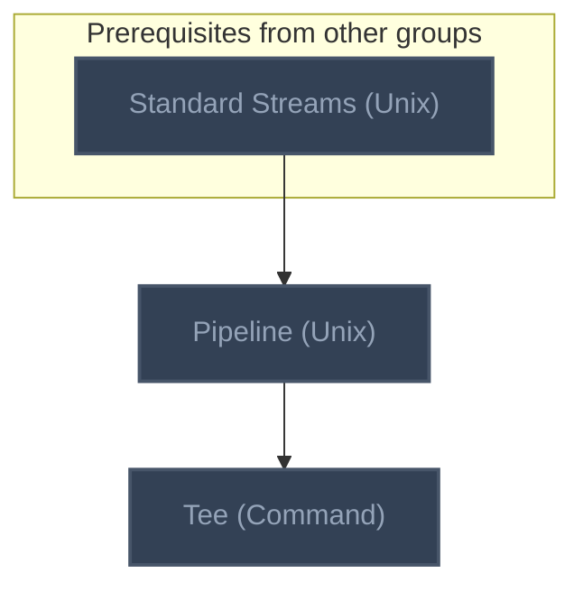

## Linux Journey: User Management
**Reached:** L1 0 · L2 0 · L3 0 · L4 0 · L5 0 (of 2 nodes)

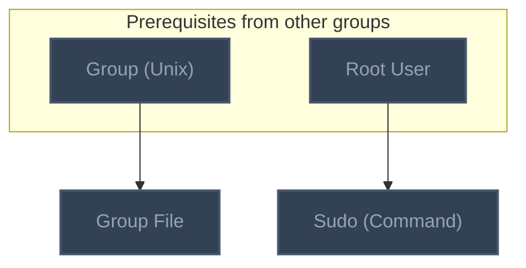

# Source
Graph structure: the single source for the diagrams above, edited by `/note` and `Scripts/skill_trees.py` (`add`, `edge`, `rename`). Everything above this heading is regenerated by `render`.

```skilltree
    %% PREREQUISITES
    n_virtual_filesystem["Virtual Filesystem"]
    n_disk["Disk"]
    n_filesystem["Filesystem"]
    n_inode["Inode"]
    n_init_process["Init Process"]
    n_atomic_clock["Atomic Clock"]
    n_cpu_scheduling["CPU Scheduling"]
    n_osi_model["OSI Model"]
    n_ipv4["IPv4"]
    n_application_layer["Application Layer"]
    n_inter_process_communication["Inter-Process Communication"]
    n_systems_software["Systems Software"]
    n_main_memory["Main Memory"]
    %% NODES
    %% == How Linux Works Ch1: The Big Picture ==
    n_abstraction_layer["Abstraction Layer"]
    n_kernel_operating_system["Kernel (Operating System)"]
    n_kernel_mode["Kernel Mode"]
    n_kernel_space["Kernel Space"]
    n_user_mode["User Mode"]
    n_process_computing["Process (Computing)"]
    n_user_space["User Space"]
    n_process_management["Process Management"]
    n_time_slice["Time Slice"]
    n_context_switch["Context Switch"]
    n_multitasking["Multitasking"]
    n_virtual_memory["Virtual Memory"]
    n_memory_management_unit["Memory Management Unit"]
    n_page_table["Page Table"]
    n_device_driver["Device Driver"]
    n_system_call["System Call"]
    n_fork_and_exec["Fork and Exec"]
    n_pseudodevice["Pseudodevice"]
    n_user_unix["User (Unix)"]
    n_root_user["Root User"]
    n_group_unix["Group (Unix)"]
    n_operating_system["Operating System"]
    n_virtual_machine["Virtual Machine"]
    %% == How Linux Works Ch2: Basic Commands and Directory Hierarchy ==
    n_shell_unix["Shell (Unix)"]
    n_bourne_shell["Bourne Shell"]
    n_bash["Bash"]
    n_shell_script["Shell Script"]
    n_standard_streams_unix["Standard Streams (Unix)"]
    n_path_unix["Path (Unix)"]
    n_globbing["Globbing"]
    n_shell_variable["Shell Variable"]
    n_dot_file["Dot File"]
    n_environment_variable["Environment Variable"]
    n_path_environment_variable["PATH (Environment Variable)"]
    n_file_permissions_unix["File Permissions (Unix)"]
    n_symbolic_link["Symbolic Link"]
    n_linux_directory_hierarchy["Linux Directory Hierarchy"]
    %% == How Linux Works Ch3: Devices ==
    n_device_file["Device File"]
    n_block_device["Block Device"]
    n_character_device["Character Device"]
    n_named_pipe["Named Pipe"]
    n_unix_domain_socket["Unix Domain Socket"]
    n_sysfs["sysfs"]
    n_terminal_unix["Terminal (Unix)"]
    n_pseudoterminal["Pseudoterminal"]
    n_virtual_console["Virtual Console"]
    n_udev["Udev"]
    n_devtmpfs["Devtmpfs"]
    n_uevent["Uevent"]
    n_udevadm["Udevadm"]
    %% == How Linux Works Ch4: Disks and Filesystems ==
    n_partition_operating_systems["Partition (Operating Systems)"]
    n_partition_table["Partition Table"]
    n_partition_alignment["Partition Alignment"]
    n_fuse_filesystem_in_userspace["FUSE (Filesystem in Userspace)"]
    n_virtual_file_system_vfs["Virtual File System (VFS)"]
    n_mounting_unix["Mounting (Unix)"]
    n_universally_unique_identifier_uuid["Universally Unique Identifier (UUID)"]
    n_write_back_caching_disk["Write-Back Caching (Disk)"]
    n_fstab["Fstab"]
    n_procfs["Procfs"]
    n_tmpfs["Tmpfs"]
    n_swap_space["Swap Space"]
    n_out_of_memory_killer["Out-of-Memory Killer"]
    n_superblock["Superblock"]
    n_block_bitmap["Block Bitmap"]
    n_filesystem_check_fsck["Filesystem Check (fsck)"]
    %% == How Linux Works Ch5: How the Linux Kernel Boots ==
    n_boot_loader["Boot Loader"]
    n_boot_process_linux["Boot Process (Linux)"]
    n_loadable_kernel_module["Loadable Kernel Module"]
    n_kernel_parameter["Kernel Parameter"]
    n_bios["BIOS"]
    n_uefi["UEFI"]
    n_secure_boot["Secure Boot"]
    n_master_boot_record["Master Boot Record"]
    n_globally_unique_identifier_partition_table_gpt["Globally Unique Identifier Partition Table (GPT)"]
    n_efi_system_partition["EFI System Partition"]
    n_grub["GRUB"]
    n_chainloading["Chainloading"]
    n_initial_ram_filesystem_initrd["Initial RAM Filesystem (Initrd)"]
    %% == How Linux Works Ch6: How User Space Starts ==
    n_daemon_computing["Daemon (Computing)"]
    n_system_v_init["System V Init"]
    n_runlevel["Runlevel"]
    n_upstart["Upstart"]
    n_systemd["systemd"]
    n_systemd_unit["Systemd Unit"]
    n_control_group_cgroups["Control Group (Cgroups)"]
    n_systemd_socket_activation["Systemd Socket Activation"]
    n_shutdown_process_linux["Shutdown Process (Linux)"]
    n_live_image_linux["Live Image (Linux)"]
    n_single_user_mode["Single-User Mode"]
    %% == How Linux Works Ch7: System Configuration ==
    n_system_configuration_directory["System Configuration Directory"]
    n_syslog["Syslog"]
    n_syslog_rule["Syslog Rule"]
    n_passwd_file["Passwd File"]
    n_shadow_file["Shadow File"]
    n_account_unix["Account (Unix)"]
    n_pseudo_user["Pseudo-User"]
    n_system_clock["System Clock"]
    n_real_time_clock_rtc["Real-Time Clock (RTC)"]
    n_time_drift["Time Drift"]
    n_network_time_protocol_ntp["Network Time Protocol (NTP)"]
    n_cron["Cron"]
    n_crontab["Crontab"]
    n_process_user_id["Process User ID"]
    n_effective_user_id["Effective User ID"]
    n_real_user_id["Real User ID"]
    n_saved_user_id["Saved User ID"]
    n_filesystem_user_id["Filesystem User ID"]
    n_setuid["Setuid"]
    %% == How Linux Works Ch8: Processes and Resource Utilization ==
    n_scheduling_priority_linux["Scheduling Priority (Linux)"]
    n_nice_value["Nice Value"]
    n_load_average["Load Average"]
    n_thrashing["Thrashing"]
    n_page_fault["Page Fault"]
    n_demand_paging["Demand Paging"]
    n_minor_page_fault["Minor Page Fault"]
    n_major_page_fault["Major Page Fault"]
    n_io_scheduling_priority["IO Scheduling Priority"]
    %% == How Linux Works Ch9: Network and Configuration ==
    n_packet["Packet"]
    n_host_networking["Host (Networking)"]
    n_internet_protocol_suite["Internet Protocol Suite"]
    n_ip_address["IP Address"]
    n_subnet["Subnet"]
    n_router["Router"]
    n_default_gateway["Default Gateway"]
    n_domain_name_system_dns["Domain Name System (DNS)"]
    n_mac_address["MAC Address"]
    n_port_networking["Port (Networking)"]
    n_dynamic_host_configuration_protocol_dhcp["Dynamic Host Configuration Protocol (DHCP)"]
    n_network_address_translation_nat["Network Address Translation (NAT)"]
    n_firewall["Firewall"]
    n_computer_network["Computer Network"]
    %% == How Linux Works Ch10: Network Applications and Services ==
    n_remote_procedure_call_rpc["Remote Procedure Call (RPC)"]
    n_socket_unix["Socket (Unix)"]
    %% == How Linux Works Ch12: Network File Transfer and Sharing ==
    n_network_file_system_nfs["Network File System (NFS)"]
    %% == How Linux Works Ch13: User Environments ==
    n_startup_file["Startup File"]
    n_login_shell["Login Shell"]
    n_non_login_shell["Non-Login Shell"]
    %% == How Linux Works Ch14: The Linux Desktop ==
    n_x_window_system["X Window System"]
    n_window_manager["Window Manager"]
    n_graphical_toolkit["Graphical Toolkit"]
    n_desktop_environment["Desktop Environment"]
    n_display_manager["Display Manager"]
    n_compositing_window_manager["Compositing Window Manager"]
    n_desktop_bus_d_bus["Desktop Bus (D-Bus)"]
    n_wayland["Wayland"]
    %% == How Linux Works Ch17: Building on the Basics ==
    %% == Linux Journey: Getting Started ==
    n_linux_distribution["Linux Distribution"]
    %% == Linux Journey: Packages ==
    n_package_software["Package (Software)"]
    n_package_manager["Package Manager"]
    n_package_repository["Package Repository"]
    n_package_dependency["Package Dependency"]
    n_upstream_project["Upstream Project"]
    %% == Linux Journey: Permissions ==
    n_file_ownership_unix["File Ownership (Unix)"]
    n_umask["umask"]
    n_set_group_id_setgid["Set-Group-ID (Setgid)"]
    n_sticky_bit["Sticky Bit"]
    n_access_control_list_unix["Access Control List (Unix)"]
    %% == Linux Journey: Text-Fu ==
    n_pipeline_unix["Pipeline (Unix)"]
    n_tee_command["Tee (Command)"]
    %% == Linux Journey: User Management ==
    n_sudo_command["Sudo (Command)"]
    n_group_file["Group File"]
    %% == Linux Journey: Advanced Text-Fu ==
    %% EDGES
    n_main_memory --> n_kernel_space
    n_main_memory --> n_virtual_memory
    n_main_memory --> n_write_back_caching_disk
    n_operating_system --> n_kernel_operating_system
    n_abstraction_layer --> n_kernel_operating_system
    n_kernel_operating_system --> n_kernel_mode
    n_kernel_operating_system --> n_process_computing
    n_kernel_operating_system --> n_boot_loader
    n_kernel_operating_system --> n_loadable_kernel_module
    n_kernel_operating_system --> n_system_clock
    n_kernel_operating_system --> n_linux_distribution
    n_kernel_mode --> n_kernel_space
    n_kernel_mode --> n_user_mode
    n_kernel_mode --> n_device_driver
    n_kernel_space --> n_user_space
    n_user_mode --> n_user_space
    n_process_computing --> n_user_space
    n_process_computing --> n_process_management
    n_process_computing --> n_time_slice
    n_process_computing --> n_virtual_memory
    n_process_computing --> n_user_unix
    n_process_computing --> n_shell_unix
    n_process_computing --> n_standard_streams_unix
    n_process_computing --> n_procfs
    n_process_computing --> n_daemon_computing
    n_process_computing --> n_x_window_system
    n_process_management --> n_context_switch
    n_process_management --> n_control_group_cgroups
    n_process_management --> n_load_average
    n_time_slice --> n_context_switch
    n_context_switch --> n_multitasking
    n_virtual_memory --> n_memory_management_unit
    n_virtual_memory --> n_swap_space
    n_memory_management_unit --> n_page_table
    n_page_table --> n_page_fault
    n_user_space --> n_system_call
    n_system_call --> n_fork_and_exec
    n_system_call --> n_setuid
    n_system_call --> n_socket_unix
    n_device_driver --> n_pseudodevice
    n_device_driver --> n_device_file
    n_user_unix --> n_root_user
    n_user_unix --> n_group_unix
    n_user_unix --> n_passwd_file
    n_user_unix --> n_pseudo_user
    n_user_unix --> n_process_user_id
    n_shell_unix --> n_bourne_shell
    n_shell_unix --> n_shell_script
    n_shell_unix --> n_globbing
    n_shell_unix --> n_shell_variable
    n_shell_unix --> n_startup_file
    n_shell_unix --> n_login_shell
    n_bourne_shell --> n_bash
    n_shell_variable --> n_environment_variable
    n_environment_variable --> n_path_environment_variable
    n_path_unix --> n_path_environment_variable
    n_path_unix --> n_dot_file
    n_path_unix --> n_linux_directory_hierarchy
    n_path_unix --> n_symbolic_link
    n_group_unix --> n_file_permissions_unix
    n_group_unix --> n_group_file
    n_linux_directory_hierarchy --> n_device_file
    n_linux_directory_hierarchy --> n_system_configuration_directory
    n_device_file --> n_block_device
    n_device_file --> n_unix_domain_socket
    n_device_file --> n_sysfs
    n_device_file --> n_udev
    n_block_device --> n_character_device
    n_block_device --> n_partition_operating_systems
    n_character_device --> n_named_pipe
    n_character_device --> n_terminal_unix
    n_socket_unix --> n_unix_domain_socket
    n_socket_unix --> n_systemd_socket_activation
    n_virtual_filesystem --> n_sysfs
    n_virtual_filesystem --> n_devtmpfs
    n_virtual_filesystem --> n_procfs
    n_virtual_filesystem --> n_tmpfs
    n_pseudodevice --> n_pseudoterminal
    n_terminal_unix --> n_pseudoterminal
    n_terminal_unix --> n_virtual_console
    n_udev --> n_devtmpfs
    n_udev --> n_uevent
    n_udev --> n_udevadm
    n_disk --> n_partition_operating_systems
    n_disk --> n_write_back_caching_disk
    n_partition_operating_systems --> n_partition_table
    n_partition_operating_systems --> n_partition_alignment
    n_partition_operating_systems --> n_efi_system_partition
    n_filesystem --> n_fuse_filesystem_in_userspace
    n_filesystem --> n_virtual_file_system_vfs
    n_filesystem --> n_mounting_unix
    n_filesystem --> n_block_bitmap
    n_mounting_unix --> n_universally_unique_identifier_uuid
    n_mounting_unix --> n_fstab
    n_mounting_unix --> n_network_file_system_nfs
    n_swap_space --> n_tmpfs
    n_swap_space --> n_out_of_memory_killer
    n_swap_space --> n_thrashing
    n_inode --> n_superblock
    n_inode --> n_filesystem_check_fsck
    n_block_bitmap --> n_filesystem_check_fsck
    n_boot_loader --> n_kernel_parameter
    n_boot_loader --> n_bios
    n_boot_loader --> n_grub
    n_boot_loader --> n_initial_ram_filesystem_initrd
    n_boot_loader --> n_boot_process_linux
    n_boot_loader --> n_single_user_mode
    n_bios --> n_uefi
    n_bios --> n_master_boot_record
    n_uefi --> n_secure_boot
    n_uefi --> n_globally_unique_identifier_partition_table_gpt
    n_uefi --> n_efi_system_partition
    n_partition_table --> n_master_boot_record
    n_master_boot_record --> n_globally_unique_identifier_partition_table_gpt
    n_grub --> n_chainloading
    n_loadable_kernel_module --> n_initial_ram_filesystem_initrd
    n_init_process --> n_system_v_init
    n_init_process --> n_upstart
    n_init_process --> n_systemd
    n_init_process --> n_shutdown_process_linux
    n_system_v_init --> n_runlevel
    n_runlevel --> n_single_user_mode
    n_systemd --> n_systemd_unit
    n_systemd_unit --> n_systemd_socket_activation
    n_boot_process_linux --> n_live_image_linux
    n_system_configuration_directory --> n_passwd_file
    n_daemon_computing --> n_syslog
    n_daemon_computing --> n_cron
    n_syslog --> n_syslog_rule
    n_passwd_file --> n_shadow_file
    n_passwd_file --> n_account_unix
    n_system_clock --> n_real_time_clock_rtc
    n_system_clock --> n_time_drift
    n_atomic_clock --> n_time_drift
    n_time_drift --> n_network_time_protocol_ntp
    n_cron --> n_crontab
    n_process_user_id --> n_effective_user_id
    n_process_user_id --> n_real_user_id
    n_process_user_id --> n_filesystem_user_id
    n_effective_user_id --> n_saved_user_id
    n_effective_user_id --> n_setuid
    n_cpu_scheduling --> n_scheduling_priority_linux
    n_scheduling_priority_linux --> n_nice_value
    n_scheduling_priority_linux --> n_io_scheduling_priority
    n_page_fault --> n_demand_paging
    n_page_fault --> n_minor_page_fault
    n_page_fault --> n_major_page_fault
    n_computer_network --> n_packet
    n_computer_network --> n_host_networking
    n_computer_network --> n_socket_unix
    n_computer_network --> n_network_file_system_nfs
    n_osi_model --> n_internet_protocol_suite
    n_ipv4 --> n_ip_address
    n_host_networking --> n_ip_address
    n_ip_address --> n_subnet
    n_ip_address --> n_domain_name_system_dns
    n_ip_address --> n_mac_address
    n_ip_address --> n_port_networking
    n_subnet --> n_router
    n_router --> n_default_gateway
    n_router --> n_network_address_translation_nat
    n_router --> n_firewall
    n_default_gateway --> n_dynamic_host_configuration_protocol_dhcp
    n_domain_name_system_dns --> n_dynamic_host_configuration_protocol_dhcp
    n_application_layer --> n_remote_procedure_call_rpc
    n_dot_file --> n_startup_file
    n_login_shell --> n_non_login_shell
    n_x_window_system --> n_window_manager
    n_window_manager --> n_desktop_environment
    n_window_manager --> n_display_manager
    n_window_manager --> n_compositing_window_manager
    n_graphical_toolkit --> n_desktop_environment
    n_inter_process_communication --> n_desktop_bus_d_bus
    n_compositing_window_manager --> n_wayland
    n_linux_distribution --> n_package_software
    n_linux_distribution --> n_upstream_project
    n_package_software --> n_package_manager
    n_package_software --> n_package_repository
    n_package_software --> n_package_dependency
    n_file_permissions_unix --> n_file_ownership_unix
    n_file_permissions_unix --> n_umask
    n_file_permissions_unix --> n_set_group_id_setgid
    n_file_permissions_unix --> n_sticky_bit
    n_file_permissions_unix --> n_access_control_list_unix
    n_standard_streams_unix --> n_pipeline_unix
    n_pipeline_unix --> n_tee_command
    n_root_user --> n_sudo_command
    n_operating_system --> n_linux_distribution
    n_systems_software --> n_operating_system
    n_operating_system --> n_virtual_machine
```
