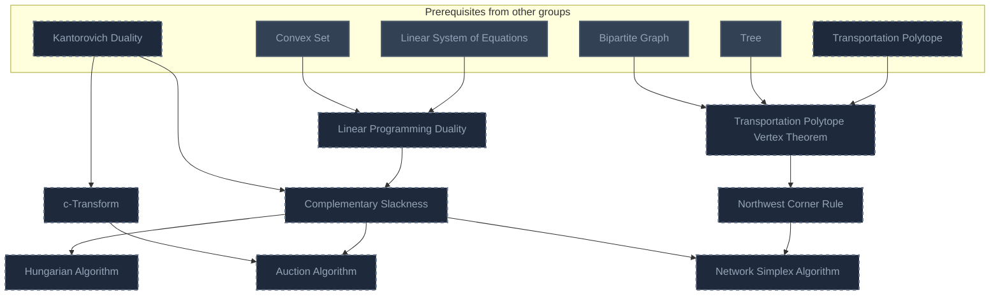
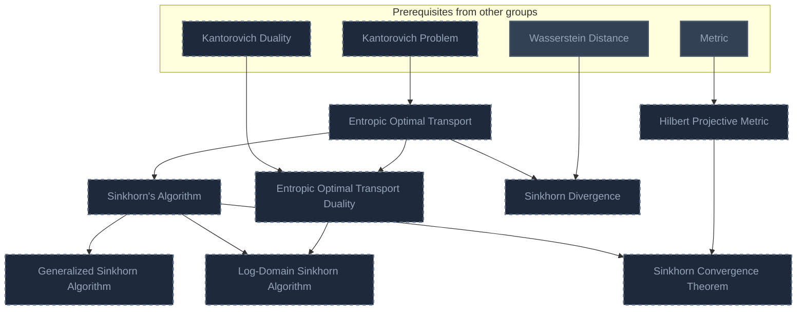
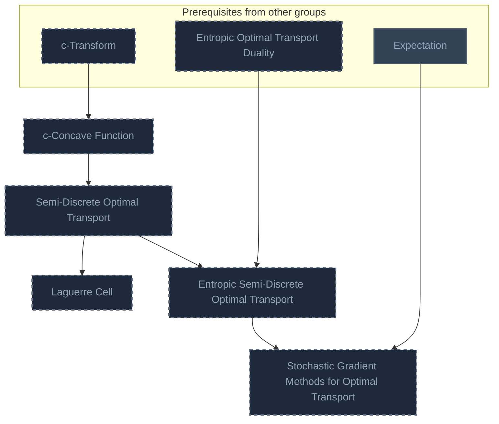
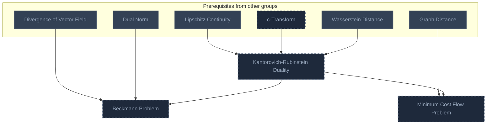
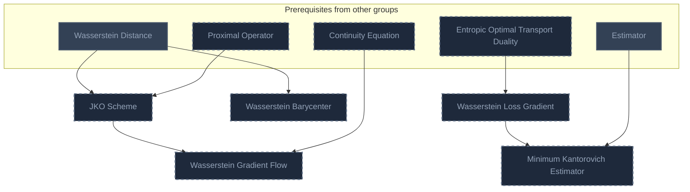

<!-- BEGIN STATS (generated by Scripts/skill_trees.py; do not edit) -->
**Mastered:** 0 / 70 · **Depth:** 0% · **Discovered:** 3 · **Planned:** 67 · **Locked:** 3 · **Rusty:** 0

| | L0 Discovered | L1 Recall | L2 Apply | L3 Prove ★ | L4 Wield | L5 Command |
|---|---:|---:|---:|---:|---:|---:|
| **At this level** | 3 | 0 | 0 | 0 | 0 | 0 |
| **Reached (this level or higher)** | 3 | 0 | 0 | 0 | 0 | 0 |

**Next up:** —

Legend: dashed grey = planned (no note yet) · dark grey = locked · white L0 Discovered · green L1 Recall · blue L2 Apply · purple L3 Prove (Mastered) · orange L4 Wield · gold L5 Command · brown dashed border = rusty
<!-- END STATS -->

## Peyré & Cuturi Ch. 2: Theoretical Foundations
**Reached:** L1 0 · L2 0 · L3 0 · L4 0 · L5 0 (of 17 nodes, 16 planned)

```mermaid
flowchart TD
    classDef planned fill:#1E293B,stroke:#64748B,stroke-width:2px,stroke-dasharray:5 5,color:#94A3B8;
    classDef locked fill:#334155,stroke:#475569,stroke-width:2px,color:#94A3B8;
    classDef L0 fill:#F1F5F9,stroke:#94A3B8,stroke-width:2px,color:#000000;
    classDef L1 fill:#22C55E,stroke:#15803D,stroke-width:2px,color:#000000;
    classDef L2 fill:#3B82F6,stroke:#1D4ED8,stroke-width:3px,color:#FFFFFF;
    classDef L3 fill:#A855F7,stroke:#6B21A8,stroke-width:3px,color:#FFFFFF,font-weight:bold;
    classDef L4 fill:#F97316,stroke:#C2410C,stroke-width:4px,color:#000000,font-weight:bold;
    classDef L5 fill:#FFD700,stroke:#FF8C00,stroke-width:5px,color:#000000,font-weight:bold;
    classDef rusty stroke:#8B4513,stroke-width:4px,stroke-dasharray:3 3;
    subgraph sg_prereqs["Prerequisites from other groups"]
        n_borel_measure["Borel Measure"]
        n_dirac_measure["Dirac Measure"]
        n_probability_mass_function["Probability Mass Function"]
        n_permutation["Permutation"]
        n_measure_measure_theory["Measure (Measure Theory)"]
        n_convex_set["Convex Set"]
        n_marginal_distribution["Marginal Distribution"]
        n_permutation_matrix["Permutation Matrix"]
        n_convergence_in_distribution["Convergence in Distribution"]
        n_absolutely_continuous_measure["Absolutely Continuous Measure"]
        n_convex_function["Convex Function"]
        n_quantile_function["Quantile Function"]
        n_multivariate_normal_distribution["Multivariate Normal Distribution"]
        n_metric_space["Metric Space"]
    end
    n_radon_measure["Radon Measure"]
    n_discrete_measure["Discrete Measure"]
    n_assignment_problem["Assignment Problem"]
    n_push_forward_measure["Push-Forward Measure"]
    n_monge_problem["Monge Problem"]
    n_transportation_polytope["Transportation Polytope"]
    n_coupling_probability["Coupling (Probability)"]
    n_kantorovich_problem["Kantorovich Problem"]
    n_birkhoff_von_neumann_theorem["Birkhoff-von Neumann Theorem"]
    n_weak_convergence_of_measures["Weak Convergence of Measures"]
    n_kantorovich_duality["Kantorovich Duality"]
    n_brenier_s_theorem["Brenier's Theorem"]
    n_monge_amp_re_equation["Monge-Ampère Equation"]
    n_one_dimensional_optimal_transport["One-Dimensional Optimal Transport"]
    n_bures_wasserstein_distance["Bures-Wasserstein Distance"]
    n_total_variation_distance["Total Variation Distance"]
    n_wasserstein_distance["Wasserstein Distance"]
    n_borel_measure --> n_radon_measure
    n_dirac_measure --> n_discrete_measure
    n_probability_mass_function --> n_discrete_measure
    n_permutation --> n_assignment_problem
    n_measure_measure_theory --> n_push_forward_measure
    n_assignment_problem --> n_monge_problem
    n_push_forward_measure --> n_monge_problem
    n_convex_set --> n_transportation_polytope
    n_discrete_measure --> n_transportation_polytope
    n_marginal_distribution --> n_coupling_probability
    n_radon_measure --> n_coupling_probability
    n_push_forward_measure --> n_coupling_probability
    n_monge_problem --> n_kantorovich_problem
    n_transportation_polytope --> n_kantorovich_problem
    n_coupling_probability --> n_kantorovich_problem
    n_permutation_matrix --> n_birkhoff_von_neumann_theorem
    n_transportation_polytope --> n_birkhoff_von_neumann_theorem
    n_convergence_in_distribution --> n_weak_convergence_of_measures
    n_radon_measure --> n_weak_convergence_of_measures
    n_kantorovich_problem --> n_kantorovich_duality
    n_absolutely_continuous_measure --> n_brenier_s_theorem
    n_convex_function --> n_brenier_s_theorem
    n_kantorovich_duality --> n_brenier_s_theorem
    n_brenier_s_theorem --> n_monge_amp_re_equation
    n_quantile_function --> n_one_dimensional_optimal_transport
    n_kantorovich_problem --> n_one_dimensional_optimal_transport
    n_multivariate_normal_distribution --> n_bures_wasserstein_distance
    n_brenier_s_theorem --> n_bures_wasserstein_distance
    n_kantorovich_problem --> n_total_variation_distance
    n_kantorovich_problem --> n_wasserstein_distance
    n_metric_space --> n_wasserstein_distance
    n_wasserstein_distance --> n_bures_wasserstein_distance
    class n_radon_measure,n_discrete_measure,n_assignment_problem,n_push_forward_measure,n_monge_problem,n_transportation_polytope,n_coupling_probability,n_kantorovich_problem,n_birkhoff_von_neumann_theorem,n_weak_convergence_of_measures,n_kantorovich_duality,n_brenier_s_theorem,n_monge_amp_re_equation,n_one_dimensional_optimal_transport,n_bures_wasserstein_distance,n_total_variation_distance planned;
    class n_borel_measure,n_dirac_measure,n_probability_mass_function,n_measure_measure_theory,n_convex_set,n_marginal_distribution,n_permutation_matrix,n_convergence_in_distribution,n_absolutely_continuous_measure,n_quantile_function,n_multivariate_normal_distribution,n_metric_space,n_wasserstein_distance locked;
    class n_permutation,n_convex_function L0;
    class n_borel_measure,n_dirac_measure,n_probability_mass_function,n_permutation,n_measure_measure_theory,n_convex_set,n_marginal_distribution,n_permutation_matrix,n_convergence_in_distribution,n_absolutely_continuous_measure,n_convex_function,n_quantile_function,n_multivariate_normal_distribution,n_metric_space,n_wasserstein_distance internal-link;
```



## Peyré & Cuturi Ch. 3: Algorithmic Foundations
**Reached:** L1 0 · L2 0 · L3 0 · L4 0 · L5 0 (of 8 nodes, 8 planned)



## Peyré & Cuturi Ch. 4: Entropic Regularization of Optimal Transport
**Reached:** L1 0 · L2 0 · L3 0 · L4 0 · L5 0 (of 8 nodes, 8 planned)



## Peyré & Cuturi Ch. 5: Semi-Discrete Optimal Transport
**Reached:** L1 0 · L2 0 · L3 0 · L4 0 · L5 0 (of 5 nodes, 5 planned)



## Peyré & Cuturi Ch. 6: W1 Optimal Transport
**Reached:** L1 0 · L2 0 · L3 0 · L4 0 · L5 0 (of 3 nodes, 3 planned)



## Peyré & Cuturi Ch. 7: Dynamic Formulations
**Reached:** L1 0 · L2 0 · L3 0 · L4 0 · L5 0 (of 8 nodes, 8 planned)



```mermaid
flowchart TD
    classDef planned fill:#1E293B,stroke:#64748B,stroke-width:2px,stroke-dasharray:5 5,color:#94A3B8;
    classDef locked fill:#334155,stroke:#475569,stroke-width:2px,color:#94A3B8;
    classDef L0 fill:#F1F5F9,stroke:#94A3B8,stroke-width:2px,color:#000000;
    classDef L1 fill:#22C55E,stroke:#15803D,stroke-width:2px,color:#000000;
    classDef L2 fill:#3B82F6,stroke:#1D4ED8,stroke-width:3px,color:#FFFFFF;
    classDef L3 fill:#A855F7,stroke:#6B21A8,stroke-width:3px,color:#FFFFFF,font-weight:bold;
    classDef L4 fill:#F97316,stroke:#C2410C,stroke-width:4px,color:#000000,font-weight:bold;
    classDef L5 fill:#FFD700,stroke:#FF8C00,stroke-width:5px,color:#000000,font-weight:bold;
    classDef rusty stroke:#8B4513,stroke-width:4px,stroke-dasharray:3 3;
    subgraph sg_prereqs["Prerequisites from other groups"]
        n_divergence_of_vector_field["Divergence of Vector Field"]
        n_transport_equation["Transport Equation"]
        n_brenier_s_theorem["Brenier's Theorem"]
        n_convex_function["Convex Function"]
        n_brownian_motion["Brownian Motion"]
        n_entropic_optimal_transport["Entropic Optimal Transport"]
        n_wasserstein_distance["Wasserstein Distance"]
    end
    n_continuity_equation["Continuity Equation"]
    n_displacement_interpolation["Displacement Interpolation"]
    n_benamou_brenier_formula["Benamou-Brenier Formula"]
    n_staggered_grid_discretization["Staggered Grid Discretization"]
    n_proximal_operator["Proximal Operator"]
    n_douglas_rachford_splitting["Douglas-Rachford Splitting"]
    n_wasserstein_fisher_rao_distance["Wasserstein-Fisher-Rao Distance"]
    n_schr_dinger_problem["Schrödinger Problem"]
    n_divergence_of_vector_field --> n_continuity_equation
    n_transport_equation --> n_continuity_equation
    n_brenier_s_theorem --> n_displacement_interpolation
    n_continuity_equation --> n_benamou_brenier_formula
    n_displacement_interpolation --> n_benamou_brenier_formula
    n_benamou_brenier_formula --> n_staggered_grid_discretization
    n_convex_function --> n_proximal_operator
    n_proximal_operator --> n_douglas_rachford_splitting
    n_benamou_brenier_formula --> n_wasserstein_fisher_rao_distance
    n_brownian_motion --> n_schr_dinger_problem
    n_entropic_optimal_transport --> n_schr_dinger_problem
    n_benamou_brenier_formula --> n_schr_dinger_problem
    n_wasserstein_distance --> n_wasserstein_fisher_rao_distance
    class n_brenier_s_theorem,n_entropic_optimal_transport,n_continuity_equation,n_displacement_interpolation,n_benamou_brenier_formula,n_staggered_grid_discretization,n_proximal_operator,n_douglas_rachford_splitting,n_wasserstein_fisher_rao_distance,n_schr_dinger_problem planned;
    class n_divergence_of_vector_field,n_transport_equation,n_brownian_motion,n_wasserstein_distance locked;
    class n_convex_function L0;
    class n_divergence_of_vector_field,n_transport_equation,n_convex_function,n_brownian_motion,n_wasserstein_distance internal-link;
```

## Peyré & Cuturi Ch. 8: Statistical Divergences
**Reached:** L1 0 · L2 0 · L3 0 · L4 0 · L5 0 (of 7 nodes, 7 planned)

```mermaid
flowchart TD
    classDef planned fill:#1E293B,stroke:#64748B,stroke-width:2px,stroke-dasharray:5 5,color:#94A3B8;
    classDef locked fill:#334155,stroke:#475569,stroke-width:2px,color:#94A3B8;
    classDef L0 fill:#F1F5F9,stroke:#94A3B8,stroke-width:2px,color:#000000;
    classDef L1 fill:#22C55E,stroke:#15803D,stroke-width:2px,color:#000000;
    classDef L2 fill:#3B82F6,stroke:#1D4ED8,stroke-width:3px,color:#FFFFFF;
    classDef L3 fill:#A855F7,stroke:#6B21A8,stroke-width:3px,color:#FFFFFF,font-weight:bold;
    classDef L4 fill:#F97316,stroke:#C2410C,stroke-width:4px,color:#000000,font-weight:bold;
    classDef L5 fill:#FFD700,stroke:#FF8C00,stroke-width:5px,color:#000000,font-weight:bold;
    classDef rusty stroke:#8B4513,stroke-width:4px,stroke-dasharray:3 3;
    subgraph sg_prereqs["Prerequisites from other groups"]
        n_absolutely_continuous_measure["Absolutely Continuous Measure"]
        n_convex_function["Convex Function"]
        n_expectation["Expectation"]
        n_radon_measure["Radon Measure"]
        n_hilbert_space["Hilbert Space"]
        n_dirac_measure["Dirac Measure"]
        n_empirical_distribution_function["Empirical Distribution Function"]
        n_wasserstein_distance["Wasserstein Distance"]
    end
    n_phi_divergence["Phi-Divergence"]
    n_hellinger_distance["Hellinger Distance"]
    n_integral_probability_metric["Integral Probability Metric"]
    n_maximum_mean_discrepancy["Maximum Mean Discrepancy"]
    n_negative_definite_kernel["Negative Definite Kernel"]
    n_empirical_measure["Empirical Measure"]
    n_optimal_transport_sample_complexity["Optimal Transport Sample Complexity"]
    n_absolutely_continuous_measure --> n_phi_divergence
    n_convex_function --> n_phi_divergence
    n_phi_divergence --> n_hellinger_distance
    n_expectation --> n_integral_probability_metric
    n_radon_measure --> n_integral_probability_metric
    n_hilbert_space --> n_maximum_mean_discrepancy
    n_integral_probability_metric --> n_maximum_mean_discrepancy
    n_hilbert_space --> n_negative_definite_kernel
    n_dirac_measure --> n_empirical_measure
    n_empirical_distribution_function --> n_empirical_measure
    n_empirical_measure --> n_optimal_transport_sample_complexity
    n_wasserstein_distance --> n_optimal_transport_sample_complexity
    class n_radon_measure,n_phi_divergence,n_hellinger_distance,n_integral_probability_metric,n_maximum_mean_discrepancy,n_negative_definite_kernel,n_empirical_measure,n_optimal_transport_sample_complexity planned;
    class n_absolutely_continuous_measure,n_expectation,n_hilbert_space,n_dirac_measure,n_empirical_distribution_function,n_wasserstein_distance locked;
    class n_convex_function L0;
    class n_absolutely_continuous_measure,n_convex_function,n_expectation,n_hilbert_space,n_dirac_measure,n_empirical_distribution_function,n_wasserstein_distance internal-link;
```



## Peyré & Cuturi Ch. 9: Variational Wasserstein Problems
**Reached:** L1 0 · L2 0 · L3 0 · L4 0 · L5 0 (of 5 nodes, 5 planned)



## Peyré & Cuturi Ch. 10: Extensions of Optimal Transport
**Reached:** L1 0 · L2 0 · L3 0 · L4 0 · L5 0 (of 9 nodes, 7 planned)

```mermaid
flowchart TD
    classDef planned fill:#1E293B,stroke:#64748B,stroke-width:2px,stroke-dasharray:5 5,color:#94A3B8;
    classDef locked fill:#334155,stroke:#475569,stroke-width:2px,color:#94A3B8;
    classDef L0 fill:#F1F5F9,stroke:#94A3B8,stroke-width:2px,color:#000000;
    classDef L1 fill:#22C55E,stroke:#15803D,stroke-width:2px,color:#000000;
    classDef L2 fill:#3B82F6,stroke:#1D4ED8,stroke-width:3px,color:#FFFFFF;
    classDef L3 fill:#A855F7,stroke:#6B21A8,stroke-width:3px,color:#FFFFFF,font-weight:bold;
    classDef L4 fill:#F97316,stroke:#C2410C,stroke-width:4px,color:#000000,font-weight:bold;
    classDef L5 fill:#FFD700,stroke:#FF8C00,stroke-width:5px,color:#000000,font-weight:bold;
    classDef rusty stroke:#8B4513,stroke-width:4px,stroke-dasharray:3 3;
    subgraph sg_prereqs["Prerequisites from other groups"]
        n_kantorovich_problem["Kantorovich Problem"]
        n_phi_divergence["Phi-Divergence"]
        n_conditional_expectation["Conditional Expectation"]
        n_one_dimensional_optimal_transport["One-Dimensional Optimal Transport"]
        n_positive_semidefinite_matrix["Positive Semidefinite Matrix"]
        n_entropic_optimal_transport["Entropic Optimal Transport"]
        n_metric_space["Metric Space"]
        n_jacobian_matrix["Jacobian Matrix"]
        n_lower_triangular_matrix["Lower Triangular Matrix"]
        n_absolutely_continuous_measure["Absolutely Continuous Measure"]
        n_conditional_distribution["Conditional Distribution"]
        n_quantile_function["Quantile Function"]
        n_wasserstein_distance["Wasserstein Distance"]
        n_inverse_transform_sampling["Inverse Transform Sampling"]
    end
    n_multi_marginal_optimal_transport["Multi-Marginal Optimal Transport"]
    n_unbalanced_optimal_transport["Unbalanced Optimal Transport"]
    n_martingale_optimal_transport["Martingale Optimal Transport"]
    n_sliced_wasserstein_distance["Sliced Wasserstein Distance"]
    n_quantum_optimal_transport["Quantum Optimal Transport"]
    n_gromov_hausdorff_distance["Gromov-Hausdorff Distance"]
    n_gromov_wasserstein_distance["Gromov-Wasserstein Distance"]
    n_monotone_triangular_map["Monotone Triangular Map"]
    n_knothe_rosenblatt_rearrangement["Knothe-Rosenblatt Rearrangement"]
    n_kantorovich_problem --> n_multi_marginal_optimal_transport
    n_kantorovich_problem --> n_unbalanced_optimal_transport
    n_phi_divergence --> n_unbalanced_optimal_transport
    n_conditional_expectation --> n_martingale_optimal_transport
    n_kantorovich_problem --> n_martingale_optimal_transport
    n_one_dimensional_optimal_transport --> n_sliced_wasserstein_distance
    n_positive_semidefinite_matrix --> n_quantum_optimal_transport
    n_entropic_optimal_transport --> n_quantum_optimal_transport
    n_metric_space --> n_gromov_hausdorff_distance
    n_metric_space --> n_gromov_wasserstein_distance
    n_jacobian_matrix --> n_monotone_triangular_map
    n_lower_triangular_matrix --> n_monotone_triangular_map
    n_absolutely_continuous_measure --> n_knothe_rosenblatt_rearrangement
    n_monotone_triangular_map --> n_knothe_rosenblatt_rearrangement
    n_conditional_distribution --> n_knothe_rosenblatt_rearrangement
    n_quantile_function --> n_knothe_rosenblatt_rearrangement
    n_wasserstein_distance --> n_gromov_wasserstein_distance
    n_inverse_transform_sampling --> n_knothe_rosenblatt_rearrangement
    class n_kantorovich_problem,n_phi_divergence,n_one_dimensional_optimal_transport,n_entropic_optimal_transport,n_multi_marginal_optimal_transport,n_unbalanced_optimal_transport,n_martingale_optimal_transport,n_sliced_wasserstein_distance,n_quantum_optimal_transport,n_gromov_hausdorff_distance,n_gromov_wasserstein_distance planned;
    class n_positive_semidefinite_matrix,n_metric_space,n_jacobian_matrix,n_lower_triangular_matrix,n_absolutely_continuous_measure,n_quantile_function,n_wasserstein_distance,n_inverse_transform_sampling,n_monotone_triangular_map,n_knothe_rosenblatt_rearrangement locked;
    class n_conditional_expectation,n_conditional_distribution L1;
    class n_conditional_expectation,n_positive_semidefinite_matrix,n_metric_space,n_jacobian_matrix,n_lower_triangular_matrix,n_absolutely_continuous_measure,n_conditional_distribution,n_quantile_function,n_wasserstein_distance,n_inverse_transform_sampling,n_monotone_triangular_map,n_knothe_rosenblatt_rearrangement internal-link;
```



# Source
Graph structure: the single source for the diagrams above, edited by `/note` and `Scripts/skill_trees.py` (`add`, `edge`, `rename`). Everything above this heading is regenerated by `render`.

```skilltree
    %% PREREQUISITES
    n_permutation["Permutation"]
    n_divergence_of_vector_field["Divergence of Vector Field"]
    n_dual_norm["Dual Norm"]
    n_hilbert_space["Hilbert Space"]
    n_linear_system_of_equations["Linear System of Equations"]
    n_permutation_matrix["Permutation Matrix"]
    n_positive_semidefinite_matrix["Positive Semidefinite Matrix"]
    n_conditional_expectation["Conditional Expectation"]
    n_convergence_in_distribution["Convergence in Distribution"]
    n_convex_function["Convex Function"]
    n_empirical_distribution_function["Empirical Distribution Function"]
    n_estimator["Estimator"]
    n_expectation["Expectation"]
    n_marginal_distribution["Marginal Distribution"]
    n_multivariate_normal_distribution["Multivariate Normal Distribution"]
    n_probability_mass_function["Probability Mass Function"]
    n_quantile_function["Quantile Function"]
    n_absolutely_continuous_measure["Absolutely Continuous Measure"]
    n_borel_measure["Borel Measure"]
    n_dirac_measure["Dirac Measure"]
    n_measure_measure_theory["Measure (Measure Theory)"]
    n_brownian_motion["Brownian Motion"]
    n_transport_equation["Transport Equation"]
    n_convex_set["Convex Set"]
    n_lipschitz_continuity["Lipschitz Continuity"]
    n_metric["Metric"]
    n_metric_space["Metric Space"]
    n_bipartite_graph["Bipartite Graph"]
    n_graph_distance["Graph Distance"]
    n_tree["Tree"]
    n_jacobian_matrix["Jacobian Matrix"]
    n_lower_triangular_matrix["Lower Triangular Matrix"]
    n_conditional_distribution["Conditional Distribution"]
    n_inverse_transform_sampling["Inverse Transform Sampling"]
    %% NODES
    %% == Peyré & Cuturi Ch. 2: Theoretical Foundations ==
    n_radon_measure["Radon Measure"]
    n_discrete_measure["Discrete Measure"]
    n_assignment_problem["Assignment Problem"]
    n_push_forward_measure["Push-Forward Measure"]
    n_monge_problem["Monge Problem"]
    n_transportation_polytope["Transportation Polytope"]
    n_coupling_probability["Coupling (Probability)"]
    n_kantorovich_problem["Kantorovich Problem"]
    n_birkhoff_von_neumann_theorem["Birkhoff-von Neumann Theorem"]
    n_weak_convergence_of_measures["Weak Convergence of Measures"]
    n_kantorovich_duality["Kantorovich Duality"]
    n_brenier_s_theorem["Brenier's Theorem"]
    n_monge_amp_re_equation["Monge-Ampère Equation"]
    n_one_dimensional_optimal_transport["One-Dimensional Optimal Transport"]
    n_bures_wasserstein_distance["Bures-Wasserstein Distance"]
    n_total_variation_distance["Total Variation Distance"]
    n_wasserstein_distance["Wasserstein Distance"]
    %% == Peyré & Cuturi Ch. 3: Algorithmic Foundations ==
    n_linear_programming_duality["Linear Programming Duality"]
    n_c_transform["c-Transform"]
    n_complementary_slackness["Complementary Slackness"]
    n_transportation_polytope_vertex_theorem["Transportation Polytope Vertex Theorem"]
    n_northwest_corner_rule["Northwest Corner Rule"]
    n_network_simplex_algorithm["Network Simplex Algorithm"]
    n_hungarian_algorithm["Hungarian Algorithm"]
    n_auction_algorithm["Auction Algorithm"]
    %% == Peyré & Cuturi Ch. 4: Entropic Regularization of Optimal Transport ==
    n_entropic_optimal_transport["Entropic Optimal Transport"]
    n_sinkhorn_s_algorithm["Sinkhorn's Algorithm"]
    n_hilbert_projective_metric["Hilbert Projective Metric"]
    n_sinkhorn_convergence_theorem["Sinkhorn Convergence Theorem"]
    n_entropic_optimal_transport_duality["Entropic Optimal Transport Duality"]
    n_log_domain_sinkhorn_algorithm["Log-Domain Sinkhorn Algorithm"]
    n_sinkhorn_divergence["Sinkhorn Divergence"]
    n_generalized_sinkhorn_algorithm["Generalized Sinkhorn Algorithm"]
    %% == Peyré & Cuturi Ch. 5: Semi-Discrete Optimal Transport ==
    n_c_concave_function["c-Concave Function"]
    n_semi_discrete_optimal_transport["Semi-Discrete Optimal Transport"]
    n_laguerre_cell["Laguerre Cell"]
    n_entropic_semi_discrete_optimal_transport["Entropic Semi-Discrete Optimal Transport"]
    n_stochastic_gradient_methods_for_optimal_transport["Stochastic Gradient Methods for Optimal Transport"]
    %% == Peyré & Cuturi Ch. 6: W1 Optimal Transport ==
    n_kantorovich_rubinstein_duality["Kantorovich-Rubinstein Duality"]
    n_beckmann_problem["Beckmann Problem"]
    n_minimum_cost_flow_problem["Minimum Cost Flow Problem"]
    %% == Peyré & Cuturi Ch. 7: Dynamic Formulations ==
    n_continuity_equation["Continuity Equation"]
    n_displacement_interpolation["Displacement Interpolation"]
    n_benamou_brenier_formula["Benamou-Brenier Formula"]
    n_staggered_grid_discretization["Staggered Grid Discretization"]
    n_proximal_operator["Proximal Operator"]
    n_douglas_rachford_splitting["Douglas-Rachford Splitting"]
    n_wasserstein_fisher_rao_distance["Wasserstein-Fisher-Rao Distance"]
    n_schr_dinger_problem["Schrödinger Problem"]
    %% == Peyré & Cuturi Ch. 8: Statistical Divergences ==
    n_phi_divergence["Phi-Divergence"]
    n_hellinger_distance["Hellinger Distance"]
    n_integral_probability_metric["Integral Probability Metric"]
    n_maximum_mean_discrepancy["Maximum Mean Discrepancy"]
    n_negative_definite_kernel["Negative Definite Kernel"]
    n_empirical_measure["Empirical Measure"]
    n_optimal_transport_sample_complexity["Optimal Transport Sample Complexity"]
    %% == Peyré & Cuturi Ch. 9: Variational Wasserstein Problems ==
    n_wasserstein_loss_gradient["Wasserstein Loss Gradient"]
    n_wasserstein_barycenter["Wasserstein Barycenter"]
    n_jko_scheme["JKO Scheme"]
    n_wasserstein_gradient_flow["Wasserstein Gradient Flow"]
    n_minimum_kantorovich_estimator["Minimum Kantorovich Estimator"]
    %% == Peyré & Cuturi Ch. 10: Extensions of Optimal Transport ==
    n_multi_marginal_optimal_transport["Multi-Marginal Optimal Transport"]
    n_unbalanced_optimal_transport["Unbalanced Optimal Transport"]
    n_martingale_optimal_transport["Martingale Optimal Transport"]
    n_sliced_wasserstein_distance["Sliced Wasserstein Distance"]
    n_quantum_optimal_transport["Quantum Optimal Transport"]
    n_gromov_hausdorff_distance["Gromov-Hausdorff Distance"]
    n_gromov_wasserstein_distance["Gromov-Wasserstein Distance"]
    n_monotone_triangular_map["Monotone Triangular Map"]
    n_knothe_rosenblatt_rearrangement["Knothe-Rosenblatt Rearrangement"]
    %% EDGES
    n_borel_measure --> n_radon_measure
    n_dirac_measure --> n_discrete_measure
    n_probability_mass_function --> n_discrete_measure
    n_permutation --> n_assignment_problem
    n_measure_measure_theory --> n_push_forward_measure
    n_assignment_problem --> n_monge_problem
    n_push_forward_measure --> n_monge_problem
    n_convex_set --> n_transportation_polytope
    n_discrete_measure --> n_transportation_polytope
    n_marginal_distribution --> n_coupling_probability
    n_radon_measure --> n_coupling_probability
    n_push_forward_measure --> n_coupling_probability
    n_monge_problem --> n_kantorovich_problem
    n_transportation_polytope --> n_kantorovich_problem
    n_coupling_probability --> n_kantorovich_problem
    n_permutation_matrix --> n_birkhoff_von_neumann_theorem
    n_transportation_polytope --> n_birkhoff_von_neumann_theorem
    n_convergence_in_distribution --> n_weak_convergence_of_measures
    n_radon_measure --> n_weak_convergence_of_measures
    n_kantorovich_problem --> n_kantorovich_duality
    n_absolutely_continuous_measure --> n_brenier_s_theorem
    n_convex_function --> n_brenier_s_theorem
    n_kantorovich_duality --> n_brenier_s_theorem
    n_brenier_s_theorem --> n_monge_amp_re_equation
    n_quantile_function --> n_one_dimensional_optimal_transport
    n_kantorovich_problem --> n_one_dimensional_optimal_transport
    n_multivariate_normal_distribution --> n_bures_wasserstein_distance
    n_brenier_s_theorem --> n_bures_wasserstein_distance
    n_kantorovich_problem --> n_total_variation_distance
    n_convex_set --> n_linear_programming_duality
    n_linear_system_of_equations --> n_linear_programming_duality
    n_kantorovich_duality --> n_c_transform
    n_kantorovich_duality --> n_complementary_slackness
    n_linear_programming_duality --> n_complementary_slackness
    n_bipartite_graph --> n_transportation_polytope_vertex_theorem
    n_tree --> n_transportation_polytope_vertex_theorem
    n_transportation_polytope --> n_transportation_polytope_vertex_theorem
    n_transportation_polytope_vertex_theorem --> n_northwest_corner_rule
    n_complementary_slackness --> n_network_simplex_algorithm
    n_northwest_corner_rule --> n_network_simplex_algorithm
    n_complementary_slackness --> n_hungarian_algorithm
    n_c_transform --> n_auction_algorithm
    n_complementary_slackness --> n_auction_algorithm
    n_kantorovich_problem --> n_entropic_optimal_transport
    n_entropic_optimal_transport --> n_sinkhorn_s_algorithm
    n_metric --> n_hilbert_projective_metric
    n_sinkhorn_s_algorithm --> n_sinkhorn_convergence_theorem
    n_hilbert_projective_metric --> n_sinkhorn_convergence_theorem
    n_kantorovich_duality --> n_entropic_optimal_transport_duality
    n_entropic_optimal_transport --> n_entropic_optimal_transport_duality
    n_sinkhorn_s_algorithm --> n_log_domain_sinkhorn_algorithm
    n_entropic_optimal_transport_duality --> n_log_domain_sinkhorn_algorithm
    n_entropic_optimal_transport --> n_sinkhorn_divergence
    n_sinkhorn_s_algorithm --> n_generalized_sinkhorn_algorithm
    n_c_transform --> n_c_concave_function
    n_c_concave_function --> n_semi_discrete_optimal_transport
    n_semi_discrete_optimal_transport --> n_laguerre_cell
    n_entropic_optimal_transport_duality --> n_entropic_semi_discrete_optimal_transport
    n_semi_discrete_optimal_transport --> n_entropic_semi_discrete_optimal_transport
    n_expectation --> n_stochastic_gradient_methods_for_optimal_transport
    n_entropic_semi_discrete_optimal_transport --> n_stochastic_gradient_methods_for_optimal_transport
    n_lipschitz_continuity --> n_kantorovich_rubinstein_duality
    n_c_transform --> n_kantorovich_rubinstein_duality
    n_divergence_of_vector_field --> n_beckmann_problem
    n_dual_norm --> n_beckmann_problem
    n_kantorovich_rubinstein_duality --> n_beckmann_problem
    n_graph_distance --> n_minimum_cost_flow_problem
    n_kantorovich_rubinstein_duality --> n_minimum_cost_flow_problem
    n_divergence_of_vector_field --> n_continuity_equation
    n_transport_equation --> n_continuity_equation
    n_brenier_s_theorem --> n_displacement_interpolation
    n_continuity_equation --> n_benamou_brenier_formula
    n_displacement_interpolation --> n_benamou_brenier_formula
    n_benamou_brenier_formula --> n_staggered_grid_discretization
    n_convex_function --> n_proximal_operator
    n_proximal_operator --> n_douglas_rachford_splitting
    n_benamou_brenier_formula --> n_wasserstein_fisher_rao_distance
    n_brownian_motion --> n_schr_dinger_problem
    n_entropic_optimal_transport --> n_schr_dinger_problem
    n_benamou_brenier_formula --> n_schr_dinger_problem
    n_absolutely_continuous_measure --> n_phi_divergence
    n_convex_function --> n_phi_divergence
    n_phi_divergence --> n_hellinger_distance
    n_expectation --> n_integral_probability_metric
    n_radon_measure --> n_integral_probability_metric
    n_hilbert_space --> n_maximum_mean_discrepancy
    n_integral_probability_metric --> n_maximum_mean_discrepancy
    n_hilbert_space --> n_negative_definite_kernel
    n_dirac_measure --> n_empirical_measure
    n_empirical_distribution_function --> n_empirical_measure
    n_empirical_measure --> n_optimal_transport_sample_complexity
    n_entropic_optimal_transport_duality --> n_wasserstein_loss_gradient
    n_proximal_operator --> n_jko_scheme
    n_continuity_equation --> n_wasserstein_gradient_flow
    n_jko_scheme --> n_wasserstein_gradient_flow
    n_estimator --> n_minimum_kantorovich_estimator
    n_wasserstein_loss_gradient --> n_minimum_kantorovich_estimator
    n_kantorovich_problem --> n_multi_marginal_optimal_transport
    n_kantorovich_problem --> n_unbalanced_optimal_transport
    n_phi_divergence --> n_unbalanced_optimal_transport
    n_conditional_expectation --> n_martingale_optimal_transport
    n_kantorovich_problem --> n_martingale_optimal_transport
    n_one_dimensional_optimal_transport --> n_sliced_wasserstein_distance
    n_positive_semidefinite_matrix --> n_quantum_optimal_transport
    n_entropic_optimal_transport --> n_quantum_optimal_transport
    n_metric_space --> n_gromov_hausdorff_distance
    n_metric_space --> n_gromov_wasserstein_distance
    n_jacobian_matrix --> n_monotone_triangular_map
    n_lower_triangular_matrix --> n_monotone_triangular_map
    n_absolutely_continuous_measure --> n_knothe_rosenblatt_rearrangement
    n_monotone_triangular_map --> n_knothe_rosenblatt_rearrangement
    n_conditional_distribution --> n_knothe_rosenblatt_rearrangement
    n_quantile_function --> n_knothe_rosenblatt_rearrangement
    n_kantorovich_problem --> n_wasserstein_distance
    n_metric_space --> n_wasserstein_distance
    n_wasserstein_distance --> n_wasserstein_barycenter
    n_wasserstein_distance --> n_gromov_wasserstein_distance
    n_wasserstein_distance --> n_bures_wasserstein_distance
    n_wasserstein_distance --> n_kantorovich_rubinstein_duality
    n_wasserstein_distance --> n_wasserstein_fisher_rao_distance
    n_wasserstein_distance --> n_jko_scheme
    n_wasserstein_distance --> n_optimal_transport_sample_complexity
    n_wasserstein_distance --> n_sinkhorn_divergence
    n_inverse_transform_sampling --> n_knothe_rosenblatt_rearrangement
```
