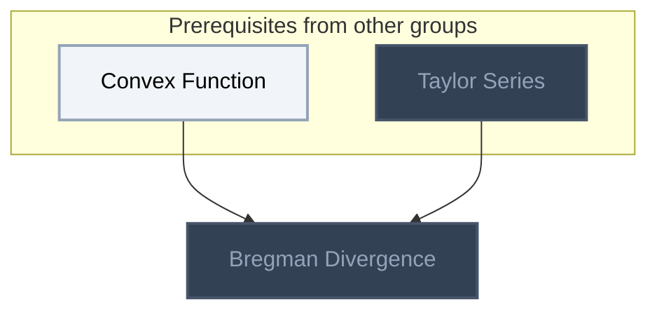

<!-- BEGIN STATS (generated by Scripts/skill_trees.py; do not edit) -->
**Mastered:** 0 / 18 · **Depth:** 0% · **Discovered:** 18 · **Planned:** 0 · **Locked:** 17 · **Rusty:** 0

| | L0 Discovered | L1 Recall | L2 Apply | L3 Prove ★ | L4 Wield | L5 Command |
|---|---:|---:|---:|---:|---:|---:|
| **At this level** | 18 | 0 | 0 | 0 | 0 | 0 |
| **Reached (this level or higher)** | 18 | 0 | 0 | 0 | 0 | 0 |

**Next up:** [[Global Minimum]]

Legend: dashed grey = planned (no note yet) · dark grey = locked · white L0 Discovered · green L1 Recall · blue L2 Apply · purple L3 Prove (Mastered) · orange L4 Wield · gold L5 Command · brown dashed border = rusty
<!-- END STATS -->

## Convex Analysis
**Reached:** L1 0 · L2 0 · L3 0 · L4 0 · L5 0 (of 1 nodes)



## Gradient-Based Optimization
**Reached:** L1 0 · L2 0 · L3 0 · L4 0 · L5 0 (of 17 nodes)

```mermaid
flowchart TD
    classDef planned fill:#1E293B,stroke:#64748B,stroke-width:2px,stroke-dasharray:5 5,color:#94A3B8;
    classDef locked fill:#334155,stroke:#475569,stroke-width:2px,color:#94A3B8;
    classDef L0 fill:#F1F5F9,stroke:#94A3B8,stroke-width:2px,color:#000000;
    classDef L1 fill:#22C55E,stroke:#15803D,stroke-width:2px,color:#000000;
    classDef L2 fill:#3B82F6,stroke:#1D4ED8,stroke-width:3px,color:#FFFFFF;
    classDef L3 fill:#A855F7,stroke:#6B21A8,stroke-width:3px,color:#FFFFFF,font-weight:bold;
    classDef L4 fill:#F97316,stroke:#C2410C,stroke-width:4px,color:#000000,font-weight:bold;
    classDef L5 fill:#FFD700,stroke:#FF8C00,stroke-width:5px,color:#000000,font-weight:bold;
    classDef rusty stroke:#8B4513,stroke-width:4px,stroke-dasharray:3 3;
    subgraph sg_prereqs["Prerequisites from other groups"]
        n_cost_function["Cost Function"]
        n_gradient_vector["Gradient Vector"]
        n_hessian_matrix["Hessian Matrix"]
        n_gradient_based_learning["Gradient-Based Learning"]
        n_local_minimum["Local Minimum"]
        n_standard_deviation["Standard Deviation"]
        n_bregman_divergence["Bregman Divergence"]
        n_kullback_leibler_divergence["Kullback-Leibler Divergence"]
    end
    n_operating_point["Operating Point"]
    n_zeroth_order_optimization["Zeroth-Order Optimization"]
    n_first_order_optimization["First-Order Optimization"]
    n_higher_order_optimization["Higher-Order Optimization"]
    n_global_minimum["Global Minimum"]
    n_suboptimal_local_minimum["Suboptimal Local Minimum"]
    n_saddle_point["Saddle Point"]
    n_gradient_descent["Gradient Descent"]
    n_learning_rate["Learning Rate"]
    n_learning_rate_schedule["Learning Rate Schedule"]
    n_stochastic_gradient_descent["Stochastic Gradient Descent"]
    n_batch_size["Batch Size"]
    n_gradient_descent_with_momentum["Gradient Descent with Momentum"]
    n_line_search["Line Search"]
    n_newton_s_method_optimization["Newton's Method (Optimization)"]
    n_evolution_strategy["Evolution Strategy"]
    n_mirror_descent["Mirror Descent"]
    n_cost_function --> n_operating_point
    n_operating_point --> n_zeroth_order_optimization
    n_gradient_vector --> n_first_order_optimization
    n_operating_point --> n_first_order_optimization
    n_operating_point --> n_higher_order_optimization
    n_hessian_matrix --> n_higher_order_optimization
    n_first_order_optimization --> n_gradient_descent
    n_gradient_descent --> n_learning_rate
    n_gradient_based_learning --> n_learning_rate
    n_learning_rate --> n_learning_rate_schedule
    n_gradient_descent --> n_stochastic_gradient_descent
    n_stochastic_gradient_descent --> n_batch_size
    n_learning_rate --> n_gradient_descent_with_momentum
    n_local_minimum --> n_suboptimal_local_minimum
    n_global_minimum --> n_suboptimal_local_minimum
    n_gradient_descent --> n_suboptimal_local_minimum
    n_standard_deviation --> n_evolution_strategy
    n_zeroth_order_optimization --> n_evolution_strategy
    n_gradient_descent --> n_evolution_strategy
    n_local_minimum --> n_global_minimum
    n_hessian_matrix --> n_saddle_point
    n_higher_order_optimization --> n_newton_s_method_optimization
    n_hessian_matrix --> n_newton_s_method_optimization
    n_learning_rate --> n_line_search
    n_gradient_descent --> n_mirror_descent
    n_bregman_divergence --> n_mirror_descent
    n_kullback_leibler_divergence --> n_mirror_descent
    class n_gradient_vector,n_hessian_matrix,n_gradient_based_learning,n_standard_deviation,n_bregman_divergence,n_kullback_leibler_divergence,n_operating_point,n_zeroth_order_optimization,n_first_order_optimization,n_higher_order_optimization,n_suboptimal_local_minimum,n_saddle_point,n_gradient_descent,n_learning_rate,n_learning_rate_schedule,n_stochastic_gradient_descent,n_batch_size,n_gradient_descent_with_momentum,n_line_search,n_newton_s_method_optimization,n_evolution_strategy,n_mirror_descent locked;
    class n_cost_function,n_global_minimum L0;
    class n_local_minimum L2;
    class n_cost_function,n_gradient_vector,n_hessian_matrix,n_gradient_based_learning,n_local_minimum,n_standard_deviation,n_bregman_divergence,n_kullback_leibler_divergence,n_operating_point,n_zeroth_order_optimization,n_first_order_optimization,n_higher_order_optimization,n_global_minimum,n_suboptimal_local_minimum,n_saddle_point,n_gradient_descent,n_learning_rate,n_learning_rate_schedule,n_stochastic_gradient_descent,n_batch_size,n_gradient_descent_with_momentum,n_line_search,n_newton_s_method_optimization,n_evolution_strategy,n_mirror_descent internal-link;
```



# Source
Graph structure: the single source for the diagrams above, edited by `/note` and `Scripts/skill_trees.py` (`add`, `edge`, `rename`). Everything above this heading is regenerated by `render`.

```skilltree
    %% PREREQUISITES
    n_convex_function["Convex Function"]
    n_taylor_series["Taylor Series"]
    n_cost_function["Cost Function"]
    n_gradient_vector["Gradient Vector"]
    n_hessian_matrix["Hessian Matrix"]
    n_gradient_based_learning["Gradient-Based Learning"]
    n_local_minimum["Local Minimum"]
    n_standard_deviation["Standard Deviation"]
    n_kullback_leibler_divergence["Kullback-Leibler Divergence"]
    %% NODES
    %% == Convex Analysis ==
    n_bregman_divergence["Bregman Divergence"]
    %% == Gradient-Based Optimization ==
    n_operating_point["Operating Point"]
    n_zeroth_order_optimization["Zeroth-Order Optimization"]
    n_first_order_optimization["First-Order Optimization"]
    n_higher_order_optimization["Higher-Order Optimization"]
    n_global_minimum["Global Minimum"]
    n_suboptimal_local_minimum["Suboptimal Local Minimum"]
    n_saddle_point["Saddle Point"]
    n_gradient_descent["Gradient Descent"]
    n_learning_rate["Learning Rate"]
    n_learning_rate_schedule["Learning Rate Schedule"]
    n_stochastic_gradient_descent["Stochastic Gradient Descent"]
    n_batch_size["Batch Size"]
    n_gradient_descent_with_momentum["Gradient Descent with Momentum"]
    n_line_search["Line Search"]
    n_newton_s_method_optimization["Newton's Method (Optimization)"]
    n_evolution_strategy["Evolution Strategy"]
    n_mirror_descent["Mirror Descent"]
    %% EDGES
    n_convex_function --> n_bregman_divergence
    n_taylor_series --> n_bregman_divergence
    n_cost_function --> n_operating_point
    n_operating_point --> n_zeroth_order_optimization
    n_gradient_vector --> n_first_order_optimization
    n_operating_point --> n_first_order_optimization
    n_operating_point --> n_higher_order_optimization
    n_hessian_matrix --> n_higher_order_optimization
    n_first_order_optimization --> n_gradient_descent
    n_gradient_descent --> n_learning_rate
    n_gradient_based_learning --> n_learning_rate
    n_learning_rate --> n_learning_rate_schedule
    n_gradient_descent --> n_stochastic_gradient_descent
    n_stochastic_gradient_descent --> n_batch_size
    n_learning_rate --> n_gradient_descent_with_momentum
    n_local_minimum --> n_suboptimal_local_minimum
    n_global_minimum --> n_suboptimal_local_minimum
    n_gradient_descent --> n_suboptimal_local_minimum
    n_standard_deviation --> n_evolution_strategy
    n_zeroth_order_optimization --> n_evolution_strategy
    n_gradient_descent --> n_evolution_strategy
    n_local_minimum --> n_global_minimum
    n_hessian_matrix --> n_saddle_point
    n_higher_order_optimization --> n_newton_s_method_optimization
    n_hessian_matrix --> n_newton_s_method_optimization
    n_learning_rate --> n_line_search
    n_gradient_descent --> n_mirror_descent
    n_bregman_divergence --> n_mirror_descent
    n_kullback_leibler_divergence --> n_mirror_descent
```
