<!-- BEGIN STATS (generated by Scripts/skill_trees.py; do not edit) -->
**Mastered:** 0 / 178 · **Depth:** 0% · **Discovered:** 102 · **Planned:** 76 · **Locked:** 102 · **Rusty:** 0

**Levels:** L0 102 · L1 0 · L2 0 · L3 0 · L4 0 · L5 0

**Next up:** —

Legend: dashed grey = planned (no note yet) · dark grey = locked · white L0 Discovered · green L1 Recall · blue L2 Apply · purple L3 Prove (Mastered) · orange L4 Wield · gold L5 Command · brown dashed border = rusty
<!-- END STATS -->

## Strauss Ch. 1: Where PDEs Come From
**Mastered:** 0 / 33 · **Discovered:** 33 / 33

```mermaid
flowchart TD
    classDef planned fill:#1E293B,stroke:#64748B,stroke-width:2px,stroke-dasharray:5 5,color:#94A3B8;
    classDef locked fill:#334155,stroke:#475569,stroke-width:2px,color:#94A3B8;
    classDef L0 fill:#F1F5F9,stroke:#94A3B8,stroke-width:2px,color:#000000;
    classDef L1 fill:#22C55E,stroke:#15803D,stroke-width:2px,color:#000000;
    classDef L2 fill:#3B82F6,stroke:#1D4ED8,stroke-width:3px,color:#FFFFFF;
    classDef L3 fill:#A855F7,stroke:#6B21A8,stroke-width:3px,color:#FFFFFF,font-weight:bold;
    classDef L4 fill:#F97316,stroke:#C2410C,stroke-width:4px,color:#000000,font-weight:bold;
    classDef L5 fill:#FFD700,stroke:#FF8C00,stroke-width:5px,color:#000000,font-weight:bold;
    classDef rusty stroke:#8B4513,stroke-width:4px,stroke-dasharray:3 3;
    subgraph sg_prereqs["Prerequisites from other groups"]
        n_differential_equation["Differential Equation"]
        n_partial_derivative["Partial Derivative"]
        n_linear_operator["Linear Operator"]
        n_kernel_vector_subspace["Kernel Vector Subspace"]
        n_curve["Curve"]
        n_ordinary_differential_equation["Ordinary Differential Equation"]
        n_derivative_chain_rule["Derivative Chain Rule"]
        n_directional_derivative["Directional Derivative"]
        n_divergence_of_vector_field["Divergence of Vector Field"]
        n_d_alembert_s_formula["D'Alembert's Formula"]
        n_duhamel_s_principle["Duhamel's Principle"]
        n_harmonic_function["Harmonic Function"]
        n_initial_condition["Initial Condition"]
        n_eigenvalue["Eigenvalue"]
        n_conic_section["Conic Section"]
        n_spectral_theorem["Spectral Theorem"]
        n_orthogonal_matrix["Orthogonal Matrix"]
        n_positive_definite_matrix["Positive Definite Matrix"]
        n_gradient_vector["Gradient Vector"]
    end
    n_partial_differential_equation["Partial Differential Equation"]
    n_general_order_partial_differential_equation["General Order Partial Differential Equation"]
    n_first_order_partial_differential_equation["First Order Partial Differential Equation"]
    n_second_order_partial_differential_equation["Second Order Partial Differential Equation"]
    n_linear_partial_differential_operator["Linear Partial Differential Operator"]
    n_homogeneous_linear_partial_differential_equation["Homogeneous Linear Partial Differential Equation"]
    n_inhomogeneous_linear_partial_differential_equation["Inhomogeneous Linear Partial Differential Equation"]
    n_superposition_principle_partial_differential_equations["Superposition Principle (Partial Differential Equations)"]
    n_coordinate_change_method["Coordinate Change Method"]
    n_characteristic_curve["Characteristic Curve"]
    n_geometric_method["Geometric Method"]
    n_transport_equation["Transport Equation"]
    n_laplacian_operator["Laplacian Operator"]
    n_wave_equation["Wave Equation"]
    n_damped_wave_equation["Damped Wave Equation"]
    n_klein_gordon_equation["Klein-Gordon Equation"]
    n_inhomogeneous_wave_equation["Inhomogeneous Wave Equation"]
    n_diffusion_equation["Diffusion Equation"]
    n_heat_equation["Heat Equation"]
    n_schr_dinger_equation["Schrödinger Equation"]
    n_laplace_equation["Laplace Equation"]
    n_boundary_condition["Boundary Condition"]
    n_dirichlet_boundary_condition["Dirichlet Boundary Condition"]
    n_normal_derivative["Normal Derivative"]
    n_neumann_boundary_condition["Neumann Boundary Condition"]
    n_robin_boundary_condition["Robin Boundary Condition"]
    n_linearized_acoustic_equations["Linearized Acoustic Equations"]
    n_second_order_linear_partial_differential_equation["Second Order Linear Partial Differential Equation"]
    n_canonical_form_of_second_order_linear_partial_differential_equation["Canonical Form of Second Order Linear Partial Differential Equation"]
    n_hyperbolic_partial_differential_equation["Hyperbolic Partial Differential Equation"]
    n_ultrahyperbolic_partial_differential_equation["Ultrahyperbolic Partial Differential Equation"]
    n_elliptic_partial_differential_equation["Elliptic Partial Differential Equation"]
    n_parabolic_partial_differential_equation["Parabolic Partial Differential Equation"]
    n_differential_equation --> n_partial_differential_equation
    n_partial_derivative --> n_partial_differential_equation
    n_partial_differential_equation --> n_general_order_partial_differential_equation
    n_partial_differential_equation --> n_first_order_partial_differential_equation
    n_partial_differential_equation --> n_second_order_partial_differential_equation
    n_partial_derivative --> n_linear_partial_differential_operator
    n_linear_operator --> n_linear_partial_differential_operator
    n_partial_differential_equation --> n_homogeneous_linear_partial_differential_equation
    n_linear_partial_differential_operator --> n_homogeneous_linear_partial_differential_equation
    n_homogeneous_linear_partial_differential_equation --> n_inhomogeneous_linear_partial_differential_equation
    n_homogeneous_linear_partial_differential_equation --> n_superposition_principle_partial_differential_equations
    n_kernel_vector_subspace --> n_superposition_principle_partial_differential_equations
    n_first_order_partial_differential_equation --> n_characteristic_curve
    n_curve --> n_characteristic_curve
    n_ordinary_differential_equation --> n_characteristic_curve
    n_characteristic_curve --> n_coordinate_change_method
    n_derivative_chain_rule --> n_coordinate_change_method
    n_characteristic_curve --> n_geometric_method
    n_directional_derivative --> n_geometric_method
    n_first_order_partial_differential_equation --> n_transport_equation
    n_linear_partial_differential_operator --> n_laplacian_operator
    n_divergence_of_vector_field --> n_laplacian_operator
    n_second_order_partial_differential_equation --> n_wave_equation
    n_laplacian_operator --> n_wave_equation
    n_wave_equation --> n_damped_wave_equation
    n_wave_equation --> n_klein_gordon_equation
    n_d_alembert_s_formula --> n_inhomogeneous_wave_equation
    n_duhamel_s_principle --> n_inhomogeneous_wave_equation
    n_second_order_partial_differential_equation --> n_diffusion_equation
    n_laplacian_operator --> n_diffusion_equation
    n_diffusion_equation --> n_heat_equation
    n_second_order_partial_differential_equation --> n_schr_dinger_equation
    n_laplacian_operator --> n_schr_dinger_equation
    n_laplacian_operator --> n_laplace_equation
    n_harmonic_function --> n_laplace_equation
    n_partial_differential_equation --> n_boundary_condition
    n_initial_condition --> n_boundary_condition
    n_boundary_condition --> n_dirichlet_boundary_condition
    n_directional_derivative --> n_normal_derivative
    n_boundary_condition --> n_neumann_boundary_condition
    n_normal_derivative --> n_neumann_boundary_condition
    n_boundary_condition --> n_robin_boundary_condition
    n_normal_derivative --> n_robin_boundary_condition
    n_wave_equation --> n_linearized_acoustic_equations
    n_second_order_partial_differential_equation --> n_second_order_linear_partial_differential_equation
    n_linear_partial_differential_operator --> n_second_order_linear_partial_differential_equation
    n_eigenvalue --> n_second_order_linear_partial_differential_equation
    n_conic_section --> n_second_order_linear_partial_differential_equation
    n_second_order_linear_partial_differential_equation --> n_canonical_form_of_second_order_linear_partial_differential_equation
    n_spectral_theorem --> n_canonical_form_of_second_order_linear_partial_differential_equation
    n_orthogonal_matrix --> n_canonical_form_of_second_order_linear_partial_differential_equation
    n_second_order_linear_partial_differential_equation --> n_hyperbolic_partial_differential_equation
    n_second_order_linear_partial_differential_equation --> n_ultrahyperbolic_partial_differential_equation
    n_second_order_linear_partial_differential_equation --> n_elliptic_partial_differential_equation
    n_positive_definite_matrix --> n_elliptic_partial_differential_equation
    n_second_order_linear_partial_differential_equation --> n_parabolic_partial_differential_equation
    n_gradient_vector --> n_laplacian_operator
    class n_differential_equation,n_partial_derivative,n_linear_operator,n_kernel_vector_subspace,n_curve,n_ordinary_differential_equation,n_derivative_chain_rule,n_directional_derivative,n_divergence_of_vector_field,n_d_alembert_s_formula,n_duhamel_s_principle,n_harmonic_function,n_initial_condition,n_eigenvalue,n_conic_section,n_spectral_theorem,n_orthogonal_matrix,n_positive_definite_matrix,n_gradient_vector,n_partial_differential_equation,n_general_order_partial_differential_equation,n_first_order_partial_differential_equation,n_second_order_partial_differential_equation,n_linear_partial_differential_operator,n_homogeneous_linear_partial_differential_equation,n_inhomogeneous_linear_partial_differential_equation,n_superposition_principle_partial_differential_equations,n_coordinate_change_method,n_characteristic_curve,n_geometric_method,n_transport_equation,n_laplacian_operator,n_wave_equation,n_damped_wave_equation,n_klein_gordon_equation,n_inhomogeneous_wave_equation,n_diffusion_equation,n_heat_equation,n_schr_dinger_equation,n_laplace_equation,n_boundary_condition,n_dirichlet_boundary_condition,n_normal_derivative,n_neumann_boundary_condition,n_robin_boundary_condition,n_linearized_acoustic_equations,n_second_order_linear_partial_differential_equation,n_canonical_form_of_second_order_linear_partial_differential_equation,n_hyperbolic_partial_differential_equation,n_ultrahyperbolic_partial_differential_equation,n_elliptic_partial_differential_equation,n_parabolic_partial_differential_equation locked;
    class n_differential_equation,n_partial_derivative,n_linear_operator,n_kernel_vector_subspace,n_curve,n_ordinary_differential_equation,n_derivative_chain_rule,n_directional_derivative,n_divergence_of_vector_field,n_d_alembert_s_formula,n_duhamel_s_principle,n_harmonic_function,n_initial_condition,n_eigenvalue,n_conic_section,n_spectral_theorem,n_orthogonal_matrix,n_positive_definite_matrix,n_gradient_vector,n_partial_differential_equation,n_general_order_partial_differential_equation,n_first_order_partial_differential_equation,n_second_order_partial_differential_equation,n_linear_partial_differential_operator,n_homogeneous_linear_partial_differential_equation,n_inhomogeneous_linear_partial_differential_equation,n_superposition_principle_partial_differential_equations,n_coordinate_change_method,n_characteristic_curve,n_geometric_method,n_transport_equation,n_laplacian_operator,n_wave_equation,n_damped_wave_equation,n_klein_gordon_equation,n_inhomogeneous_wave_equation,n_diffusion_equation,n_heat_equation,n_schr_dinger_equation,n_laplace_equation,n_boundary_condition,n_dirichlet_boundary_condition,n_normal_derivative,n_neumann_boundary_condition,n_robin_boundary_condition,n_linearized_acoustic_equations,n_second_order_linear_partial_differential_equation,n_canonical_form_of_second_order_linear_partial_differential_equation,n_hyperbolic_partial_differential_equation,n_ultrahyperbolic_partial_differential_equation,n_elliptic_partial_differential_equation,n_parabolic_partial_differential_equation internal-link;
```

## Strauss Ch. 2: Waves and Diffusions
**Mastered:** 0 / 13 · **Discovered:** 13 / 13

```mermaid
flowchart TD
    classDef planned fill:#1E293B,stroke:#64748B,stroke-width:2px,stroke-dasharray:5 5,color:#94A3B8;
    classDef locked fill:#334155,stroke:#475569,stroke-width:2px,color:#94A3B8;
    classDef L0 fill:#F1F5F9,stroke:#94A3B8,stroke-width:2px,color:#000000;
    classDef L1 fill:#22C55E,stroke:#15803D,stroke-width:2px,color:#000000;
    classDef L2 fill:#3B82F6,stroke:#1D4ED8,stroke-width:3px,color:#FFFFFF;
    classDef L3 fill:#A855F7,stroke:#6B21A8,stroke-width:3px,color:#FFFFFF,font-weight:bold;
    classDef L4 fill:#F97316,stroke:#C2410C,stroke-width:4px,color:#000000,font-weight:bold;
    classDef L5 fill:#FFD700,stroke:#FF8C00,stroke-width:5px,color:#000000,font-weight:bold;
    classDef rusty stroke:#8B4513,stroke-width:4px,stroke-dasharray:3 3;
    subgraph sg_prereqs["Prerequisites from other groups"]
        n_wave_equation["Wave Equation"]
        n_transport_equation["Transport Equation"]
        n_characteristic_curve["Characteristic Curve"]
        n_diffusion_equation["Diffusion Equation"]
        n_superposition_principle_partial_differential_equations["Superposition Principle (Partial Differential Equations)"]
        n_normal_distribution["Normal Distribution"]
        n_cumulative_distribution_function["Cumulative Distribution Function"]
        n_hyperbolic_partial_differential_equation["Hyperbolic Partial Differential Equation"]
        n_parabolic_partial_differential_equation["Parabolic Partial Differential Equation"]
        n_convolution["Convolution"]
        n_random_walk["Random Walk"]
        n_well_posed_problem["Well-Posed Problem"]
    end
    n_d_alembert_s_formula["D'Alembert's Formula"]
    n_domain_of_influence["Domain of Influence"]
    n_domain_of_dependence["Domain of Dependence"]
    n_principle_of_causality_wave_equation["Principle of Causality (Wave Equation)"]
    n_wave_equation_energy_conservation["Wave Equation Energy Conservation"]
    n_huygens_s_principle["Huygens's Principle"]
    n_maximum_principle_diffusion_equation["Maximum Principle (Diffusion Equation)"]
    n_diffusion_equation_well_posedness["Diffusion Equation Well-Posedness"]
    n_diffusion_equation_invariance_properties["Diffusion Equation Invariance Properties"]
    n_diffusion_kernel_partial_differential_equations["Diffusion Kernel (Partial Differential Equations)"]
    n_brownian_motion["Brownian Motion"]
    n_error_function["Error Function"]
    n_wave_and_diffusion_equation_comparison["Wave and Diffusion Equation Comparison"]
    n_wave_equation --> n_d_alembert_s_formula
    n_transport_equation --> n_d_alembert_s_formula
    n_characteristic_curve --> n_d_alembert_s_formula
    n_d_alembert_s_formula --> n_domain_of_influence
    n_d_alembert_s_formula --> n_domain_of_dependence
    n_domain_of_influence --> n_principle_of_causality_wave_equation
    n_domain_of_dependence --> n_principle_of_causality_wave_equation
    n_principle_of_causality_wave_equation --> n_huygens_s_principle
    n_wave_equation --> n_wave_equation_energy_conservation
    n_diffusion_equation --> n_maximum_principle_diffusion_equation
    n_maximum_principle_diffusion_equation --> n_diffusion_equation_well_posedness
    n_diffusion_equation --> n_diffusion_equation_invariance_properties
    n_superposition_principle_partial_differential_equations --> n_diffusion_equation_invariance_properties
    n_diffusion_equation_invariance_properties --> n_diffusion_kernel_partial_differential_equations
    n_normal_distribution --> n_diffusion_kernel_partial_differential_equations
    n_diffusion_kernel_partial_differential_equations --> n_brownian_motion
    n_cumulative_distribution_function --> n_error_function
    n_normal_distribution --> n_error_function
    n_huygens_s_principle --> n_wave_and_diffusion_equation_comparison
    n_wave_equation_energy_conservation --> n_wave_and_diffusion_equation_comparison
    n_diffusion_kernel_partial_differential_equations --> n_wave_and_diffusion_equation_comparison
    n_diffusion_equation_well_posedness --> n_wave_and_diffusion_equation_comparison
    n_hyperbolic_partial_differential_equation --> n_wave_and_diffusion_equation_comparison
    n_parabolic_partial_differential_equation --> n_wave_and_diffusion_equation_comparison
    n_convolution --> n_diffusion_kernel_partial_differential_equations
    n_random_walk --> n_brownian_motion
    n_well_posed_problem --> n_diffusion_equation_well_posedness
    class n_wave_equation,n_transport_equation,n_characteristic_curve,n_diffusion_equation,n_superposition_principle_partial_differential_equations,n_normal_distribution,n_cumulative_distribution_function,n_hyperbolic_partial_differential_equation,n_parabolic_partial_differential_equation,n_convolution,n_d_alembert_s_formula,n_domain_of_influence,n_domain_of_dependence,n_principle_of_causality_wave_equation,n_wave_equation_energy_conservation,n_huygens_s_principle,n_maximum_principle_diffusion_equation,n_diffusion_equation_well_posedness,n_diffusion_equation_invariance_properties,n_diffusion_kernel_partial_differential_equations,n_brownian_motion,n_error_function,n_wave_and_diffusion_equation_comparison locked;
    class n_random_walk,n_well_posed_problem L0;
    class n_wave_equation,n_transport_equation,n_characteristic_curve,n_diffusion_equation,n_superposition_principle_partial_differential_equations,n_normal_distribution,n_cumulative_distribution_function,n_hyperbolic_partial_differential_equation,n_parabolic_partial_differential_equation,n_convolution,n_random_walk,n_well_posed_problem,n_d_alembert_s_formula,n_domain_of_influence,n_domain_of_dependence,n_principle_of_causality_wave_equation,n_wave_equation_energy_conservation,n_huygens_s_principle,n_maximum_principle_diffusion_equation,n_diffusion_equation_well_posedness,n_diffusion_equation_invariance_properties,n_diffusion_kernel_partial_differential_equations,n_brownian_motion,n_error_function,n_wave_and_diffusion_equation_comparison internal-link;
```

## Strauss Ch. 3: Reflections and Sources
**Mastered:** 0 / 8 · **Discovered:** 8 / 8

```mermaid
flowchart TD
    classDef planned fill:#1E293B,stroke:#64748B,stroke-width:2px,stroke-dasharray:5 5,color:#94A3B8;
    classDef locked fill:#334155,stroke:#475569,stroke-width:2px,color:#94A3B8;
    classDef L0 fill:#F1F5F9,stroke:#94A3B8,stroke-width:2px,color:#000000;
    classDef L1 fill:#22C55E,stroke:#15803D,stroke-width:2px,color:#000000;
    classDef L2 fill:#3B82F6,stroke:#1D4ED8,stroke-width:3px,color:#FFFFFF;
    classDef L3 fill:#A855F7,stroke:#6B21A8,stroke-width:3px,color:#FFFFFF,font-weight:bold;
    classDef L4 fill:#F97316,stroke:#C2410C,stroke-width:4px,color:#000000,font-weight:bold;
    classDef L5 fill:#FFD700,stroke:#FF8C00,stroke-width:5px,color:#000000,font-weight:bold;
    classDef rusty stroke:#8B4513,stroke-width:4px,stroke-dasharray:3 3;
    subgraph sg_prereqs["Prerequisites from other groups"]
        n_dirichlet_boundary_condition["Dirichlet Boundary Condition"]
        n_neumann_boundary_condition["Neumann Boundary Condition"]
        n_extension_of_function["Extension of Function"]
        n_parity_of_function["Parity of Function"]
        n_diffusion_kernel_partial_differential_equations["Diffusion Kernel (Partial Differential Equations)"]
        n_domain_of_dependence["Domain of Dependence"]
        n_inhomogeneous_linear_partial_differential_equation["Inhomogeneous Linear Partial Differential Equation"]
        n_matrix_exponential["Matrix Exponential"]
        n_first_order_linear_ordinary_differential_equation["First Order Linear Ordinary Differential Equation"]
        n_piecewise_continuous_function["Piecewise Continuous Function"]
        n_jump_discontinuity["Jump Discontinuity"]
        n_fourier_sine_series["Fourier Sine Series"]
    end
    n_method_of_reflection["Method of Reflection"]
    n_diffusion_equation_on_the_half_line["Diffusion Equation on the Half-Line"]
    n_wave_equation_on_the_half_line["Wave Equation on the Half-Line"]
    n_wave_equation_on_a_finite_interval["Wave Equation on a Finite Interval"]
    n_duhamel_s_principle["Duhamel's Principle"]
    n_inhomogeneous_diffusion_equation["Inhomogeneous Diffusion Equation"]
    n_boundary_condition_subtraction_device["Boundary Condition Subtraction Device"]
    n_diffusion_equation_smoothing_theorem["Diffusion Equation Smoothing Theorem"]
    n_dirichlet_boundary_condition --> n_method_of_reflection
    n_neumann_boundary_condition --> n_method_of_reflection
    n_extension_of_function --> n_method_of_reflection
    n_parity_of_function --> n_method_of_reflection
    n_method_of_reflection --> n_diffusion_equation_on_the_half_line
    n_diffusion_kernel_partial_differential_equations --> n_diffusion_equation_on_the_half_line
    n_method_of_reflection --> n_wave_equation_on_the_half_line
    n_domain_of_dependence --> n_wave_equation_on_the_half_line
    n_wave_equation_on_the_half_line --> n_wave_equation_on_a_finite_interval
    n_inhomogeneous_linear_partial_differential_equation --> n_duhamel_s_principle
    n_matrix_exponential --> n_duhamel_s_principle
    n_first_order_linear_ordinary_differential_equation --> n_duhamel_s_principle
    n_diffusion_kernel_partial_differential_equations --> n_inhomogeneous_diffusion_equation
    n_duhamel_s_principle --> n_inhomogeneous_diffusion_equation
    n_diffusion_equation_on_the_half_line --> n_boundary_condition_subtraction_device
    n_inhomogeneous_diffusion_equation --> n_boundary_condition_subtraction_device
    n_diffusion_kernel_partial_differential_equations --> n_diffusion_equation_smoothing_theorem
    n_piecewise_continuous_function --> n_diffusion_equation_smoothing_theorem
    n_jump_discontinuity --> n_diffusion_equation_smoothing_theorem
    n_fourier_sine_series --> n_wave_equation_on_a_finite_interval
    class n_dirichlet_boundary_condition,n_neumann_boundary_condition,n_extension_of_function,n_parity_of_function,n_diffusion_kernel_partial_differential_equations,n_domain_of_dependence,n_inhomogeneous_linear_partial_differential_equation,n_matrix_exponential,n_first_order_linear_ordinary_differential_equation,n_piecewise_continuous_function,n_jump_discontinuity,n_fourier_sine_series,n_method_of_reflection,n_diffusion_equation_on_the_half_line,n_wave_equation_on_the_half_line,n_wave_equation_on_a_finite_interval,n_duhamel_s_principle,n_inhomogeneous_diffusion_equation,n_boundary_condition_subtraction_device,n_diffusion_equation_smoothing_theorem locked;
    class n_dirichlet_boundary_condition,n_neumann_boundary_condition,n_extension_of_function,n_parity_of_function,n_diffusion_kernel_partial_differential_equations,n_domain_of_dependence,n_inhomogeneous_linear_partial_differential_equation,n_matrix_exponential,n_first_order_linear_ordinary_differential_equation,n_piecewise_continuous_function,n_jump_discontinuity,n_fourier_sine_series,n_method_of_reflection,n_diffusion_equation_on_the_half_line,n_wave_equation_on_the_half_line,n_wave_equation_on_a_finite_interval,n_duhamel_s_principle,n_inhomogeneous_diffusion_equation,n_boundary_condition_subtraction_device,n_diffusion_equation_smoothing_theorem internal-link;
```

## Strauss Ch. 4: Boundary Problems
**Mastered:** 0 / 8 · **Discovered:** 8 / 8

```mermaid
flowchart TD
    classDef planned fill:#1E293B,stroke:#64748B,stroke-width:2px,stroke-dasharray:5 5,color:#94A3B8;
    classDef locked fill:#334155,stroke:#475569,stroke-width:2px,color:#94A3B8;
    classDef L0 fill:#F1F5F9,stroke:#94A3B8,stroke-width:2px,color:#000000;
    classDef L1 fill:#22C55E,stroke:#15803D,stroke-width:2px,color:#000000;
    classDef L2 fill:#3B82F6,stroke:#1D4ED8,stroke-width:3px,color:#FFFFFF;
    classDef L3 fill:#A855F7,stroke:#6B21A8,stroke-width:3px,color:#FFFFFF,font-weight:bold;
    classDef L4 fill:#F97316,stroke:#C2410C,stroke-width:4px,color:#000000,font-weight:bold;
    classDef L5 fill:#FFD700,stroke:#FF8C00,stroke-width:5px,color:#000000,font-weight:bold;
    classDef rusty stroke:#8B4513,stroke-width:4px,stroke-dasharray:3 3;
    subgraph sg_prereqs["Prerequisites from other groups"]
        n_superposition_principle_partial_differential_equations["Superposition Principle (Partial Differential Equations)"]
        n_boundary_condition["Boundary Condition"]
        n_ordinary_differential_equation["Ordinary Differential Equation"]
        n_diffusion_equation["Diffusion Equation"]
        n_eigenvector["Eigenvector"]
        n_function_space["Function Space"]
        n_laplacian_operator["Laplacian Operator"]
        n_integration_by_parts["Integration by Parts"]
        n_dirichlet_boundary_condition["Dirichlet Boundary Condition"]
        n_neumann_boundary_condition["Neumann Boundary Condition"]
        n_robin_boundary_condition["Robin Boundary Condition"]
        n_fourier_sine_series["Fourier Sine Series"]
        n_fourier_cosine_series["Fourier Cosine Series"]
    end
    n_separation_of_variables["Separation of Variables"]
    n_diffusion_equation_on_a_finite_interval["Diffusion Equation on a Finite Interval"]
    n_eigenfunction["Eigenfunction"]
    n_dirichlet_energy["Dirichlet Energy"]
    n_dirichlet_eigenvalue_problem_on_an_interval["Dirichlet Eigenvalue Problem on an Interval"]
    n_neumann_eigenvalue_problem_on_an_interval["Neumann Eigenvalue Problem on an Interval"]
    n_mixed_eigenvalue_problem_on_an_interval["Mixed Eigenvalue Problem on an Interval"]
    n_robin_eigenvalue_problem_on_an_interval["Robin Eigenvalue Problem on an Interval"]
    n_superposition_principle_partial_differential_equations --> n_separation_of_variables
    n_boundary_condition --> n_separation_of_variables
    n_ordinary_differential_equation --> n_separation_of_variables
    n_separation_of_variables --> n_diffusion_equation_on_a_finite_interval
    n_diffusion_equation --> n_diffusion_equation_on_a_finite_interval
    n_separation_of_variables --> n_eigenfunction
    n_eigenvector --> n_eigenfunction
    n_function_space --> n_eigenfunction
    n_laplacian_operator --> n_dirichlet_energy
    n_integration_by_parts --> n_dirichlet_energy
    n_eigenfunction --> n_dirichlet_eigenvalue_problem_on_an_interval
    n_dirichlet_boundary_condition --> n_dirichlet_eigenvalue_problem_on_an_interval
    n_dirichlet_energy --> n_dirichlet_eigenvalue_problem_on_an_interval
    n_dirichlet_eigenvalue_problem_on_an_interval --> n_neumann_eigenvalue_problem_on_an_interval
    n_neumann_boundary_condition --> n_neumann_eigenvalue_problem_on_an_interval
    n_neumann_eigenvalue_problem_on_an_interval --> n_mixed_eigenvalue_problem_on_an_interval
    n_neumann_eigenvalue_problem_on_an_interval --> n_robin_eigenvalue_problem_on_an_interval
    n_robin_boundary_condition --> n_robin_eigenvalue_problem_on_an_interval
    n_fourier_sine_series --> n_diffusion_equation_on_a_finite_interval
    n_fourier_cosine_series --> n_diffusion_equation_on_a_finite_interval
    class n_superposition_principle_partial_differential_equations,n_boundary_condition,n_ordinary_differential_equation,n_diffusion_equation,n_eigenvector,n_function_space,n_laplacian_operator,n_integration_by_parts,n_dirichlet_boundary_condition,n_neumann_boundary_condition,n_robin_boundary_condition,n_fourier_sine_series,n_fourier_cosine_series,n_separation_of_variables,n_diffusion_equation_on_a_finite_interval,n_eigenfunction,n_dirichlet_energy,n_dirichlet_eigenvalue_problem_on_an_interval,n_neumann_eigenvalue_problem_on_an_interval,n_mixed_eigenvalue_problem_on_an_interval,n_robin_eigenvalue_problem_on_an_interval locked;
    class n_superposition_principle_partial_differential_equations,n_boundary_condition,n_ordinary_differential_equation,n_diffusion_equation,n_eigenvector,n_function_space,n_laplacian_operator,n_integration_by_parts,n_dirichlet_boundary_condition,n_neumann_boundary_condition,n_robin_boundary_condition,n_fourier_sine_series,n_fourier_cosine_series,n_separation_of_variables,n_diffusion_equation_on_a_finite_interval,n_eigenfunction,n_dirichlet_energy,n_dirichlet_eigenvalue_problem_on_an_interval,n_neumann_eigenvalue_problem_on_an_interval,n_mixed_eigenvalue_problem_on_an_interval,n_robin_eigenvalue_problem_on_an_interval internal-link;
```

## Strauss Ch. 5: Fourier Series
**Mastered:** 0 / 22 · **Discovered:** 22 / 22

```mermaid
flowchart TD
    classDef planned fill:#1E293B,stroke:#64748B,stroke-width:2px,stroke-dasharray:5 5,color:#94A3B8;
    classDef locked fill:#334155,stroke:#475569,stroke-width:2px,color:#94A3B8;
    classDef L0 fill:#F1F5F9,stroke:#94A3B8,stroke-width:2px,color:#000000;
    classDef L1 fill:#22C55E,stroke:#15803D,stroke-width:2px,color:#000000;
    classDef L2 fill:#3B82F6,stroke:#1D4ED8,stroke-width:3px,color:#FFFFFF;
    classDef L3 fill:#A855F7,stroke:#6B21A8,stroke-width:3px,color:#FFFFFF,font-weight:bold;
    classDef L4 fill:#F97316,stroke:#C2410C,stroke-width:4px,color:#000000,font-weight:bold;
    classDef L5 fill:#FFD700,stroke:#FF8C00,stroke-width:5px,color:#000000,font-weight:bold;
    classDef rusty stroke:#8B4513,stroke-width:4px,stroke-dasharray:3 3;
    subgraph sg_prereqs["Prerequisites from other groups"]
        n_periodic_function["Periodic Function"]
        n_jump_discontinuity["Jump Discontinuity"]
        n_parity_of_function["Parity of Function"]
        n_extension_of_function["Extension of Function"]
        n_even_function["Even Function"]
        n_boundary_condition["Boundary Condition"]
        n_inner_product["Inner Product"]
        n_function_space["Function Space"]
        n_complex_conjugate["Complex Conjugate"]
        n_norm["Norm"]
        n_integration_by_parts["Integration by Parts"]
        n_normal_derivative["Normal Derivative"]
        n_laplacian_operator["Laplacian Operator"]
        n_self_adjoint_linear_map["Self-Adjoint Linear Map"]
        n_eigenfunction["Eigenfunction"]
        n_dirichlet_energy["Dirichlet Energy"]
        n_orthogonal_projection["Orthogonal Projection"]
        n_weierstrass_m_test["Weierstrass M-Test"]
        n_piecewise_continuous_function["Piecewise Continuous Function"]
        n_hilbert_space["Hilbert Space"]
        n_duhamel_s_principle["Duhamel's Principle"]
        n_fourier_series["Fourier Series"]
        n_parseval_s_theorem["Parseval's Theorem"]
        n_convolution["Convolution"]
    end
    n_periodic_extension["Periodic Extension"]
    n_odd_function["Odd Function"]
    n_periodic_boundary_condition["Periodic Boundary Condition"]
    n_odd_extension["Odd Extension"]
    n_even_extension["Even Extension"]
    n_l2_inner_product["L2 Inner Product"]
    n_green_s_second_identity["Green's Second Identity"]
    n_symmetric_boundary_condition["Symmetric Boundary Condition"]
    n_symmetric_boundary_condition_orthogonality_theorem["Symmetric Boundary Condition Orthogonality Theorem"]
    n_symmetric_boundary_condition_real_eigenvalue_theorem["Symmetric Boundary Condition Real Eigenvalue Theorem"]
    n_symmetric_boundary_condition_nonnegative_eigenvalue_theorem["Symmetric Boundary Condition Nonnegative Eigenvalue Theorem"]
    n_symmetric_boundary_condition_infinite_eigenvalue_theorem["Symmetric Boundary Condition Infinite Eigenvalue Theorem"]
    n_eigenfunction_expansion["Eigenfunction Expansion"]
    n_mean_square_convergence["Mean-Square Convergence"]
    n_l2_norm["L2 Norm"]
    n_fourier_series_uniform_convergence_theorem["Fourier Series Uniform Convergence Theorem"]
    n_fourier_series_l2_convergence_theorem["Fourier Series L2 Convergence Theorem"]
    n_fourier_series_pointwise_convergence_theorem["Fourier Series Pointwise Convergence Theorem"]
    n_complete_orthogonal_set["Complete Orthogonal Set"]
    n_dirichlet_kernel["Dirichlet Kernel"]
    n_gibbs_phenomenon["Gibbs Phenomenon"]
    n_eigenfunction_expansion_method_for_inhomogeneous_boundary_conditions["Eigenfunction Expansion Method for Inhomogeneous Boundary Conditions"]
    n_periodic_function --> n_periodic_extension
    n_jump_discontinuity --> n_periodic_extension
    n_parity_of_function --> n_odd_function
    n_odd_function --> n_odd_extension
    n_extension_of_function --> n_odd_extension
    n_even_function --> n_even_extension
    n_extension_of_function --> n_even_extension
    n_boundary_condition --> n_periodic_boundary_condition
    n_inner_product --> n_l2_inner_product
    n_function_space --> n_l2_inner_product
    n_complex_conjugate --> n_l2_inner_product
    n_l2_inner_product --> n_l2_norm
    n_norm --> n_l2_norm
    n_integration_by_parts --> n_green_s_second_identity
    n_normal_derivative --> n_green_s_second_identity
    n_laplacian_operator --> n_green_s_second_identity
    n_boundary_condition --> n_symmetric_boundary_condition
    n_green_s_second_identity --> n_symmetric_boundary_condition
    n_l2_inner_product --> n_symmetric_boundary_condition
    n_self_adjoint_linear_map --> n_symmetric_boundary_condition
    n_symmetric_boundary_condition --> n_symmetric_boundary_condition_orthogonality_theorem
    n_eigenfunction --> n_symmetric_boundary_condition_orthogonality_theorem
    n_symmetric_boundary_condition --> n_symmetric_boundary_condition_real_eigenvalue_theorem
    n_eigenfunction --> n_symmetric_boundary_condition_real_eigenvalue_theorem
    n_symmetric_boundary_condition --> n_symmetric_boundary_condition_nonnegative_eigenvalue_theorem
    n_eigenfunction --> n_symmetric_boundary_condition_nonnegative_eigenvalue_theorem
    n_dirichlet_energy --> n_symmetric_boundary_condition_nonnegative_eigenvalue_theorem
    n_symmetric_boundary_condition_real_eigenvalue_theorem --> n_symmetric_boundary_condition_infinite_eigenvalue_theorem
    n_symmetric_boundary_condition_orthogonality_theorem --> n_eigenfunction_expansion
    n_orthogonal_projection --> n_eigenfunction_expansion
    n_l2_norm --> n_mean_square_convergence
    n_eigenfunction_expansion --> n_fourier_series_uniform_convergence_theorem
    n_periodic_extension --> n_fourier_series_uniform_convergence_theorem
    n_odd_extension --> n_fourier_series_uniform_convergence_theorem
    n_even_extension --> n_fourier_series_uniform_convergence_theorem
    n_weierstrass_m_test --> n_fourier_series_uniform_convergence_theorem
    n_eigenfunction_expansion --> n_fourier_series_l2_convergence_theorem
    n_mean_square_convergence --> n_fourier_series_l2_convergence_theorem
    n_eigenfunction_expansion --> n_dirichlet_kernel
    n_dirichlet_kernel --> n_fourier_series_pointwise_convergence_theorem
    n_periodic_extension --> n_fourier_series_pointwise_convergence_theorem
    n_odd_extension --> n_fourier_series_pointwise_convergence_theorem
    n_even_extension --> n_fourier_series_pointwise_convergence_theorem
    n_piecewise_continuous_function --> n_fourier_series_pointwise_convergence_theorem
    n_mean_square_convergence --> n_complete_orthogonal_set
    n_eigenfunction_expansion --> n_complete_orthogonal_set
    n_hilbert_space --> n_complete_orthogonal_set
    n_fourier_series_pointwise_convergence_theorem --> n_gibbs_phenomenon
    n_eigenfunction_expansion --> n_eigenfunction_expansion_method_for_inhomogeneous_boundary_conditions
    n_duhamel_s_principle --> n_eigenfunction_expansion_method_for_inhomogeneous_boundary_conditions
    n_fourier_series --> n_dirichlet_kernel
    n_parseval_s_theorem --> n_complete_orthogonal_set
    n_convolution --> n_dirichlet_kernel
    class n_periodic_function,n_jump_discontinuity,n_parity_of_function,n_extension_of_function,n_even_function,n_boundary_condition,n_inner_product,n_function_space,n_complex_conjugate,n_norm,n_integration_by_parts,n_normal_derivative,n_laplacian_operator,n_self_adjoint_linear_map,n_eigenfunction,n_dirichlet_energy,n_orthogonal_projection,n_weierstrass_m_test,n_piecewise_continuous_function,n_hilbert_space,n_duhamel_s_principle,n_fourier_series,n_parseval_s_theorem,n_convolution,n_periodic_extension,n_odd_function,n_periodic_boundary_condition,n_odd_extension,n_even_extension,n_l2_inner_product,n_green_s_second_identity,n_symmetric_boundary_condition,n_symmetric_boundary_condition_orthogonality_theorem,n_symmetric_boundary_condition_real_eigenvalue_theorem,n_symmetric_boundary_condition_nonnegative_eigenvalue_theorem,n_symmetric_boundary_condition_infinite_eigenvalue_theorem,n_eigenfunction_expansion,n_mean_square_convergence,n_l2_norm,n_fourier_series_uniform_convergence_theorem,n_fourier_series_l2_convergence_theorem,n_fourier_series_pointwise_convergence_theorem,n_complete_orthogonal_set,n_dirichlet_kernel,n_gibbs_phenomenon,n_eigenfunction_expansion_method_for_inhomogeneous_boundary_conditions locked;
    class n_periodic_function,n_jump_discontinuity,n_parity_of_function,n_extension_of_function,n_even_function,n_boundary_condition,n_inner_product,n_function_space,n_complex_conjugate,n_norm,n_integration_by_parts,n_normal_derivative,n_laplacian_operator,n_self_adjoint_linear_map,n_eigenfunction,n_dirichlet_energy,n_orthogonal_projection,n_weierstrass_m_test,n_piecewise_continuous_function,n_hilbert_space,n_duhamel_s_principle,n_fourier_series,n_parseval_s_theorem,n_convolution,n_periodic_extension,n_odd_function,n_periodic_boundary_condition,n_odd_extension,n_even_extension,n_l2_inner_product,n_green_s_second_identity,n_symmetric_boundary_condition,n_symmetric_boundary_condition_orthogonality_theorem,n_symmetric_boundary_condition_real_eigenvalue_theorem,n_symmetric_boundary_condition_nonnegative_eigenvalue_theorem,n_symmetric_boundary_condition_infinite_eigenvalue_theorem,n_eigenfunction_expansion,n_mean_square_convergence,n_l2_norm,n_fourier_series_uniform_convergence_theorem,n_fourier_series_l2_convergence_theorem,n_fourier_series_pointwise_convergence_theorem,n_complete_orthogonal_set,n_dirichlet_kernel,n_gibbs_phenomenon,n_eigenfunction_expansion_method_for_inhomogeneous_boundary_conditions internal-link;
```

## Strauss Ch. 6: Harmonic Functions
**Mastered:** 0 / 18 · **Discovered:** 18 / 18

```mermaid
flowchart TD
    classDef planned fill:#1E293B,stroke:#64748B,stroke-width:2px,stroke-dasharray:5 5,color:#94A3B8;
    classDef locked fill:#334155,stroke:#475569,stroke-width:2px,color:#94A3B8;
    classDef L0 fill:#F1F5F9,stroke:#94A3B8,stroke-width:2px,color:#000000;
    classDef L1 fill:#22C55E,stroke:#15803D,stroke-width:2px,color:#000000;
    classDef L2 fill:#3B82F6,stroke:#1D4ED8,stroke-width:3px,color:#FFFFFF;
    classDef L3 fill:#A855F7,stroke:#6B21A8,stroke-width:3px,color:#FFFFFF,font-weight:bold;
    classDef L4 fill:#F97316,stroke:#C2410C,stroke-width:4px,color:#000000,font-weight:bold;
    classDef L5 fill:#FFD700,stroke:#FF8C00,stroke-width:5px,color:#000000,font-weight:bold;
    classDef rusty stroke:#8B4513,stroke-width:4px,stroke-dasharray:3 3;
    subgraph sg_prereqs["Prerequisites from other groups"]
        n_laplace_equation["Laplace Equation"]
        n_dirichlet_boundary_condition["Dirichlet Boundary Condition"]
        n_laplacian_operator["Laplacian Operator"]
        n_orthogonal_matrix["Orthogonal Matrix"]
        n_group_action["Group Action"]
        n_polar_coordinate_system["Polar Coordinate System"]
        n_spherical_coordinate_system["Spherical Coordinate System"]
        n_dirichlet_eigenvalue_problem_on_an_interval["Dirichlet Eigenvalue Problem on an Interval"]
        n_eigenfunction_expansion["Eigenfunction Expansion"]
        n_separation_of_variables["Separation of Variables"]
        n_periodic_boundary_condition["Periodic Boundary Condition"]
        n_law_of_cosines["Law of Cosines"]
        n_rigid_body_transformation["Rigid-Body Transformation"]
        n_hessian_matrix["Hessian Matrix"]
        n_fourier_series["Fourier Series"]
        n_fourier_sine_series["Fourier Sine Series"]
    end
    n_poisson_equation["Poisson Equation"]
    n_maximum_principle_laplace_equation["Maximum Principle (Laplace Equation)"]
    n_laplace_equation_dirichlet_problem_uniqueness["Laplace Equation Dirichlet Problem Uniqueness"]
    n_laplacian_operator_rigid_motion_invariance["Laplacian Operator Rigid Motion Invariance"]
    n_laplacian_in_polar_coordinates["Laplacian in Polar Coordinates"]
    n_laplacian_in_spherical_coordinates["Laplacian in Spherical Coordinates"]
    n_radial_harmonic_function["Radial Harmonic Function"]
    n_laplace_equation_in_a_rectangle["Laplace Equation in a Rectangle"]
    n_double_fourier_sine_series["Double Fourier Sine Series"]
    n_laplace_equation_in_a_box["Laplace Equation in a Box"]
    n_laplace_equation_in_a_disk["Laplace Equation in a Disk"]
    n_poisson_s_formula["Poisson's Formula"]
    n_mean_value_property_harmonic_function["Mean Value Property (Harmonic Function)"]
    n_poisson_kernel["Poisson Kernel"]
    n_harmonic_function_smoothness["Harmonic Function Smoothness"]
    n_laplace_equation_in_a_wedge["Laplace Equation in a Wedge"]
    n_laplace_equation_in_an_annulus["Laplace Equation in an Annulus"]
    n_laplace_equation_in_the_exterior_of_a_circle["Laplace Equation in the Exterior of a Circle"]
    n_laplace_equation --> n_poisson_equation
    n_laplace_equation --> n_maximum_principle_laplace_equation
    n_poisson_equation --> n_laplace_equation_dirichlet_problem_uniqueness
    n_maximum_principle_laplace_equation --> n_laplace_equation_dirichlet_problem_uniqueness
    n_dirichlet_boundary_condition --> n_laplace_equation_dirichlet_problem_uniqueness
    n_laplacian_operator --> n_laplacian_operator_rigid_motion_invariance
    n_orthogonal_matrix --> n_laplacian_operator_rigid_motion_invariance
    n_group_action --> n_laplacian_operator_rigid_motion_invariance
    n_laplacian_operator_rigid_motion_invariance --> n_laplacian_in_polar_coordinates
    n_polar_coordinate_system --> n_laplacian_in_polar_coordinates
    n_laplacian_in_polar_coordinates --> n_laplacian_in_spherical_coordinates
    n_spherical_coordinate_system --> n_laplacian_in_spherical_coordinates
    n_laplace_equation --> n_radial_harmonic_function
    n_laplacian_in_spherical_coordinates --> n_radial_harmonic_function
    n_laplace_equation --> n_laplace_equation_in_a_rectangle
    n_dirichlet_eigenvalue_problem_on_an_interval --> n_laplace_equation_in_a_rectangle
    n_eigenfunction_expansion --> n_double_fourier_sine_series
    n_dirichlet_eigenvalue_problem_on_an_interval --> n_double_fourier_sine_series
    n_laplace_equation_in_a_rectangle --> n_laplace_equation_in_a_box
    n_double_fourier_sine_series --> n_laplace_equation_in_a_box
    n_laplace_equation --> n_laplace_equation_in_a_disk
    n_laplacian_in_polar_coordinates --> n_laplace_equation_in_a_disk
    n_separation_of_variables --> n_laplace_equation_in_a_disk
    n_periodic_boundary_condition --> n_laplace_equation_in_a_disk
    n_laplace_equation_in_a_disk --> n_poisson_s_formula
    n_law_of_cosines --> n_poisson_s_formula
    n_poisson_s_formula --> n_mean_value_property_harmonic_function
    n_poisson_s_formula --> n_poisson_kernel
    n_poisson_kernel --> n_harmonic_function_smoothness
    n_laplace_equation_in_a_disk --> n_laplace_equation_in_a_wedge
    n_dirichlet_eigenvalue_problem_on_an_interval --> n_laplace_equation_in_a_wedge
    n_laplace_equation_in_a_disk --> n_laplace_equation_in_an_annulus
    n_radial_harmonic_function --> n_laplace_equation_in_an_annulus
    n_poisson_s_formula --> n_laplace_equation_in_the_exterior_of_a_circle
    n_rigid_body_transformation --> n_laplacian_operator_rigid_motion_invariance
    n_hessian_matrix --> n_laplacian_operator_rigid_motion_invariance
    n_fourier_series --> n_laplace_equation_in_a_disk
    n_fourier_sine_series --> n_laplace_equation_in_a_wedge
    class n_laplace_equation,n_dirichlet_boundary_condition,n_laplacian_operator,n_orthogonal_matrix,n_group_action,n_polar_coordinate_system,n_spherical_coordinate_system,n_dirichlet_eigenvalue_problem_on_an_interval,n_eigenfunction_expansion,n_separation_of_variables,n_periodic_boundary_condition,n_law_of_cosines,n_rigid_body_transformation,n_hessian_matrix,n_fourier_series,n_fourier_sine_series,n_poisson_equation,n_maximum_principle_laplace_equation,n_laplace_equation_dirichlet_problem_uniqueness,n_laplacian_operator_rigid_motion_invariance,n_laplacian_in_polar_coordinates,n_laplacian_in_spherical_coordinates,n_radial_harmonic_function,n_laplace_equation_in_a_rectangle,n_double_fourier_sine_series,n_laplace_equation_in_a_box,n_laplace_equation_in_a_disk,n_poisson_s_formula,n_mean_value_property_harmonic_function,n_poisson_kernel,n_harmonic_function_smoothness,n_laplace_equation_in_a_wedge,n_laplace_equation_in_an_annulus,n_laplace_equation_in_the_exterior_of_a_circle locked;
    class n_laplace_equation,n_dirichlet_boundary_condition,n_laplacian_operator,n_orthogonal_matrix,n_group_action,n_polar_coordinate_system,n_spherical_coordinate_system,n_dirichlet_eigenvalue_problem_on_an_interval,n_eigenfunction_expansion,n_separation_of_variables,n_periodic_boundary_condition,n_law_of_cosines,n_rigid_body_transformation,n_hessian_matrix,n_fourier_series,n_fourier_sine_series,n_poisson_equation,n_maximum_principle_laplace_equation,n_laplace_equation_dirichlet_problem_uniqueness,n_laplacian_operator_rigid_motion_invariance,n_laplacian_in_polar_coordinates,n_laplacian_in_spherical_coordinates,n_radial_harmonic_function,n_laplace_equation_in_a_rectangle,n_double_fourier_sine_series,n_laplace_equation_in_a_box,n_laplace_equation_in_a_disk,n_poisson_s_formula,n_mean_value_property_harmonic_function,n_poisson_kernel,n_harmonic_function_smoothness,n_laplace_equation_in_a_wedge,n_laplace_equation_in_an_annulus,n_laplace_equation_in_the_exterior_of_a_circle internal-link;
```

## Strauss Ch. 7: Green's Identities and Green's Functions (planned)
**Mastered:** 0 / 8 · **Discovered:** 0 / 8

```mermaid
flowchart TD
    classDef planned fill:#1E293B,stroke:#64748B,stroke-width:2px,stroke-dasharray:5 5,color:#94A3B8;
    classDef locked fill:#334155,stroke:#475569,stroke-width:2px,color:#94A3B8;
    classDef L0 fill:#F1F5F9,stroke:#94A3B8,stroke-width:2px,color:#000000;
    classDef L1 fill:#22C55E,stroke:#15803D,stroke-width:2px,color:#000000;
    classDef L2 fill:#3B82F6,stroke:#1D4ED8,stroke-width:3px,color:#FFFFFF;
    classDef L3 fill:#A855F7,stroke:#6B21A8,stroke-width:3px,color:#FFFFFF,font-weight:bold;
    classDef L4 fill:#F97316,stroke:#C2410C,stroke-width:4px,color:#000000,font-weight:bold;
    classDef L5 fill:#FFD700,stroke:#FF8C00,stroke-width:5px,color:#000000,font-weight:bold;
    classDef rusty stroke:#8B4513,stroke-width:4px,stroke-dasharray:3 3;
    subgraph sg_prereqs["Prerequisites from other groups"]
        n_normal_derivative["Normal Derivative"]
        n_laplacian_operator["Laplacian Operator"]
        n_integration_by_parts["Integration by Parts"]
        n_dirichlet_energy["Dirichlet Energy"]
        n_laplace_equation["Laplace Equation"]
        n_radial_harmonic_function["Radial Harmonic Function"]
        n_green_s_second_identity["Green's Second Identity"]
        n_poisson_equation["Poisson Equation"]
        n_method_of_reflection["Method of Reflection"]
    end
    n_green_s_first_identity["Green's First Identity"]
    n_dirichlet_s_principle["Dirichlet's Principle"]
    n_fundamental_solution_of_laplace_equation["Fundamental Solution of Laplace Equation"]
    n_green_s_representation_formula["Green's Representation Formula"]
    n_green_s_function["Green's Function"]
    n_green_s_function_symmetry["Green's Function Symmetry"]
    n_green_s_function_for_half_space["Green's Function for Half-Space"]
    n_green_s_function_for_ball["Green's Function for Ball"]
    n_normal_derivative --> n_green_s_first_identity
    n_laplacian_operator --> n_green_s_first_identity
    n_integration_by_parts --> n_green_s_first_identity
    n_green_s_first_identity --> n_dirichlet_s_principle
    n_dirichlet_energy --> n_dirichlet_s_principle
    n_laplace_equation --> n_dirichlet_s_principle
    n_radial_harmonic_function --> n_fundamental_solution_of_laplace_equation
    n_green_s_second_identity --> n_green_s_representation_formula
    n_fundamental_solution_of_laplace_equation --> n_green_s_representation_formula
    n_green_s_representation_formula --> n_green_s_function
    n_poisson_equation --> n_green_s_function
    n_green_s_function --> n_green_s_function_symmetry
    n_green_s_function --> n_green_s_function_for_half_space
    n_method_of_reflection --> n_green_s_function_for_half_space
    n_green_s_function --> n_green_s_function_for_ball
    class n_green_s_first_identity,n_dirichlet_s_principle,n_fundamental_solution_of_laplace_equation,n_green_s_representation_formula,n_green_s_function,n_green_s_function_symmetry,n_green_s_function_for_half_space,n_green_s_function_for_ball planned;
    class n_normal_derivative,n_laplacian_operator,n_integration_by_parts,n_dirichlet_energy,n_laplace_equation,n_radial_harmonic_function,n_green_s_second_identity,n_poisson_equation,n_method_of_reflection locked;
    class n_normal_derivative,n_laplacian_operator,n_integration_by_parts,n_dirichlet_energy,n_laplace_equation,n_radial_harmonic_function,n_green_s_second_identity,n_poisson_equation,n_method_of_reflection internal-link;
```

## Strauss Ch. 8: Computation of Solutions (planned)
**Mastered:** 0 / 5 · **Discovered:** 0 / 5

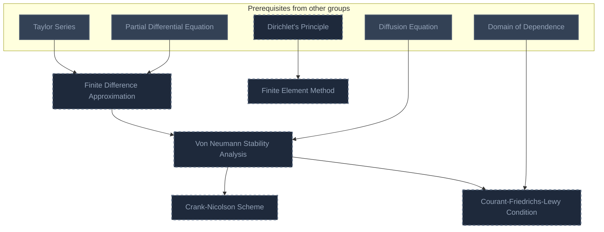

## Strauss Ch. 9: Waves in Space (planned)
**Mastered:** 0 / 2 · **Discovered:** 0 / 2

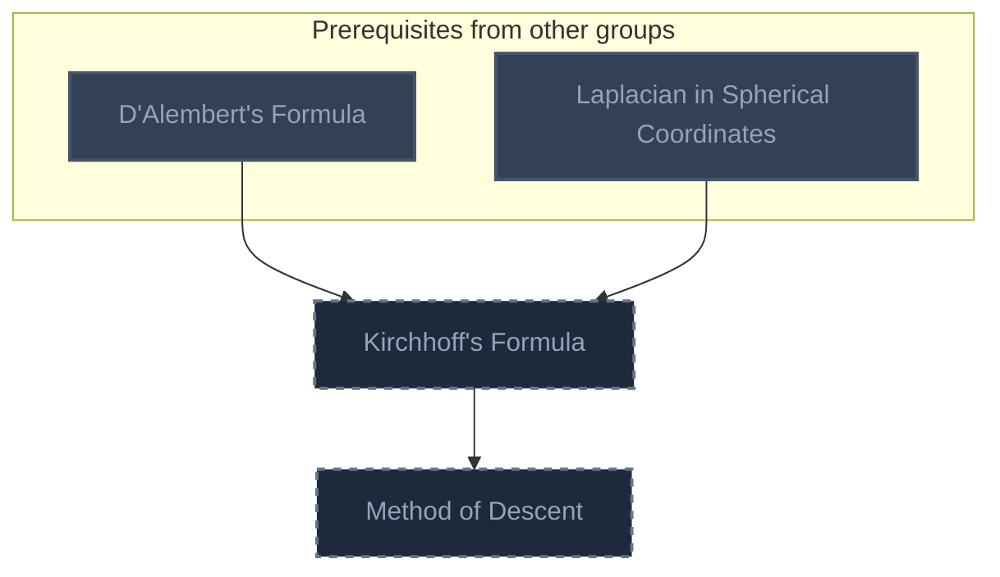

## Strauss Ch. 10: Boundary Problems in the Plane and in Space (planned)
**Mastered:** 0 / 7 · **Discovered:** 0 / 7

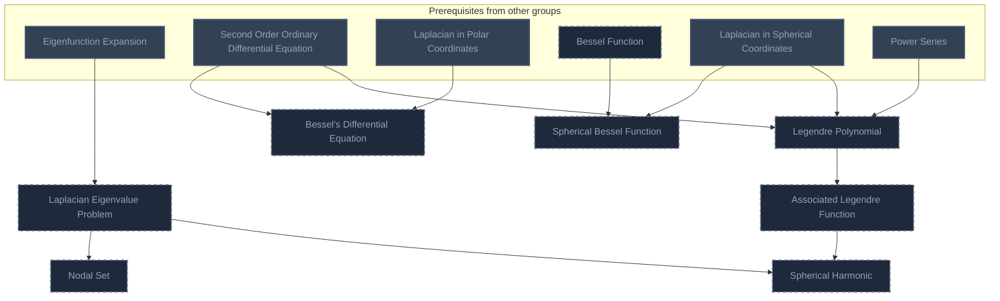

## Strauss Ch. 11: General Eigenvalue Problems (planned)
**Mastered:** 0 / 6 · **Discovered:** 0 / 6

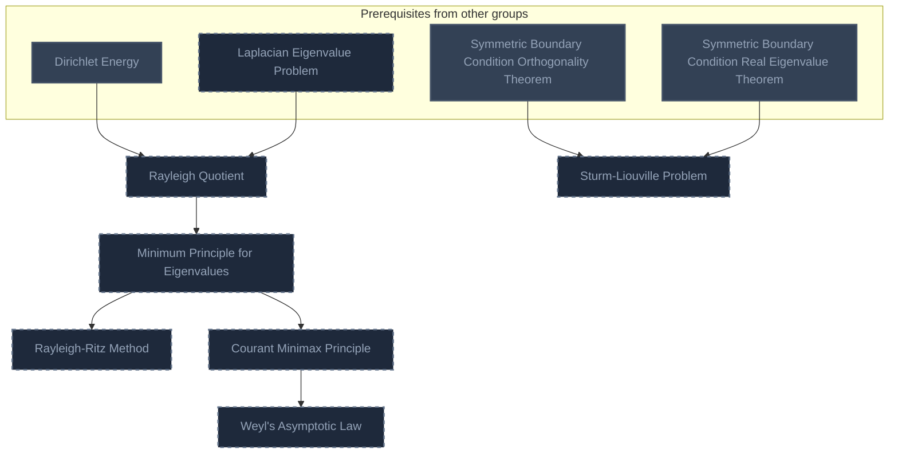

## Strauss Ch. 12: Distributions and Transforms (planned)
**Mastered:** 0 / 3 · **Discovered:** 0 / 3

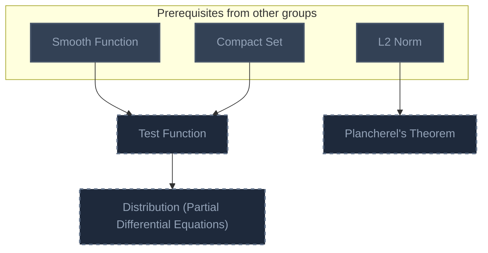

## Strauss Ch. 13: PDE Problems from Physics (planned)
**Mastered:** 0 / 4 · **Discovered:** 0 / 4

```mermaid
flowchart TD
    classDef planned fill:#1E293B,stroke:#64748B,stroke-width:2px,stroke-dasharray:5 5,color:#94A3B8;
    classDef locked fill:#334155,stroke:#475569,stroke-width:2px,color:#94A3B8;
    classDef L0 fill:#F1F5F9,stroke:#94A3B8,stroke-width:2px,color:#000000;
    classDef L1 fill:#22C55E,stroke:#15803D,stroke-width:2px,color:#000000;
    classDef L2 fill:#3B82F6,stroke:#1D4ED8,stroke-width:3px,color:#FFFFFF;
    classDef L3 fill:#A855F7,stroke:#6B21A8,stroke-width:3px,color:#FFFFFF,font-weight:bold;
    classDef L4 fill:#F97316,stroke:#C2410C,stroke-width:4px,color:#000000,font-weight:bold;
    classDef L5 fill:#FFD700,stroke:#FF8C00,stroke-width:5px,color:#000000,font-weight:bold;
    classDef rusty stroke:#8B4513,stroke-width:4px,stroke-dasharray:3 3;
    subgraph sg_prereqs["Prerequisites from other groups"]
        n_curl_of_vector_field["Curl of Vector Field"]
        n_wave_equation["Wave Equation"]
        n_divergence_of_vector_field["Divergence of Vector Field"]
        n_partial_differential_equation["Partial Differential Equation"]
        n_schr_dinger_equation["Schrödinger Equation"]
        n_laplacian_eigenvalue_problem["Laplacian Eigenvalue Problem"]
        n_klein_gordon_equation["Klein-Gordon Equation"]
    end
    n_maxwell_s_equations["Maxwell's Equations"]
    n_euler_equations_fluid_dynamics["Euler Equations (Fluid Dynamics)"]
    n_continuous_spectrum["Continuous Spectrum"]
    n_dirac_equation["Dirac Equation"]
    n_curl_of_vector_field --> n_maxwell_s_equations
    n_wave_equation --> n_maxwell_s_equations
    n_divergence_of_vector_field --> n_euler_equations_fluid_dynamics
    n_partial_differential_equation --> n_euler_equations_fluid_dynamics
    n_schr_dinger_equation --> n_continuous_spectrum
    n_laplacian_eigenvalue_problem --> n_continuous_spectrum
    n_klein_gordon_equation --> n_dirac_equation
    class n_laplacian_eigenvalue_problem,n_maxwell_s_equations,n_euler_equations_fluid_dynamics,n_continuous_spectrum,n_dirac_equation planned;
    class n_curl_of_vector_field,n_wave_equation,n_divergence_of_vector_field,n_partial_differential_equation,n_schr_dinger_equation,n_klein_gordon_equation locked;
    class n_curl_of_vector_field,n_wave_equation,n_divergence_of_vector_field,n_partial_differential_equation,n_schr_dinger_equation,n_klein_gordon_equation internal-link;
```

## Strauss Ch. 14: Nonlinear PDEs (planned)
**Mastered:** 0 / 7 · **Discovered:** 0 / 7

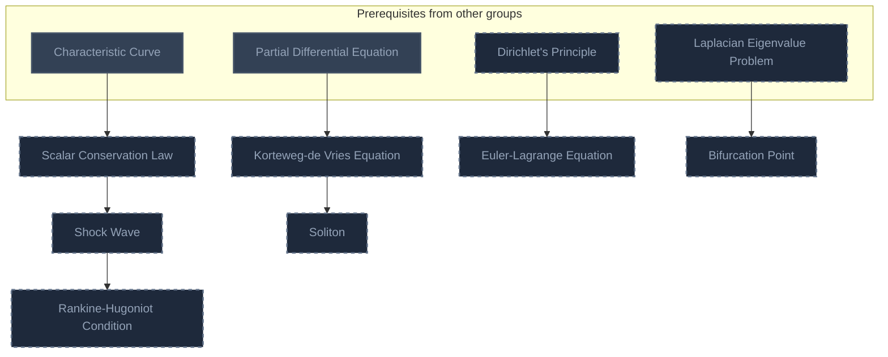

## Evans Ch. 2: Four Important Linear PDE (planned)
**Mastered:** 0 / 1 · **Discovered:** 0 / 1

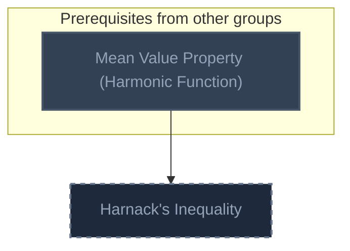

## Evans Ch. 3: Nonlinear First-Order PDE (planned)
**Mastered:** 0 / 5 · **Discovered:** 0 / 5

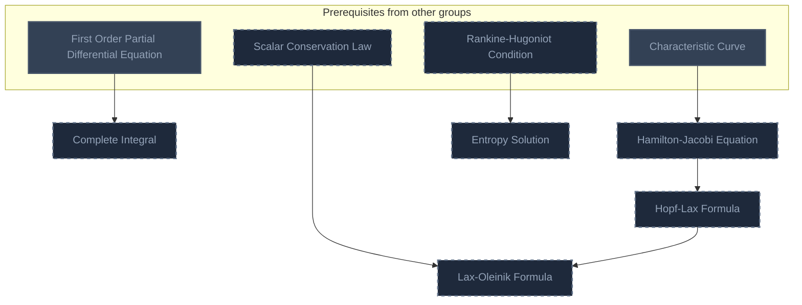

## Evans Ch. 4: Other Ways to Represent Solutions (planned)
**Mastered:** 0 / 2 · **Discovered:** 0 / 2

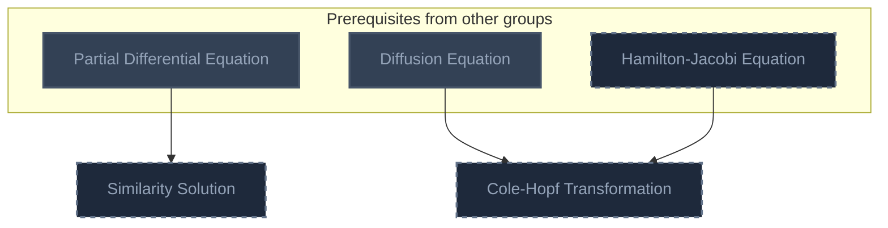

## Evans Ch. 5: Sobolev Spaces (planned)
**Mastered:** 0 / 8 · **Discovered:** 0 / 8

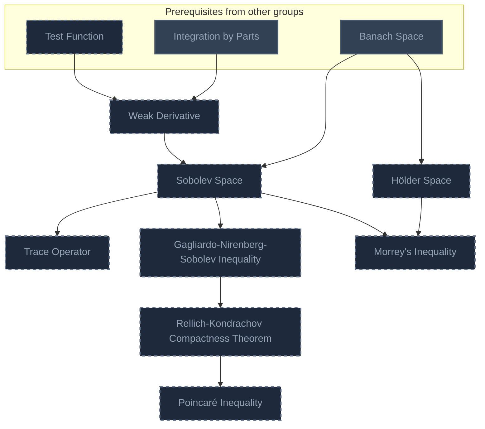

## Evans Ch. 6: Second-Order Elliptic Equations (planned)
**Mastered:** 0 / 5 · **Discovered:** 0 / 5

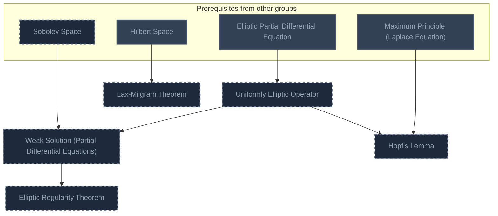

## Evans Ch. 7: Linear Evolution Equations (planned)
**Mastered:** 0 / 2 · **Discovered:** 0 / 2

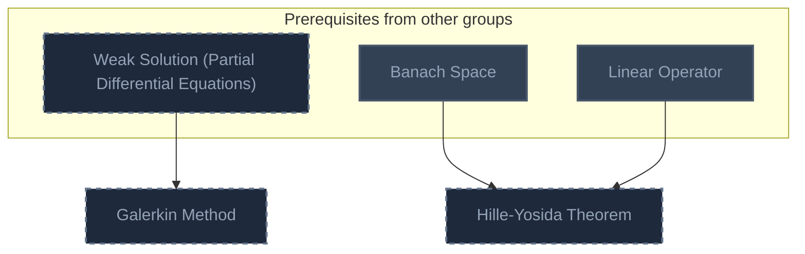

## Evans Ch. 8: The Calculus of Variations (planned)
**Mastered:** 0 / 2 · **Discovered:** 0 / 2

```mermaid
flowchart TD
    classDef planned fill:#1E293B,stroke:#64748B,stroke-width:2px,stroke-dasharray:5 5,color:#94A3B8;
    classDef locked fill:#334155,stroke:#475569,stroke-width:2px,color:#94A3B8;
    classDef L0 fill:#F1F5F9,stroke:#94A3B8,stroke-width:2px,color:#000000;
    classDef L1 fill:#22C55E,stroke:#15803D,stroke-width:2px,color:#000000;
    classDef L2 fill:#3B82F6,stroke:#1D4ED8,stroke-width:3px,color:#FFFFFF;
    classDef L3 fill:#A855F7,stroke:#6B21A8,stroke-width:3px,color:#FFFFFF,font-weight:bold;
    classDef L4 fill:#F97316,stroke:#C2410C,stroke-width:4px,color:#000000,font-weight:bold;
    classDef L5 fill:#FFD700,stroke:#FF8C00,stroke-width:5px,color:#000000,font-weight:bold;
    classDef rusty stroke:#8B4513,stroke-width:4px,stroke-dasharray:3 3;
    subgraph sg_prereqs["Prerequisites from other groups"]
        n_euler_lagrange_equation["Euler-Lagrange Equation"]
        n_sobolev_space["Sobolev Space"]
    end
    n_direct_method_in_the_calculus_of_variations["Direct Method in the Calculus of Variations"]
    n_mountain_pass_theorem["Mountain Pass Theorem"]
    n_euler_lagrange_equation --> n_direct_method_in_the_calculus_of_variations
    n_sobolev_space --> n_direct_method_in_the_calculus_of_variations
    n_euler_lagrange_equation --> n_mountain_pass_theorem
    class n_euler_lagrange_equation,n_sobolev_space,n_direct_method_in_the_calculus_of_variations,n_mountain_pass_theorem planned;
```

## Evans Ch. 9: Nonvariational Techniques (planned)
**Mastered:** 0 / 3 · **Discovered:** 0 / 3

```mermaid
flowchart TD
    classDef planned fill:#1E293B,stroke:#64748B,stroke-width:2px,stroke-dasharray:5 5,color:#94A3B8;
    classDef locked fill:#334155,stroke:#475569,stroke-width:2px,color:#94A3B8;
    classDef L0 fill:#F1F5F9,stroke:#94A3B8,stroke-width:2px,color:#000000;
    classDef L1 fill:#22C55E,stroke:#15803D,stroke-width:2px,color:#000000;
    classDef L2 fill:#3B82F6,stroke:#1D4ED8,stroke-width:3px,color:#FFFFFF;
    classDef L3 fill:#A855F7,stroke:#6B21A8,stroke-width:3px,color:#FFFFFF,font-weight:bold;
    classDef L4 fill:#F97316,stroke:#C2410C,stroke-width:4px,color:#000000,font-weight:bold;
    classDef L5 fill:#FFD700,stroke:#FF8C00,stroke-width:5px,color:#000000,font-weight:bold;
    classDef rusty stroke:#8B4513,stroke-width:4px,stroke-dasharray:3 3;
    subgraph sg_prereqs["Prerequisites from other groups"]
        n_banach_space["Banach Space"]
        n_banach_fixed_point_theorem["Banach Fixed-Point Theorem"]
        n_poisson_equation["Poisson Equation"]
    end
    n_browder_minty_theorem["Browder-Minty Theorem"]
    n_schauder_fixed_point_theorem["Schauder Fixed-Point Theorem"]
    n_pohozaev_identity["Pohozaev Identity"]
    n_banach_space --> n_browder_minty_theorem
    n_banach_fixed_point_theorem --> n_schauder_fixed_point_theorem
    n_banach_space --> n_schauder_fixed_point_theorem
    n_poisson_equation --> n_pohozaev_identity
    class n_browder_minty_theorem,n_schauder_fixed_point_theorem,n_pohozaev_identity planned;
    class n_banach_space,n_banach_fixed_point_theorem,n_poisson_equation locked;
    class n_banach_space,n_banach_fixed_point_theorem,n_poisson_equation internal-link;
```

## Evans Ch. 10: Hamilton-Jacobi Equations (planned)
**Mastered:** 0 / 2 · **Discovered:** 0 / 2

```mermaid
flowchart TD
    classDef planned fill:#1E293B,stroke:#64748B,stroke-width:2px,stroke-dasharray:5 5,color:#94A3B8;
    classDef locked fill:#334155,stroke:#475569,stroke-width:2px,color:#94A3B8;
    classDef L0 fill:#F1F5F9,stroke:#94A3B8,stroke-width:2px,color:#000000;
    classDef L1 fill:#22C55E,stroke:#15803D,stroke-width:2px,color:#000000;
    classDef L2 fill:#3B82F6,stroke:#1D4ED8,stroke-width:3px,color:#FFFFFF;
    classDef L3 fill:#A855F7,stroke:#6B21A8,stroke-width:3px,color:#FFFFFF,font-weight:bold;
    classDef L4 fill:#F97316,stroke:#C2410C,stroke-width:4px,color:#000000,font-weight:bold;
    classDef L5 fill:#FFD700,stroke:#FF8C00,stroke-width:5px,color:#000000,font-weight:bold;
    classDef rusty stroke:#8B4513,stroke-width:4px,stroke-dasharray:3 3;
    subgraph sg_prereqs["Prerequisites from other groups"]
        n_hamilton_jacobi_equation["Hamilton-Jacobi Equation"]
    end
    n_viscosity_solution["Viscosity Solution"]
    n_viscosity_solution_uniqueness_theorem["Viscosity Solution Uniqueness Theorem"]
    n_hamilton_jacobi_equation --> n_viscosity_solution
    n_viscosity_solution --> n_viscosity_solution_uniqueness_theorem
    class n_hamilton_jacobi_equation,n_viscosity_solution,n_viscosity_solution_uniqueness_theorem planned;
```

## Evans Ch. 11: Systems of Conservation Laws (planned)
**Mastered:** 0 / 3 · **Discovered:** 0 / 3

```mermaid
flowchart TD
    classDef planned fill:#1E293B,stroke:#64748B,stroke-width:2px,stroke-dasharray:5 5,color:#94A3B8;
    classDef locked fill:#334155,stroke:#475569,stroke-width:2px,color:#94A3B8;
    classDef L0 fill:#F1F5F9,stroke:#94A3B8,stroke-width:2px,color:#000000;
    classDef L1 fill:#22C55E,stroke:#15803D,stroke-width:2px,color:#000000;
    classDef L2 fill:#3B82F6,stroke:#1D4ED8,stroke-width:3px,color:#FFFFFF;
    classDef L3 fill:#A855F7,stroke:#6B21A8,stroke-width:3px,color:#FFFFFF,font-weight:bold;
    classDef L4 fill:#F97316,stroke:#C2410C,stroke-width:4px,color:#000000,font-weight:bold;
    classDef L5 fill:#FFD700,stroke:#FF8C00,stroke-width:5px,color:#000000,font-weight:bold;
    classDef rusty stroke:#8B4513,stroke-width:4px,stroke-dasharray:3 3;
    subgraph sg_prereqs["Prerequisites from other groups"]
        n_rankine_hugoniot_condition["Rankine-Hugoniot Condition"]
        n_entropy_solution["Entropy Solution"]
    end
    n_riemann_problem["Riemann Problem"]
    n_rarefaction_wave["Rarefaction Wave"]
    n_entropy_entropy_flux_pair["Entropy-Entropy Flux Pair"]
    n_rankine_hugoniot_condition --> n_riemann_problem
    n_riemann_problem --> n_rarefaction_wave
    n_entropy_solution --> n_entropy_entropy_flux_pair
    class n_rankine_hugoniot_condition,n_entropy_solution,n_riemann_problem,n_rarefaction_wave,n_entropy_entropy_flux_pair planned;
```

## Evans Ch. 12: Nonlinear Wave Equations (planned)
**Mastered:** 0 / 1 · **Discovered:** 0 / 1

```mermaid
flowchart TD
    classDef planned fill:#1E293B,stroke:#64748B,stroke-width:2px,stroke-dasharray:5 5,color:#94A3B8;
    classDef locked fill:#334155,stroke:#475569,stroke-width:2px,color:#94A3B8;
    classDef L0 fill:#F1F5F9,stroke:#94A3B8,stroke-width:2px,color:#000000;
    classDef L1 fill:#22C55E,stroke:#15803D,stroke-width:2px,color:#000000;
    classDef L2 fill:#3B82F6,stroke:#1D4ED8,stroke-width:3px,color:#FFFFFF;
    classDef L3 fill:#A855F7,stroke:#6B21A8,stroke-width:3px,color:#FFFFFF,font-weight:bold;
    classDef L4 fill:#F97316,stroke:#C2410C,stroke-width:4px,color:#000000,font-weight:bold;
    classDef L5 fill:#FFD700,stroke:#FF8C00,stroke-width:5px,color:#000000,font-weight:bold;
    classDef rusty stroke:#8B4513,stroke-width:4px,stroke-dasharray:3 3;
    subgraph sg_prereqs["Prerequisites from other groups"]
        n_wave_equation_energy_conservation["Wave Equation Energy Conservation"]
    end
    n_semilinear_wave_equation["Semilinear Wave Equation"]
    n_wave_equation_energy_conservation --> n_semilinear_wave_equation
    class n_semilinear_wave_equation planned;
    class n_wave_equation_energy_conservation locked;
    class n_wave_equation_energy_conservation internal-link;
```

# Source
Graph structure: the single source for the diagrams above, edited by `/note` and `Scripts/skill_trees.py` (`add`, `edge`, `rename`). Everything above this heading is regenerated by `render`.

```skilltree
    %% PREREQUISITES
    n_differential_equation["Differential Equation"]
    n_partial_derivative["Partial Derivative"]
    n_linear_operator["Linear Operator"]
    n_kernel_vector_subspace["Kernel Vector Subspace"]
    n_curve["Curve"]
    n_ordinary_differential_equation["Ordinary Differential Equation"]
    n_derivative_chain_rule["Derivative Chain Rule"]
    n_directional_derivative["Directional Derivative"]
    n_divergence_of_vector_field["Divergence of Vector Field"]
    n_harmonic_function["Harmonic Function"]
    n_initial_condition["Initial Condition"]
    n_eigenvalue["Eigenvalue"]
    n_conic_section["Conic Section"]
    n_spectral_theorem["Spectral Theorem"]
    n_orthogonal_matrix["Orthogonal Matrix"]
    n_positive_definite_matrix["Positive Definite Matrix"]
    n_normal_distribution["Normal Distribution"]
    n_cumulative_distribution_function["Cumulative Distribution Function"]
    n_extension_of_function["Extension of Function"]
    n_parity_of_function["Parity of Function"]
    n_matrix_exponential["Matrix Exponential"]
    n_first_order_linear_ordinary_differential_equation["First Order Linear Ordinary Differential Equation"]
    n_piecewise_continuous_function["Piecewise Continuous Function"]
    n_jump_discontinuity["Jump Discontinuity"]
    n_eigenvector["Eigenvector"]
    n_function_space["Function Space"]
    n_integration_by_parts["Integration by Parts"]
    n_periodic_function["Periodic Function"]
    n_inner_product["Inner Product"]
    n_complex_conjugate["Complex Conjugate"]
    n_norm["Norm"]
    n_self_adjoint_linear_map["Self-Adjoint Linear Map"]
    n_orthogonal_projection["Orthogonal Projection"]
    n_weierstrass_m_test["Weierstrass M-Test"]
    n_hilbert_space["Hilbert Space"]
    n_group_action["Group Action"]
    n_polar_coordinate_system["Polar Coordinate System"]
    n_spherical_coordinate_system["Spherical Coordinate System"]
    n_law_of_cosines["Law of Cosines"]
    n_taylor_series["Taylor Series"]
    n_second_order_ordinary_differential_equation["Second Order Ordinary Differential Equation"]
    n_power_series["Power Series"]
    n_smooth_function["Smooth Function"]
    n_compact_set["Compact Set"]
    n_curl_of_vector_field["Curl of Vector Field"]
    n_banach_space["Banach Space"]
    n_banach_fixed_point_theorem["Banach Fixed-Point Theorem"]
    n_bessel_function["Bessel Function"]
    n_even_function["Even Function"]
    n_rigid_body_transformation["Rigid-Body Transformation"]
    n_gradient_vector["Gradient Vector"]
    n_hessian_matrix["Hessian Matrix"]
    n_fourier_series["Fourier Series"]
    n_fourier_sine_series["Fourier Sine Series"]
    n_fourier_cosine_series["Fourier Cosine Series"]
    n_parseval_s_theorem["Parseval's Theorem"]
    n_convolution["Convolution"]
    n_random_walk["Random Walk"]
    n_well_posed_problem["Well-Posed Problem"]
    %% NODES
    %% == Strauss Ch. 1: Where PDEs Come From ==
    n_partial_differential_equation["Partial Differential Equation"]
    n_general_order_partial_differential_equation["General Order Partial Differential Equation"]
    n_first_order_partial_differential_equation["First Order Partial Differential Equation"]
    n_second_order_partial_differential_equation["Second Order Partial Differential Equation"]
    n_linear_partial_differential_operator["Linear Partial Differential Operator"]
    n_homogeneous_linear_partial_differential_equation["Homogeneous Linear Partial Differential Equation"]
    n_inhomogeneous_linear_partial_differential_equation["Inhomogeneous Linear Partial Differential Equation"]
    n_superposition_principle_partial_differential_equations["Superposition Principle (Partial Differential Equations)"]
    n_coordinate_change_method["Coordinate Change Method"]
    n_characteristic_curve["Characteristic Curve"]
    n_geometric_method["Geometric Method"]
    n_transport_equation["Transport Equation"]
    n_laplacian_operator["Laplacian Operator"]
    n_wave_equation["Wave Equation"]
    n_damped_wave_equation["Damped Wave Equation"]
    n_klein_gordon_equation["Klein-Gordon Equation"]
    n_inhomogeneous_wave_equation["Inhomogeneous Wave Equation"]
    n_diffusion_equation["Diffusion Equation"]
    n_heat_equation["Heat Equation"]
    n_schr_dinger_equation["Schrödinger Equation"]
    n_laplace_equation["Laplace Equation"]
    n_boundary_condition["Boundary Condition"]
    n_dirichlet_boundary_condition["Dirichlet Boundary Condition"]
    n_normal_derivative["Normal Derivative"]
    n_neumann_boundary_condition["Neumann Boundary Condition"]
    n_robin_boundary_condition["Robin Boundary Condition"]
    n_linearized_acoustic_equations["Linearized Acoustic Equations"]
    n_second_order_linear_partial_differential_equation["Second Order Linear Partial Differential Equation"]
    n_canonical_form_of_second_order_linear_partial_differential_equation["Canonical Form of Second Order Linear Partial Differential Equation"]
    n_hyperbolic_partial_differential_equation["Hyperbolic Partial Differential Equation"]
    n_ultrahyperbolic_partial_differential_equation["Ultrahyperbolic Partial Differential Equation"]
    n_elliptic_partial_differential_equation["Elliptic Partial Differential Equation"]
    n_parabolic_partial_differential_equation["Parabolic Partial Differential Equation"]
    %% == Strauss Ch. 2: Waves and Diffusions ==
    n_d_alembert_s_formula["D'Alembert's Formula"]
    n_domain_of_influence["Domain of Influence"]
    n_domain_of_dependence["Domain of Dependence"]
    n_principle_of_causality_wave_equation["Principle of Causality (Wave Equation)"]
    n_wave_equation_energy_conservation["Wave Equation Energy Conservation"]
    n_huygens_s_principle["Huygens's Principle"]
    n_maximum_principle_diffusion_equation["Maximum Principle (Diffusion Equation)"]
    n_diffusion_equation_well_posedness["Diffusion Equation Well-Posedness"]
    n_diffusion_equation_invariance_properties["Diffusion Equation Invariance Properties"]
    n_diffusion_kernel_partial_differential_equations["Diffusion Kernel (Partial Differential Equations)"]
    n_brownian_motion["Brownian Motion"]
    n_error_function["Error Function"]
    n_wave_and_diffusion_equation_comparison["Wave and Diffusion Equation Comparison"]
    %% == Strauss Ch. 3: Reflections and Sources ==
    n_method_of_reflection["Method of Reflection"]
    n_diffusion_equation_on_the_half_line["Diffusion Equation on the Half-Line"]
    n_wave_equation_on_the_half_line["Wave Equation on the Half-Line"]
    n_wave_equation_on_a_finite_interval["Wave Equation on a Finite Interval"]
    n_duhamel_s_principle["Duhamel's Principle"]
    n_inhomogeneous_diffusion_equation["Inhomogeneous Diffusion Equation"]
    n_boundary_condition_subtraction_device["Boundary Condition Subtraction Device"]
    n_diffusion_equation_smoothing_theorem["Diffusion Equation Smoothing Theorem"]
    %% == Strauss Ch. 4: Boundary Problems ==
    n_separation_of_variables["Separation of Variables"]
    n_diffusion_equation_on_a_finite_interval["Diffusion Equation on a Finite Interval"]
    n_eigenfunction["Eigenfunction"]
    n_dirichlet_energy["Dirichlet Energy"]
    n_dirichlet_eigenvalue_problem_on_an_interval["Dirichlet Eigenvalue Problem on an Interval"]
    n_neumann_eigenvalue_problem_on_an_interval["Neumann Eigenvalue Problem on an Interval"]
    n_mixed_eigenvalue_problem_on_an_interval["Mixed Eigenvalue Problem on an Interval"]
    n_robin_eigenvalue_problem_on_an_interval["Robin Eigenvalue Problem on an Interval"]
    %% == Strauss Ch. 5: Fourier Series ==
    n_periodic_extension["Periodic Extension"]
    n_odd_function["Odd Function"]
    n_periodic_boundary_condition["Periodic Boundary Condition"]
    n_odd_extension["Odd Extension"]
    n_even_extension["Even Extension"]
    n_l2_inner_product["L2 Inner Product"]
    n_green_s_second_identity["Green's Second Identity"]
    n_symmetric_boundary_condition["Symmetric Boundary Condition"]
    n_symmetric_boundary_condition_orthogonality_theorem["Symmetric Boundary Condition Orthogonality Theorem"]
    n_symmetric_boundary_condition_real_eigenvalue_theorem["Symmetric Boundary Condition Real Eigenvalue Theorem"]
    n_symmetric_boundary_condition_nonnegative_eigenvalue_theorem["Symmetric Boundary Condition Nonnegative Eigenvalue Theorem"]
    n_symmetric_boundary_condition_infinite_eigenvalue_theorem["Symmetric Boundary Condition Infinite Eigenvalue Theorem"]
    n_eigenfunction_expansion["Eigenfunction Expansion"]
    n_mean_square_convergence["Mean-Square Convergence"]
    n_l2_norm["L2 Norm"]
    n_fourier_series_uniform_convergence_theorem["Fourier Series Uniform Convergence Theorem"]
    n_fourier_series_l2_convergence_theorem["Fourier Series L2 Convergence Theorem"]
    n_fourier_series_pointwise_convergence_theorem["Fourier Series Pointwise Convergence Theorem"]
    n_complete_orthogonal_set["Complete Orthogonal Set"]
    n_dirichlet_kernel["Dirichlet Kernel"]
    n_gibbs_phenomenon["Gibbs Phenomenon"]
    n_eigenfunction_expansion_method_for_inhomogeneous_boundary_conditions["Eigenfunction Expansion Method for Inhomogeneous Boundary Conditions"]
    %% == Strauss Ch. 6: Harmonic Functions ==
    n_poisson_equation["Poisson Equation"]
    n_maximum_principle_laplace_equation["Maximum Principle (Laplace Equation)"]
    n_laplace_equation_dirichlet_problem_uniqueness["Laplace Equation Dirichlet Problem Uniqueness"]
    n_laplacian_operator_rigid_motion_invariance["Laplacian Operator Rigid Motion Invariance"]
    n_laplacian_in_polar_coordinates["Laplacian in Polar Coordinates"]
    n_laplacian_in_spherical_coordinates["Laplacian in Spherical Coordinates"]
    n_radial_harmonic_function["Radial Harmonic Function"]
    n_laplace_equation_in_a_rectangle["Laplace Equation in a Rectangle"]
    n_double_fourier_sine_series["Double Fourier Sine Series"]
    n_laplace_equation_in_a_box["Laplace Equation in a Box"]
    n_laplace_equation_in_a_disk["Laplace Equation in a Disk"]
    n_poisson_s_formula["Poisson's Formula"]
    n_mean_value_property_harmonic_function["Mean Value Property (Harmonic Function)"]
    n_poisson_kernel["Poisson Kernel"]
    n_harmonic_function_smoothness["Harmonic Function Smoothness"]
    n_laplace_equation_in_a_wedge["Laplace Equation in a Wedge"]
    n_laplace_equation_in_an_annulus["Laplace Equation in an Annulus"]
    n_laplace_equation_in_the_exterior_of_a_circle["Laplace Equation in the Exterior of a Circle"]
    %% == Strauss Ch. 7: Green's Identities and Green's Functions (planned) ==
    n_green_s_first_identity["Green's First Identity"]
    n_dirichlet_s_principle["Dirichlet's Principle"]
    n_fundamental_solution_of_laplace_equation["Fundamental Solution of Laplace Equation"]
    n_green_s_representation_formula["Green's Representation Formula"]
    n_green_s_function["Green's Function"]
    n_green_s_function_symmetry["Green's Function Symmetry"]
    n_green_s_function_for_half_space["Green's Function for Half-Space"]
    n_green_s_function_for_ball["Green's Function for Ball"]
    %% == Strauss Ch. 8: Computation of Solutions (planned) ==
    n_finite_difference_approximation["Finite Difference Approximation"]
    n_von_neumann_stability_analysis["Von Neumann Stability Analysis"]
    n_crank_nicolson_scheme["Crank-Nicolson Scheme"]
    n_courant_friedrichs_lewy_condition["Courant-Friedrichs-Lewy Condition"]
    n_finite_element_method["Finite Element Method"]
    %% == Strauss Ch. 9: Waves in Space (planned) ==
    n_kirchhoff_s_formula["Kirchhoff's Formula"]
    n_method_of_descent["Method of Descent"]
    %% == Strauss Ch. 10: Boundary Problems in the Plane and in Space (planned) ==
    n_laplacian_eigenvalue_problem["Laplacian Eigenvalue Problem"]
    n_nodal_set["Nodal Set"]
    n_bessel_s_differential_equation["Bessel's Differential Equation"]
    n_spherical_bessel_function["Spherical Bessel Function"]
    n_legendre_polynomial["Legendre Polynomial"]
    n_associated_legendre_function["Associated Legendre Function"]
    n_spherical_harmonic["Spherical Harmonic"]
    %% == Strauss Ch. 11: General Eigenvalue Problems (planned) ==
    n_rayleigh_quotient["Rayleigh Quotient"]
    n_minimum_principle_for_eigenvalues["Minimum Principle for Eigenvalues"]
    n_rayleigh_ritz_method["Rayleigh-Ritz Method"]
    n_courant_minimax_principle["Courant Minimax Principle"]
    n_sturm_liouville_problem["Sturm-Liouville Problem"]
    n_weyl_s_asymptotic_law["Weyl's Asymptotic Law"]
    %% == Strauss Ch. 12: Distributions and Transforms (planned) ==
    n_test_function["Test Function"]
    n_distribution_partial_differential_equations["Distribution (Partial Differential Equations)"]
    n_plancherel_s_theorem["Plancherel's Theorem"]
    %% == Strauss Ch. 13: PDE Problems from Physics (planned) ==
    n_maxwell_s_equations["Maxwell's Equations"]
    n_euler_equations_fluid_dynamics["Euler Equations (Fluid Dynamics)"]
    n_continuous_spectrum["Continuous Spectrum"]
    n_dirac_equation["Dirac Equation"]
    %% == Strauss Ch. 14: Nonlinear PDEs (planned) ==
    n_scalar_conservation_law["Scalar Conservation Law"]
    n_shock_wave["Shock Wave"]
    n_rankine_hugoniot_condition["Rankine-Hugoniot Condition"]
    n_korteweg_de_vries_equation["Korteweg-de Vries Equation"]
    n_soliton["Soliton"]
    n_euler_lagrange_equation["Euler-Lagrange Equation"]
    n_bifurcation_point["Bifurcation Point"]
    %% == Evans Ch. 2: Four Important Linear PDE (planned) ==
    n_harnack_s_inequality["Harnack's Inequality"]
    %% == Evans Ch. 3: Nonlinear First-Order PDE (planned) ==
    n_complete_integral["Complete Integral"]
    n_hamilton_jacobi_equation["Hamilton-Jacobi Equation"]
    n_hopf_lax_formula["Hopf-Lax Formula"]
    n_lax_oleinik_formula["Lax-Oleinik Formula"]
    n_entropy_solution["Entropy Solution"]
    %% == Evans Ch. 4: Other Ways to Represent Solutions (planned) ==
    n_similarity_solution["Similarity Solution"]
    n_cole_hopf_transformation["Cole-Hopf Transformation"]
    %% == Evans Ch. 5: Sobolev Spaces (planned) ==
    n_h_lder_space["Hölder Space"]
    n_weak_derivative["Weak Derivative"]
    n_sobolev_space["Sobolev Space"]
    n_trace_operator["Trace Operator"]
    n_gagliardo_nirenberg_sobolev_inequality["Gagliardo-Nirenberg-Sobolev Inequality"]
    n_morrey_s_inequality["Morrey's Inequality"]
    n_rellich_kondrachov_compactness_theorem["Rellich-Kondrachov Compactness Theorem"]
    n_poincar_inequality["Poincaré Inequality"]
    %% == Evans Ch. 6: Second-Order Elliptic Equations (planned) ==
    n_uniformly_elliptic_operator["Uniformly Elliptic Operator"]
    n_weak_solution_partial_differential_equations["Weak Solution (Partial Differential Equations)"]
    n_lax_milgram_theorem["Lax-Milgram Theorem"]
    n_elliptic_regularity_theorem["Elliptic Regularity Theorem"]
    n_hopf_s_lemma["Hopf's Lemma"]
    %% == Evans Ch. 7: Linear Evolution Equations (planned) ==
    n_galerkin_method["Galerkin Method"]
    n_hille_yosida_theorem["Hille-Yosida Theorem"]
    %% == Evans Ch. 8: The Calculus of Variations (planned) ==
    n_direct_method_in_the_calculus_of_variations["Direct Method in the Calculus of Variations"]
    n_mountain_pass_theorem["Mountain Pass Theorem"]
    %% == Evans Ch. 9: Nonvariational Techniques (planned) ==
    n_browder_minty_theorem["Browder-Minty Theorem"]
    n_schauder_fixed_point_theorem["Schauder Fixed-Point Theorem"]
    n_pohozaev_identity["Pohozaev Identity"]
    %% == Evans Ch. 10: Hamilton-Jacobi Equations (planned) ==
    n_viscosity_solution["Viscosity Solution"]
    n_viscosity_solution_uniqueness_theorem["Viscosity Solution Uniqueness Theorem"]
    %% == Evans Ch. 11: Systems of Conservation Laws (planned) ==
    n_riemann_problem["Riemann Problem"]
    n_rarefaction_wave["Rarefaction Wave"]
    n_entropy_entropy_flux_pair["Entropy-Entropy Flux Pair"]
    %% == Evans Ch. 12: Nonlinear Wave Equations (planned) ==
    n_semilinear_wave_equation["Semilinear Wave Equation"]
    %% EDGES
    n_differential_equation --> n_partial_differential_equation
    n_partial_derivative --> n_partial_differential_equation
    n_partial_differential_equation --> n_general_order_partial_differential_equation
    n_partial_differential_equation --> n_first_order_partial_differential_equation
    n_partial_differential_equation --> n_second_order_partial_differential_equation
    n_partial_derivative --> n_linear_partial_differential_operator
    n_linear_operator --> n_linear_partial_differential_operator
    n_partial_differential_equation --> n_homogeneous_linear_partial_differential_equation
    n_linear_partial_differential_operator --> n_homogeneous_linear_partial_differential_equation
    n_homogeneous_linear_partial_differential_equation --> n_inhomogeneous_linear_partial_differential_equation
    n_homogeneous_linear_partial_differential_equation --> n_superposition_principle_partial_differential_equations
    n_kernel_vector_subspace --> n_superposition_principle_partial_differential_equations
    n_first_order_partial_differential_equation --> n_characteristic_curve
    n_curve --> n_characteristic_curve
    n_ordinary_differential_equation --> n_characteristic_curve
    n_characteristic_curve --> n_coordinate_change_method
    n_derivative_chain_rule --> n_coordinate_change_method
    n_characteristic_curve --> n_geometric_method
    n_directional_derivative --> n_geometric_method
    n_first_order_partial_differential_equation --> n_transport_equation
    n_linear_partial_differential_operator --> n_laplacian_operator
    n_divergence_of_vector_field --> n_laplacian_operator
    n_second_order_partial_differential_equation --> n_wave_equation
    n_laplacian_operator --> n_wave_equation
    n_wave_equation --> n_damped_wave_equation
    n_wave_equation --> n_klein_gordon_equation
    n_d_alembert_s_formula --> n_inhomogeneous_wave_equation
    n_duhamel_s_principle --> n_inhomogeneous_wave_equation
    n_second_order_partial_differential_equation --> n_diffusion_equation
    n_laplacian_operator --> n_diffusion_equation
    n_diffusion_equation --> n_heat_equation
    n_second_order_partial_differential_equation --> n_schr_dinger_equation
    n_laplacian_operator --> n_schr_dinger_equation
    n_laplacian_operator --> n_laplace_equation
    n_harmonic_function --> n_laplace_equation
    n_partial_differential_equation --> n_boundary_condition
    n_initial_condition --> n_boundary_condition
    n_boundary_condition --> n_dirichlet_boundary_condition
    n_directional_derivative --> n_normal_derivative
    n_boundary_condition --> n_neumann_boundary_condition
    n_normal_derivative --> n_neumann_boundary_condition
    n_boundary_condition --> n_robin_boundary_condition
    n_normal_derivative --> n_robin_boundary_condition
    n_wave_equation --> n_linearized_acoustic_equations
    n_second_order_partial_differential_equation --> n_second_order_linear_partial_differential_equation
    n_linear_partial_differential_operator --> n_second_order_linear_partial_differential_equation
    n_eigenvalue --> n_second_order_linear_partial_differential_equation
    n_conic_section --> n_second_order_linear_partial_differential_equation
    n_second_order_linear_partial_differential_equation --> n_canonical_form_of_second_order_linear_partial_differential_equation
    n_spectral_theorem --> n_canonical_form_of_second_order_linear_partial_differential_equation
    n_orthogonal_matrix --> n_canonical_form_of_second_order_linear_partial_differential_equation
    n_second_order_linear_partial_differential_equation --> n_hyperbolic_partial_differential_equation
    n_second_order_linear_partial_differential_equation --> n_ultrahyperbolic_partial_differential_equation
    n_second_order_linear_partial_differential_equation --> n_elliptic_partial_differential_equation
    n_positive_definite_matrix --> n_elliptic_partial_differential_equation
    n_second_order_linear_partial_differential_equation --> n_parabolic_partial_differential_equation
    n_wave_equation --> n_d_alembert_s_formula
    n_transport_equation --> n_d_alembert_s_formula
    n_characteristic_curve --> n_d_alembert_s_formula
    n_d_alembert_s_formula --> n_domain_of_influence
    n_d_alembert_s_formula --> n_domain_of_dependence
    n_domain_of_influence --> n_principle_of_causality_wave_equation
    n_domain_of_dependence --> n_principle_of_causality_wave_equation
    n_principle_of_causality_wave_equation --> n_huygens_s_principle
    n_wave_equation --> n_wave_equation_energy_conservation
    n_diffusion_equation --> n_maximum_principle_diffusion_equation
    n_maximum_principle_diffusion_equation --> n_diffusion_equation_well_posedness
    n_diffusion_equation --> n_diffusion_equation_invariance_properties
    n_superposition_principle_partial_differential_equations --> n_diffusion_equation_invariance_properties
    n_diffusion_equation_invariance_properties --> n_diffusion_kernel_partial_differential_equations
    n_normal_distribution --> n_diffusion_kernel_partial_differential_equations
    n_diffusion_kernel_partial_differential_equations --> n_brownian_motion
    n_cumulative_distribution_function --> n_error_function
    n_normal_distribution --> n_error_function
    n_huygens_s_principle --> n_wave_and_diffusion_equation_comparison
    n_wave_equation_energy_conservation --> n_wave_and_diffusion_equation_comparison
    n_diffusion_kernel_partial_differential_equations --> n_wave_and_diffusion_equation_comparison
    n_diffusion_equation_well_posedness --> n_wave_and_diffusion_equation_comparison
    n_hyperbolic_partial_differential_equation --> n_wave_and_diffusion_equation_comparison
    n_parabolic_partial_differential_equation --> n_wave_and_diffusion_equation_comparison
    n_dirichlet_boundary_condition --> n_method_of_reflection
    n_neumann_boundary_condition --> n_method_of_reflection
    n_extension_of_function --> n_method_of_reflection
    n_parity_of_function --> n_method_of_reflection
    n_method_of_reflection --> n_diffusion_equation_on_the_half_line
    n_diffusion_kernel_partial_differential_equations --> n_diffusion_equation_on_the_half_line
    n_method_of_reflection --> n_wave_equation_on_the_half_line
    n_domain_of_dependence --> n_wave_equation_on_the_half_line
    n_wave_equation_on_the_half_line --> n_wave_equation_on_a_finite_interval
    n_inhomogeneous_linear_partial_differential_equation --> n_duhamel_s_principle
    n_matrix_exponential --> n_duhamel_s_principle
    n_first_order_linear_ordinary_differential_equation --> n_duhamel_s_principle
    n_diffusion_kernel_partial_differential_equations --> n_inhomogeneous_diffusion_equation
    n_duhamel_s_principle --> n_inhomogeneous_diffusion_equation
    n_diffusion_equation_on_the_half_line --> n_boundary_condition_subtraction_device
    n_inhomogeneous_diffusion_equation --> n_boundary_condition_subtraction_device
    n_diffusion_kernel_partial_differential_equations --> n_diffusion_equation_smoothing_theorem
    n_piecewise_continuous_function --> n_diffusion_equation_smoothing_theorem
    n_jump_discontinuity --> n_diffusion_equation_smoothing_theorem
    n_superposition_principle_partial_differential_equations --> n_separation_of_variables
    n_boundary_condition --> n_separation_of_variables
    n_ordinary_differential_equation --> n_separation_of_variables
    n_separation_of_variables --> n_diffusion_equation_on_a_finite_interval
    n_diffusion_equation --> n_diffusion_equation_on_a_finite_interval
    n_separation_of_variables --> n_eigenfunction
    n_eigenvector --> n_eigenfunction
    n_function_space --> n_eigenfunction
    n_laplacian_operator --> n_dirichlet_energy
    n_integration_by_parts --> n_dirichlet_energy
    n_eigenfunction --> n_dirichlet_eigenvalue_problem_on_an_interval
    n_dirichlet_boundary_condition --> n_dirichlet_eigenvalue_problem_on_an_interval
    n_dirichlet_energy --> n_dirichlet_eigenvalue_problem_on_an_interval
    n_dirichlet_eigenvalue_problem_on_an_interval --> n_neumann_eigenvalue_problem_on_an_interval
    n_neumann_boundary_condition --> n_neumann_eigenvalue_problem_on_an_interval
    n_neumann_eigenvalue_problem_on_an_interval --> n_mixed_eigenvalue_problem_on_an_interval
    n_neumann_eigenvalue_problem_on_an_interval --> n_robin_eigenvalue_problem_on_an_interval
    n_robin_boundary_condition --> n_robin_eigenvalue_problem_on_an_interval
    n_periodic_function --> n_periodic_extension
    n_jump_discontinuity --> n_periodic_extension
    n_parity_of_function --> n_odd_function
    n_odd_function --> n_odd_extension
    n_extension_of_function --> n_odd_extension
    n_even_function --> n_even_extension
    n_extension_of_function --> n_even_extension
    n_boundary_condition --> n_periodic_boundary_condition
    n_inner_product --> n_l2_inner_product
    n_function_space --> n_l2_inner_product
    n_complex_conjugate --> n_l2_inner_product
    n_l2_inner_product --> n_l2_norm
    n_norm --> n_l2_norm
    n_integration_by_parts --> n_green_s_second_identity
    n_normal_derivative --> n_green_s_second_identity
    n_laplacian_operator --> n_green_s_second_identity
    n_boundary_condition --> n_symmetric_boundary_condition
    n_green_s_second_identity --> n_symmetric_boundary_condition
    n_l2_inner_product --> n_symmetric_boundary_condition
    n_self_adjoint_linear_map --> n_symmetric_boundary_condition
    n_symmetric_boundary_condition --> n_symmetric_boundary_condition_orthogonality_theorem
    n_eigenfunction --> n_symmetric_boundary_condition_orthogonality_theorem
    n_symmetric_boundary_condition --> n_symmetric_boundary_condition_real_eigenvalue_theorem
    n_eigenfunction --> n_symmetric_boundary_condition_real_eigenvalue_theorem
    n_symmetric_boundary_condition --> n_symmetric_boundary_condition_nonnegative_eigenvalue_theorem
    n_eigenfunction --> n_symmetric_boundary_condition_nonnegative_eigenvalue_theorem
    n_dirichlet_energy --> n_symmetric_boundary_condition_nonnegative_eigenvalue_theorem
    n_symmetric_boundary_condition_real_eigenvalue_theorem --> n_symmetric_boundary_condition_infinite_eigenvalue_theorem
    n_symmetric_boundary_condition_orthogonality_theorem --> n_eigenfunction_expansion
    n_orthogonal_projection --> n_eigenfunction_expansion
    n_l2_norm --> n_mean_square_convergence
    n_eigenfunction_expansion --> n_fourier_series_uniform_convergence_theorem
    n_periodic_extension --> n_fourier_series_uniform_convergence_theorem
    n_odd_extension --> n_fourier_series_uniform_convergence_theorem
    n_even_extension --> n_fourier_series_uniform_convergence_theorem
    n_weierstrass_m_test --> n_fourier_series_uniform_convergence_theorem
    n_eigenfunction_expansion --> n_fourier_series_l2_convergence_theorem
    n_mean_square_convergence --> n_fourier_series_l2_convergence_theorem
    n_eigenfunction_expansion --> n_dirichlet_kernel
    n_dirichlet_kernel --> n_fourier_series_pointwise_convergence_theorem
    n_periodic_extension --> n_fourier_series_pointwise_convergence_theorem
    n_odd_extension --> n_fourier_series_pointwise_convergence_theorem
    n_even_extension --> n_fourier_series_pointwise_convergence_theorem
    n_piecewise_continuous_function --> n_fourier_series_pointwise_convergence_theorem
    n_mean_square_convergence --> n_complete_orthogonal_set
    n_eigenfunction_expansion --> n_complete_orthogonal_set
    n_hilbert_space --> n_complete_orthogonal_set
    n_fourier_series_pointwise_convergence_theorem --> n_gibbs_phenomenon
    n_eigenfunction_expansion --> n_eigenfunction_expansion_method_for_inhomogeneous_boundary_conditions
    n_duhamel_s_principle --> n_eigenfunction_expansion_method_for_inhomogeneous_boundary_conditions
    n_laplace_equation --> n_poisson_equation
    n_laplace_equation --> n_maximum_principle_laplace_equation
    n_poisson_equation --> n_laplace_equation_dirichlet_problem_uniqueness
    n_maximum_principle_laplace_equation --> n_laplace_equation_dirichlet_problem_uniqueness
    n_dirichlet_boundary_condition --> n_laplace_equation_dirichlet_problem_uniqueness
    n_laplacian_operator --> n_laplacian_operator_rigid_motion_invariance
    n_orthogonal_matrix --> n_laplacian_operator_rigid_motion_invariance
    n_group_action --> n_laplacian_operator_rigid_motion_invariance
    n_laplacian_operator_rigid_motion_invariance --> n_laplacian_in_polar_coordinates
    n_polar_coordinate_system --> n_laplacian_in_polar_coordinates
    n_laplacian_in_polar_coordinates --> n_laplacian_in_spherical_coordinates
    n_spherical_coordinate_system --> n_laplacian_in_spherical_coordinates
    n_laplace_equation --> n_radial_harmonic_function
    n_laplacian_in_spherical_coordinates --> n_radial_harmonic_function
    n_laplace_equation --> n_laplace_equation_in_a_rectangle
    n_dirichlet_eigenvalue_problem_on_an_interval --> n_laplace_equation_in_a_rectangle
    n_eigenfunction_expansion --> n_double_fourier_sine_series
    n_dirichlet_eigenvalue_problem_on_an_interval --> n_double_fourier_sine_series
    n_laplace_equation_in_a_rectangle --> n_laplace_equation_in_a_box
    n_double_fourier_sine_series --> n_laplace_equation_in_a_box
    n_laplace_equation --> n_laplace_equation_in_a_disk
    n_laplacian_in_polar_coordinates --> n_laplace_equation_in_a_disk
    n_separation_of_variables --> n_laplace_equation_in_a_disk
    n_periodic_boundary_condition --> n_laplace_equation_in_a_disk
    n_laplace_equation_in_a_disk --> n_poisson_s_formula
    n_law_of_cosines --> n_poisson_s_formula
    n_poisson_s_formula --> n_mean_value_property_harmonic_function
    n_poisson_s_formula --> n_poisson_kernel
    n_poisson_kernel --> n_harmonic_function_smoothness
    n_laplace_equation_in_a_disk --> n_laplace_equation_in_a_wedge
    n_dirichlet_eigenvalue_problem_on_an_interval --> n_laplace_equation_in_a_wedge
    n_laplace_equation_in_a_disk --> n_laplace_equation_in_an_annulus
    n_radial_harmonic_function --> n_laplace_equation_in_an_annulus
    n_poisson_s_formula --> n_laplace_equation_in_the_exterior_of_a_circle
    n_normal_derivative --> n_green_s_first_identity
    n_laplacian_operator --> n_green_s_first_identity
    n_integration_by_parts --> n_green_s_first_identity
    n_green_s_first_identity --> n_dirichlet_s_principle
    n_dirichlet_energy --> n_dirichlet_s_principle
    n_laplace_equation --> n_dirichlet_s_principle
    n_radial_harmonic_function --> n_fundamental_solution_of_laplace_equation
    n_green_s_second_identity --> n_green_s_representation_formula
    n_fundamental_solution_of_laplace_equation --> n_green_s_representation_formula
    n_green_s_representation_formula --> n_green_s_function
    n_poisson_equation --> n_green_s_function
    n_green_s_function --> n_green_s_function_symmetry
    n_green_s_function --> n_green_s_function_for_half_space
    n_method_of_reflection --> n_green_s_function_for_half_space
    n_green_s_function --> n_green_s_function_for_ball
    n_taylor_series --> n_finite_difference_approximation
    n_partial_differential_equation --> n_finite_difference_approximation
    n_finite_difference_approximation --> n_von_neumann_stability_analysis
    n_diffusion_equation --> n_von_neumann_stability_analysis
    n_von_neumann_stability_analysis --> n_crank_nicolson_scheme
    n_von_neumann_stability_analysis --> n_courant_friedrichs_lewy_condition
    n_domain_of_dependence --> n_courant_friedrichs_lewy_condition
    n_dirichlet_s_principle --> n_finite_element_method
    n_d_alembert_s_formula --> n_kirchhoff_s_formula
    n_laplacian_in_spherical_coordinates --> n_kirchhoff_s_formula
    n_kirchhoff_s_formula --> n_method_of_descent
    n_eigenfunction_expansion --> n_laplacian_eigenvalue_problem
    n_laplacian_eigenvalue_problem --> n_nodal_set
    n_second_order_ordinary_differential_equation --> n_bessel_s_differential_equation
    n_laplacian_in_polar_coordinates --> n_bessel_s_differential_equation
    n_bessel_function --> n_spherical_bessel_function
    n_laplacian_in_spherical_coordinates --> n_spherical_bessel_function
    n_laplacian_in_spherical_coordinates --> n_legendre_polynomial
    n_second_order_ordinary_differential_equation --> n_legendre_polynomial
    n_power_series --> n_legendre_polynomial
    n_legendre_polynomial --> n_associated_legendre_function
    n_associated_legendre_function --> n_spherical_harmonic
    n_laplacian_eigenvalue_problem --> n_spherical_harmonic
    n_dirichlet_energy --> n_rayleigh_quotient
    n_laplacian_eigenvalue_problem --> n_rayleigh_quotient
    n_rayleigh_quotient --> n_minimum_principle_for_eigenvalues
    n_minimum_principle_for_eigenvalues --> n_rayleigh_ritz_method
    n_minimum_principle_for_eigenvalues --> n_courant_minimax_principle
    n_symmetric_boundary_condition_orthogonality_theorem --> n_sturm_liouville_problem
    n_symmetric_boundary_condition_real_eigenvalue_theorem --> n_sturm_liouville_problem
    n_courant_minimax_principle --> n_weyl_s_asymptotic_law
    n_smooth_function --> n_test_function
    n_compact_set --> n_test_function
    n_test_function --> n_distribution_partial_differential_equations
    n_l2_norm --> n_plancherel_s_theorem
    n_curl_of_vector_field --> n_maxwell_s_equations
    n_wave_equation --> n_maxwell_s_equations
    n_divergence_of_vector_field --> n_euler_equations_fluid_dynamics
    n_partial_differential_equation --> n_euler_equations_fluid_dynamics
    n_schr_dinger_equation --> n_continuous_spectrum
    n_laplacian_eigenvalue_problem --> n_continuous_spectrum
    n_klein_gordon_equation --> n_dirac_equation
    n_characteristic_curve --> n_scalar_conservation_law
    n_scalar_conservation_law --> n_shock_wave
    n_shock_wave --> n_rankine_hugoniot_condition
    n_partial_differential_equation --> n_korteweg_de_vries_equation
    n_korteweg_de_vries_equation --> n_soliton
    n_dirichlet_s_principle --> n_euler_lagrange_equation
    n_laplacian_eigenvalue_problem --> n_bifurcation_point
    n_mean_value_property_harmonic_function --> n_harnack_s_inequality
    n_first_order_partial_differential_equation --> n_complete_integral
    n_characteristic_curve --> n_hamilton_jacobi_equation
    n_hamilton_jacobi_equation --> n_hopf_lax_formula
    n_scalar_conservation_law --> n_lax_oleinik_formula
    n_hopf_lax_formula --> n_lax_oleinik_formula
    n_rankine_hugoniot_condition --> n_entropy_solution
    n_partial_differential_equation --> n_similarity_solution
    n_diffusion_equation --> n_cole_hopf_transformation
    n_hamilton_jacobi_equation --> n_cole_hopf_transformation
    n_banach_space --> n_h_lder_space
    n_test_function --> n_weak_derivative
    n_integration_by_parts --> n_weak_derivative
    n_weak_derivative --> n_sobolev_space
    n_banach_space --> n_sobolev_space
    n_sobolev_space --> n_trace_operator
    n_sobolev_space --> n_gagliardo_nirenberg_sobolev_inequality
    n_sobolev_space --> n_morrey_s_inequality
    n_h_lder_space --> n_morrey_s_inequality
    n_gagliardo_nirenberg_sobolev_inequality --> n_rellich_kondrachov_compactness_theorem
    n_rellich_kondrachov_compactness_theorem --> n_poincar_inequality
    n_elliptic_partial_differential_equation --> n_uniformly_elliptic_operator
    n_uniformly_elliptic_operator --> n_weak_solution_partial_differential_equations
    n_sobolev_space --> n_weak_solution_partial_differential_equations
    n_hilbert_space --> n_lax_milgram_theorem
    n_weak_solution_partial_differential_equations --> n_elliptic_regularity_theorem
    n_maximum_principle_laplace_equation --> n_hopf_s_lemma
    n_uniformly_elliptic_operator --> n_hopf_s_lemma
    n_weak_solution_partial_differential_equations --> n_galerkin_method
    n_banach_space --> n_hille_yosida_theorem
    n_linear_operator --> n_hille_yosida_theorem
    n_euler_lagrange_equation --> n_direct_method_in_the_calculus_of_variations
    n_sobolev_space --> n_direct_method_in_the_calculus_of_variations
    n_euler_lagrange_equation --> n_mountain_pass_theorem
    n_banach_space --> n_browder_minty_theorem
    n_banach_fixed_point_theorem --> n_schauder_fixed_point_theorem
    n_banach_space --> n_schauder_fixed_point_theorem
    n_poisson_equation --> n_pohozaev_identity
    n_hamilton_jacobi_equation --> n_viscosity_solution
    n_viscosity_solution --> n_viscosity_solution_uniqueness_theorem
    n_rankine_hugoniot_condition --> n_riemann_problem
    n_riemann_problem --> n_rarefaction_wave
    n_entropy_solution --> n_entropy_entropy_flux_pair
    n_wave_equation_energy_conservation --> n_semilinear_wave_equation
    n_rigid_body_transformation --> n_laplacian_operator_rigid_motion_invariance
    n_gradient_vector --> n_laplacian_operator
    n_hessian_matrix --> n_laplacian_operator_rigid_motion_invariance
    n_fourier_series --> n_dirichlet_kernel
    n_fourier_series --> n_laplace_equation_in_a_disk
    n_fourier_sine_series --> n_wave_equation_on_a_finite_interval
    n_fourier_sine_series --> n_diffusion_equation_on_a_finite_interval
    n_fourier_sine_series --> n_laplace_equation_in_a_wedge
    n_fourier_cosine_series --> n_diffusion_equation_on_a_finite_interval
    n_parseval_s_theorem --> n_complete_orthogonal_set
    n_convolution --> n_dirichlet_kernel
    n_convolution --> n_diffusion_kernel_partial_differential_equations
    n_random_walk --> n_brownian_motion
    n_well_posed_problem --> n_diffusion_equation_well_posedness
```
