<!-- BEGIN STATS (generated by Scripts/skill_trees.py; do not edit) -->
**Mastered:** 0 / 115 · **Depth:** 0% · **Mastery Depth:** 0% · **Discovered:** 115 · **Planned:** 0 · **Locked:** 68 · **Rusty:** 0

| | L0 Discovered | L1 Recall | L2 Apply | L3 Prove ★ | L4 Wield | L5 Command |
|---|---:|---:|---:|---:|---:|---:|
| **At this level** | 115 | 0 | 0 | 0 | 0 | 0 |
| **Reached (this level or higher)** | 115 | 0 | 0 | 0 | 0 | 0 |

**Next up:** [[Unorganized Machine]], [[Paradigm (Philosophy of Science)]], [[Underdetermination of Theory by Evidence]], [[Weak Artificial Intelligence]], [[Strong Artificial Intelligence]]

Legend: dashed grey = planned (no note yet) · dark grey = locked · white L0 Discovered · green L1 Recall · blue L2 Apply · purple L3 Prove (Mastered) · orange L4 Wield · gold L5 Command · brown dashed border = rusty
<!-- END STATS -->

## Intelligent Machinery (Turing, 1948)
**Reached:** L1 0 · L2 0 · L3 0 · L4 0 · L5 0 (of 4 nodes)

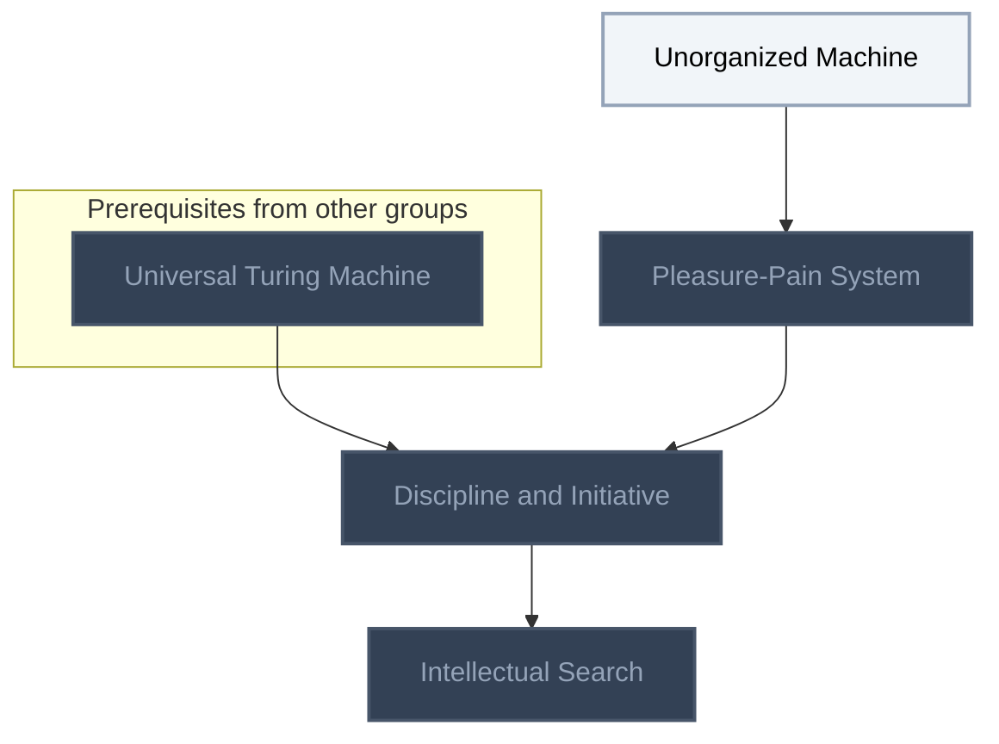

## Computing Machinery and Intelligence (Turing, 1950)
**Reached:** L1 0 · L2 0 · L3 0 · L4 0 · L5 0 (of 7 nodes)

```mermaid
flowchart TD
    classDef planned fill:#1E293B,stroke:#64748B,stroke-width:2px,stroke-dasharray:5 5,color:#94A3B8;
    classDef locked fill:#334155,stroke:#475569,stroke-width:2px,color:#94A3B8;
    classDef L0 fill:#F1F5F9,stroke:#94A3B8,stroke-width:2px,color:#000000;
    classDef L1 fill:#22C55E,stroke:#15803D,stroke-width:2px,color:#000000;
    classDef L2 fill:#3B82F6,stroke:#1D4ED8,stroke-width:3px,color:#FFFFFF;
    classDef L3 fill:#A855F7,stroke:#6B21A8,stroke-width:3px,color:#FFFFFF,font-weight:bold;
    classDef L4 fill:#F97316,stroke:#C2410C,stroke-width:4px,color:#000000,font-weight:bold;
    classDef L5 fill:#FFD700,stroke:#FF8C00,stroke-width:5px,color:#000000,font-weight:bold;
    classDef rusty stroke:#8B4513,stroke-width:4px,stroke-dasharray:3 3;
    subgraph sg_prereqs["Prerequisites from other groups"]
        n_turing_test["Turing Test"]
    end
    n_objections_to_machine_intelligence["Objections to Machine Intelligence"]
    n_heads_in_the_sand_objection["Heads in the Sand Objection"]
    n_argument_from_consciousness["Argument from Consciousness"]
    n_argument_from_various_disabilities["Argument from Various Disabilities"]
    n_argument_from_continuity_in_the_nervous_system["Argument from Continuity in the Nervous System"]
    n_lady_lovelace_s_objection["Lady Lovelace's Objection"]
    n_child_machine["Child Machine"]
    n_turing_test --> n_objections_to_machine_intelligence
    n_turing_test --> n_heads_in_the_sand_objection
    n_turing_test --> n_argument_from_consciousness
    n_turing_test --> n_argument_from_various_disabilities
    n_turing_test --> n_argument_from_continuity_in_the_nervous_system
    n_turing_test --> n_lady_lovelace_s_objection
    n_lady_lovelace_s_objection --> n_child_machine
    class n_objections_to_machine_intelligence,n_heads_in_the_sand_objection,n_argument_from_consciousness,n_argument_from_various_disabilities,n_argument_from_continuity_in_the_nervous_system,n_lady_lovelace_s_objection,n_child_machine locked;
    class n_turing_test L0;
    class n_turing_test,n_objections_to_machine_intelligence,n_heads_in_the_sand_objection,n_argument_from_consciousness,n_argument_from_various_disabilities,n_argument_from_continuity_in_the_nervous_system,n_lady_lovelace_s_objection,n_child_machine internal-link;
```

## The Structure of Scientific Revolutions (Kuhn, 1970)
**Reached:** L1 0 · L2 0 · L3 0 · L4 0 · L5 0 (of 11 nodes)

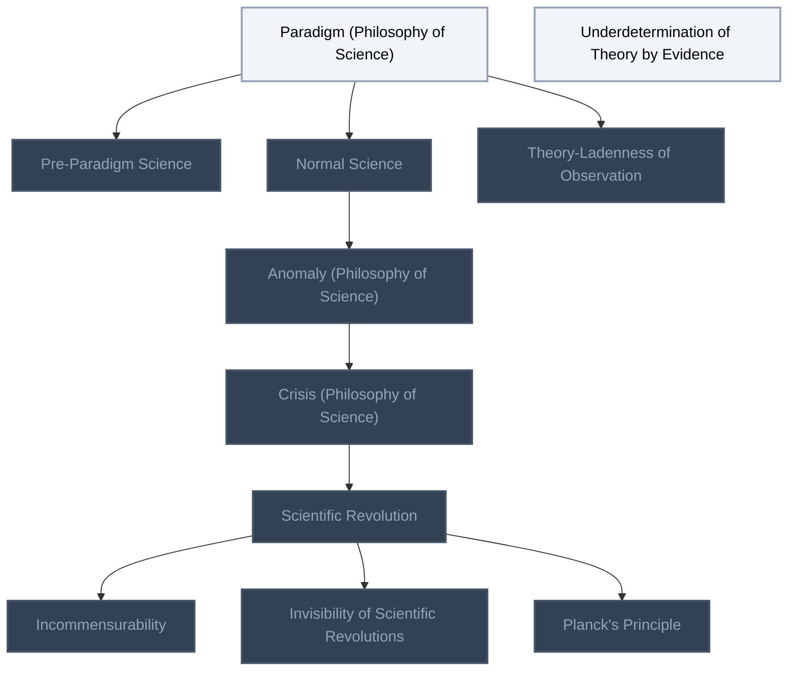

## Minds, Brains and Programs (Searle)
**Reached:** L1 0 · L2 0 · L3 0 · L4 0 · L5 0 (of 5 nodes)

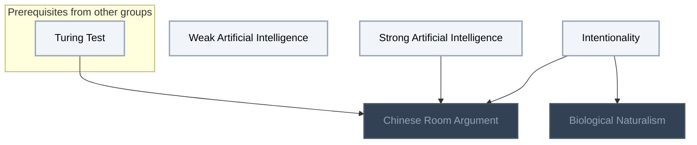

## The Fourth Paradigm (Hey et al., 2009)
**Reached:** L1 0 · L2 0 · L3 0 · L4 0 · L5 0 (of 13 nodes)

```mermaid
flowchart TD
    classDef planned fill:#1E293B,stroke:#64748B,stroke-width:2px,stroke-dasharray:5 5,color:#94A3B8;
    classDef locked fill:#334155,stroke:#475569,stroke-width:2px,color:#94A3B8;
    classDef L0 fill:#F1F5F9,stroke:#94A3B8,stroke-width:2px,color:#000000;
    classDef L1 fill:#22C55E,stroke:#15803D,stroke-width:2px,color:#000000;
    classDef L2 fill:#3B82F6,stroke:#1D4ED8,stroke-width:3px,color:#FFFFFF;
    classDef L3 fill:#A855F7,stroke:#6B21A8,stroke-width:3px,color:#FFFFFF,font-weight:bold;
    classDef L4 fill:#F97316,stroke:#C2410C,stroke-width:4px,color:#000000,font-weight:bold;
    classDef L5 fill:#FFD700,stroke:#FF8C00,stroke-width:5px,color:#000000,font-weight:bold;
    classDef rusty stroke:#8B4513,stroke-width:4px,stroke-dasharray:3 3;
    subgraph sg_prereqs["Prerequisites from other groups"]
        n_knowledge_representation_artificial_intelligence["Knowledge Representation (Artificial Intelligence)"]
    end
    n_paradigms_of_scientific_discovery["Paradigms of Scientific Discovery"]
    n_data_intensive_science["Data-Intensive Science"]
    n_laboratory_information_management_system["Laboratory Information Management System"]
    n_open_scholarly_communication["Open Scholarly Communication"]
    n_gray_s_laws["Gray's Laws"]
    n_applications_science["Applications Science"]
    n_citizen_science["Citizen Science"]
    n_connectomics["Connectomics"]
    n_data_intensive_healthcare["Data-Intensive Healthcare"]
    n_health_avatar["Health Avatar"]
    n_algorithmic_systems_biology["Algorithmic Systems Biology"]
    n_scientific_workflow["Scientific Workflow"]
    n_ontology_computer_science["Ontology (Computer Science)"]
    n_paradigms_of_scientific_discovery --> n_data_intensive_science
    n_data_intensive_science --> n_gray_s_laws
    n_data_intensive_science --> n_data_intensive_healthcare
    n_data_intensive_healthcare --> n_health_avatar
    n_knowledge_representation_artificial_intelligence --> n_ontology_computer_science
    class n_data_intensive_science,n_gray_s_laws,n_data_intensive_healthcare,n_health_avatar,n_ontology_computer_science locked;
    class n_knowledge_representation_artificial_intelligence,n_paradigms_of_scientific_discovery,n_laboratory_information_management_system,n_open_scholarly_communication,n_applications_science,n_citizen_science,n_connectomics,n_algorithmic_systems_biology,n_scientific_workflow L0;
    class n_knowledge_representation_artificial_intelligence,n_paradigms_of_scientific_discovery,n_data_intensive_science,n_laboratory_information_management_system,n_open_scholarly_communication,n_gray_s_laws,n_applications_science,n_citizen_science,n_connectomics,n_data_intensive_healthcare,n_health_avatar,n_algorithmic_systems_biology,n_scientific_workflow,n_ontology_computer_science internal-link;
```

## Superintelligence (Bostrom, 2014)
**Reached:** L1 0 · L2 0 · L3 0 · L4 0 · L5 0 (of 31 nodes)

```mermaid
flowchart TD
    classDef planned fill:#1E293B,stroke:#64748B,stroke-width:2px,stroke-dasharray:5 5,color:#94A3B8;
    classDef locked fill:#334155,stroke:#475569,stroke-width:2px,color:#94A3B8;
    classDef L0 fill:#F1F5F9,stroke:#94A3B8,stroke-width:2px,color:#000000;
    classDef L1 fill:#22C55E,stroke:#15803D,stroke-width:2px,color:#000000;
    classDef L2 fill:#3B82F6,stroke:#1D4ED8,stroke-width:3px,color:#FFFFFF;
    classDef L3 fill:#A855F7,stroke:#6B21A8,stroke-width:3px,color:#FFFFFF,font-weight:bold;
    classDef L4 fill:#F97316,stroke:#C2410C,stroke-width:4px,color:#000000,font-weight:bold;
    classDef L5 fill:#FFD700,stroke:#FF8C00,stroke-width:5px,color:#000000,font-weight:bold;
    classDef rusty stroke:#8B4513,stroke-width:4px,stroke-dasharray:3 3;
    subgraph sg_prereqs["Prerequisites from other groups"]
        n_child_machine["Child Machine"]
    end
    n_intelligence_explosion["Intelligence Explosion"]
    n_combinatorial_explosion["Combinatorial Explosion"]
    n_ai_effect["AI Effect"]
    n_superintelligence["Superintelligence"]
    n_observation_selection_effect["Observation Selection Effect"]
    n_seed_ai["Seed AI"]
    n_whole_brain_emulation["Whole Brain Emulation"]
    n_paths_to_superintelligence["Paths to Superintelligence"]
    n_superintelligence_takeoff["Superintelligence Takeoff"]
    n_decisive_strategic_advantage["Decisive Strategic Advantage"]
    n_orthogonality_thesis["Orthogonality Thesis"]
    n_instrumental_convergence_thesis["Instrumental Convergence Thesis"]
    n_treacherous_turn["Treacherous Turn"]
    n_perverse_instantiation["Perverse Instantiation"]
    n_wireheading["Wireheading"]
    n_infrastructure_profusion["Infrastructure Profusion"]
    n_mind_crime["Mind Crime"]
    n_ai_control_problem["AI Control Problem"]
    n_capability_control_methods["Capability Control Methods"]
    n_motivation_selection_methods["Motivation Selection Methods"]
    n_ai_system_castes["AI System Castes"]
    n_multipolar_scenario["Multipolar Scenario"]
    n_value_loading_problem["Value-Loading Problem"]
    n_indirect_normativity["Indirect Normativity"]
    n_coherent_extrapolated_volition["Coherent Extrapolated Volition"]
    n_person_affecting_and_impersonal_perspectives["Person-Affecting and Impersonal Perspectives"]
    n_differential_technological_development["Differential Technological Development"]
    n_state_risk_and_step_risk["State Risk and Step Risk"]
    n_singleton["Singleton"]
    n_common_good_principle["Common Good Principle"]
    n_crucial_consideration["Crucial Consideration"]
    n_superintelligence --> n_paths_to_superintelligence
    n_child_machine --> n_seed_ai
    n_superintelligence --> n_superintelligence_takeoff
    n_superintelligence_takeoff --> n_decisive_strategic_advantage
    n_decisive_strategic_advantage --> n_singleton
    n_singleton --> n_multipolar_scenario
    n_superintelligence --> n_orthogonality_thesis
    n_superintelligence --> n_instrumental_convergence_thesis
    n_singleton --> n_treacherous_turn
    n_instrumental_convergence_thesis --> n_treacherous_turn
    n_superintelligence --> n_perverse_instantiation
    n_decisive_strategic_advantage --> n_wireheading
    n_instrumental_convergence_thesis --> n_infrastructure_profusion
    n_superintelligence --> n_mind_crime
    n_superintelligence --> n_ai_control_problem
    n_ai_control_problem --> n_capability_control_methods
    n_ai_control_problem --> n_motivation_selection_methods
    n_ai_control_problem --> n_ai_system_castes
    n_motivation_selection_methods --> n_value_loading_problem
    n_value_loading_problem --> n_indirect_normativity
    n_indirect_normativity --> n_coherent_extrapolated_volition
    class n_child_machine,n_seed_ai,n_paths_to_superintelligence,n_superintelligence_takeoff,n_decisive_strategic_advantage,n_orthogonality_thesis,n_instrumental_convergence_thesis,n_treacherous_turn,n_perverse_instantiation,n_wireheading,n_infrastructure_profusion,n_mind_crime,n_ai_control_problem,n_capability_control_methods,n_motivation_selection_methods,n_ai_system_castes,n_multipolar_scenario,n_value_loading_problem,n_indirect_normativity,n_coherent_extrapolated_volition,n_singleton locked;
    class n_intelligence_explosion,n_combinatorial_explosion,n_ai_effect,n_superintelligence,n_observation_selection_effect,n_whole_brain_emulation,n_person_affecting_and_impersonal_perspectives,n_differential_technological_development,n_state_risk_and_step_risk,n_common_good_principle,n_crucial_consideration L0;
    class n_child_machine,n_intelligence_explosion,n_combinatorial_explosion,n_ai_effect,n_superintelligence,n_observation_selection_effect,n_seed_ai,n_whole_brain_emulation,n_paths_to_superintelligence,n_superintelligence_takeoff,n_decisive_strategic_advantage,n_orthogonality_thesis,n_instrumental_convergence_thesis,n_treacherous_turn,n_perverse_instantiation,n_wireheading,n_infrastructure_profusion,n_mind_crime,n_ai_control_problem,n_capability_control_methods,n_motivation_selection_methods,n_ai_system_castes,n_multipolar_scenario,n_value_loading_problem,n_indirect_normativity,n_coherent_extrapolated_volition,n_person_affecting_and_impersonal_perspectives,n_differential_technological_development,n_state_risk_and_step_risk,n_singleton,n_common_good_principle,n_crucial_consideration internal-link;
```

## Concrete Problems in AI Safety (Amodei et al., 2016)
**Reached:** L1 0 · L2 0 · L3 0 · L4 0 · L5 0 (of 8 nodes)

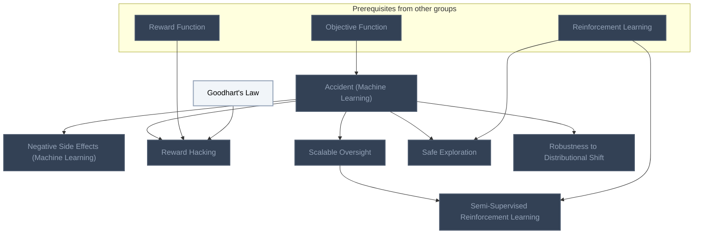

## The Bitter Lesson (Sutton)
**Reached:** L1 0 · L2 0 · L3 0 · L4 0 · L5 0 (of 1 nodes)

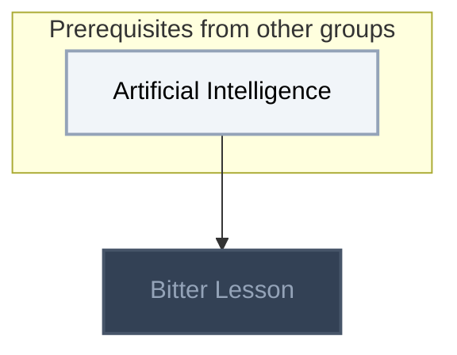

## The Alignment Problem (Christian, 2021)
**Reached:** L1 0 · L2 0 · L3 0 · L4 0 · L5 0 (of 20 nodes)

```mermaid
flowchart TD
    classDef planned fill:#1E293B,stroke:#64748B,stroke-width:2px,stroke-dasharray:5 5,color:#94A3B8;
    classDef locked fill:#334155,stroke:#475569,stroke-width:2px,color:#94A3B8;
    classDef L0 fill:#F1F5F9,stroke:#94A3B8,stroke-width:2px,color:#000000;
    classDef L1 fill:#22C55E,stroke:#15803D,stroke-width:2px,color:#000000;
    classDef L2 fill:#3B82F6,stroke:#1D4ED8,stroke-width:3px,color:#FFFFFF;
    classDef L3 fill:#A855F7,stroke:#6B21A8,stroke-width:3px,color:#FFFFFF,font-weight:bold;
    classDef L4 fill:#F97316,stroke:#C2410C,stroke-width:4px,color:#000000,font-weight:bold;
    classDef L5 fill:#FFD700,stroke:#FF8C00,stroke-width:5px,color:#000000,font-weight:bold;
    classDef rusty stroke:#8B4513,stroke-width:4px,stroke-dasharray:3 3;
    subgraph sg_prereqs["Prerequisites from other groups"]
        n_reinforcement_learning["Reinforcement Learning"]
        n_temporal_difference_learning["Temporal-Difference Learning"]
        n_inverse_reinforcement_learning["Inverse Reinforcement Learning"]
        n_negative_side_effects_machine_learning["Negative Side Effects (Machine Learning)"]
        n_ai_control_problem["AI Control Problem"]
    end
    n_algorithmic_bias["Algorithmic Bias"]
    n_feedback_loop_machine_learning["Feedback Loop (Machine Learning)"]
    n_redundant_encoding["Redundant Encoding"]
    n_fairness_impossibility_theorem["Fairness Impossibility Theorem"]
    n_interpretability_machine_learning["Interpretability (Machine Learning)"]
    n_improper_linear_model["Improper Linear Model"]
    n_law_of_effect["Law of Effect"]
    n_hedonistic_neuron["Hedonistic Neuron"]
    n_reward_hypothesis["Reward Hypothesis"]
    n_reward_prediction_error_hypothesis["Reward Prediction Error Hypothesis"]
    n_shaping_machine_learning["Shaping (Machine Learning)"]
    n_reward_shaping["Reward Shaping"]
    n_curiosity_driven_exploration["Curiosity-Driven Exploration"]
    n_overimitation["Overimitation"]
    n_cooperative_inverse_reinforcement_learning["Cooperative Inverse Reinforcement Learning"]
    n_attainable_utility_preservation["Attainable Utility Preservation"]
    n_corrigibility["Corrigibility"]
    n_inverse_reward_design["Inverse Reward Design"]
    n_moral_uncertainty["Moral Uncertainty"]
    n_astronomical_waste["Astronomical Waste"]
    n_algorithmic_bias --> n_redundant_encoding
    n_algorithmic_bias --> n_fairness_impossibility_theorem
    n_law_of_effect --> n_hedonistic_neuron
    n_reinforcement_learning --> n_reward_hypothesis
    n_temporal_difference_learning --> n_reward_prediction_error_hypothesis
    n_shaping_machine_learning --> n_reward_shaping
    n_reinforcement_learning --> n_curiosity_driven_exploration
    n_inverse_reinforcement_learning --> n_cooperative_inverse_reinforcement_learning
    n_inverse_reinforcement_learning --> n_inverse_reward_design
    n_negative_side_effects_machine_learning --> n_attainable_utility_preservation
    n_ai_control_problem --> n_corrigibility
    class n_reinforcement_learning,n_temporal_difference_learning,n_inverse_reinforcement_learning,n_negative_side_effects_machine_learning,n_ai_control_problem,n_redundant_encoding,n_fairness_impossibility_theorem,n_hedonistic_neuron,n_reward_hypothesis,n_reward_prediction_error_hypothesis,n_reward_shaping,n_curiosity_driven_exploration,n_cooperative_inverse_reinforcement_learning,n_attainable_utility_preservation,n_corrigibility,n_inverse_reward_design locked;
    class n_algorithmic_bias,n_feedback_loop_machine_learning,n_interpretability_machine_learning,n_improper_linear_model,n_law_of_effect,n_shaping_machine_learning,n_overimitation,n_moral_uncertainty,n_astronomical_waste L0;
    class n_reinforcement_learning,n_temporal_difference_learning,n_inverse_reinforcement_learning,n_negative_side_effects_machine_learning,n_ai_control_problem,n_algorithmic_bias,n_feedback_loop_machine_learning,n_redundant_encoding,n_fairness_impossibility_theorem,n_interpretability_machine_learning,n_improper_linear_model,n_law_of_effect,n_hedonistic_neuron,n_reward_hypothesis,n_reward_prediction_error_hypothesis,n_shaping_machine_learning,n_reward_shaping,n_curiosity_driven_exploration,n_overimitation,n_cooperative_inverse_reinforcement_learning,n_attainable_utility_preservation,n_corrigibility,n_inverse_reward_design,n_moral_uncertainty,n_astronomical_waste internal-link;
```

## The Age of AI (Kissinger et al., 2021)
**Reached:** L1 0 · L2 0 · L3 0 · L4 0 · L5 0 (of 7 nodes)

```mermaid
flowchart TD
    classDef planned fill:#1E293B,stroke:#64748B,stroke-width:2px,stroke-dasharray:5 5,color:#94A3B8;
    classDef locked fill:#334155,stroke:#475569,stroke-width:2px,color:#94A3B8;
    classDef L0 fill:#F1F5F9,stroke:#94A3B8,stroke-width:2px,color:#000000;
    classDef L1 fill:#22C55E,stroke:#15803D,stroke-width:2px,color:#000000;
    classDef L2 fill:#3B82F6,stroke:#1D4ED8,stroke-width:3px,color:#FFFFFF;
    classDef L3 fill:#A855F7,stroke:#6B21A8,stroke-width:3px,color:#FFFFFF,font-weight:bold;
    classDef L4 fill:#F97316,stroke:#C2410C,stroke-width:4px,color:#000000,font-weight:bold;
    classDef L5 fill:#FFD700,stroke:#FF8C00,stroke-width:5px,color:#000000,font-weight:bold;
    classDef rusty stroke:#8B4513,stroke-width:4px,stroke-dasharray:3 3;
    n_ai_driven_societal_transformation["AI-Driven Societal Transformation"]
    n_human_machine_partnership["Human-Machine Partnership"]
    n_thing_in_itself["Thing-in-Itself"]
    n_ai_as_a_way_of_knowing["AI as a Way of Knowing"]
    n_information_knowledge_wisdom_hierarchy["Information-Knowledge-Wisdom Hierarchy"]
    n_algorithmic_echo_chamber["Algorithmic Echo Chamber"]
    n_artificial_intelligence_in_warfare["Artificial Intelligence in Warfare"]
    n_thing_in_itself --> n_ai_as_a_way_of_knowing
    class n_ai_as_a_way_of_knowing locked;
    class n_ai_driven_societal_transformation,n_human_machine_partnership,n_thing_in_itself,n_information_knowledge_wisdom_hierarchy,n_algorithmic_echo_chamber,n_artificial_intelligence_in_warfare L0;
    class n_ai_driven_societal_transformation,n_human_machine_partnership,n_thing_in_itself,n_ai_as_a_way_of_knowing,n_information_knowledge_wisdom_hierarchy,n_algorithmic_echo_chamber,n_artificial_intelligence_in_warfare internal-link;
```

## AI-Assisted Science (Bubeck et al., 2025)
**Reached:** L1 0 · L2 0 · L3 0 · L4 0 · L5 0 (of 1 nodes)

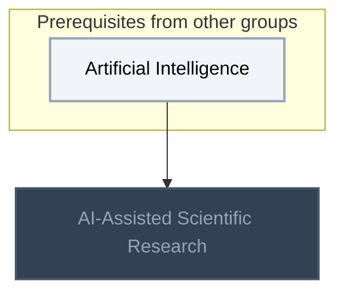

## Mathematics and AI (Klowden and Tao, 2026)
**Reached:** L1 0 · L2 0 · L3 0 · L4 0 · L5 0 (of 7 nodes)

```mermaid
flowchart TD
    classDef planned fill:#1E293B,stroke:#64748B,stroke-width:2px,stroke-dasharray:5 5,color:#94A3B8;
    classDef locked fill:#334155,stroke:#475569,stroke-width:2px,color:#94A3B8;
    classDef L0 fill:#F1F5F9,stroke:#94A3B8,stroke-width:2px,color:#000000;
    classDef L1 fill:#22C55E,stroke:#15803D,stroke-width:2px,color:#000000;
    classDef L2 fill:#3B82F6,stroke:#1D4ED8,stroke-width:3px,color:#FFFFFF;
    classDef L3 fill:#A855F7,stroke:#6B21A8,stroke-width:3px,color:#FFFFFF,font-weight:bold;
    classDef L4 fill:#F97316,stroke:#C2410C,stroke-width:4px,color:#000000,font-weight:bold;
    classDef L5 fill:#FFD700,stroke:#FF8C00,stroke-width:5px,color:#000000,font-weight:bold;
    classDef rusty stroke:#8B4513,stroke-width:4px,stroke-dasharray:3 3;
    subgraph sg_prereqs["Prerequisites from other groups"]
        n_artificial_intelligence["Artificial Intelligence"]
    end
    n_human_centered_artificial_intelligence["Human-Centered Artificial Intelligence"]
    n_ai_assisted_mathematics["AI-Assisted Mathematics"]
    n_smell_mathematics["Smell (Mathematics)"]
    n_formal_proof_assistant["Formal Proof Assistant"]
    n_model_collapse["Model Collapse"]
    n_philosophical_stances_on_artificial_intelligence["Philosophical Stances on Artificial Intelligence"]
    n_copernican_principle["Copernican Principle"]
    n_artificial_intelligence --> n_human_centered_artificial_intelligence
    class n_human_centered_artificial_intelligence locked;
    class n_artificial_intelligence,n_ai_assisted_mathematics,n_smell_mathematics,n_formal_proof_assistant,n_model_collapse,n_philosophical_stances_on_artificial_intelligence,n_copernican_principle L0;
    class n_artificial_intelligence,n_human_centered_artificial_intelligence,n_ai_assisted_mathematics,n_smell_mathematics,n_formal_proof_assistant,n_model_collapse,n_philosophical_stances_on_artificial_intelligence,n_copernican_principle internal-link;
```

# Source
Graph structure: the single source for the diagrams above, edited by `/note` and `Scripts/skill_trees.py` (`add`, `edge`, `rename`). Everything above this heading is regenerated by `render`.

```skilltree
    %% PREREQUISITES
    n_turing_test["Turing Test"]
    n_knowledge_representation_artificial_intelligence["Knowledge Representation (Artificial Intelligence)"]
    n_objective_function["Objective Function"]
    n_reward_function["Reward Function"]
    n_reinforcement_learning["Reinforcement Learning"]
    n_artificial_intelligence["Artificial Intelligence"]
    n_universal_turing_machine["Universal Turing Machine"]
    n_inverse_reinforcement_learning["Inverse Reinforcement Learning"]
    n_temporal_difference_learning["Temporal-Difference Learning"]
    %% NODES
    %% == Computability (Turing, 1936) ==
    %% == Intelligent Machinery (Turing, 1948) ==
    n_unorganized_machine["Unorganized Machine"]
    n_pleasure_pain_system["Pleasure-Pain System"]
    n_discipline_and_initiative["Discipline and Initiative"]
    n_intellectual_search["Intellectual Search"]
    %% == Computing Machinery and Intelligence (Turing, 1950) ==
    n_objections_to_machine_intelligence["Objections to Machine Intelligence"]
    n_heads_in_the_sand_objection["Heads in the Sand Objection"]
    n_argument_from_consciousness["Argument from Consciousness"]
    n_argument_from_various_disabilities["Argument from Various Disabilities"]
    n_argument_from_continuity_in_the_nervous_system["Argument from Continuity in the Nervous System"]
    n_lady_lovelace_s_objection["Lady Lovelace's Objection"]
    n_child_machine["Child Machine"]
    %% == The Structure of Scientific Revolutions (Kuhn, 1970) ==
    n_paradigm_philosophy_of_science["Paradigm (Philosophy of Science)"]
    n_pre_paradigm_science["Pre-Paradigm Science"]
    n_normal_science["Normal Science"]
    n_anomaly_philosophy_of_science["Anomaly (Philosophy of Science)"]
    n_crisis_philosophy_of_science["Crisis (Philosophy of Science)"]
    n_underdetermination_of_theory_by_evidence["Underdetermination of Theory by Evidence"]
    n_scientific_revolution["Scientific Revolution"]
    n_theory_ladenness_of_observation["Theory-Ladenness of Observation"]
    n_incommensurability["Incommensurability"]
    n_invisibility_of_scientific_revolutions["Invisibility of Scientific Revolutions"]
    n_planck_s_principle["Planck's Principle"]
    %% == Minds, Brains and Programs (Searle) ==
    n_weak_artificial_intelligence["Weak Artificial Intelligence"]
    n_strong_artificial_intelligence["Strong Artificial Intelligence"]
    n_intentionality["Intentionality"]
    n_chinese_room_argument["Chinese Room Argument"]
    n_biological_naturalism["Biological Naturalism"]
    %% == The Fourth Paradigm (Hey et al., 2009) ==
    n_paradigms_of_scientific_discovery["Paradigms of Scientific Discovery"]
    n_data_intensive_science["Data-Intensive Science"]
    n_laboratory_information_management_system["Laboratory Information Management System"]
    n_open_scholarly_communication["Open Scholarly Communication"]
    n_gray_s_laws["Gray's Laws"]
    n_applications_science["Applications Science"]
    n_citizen_science["Citizen Science"]
    n_connectomics["Connectomics"]
    n_data_intensive_healthcare["Data-Intensive Healthcare"]
    n_health_avatar["Health Avatar"]
    n_algorithmic_systems_biology["Algorithmic Systems Biology"]
    n_scientific_workflow["Scientific Workflow"]
    n_ontology_computer_science["Ontology (Computer Science)"]
    %% == Superintelligence (Bostrom, 2014) ==
    n_intelligence_explosion["Intelligence Explosion"]
    n_combinatorial_explosion["Combinatorial Explosion"]
    n_ai_effect["AI Effect"]
    n_superintelligence["Superintelligence"]
    n_observation_selection_effect["Observation Selection Effect"]
    n_seed_ai["Seed AI"]
    n_whole_brain_emulation["Whole Brain Emulation"]
    n_paths_to_superintelligence["Paths to Superintelligence"]
    n_superintelligence_takeoff["Superintelligence Takeoff"]
    n_decisive_strategic_advantage["Decisive Strategic Advantage"]
    n_orthogonality_thesis["Orthogonality Thesis"]
    n_instrumental_convergence_thesis["Instrumental Convergence Thesis"]
    n_treacherous_turn["Treacherous Turn"]
    n_perverse_instantiation["Perverse Instantiation"]
    n_wireheading["Wireheading"]
    n_infrastructure_profusion["Infrastructure Profusion"]
    n_mind_crime["Mind Crime"]
    n_ai_control_problem["AI Control Problem"]
    n_capability_control_methods["Capability Control Methods"]
    n_motivation_selection_methods["Motivation Selection Methods"]
    n_ai_system_castes["AI System Castes"]
    n_multipolar_scenario["Multipolar Scenario"]
    n_value_loading_problem["Value-Loading Problem"]
    n_indirect_normativity["Indirect Normativity"]
    n_coherent_extrapolated_volition["Coherent Extrapolated Volition"]
    n_person_affecting_and_impersonal_perspectives["Person-Affecting and Impersonal Perspectives"]
    n_differential_technological_development["Differential Technological Development"]
    n_state_risk_and_step_risk["State Risk and Step Risk"]
    n_singleton["Singleton"]
    n_common_good_principle["Common Good Principle"]
    n_crucial_consideration["Crucial Consideration"]
    %% == Concrete Problems in AI Safety (Amodei et al., 2016) ==
    n_accident_machine_learning["Accident (Machine Learning)"]
    n_negative_side_effects_machine_learning["Negative Side Effects (Machine Learning)"]
    n_goodhart_s_law["Goodhart's Law"]
    n_reward_hacking["Reward Hacking"]
    n_scalable_oversight["Scalable Oversight"]
    n_semi_supervised_reinforcement_learning["Semi-Supervised Reinforcement Learning"]
    n_safe_exploration["Safe Exploration"]
    n_robustness_to_distributional_shift["Robustness to Distributional Shift"]
    %% == The Bitter Lesson (Sutton) ==
    n_bitter_lesson["Bitter Lesson"]
    %% == The Alignment Problem (Christian, 2021) ==
    n_algorithmic_bias["Algorithmic Bias"]
    n_feedback_loop_machine_learning["Feedback Loop (Machine Learning)"]
    n_redundant_encoding["Redundant Encoding"]
    n_fairness_impossibility_theorem["Fairness Impossibility Theorem"]
    n_interpretability_machine_learning["Interpretability (Machine Learning)"]
    n_improper_linear_model["Improper Linear Model"]
    n_law_of_effect["Law of Effect"]
    n_hedonistic_neuron["Hedonistic Neuron"]
    n_reward_hypothesis["Reward Hypothesis"]
    n_reward_prediction_error_hypothesis["Reward Prediction Error Hypothesis"]
    n_shaping_machine_learning["Shaping (Machine Learning)"]
    n_reward_shaping["Reward Shaping"]
    n_curiosity_driven_exploration["Curiosity-Driven Exploration"]
    n_overimitation["Overimitation"]
    n_cooperative_inverse_reinforcement_learning["Cooperative Inverse Reinforcement Learning"]
    n_attainable_utility_preservation["Attainable Utility Preservation"]
    n_corrigibility["Corrigibility"]
    n_inverse_reward_design["Inverse Reward Design"]
    n_moral_uncertainty["Moral Uncertainty"]
    n_astronomical_waste["Astronomical Waste"]
    %% == The Age of AI (Kissinger et al., 2021) ==
    n_ai_driven_societal_transformation["AI-Driven Societal Transformation"]
    n_human_machine_partnership["Human-Machine Partnership"]
    n_thing_in_itself["Thing-in-Itself"]
    n_ai_as_a_way_of_knowing["AI as a Way of Knowing"]
    n_information_knowledge_wisdom_hierarchy["Information-Knowledge-Wisdom Hierarchy"]
    n_algorithmic_echo_chamber["Algorithmic Echo Chamber"]
    n_artificial_intelligence_in_warfare["Artificial Intelligence in Warfare"]
    %% == AI-Assisted Science (Bubeck et al., 2025) ==
    n_ai_assisted_scientific_research["AI-Assisted Scientific Research"]
    %% == Mathematics and AI (Klowden and Tao, 2026) ==
    n_human_centered_artificial_intelligence["Human-Centered Artificial Intelligence"]
    n_ai_assisted_mathematics["AI-Assisted Mathematics"]
    n_smell_mathematics["Smell (Mathematics)"]
    n_formal_proof_assistant["Formal Proof Assistant"]
    n_model_collapse["Model Collapse"]
    n_philosophical_stances_on_artificial_intelligence["Philosophical Stances on Artificial Intelligence"]
    n_copernican_principle["Copernican Principle"]
    %% EDGES
    n_unorganized_machine --> n_pleasure_pain_system
    n_universal_turing_machine --> n_discipline_and_initiative
    n_pleasure_pain_system --> n_discipline_and_initiative
    n_discipline_and_initiative --> n_intellectual_search
    n_turing_test --> n_objections_to_machine_intelligence
    n_turing_test --> n_heads_in_the_sand_objection
    n_turing_test --> n_argument_from_consciousness
    n_turing_test --> n_argument_from_various_disabilities
    n_turing_test --> n_argument_from_continuity_in_the_nervous_system
    n_turing_test --> n_lady_lovelace_s_objection
    n_lady_lovelace_s_objection --> n_child_machine
    n_paradigm_philosophy_of_science --> n_pre_paradigm_science
    n_paradigm_philosophy_of_science --> n_normal_science
    n_normal_science --> n_anomaly_philosophy_of_science
    n_anomaly_philosophy_of_science --> n_crisis_philosophy_of_science
    n_crisis_philosophy_of_science --> n_scientific_revolution
    n_paradigm_philosophy_of_science --> n_theory_ladenness_of_observation
    n_scientific_revolution --> n_incommensurability
    n_scientific_revolution --> n_invisibility_of_scientific_revolutions
    n_scientific_revolution --> n_planck_s_principle
    n_strong_artificial_intelligence --> n_chinese_room_argument
    n_intentionality --> n_chinese_room_argument
    n_turing_test --> n_chinese_room_argument
    n_intentionality --> n_biological_naturalism
    n_paradigms_of_scientific_discovery --> n_data_intensive_science
    n_data_intensive_science --> n_gray_s_laws
    n_data_intensive_science --> n_data_intensive_healthcare
    n_data_intensive_healthcare --> n_health_avatar
    n_knowledge_representation_artificial_intelligence --> n_ontology_computer_science
    n_superintelligence --> n_paths_to_superintelligence
    n_child_machine --> n_seed_ai
    n_superintelligence --> n_superintelligence_takeoff
    n_superintelligence_takeoff --> n_decisive_strategic_advantage
    n_decisive_strategic_advantage --> n_singleton
    n_singleton --> n_multipolar_scenario
    n_superintelligence --> n_orthogonality_thesis
    n_superintelligence --> n_instrumental_convergence_thesis
    n_singleton --> n_treacherous_turn
    n_instrumental_convergence_thesis --> n_treacherous_turn
    n_superintelligence --> n_perverse_instantiation
    n_decisive_strategic_advantage --> n_wireheading
    n_instrumental_convergence_thesis --> n_infrastructure_profusion
    n_superintelligence --> n_mind_crime
    n_superintelligence --> n_ai_control_problem
    n_ai_control_problem --> n_capability_control_methods
    n_ai_control_problem --> n_motivation_selection_methods
    n_ai_control_problem --> n_ai_system_castes
    n_motivation_selection_methods --> n_value_loading_problem
    n_value_loading_problem --> n_indirect_normativity
    n_indirect_normativity --> n_coherent_extrapolated_volition
    n_objective_function --> n_accident_machine_learning
    n_accident_machine_learning --> n_negative_side_effects_machine_learning
    n_accident_machine_learning --> n_reward_hacking
    n_reward_function --> n_reward_hacking
    n_goodhart_s_law --> n_reward_hacking
    n_accident_machine_learning --> n_scalable_oversight
    n_accident_machine_learning --> n_safe_exploration
    n_reinforcement_learning --> n_safe_exploration
    n_accident_machine_learning --> n_robustness_to_distributional_shift
    n_scalable_oversight --> n_semi_supervised_reinforcement_learning
    n_reinforcement_learning --> n_semi_supervised_reinforcement_learning
    n_artificial_intelligence --> n_bitter_lesson
    n_algorithmic_bias --> n_redundant_encoding
    n_algorithmic_bias --> n_fairness_impossibility_theorem
    n_law_of_effect --> n_hedonistic_neuron
    n_reinforcement_learning --> n_reward_hypothesis
    n_temporal_difference_learning --> n_reward_prediction_error_hypothesis
    n_shaping_machine_learning --> n_reward_shaping
    n_reinforcement_learning --> n_curiosity_driven_exploration
    n_inverse_reinforcement_learning --> n_cooperative_inverse_reinforcement_learning
    n_inverse_reinforcement_learning --> n_inverse_reward_design
    n_negative_side_effects_machine_learning --> n_attainable_utility_preservation
    n_ai_control_problem --> n_corrigibility
    n_thing_in_itself --> n_ai_as_a_way_of_knowing
    n_artificial_intelligence --> n_ai_assisted_scientific_research
    n_artificial_intelligence --> n_human_centered_artificial_intelligence
```
