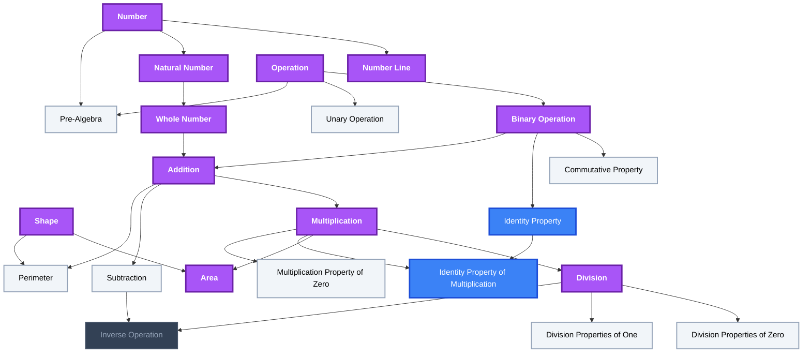
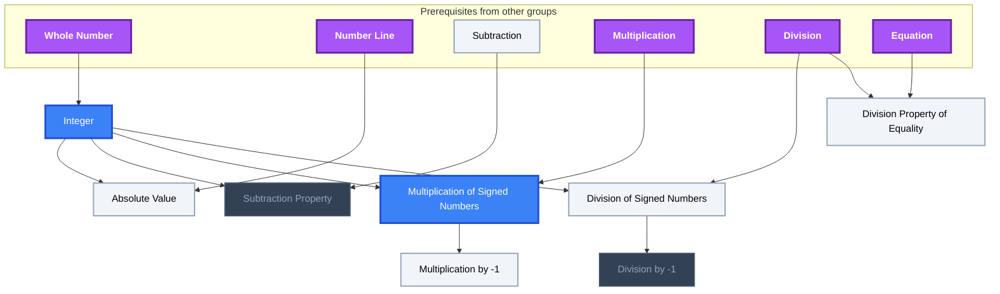
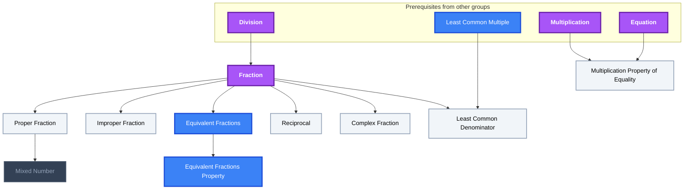
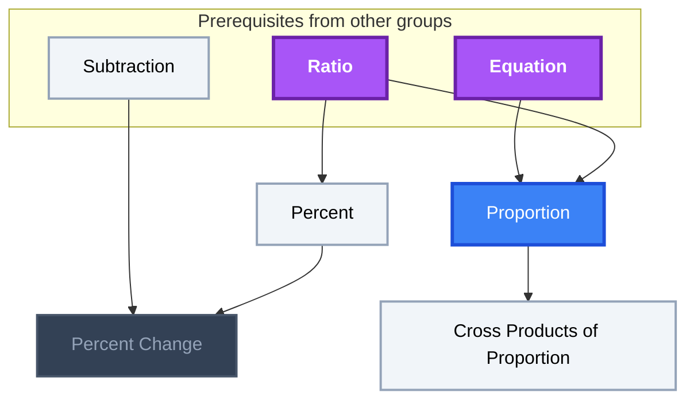
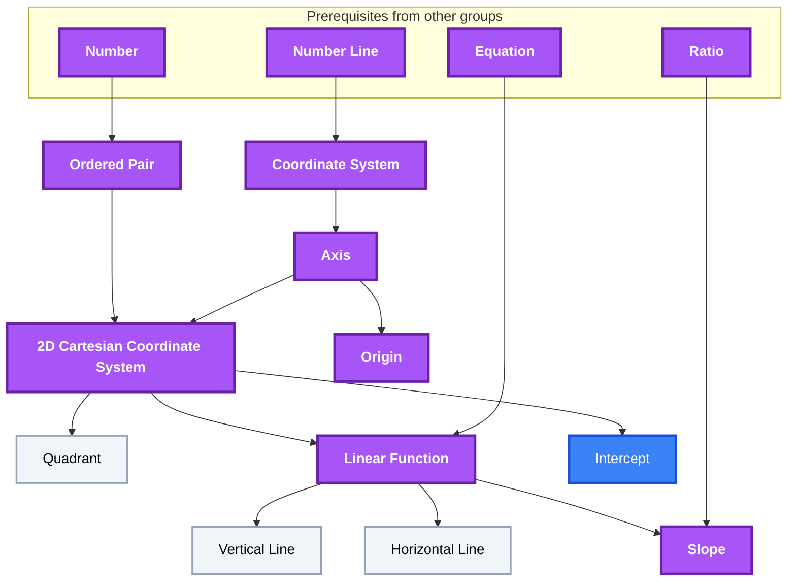

<!-- BEGIN STATS (generated by Scripts/skill_trees.py; do not edit) -->
**Mastered:** 28 / 134 · **Depth:** 21% · **Discovered:** 134 · **Planned:** 0 · **Locked:** 20 · **Rusty:** 0

**Levels:** L0 78 · L1 0 · L2 28 · L3 28 · L4 0 · L5 0

**Next up:** [[Pre-Algebra]], [[Unary Operation]], [[Mean]], [[Trapezoid]], [[Identity Property]]

Legend: dashed grey = planned (no note yet) · dark grey = locked · white L0 Discovered · green L1 Recall · blue L2 Apply · purple L3 Prove (Mastered) · orange L4 Wield · gold L5 Command · brown dashed border = rusty
<!-- END STATS -->

## OpenStax Prealgebra 2e Ch. 1: Whole Numbers
**Mastered:** 11 / 22 · **Discovered:** 22 / 22



## OpenStax Prealgebra 2e Ch. 2: The Language of Algebra
**Mastered:** 5 / 21 · **Discovered:** 21 / 21

```mermaid
flowchart TD
    classDef planned fill:#1E293B,stroke:#64748B,stroke-width:2px,stroke-dasharray:5 5,color:#94A3B8;
    classDef locked fill:#334155,stroke:#475569,stroke-width:2px,color:#94A3B8;
    classDef L0 fill:#F1F5F9,stroke:#94A3B8,stroke-width:2px,color:#000000;
    classDef L1 fill:#22C55E,stroke:#15803D,stroke-width:2px,color:#000000;
    classDef L2 fill:#3B82F6,stroke:#1D4ED8,stroke-width:3px,color:#FFFFFF;
    classDef L3 fill:#A855F7,stroke:#6B21A8,stroke-width:3px,color:#FFFFFF,font-weight:bold;
    classDef L4 fill:#F97316,stroke:#C2410C,stroke-width:4px,color:#000000,font-weight:bold;
    classDef L5 fill:#FFD700,stroke:#FF8C00,stroke-width:5px,color:#000000,font-weight:bold;
    classDef rusty stroke:#8B4513,stroke-width:4px,stroke-dasharray:3 3;
    subgraph sg_prereqs["Prerequisites from other groups"]
        n_number["Number"]
        n_operation["Operation"]
        n_multiplication["Multiplication"]
        n_subtraction["Subtraction"]
        n_division["Division"]
        n_addition["Addition"]
    end
    n_constant["Constant"]
    n_variable["Variable"]
    n_expression["Expression"]
    n_equality["Equality"]
    n_equation["Equation"]
    n_inequality["Inequality"]
    n_exponentiation["Exponentiation"]
    n_order_of_arithmetic_operations["Order of Arithmetic Operations"]
    n_term["Term"]
    n_like_terms["Like Terms"]
    n_subtraction_property_of_equality["Subtraction Property of Equality"]
    n_addition_property_of_equality["Addition Property of Equality"]
    n_multiple["Multiple"]
    n_divisible["Divisible"]
    n_factor["Factor"]
    n_prime_number["Prime Number"]
    n_composite_number["Composite Number"]
    n_prime_factorization["Prime Factorization"]
    n_common_multiple["Common Multiple"]
    n_least_common_multiple["Least Common Multiple"]
    n_prime_factors_method["Prime Factors Method"]
    n_number --> n_constant
    n_number --> n_variable
    n_operation --> n_expression
    n_constant --> n_expression
    n_variable --> n_expression
    n_expression --> n_equality
    n_equality --> n_equation
    n_equality --> n_inequality
    n_multiplication --> n_exponentiation
    n_subtraction --> n_order_of_arithmetic_operations
    n_division --> n_order_of_arithmetic_operations
    n_exponentiation --> n_order_of_arithmetic_operations
    n_multiplication --> n_term
    n_expression --> n_term
    n_exponentiation --> n_like_terms
    n_term --> n_like_terms
    n_subtraction --> n_subtraction_property_of_equality
    n_equation --> n_subtraction_property_of_equality
    n_addition --> n_addition_property_of_equality
    n_equation --> n_addition_property_of_equality
    n_multiplication --> n_multiple
    n_division --> n_divisible
    n_multiple --> n_divisible
    n_multiplication --> n_factor
    n_factor --> n_prime_number
    n_prime_number --> n_composite_number
    n_prime_number --> n_prime_factorization
    n_multiple --> n_common_multiple
    n_common_multiple --> n_least_common_multiple
    n_prime_factorization --> n_prime_factors_method
    n_least_common_multiple --> n_prime_factors_method
    class n_order_of_arithmetic_operations,n_subtraction_property_of_equality,n_prime_factors_method locked;
    class n_subtraction,n_like_terms,n_addition_property_of_equality,n_divisible,n_composite_number,n_prime_factorization L0;
    class n_inequality,n_exponentiation,n_term,n_multiple,n_factor,n_prime_number,n_common_multiple,n_least_common_multiple L2;
    class n_number,n_operation,n_multiplication,n_division,n_addition,n_constant,n_variable,n_expression,n_equality,n_equation L3;
    class n_number,n_operation,n_multiplication,n_subtraction,n_division,n_addition,n_constant,n_variable,n_expression,n_equality,n_equation,n_inequality,n_exponentiation,n_order_of_arithmetic_operations,n_term,n_like_terms,n_subtraction_property_of_equality,n_addition_property_of_equality,n_multiple,n_divisible,n_factor,n_prime_number,n_composite_number,n_prime_factorization,n_common_multiple,n_least_common_multiple,n_prime_factors_method internal-link;
```



## OpenStax Prealgebra 2e Ch. 3: Integers
**Mastered:** 0 / 8 · **Discovered:** 8 / 8



## OpenStax Prealgebra 2e Ch. 4: Fractions
**Mastered:** 1 / 10 · **Discovered:** 10 / 10



## OpenStax Prealgebra 2e Ch. 5: Decimals
**Mastered:** 3 / 14 · **Discovered:** 14 / 14

```mermaid
flowchart TD
    classDef planned fill:#1E293B,stroke:#64748B,stroke-width:2px,stroke-dasharray:5 5,color:#94A3B8;
    classDef locked fill:#334155,stroke:#475569,stroke-width:2px,color:#94A3B8;
    classDef L0 fill:#F1F5F9,stroke:#94A3B8,stroke-width:2px,color:#000000;
    classDef L1 fill:#22C55E,stroke:#15803D,stroke-width:2px,color:#000000;
    classDef L2 fill:#3B82F6,stroke:#1D4ED8,stroke-width:3px,color:#FFFFFF;
    classDef L3 fill:#A855F7,stroke:#6B21A8,stroke-width:3px,color:#FFFFFF,font-weight:bold;
    classDef L4 fill:#F97316,stroke:#C2410C,stroke-width:4px,color:#000000,font-weight:bold;
    classDef L5 fill:#FFD700,stroke:#FF8C00,stroke-width:5px,color:#000000,font-weight:bold;
    classDef rusty stroke:#8B4513,stroke-width:4px,stroke-dasharray:3 3;
    subgraph sg_prereqs["Prerequisites from other groups"]
        n_exponentiation["Exponentiation"]
        n_fraction["Fraction"]
        n_shape["Shape"]
        n_number["Number"]
        n_division["Division"]
        n_nth_root["Nth Root"]
        n_inequality["Inequality"]
        n_frequency["Frequency"]
    end
    n_decimal["Decimal"]
    n_equivalent_decimals["Equivalent Decimals"]
    n_repeating_decimal["Repeating Decimal"]
    n_circle["Circle"]
    n_pi["Pi"]
    n_mean["Mean"]
    n_arithmetic_mean["Arithmetic Mean"]
    n_geometric_mean["Geometric Mean"]
    n_median["Median"]
    n_mode["Mode"]
    n_ratio["Ratio"]
    n_rate["Rate"]
    n_perfect_square["Perfect Square"]
    n_square_root["Square Root"]
    n_exponentiation --> n_decimal
    n_fraction --> n_decimal
    n_decimal --> n_equivalent_decimals
    n_decimal --> n_repeating_decimal
    n_shape --> n_circle
    n_circle --> n_pi
    n_number --> n_mean
    n_division --> n_arithmetic_mean
    n_mean --> n_arithmetic_mean
    n_nth_root --> n_geometric_mean
    n_mean --> n_geometric_mean
    n_inequality --> n_median
    n_number --> n_mode
    n_fraction --> n_ratio
    n_ratio --> n_rate
    n_exponentiation --> n_perfect_square
    n_exponentiation --> n_square_root
    n_frequency --> n_mode
    class n_frequency,n_arithmetic_mean,n_geometric_mean,n_mode locked;
    class n_nth_root,n_equivalent_decimals,n_repeating_decimal,n_mean,n_median,n_rate,n_perfect_square L0;
    class n_exponentiation,n_inequality,n_decimal,n_square_root L2;
    class n_fraction,n_shape,n_number,n_division,n_circle,n_pi,n_ratio L3;
    class n_exponentiation,n_fraction,n_shape,n_number,n_division,n_nth_root,n_inequality,n_frequency,n_decimal,n_equivalent_decimals,n_repeating_decimal,n_circle,n_pi,n_mean,n_arithmetic_mean,n_geometric_mean,n_median,n_mode,n_ratio,n_rate,n_perfect_square,n_square_root internal-link;
```



## OpenStax Prealgebra 2e Ch. 6: Percents
**Mastered:** 0 / 4 · **Discovered:** 4 / 4



## OpenStax Prealgebra 2e Ch. 7: The Properties of Real Numbers
**Mastered:** 0 / 8 · **Discovered:** 8 / 8



```mermaid
flowchart TD
    classDef planned fill:#1E293B,stroke:#64748B,stroke-width:2px,stroke-dasharray:5 5,color:#94A3B8;
    classDef locked fill:#334155,stroke:#475569,stroke-width:2px,color:#94A3B8;
    classDef L0 fill:#F1F5F9,stroke:#94A3B8,stroke-width:2px,color:#000000;
    classDef L1 fill:#22C55E,stroke:#15803D,stroke-width:2px,color:#000000;
    classDef L2 fill:#3B82F6,stroke:#1D4ED8,stroke-width:3px,color:#FFFFFF;
    classDef L3 fill:#A855F7,stroke:#6B21A8,stroke-width:3px,color:#FFFFFF,font-weight:bold;
    classDef L4 fill:#F97316,stroke:#C2410C,stroke-width:4px,color:#000000,font-weight:bold;
    classDef L5 fill:#FFD700,stroke:#FF8C00,stroke-width:5px,color:#000000,font-weight:bold;
    classDef rusty stroke:#8B4513,stroke-width:4px,stroke-dasharray:3 3;
    subgraph sg_prereqs["Prerequisites from other groups"]
        n_integer["Integer"]
        n_fraction["Fraction"]
        n_binary_operation["Binary Operation"]
        n_multiplication["Multiplication"]
        n_addition["Addition"]
        n_identity_property["Identity Property"]
        n_identity_property_of_multiplication["Identity Property of Multiplication"]
        n_reciprocal["Reciprocal"]
    end
    n_rational_number["Rational Number"]
    n_irrational_number["Irrational Number"]
    n_real_number["Real Number"]
    n_associative_property["Associative Property"]
    n_distributive_property["Distributive Property"]
    n_identity_property_of_addition["Identity Property of Addition"]
    n_inverse_property_of_addition["Inverse Property of Addition"]
    n_inverse_property_of_multiplication["Inverse Property of Multiplication"]
    n_integer --> n_rational_number
    n_fraction --> n_rational_number
    n_rational_number --> n_irrational_number
    n_irrational_number --> n_real_number
    n_binary_operation --> n_associative_property
    n_multiplication --> n_distributive_property
    n_addition --> n_identity_property_of_addition
    n_identity_property --> n_identity_property_of_addition
    n_integer --> n_inverse_property_of_addition
    n_identity_property_of_addition --> n_inverse_property_of_addition
    n_identity_property_of_multiplication --> n_inverse_property_of_multiplication
    n_reciprocal --> n_inverse_property_of_multiplication
    class n_inverse_property_of_addition,n_inverse_property_of_multiplication locked;
    class n_reciprocal,n_associative_property,n_distributive_property,n_identity_property_of_addition L0;
    class n_integer,n_identity_property,n_identity_property_of_multiplication,n_rational_number,n_irrational_number,n_real_number L2;
    class n_fraction,n_binary_operation,n_multiplication,n_addition L3;
    class n_integer,n_fraction,n_binary_operation,n_multiplication,n_addition,n_identity_property,n_identity_property_of_multiplication,n_reciprocal,n_rational_number,n_irrational_number,n_real_number,n_associative_property,n_distributive_property,n_identity_property_of_addition,n_inverse_property_of_addition,n_inverse_property_of_multiplication internal-link;
```

## OpenStax Prealgebra 2e Ch. 9: Math Models and Geometry
**Mastered:** 1 / 20 · **Discovered:** 20 / 20

```mermaid
flowchart TD
    classDef planned fill:#1E293B,stroke:#64748B,stroke-width:2px,stroke-dasharray:5 5,color:#94A3B8;
    classDef locked fill:#334155,stroke:#475569,stroke-width:2px,color:#94A3B8;
    classDef L0 fill:#F1F5F9,stroke:#94A3B8,stroke-width:2px,color:#000000;
    classDef L1 fill:#22C55E,stroke:#15803D,stroke-width:2px,color:#000000;
    classDef L2 fill:#3B82F6,stroke:#1D4ED8,stroke-width:3px,color:#FFFFFF;
    classDef L3 fill:#A855F7,stroke:#6B21A8,stroke-width:3px,color:#FFFFFF,font-weight:bold;
    classDef L4 fill:#F97316,stroke:#C2410C,stroke-width:4px,color:#000000,font-weight:bold;
    classDef L5 fill:#FFD700,stroke:#FF8C00,stroke-width:5px,color:#000000,font-weight:bold;
    classDef rusty stroke:#8B4513,stroke-width:4px,stroke-dasharray:3 3;
    subgraph sg_prereqs["Prerequisites from other groups"]
        n_ray["Ray"]
        n_addition["Addition"]
        n_shape["Shape"]
        n_right_angle["Right Angle"]
        n_proportion["Proportion"]
        n_exponentiation["Exponentiation"]
        n_area["Area"]
        n_circle["Circle"]
    end
    n_angle["Angle"]
    n_supplementary_angles["Supplementary Angles"]
    n_complementary_angles["Complementary Angles"]
    n_triangle["Triangle"]
    n_sum_of_the_measures_of_the_angles_of_a_triangle["Sum of the Measures of the Angles of a Triangle"]
    n_right_triangle["Right Triangle"]
    n_similar_triangles["Similar Triangles"]
    n_pythagorean_theorem["Pythagorean Theorem"]
    n_volume["Volume"]
    n_rectangle["Rectangle"]
    n_congruent_triangles["Congruent Triangles"]
    n_isosceles_triangle["Isosceles Triangle"]
    n_equilateral_triangle["Equilateral Triangle"]
    n_trapezoid["Trapezoid"]
    n_surface_area["Surface Area"]
    n_rectangular_solid["Rectangular Solid"]
    n_cube["Cube"]
    n_sphere["Sphere"]
    n_cylinder["Cylinder"]
    n_cone["Cone"]
    n_ray --> n_angle
    n_addition --> n_supplementary_angles
    n_angle --> n_supplementary_angles
    n_addition --> n_complementary_angles
    n_angle --> n_complementary_angles
    n_shape --> n_triangle
    n_angle --> n_triangle
    n_triangle --> n_sum_of_the_measures_of_the_angles_of_a_triangle
    n_right_angle --> n_right_triangle
    n_triangle --> n_right_triangle
    n_proportion --> n_similar_triangles
    n_triangle --> n_similar_triangles
    n_exponentiation --> n_pythagorean_theorem
    n_right_triangle --> n_pythagorean_theorem
    n_area --> n_volume
    n_right_angle --> n_rectangle
    n_shape --> n_rectangle
    n_triangle --> n_congruent_triangles
    n_triangle --> n_isosceles_triangle
    n_triangle --> n_equilateral_triangle
    n_shape --> n_trapezoid
    n_area --> n_surface_area
    n_rectangle --> n_rectangular_solid
    n_rectangular_solid --> n_cube
    n_circle --> n_sphere
    n_circle --> n_cylinder
    n_circle --> n_cone
    class n_rectangular_solid,n_cube locked;
    class n_supplementary_angles,n_complementary_angles,n_sum_of_the_measures_of_the_angles_of_a_triangle,n_similar_triangles,n_volume,n_rectangle,n_congruent_triangles,n_isosceles_triangle,n_equilateral_triangle,n_trapezoid,n_surface_area,n_sphere,n_cylinder,n_cone L0;
    class n_right_angle,n_proportion,n_exponentiation,n_triangle,n_right_triangle,n_pythagorean_theorem L2;
    class n_ray,n_addition,n_shape,n_area,n_circle,n_angle L3;
    class n_ray,n_addition,n_shape,n_right_angle,n_proportion,n_exponentiation,n_area,n_circle,n_angle,n_supplementary_angles,n_complementary_angles,n_triangle,n_sum_of_the_measures_of_the_angles_of_a_triangle,n_right_triangle,n_similar_triangles,n_pythagorean_theorem,n_volume,n_rectangle,n_congruent_triangles,n_isosceles_triangle,n_equilateral_triangle,n_trapezoid,n_surface_area,n_rectangular_solid,n_cube,n_sphere,n_cylinder,n_cone internal-link;
```



## OpenStax Prealgebra 2e Ch. 10: Polynomials
**Mastered:** 0 / 16 · **Discovered:** 16 / 16

```mermaid
flowchart TD
    classDef planned fill:#1E293B,stroke:#64748B,stroke-width:2px,stroke-dasharray:5 5,color:#94A3B8;
    classDef locked fill:#334155,stroke:#475569,stroke-width:2px,color:#94A3B8;
    classDef L0 fill:#F1F5F9,stroke:#94A3B8,stroke-width:2px,color:#000000;
    classDef L1 fill:#22C55E,stroke:#15803D,stroke-width:2px,color:#000000;
    classDef L2 fill:#3B82F6,stroke:#1D4ED8,stroke-width:3px,color:#FFFFFF;
    classDef L3 fill:#A855F7,stroke:#6B21A8,stroke-width:3px,color:#FFFFFF,font-weight:bold;
    classDef L4 fill:#F97316,stroke:#C2410C,stroke-width:4px,color:#000000,font-weight:bold;
    classDef L5 fill:#FFD700,stroke:#FF8C00,stroke-width:5px,color:#000000,font-weight:bold;
    classDef rusty stroke:#8B4513,stroke-width:4px,stroke-dasharray:3 3;
    subgraph sg_prereqs["Prerequisites from other groups"]
        n_term["Term"]
        n_exponentiation["Exponentiation"]
        n_commutative_property["Commutative Property"]
        n_equivalent_fractions_property["Equivalent Fractions Property"]
        n_fraction["Fraction"]
        n_reciprocal["Reciprocal"]
        n_factor["Factor"]
        n_square_root["Square Root"]
    end
    n_monomial["Monomial"]
    n_polynomial["Polynomial"]
    n_binomial["Binomial"]
    n_trinomial["Trinomial"]
    n_degree_of_polynomial["Degree of Polynomial"]
    n_polynomial_standard_form["Polynomial Standard Form"]
    n_product_property_of_exponents["Product Property of Exponents"]
    n_power_property_of_exponents["Power Property of Exponents"]
    n_product_to_a_power_property_of_exponents["Product to a Power Property of Exponents"]
    n_quotient_property_of_exponents["Quotient Property of Exponents"]
    n_zero_exponent_property["Zero Exponent Property"]
    n_quotient_to_a_power_property_of_exponents["Quotient to a Power Property of Exponents"]
    n_negative_exponent_property["Negative Exponent Property"]
    n_greatest_common_factor["Greatest Common Factor"]
    n_conjugate["Conjugate"]
    n_square_root_conjugate["Square Root Conjugate"]
    n_term --> n_monomial
    n_monomial --> n_polynomial
    n_polynomial --> n_binomial
    n_polynomial --> n_trinomial
    n_polynomial --> n_degree_of_polynomial
    n_degree_of_polynomial --> n_polynomial_standard_form
    n_exponentiation --> n_product_property_of_exponents
    n_product_property_of_exponents --> n_power_property_of_exponents
    n_commutative_property --> n_product_to_a_power_property_of_exponents
    n_exponentiation --> n_product_to_a_power_property_of_exponents
    n_exponentiation --> n_quotient_property_of_exponents
    n_equivalent_fractions_property --> n_quotient_property_of_exponents
    n_quotient_property_of_exponents --> n_zero_exponent_property
    n_exponentiation --> n_quotient_to_a_power_property_of_exponents
    n_fraction --> n_quotient_to_a_power_property_of_exponents
    n_reciprocal --> n_negative_exponent_property
    n_zero_exponent_property --> n_negative_exponent_property
    n_term --> n_greatest_common_factor
    n_factor --> n_greatest_common_factor
    n_binomial --> n_conjugate
    n_square_root --> n_square_root_conjugate
    n_conjugate --> n_square_root_conjugate
    class n_power_property_of_exponents,n_product_to_a_power_property_of_exponents,n_zero_exponent_property,n_negative_exponent_property,n_square_root_conjugate locked;
    class n_commutative_property,n_reciprocal,n_trinomial,n_polynomial_standard_form,n_product_property_of_exponents,n_quotient_property_of_exponents,n_quotient_to_a_power_property_of_exponents,n_greatest_common_factor,n_conjugate L0;
    class n_term,n_exponentiation,n_equivalent_fractions_property,n_factor,n_square_root,n_monomial,n_polynomial,n_binomial,n_degree_of_polynomial L2;
    class n_fraction L3;
    class n_term,n_exponentiation,n_commutative_property,n_equivalent_fractions_property,n_fraction,n_reciprocal,n_factor,n_square_root,n_monomial,n_polynomial,n_binomial,n_trinomial,n_degree_of_polynomial,n_polynomial_standard_form,n_product_property_of_exponents,n_power_property_of_exponents,n_product_to_a_power_property_of_exponents,n_quotient_property_of_exponents,n_zero_exponent_property,n_quotient_to_a_power_property_of_exponents,n_negative_exponent_property,n_greatest_common_factor,n_conjugate,n_square_root_conjugate internal-link;
```



## OpenStax Prealgebra 2e Ch. 11: Graphs
**Mastered:** 7 / 11 · **Discovered:** 11 / 11



# Source
Graph structure: the single source for the diagrams above, edited by `/note` and `Scripts/skill_trees.py` (`add`, `edge`, `rename`). Everything above this heading is regenerated by `render`.

```skilltree
    %% PREREQUISITES
    n_nth_root["Nth Root"]
    n_ray["Ray"]
    n_right_angle["Right Angle"]
    n_frequency["Frequency"]
    %% NODES
    %% == OpenStax Prealgebra 2e Ch. 1: Whole Numbers ==
    n_pre_algebra["Pre-Algebra"]
    n_number["Number"]
    n_natural_number["Natural Number"]
    n_whole_number["Whole Number"]
    n_number_line["Number Line"]
    n_operation["Operation"]
    n_unary_operation["Unary Operation"]
    n_binary_operation["Binary Operation"]
    n_shape["Shape"]
    n_addition["Addition"]
    n_identity_property["Identity Property"]
    n_commutative_property["Commutative Property"]
    n_perimeter["Perimeter"]
    n_subtraction["Subtraction"]
    n_multiplication["Multiplication"]
    n_multiplication_property_of_zero["Multiplication Property of Zero"]
    n_identity_property_of_multiplication["Identity Property of Multiplication"]
    n_area["Area"]
    n_division["Division"]
    n_inverse_operation["Inverse Operation"]
    n_division_properties_of_one["Division Properties of One"]
    n_division_properties_of_zero["Division Properties of Zero"]
    %% == OpenStax Prealgebra 2e Ch. 2: The Language of Algebra ==
    n_constant["Constant"]
    n_variable["Variable"]
    n_expression["Expression"]
    n_equality["Equality"]
    n_equation["Equation"]
    n_inequality["Inequality"]
    n_exponentiation["Exponentiation"]
    n_order_of_arithmetic_operations["Order of Arithmetic Operations"]
    n_term["Term"]
    n_like_terms["Like Terms"]
    n_subtraction_property_of_equality["Subtraction Property of Equality"]
    n_addition_property_of_equality["Addition Property of Equality"]
    n_multiple["Multiple"]
    n_divisible["Divisible"]
    n_factor["Factor"]
    n_prime_number["Prime Number"]
    n_composite_number["Composite Number"]
    n_prime_factorization["Prime Factorization"]
    n_common_multiple["Common Multiple"]
    n_least_common_multiple["Least Common Multiple"]
    n_prime_factors_method["Prime Factors Method"]
    %% == OpenStax Prealgebra 2e Ch. 3: Integers ==
    n_integer["Integer"]
    n_absolute_value["Absolute Value"]
    n_subtraction_property["Subtraction Property"]
    n_multiplication_of_signed_numbers["Multiplication of Signed Numbers"]
    n_division_of_signed_numbers["Division of Signed Numbers"]
    n_multiplication_by_1["Multiplication by -1"]
    n_division_by_1["Division by -1"]
    n_division_property_of_equality["Division Property of Equality"]
    %% == OpenStax Prealgebra 2e Ch. 4: Fractions ==
    n_fraction["Fraction"]
    n_proper_fraction["Proper Fraction"]
    n_improper_fraction["Improper Fraction"]
    n_mixed_number["Mixed Number"]
    n_equivalent_fractions["Equivalent Fractions"]
    n_equivalent_fractions_property["Equivalent Fractions Property"]
    n_reciprocal["Reciprocal"]
    n_complex_fraction["Complex Fraction"]
    n_least_common_denominator["Least Common Denominator"]
    n_multiplication_property_of_equality["Multiplication Property of Equality"]
    %% == OpenStax Prealgebra 2e Ch. 5: Decimals ==
    n_decimal["Decimal"]
    n_equivalent_decimals["Equivalent Decimals"]
    n_repeating_decimal["Repeating Decimal"]
    n_circle["Circle"]
    n_pi["Pi"]
    n_mean["Mean"]
    n_arithmetic_mean["Arithmetic Mean"]
    n_geometric_mean["Geometric Mean"]
    n_median["Median"]
    n_mode["Mode"]
    n_ratio["Ratio"]
    n_rate["Rate"]
    n_perfect_square["Perfect Square"]
    n_square_root["Square Root"]
    %% == OpenStax Prealgebra 2e Ch. 6: Percents ==
    n_percent["Percent"]
    n_percent_change["Percent Change"]
    n_proportion["Proportion"]
    n_cross_products_of_proportion["Cross Products of Proportion"]
    %% == OpenStax Prealgebra 2e Ch. 7: The Properties of Real Numbers ==
    n_rational_number["Rational Number"]
    n_irrational_number["Irrational Number"]
    n_real_number["Real Number"]
    n_associative_property["Associative Property"]
    n_distributive_property["Distributive Property"]
    n_identity_property_of_addition["Identity Property of Addition"]
    n_inverse_property_of_addition["Inverse Property of Addition"]
    n_inverse_property_of_multiplication["Inverse Property of Multiplication"]
    %% == OpenStax Prealgebra 2e Ch. 9: Math Models and Geometry ==
    n_angle["Angle"]
    n_supplementary_angles["Supplementary Angles"]
    n_complementary_angles["Complementary Angles"]
    n_triangle["Triangle"]
    n_sum_of_the_measures_of_the_angles_of_a_triangle["Sum of the Measures of the Angles of a Triangle"]
    n_right_triangle["Right Triangle"]
    n_similar_triangles["Similar Triangles"]
    n_pythagorean_theorem["Pythagorean Theorem"]
    n_volume["Volume"]
    n_rectangle["Rectangle"]
    n_congruent_triangles["Congruent Triangles"]
    n_isosceles_triangle["Isosceles Triangle"]
    n_equilateral_triangle["Equilateral Triangle"]
    n_trapezoid["Trapezoid"]
    n_surface_area["Surface Area"]
    n_rectangular_solid["Rectangular Solid"]
    n_cube["Cube"]
    n_sphere["Sphere"]
    n_cylinder["Cylinder"]
    n_cone["Cone"]
    %% == OpenStax Prealgebra 2e Ch. 10: Polynomials ==
    n_monomial["Monomial"]
    n_polynomial["Polynomial"]
    n_binomial["Binomial"]
    n_trinomial["Trinomial"]
    n_degree_of_polynomial["Degree of Polynomial"]
    n_polynomial_standard_form["Polynomial Standard Form"]
    n_product_property_of_exponents["Product Property of Exponents"]
    n_power_property_of_exponents["Power Property of Exponents"]
    n_product_to_a_power_property_of_exponents["Product to a Power Property of Exponents"]
    n_quotient_property_of_exponents["Quotient Property of Exponents"]
    n_zero_exponent_property["Zero Exponent Property"]
    n_quotient_to_a_power_property_of_exponents["Quotient to a Power Property of Exponents"]
    n_negative_exponent_property["Negative Exponent Property"]
    n_greatest_common_factor["Greatest Common Factor"]
    n_conjugate["Conjugate"]
    n_square_root_conjugate["Square Root Conjugate"]
    %% == OpenStax Prealgebra 2e Ch. 11: Graphs ==
    n_coordinate_system["Coordinate System"]
    n_axis["Axis"]
    n_ordered_pair["Ordered Pair"]
    n_2d_cartesian_coordinate_system["2D Cartesian Coordinate System"]
    n_quadrant["Quadrant"]
    n_origin["Origin"]
    n_linear_function["Linear Function"]
    n_vertical_line["Vertical Line"]
    n_horizontal_line["Horizontal Line"]
    n_intercept["Intercept"]
    n_slope["Slope"]
    %% EDGES
    n_number --> n_pre_algebra
    n_operation --> n_pre_algebra
    n_number --> n_natural_number
    n_natural_number --> n_whole_number
    n_number --> n_number_line
    n_operation --> n_unary_operation
    n_operation --> n_binary_operation
    n_whole_number --> n_addition
    n_binary_operation --> n_addition
    n_binary_operation --> n_identity_property
    n_binary_operation --> n_commutative_property
    n_shape --> n_perimeter
    n_addition --> n_perimeter
    n_addition --> n_subtraction
    n_addition --> n_multiplication
    n_multiplication --> n_multiplication_property_of_zero
    n_identity_property --> n_identity_property_of_multiplication
    n_multiplication --> n_identity_property_of_multiplication
    n_shape --> n_area
    n_multiplication --> n_area
    n_multiplication --> n_division
    n_subtraction --> n_inverse_operation
    n_division --> n_inverse_operation
    n_division --> n_division_properties_of_one
    n_division --> n_division_properties_of_zero
    n_number --> n_constant
    n_number --> n_variable
    n_operation --> n_expression
    n_constant --> n_expression
    n_variable --> n_expression
    n_expression --> n_equality
    n_equality --> n_equation
    n_equality --> n_inequality
    n_multiplication --> n_exponentiation
    n_subtraction --> n_order_of_arithmetic_operations
    n_division --> n_order_of_arithmetic_operations
    n_exponentiation --> n_order_of_arithmetic_operations
    n_multiplication --> n_term
    n_expression --> n_term
    n_exponentiation --> n_like_terms
    n_term --> n_like_terms
    n_subtraction --> n_subtraction_property_of_equality
    n_equation --> n_subtraction_property_of_equality
    n_addition --> n_addition_property_of_equality
    n_equation --> n_addition_property_of_equality
    n_multiplication --> n_multiple
    n_division --> n_divisible
    n_multiple --> n_divisible
    n_multiplication --> n_factor
    n_factor --> n_prime_number
    n_prime_number --> n_composite_number
    n_prime_number --> n_prime_factorization
    n_multiple --> n_common_multiple
    n_common_multiple --> n_least_common_multiple
    n_prime_factorization --> n_prime_factors_method
    n_least_common_multiple --> n_prime_factors_method
    n_whole_number --> n_integer
    n_number_line --> n_absolute_value
    n_integer --> n_absolute_value
    n_subtraction --> n_subtraction_property
    n_integer --> n_subtraction_property
    n_multiplication --> n_multiplication_of_signed_numbers
    n_integer --> n_multiplication_of_signed_numbers
    n_division --> n_division_of_signed_numbers
    n_integer --> n_division_of_signed_numbers
    n_multiplication_of_signed_numbers --> n_multiplication_by_1
    n_division_of_signed_numbers --> n_division_by_1
    n_division --> n_division_property_of_equality
    n_equation --> n_division_property_of_equality
    n_division --> n_fraction
    n_fraction --> n_proper_fraction
    n_fraction --> n_improper_fraction
    n_proper_fraction --> n_mixed_number
    n_fraction --> n_equivalent_fractions
    n_equivalent_fractions --> n_equivalent_fractions_property
    n_fraction --> n_reciprocal
    n_fraction --> n_complex_fraction
    n_least_common_multiple --> n_least_common_denominator
    n_fraction --> n_least_common_denominator
    n_multiplication --> n_multiplication_property_of_equality
    n_equation --> n_multiplication_property_of_equality
    n_exponentiation --> n_decimal
    n_fraction --> n_decimal
    n_decimal --> n_equivalent_decimals
    n_decimal --> n_repeating_decimal
    n_shape --> n_circle
    n_circle --> n_pi
    n_number --> n_mean
    n_division --> n_arithmetic_mean
    n_mean --> n_arithmetic_mean
    n_nth_root --> n_geometric_mean
    n_mean --> n_geometric_mean
    n_inequality --> n_median
    n_number --> n_mode
    n_fraction --> n_ratio
    n_ratio --> n_rate
    n_exponentiation --> n_perfect_square
    n_exponentiation --> n_square_root
    n_ratio --> n_percent
    n_subtraction --> n_percent_change
    n_percent --> n_percent_change
    n_equation --> n_proportion
    n_ratio --> n_proportion
    n_proportion --> n_cross_products_of_proportion
    n_integer --> n_rational_number
    n_fraction --> n_rational_number
    n_rational_number --> n_irrational_number
    n_irrational_number --> n_real_number
    n_binary_operation --> n_associative_property
    n_multiplication --> n_distributive_property
    n_addition --> n_identity_property_of_addition
    n_identity_property --> n_identity_property_of_addition
    n_integer --> n_inverse_property_of_addition
    n_identity_property_of_addition --> n_inverse_property_of_addition
    n_identity_property_of_multiplication --> n_inverse_property_of_multiplication
    n_reciprocal --> n_inverse_property_of_multiplication
    n_ray --> n_angle
    n_addition --> n_supplementary_angles
    n_angle --> n_supplementary_angles
    n_addition --> n_complementary_angles
    n_angle --> n_complementary_angles
    n_shape --> n_triangle
    n_angle --> n_triangle
    n_triangle --> n_sum_of_the_measures_of_the_angles_of_a_triangle
    n_right_angle --> n_right_triangle
    n_triangle --> n_right_triangle
    n_proportion --> n_similar_triangles
    n_triangle --> n_similar_triangles
    n_exponentiation --> n_pythagorean_theorem
    n_right_triangle --> n_pythagorean_theorem
    n_area --> n_volume
    n_right_angle --> n_rectangle
    n_shape --> n_rectangle
    n_triangle --> n_congruent_triangles
    n_triangle --> n_isosceles_triangle
    n_triangle --> n_equilateral_triangle
    n_shape --> n_trapezoid
    n_area --> n_surface_area
    n_rectangle --> n_rectangular_solid
    n_rectangular_solid --> n_cube
    n_circle --> n_sphere
    n_circle --> n_cylinder
    n_circle --> n_cone
    n_term --> n_monomial
    n_monomial --> n_polynomial
    n_polynomial --> n_binomial
    n_polynomial --> n_trinomial
    n_polynomial --> n_degree_of_polynomial
    n_degree_of_polynomial --> n_polynomial_standard_form
    n_exponentiation --> n_product_property_of_exponents
    n_product_property_of_exponents --> n_power_property_of_exponents
    n_commutative_property --> n_product_to_a_power_property_of_exponents
    n_exponentiation --> n_product_to_a_power_property_of_exponents
    n_exponentiation --> n_quotient_property_of_exponents
    n_equivalent_fractions_property --> n_quotient_property_of_exponents
    n_quotient_property_of_exponents --> n_zero_exponent_property
    n_exponentiation --> n_quotient_to_a_power_property_of_exponents
    n_fraction --> n_quotient_to_a_power_property_of_exponents
    n_reciprocal --> n_negative_exponent_property
    n_zero_exponent_property --> n_negative_exponent_property
    n_term --> n_greatest_common_factor
    n_factor --> n_greatest_common_factor
    n_number_line --> n_coordinate_system
    n_coordinate_system --> n_axis
    n_number --> n_ordered_pair
    n_axis --> n_2d_cartesian_coordinate_system
    n_ordered_pair --> n_2d_cartesian_coordinate_system
    n_2d_cartesian_coordinate_system --> n_quadrant
    n_axis --> n_origin
    n_equation --> n_linear_function
    n_2d_cartesian_coordinate_system --> n_linear_function
    n_linear_function --> n_vertical_line
    n_linear_function --> n_horizontal_line
    n_2d_cartesian_coordinate_system --> n_intercept
    n_ratio --> n_slope
    n_linear_function --> n_slope
    n_binomial --> n_conjugate
    n_square_root --> n_square_root_conjugate
    n_conjugate --> n_square_root_conjugate
    n_frequency --> n_mode
```
