<!-- BEGIN STATS (generated by Scripts/skill_trees.py; do not edit) -->
**Mastered:** 0 / 156 · **Depth:** 0% · **Discovered:** 144 · **Planned:** 12 · **Locked:** 143 · **Rusty:** 0

**Levels:** L0 144 · L1 0 · L2 0 · L3 0 · L4 0 · L5 0

**Next up:** [[Set]]

Legend: dashed grey = planned (no note yet) · dark grey = locked · white L0 Discovered · green L1 Recall · blue L2 Apply · purple L3 Prove (Mastered) · orange L4 Wield · gold L5 Command · brown dashed border = rusty
<!-- END STATS -->

## Stitz-Zeager Ch. 1: Relations and Functions
**Mastered:** 0 / 41 · **Discovered:** 41 / 41

```mermaid
flowchart TD
    classDef planned fill:#1E293B,stroke:#64748B,stroke-width:2px,stroke-dasharray:5 5,color:#94A3B8;
    classDef locked fill:#334155,stroke:#475569,stroke-width:2px,color:#94A3B8;
    classDef L0 fill:#F1F5F9,stroke:#94A3B8,stroke-width:2px,color:#000000;
    classDef L1 fill:#22C55E,stroke:#15803D,stroke-width:2px,color:#000000;
    classDef L2 fill:#3B82F6,stroke:#1D4ED8,stroke-width:3px,color:#FFFFFF;
    classDef L3 fill:#A855F7,stroke:#6B21A8,stroke-width:3px,color:#FFFFFF,font-weight:bold;
    classDef L4 fill:#F97316,stroke:#C2410C,stroke-width:4px,color:#000000,font-weight:bold;
    classDef L5 fill:#FFD700,stroke:#FF8C00,stroke-width:5px,color:#000000,font-weight:bold;
    classDef rusty stroke:#8B4513,stroke-width:4px,stroke-dasharray:3 3;
    subgraph sg_prereqs["Prerequisites from other groups"]
        n_inequality["Inequality"]
        n_real_number["Real Number"]
        n_2d_cartesian_coordinate_system["2D Cartesian Coordinate System"]
        n_origin["Origin"]
        n_pythagorean_theorem["Pythagorean Theorem"]
        n_square_root["Square Root"]
        n_vector["Vector"]
        n_ordered_pair["Ordered Pair"]
        n_vertical_line["Vertical Line"]
        n_addition["Addition"]
        n_subtraction["Subtraction"]
        n_multiplication["Multiplication"]
        n_division["Division"]
        n_intercept["Intercept"]
        n_graph_of_function["Graph of Function"]
    end
    n_set["Set"]
    n_interval_notation["Interval Notation"]
    n_empty_set["Empty Set"]
    n_set_intersection["Set Intersection"]
    n_set_union["Set Union"]
    n_number_set["Number Set"]
    n_cartesian_coordinate_system["Cartesian Coordinate System"]
    n_reflection["Reflection"]
    n_distance["Distance"]
    n_euclidean_distance["Euclidean Distance"]
    n_midpoint["Midpoint"]
    n_relation["Relation"]
    n_function["Function"]
    n_vertical_line_test["Vertical Line Test"]
    n_domain["Domain"]
    n_codomain["Codomain"]
    n_range["Range"]
    n_function_addition["Function Addition"]
    n_function_subtraction["Function Subtraction"]
    n_function_multiplication["Function Multiplication"]
    n_function_division["Function Division"]
    n_difference_quotient_of_function["Difference Quotient of Function"]
    n_zeros_of_function["Zeros of Function"]
    n_increasing_function["Increasing Function"]
    n_decreasing_function["Decreasing Function"]
    n_non_decreasing_function["Non-Decreasing Function"]
    n_inequality_sign_change["Inequality Sign Change"]
    n_function_maximum["Function Maximum"]
    n_function_minimum["Function Minimum"]
    n_local_maximum["Local Maximum"]
    n_local_minimum["Local Minimum"]
    n_function_behavior["Function Behavior"]
    n_parity_of_function["Parity of Function"]
    n_function_transformation["Function Transformation"]
    n_vertical_shift["Vertical Shift"]
    n_horizontal_shift["Horizontal Shift"]
    n_vertical_scaling["Vertical Scaling"]
    n_horizontal_scaling["Horizontal Scaling"]
    n_scalar_valued_function["Scalar-Valued Function"]
    n_real_valued_function["Real-Valued Function"]
    n_even_function["Even Function"]
    n_inequality --> n_interval_notation
    n_real_number --> n_interval_notation
    n_set --> n_interval_notation
    n_set --> n_empty_set
    n_set --> n_set_intersection
    n_set --> n_set_union
    n_real_number --> n_number_set
    n_set --> n_number_set
    n_2d_cartesian_coordinate_system --> n_cartesian_coordinate_system
    n_origin --> n_reflection
    n_cartesian_coordinate_system --> n_reflection
    n_pythagorean_theorem --> n_distance
    n_square_root --> n_distance
    n_cartesian_coordinate_system --> n_distance
    n_vector --> n_euclidean_distance
    n_distance --> n_euclidean_distance
    n_distance --> n_midpoint
    n_ordered_pair --> n_relation
    n_set --> n_relation
    n_relation --> n_function
    n_vertical_line --> n_vertical_line_test
    n_function --> n_vertical_line_test
    n_function --> n_domain
    n_function --> n_codomain
    n_codomain --> n_range
    n_addition --> n_function_addition
    n_domain --> n_function_addition
    n_subtraction --> n_function_subtraction
    n_domain --> n_function_subtraction
    n_multiplication --> n_function_multiplication
    n_domain --> n_function_multiplication
    n_division --> n_function_division
    n_domain --> n_function_division
    n_division --> n_difference_quotient_of_function
    n_function --> n_difference_quotient_of_function
    n_intercept --> n_zeros_of_function
    n_function --> n_zeros_of_function
    n_interval_notation --> n_increasing_function
    n_function --> n_increasing_function
    n_interval_notation --> n_decreasing_function
    n_function --> n_decreasing_function
    n_interval_notation --> n_non_decreasing_function
    n_function --> n_non_decreasing_function
    n_increasing_function --> n_inequality_sign_change
    n_decreasing_function --> n_inequality_sign_change
    n_domain --> n_function_maximum
    n_range --> n_function_maximum
    n_domain --> n_function_minimum
    n_range --> n_function_minimum
    n_interval_notation --> n_local_maximum
    n_function_maximum --> n_local_maximum
    n_interval_notation --> n_local_minimum
    n_function_minimum --> n_local_minimum
    n_increasing_function --> n_function_behavior
    n_decreasing_function --> n_function_behavior
    n_local_maximum --> n_function_behavior
    n_local_minimum --> n_function_behavior
    n_reflection --> n_parity_of_function
    n_function --> n_parity_of_function
    n_function --> n_function_transformation
    n_addition --> n_vertical_shift
    n_function_transformation --> n_vertical_shift
    n_addition --> n_horizontal_shift
    n_function_transformation --> n_horizontal_shift
    n_multiplication --> n_vertical_scaling
    n_function_transformation --> n_vertical_scaling
    n_multiplication --> n_horizontal_scaling
    n_function_transformation --> n_horizontal_scaling
    n_function --> n_scalar_valued_function
    n_scalar_valued_function --> n_real_valued_function
    n_parity_of_function --> n_even_function
    n_graph_of_function --> n_function_transformation
    class n_inequality,n_real_number,n_2d_cartesian_coordinate_system,n_origin,n_pythagorean_theorem,n_square_root,n_vector,n_ordered_pair,n_vertical_line,n_addition,n_subtraction,n_multiplication,n_division,n_intercept,n_graph_of_function,n_interval_notation,n_empty_set,n_set_intersection,n_set_union,n_number_set,n_cartesian_coordinate_system,n_reflection,n_distance,n_euclidean_distance,n_midpoint,n_relation,n_function,n_vertical_line_test,n_domain,n_codomain,n_range,n_function_addition,n_function_subtraction,n_function_multiplication,n_function_division,n_difference_quotient_of_function,n_zeros_of_function,n_increasing_function,n_decreasing_function,n_non_decreasing_function,n_inequality_sign_change,n_function_maximum,n_function_minimum,n_local_maximum,n_local_minimum,n_function_behavior,n_parity_of_function,n_function_transformation,n_vertical_shift,n_horizontal_shift,n_vertical_scaling,n_horizontal_scaling,n_scalar_valued_function,n_real_valued_function,n_even_function locked;
    class n_set L0;
    class n_inequality,n_real_number,n_2d_cartesian_coordinate_system,n_origin,n_pythagorean_theorem,n_square_root,n_vector,n_ordered_pair,n_vertical_line,n_addition,n_subtraction,n_multiplication,n_division,n_intercept,n_graph_of_function,n_set,n_interval_notation,n_empty_set,n_set_intersection,n_set_union,n_number_set,n_cartesian_coordinate_system,n_reflection,n_distance,n_euclidean_distance,n_midpoint,n_relation,n_function,n_vertical_line_test,n_domain,n_codomain,n_range,n_function_addition,n_function_subtraction,n_function_multiplication,n_function_division,n_difference_quotient_of_function,n_zeros_of_function,n_increasing_function,n_decreasing_function,n_non_decreasing_function,n_inequality_sign_change,n_function_maximum,n_function_minimum,n_local_maximum,n_local_minimum,n_function_behavior,n_parity_of_function,n_function_transformation,n_vertical_shift,n_horizontal_shift,n_vertical_scaling,n_horizontal_scaling,n_scalar_valued_function,n_real_valued_function,n_even_function internal-link;
```

## Stitz-Zeager Ch. 2: Linear and Quadratic Functions
**Mastered:** 0 / 17 · **Discovered:** 17 / 17

```mermaid
flowchart TD
    classDef planned fill:#1E293B,stroke:#64748B,stroke-width:2px,stroke-dasharray:5 5,color:#94A3B8;
    classDef locked fill:#334155,stroke:#475569,stroke-width:2px,color:#94A3B8;
    classDef L0 fill:#F1F5F9,stroke:#94A3B8,stroke-width:2px,color:#000000;
    classDef L1 fill:#22C55E,stroke:#15803D,stroke-width:2px,color:#000000;
    classDef L2 fill:#3B82F6,stroke:#1D4ED8,stroke-width:3px,color:#FFFFFF;
    classDef L3 fill:#A855F7,stroke:#6B21A8,stroke-width:3px,color:#FFFFFF,font-weight:bold;
    classDef L4 fill:#F97316,stroke:#C2410C,stroke-width:4px,color:#000000,font-weight:bold;
    classDef L5 fill:#FFD700,stroke:#FF8C00,stroke-width:5px,color:#000000,font-weight:bold;
    classDef rusty stroke:#8B4513,stroke-width:4px,stroke-dasharray:3 3;
    subgraph sg_prereqs["Prerequisites from other groups"]
        n_point["Point"]
        n_horizontal_line["Horizontal Line"]
        n_function["Function"]
        n_intercept["Intercept"]
        n_slope["Slope"]
        n_interval_notation["Interval Notation"]
        n_difference_quotient_of_function["Difference Quotient of Function"]
        n_absolute_value["Absolute Value"]
        n_multiplication["Multiplication"]
        n_division["Division"]
        n_exponentiation["Exponentiation"]
        n_equation["Equation"]
        n_polynomial["Polynomial"]
        n_square_root["Square Root"]
        n_inequality["Inequality"]
        n_increasing_function["Increasing Function"]
    end
    n_line["Line"]
    n_constant_function["Constant Function"]
    n_linear_function_slope_intercept_form["Linear Function Slope-Intercept Form"]
    n_linear_function_point_slope_form["Linear Function Point-Slope Form"]
    n_average_rate_of_change["Average Rate of Change"]
    n_absolute_value_function["Absolute Value Function"]
    n_absolute_value_product_rule["Absolute Value Product Rule"]
    n_absolute_value_quotient_rule["Absolute Value Quotient Rule"]
    n_absolute_value_power_rule["Absolute Value Power Rule"]
    n_absolute_value_equality_properties["Absolute Value Equality Properties"]
    n_quadratic_function["Quadratic Function"]
    n_complete_the_square["Complete the Square"]
    n_quadratic_formula["Quadratic Formula"]
    n_function_inequality["Function Inequality"]
    n_absolute_value_inequality["Absolute Value Inequality"]
    n_increasing_property_of_square_root["Increasing Property of Square Root"]
    n_square_root_triangle_inequality["Square Root Triangle Inequality"]
    n_point --> n_line
    n_horizontal_line --> n_constant_function
    n_function --> n_constant_function
    n_intercept --> n_linear_function_slope_intercept_form
    n_slope --> n_linear_function_slope_intercept_form
    n_slope --> n_linear_function_point_slope_form
    n_slope --> n_average_rate_of_change
    n_interval_notation --> n_average_rate_of_change
    n_difference_quotient_of_function --> n_average_rate_of_change
    n_absolute_value --> n_absolute_value_function
    n_function --> n_absolute_value_function
    n_absolute_value --> n_absolute_value_product_rule
    n_multiplication --> n_absolute_value_product_rule
    n_absolute_value --> n_absolute_value_quotient_rule
    n_division --> n_absolute_value_quotient_rule
    n_exponentiation --> n_absolute_value_power_rule
    n_absolute_value_product_rule --> n_absolute_value_power_rule
    n_absolute_value --> n_absolute_value_equality_properties
    n_equation --> n_absolute_value_equality_properties
    n_polynomial --> n_quadratic_function
    n_function --> n_quadratic_function
    n_quadratic_function --> n_complete_the_square
    n_square_root --> n_quadratic_formula
    n_complete_the_square --> n_quadratic_formula
    n_inequality --> n_function_inequality
    n_function --> n_function_inequality
    n_absolute_value --> n_absolute_value_inequality
    n_inequality --> n_absolute_value_inequality
    n_square_root --> n_increasing_property_of_square_root
    n_increasing_function --> n_increasing_property_of_square_root
    n_increasing_property_of_square_root --> n_square_root_triangle_inequality
    class n_point,n_horizontal_line,n_function,n_intercept,n_slope,n_interval_notation,n_difference_quotient_of_function,n_absolute_value,n_multiplication,n_division,n_exponentiation,n_equation,n_polynomial,n_square_root,n_inequality,n_increasing_function,n_line,n_constant_function,n_linear_function_slope_intercept_form,n_linear_function_point_slope_form,n_average_rate_of_change,n_absolute_value_function,n_absolute_value_product_rule,n_absolute_value_quotient_rule,n_absolute_value_power_rule,n_absolute_value_equality_properties,n_quadratic_function,n_complete_the_square,n_quadratic_formula,n_function_inequality,n_absolute_value_inequality,n_increasing_property_of_square_root,n_square_root_triangle_inequality locked;
    class n_point,n_horizontal_line,n_function,n_intercept,n_slope,n_interval_notation,n_difference_quotient_of_function,n_absolute_value,n_multiplication,n_division,n_exponentiation,n_equation,n_polynomial,n_square_root,n_inequality,n_increasing_function,n_line,n_constant_function,n_linear_function_slope_intercept_form,n_linear_function_point_slope_form,n_average_rate_of_change,n_absolute_value_function,n_absolute_value_product_rule,n_absolute_value_quotient_rule,n_absolute_value_power_rule,n_absolute_value_equality_properties,n_quadratic_function,n_complete_the_square,n_quadratic_formula,n_function_inequality,n_absolute_value_inequality,n_increasing_property_of_square_root,n_square_root_triangle_inequality internal-link;
```

## Stitz-Zeager Ch. 3: Polynomial Functions
**Mastered:** 0 / 18 · **Discovered:** 18 / 18

```mermaid
flowchart TD
    classDef planned fill:#1E293B,stroke:#64748B,stroke-width:2px,stroke-dasharray:5 5,color:#94A3B8;
    classDef locked fill:#334155,stroke:#475569,stroke-width:2px,color:#94A3B8;
    classDef L0 fill:#F1F5F9,stroke:#94A3B8,stroke-width:2px,color:#000000;
    classDef L1 fill:#22C55E,stroke:#15803D,stroke-width:2px,color:#000000;
    classDef L2 fill:#3B82F6,stroke:#1D4ED8,stroke-width:3px,color:#FFFFFF;
    classDef L3 fill:#A855F7,stroke:#6B21A8,stroke-width:3px,color:#FFFFFF,font-weight:bold;
    classDef L4 fill:#F97316,stroke:#C2410C,stroke-width:4px,color:#000000,font-weight:bold;
    classDef L5 fill:#FFD700,stroke:#FF8C00,stroke-width:5px,color:#000000,font-weight:bold;
    classDef rusty stroke:#8B4513,stroke-width:4px,stroke-dasharray:3 3;
    subgraph sg_prereqs["Prerequisites from other groups"]
        n_degree_of_polynomial["Degree of Polynomial"]
        n_function["Function"]
        n_factor["Factor"]
        n_zeros_of_function["Zeros of Function"]
        n_division["Division"]
        n_absolute_value["Absolute Value"]
        n_rational_number["Rational Number"]
        n_square_root["Square Root"]
        n_real_number["Real Number"]
        n_quadratic_formula["Quadratic Formula"]
    end
    n_polynomial_function["Polynomial Function"]
    n_multiplicity["Multiplicity"]
    n_polynomial_division["Polynomial Division"]
    n_remainder_theorem["Remainder Theorem"]
    n_factor_theorem["Factor Theorem"]
    n_synthetic_division["Synthetic Division"]
    n_cauchy_s_bound["Cauchy's Bound"]
    n_rational_zeros_theorem["Rational Zeros Theorem"]
    n_descartes_rule_of_signs["Descartes' Rule of Signs"]
    n_polynomial_upper_and_lower_bounds["Polynomial Upper and Lower Bounds"]
    n_imaginary_unit["Imaginary Unit"]
    n_complex_number["Complex Number"]
    n_complex_conjugate["Complex Conjugate"]
    n_fundamental_theorem_of_algebra["Fundamental Theorem of Algebra"]
    n_complex_factorization_theorem["Complex Factorization Theorem"]
    n_irreducible_quadratic["Irreducible Quadratic"]
    n_conjugate_pairs_theorem["Conjugate Pairs Theorem"]
    n_real_factorization_theorem["Real Factorization Theorem"]
    n_degree_of_polynomial --> n_polynomial_function
    n_function --> n_polynomial_function
    n_factor --> n_multiplicity
    n_zeros_of_function --> n_multiplicity
    n_polynomial_function --> n_multiplicity
    n_division --> n_polynomial_division
    n_polynomial_function --> n_polynomial_division
    n_polynomial_division --> n_remainder_theorem
    n_factor --> n_factor_theorem
    n_zeros_of_function --> n_factor_theorem
    n_remainder_theorem --> n_factor_theorem
    n_polynomial_division --> n_synthetic_division
    n_absolute_value --> n_cauchy_s_bound
    n_zeros_of_function --> n_cauchy_s_bound
    n_polynomial_function --> n_cauchy_s_bound
    n_factor --> n_rational_zeros_theorem
    n_rational_number --> n_rational_zeros_theorem
    n_zeros_of_function --> n_rational_zeros_theorem
    n_polynomial_function --> n_rational_zeros_theorem
    n_multiplicity --> n_descartes_rule_of_signs
    n_zeros_of_function --> n_polynomial_upper_and_lower_bounds
    n_synthetic_division --> n_polynomial_upper_and_lower_bounds
    n_square_root --> n_imaginary_unit
    n_real_number --> n_complex_number
    n_imaginary_unit --> n_complex_number
    n_complex_number --> n_complex_conjugate
    n_multiplicity --> n_fundamental_theorem_of_algebra
    n_complex_number --> n_fundamental_theorem_of_algebra
    n_factor_theorem --> n_complex_factorization_theorem
    n_fundamental_theorem_of_algebra --> n_complex_factorization_theorem
    n_quadratic_formula --> n_irreducible_quadratic
    n_complex_number --> n_irreducible_quadratic
    n_multiplicity --> n_conjugate_pairs_theorem
    n_complex_conjugate --> n_conjugate_pairs_theorem
    n_complex_factorization_theorem --> n_real_factorization_theorem
    n_irreducible_quadratic --> n_real_factorization_theorem
    n_conjugate_pairs_theorem --> n_real_factorization_theorem
    class n_degree_of_polynomial,n_function,n_factor,n_zeros_of_function,n_division,n_absolute_value,n_rational_number,n_square_root,n_real_number,n_quadratic_formula,n_polynomial_function,n_multiplicity,n_polynomial_division,n_remainder_theorem,n_factor_theorem,n_synthetic_division,n_cauchy_s_bound,n_rational_zeros_theorem,n_descartes_rule_of_signs,n_polynomial_upper_and_lower_bounds,n_imaginary_unit,n_complex_number,n_complex_conjugate,n_fundamental_theorem_of_algebra,n_complex_factorization_theorem,n_irreducible_quadratic,n_conjugate_pairs_theorem,n_real_factorization_theorem locked;
    class n_degree_of_polynomial,n_function,n_factor,n_zeros_of_function,n_division,n_absolute_value,n_rational_number,n_square_root,n_real_number,n_quadratic_formula,n_polynomial_function,n_multiplicity,n_polynomial_division,n_remainder_theorem,n_factor_theorem,n_synthetic_division,n_cauchy_s_bound,n_rational_zeros_theorem,n_descartes_rule_of_signs,n_polynomial_upper_and_lower_bounds,n_imaginary_unit,n_complex_number,n_complex_conjugate,n_fundamental_theorem_of_algebra,n_complex_factorization_theorem,n_irreducible_quadratic,n_conjugate_pairs_theorem,n_real_factorization_theorem internal-link;
```

## Stitz-Zeager Ch. 4: Rational Functions
**Mastered:** 0 / 5 · **Discovered:** 5 / 5

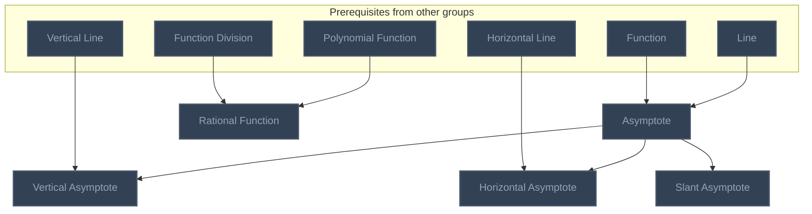

## Stitz-Zeager Ch. 5: Further Topics in Functions
**Mastered:** 0 / 11 · **Discovered:** 11 / 11

```mermaid
flowchart TD
    classDef planned fill:#1E293B,stroke:#64748B,stroke-width:2px,stroke-dasharray:5 5,color:#94A3B8;
    classDef locked fill:#334155,stroke:#475569,stroke-width:2px,color:#94A3B8;
    classDef L0 fill:#F1F5F9,stroke:#94A3B8,stroke-width:2px,color:#000000;
    classDef L1 fill:#22C55E,stroke:#15803D,stroke-width:2px,color:#000000;
    classDef L2 fill:#3B82F6,stroke:#1D4ED8,stroke-width:3px,color:#FFFFFF;
    classDef L3 fill:#A855F7,stroke:#6B21A8,stroke-width:3px,color:#FFFFFF,font-weight:bold;
    classDef L4 fill:#F97316,stroke:#C2410C,stroke-width:4px,color:#000000,font-weight:bold;
    classDef L5 fill:#FFD700,stroke:#FF8C00,stroke-width:5px,color:#000000,font-weight:bold;
    classDef rusty stroke:#8B4513,stroke-width:4px,stroke-dasharray:3 3;
    subgraph sg_prereqs["Prerequisites from other groups"]
        n_domain["Domain"]
        n_function_addition["Function Addition"]
        n_function_subtraction["Function Subtraction"]
        n_function_multiplication["Function Multiplication"]
        n_function_division["Function Division"]
        n_function["Function"]
        n_range["Range"]
        n_horizontal_line["Horizontal Line"]
        n_real_number["Real Number"]
        n_square_root["Square Root"]
    end
    n_function_composition["Function Composition"]
    n_function_operations["Function Operations"]
    n_injective_function["Injective Function"]
    n_surjective_function["Surjective Function"]
    n_bijective_function["Bijective Function"]
    n_inverse_function["Inverse Function"]
    n_horizontal_line_test["Horizontal Line Test"]
    n_nth_root["Nth Root"]
    n_nth_root_product_rule["Nth Root Product Rule"]
    n_nth_root_quotient_rule["Nth Root Quotient Rule"]
    n_nth_root_power_rule["Nth Root Power Rule"]
    n_domain --> n_function_composition
    n_function_addition --> n_function_operations
    n_function_subtraction --> n_function_operations
    n_function_multiplication --> n_function_operations
    n_function_division --> n_function_operations
    n_function_composition --> n_function_operations
    n_function --> n_injective_function
    n_range --> n_surjective_function
    n_injective_function --> n_bijective_function
    n_surjective_function --> n_bijective_function
    n_function_composition --> n_inverse_function
    n_bijective_function --> n_inverse_function
    n_horizontal_line --> n_horizontal_line_test
    n_injective_function --> n_horizontal_line_test
    n_real_number --> n_nth_root
    n_square_root --> n_nth_root
    n_nth_root --> n_nth_root_product_rule
    n_nth_root --> n_nth_root_quotient_rule
    n_nth_root --> n_nth_root_power_rule
    class n_domain,n_function_addition,n_function_subtraction,n_function_multiplication,n_function_division,n_function,n_range,n_horizontal_line,n_real_number,n_square_root,n_function_composition,n_function_operations,n_injective_function,n_surjective_function,n_bijective_function,n_inverse_function,n_horizontal_line_test,n_nth_root,n_nth_root_product_rule,n_nth_root_quotient_rule,n_nth_root_power_rule locked;
    class n_domain,n_function_addition,n_function_subtraction,n_function_multiplication,n_function_division,n_function,n_range,n_horizontal_line,n_real_number,n_square_root,n_function_composition,n_function_operations,n_injective_function,n_surjective_function,n_bijective_function,n_inverse_function,n_horizontal_line_test,n_nth_root,n_nth_root_product_rule,n_nth_root_quotient_rule,n_nth_root_power_rule internal-link;
```

## Stitz-Zeager Ch. 6: Exponential and Logarithmic Functions
**Mastered:** 0 / 11 · **Discovered:** 11 / 11

```mermaid
flowchart TD
    classDef planned fill:#1E293B,stroke:#64748B,stroke-width:2px,stroke-dasharray:5 5,color:#94A3B8;
    classDef locked fill:#334155,stroke:#475569,stroke-width:2px,color:#94A3B8;
    classDef L0 fill:#F1F5F9,stroke:#94A3B8,stroke-width:2px,color:#000000;
    classDef L1 fill:#22C55E,stroke:#15803D,stroke-width:2px,color:#000000;
    classDef L2 fill:#3B82F6,stroke:#1D4ED8,stroke-width:3px,color:#FFFFFF;
    classDef L3 fill:#A855F7,stroke:#6B21A8,stroke-width:3px,color:#FFFFFF,font-weight:bold;
    classDef L4 fill:#F97316,stroke:#C2410C,stroke-width:4px,color:#000000,font-weight:bold;
    classDef L5 fill:#FFD700,stroke:#FF8C00,stroke-width:5px,color:#000000,font-weight:bold;
    classDef rusty stroke:#8B4513,stroke-width:4px,stroke-dasharray:3 3;
    subgraph sg_prereqs["Prerequisites from other groups"]
        n_exponentiation["Exponentiation"]
        n_function["Function"]
        n_inverse_function["Inverse Function"]
        n_product_property_of_exponents["Product Property of Exponents"]
        n_quotient_property_of_exponents["Quotient Property of Exponents"]
        n_power_property_of_exponents["Power Property of Exponents"]
        n_absolute_value["Absolute Value"]
        n_order_of_arithmetic_operations["Order of Arithmetic Operations"]
        n_nth_root["Nth Root"]
    end
    n_exponential_function["Exponential Function"]
    n_logarithm["Logarithm"]
    n_logarithm_function["Logarithm Function"]
    n_logarithm_basic_properties["Logarithm Basic Properties"]
    n_exponent_basic_properties["Exponent Basic Properties"]
    n_logarithm_product_rule["Logarithm Product Rule"]
    n_logarithm_quotient_rule["Logarithm Quotient Rule"]
    n_logarithm_power_rule["Logarithm Power Rule"]
    n_exponentiation_change_of_base["Exponentiation Change of Base"]
    n_logarithm_change_of_base["Logarithm Change of Base"]
    n_arithmetic_operations["Arithmetic Operations"]
    n_exponentiation --> n_exponential_function
    n_function --> n_exponential_function
    n_inverse_function --> n_logarithm
    n_exponential_function --> n_logarithm
    n_logarithm --> n_logarithm_function
    n_logarithm --> n_logarithm_basic_properties
    n_exponential_function --> n_exponent_basic_properties
    n_product_property_of_exponents --> n_logarithm_product_rule
    n_logarithm_basic_properties --> n_logarithm_product_rule
    n_quotient_property_of_exponents --> n_logarithm_quotient_rule
    n_logarithm_basic_properties --> n_logarithm_quotient_rule
    n_power_property_of_exponents --> n_logarithm_power_rule
    n_logarithm_basic_properties --> n_logarithm_power_rule
    n_power_property_of_exponents --> n_exponentiation_change_of_base
    n_logarithm_basic_properties --> n_exponentiation_change_of_base
    n_logarithm_power_rule --> n_logarithm_change_of_base
    n_absolute_value --> n_arithmetic_operations
    n_order_of_arithmetic_operations --> n_arithmetic_operations
    n_nth_root --> n_arithmetic_operations
    n_logarithm --> n_arithmetic_operations
    class n_exponentiation,n_function,n_inverse_function,n_product_property_of_exponents,n_quotient_property_of_exponents,n_power_property_of_exponents,n_absolute_value,n_order_of_arithmetic_operations,n_nth_root,n_exponential_function,n_logarithm,n_logarithm_function,n_logarithm_basic_properties,n_exponent_basic_properties,n_logarithm_product_rule,n_logarithm_quotient_rule,n_logarithm_power_rule,n_exponentiation_change_of_base,n_logarithm_change_of_base,n_arithmetic_operations locked;
    class n_exponentiation,n_function,n_inverse_function,n_product_property_of_exponents,n_quotient_property_of_exponents,n_power_property_of_exponents,n_absolute_value,n_order_of_arithmetic_operations,n_nth_root,n_exponential_function,n_logarithm,n_logarithm_function,n_logarithm_basic_properties,n_exponent_basic_properties,n_logarithm_product_rule,n_logarithm_quotient_rule,n_logarithm_power_rule,n_exponentiation_change_of_base,n_logarithm_change_of_base,n_arithmetic_operations internal-link;
```

## Stitz-Zeager Ch. 7: Hooked on Conics
**Mastered:** 0 / 6 · **Discovered:** 6 / 6

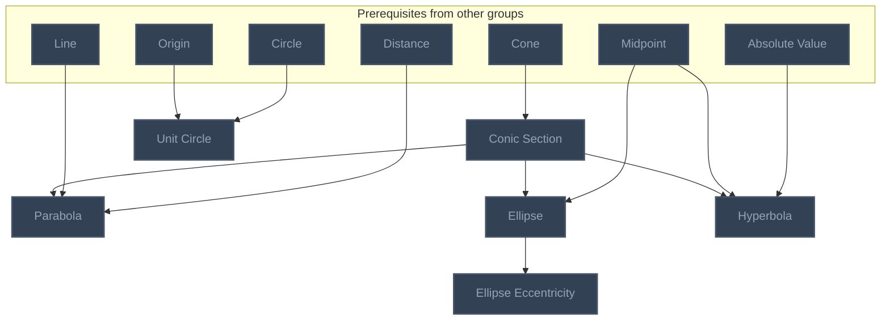

## Stitz-Zeager Ch. 8: Systems of Equations and Matrices
**Mastered:** 0 / 1 · **Discovered:** 0 / 1

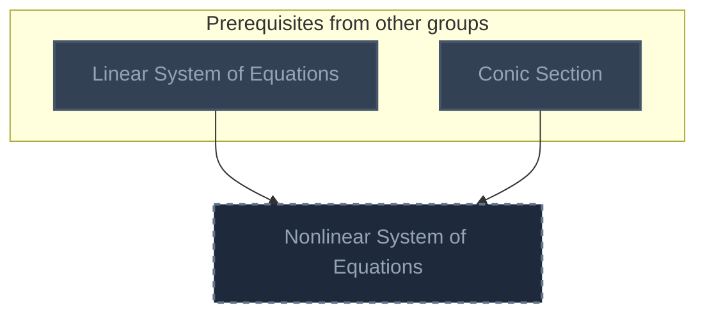

## Stitz-Zeager Ch. 9: Sequences and the Binomial Theorem
**Mastered:** 0 / 3 · **Discovered:** 0 / 3

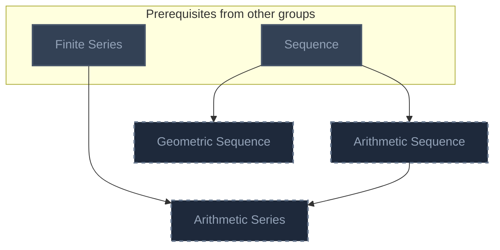

## Stitz-Zeager Ch. 10: Foundations of Trigonometry
**Mastered:** 0 / 32 · **Discovered:** 32 / 32

```mermaid
flowchart TD
    classDef planned fill:#1E293B,stroke:#64748B,stroke-width:2px,stroke-dasharray:5 5,color:#94A3B8;
    classDef locked fill:#334155,stroke:#475569,stroke-width:2px,color:#94A3B8;
    classDef L0 fill:#F1F5F9,stroke:#94A3B8,stroke-width:2px,color:#000000;
    classDef L1 fill:#22C55E,stroke:#15803D,stroke-width:2px,color:#000000;
    classDef L2 fill:#3B82F6,stroke:#1D4ED8,stroke-width:3px,color:#FFFFFF;
    classDef L3 fill:#A855F7,stroke:#6B21A8,stroke-width:3px,color:#FFFFFF,font-weight:bold;
    classDef L4 fill:#F97316,stroke:#C2410C,stroke-width:4px,color:#000000,font-weight:bold;
    classDef L5 fill:#FFD700,stroke:#FF8C00,stroke-width:5px,color:#000000,font-weight:bold;
    classDef rusty stroke:#8B4513,stroke-width:4px,stroke-dasharray:3 3;
    subgraph sg_prereqs["Prerequisites from other groups"]
        n_line["Line"]
        n_angle["Angle"]
        n_pi["Pi"]
        n_unit_circle["Unit Circle"]
        n_function["Function"]
        n_right_triangle["Right Triangle"]
        n_domain["Domain"]
        n_inverse_function["Inverse Function"]
    end
    n_ray["Ray"]
    n_straight_angle["Straight Angle"]
    n_acute_angle["Acute Angle"]
    n_right_angle["Right Angle"]
    n_obtuse_angle["Obtuse Angle"]
    n_angle_degree_radian_conversion["Angle Degree Radian Conversion"]
    n_trigonometric_function["Trigonometric Function"]
    n_cosine_function["Cosine Function"]
    n_sine_function["Sine Function"]
    n_tangent_function["Tangent Function"]
    n_secant_function["Secant Function"]
    n_cotangent_function["Cotangent Function"]
    n_cosecant_function["Cosecant Function"]
    n_pythagorean_identities["Pythagorean Identities"]
    n_soh_cah_toa["SOH-CAH-TOA"]
    n_pythagorean_conjugates["Pythagorean Conjugates"]
    n_sum_and_difference_identities_for_cosine["Sum and Difference Identities for Cosine"]
    n_cofunction_identities["Cofunction Identities"]
    n_sum_and_difference_identities_for_sine["Sum and Difference Identities for Sine"]
    n_sum_and_difference_identities["Sum and Difference Identities"]
    n_double_angle_identities["Double Angle Identities"]
    n_power_reduction_formulas["Power Reduction Formulas"]
    n_half_angle_identities["Half Angle Identities"]
    n_product_to_sum_formulas["Product to Sum Formulas"]
    n_sum_to_product_formulas["Sum to Product Formulas"]
    n_periodic_function["Periodic Function"]
    n_inverse_sine_function["Inverse Sine Function"]
    n_inverse_cosine_function["Inverse Cosine Function"]
    n_inverse_tangent_function["Inverse Tangent Function"]
    n_inverse_cotangent_function["Inverse Cotangent Function"]
    n_inverse_secant_function["Inverse Secant Function"]
    n_inverse_cosecant_function["Inverse Cosecant Function"]
    n_line --> n_ray
    n_angle --> n_straight_angle
    n_angle --> n_acute_angle
    n_angle --> n_right_angle
    n_angle --> n_obtuse_angle
    n_angle --> n_angle_degree_radian_conversion
    n_pi --> n_angle_degree_radian_conversion
    n_unit_circle --> n_angle_degree_radian_conversion
    n_function --> n_trigonometric_function
    n_angle_degree_radian_conversion --> n_trigonometric_function
    n_trigonometric_function --> n_cosine_function
    n_trigonometric_function --> n_sine_function
    n_cosine_function --> n_tangent_function
    n_sine_function --> n_tangent_function
    n_cosine_function --> n_secant_function
    n_cosine_function --> n_cotangent_function
    n_sine_function --> n_cotangent_function
    n_sine_function --> n_cosecant_function
    n_tangent_function --> n_pythagorean_identities
    n_secant_function --> n_pythagorean_identities
    n_cotangent_function --> n_pythagorean_identities
    n_cosecant_function --> n_pythagorean_identities
    n_right_triangle --> n_soh_cah_toa
    n_tangent_function --> n_soh_cah_toa
    n_pythagorean_identities --> n_pythagorean_conjugates
    n_pythagorean_identities --> n_sum_and_difference_identities_for_cosine
    n_sum_and_difference_identities_for_cosine --> n_cofunction_identities
    n_cofunction_identities --> n_sum_and_difference_identities_for_sine
    n_sum_and_difference_identities_for_sine --> n_sum_and_difference_identities
    n_sum_and_difference_identities --> n_double_angle_identities
    n_double_angle_identities --> n_power_reduction_formulas
    n_power_reduction_formulas --> n_half_angle_identities
    n_sum_and_difference_identities --> n_product_to_sum_formulas
    n_product_to_sum_formulas --> n_sum_to_product_formulas
    n_domain --> n_periodic_function
    n_inverse_function --> n_inverse_sine_function
    n_sine_function --> n_inverse_sine_function
    n_inverse_function --> n_inverse_cosine_function
    n_cosine_function --> n_inverse_cosine_function
    n_inverse_function --> n_inverse_tangent_function
    n_tangent_function --> n_inverse_tangent_function
    n_inverse_function --> n_inverse_cotangent_function
    n_cotangent_function --> n_inverse_cotangent_function
    n_inverse_function --> n_inverse_secant_function
    n_secant_function --> n_inverse_secant_function
    n_inverse_function --> n_inverse_cosecant_function
    n_cosecant_function --> n_inverse_cosecant_function
    class n_line,n_angle,n_pi,n_unit_circle,n_function,n_right_triangle,n_domain,n_inverse_function,n_ray,n_straight_angle,n_acute_angle,n_right_angle,n_obtuse_angle,n_angle_degree_radian_conversion,n_trigonometric_function,n_cosine_function,n_sine_function,n_tangent_function,n_secant_function,n_cotangent_function,n_cosecant_function,n_pythagorean_identities,n_soh_cah_toa,n_pythagorean_conjugates,n_sum_and_difference_identities_for_cosine,n_cofunction_identities,n_sum_and_difference_identities_for_sine,n_sum_and_difference_identities,n_double_angle_identities,n_power_reduction_formulas,n_half_angle_identities,n_product_to_sum_formulas,n_sum_to_product_formulas,n_periodic_function,n_inverse_sine_function,n_inverse_cosine_function,n_inverse_tangent_function,n_inverse_cotangent_function,n_inverse_secant_function,n_inverse_cosecant_function locked;
    class n_line,n_angle,n_pi,n_unit_circle,n_function,n_right_triangle,n_domain,n_inverse_function,n_ray,n_straight_angle,n_acute_angle,n_right_angle,n_obtuse_angle,n_angle_degree_radian_conversion,n_trigonometric_function,n_cosine_function,n_sine_function,n_tangent_function,n_secant_function,n_cotangent_function,n_cosecant_function,n_pythagorean_identities,n_soh_cah_toa,n_pythagorean_conjugates,n_sum_and_difference_identities_for_cosine,n_cofunction_identities,n_sum_and_difference_identities_for_sine,n_sum_and_difference_identities,n_double_angle_identities,n_power_reduction_formulas,n_half_angle_identities,n_product_to_sum_formulas,n_sum_to_product_formulas,n_periodic_function,n_inverse_sine_function,n_inverse_cosine_function,n_inverse_tangent_function,n_inverse_cotangent_function,n_inverse_secant_function,n_inverse_cosecant_function internal-link;
```

## Stitz-Zeager Ch. 11: Applications of Trigonometry
**Mastered:** 0 / 11 · **Discovered:** 3 / 11

```mermaid
flowchart TD
    classDef planned fill:#1E293B,stroke:#64748B,stroke-width:2px,stroke-dasharray:5 5,color:#94A3B8;
    classDef locked fill:#334155,stroke:#475569,stroke-width:2px,color:#94A3B8;
    classDef L0 fill:#F1F5F9,stroke:#94A3B8,stroke-width:2px,color:#000000;
    classDef L1 fill:#22C55E,stroke:#15803D,stroke-width:2px,color:#000000;
    classDef L2 fill:#3B82F6,stroke:#1D4ED8,stroke-width:3px,color:#FFFFFF;
    classDef L3 fill:#A855F7,stroke:#6B21A8,stroke-width:3px,color:#FFFFFF,font-weight:bold;
    classDef L4 fill:#F97316,stroke:#C2410C,stroke-width:4px,color:#000000,font-weight:bold;
    classDef L5 fill:#FFD700,stroke:#FF8C00,stroke-width:5px,color:#000000,font-weight:bold;
    classDef rusty stroke:#8B4513,stroke-width:4px,stroke-dasharray:3 3;
    subgraph sg_prereqs["Prerequisites from other groups"]
        n_triangle["Triangle"]
        n_sine_function["Sine Function"]
        n_pythagorean_theorem["Pythagorean Theorem"]
        n_cosine_function["Cosine Function"]
        n_polar_coordinate_system["Polar Coordinate System"]
        n_conic_section["Conic Section"]
        n_sum_and_difference_identities["Sum and Difference Identities"]
        n_parabola["Parabola"]
        n_ellipse_eccentricity["Ellipse Eccentricity"]
        n_hyperbola["Hyperbola"]
        n_de_moivre_s_formula["De Moivre's Formula"]
        n_nth_root["Nth Root"]
        n_function["Function"]
        n_ordered_pair["Ordered Pair"]
    end
    n_law_of_sines["Law of Sines"]
    n_law_of_cosines["Law of Cosines"]
    n_limacon["Limacon"]
    n_cardioid["Cardioid"]
    n_rose_curve["Rose Curve"]
    n_lemniscate["Lemniscate"]
    n_rotation_of_axes["Rotation of Axes"]
    n_conic_section_eccentricity["Conic Section Eccentricity"]
    n_conic_section_polar_form["Conic Section Polar Form"]
    n_nth_root_of_complex_number["Nth Root of Complex Number"]
    n_graph_of_function["Graph of Function"]
    n_triangle --> n_law_of_sines
    n_sine_function --> n_law_of_sines
    n_pythagorean_theorem --> n_law_of_cosines
    n_cosine_function --> n_law_of_cosines
    n_polar_coordinate_system --> n_limacon
    n_limacon --> n_cardioid
    n_polar_coordinate_system --> n_rose_curve
    n_polar_coordinate_system --> n_lemniscate
    n_conic_section --> n_rotation_of_axes
    n_sum_and_difference_identities --> n_rotation_of_axes
    n_parabola --> n_conic_section_eccentricity
    n_ellipse_eccentricity --> n_conic_section_eccentricity
    n_hyperbola --> n_conic_section_eccentricity
    n_polar_coordinate_system --> n_conic_section_polar_form
    n_conic_section_eccentricity --> n_conic_section_polar_form
    n_de_moivre_s_formula --> n_nth_root_of_complex_number
    n_nth_root --> n_nth_root_of_complex_number
    n_function --> n_graph_of_function
    n_ordered_pair --> n_graph_of_function
    class n_limacon,n_cardioid,n_rose_curve,n_lemniscate,n_rotation_of_axes,n_conic_section_eccentricity,n_conic_section_polar_form,n_nth_root_of_complex_number planned;
    class n_triangle,n_sine_function,n_pythagorean_theorem,n_cosine_function,n_polar_coordinate_system,n_conic_section,n_sum_and_difference_identities,n_parabola,n_ellipse_eccentricity,n_hyperbola,n_de_moivre_s_formula,n_nth_root,n_function,n_ordered_pair,n_law_of_sines,n_law_of_cosines,n_graph_of_function locked;
    class n_triangle,n_sine_function,n_pythagorean_theorem,n_cosine_function,n_polar_coordinate_system,n_conic_section,n_sum_and_difference_identities,n_parabola,n_ellipse_eccentricity,n_hyperbola,n_de_moivre_s_formula,n_nth_root,n_function,n_ordered_pair,n_law_of_sines,n_law_of_cosines,n_graph_of_function internal-link;
```

# Source
Graph structure: the single source for the diagrams above, edited by `/note` and `Scripts/skill_trees.py` (`add`, `edge`, `rename`). Everything above this heading is regenerated by `render`.

```skilltree
    %% PREREQUISITES
    n_2d_cartesian_coordinate_system["2D Cartesian Coordinate System"]
    n_absolute_value["Absolute Value"]
    n_addition["Addition"]
    n_angle["Angle"]
    n_circle["Circle"]
    n_cone["Cone"]
    n_de_moivre_s_formula["De Moivre's Formula"]
    n_degree_of_polynomial["Degree of Polynomial"]
    n_division["Division"]
    n_equation["Equation"]
    n_exponentiation["Exponentiation"]
    n_factor["Factor"]
    n_finite_series["Finite Series"]
    n_horizontal_line["Horizontal Line"]
    n_inequality["Inequality"]
    n_intercept["Intercept"]
    n_linear_system_of_equations["Linear System of Equations"]
    n_multiplication["Multiplication"]
    n_order_of_arithmetic_operations["Order of Arithmetic Operations"]
    n_ordered_pair["Ordered Pair"]
    n_origin["Origin"]
    n_pi["Pi"]
    n_point["Point"]
    n_polar_coordinate_system["Polar Coordinate System"]
    n_polynomial["Polynomial"]
    n_power_property_of_exponents["Power Property of Exponents"]
    n_product_property_of_exponents["Product Property of Exponents"]
    n_pythagorean_theorem["Pythagorean Theorem"]
    n_quotient_property_of_exponents["Quotient Property of Exponents"]
    n_rational_number["Rational Number"]
    n_real_number["Real Number"]
    n_right_triangle["Right Triangle"]
    n_sequence["Sequence"]
    n_slope["Slope"]
    n_square_root["Square Root"]
    n_subtraction["Subtraction"]
    n_triangle["Triangle"]
    n_vector["Vector"]
    n_vertical_line["Vertical Line"]
    %% NODES
    %% == Stitz-Zeager Ch. 1: Relations and Functions ==
    n_set["Set"]
    n_interval_notation["Interval Notation"]
    n_empty_set["Empty Set"]
    n_set_intersection["Set Intersection"]
    n_set_union["Set Union"]
    n_number_set["Number Set"]
    n_cartesian_coordinate_system["Cartesian Coordinate System"]
    n_reflection["Reflection"]
    n_distance["Distance"]
    n_euclidean_distance["Euclidean Distance"]
    n_midpoint["Midpoint"]
    n_relation["Relation"]
    n_function["Function"]
    n_vertical_line_test["Vertical Line Test"]
    n_domain["Domain"]
    n_codomain["Codomain"]
    n_range["Range"]
    n_function_addition["Function Addition"]
    n_function_subtraction["Function Subtraction"]
    n_function_multiplication["Function Multiplication"]
    n_function_division["Function Division"]
    n_difference_quotient_of_function["Difference Quotient of Function"]
    n_zeros_of_function["Zeros of Function"]
    n_increasing_function["Increasing Function"]
    n_decreasing_function["Decreasing Function"]
    n_non_decreasing_function["Non-Decreasing Function"]
    n_inequality_sign_change["Inequality Sign Change"]
    n_function_maximum["Function Maximum"]
    n_function_minimum["Function Minimum"]
    n_local_maximum["Local Maximum"]
    n_local_minimum["Local Minimum"]
    n_function_behavior["Function Behavior"]
    n_parity_of_function["Parity of Function"]
    n_function_transformation["Function Transformation"]
    n_vertical_shift["Vertical Shift"]
    n_horizontal_shift["Horizontal Shift"]
    n_vertical_scaling["Vertical Scaling"]
    n_horizontal_scaling["Horizontal Scaling"]
    n_scalar_valued_function["Scalar-Valued Function"]
    n_real_valued_function["Real-Valued Function"]
    n_even_function["Even Function"]
    %% == Stitz-Zeager Ch. 2: Linear and Quadratic Functions ==
    n_line["Line"]
    n_constant_function["Constant Function"]
    n_linear_function_slope_intercept_form["Linear Function Slope-Intercept Form"]
    n_linear_function_point_slope_form["Linear Function Point-Slope Form"]
    n_average_rate_of_change["Average Rate of Change"]
    n_absolute_value_function["Absolute Value Function"]
    n_absolute_value_product_rule["Absolute Value Product Rule"]
    n_absolute_value_quotient_rule["Absolute Value Quotient Rule"]
    n_absolute_value_power_rule["Absolute Value Power Rule"]
    n_absolute_value_equality_properties["Absolute Value Equality Properties"]
    n_quadratic_function["Quadratic Function"]
    n_complete_the_square["Complete the Square"]
    n_quadratic_formula["Quadratic Formula"]
    n_function_inequality["Function Inequality"]
    n_absolute_value_inequality["Absolute Value Inequality"]
    n_increasing_property_of_square_root["Increasing Property of Square Root"]
    n_square_root_triangle_inequality["Square Root Triangle Inequality"]
    %% == Stitz-Zeager Ch. 3: Polynomial Functions ==
    n_polynomial_function["Polynomial Function"]
    n_multiplicity["Multiplicity"]
    n_polynomial_division["Polynomial Division"]
    n_remainder_theorem["Remainder Theorem"]
    n_factor_theorem["Factor Theorem"]
    n_synthetic_division["Synthetic Division"]
    n_cauchy_s_bound["Cauchy's Bound"]
    n_rational_zeros_theorem["Rational Zeros Theorem"]
    n_descartes_rule_of_signs["Descartes' Rule of Signs"]
    n_polynomial_upper_and_lower_bounds["Polynomial Upper and Lower Bounds"]
    n_imaginary_unit["Imaginary Unit"]
    n_complex_number["Complex Number"]
    n_complex_conjugate["Complex Conjugate"]
    n_fundamental_theorem_of_algebra["Fundamental Theorem of Algebra"]
    n_complex_factorization_theorem["Complex Factorization Theorem"]
    n_irreducible_quadratic["Irreducible Quadratic"]
    n_conjugate_pairs_theorem["Conjugate Pairs Theorem"]
    n_real_factorization_theorem["Real Factorization Theorem"]
    %% == Stitz-Zeager Ch. 4: Rational Functions ==
    n_asymptote["Asymptote"]
    n_rational_function["Rational Function"]
    n_vertical_asymptote["Vertical Asymptote"]
    n_horizontal_asymptote["Horizontal Asymptote"]
    n_slant_asymptote["Slant Asymptote"]
    %% == Stitz-Zeager Ch. 5: Further Topics in Functions ==
    n_function_composition["Function Composition"]
    n_function_operations["Function Operations"]
    n_injective_function["Injective Function"]
    n_surjective_function["Surjective Function"]
    n_bijective_function["Bijective Function"]
    n_inverse_function["Inverse Function"]
    n_horizontal_line_test["Horizontal Line Test"]
    n_nth_root["Nth Root"]
    n_nth_root_product_rule["Nth Root Product Rule"]
    n_nth_root_quotient_rule["Nth Root Quotient Rule"]
    n_nth_root_power_rule["Nth Root Power Rule"]
    %% == Stitz-Zeager Ch. 6: Exponential and Logarithmic Functions ==
    n_exponential_function["Exponential Function"]
    n_logarithm["Logarithm"]
    n_logarithm_function["Logarithm Function"]
    n_logarithm_basic_properties["Logarithm Basic Properties"]
    n_exponent_basic_properties["Exponent Basic Properties"]
    n_logarithm_product_rule["Logarithm Product Rule"]
    n_logarithm_quotient_rule["Logarithm Quotient Rule"]
    n_logarithm_power_rule["Logarithm Power Rule"]
    n_exponentiation_change_of_base["Exponentiation Change of Base"]
    n_logarithm_change_of_base["Logarithm Change of Base"]
    n_arithmetic_operations["Arithmetic Operations"]
    %% == Stitz-Zeager Ch. 7: Hooked on Conics ==
    n_conic_section["Conic Section"]
    n_unit_circle["Unit Circle"]
    n_parabola["Parabola"]
    n_ellipse["Ellipse"]
    n_ellipse_eccentricity["Ellipse Eccentricity"]
    n_hyperbola["Hyperbola"]
    %% == Stitz-Zeager Ch. 8: Systems of Equations and Matrices ==
    n_nonlinear_system_of_equations["Nonlinear System of Equations"]
    %% == Stitz-Zeager Ch. 9: Sequences and the Binomial Theorem ==
    n_arithmetic_sequence["Arithmetic Sequence"]
    n_geometric_sequence["Geometric Sequence"]
    n_arithmetic_series["Arithmetic Series"]
    %% == Stitz-Zeager Ch. 10: Foundations of Trigonometry ==
    n_ray["Ray"]
    n_straight_angle["Straight Angle"]
    n_acute_angle["Acute Angle"]
    n_right_angle["Right Angle"]
    n_obtuse_angle["Obtuse Angle"]
    n_angle_degree_radian_conversion["Angle Degree Radian Conversion"]
    n_trigonometric_function["Trigonometric Function"]
    n_cosine_function["Cosine Function"]
    n_sine_function["Sine Function"]
    n_tangent_function["Tangent Function"]
    n_secant_function["Secant Function"]
    n_cotangent_function["Cotangent Function"]
    n_cosecant_function["Cosecant Function"]
    n_pythagorean_identities["Pythagorean Identities"]
    n_soh_cah_toa["SOH-CAH-TOA"]
    n_pythagorean_conjugates["Pythagorean Conjugates"]
    n_sum_and_difference_identities_for_cosine["Sum and Difference Identities for Cosine"]
    n_cofunction_identities["Cofunction Identities"]
    n_sum_and_difference_identities_for_sine["Sum and Difference Identities for Sine"]
    n_sum_and_difference_identities["Sum and Difference Identities"]
    n_double_angle_identities["Double Angle Identities"]
    n_power_reduction_formulas["Power Reduction Formulas"]
    n_half_angle_identities["Half Angle Identities"]
    n_product_to_sum_formulas["Product to Sum Formulas"]
    n_sum_to_product_formulas["Sum to Product Formulas"]
    n_periodic_function["Periodic Function"]
    n_inverse_sine_function["Inverse Sine Function"]
    n_inverse_cosine_function["Inverse Cosine Function"]
    n_inverse_tangent_function["Inverse Tangent Function"]
    n_inverse_cotangent_function["Inverse Cotangent Function"]
    n_inverse_secant_function["Inverse Secant Function"]
    n_inverse_cosecant_function["Inverse Cosecant Function"]
    %% == Stitz-Zeager Ch. 11: Applications of Trigonometry ==
    n_law_of_sines["Law of Sines"]
    n_law_of_cosines["Law of Cosines"]
    n_limacon["Limacon"]
    n_cardioid["Cardioid"]
    n_rose_curve["Rose Curve"]
    n_lemniscate["Lemniscate"]
    n_rotation_of_axes["Rotation of Axes"]
    n_conic_section_eccentricity["Conic Section Eccentricity"]
    n_conic_section_polar_form["Conic Section Polar Form"]
    n_nth_root_of_complex_number["Nth Root of Complex Number"]
    n_graph_of_function["Graph of Function"]
    %% EDGES
    n_inequality --> n_interval_notation
    n_real_number --> n_interval_notation
    n_set --> n_interval_notation
    n_set --> n_empty_set
    n_set --> n_set_intersection
    n_set --> n_set_union
    n_real_number --> n_number_set
    n_set --> n_number_set
    n_2d_cartesian_coordinate_system --> n_cartesian_coordinate_system
    n_origin --> n_reflection
    n_cartesian_coordinate_system --> n_reflection
    n_pythagorean_theorem --> n_distance
    n_square_root --> n_distance
    n_cartesian_coordinate_system --> n_distance
    n_vector --> n_euclidean_distance
    n_distance --> n_euclidean_distance
    n_distance --> n_midpoint
    n_ordered_pair --> n_relation
    n_set --> n_relation
    n_relation --> n_function
    n_vertical_line --> n_vertical_line_test
    n_function --> n_vertical_line_test
    n_function --> n_domain
    n_function --> n_codomain
    n_codomain --> n_range
    n_addition --> n_function_addition
    n_domain --> n_function_addition
    n_subtraction --> n_function_subtraction
    n_domain --> n_function_subtraction
    n_multiplication --> n_function_multiplication
    n_domain --> n_function_multiplication
    n_division --> n_function_division
    n_domain --> n_function_division
    n_division --> n_difference_quotient_of_function
    n_function --> n_difference_quotient_of_function
    n_intercept --> n_zeros_of_function
    n_function --> n_zeros_of_function
    n_interval_notation --> n_increasing_function
    n_function --> n_increasing_function
    n_interval_notation --> n_decreasing_function
    n_function --> n_decreasing_function
    n_interval_notation --> n_non_decreasing_function
    n_function --> n_non_decreasing_function
    n_increasing_function --> n_inequality_sign_change
    n_decreasing_function --> n_inequality_sign_change
    n_domain --> n_function_maximum
    n_range --> n_function_maximum
    n_domain --> n_function_minimum
    n_range --> n_function_minimum
    n_interval_notation --> n_local_maximum
    n_function_maximum --> n_local_maximum
    n_interval_notation --> n_local_minimum
    n_function_minimum --> n_local_minimum
    n_increasing_function --> n_function_behavior
    n_decreasing_function --> n_function_behavior
    n_local_maximum --> n_function_behavior
    n_local_minimum --> n_function_behavior
    n_reflection --> n_parity_of_function
    n_function --> n_parity_of_function
    n_function --> n_function_transformation
    n_addition --> n_vertical_shift
    n_function_transformation --> n_vertical_shift
    n_addition --> n_horizontal_shift
    n_function_transformation --> n_horizontal_shift
    n_multiplication --> n_vertical_scaling
    n_function_transformation --> n_vertical_scaling
    n_multiplication --> n_horizontal_scaling
    n_function_transformation --> n_horizontal_scaling
    n_point --> n_line
    n_horizontal_line --> n_constant_function
    n_function --> n_constant_function
    n_intercept --> n_linear_function_slope_intercept_form
    n_slope --> n_linear_function_slope_intercept_form
    n_slope --> n_linear_function_point_slope_form
    n_slope --> n_average_rate_of_change
    n_interval_notation --> n_average_rate_of_change
    n_difference_quotient_of_function --> n_average_rate_of_change
    n_absolute_value --> n_absolute_value_function
    n_function --> n_absolute_value_function
    n_absolute_value --> n_absolute_value_product_rule
    n_multiplication --> n_absolute_value_product_rule
    n_absolute_value --> n_absolute_value_quotient_rule
    n_division --> n_absolute_value_quotient_rule
    n_exponentiation --> n_absolute_value_power_rule
    n_absolute_value_product_rule --> n_absolute_value_power_rule
    n_absolute_value --> n_absolute_value_equality_properties
    n_equation --> n_absolute_value_equality_properties
    n_polynomial --> n_quadratic_function
    n_function --> n_quadratic_function
    n_quadratic_function --> n_complete_the_square
    n_square_root --> n_quadratic_formula
    n_complete_the_square --> n_quadratic_formula
    n_inequality --> n_function_inequality
    n_function --> n_function_inequality
    n_absolute_value --> n_absolute_value_inequality
    n_inequality --> n_absolute_value_inequality
    n_square_root --> n_increasing_property_of_square_root
    n_increasing_function --> n_increasing_property_of_square_root
    n_increasing_property_of_square_root --> n_square_root_triangle_inequality
    n_degree_of_polynomial --> n_polynomial_function
    n_function --> n_polynomial_function
    n_factor --> n_multiplicity
    n_zeros_of_function --> n_multiplicity
    n_polynomial_function --> n_multiplicity
    n_division --> n_polynomial_division
    n_polynomial_function --> n_polynomial_division
    n_polynomial_division --> n_remainder_theorem
    n_factor --> n_factor_theorem
    n_zeros_of_function --> n_factor_theorem
    n_remainder_theorem --> n_factor_theorem
    n_polynomial_division --> n_synthetic_division
    n_absolute_value --> n_cauchy_s_bound
    n_zeros_of_function --> n_cauchy_s_bound
    n_polynomial_function --> n_cauchy_s_bound
    n_factor --> n_rational_zeros_theorem
    n_rational_number --> n_rational_zeros_theorem
    n_zeros_of_function --> n_rational_zeros_theorem
    n_polynomial_function --> n_rational_zeros_theorem
    n_multiplicity --> n_descartes_rule_of_signs
    n_zeros_of_function --> n_polynomial_upper_and_lower_bounds
    n_synthetic_division --> n_polynomial_upper_and_lower_bounds
    n_square_root --> n_imaginary_unit
    n_real_number --> n_complex_number
    n_imaginary_unit --> n_complex_number
    n_complex_number --> n_complex_conjugate
    n_multiplicity --> n_fundamental_theorem_of_algebra
    n_complex_number --> n_fundamental_theorem_of_algebra
    n_factor_theorem --> n_complex_factorization_theorem
    n_fundamental_theorem_of_algebra --> n_complex_factorization_theorem
    n_quadratic_formula --> n_irreducible_quadratic
    n_complex_number --> n_irreducible_quadratic
    n_multiplicity --> n_conjugate_pairs_theorem
    n_complex_conjugate --> n_conjugate_pairs_theorem
    n_complex_factorization_theorem --> n_real_factorization_theorem
    n_irreducible_quadratic --> n_real_factorization_theorem
    n_conjugate_pairs_theorem --> n_real_factorization_theorem
    n_function --> n_asymptote
    n_line --> n_asymptote
    n_function_division --> n_rational_function
    n_polynomial_function --> n_rational_function
    n_vertical_line --> n_vertical_asymptote
    n_asymptote --> n_vertical_asymptote
    n_horizontal_line --> n_horizontal_asymptote
    n_asymptote --> n_horizontal_asymptote
    n_asymptote --> n_slant_asymptote
    n_domain --> n_function_composition
    n_function_addition --> n_function_operations
    n_function_subtraction --> n_function_operations
    n_function_multiplication --> n_function_operations
    n_function_division --> n_function_operations
    n_function_composition --> n_function_operations
    n_function --> n_injective_function
    n_range --> n_surjective_function
    n_injective_function --> n_bijective_function
    n_surjective_function --> n_bijective_function
    n_function_composition --> n_inverse_function
    n_bijective_function --> n_inverse_function
    n_horizontal_line --> n_horizontal_line_test
    n_injective_function --> n_horizontal_line_test
    n_real_number --> n_nth_root
    n_square_root --> n_nth_root
    n_nth_root --> n_nth_root_product_rule
    n_nth_root --> n_nth_root_quotient_rule
    n_nth_root --> n_nth_root_power_rule
    n_exponentiation --> n_exponential_function
    n_function --> n_exponential_function
    n_inverse_function --> n_logarithm
    n_exponential_function --> n_logarithm
    n_logarithm --> n_logarithm_function
    n_logarithm --> n_logarithm_basic_properties
    n_exponential_function --> n_exponent_basic_properties
    n_product_property_of_exponents --> n_logarithm_product_rule
    n_logarithm_basic_properties --> n_logarithm_product_rule
    n_quotient_property_of_exponents --> n_logarithm_quotient_rule
    n_logarithm_basic_properties --> n_logarithm_quotient_rule
    n_power_property_of_exponents --> n_logarithm_power_rule
    n_logarithm_basic_properties --> n_logarithm_power_rule
    n_power_property_of_exponents --> n_exponentiation_change_of_base
    n_logarithm_basic_properties --> n_exponentiation_change_of_base
    n_logarithm_power_rule --> n_logarithm_change_of_base
    n_absolute_value --> n_arithmetic_operations
    n_order_of_arithmetic_operations --> n_arithmetic_operations
    n_nth_root --> n_arithmetic_operations
    n_logarithm --> n_arithmetic_operations
    n_cone --> n_conic_section
    n_circle --> n_unit_circle
    n_origin --> n_unit_circle
    n_distance --> n_parabola
    n_line --> n_parabola
    n_conic_section --> n_parabola
    n_midpoint --> n_ellipse
    n_conic_section --> n_ellipse
    n_ellipse --> n_ellipse_eccentricity
    n_absolute_value --> n_hyperbola
    n_midpoint --> n_hyperbola
    n_conic_section --> n_hyperbola
    n_linear_system_of_equations --> n_nonlinear_system_of_equations
    n_conic_section --> n_nonlinear_system_of_equations
    n_sequence --> n_arithmetic_sequence
    n_sequence --> n_geometric_sequence
    n_finite_series --> n_arithmetic_series
    n_arithmetic_sequence --> n_arithmetic_series
    n_line --> n_ray
    n_angle --> n_straight_angle
    n_angle --> n_acute_angle
    n_angle --> n_right_angle
    n_angle --> n_obtuse_angle
    n_angle --> n_angle_degree_radian_conversion
    n_pi --> n_angle_degree_radian_conversion
    n_unit_circle --> n_angle_degree_radian_conversion
    n_function --> n_trigonometric_function
    n_angle_degree_radian_conversion --> n_trigonometric_function
    n_trigonometric_function --> n_cosine_function
    n_trigonometric_function --> n_sine_function
    n_cosine_function --> n_tangent_function
    n_sine_function --> n_tangent_function
    n_cosine_function --> n_secant_function
    n_cosine_function --> n_cotangent_function
    n_sine_function --> n_cotangent_function
    n_sine_function --> n_cosecant_function
    n_tangent_function --> n_pythagorean_identities
    n_secant_function --> n_pythagorean_identities
    n_cotangent_function --> n_pythagorean_identities
    n_cosecant_function --> n_pythagorean_identities
    n_right_triangle --> n_soh_cah_toa
    n_tangent_function --> n_soh_cah_toa
    n_pythagorean_identities --> n_pythagorean_conjugates
    n_pythagorean_identities --> n_sum_and_difference_identities_for_cosine
    n_sum_and_difference_identities_for_cosine --> n_cofunction_identities
    n_cofunction_identities --> n_sum_and_difference_identities_for_sine
    n_sum_and_difference_identities_for_sine --> n_sum_and_difference_identities
    n_sum_and_difference_identities --> n_double_angle_identities
    n_double_angle_identities --> n_power_reduction_formulas
    n_power_reduction_formulas --> n_half_angle_identities
    n_sum_and_difference_identities --> n_product_to_sum_formulas
    n_product_to_sum_formulas --> n_sum_to_product_formulas
    n_domain --> n_periodic_function
    n_inverse_function --> n_inverse_sine_function
    n_sine_function --> n_inverse_sine_function
    n_inverse_function --> n_inverse_cosine_function
    n_cosine_function --> n_inverse_cosine_function
    n_inverse_function --> n_inverse_tangent_function
    n_tangent_function --> n_inverse_tangent_function
    n_inverse_function --> n_inverse_cotangent_function
    n_cotangent_function --> n_inverse_cotangent_function
    n_inverse_function --> n_inverse_secant_function
    n_secant_function --> n_inverse_secant_function
    n_inverse_function --> n_inverse_cosecant_function
    n_cosecant_function --> n_inverse_cosecant_function
    n_triangle --> n_law_of_sines
    n_sine_function --> n_law_of_sines
    n_pythagorean_theorem --> n_law_of_cosines
    n_cosine_function --> n_law_of_cosines
    n_polar_coordinate_system --> n_limacon
    n_limacon --> n_cardioid
    n_polar_coordinate_system --> n_rose_curve
    n_polar_coordinate_system --> n_lemniscate
    n_conic_section --> n_rotation_of_axes
    n_sum_and_difference_identities --> n_rotation_of_axes
    n_parabola --> n_conic_section_eccentricity
    n_ellipse_eccentricity --> n_conic_section_eccentricity
    n_hyperbola --> n_conic_section_eccentricity
    n_polar_coordinate_system --> n_conic_section_polar_form
    n_conic_section_eccentricity --> n_conic_section_polar_form
    n_de_moivre_s_formula --> n_nth_root_of_complex_number
    n_nth_root --> n_nth_root_of_complex_number
    n_function --> n_graph_of_function
    n_ordered_pair --> n_graph_of_function
    n_function --> n_scalar_valued_function
    n_scalar_valued_function --> n_real_valued_function
    n_parity_of_function --> n_even_function
    n_graph_of_function --> n_function_transformation
```
