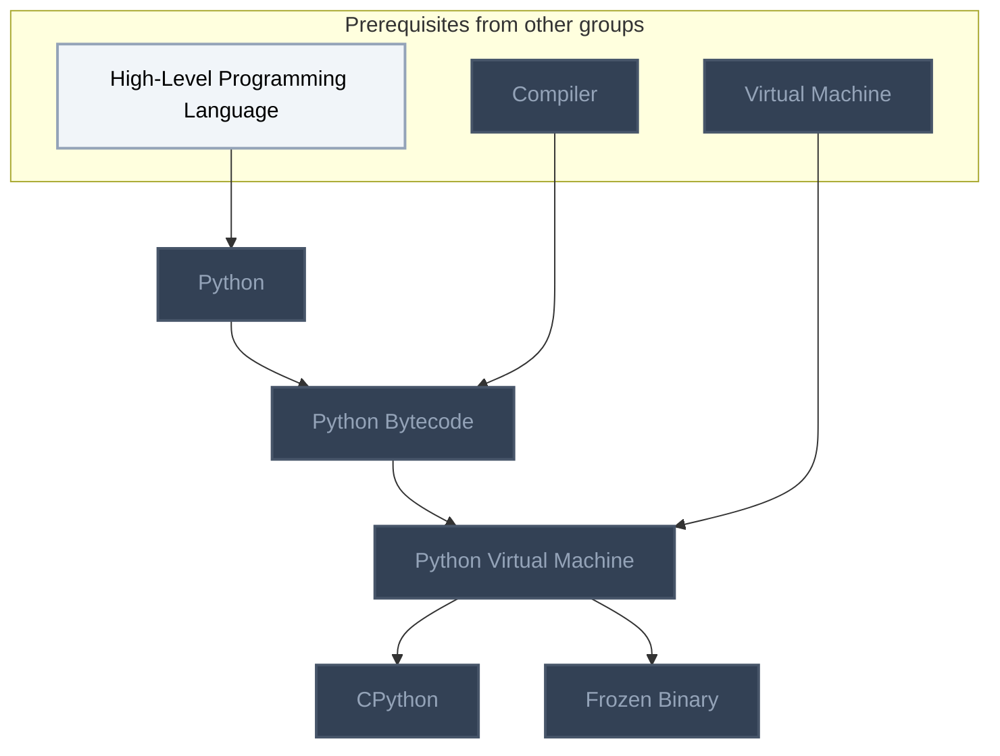
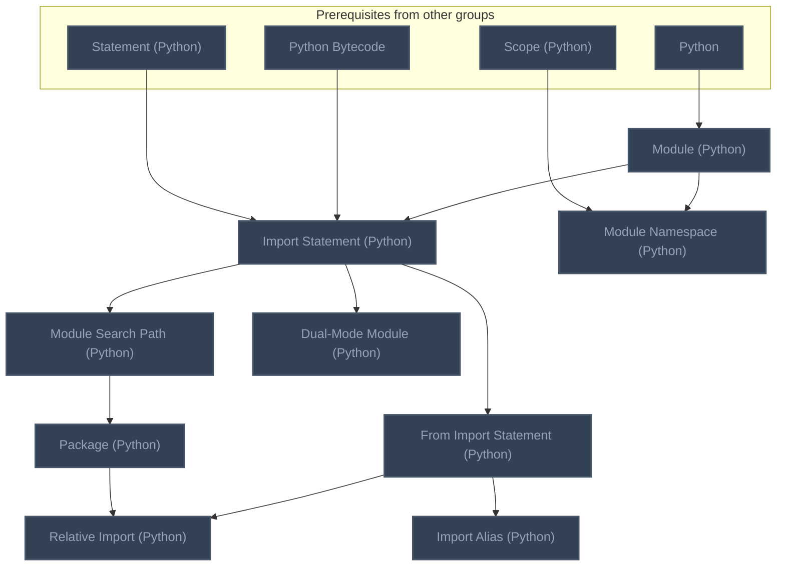
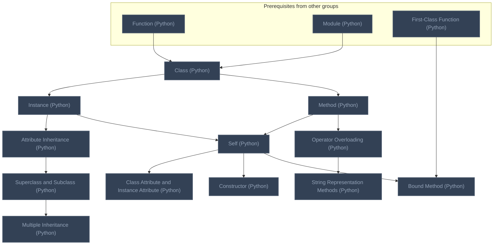
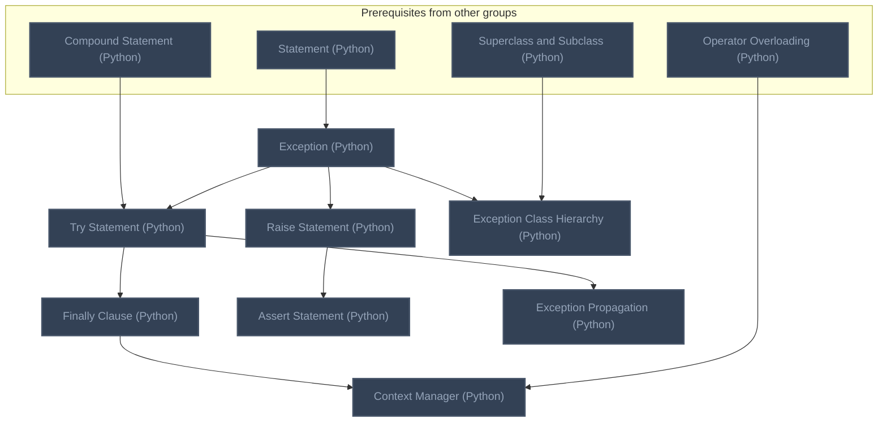
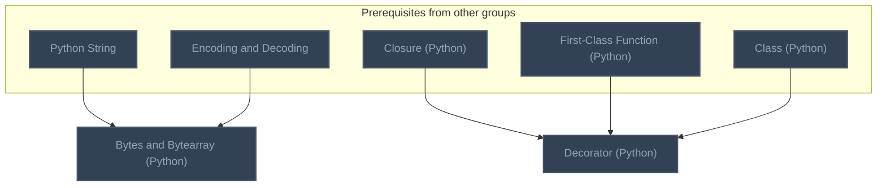

<!-- BEGIN STATS (generated by Scripts/skill_trees.py; do not edit) -->
**Mastered:** 0 / 90 · **Depth:** 0% · **Discovered:** 90 · **Planned:** 0 · **Locked:** 90 · **Rusty:** 0

**Levels:** L0 90 · L1 0 · L2 0 · L3 0 · L4 0 · L5 0

**Next up:** —

Legend: dashed grey = planned (no note yet) · dark grey = locked · white L0 Discovered · green L1 Recall · blue L2 Apply · purple L3 Prove (Mastered) · orange L4 Wield · gold L5 Command · brown dashed border = rusty
<!-- END STATS -->

## Learning Python Part I: Getting Started
**Mastered:** 0 / 5 · **Discovered:** 5 / 5



## Learning Python Part II: Types and Operations
**Mastered:** 0 / 22 · **Discovered:** 22 / 22

```mermaid
flowchart TD
    classDef planned fill:#1E293B,stroke:#64748B,stroke-width:2px,stroke-dasharray:5 5,color:#94A3B8;
    classDef locked fill:#334155,stroke:#475569,stroke-width:2px,color:#94A3B8;
    classDef L0 fill:#F1F5F9,stroke:#94A3B8,stroke-width:2px,color:#000000;
    classDef L1 fill:#22C55E,stroke:#15803D,stroke-width:2px,color:#000000;
    classDef L2 fill:#3B82F6,stroke:#1D4ED8,stroke-width:3px,color:#FFFFFF;
    classDef L3 fill:#A855F7,stroke:#6B21A8,stroke-width:3px,color:#FFFFFF,font-weight:bold;
    classDef L4 fill:#F97316,stroke:#C2410C,stroke-width:4px,color:#000000,font-weight:bold;
    classDef L5 fill:#FFD700,stroke:#FF8C00,stroke-width:5px,color:#000000,font-weight:bold;
    classDef rusty stroke:#8B4513,stroke-width:4px,stroke-dasharray:3 3;
    subgraph sg_prereqs["Prerequisites from other groups"]
        n_python["Python"]
    end
    n_object_python["Object (Python)"]
    n_dynamic_typing_python["Dynamic Typing (Python)"]
    n_strong_typing_python["Strong Typing (Python)"]
    n_polymorphism_python["Polymorphism (Python)"]
    n_duck_typing_python["Duck Typing (Python)"]
    n_mutability_python["Mutability (Python)"]
    n_sequence_python["Sequence (Python)"]
    n_slicing_python["Slicing (Python)"]
    n_python_string["Python String"]
    n_python_list["Python List"]
    n_comprehension_python["Comprehension (Python)"]
    n_iterable_and_iterator_python["Iterable and Iterator (Python)"]
    n_python_dictionary["Python Dictionary"]
    n_python_tuple["Python Tuple"]
    n_file_object_python["File Object (Python)"]
    n_python_set["Python Set"]
    n_none_python["None (Python)"]
    n_numeric_type_coercion_python["Numeric Type Coercion (Python)"]
    n_division_python["Division (Python)"]
    n_variable_python["Variable (Python)"]
    n_garbage_collection_python["Garbage Collection (Python)"]
    n_object_identity_python["Object Identity (Python)"]
    n_python --> n_object_python
    n_object_python --> n_dynamic_typing_python
    n_object_python --> n_strong_typing_python
    n_object_python --> n_polymorphism_python
    n_polymorphism_python --> n_duck_typing_python
    n_object_python --> n_mutability_python
    n_object_python --> n_sequence_python
    n_sequence_python --> n_slicing_python
    n_sequence_python --> n_python_string
    n_sequence_python --> n_python_list
    n_mutability_python --> n_python_list
    n_python_list --> n_python_tuple
    n_object_python --> n_iterable_and_iterator_python
    n_iterable_and_iterator_python --> n_comprehension_python
    n_python_list --> n_comprehension_python
    n_mutability_python --> n_python_dictionary
    n_mutability_python --> n_python_set
    n_python_string --> n_file_object_python
    n_object_python --> n_none_python
    n_object_python --> n_numeric_type_coercion_python
    n_numeric_type_coercion_python --> n_division_python
    n_object_python --> n_variable_python
    n_variable_python --> n_garbage_collection_python
    n_object_python --> n_object_identity_python
    class n_python,n_object_python,n_dynamic_typing_python,n_strong_typing_python,n_polymorphism_python,n_duck_typing_python,n_mutability_python,n_sequence_python,n_slicing_python,n_python_string,n_python_list,n_comprehension_python,n_iterable_and_iterator_python,n_python_dictionary,n_python_tuple,n_file_object_python,n_python_set,n_none_python,n_numeric_type_coercion_python,n_division_python,n_variable_python,n_garbage_collection_python,n_object_identity_python locked;
    class n_python,n_object_python,n_dynamic_typing_python,n_strong_typing_python,n_polymorphism_python,n_duck_typing_python,n_mutability_python,n_sequence_python,n_slicing_python,n_python_string,n_python_list,n_comprehension_python,n_iterable_and_iterator_python,n_python_dictionary,n_python_tuple,n_file_object_python,n_python_set,n_none_python,n_numeric_type_coercion_python,n_division_python,n_variable_python,n_garbage_collection_python,n_object_identity_python internal-link;
```



## Learning Python Part III: Statements and Syntax
**Mastered:** 0 / 16 · **Discovered:** 16 / 16



```mermaid
flowchart TD
    classDef planned fill:#1E293B,stroke:#64748B,stroke-width:2px,stroke-dasharray:5 5,color:#94A3B8;
    classDef locked fill:#334155,stroke:#475569,stroke-width:2px,color:#94A3B8;
    classDef L0 fill:#F1F5F9,stroke:#94A3B8,stroke-width:2px,color:#000000;
    classDef L1 fill:#22C55E,stroke:#15803D,stroke-width:2px,color:#000000;
    classDef L2 fill:#3B82F6,stroke:#1D4ED8,stroke-width:3px,color:#FFFFFF;
    classDef L3 fill:#A855F7,stroke:#6B21A8,stroke-width:3px,color:#FFFFFF,font-weight:bold;
    classDef L4 fill:#F97316,stroke:#C2410C,stroke-width:4px,color:#000000,font-weight:bold;
    classDef L5 fill:#FFD700,stroke:#FF8C00,stroke-width:5px,color:#000000,font-weight:bold;
    classDef rusty stroke:#8B4513,stroke-width:4px,stroke-dasharray:3 3;
    subgraph sg_prereqs["Prerequisites from other groups"]
        n_python["Python"]
        n_variable_python["Variable (Python)"]
        n_sequence_python["Sequence (Python)"]
        n_mutability_python["Mutability (Python)"]
        n_iterable_and_iterator_python["Iterable and Iterator (Python)"]
        n_python_string["Python String"]
    end
    n_statement_python["Statement (Python)"]
    n_compound_statement_python["Compound Statement (Python)"]
    n_named_expression_python["Named Expression (Python)"]
    n_assignment_statement_python["Assignment Statement (Python)"]
    n_sequence_unpacking_assignment_python["Sequence Unpacking Assignment (Python)"]
    n_multiple_target_assignment_python["Multiple-Target Assignment (Python)"]
    n_augmented_assignment_python["Augmented Assignment (Python)"]
    n_if_statement_python["If Statement (Python)"]
    n_match_statement_python["Match Statement (Python)"]
    n_short_circuit_evaluation_python["Short-Circuit Evaluation (Python)"]
    n_conditional_expression_python["Conditional Expression (Python)"]
    n_while_loop_python["While Loop (Python)"]
    n_loop_control_statement_python["Loop Control Statement (Python)"]
    n_loop_else_clause_python["Loop Else Clause (Python)"]
    n_for_loop_python["For Loop (Python)"]
    n_docstring_python["Docstring (Python)"]
    n_python --> n_statement_python
    n_statement_python --> n_compound_statement_python
    n_statement_python --> n_assignment_statement_python
    n_variable_python --> n_assignment_statement_python
    n_assignment_statement_python --> n_named_expression_python
    n_assignment_statement_python --> n_sequence_unpacking_assignment_python
    n_sequence_python --> n_sequence_unpacking_assignment_python
    n_assignment_statement_python --> n_multiple_target_assignment_python
    n_mutability_python --> n_multiple_target_assignment_python
    n_assignment_statement_python --> n_augmented_assignment_python
    n_mutability_python --> n_augmented_assignment_python
    n_compound_statement_python --> n_if_statement_python
    n_compound_statement_python --> n_match_statement_python
    n_if_statement_python --> n_short_circuit_evaluation_python
    n_if_statement_python --> n_conditional_expression_python
    n_compound_statement_python --> n_while_loop_python
    n_compound_statement_python --> n_for_loop_python
    n_iterable_and_iterator_python --> n_for_loop_python
    n_while_loop_python --> n_loop_control_statement_python
    n_for_loop_python --> n_loop_control_statement_python
    n_while_loop_python --> n_loop_else_clause_python
    n_for_loop_python --> n_loop_else_clause_python
    n_python_string --> n_docstring_python
    class n_python,n_variable_python,n_sequence_python,n_mutability_python,n_iterable_and_iterator_python,n_python_string,n_statement_python,n_compound_statement_python,n_named_expression_python,n_assignment_statement_python,n_sequence_unpacking_assignment_python,n_multiple_target_assignment_python,n_augmented_assignment_python,n_if_statement_python,n_match_statement_python,n_short_circuit_evaluation_python,n_conditional_expression_python,n_while_loop_python,n_loop_control_statement_python,n_loop_else_clause_python,n_for_loop_python,n_docstring_python locked;
    class n_python,n_variable_python,n_sequence_python,n_mutability_python,n_iterable_and_iterator_python,n_python_string,n_statement_python,n_compound_statement_python,n_named_expression_python,n_assignment_statement_python,n_sequence_unpacking_assignment_python,n_multiple_target_assignment_python,n_augmented_assignment_python,n_if_statement_python,n_match_statement_python,n_short_circuit_evaluation_python,n_conditional_expression_python,n_while_loop_python,n_loop_control_statement_python,n_loop_else_clause_python,n_for_loop_python,n_docstring_python internal-link;
```

## Learning Python Part IV: Functions and Generators
**Mastered:** 0 / 16 · **Discovered:** 16 / 16



```mermaid
flowchart TD
    classDef planned fill:#1E293B,stroke:#64748B,stroke-width:2px,stroke-dasharray:5 5,color:#94A3B8;
    classDef locked fill:#334155,stroke:#475569,stroke-width:2px,color:#94A3B8;
    classDef L0 fill:#F1F5F9,stroke:#94A3B8,stroke-width:2px,color:#000000;
    classDef L1 fill:#22C55E,stroke:#15803D,stroke-width:2px,color:#000000;
    classDef L2 fill:#3B82F6,stroke:#1D4ED8,stroke-width:3px,color:#FFFFFF;
    classDef L3 fill:#A855F7,stroke:#6B21A8,stroke-width:3px,color:#FFFFFF,font-weight:bold;
    classDef L4 fill:#F97316,stroke:#C2410C,stroke-width:4px,color:#000000,font-weight:bold;
    classDef L5 fill:#FFD700,stroke:#FF8C00,stroke-width:5px,color:#000000,font-weight:bold;
    classDef rusty stroke:#8B4513,stroke-width:4px,stroke-dasharray:3 3;
    subgraph sg_prereqs["Prerequisites from other groups"]
        n_compound_statement_python["Compound Statement (Python)"]
        n_none_python["None (Python)"]
        n_object_python["Object (Python)"]
        n_variable_python["Variable (Python)"]
        n_mutability_python["Mutability (Python)"]
        n_python_tuple["Python Tuple"]
        n_python_dictionary["Python Dictionary"]
        n_comprehension_python["Comprehension (Python)"]
    end
    n_function_python["Function (Python)"]
    n_coroutine_python["Coroutine (Python)"]
    n_return_statement_python["Return Statement (Python)"]
    n_first_class_function_python["First-Class Function (Python)"]
    n_lambda_expression_python["Lambda Expression (Python)"]
    n_scope_python["Scope (Python)"]
    n_legb_rule_python["LEGB Rule (Python)"]
    n_global_statement_python["Global Statement (Python)"]
    n_closure_python["Closure (Python)"]
    n_nonlocal_statement_python["Nonlocal Statement (Python)"]
    n_argument_passing_python["Argument Passing (Python)"]
    n_argument_matching_python["Argument Matching (Python)"]
    n_arbitrary_argument_list_python["Arbitrary Argument List (Python)"]
    n_mutable_default_argument_python["Mutable Default Argument (Python)"]
    n_yield_statement_python["Yield Statement (Python)"]
    n_generator_python["Generator (Python)"]
    n_compound_statement_python --> n_function_python
    n_function_python --> n_return_statement_python
    n_none_python --> n_return_statement_python
    n_function_python --> n_first_class_function_python
    n_object_python --> n_first_class_function_python
    n_function_python --> n_lambda_expression_python
    n_function_python --> n_scope_python
    n_variable_python --> n_scope_python
    n_scope_python --> n_legb_rule_python
    n_legb_rule_python --> n_global_statement_python
    n_legb_rule_python --> n_closure_python
    n_closure_python --> n_nonlocal_statement_python
    n_function_python --> n_argument_passing_python
    n_mutability_python --> n_argument_passing_python
    n_argument_passing_python --> n_argument_matching_python
    n_argument_matching_python --> n_arbitrary_argument_list_python
    n_python_tuple --> n_arbitrary_argument_list_python
    n_python_dictionary --> n_arbitrary_argument_list_python
    n_argument_matching_python --> n_mutable_default_argument_python
    n_return_statement_python --> n_yield_statement_python
    n_yield_statement_python --> n_generator_python
    n_comprehension_python --> n_generator_python
    n_generator_python --> n_coroutine_python
    class n_compound_statement_python,n_none_python,n_object_python,n_variable_python,n_mutability_python,n_python_tuple,n_python_dictionary,n_comprehension_python,n_function_python,n_coroutine_python,n_return_statement_python,n_first_class_function_python,n_lambda_expression_python,n_scope_python,n_legb_rule_python,n_global_statement_python,n_closure_python,n_nonlocal_statement_python,n_argument_passing_python,n_argument_matching_python,n_arbitrary_argument_list_python,n_mutable_default_argument_python,n_yield_statement_python,n_generator_python locked;
    class n_compound_statement_python,n_none_python,n_object_python,n_variable_python,n_mutability_python,n_python_tuple,n_python_dictionary,n_comprehension_python,n_function_python,n_coroutine_python,n_return_statement_python,n_first_class_function_python,n_lambda_expression_python,n_scope_python,n_legb_rule_python,n_global_statement_python,n_closure_python,n_nonlocal_statement_python,n_argument_passing_python,n_argument_matching_python,n_arbitrary_argument_list_python,n_mutable_default_argument_python,n_yield_statement_python,n_generator_python internal-link;
```

## Learning Python Part V: Modules and Packages
**Mastered:** 0 / 9 · **Discovered:** 9 / 9



## Learning Python Part VI: Classes and OOP
**Mastered:** 0 / 12 · **Discovered:** 12 / 12



## Learning Python Part VII: Exceptions
**Mastered:** 0 / 8 · **Discovered:** 8 / 8



## Learning Python Part VIII: Advanced Topics
**Mastered:** 0 / 2 · **Discovered:** 2 / 2



# Source
Graph structure: the single source for the diagrams above, edited by `/note` and `Scripts/skill_trees.py` (`add`, `edge`, `rename`). Everything above this heading is regenerated by `render`.

```skilltree
    %% PREREQUISITES
    n_high_level_programming_language["High-Level Programming Language"]
    n_compiler["Compiler"]
    n_virtual_machine["Virtual Machine"]
    n_encoding_and_decoding["Encoding and Decoding"]
    %% NODES
    %% == Learning Python Part I: Getting Started ==
    n_python["Python"]
    n_python_bytecode["Python Bytecode"]
    n_python_virtual_machine["Python Virtual Machine"]
    n_cpython["CPython"]
    n_frozen_binary["Frozen Binary"]
    %% == Learning Python Part II: Types and Operations ==
    n_object_python["Object (Python)"]
    n_dynamic_typing_python["Dynamic Typing (Python)"]
    n_strong_typing_python["Strong Typing (Python)"]
    n_polymorphism_python["Polymorphism (Python)"]
    n_duck_typing_python["Duck Typing (Python)"]
    n_mutability_python["Mutability (Python)"]
    n_sequence_python["Sequence (Python)"]
    n_slicing_python["Slicing (Python)"]
    n_python_string["Python String"]
    n_python_list["Python List"]
    n_comprehension_python["Comprehension (Python)"]
    n_iterable_and_iterator_python["Iterable and Iterator (Python)"]
    n_python_dictionary["Python Dictionary"]
    n_python_tuple["Python Tuple"]
    n_file_object_python["File Object (Python)"]
    n_python_set["Python Set"]
    n_none_python["None (Python)"]
    n_numeric_type_coercion_python["Numeric Type Coercion (Python)"]
    n_division_python["Division (Python)"]
    n_variable_python["Variable (Python)"]
    n_garbage_collection_python["Garbage Collection (Python)"]
    n_object_identity_python["Object Identity (Python)"]
    %% == Learning Python Part III: Statements and Syntax ==
    n_statement_python["Statement (Python)"]
    n_compound_statement_python["Compound Statement (Python)"]
    n_named_expression_python["Named Expression (Python)"]
    n_assignment_statement_python["Assignment Statement (Python)"]
    n_sequence_unpacking_assignment_python["Sequence Unpacking Assignment (Python)"]
    n_multiple_target_assignment_python["Multiple-Target Assignment (Python)"]
    n_augmented_assignment_python["Augmented Assignment (Python)"]
    n_if_statement_python["If Statement (Python)"]
    n_match_statement_python["Match Statement (Python)"]
    n_short_circuit_evaluation_python["Short-Circuit Evaluation (Python)"]
    n_conditional_expression_python["Conditional Expression (Python)"]
    n_while_loop_python["While Loop (Python)"]
    n_loop_control_statement_python["Loop Control Statement (Python)"]
    n_loop_else_clause_python["Loop Else Clause (Python)"]
    n_for_loop_python["For Loop (Python)"]
    n_docstring_python["Docstring (Python)"]
    %% == Learning Python Part IV: Functions and Generators ==
    n_function_python["Function (Python)"]
    n_coroutine_python["Coroutine (Python)"]
    n_return_statement_python["Return Statement (Python)"]
    n_first_class_function_python["First-Class Function (Python)"]
    n_lambda_expression_python["Lambda Expression (Python)"]
    n_scope_python["Scope (Python)"]
    n_legb_rule_python["LEGB Rule (Python)"]
    n_global_statement_python["Global Statement (Python)"]
    n_closure_python["Closure (Python)"]
    n_nonlocal_statement_python["Nonlocal Statement (Python)"]
    n_argument_passing_python["Argument Passing (Python)"]
    n_argument_matching_python["Argument Matching (Python)"]
    n_arbitrary_argument_list_python["Arbitrary Argument List (Python)"]
    n_mutable_default_argument_python["Mutable Default Argument (Python)"]
    n_yield_statement_python["Yield Statement (Python)"]
    n_generator_python["Generator (Python)"]
    %% == Learning Python Part V: Modules and Packages ==
    n_module_python["Module (Python)"]
    n_import_statement_python["Import Statement (Python)"]
    n_module_search_path_python["Module Search Path (Python)"]
    n_from_import_statement_python["From Import Statement (Python)"]
    n_module_namespace_python["Module Namespace (Python)"]
    n_package_python["Package (Python)"]
    n_relative_import_python["Relative Import (Python)"]
    n_dual_mode_module_python["Dual-Mode Module (Python)"]
    n_import_alias_python["Import Alias (Python)"]
    %% == Learning Python Part VI: Classes and OOP ==
    n_class_python["Class (Python)"]
    n_instance_python["Instance (Python)"]
    n_attribute_inheritance_python["Attribute Inheritance (Python)"]
    n_superclass_and_subclass_python["Superclass and Subclass (Python)"]
    n_multiple_inheritance_python["Multiple Inheritance (Python)"]
    n_method_python["Method (Python)"]
    n_self_python["Self (Python)"]
    n_class_attribute_and_instance_attribute_python["Class Attribute and Instance Attribute (Python)"]
    n_constructor_python["Constructor (Python)"]
    n_operator_overloading_python["Operator Overloading (Python)"]
    n_string_representation_methods_python["String Representation Methods (Python)"]
    n_bound_method_python["Bound Method (Python)"]
    %% == Learning Python Part VII: Exceptions ==
    n_exception_python["Exception (Python)"]
    n_try_statement_python["Try Statement (Python)"]
    n_finally_clause_python["Finally Clause (Python)"]
    n_raise_statement_python["Raise Statement (Python)"]
    n_assert_statement_python["Assert Statement (Python)"]
    n_context_manager_python["Context Manager (Python)"]
    n_exception_class_hierarchy_python["Exception Class Hierarchy (Python)"]
    n_exception_propagation_python["Exception Propagation (Python)"]
    %% == Learning Python Part VIII: Advanced Topics ==
    n_bytes_and_bytearray_python["Bytes and Bytearray (Python)"]
    n_decorator_python["Decorator (Python)"]
    %% EDGES
    n_high_level_programming_language --> n_python
    n_python --> n_python_bytecode
    n_compiler --> n_python_bytecode
    n_python_bytecode --> n_python_virtual_machine
    n_virtual_machine --> n_python_virtual_machine
    n_python_virtual_machine --> n_cpython
    n_python_virtual_machine --> n_frozen_binary
    n_python --> n_object_python
    n_object_python --> n_dynamic_typing_python
    n_object_python --> n_strong_typing_python
    n_object_python --> n_polymorphism_python
    n_polymorphism_python --> n_duck_typing_python
    n_object_python --> n_mutability_python
    n_object_python --> n_sequence_python
    n_sequence_python --> n_slicing_python
    n_sequence_python --> n_python_string
    n_sequence_python --> n_python_list
    n_mutability_python --> n_python_list
    n_python_list --> n_python_tuple
    n_object_python --> n_iterable_and_iterator_python
    n_iterable_and_iterator_python --> n_comprehension_python
    n_python_list --> n_comprehension_python
    n_mutability_python --> n_python_dictionary
    n_mutability_python --> n_python_set
    n_python_string --> n_file_object_python
    n_object_python --> n_none_python
    n_object_python --> n_numeric_type_coercion_python
    n_numeric_type_coercion_python --> n_division_python
    n_object_python --> n_variable_python
    n_variable_python --> n_garbage_collection_python
    n_object_python --> n_object_identity_python
    n_python --> n_statement_python
    n_statement_python --> n_compound_statement_python
    n_statement_python --> n_assignment_statement_python
    n_variable_python --> n_assignment_statement_python
    n_assignment_statement_python --> n_named_expression_python
    n_assignment_statement_python --> n_sequence_unpacking_assignment_python
    n_sequence_python --> n_sequence_unpacking_assignment_python
    n_assignment_statement_python --> n_multiple_target_assignment_python
    n_mutability_python --> n_multiple_target_assignment_python
    n_assignment_statement_python --> n_augmented_assignment_python
    n_mutability_python --> n_augmented_assignment_python
    n_compound_statement_python --> n_if_statement_python
    n_compound_statement_python --> n_match_statement_python
    n_if_statement_python --> n_short_circuit_evaluation_python
    n_if_statement_python --> n_conditional_expression_python
    n_compound_statement_python --> n_while_loop_python
    n_compound_statement_python --> n_for_loop_python
    n_iterable_and_iterator_python --> n_for_loop_python
    n_while_loop_python --> n_loop_control_statement_python
    n_for_loop_python --> n_loop_control_statement_python
    n_while_loop_python --> n_loop_else_clause_python
    n_for_loop_python --> n_loop_else_clause_python
    n_python_string --> n_docstring_python
    n_compound_statement_python --> n_function_python
    n_function_python --> n_return_statement_python
    n_none_python --> n_return_statement_python
    n_function_python --> n_first_class_function_python
    n_object_python --> n_first_class_function_python
    n_function_python --> n_lambda_expression_python
    n_function_python --> n_scope_python
    n_variable_python --> n_scope_python
    n_scope_python --> n_legb_rule_python
    n_legb_rule_python --> n_global_statement_python
    n_legb_rule_python --> n_closure_python
    n_closure_python --> n_nonlocal_statement_python
    n_function_python --> n_argument_passing_python
    n_mutability_python --> n_argument_passing_python
    n_argument_passing_python --> n_argument_matching_python
    n_argument_matching_python --> n_arbitrary_argument_list_python
    n_python_tuple --> n_arbitrary_argument_list_python
    n_python_dictionary --> n_arbitrary_argument_list_python
    n_argument_matching_python --> n_mutable_default_argument_python
    n_return_statement_python --> n_yield_statement_python
    n_yield_statement_python --> n_generator_python
    n_comprehension_python --> n_generator_python
    n_generator_python --> n_coroutine_python
    n_python --> n_module_python
    n_module_python --> n_import_statement_python
    n_python_bytecode --> n_import_statement_python
    n_statement_python --> n_import_statement_python
    n_import_statement_python --> n_module_search_path_python
    n_import_statement_python --> n_from_import_statement_python
    n_module_python --> n_module_namespace_python
    n_scope_python --> n_module_namespace_python
    n_module_search_path_python --> n_package_python
    n_from_import_statement_python --> n_relative_import_python
    n_package_python --> n_relative_import_python
    n_import_statement_python --> n_dual_mode_module_python
    n_from_import_statement_python --> n_import_alias_python
    n_function_python --> n_class_python
    n_module_python --> n_class_python
    n_class_python --> n_instance_python
    n_instance_python --> n_attribute_inheritance_python
    n_attribute_inheritance_python --> n_superclass_and_subclass_python
    n_superclass_and_subclass_python --> n_multiple_inheritance_python
    n_class_python --> n_method_python
    n_method_python --> n_self_python
    n_instance_python --> n_self_python
    n_self_python --> n_class_attribute_and_instance_attribute_python
    n_self_python --> n_constructor_python
    n_method_python --> n_operator_overloading_python
    n_operator_overloading_python --> n_string_representation_methods_python
    n_self_python --> n_bound_method_python
    n_first_class_function_python --> n_bound_method_python
    n_statement_python --> n_exception_python
    n_compound_statement_python --> n_try_statement_python
    n_exception_python --> n_try_statement_python
    n_try_statement_python --> n_finally_clause_python
    n_exception_python --> n_raise_statement_python
    n_raise_statement_python --> n_assert_statement_python
    n_finally_clause_python --> n_context_manager_python
    n_operator_overloading_python --> n_context_manager_python
    n_exception_python --> n_exception_class_hierarchy_python
    n_superclass_and_subclass_python --> n_exception_class_hierarchy_python
    n_try_statement_python --> n_exception_propagation_python
    n_python_string --> n_bytes_and_bytearray_python
    n_encoding_and_decoding --> n_bytes_and_bytearray_python
    n_closure_python --> n_decorator_python
    n_first_class_function_python --> n_decorator_python
    n_class_python --> n_decorator_python
```
