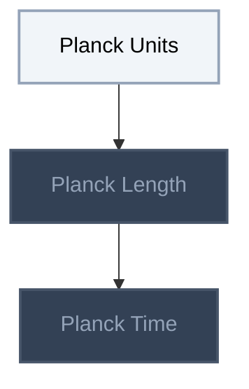
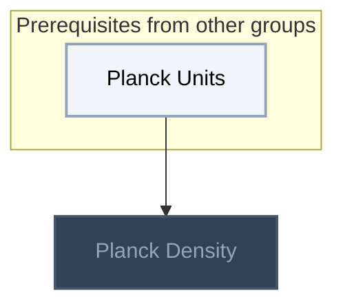

<!-- BEGIN STATS (generated by Scripts/skill_trees.py; do not edit) -->
**Mastered:** 0 / 4 · **Depth:** 0% · **Discovered:** 4 · **Planned:** 0 · **Locked:** 3 · **Rusty:** 0

| | L0 Discovered | L1 Recall | L2 Apply | L3 Prove ★ | L4 Wield | L5 Command |
|---|---:|---:|---:|---:|---:|---:|
| **At this level** | 4 | 0 | 0 | 0 | 0 | 0 |
| **Reached (this level or higher)** | 4 | 0 | 0 | 0 | 0 | 0 |

**Next up:** [[Planck Units]]

Legend: dashed grey = planned (no note yet) · dark grey = locked · white L0 Discovered · green L1 Recall · blue L2 Apply · purple L3 Prove (Mastered) · orange L4 Wield · gold L5 Command · brown dashed border = rusty
<!-- END STATS -->

## Feynman Vol. I Ch. 5: Time and Distance
**Reached:** L1 0 · L2 0 · L3 0 · L4 0 · L5 0 (of 3 nodes)



## Modern Physics and Cosmology
**Reached:** L1 0 · L2 0 · L3 0 · L4 0 · L5 0 (of 1 nodes)



# Source
Graph structure: the single source for the diagrams above, edited by `/note` and `Scripts/skill_trees.py` (`add`, `edge`, `rename`). Everything above this heading is regenerated by `render`.

```skilltree
    %% PREREQUISITES
    %% NODES
    %% == Feynman Vol. I Ch. 5: Time and Distance ==
    n_planck_units["Planck Units"]
    n_planck_length["Planck Length"]
    n_planck_time["Planck Time"]
    %% == Modern Physics and Cosmology ==
    n_planck_density["Planck Density"]
    %% EDGES
    n_planck_units --> n_planck_length
    n_planck_length --> n_planck_time
    n_planck_units --> n_planck_density
```
