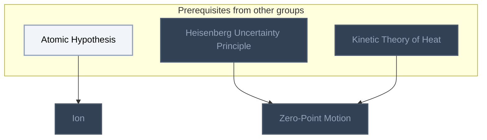
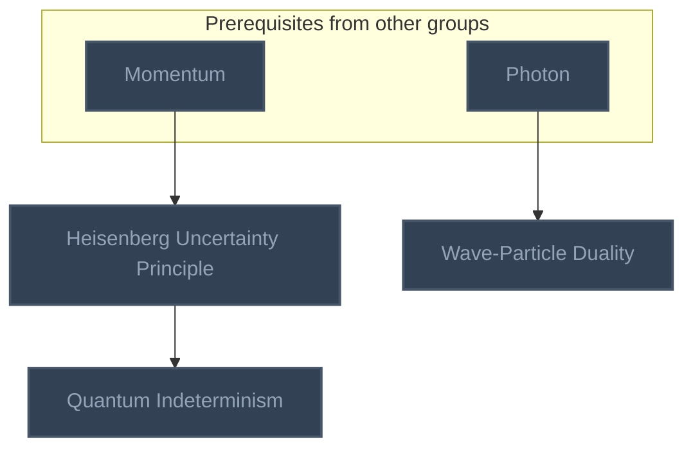
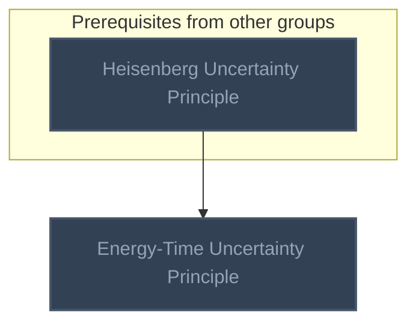

<!-- BEGIN STATS (generated by Scripts/skill_trees.py; do not edit) -->
**Mastered:** 0 / 7 · **Depth:** 0% · **Mastery Depth:** 0% · **Discovered:** 7 · **Planned:** 0 · **Locked:** 6 · **Rusty:** 0

| | L0 Discovered | L1 Recall | L2 Apply | L3 Prove ★ | L4 Wield | L5 Command |
|---|---:|---:|---:|---:|---:|---:|
| **At this level** | 7 | 0 | 0 | 0 | 0 | 0 |
| **Reached (this level or higher)** | 7 | 0 | 0 | 0 | 0 | 0 |

**Next up:** [[Electron Cloud]]

Legend: dashed grey = planned (no note yet) · dark grey = locked · white L0 Discovered · green L1 Recall · blue L2 Apply · purple L3 Prove (Mastered) · orange L4 Wield · gold L5 Command · brown dashed border = rusty
<!-- END STATS -->

## Feynman Vol. I Ch. 1: Atoms in Motion
**Reached:** L1 0 · L2 0 · L3 0 · L4 0 · L5 0 (of 2 nodes)



## Feynman Vol. I Ch. 2: Basic Physics
**Reached:** L1 0 · L2 0 · L3 0 · L4 0 · L5 0 (of 3 nodes)



## Feynman Vol. I Ch. 5: Time and Distance
**Reached:** L1 0 · L2 0 · L3 0 · L4 0 · L5 0 (of 1 nodes)



## Feynman Vol. I Ch. 6: Probability
**Reached:** L1 0 · L2 0 · L3 0 · L4 0 · L5 0 (of 1 nodes)


# Source
Graph structure: the single source for the diagrams above, edited by `/note` and `Scripts/skill_trees.py` (`add`, `edge`, `rename`). Everything above this heading is regenerated by `render`.

```skilltree
    %% PREREQUISITES
    n_atomic_hypothesis["Atomic Hypothesis"]
    n_kinetic_theory_of_heat["Kinetic Theory of Heat"]
    n_momentum["Momentum"]
    n_photon["Photon"]
    %% NODES
    %% == Feynman Vol. I Ch. 1: Atoms in Motion ==
    n_ion["Ion"]
    n_zero_point_motion["Zero-Point Motion"]
    %% == Feynman Vol. I Ch. 2: Basic Physics ==
    n_heisenberg_uncertainty_principle["Heisenberg Uncertainty Principle"]
    n_wave_particle_duality["Wave-Particle Duality"]
    n_quantum_indeterminism["Quantum Indeterminism"]
    %% == Feynman Vol. I Ch. 5: Time and Distance ==
    n_energy_time_uncertainty_principle["Energy-Time Uncertainty Principle"]
    %% == Feynman Vol. I Ch. 6: Probability ==
    n_electron_cloud["Electron Cloud"]
    %% EDGES
    n_atomic_hypothesis --> n_ion
    n_heisenberg_uncertainty_principle --> n_zero_point_motion
    n_kinetic_theory_of_heat --> n_zero_point_motion
    n_momentum --> n_heisenberg_uncertainty_principle
    n_photon --> n_wave_particle_duality
    n_heisenberg_uncertainty_principle --> n_quantum_indeterminism
    n_heisenberg_uncertainty_principle --> n_energy_time_uncertainty_principle
```
