<!-- BEGIN STATS (generated by Scripts/skill_trees.py; do not edit) -->
**Mastered:** 0 / 298 · **Depth:** 1% · **Discovered:** 268 · **Planned:** 30 · **Locked:** 239 · **Rusty:** 0

**Levels:** L0 257 · L1 0 · L2 11 · L3 0 · L4 0 · L5 0

**Next up:** [[Maximum]], [[Minimum]], [[Integral]], [[Partition]], [[Mesh of Partition]]

Legend: dashed grey = planned (no note yet) · dark grey = locked · white L0 Discovered · green L1 Recall · blue L2 Apply · purple L3 Prove (Mastered) · orange L4 Wield · gold L5 Command · brown dashed border = rusty
<!-- END STATS -->

## Ross Ch. 1: Introduction
**Mastered:** 0 / 34 · **Discovered:** 33 / 34

```mermaid
flowchart TD
    classDef planned fill:#1E293B,stroke:#64748B,stroke-width:2px,stroke-dasharray:5 5,color:#94A3B8;
    classDef locked fill:#334155,stroke:#475569,stroke-width:2px,color:#94A3B8;
    classDef L0 fill:#F1F5F9,stroke:#94A3B8,stroke-width:2px,color:#000000;
    classDef L1 fill:#22C55E,stroke:#15803D,stroke-width:2px,color:#000000;
    classDef L2 fill:#3B82F6,stroke:#1D4ED8,stroke-width:3px,color:#FFFFFF;
    classDef L3 fill:#A855F7,stroke:#6B21A8,stroke-width:3px,color:#FFFFFF,font-weight:bold;
    classDef L4 fill:#F97316,stroke:#C2410C,stroke-width:4px,color:#000000,font-weight:bold;
    classDef L5 fill:#FFD700,stroke:#FF8C00,stroke-width:5px,color:#000000,font-weight:bold;
    classDef rusty stroke:#8B4513,stroke-width:4px,stroke-dasharray:3 3;
    subgraph sg_prereqs["Prerequisites from other groups"]
        n_proof_by_induction["Proof by Induction"]
        n_rational_number["Rational Number"]
        n_real_number["Real Number"]
        n_polynomial_function["Polynomial Function"]
        n_field["Field"]
        n_ordered_set["Ordered Set"]
        n_absolute_value["Absolute Value"]
    end
    n_peano_axioms["Peano Axioms"]
    n_set_of_integers["Set of Integers"]
    n_set_of_rational_numbers["Set of Rational Numbers"]
    n_set_of_real_numbers["Set of Real Numbers"]
    n_algebraic_number["Algebraic Number"]
    n_ordered_field["Ordered Field"]
    n_ordered_field_basic_properties["Ordered Field Basic Properties"]
    n_absolute_value_non_negativity["Absolute Value Non-negativity"]
    n_triangle_inequality["Triangle Inequality"]
    n_maximum["Maximum"]
    n_minimum["Minimum"]
    n_set_maximum["Set Maximum"]
    n_set_minimum["Set Minimum"]
    n_set_of_integers_minimum_maximum_properties["Set of Integers Minimum Maximum Properties"]
    n_set_of_natural_numbers_minimum_maximum_properties["Set of Natural Numbers Minimum Maximum Properties"]
    n_set_of_rational_numbers_minimum_maximum_properties["Set of Rational Numbers Minimum Maximum Properties"]
    n_set_of_real_numbers_minimum_maximum_properties["Set of Real Numbers Minimum Maximum Properties"]
    n_bounded_set["Bounded Set"]
    n_set_lower_bound["Set Lower Bound"]
    n_set_maximum_as_set_upper_bound["Set Maximum as Set Upper Bound"]
    n_set_minimum_as_set_lower_bound["Set Minimum as Set Lower Bound"]
    n_set_upper_bound["Set Upper Bound"]
    n_infimum["Infimum"]
    n_infimum_on_different_intervals["Infimum on Different Intervals"]
    n_set_maximum_as_supremum["Set Maximum as Supremum"]
    n_set_minimum_as_infimum["Set Minimum as Infimum"]
    n_supremum["Supremum"]
    n_supremum_on_different_intervals["Supremum on Different Intervals"]
    n_completeness_axiom["Completeness Axiom"]
    n_archimedean_property["Archimedean Property"]
    n_denseness_of_set_of_rational_numbers["Denseness of Set of Rational Numbers"]
    n_infimum_addition_rule["Infimum Addition Rule"]
    n_supremum_addition_rule["Supremum Addition Rule"]
    n_dedekind_cut["Dedekind Cut"]
    n_proof_by_induction --> n_peano_axioms
    n_peano_axioms --> n_set_of_integers
    n_rational_number --> n_set_of_rational_numbers
    n_set_of_integers --> n_set_of_rational_numbers
    n_real_number --> n_set_of_real_numbers
    n_set_of_rational_numbers --> n_set_of_real_numbers
    n_polynomial_function --> n_algebraic_number
    n_set_of_integers --> n_algebraic_number
    n_field --> n_ordered_field
    n_ordered_set --> n_ordered_field
    n_ordered_field --> n_ordered_field_basic_properties
    n_absolute_value --> n_absolute_value_non_negativity
    n_absolute_value_non_negativity --> n_triangle_inequality
    n_maximum --> n_set_maximum
    n_minimum --> n_set_minimum
    n_set_of_integers --> n_set_of_integers_minimum_maximum_properties
    n_set_maximum --> n_set_of_integers_minimum_maximum_properties
    n_set_minimum --> n_set_of_integers_minimum_maximum_properties
    n_peano_axioms --> n_set_of_natural_numbers_minimum_maximum_properties
    n_set_maximum --> n_set_of_natural_numbers_minimum_maximum_properties
    n_set_minimum --> n_set_of_natural_numbers_minimum_maximum_properties
    n_set_of_rational_numbers --> n_set_of_rational_numbers_minimum_maximum_properties
    n_set_maximum --> n_set_of_rational_numbers_minimum_maximum_properties
    n_set_minimum --> n_set_of_rational_numbers_minimum_maximum_properties
    n_set_of_real_numbers --> n_set_of_real_numbers_minimum_maximum_properties
    n_set_maximum --> n_set_of_real_numbers_minimum_maximum_properties
    n_set_minimum --> n_set_of_real_numbers_minimum_maximum_properties
    n_set_lower_bound --> n_bounded_set
    n_set_upper_bound --> n_bounded_set
    n_set_of_real_numbers --> n_set_lower_bound
    n_set_maximum --> n_set_maximum_as_set_upper_bound
    n_set_upper_bound --> n_set_maximum_as_set_upper_bound
    n_set_minimum --> n_set_minimum_as_set_lower_bound
    n_set_lower_bound --> n_set_minimum_as_set_lower_bound
    n_set_of_real_numbers --> n_set_upper_bound
    n_set_lower_bound --> n_infimum
    n_infimum --> n_infimum_on_different_intervals
    n_set_maximum --> n_set_maximum_as_supremum
    n_supremum --> n_set_maximum_as_supremum
    n_set_minimum --> n_set_minimum_as_infimum
    n_infimum --> n_set_minimum_as_infimum
    n_set_upper_bound --> n_supremum
    n_supremum --> n_supremum_on_different_intervals
    n_ordered_field --> n_completeness_axiom
    n_infimum --> n_completeness_axiom
    n_supremum --> n_completeness_axiom
    n_completeness_axiom --> n_archimedean_property
    n_archimedean_property --> n_denseness_of_set_of_rational_numbers
    n_bounded_set --> n_infimum_addition_rule
    n_infimum --> n_infimum_addition_rule
    n_bounded_set --> n_supremum_addition_rule
    n_supremum --> n_supremum_addition_rule
    n_completeness_axiom --> n_dedekind_cut
    class n_dedekind_cut planned;
    class n_field,n_ordered_set,n_ordered_field,n_ordered_field_basic_properties,n_absolute_value_non_negativity,n_triangle_inequality,n_set_maximum,n_set_minimum,n_set_of_integers_minimum_maximum_properties,n_set_of_natural_numbers_minimum_maximum_properties,n_set_of_rational_numbers_minimum_maximum_properties,n_set_of_real_numbers_minimum_maximum_properties,n_set_maximum_as_set_upper_bound,n_set_minimum_as_set_lower_bound,n_infimum_on_different_intervals,n_set_maximum_as_supremum,n_set_minimum_as_infimum,n_supremum_on_different_intervals,n_completeness_axiom,n_archimedean_property,n_denseness_of_set_of_rational_numbers,n_infimum_addition_rule,n_supremum_addition_rule locked;
    class n_absolute_value,n_algebraic_number,n_maximum,n_minimum,n_infimum,n_supremum L0;
    class n_proof_by_induction,n_rational_number,n_real_number,n_polynomial_function,n_peano_axioms,n_set_of_integers,n_set_of_rational_numbers,n_set_of_real_numbers,n_bounded_set,n_set_lower_bound,n_set_upper_bound L2;
    class n_proof_by_induction,n_rational_number,n_real_number,n_polynomial_function,n_field,n_ordered_set,n_absolute_value,n_peano_axioms,n_set_of_integers,n_set_of_rational_numbers,n_set_of_real_numbers,n_algebraic_number,n_ordered_field,n_ordered_field_basic_properties,n_absolute_value_non_negativity,n_triangle_inequality,n_maximum,n_minimum,n_set_maximum,n_set_minimum,n_set_of_integers_minimum_maximum_properties,n_set_of_natural_numbers_minimum_maximum_properties,n_set_of_rational_numbers_minimum_maximum_properties,n_set_of_real_numbers_minimum_maximum_properties,n_bounded_set,n_set_lower_bound,n_set_maximum_as_set_upper_bound,n_set_minimum_as_set_lower_bound,n_set_upper_bound,n_infimum,n_infimum_on_different_intervals,n_set_maximum_as_supremum,n_set_minimum_as_infimum,n_supremum,n_supremum_on_different_intervals,n_completeness_axiom,n_archimedean_property,n_denseness_of_set_of_rational_numbers,n_infimum_addition_rule,n_supremum_addition_rule internal-link;
```

## Rudin Ch. 1: The Real and Complex Number Systems
**Mastered:** 0 / 3 · **Discovered:** 3 / 3

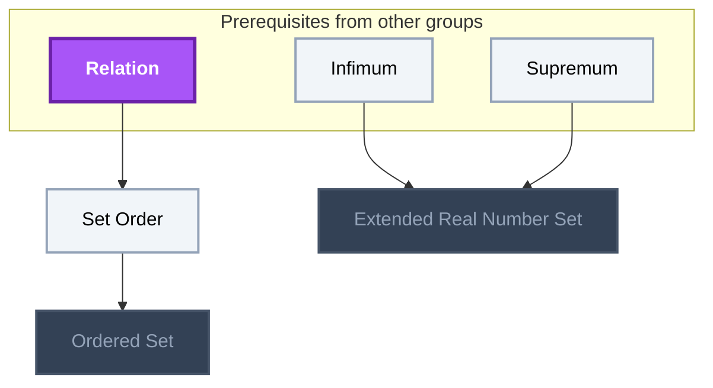

## Ross Ch. 2: Sequences
**Mastered:** 0 / 82 · **Discovered:** 82 / 82

```mermaid
flowchart TD
    classDef planned fill:#1E293B,stroke:#64748B,stroke-width:2px,stroke-dasharray:5 5,color:#94A3B8;
    classDef locked fill:#334155,stroke:#475569,stroke-width:2px,color:#94A3B8;
    classDef L0 fill:#F1F5F9,stroke:#94A3B8,stroke-width:2px,color:#000000;
    classDef L1 fill:#22C55E,stroke:#15803D,stroke-width:2px,color:#000000;
    classDef L2 fill:#3B82F6,stroke:#1D4ED8,stroke-width:3px,color:#FFFFFF;
    classDef L3 fill:#A855F7,stroke:#6B21A8,stroke-width:3px,color:#FFFFFF,font-weight:bold;
    classDef L4 fill:#F97316,stroke:#C2410C,stroke-width:4px,color:#000000,font-weight:bold;
    classDef L5 fill:#FFD700,stroke:#FF8C00,stroke-width:5px,color:#000000,font-weight:bold;
    classDef rusty stroke:#8B4513,stroke-width:4px,stroke-dasharray:3 3;
    subgraph sg_prereqs["Prerequisites from other groups"]
        n_function["Function"]
        n_infimum["Infimum"]
        n_bounded_set["Bounded Set"]
        n_completeness_axiom["Completeness Axiom"]
        n_extended_real_number_set["Extended Real Number Set"]
        n_triangle_inequality["Triangle Inequality"]
        n_limit_point["Limit Point"]
        n_totally_bounded["Totally Bounded"]
        n_riemann_integral["Riemann Integral"]
        n_set_complement["Set Complement"]
    end
    n_sequence["Sequence"]
    n_limit["Limit"]
    n_limit_of_sequence["Limit of Sequence"]
    n_limit_of_sequence_basic_examples["Limit of Sequence Basic Examples"]
    n_limit_of_sequence_theorem_of_infimum["Limit of Sequence Theorem of Infimum"]
    n_bounded_sequence["Bounded Sequence"]
    n_limit_of_sequence_bounded_theorem["Limit of Sequence Bounded Theorem"]
    n_unbounded_sequence["Unbounded Sequence"]
    n_limit_of_sequence_arithmetic_theorems["Limit of Sequence Arithmetic Theorems"]
    n_order_limit_theorem["Order Limit Theorem"]
    n_2_policemen_lemma["2 Policemen Lemma"]
    n_divergent_sequence["Divergent Sequence"]
    n_stolz_cesaro_theorem["Stolz-Cesaro Theorem"]
    n_limit_of_sequence_divergent_to_infinity_theorems["Limit of Sequence Divergent to Infinity Theorems"]
    n_decreasing_sequence["Decreasing Sequence"]
    n_increasing_sequence["Increasing Sequence"]
    n_monotone_sequence["Monotone Sequence"]
    n_bounded_monotone_sequence_convergence_theorem["Bounded Monotone Sequence Convergence Theorem"]
    n_unbounded_decreasing_sequence_limit["Unbounded Decreasing Sequence Limit"]
    n_unbounded_increasing_sequence_limit["Unbounded Increasing Sequence Limit"]
    n_limit_infimum["Limit Infimum"]
    n_limit_supremum["Limit Supremum"]
    n_monotone_sequence_limit_corollary["Monotone Sequence Limit Corollary"]
    n_limit_of_sequence_with_limit_supremum_and_limit_infimum["Limit of Sequence With Limit Supremum And Limit Infimum"]
    n_cauchy_sequence["Cauchy Sequence"]
    n_cauchy_sequence_boundedness["Cauchy Sequence Boundedness"]
    n_convergent_sequence["Convergent Sequence"]
    n_convergent_sequence_is_cauchy_sequence["Convergent Sequence is Cauchy Sequence"]
    n_subsequence["Subsequence"]
    n_subsequence_with_limit_theorem["Subsequence with Limit Theorem"]
    n_monotonic_subsequence_theorem["Monotonic Subsequence Theorem"]
    n_subsequence_limit_convergence_theorem["Subsequence Limit Convergence Theorem"]
    n_bolzano_weierstrass_theorem["Bolzano-Weierstrass Theorem"]
    n_subsequential_limit["Subsequential Limit"]
    n_monotonic_subsequence_limit_theorem["Monotonic Subsequence Limit Theorem"]
    n_subsequential_limit_theorem["Subsequential Limit Theorem"]
    n_set_of_subsequential_limit["Set of Subsequential Limit"]
    n_limit_supremum_of_product_of_sequences["Limit Supremum of Product of Sequences"]
    n_limit_supremum_and_infimum_inequality["Limit Supremum and Infimum Inequality"]
    n_metric["Metric"]
    n_metric_space["Metric Space"]
    n_complete_metric_space["Complete Metric Space"]
    n_high_dimensional_real_cauchy_sequence["High Dimensional Real Cauchy Sequence"]
    n_high_dimensional_real_sequence["High Dimensional Real Sequence"]
    n_sequence_in_metric_space["Sequence in Metric Space"]
    n_interior_point["Interior Point"]
    n_open_set["Open Set"]
    n_open_set_basic_properties["Open Set Basic Properties"]
    n_boundary_set["Boundary Set"]
    n_boundary_set_basic_properties["Boundary Set Basic Properties"]
    n_closed_set["Closed Set"]
    n_closed_set_basic_properties["Closed Set Basic Properties"]
    n_closure_set["Closure Set"]
    n_closure_set_basic_properties["Closure Set Basic Properties"]
    n_closed_set_intersection["Closed Set Intersection"]
    n_closed_set_union["Closed Set Union"]
    n_decreasing_closed_set_theorem["Decreasing Closed Set Theorem"]
    n_open_cover["Open Cover"]
    n_compact_metric_space["Compact Metric Space"]
    n_compact_set["Compact Set"]
    n_heine_borel_theorem["Heine-Borel Theorem"]
    n_subcover["Subcover"]
    n_finite_series["Finite Series"]
    n_infinite_series["Infinite Series"]
    n_series["Series"]
    n_geometric_series["Geometric Series"]
    n_infinite_series_cauchy_criterion["Infinite Series Cauchy Criterion"]
    n_infinite_series_comparison_test["Infinite Series Comparison Test"]
    n_infinite_series_convergence_cauchy_criterion_theorem["Infinite Series Convergence Cauchy Criterion Theorem"]
    n_absolutely_convergent_infinite_series["Absolutely Convergent Infinite Series"]
    n_absolutely_convergent_infinite_series_convergence_theorem["Absolutely Convergent Infinite Series Convergence Theorem"]
    n_infinite_series_ratio_test["Infinite Series Ratio Test"]
    n_infinite_series_root_test["Infinite Series Root Test"]
    n_infinite_series_integral_test["Infinite Series Integral Test"]
    n_infinite_series_convergent_examples["Infinite Series Convergent Examples"]
    n_alternating_series["Alternating Series"]
    n_infinite_series_alternating_series_test["Infinite Series Alternating Series Test"]
    n_decimal_expansion_sequence["Decimal Expansion Sequence"]
    n_epsilon_neighborhood["Epsilon Neighborhood"]
    n_interior_set["Interior Set"]
    n_exterior_set["Exterior Set"]
    n_clopen_set["Clopen Set"]
    n_function --> n_sequence
    n_function --> n_limit
    n_sequence --> n_limit_of_sequence
    n_limit --> n_limit_of_sequence
    n_limit_of_sequence --> n_limit_of_sequence_basic_examples
    n_infimum --> n_limit_of_sequence_theorem_of_infimum
    n_convergent_sequence --> n_limit_of_sequence_theorem_of_infimum
    n_bounded_set --> n_bounded_sequence
    n_sequence --> n_bounded_sequence
    n_bounded_sequence --> n_limit_of_sequence_bounded_theorem
    n_convergent_sequence --> n_limit_of_sequence_bounded_theorem
    n_bounded_sequence --> n_unbounded_sequence
    n_limit_of_sequence_bounded_theorem --> n_limit_of_sequence_arithmetic_theorems
    n_convergent_sequence --> n_order_limit_theorem
    n_convergent_sequence --> n_2_policemen_lemma
    n_convergent_sequence --> n_divergent_sequence
    n_limit_of_sequence_divergent_to_infinity_theorems --> n_stolz_cesaro_theorem
    n_monotone_sequence --> n_stolz_cesaro_theorem
    n_divergent_sequence --> n_limit_of_sequence_divergent_to_infinity_theorems
    n_sequence --> n_decreasing_sequence
    n_sequence --> n_increasing_sequence
    n_decreasing_sequence --> n_monotone_sequence
    n_increasing_sequence --> n_monotone_sequence
    n_completeness_axiom --> n_bounded_monotone_sequence_convergence_theorem
    n_bounded_sequence --> n_bounded_monotone_sequence_convergence_theorem
    n_monotone_sequence --> n_bounded_monotone_sequence_convergence_theorem
    n_convergent_sequence --> n_bounded_monotone_sequence_convergence_theorem
    n_unbounded_sequence --> n_unbounded_decreasing_sequence_limit
    n_limit_of_sequence_divergent_to_infinity_theorems --> n_unbounded_decreasing_sequence_limit
    n_decreasing_sequence --> n_unbounded_decreasing_sequence_limit
    n_unbounded_sequence --> n_unbounded_increasing_sequence_limit
    n_limit_of_sequence_divergent_to_infinity_theorems --> n_unbounded_increasing_sequence_limit
    n_increasing_sequence --> n_unbounded_increasing_sequence_limit
    n_extended_real_number_set --> n_limit_infimum
    n_monotone_sequence_limit_corollary --> n_limit_infimum
    n_extended_real_number_set --> n_limit_supremum
    n_monotone_sequence_limit_corollary --> n_limit_supremum
    n_bounded_monotone_sequence_convergence_theorem --> n_monotone_sequence_limit_corollary
    n_unbounded_decreasing_sequence_limit --> n_monotone_sequence_limit_corollary
    n_unbounded_increasing_sequence_limit --> n_monotone_sequence_limit_corollary
    n_limit_infimum --> n_limit_of_sequence_with_limit_supremum_and_limit_infimum
    n_limit_supremum --> n_limit_of_sequence_with_limit_supremum_and_limit_infimum
    n_sequence --> n_cauchy_sequence
    n_bounded_sequence --> n_cauchy_sequence_boundedness
    n_cauchy_sequence --> n_cauchy_sequence_boundedness
    n_limit_of_sequence --> n_convergent_sequence
    n_cauchy_sequence --> n_convergent_sequence_is_cauchy_sequence
    n_convergent_sequence --> n_convergent_sequence_is_cauchy_sequence
    n_sequence --> n_subsequence
    n_convergent_sequence --> n_subsequence_with_limit_theorem
    n_subsequence --> n_subsequence_with_limit_theorem
    n_monotone_sequence --> n_monotonic_subsequence_theorem
    n_subsequence --> n_monotonic_subsequence_theorem
    n_convergent_sequence --> n_subsequence_limit_convergence_theorem
    n_subsequence --> n_subsequence_limit_convergence_theorem
    n_bounded_monotone_sequence_convergence_theorem --> n_bolzano_weierstrass_theorem
    n_monotonic_subsequence_theorem --> n_bolzano_weierstrass_theorem
    n_limit_of_sequence --> n_subsequential_limit
    n_subsequence --> n_subsequential_limit
    n_limit_infimum --> n_monotonic_subsequence_limit_theorem
    n_limit_supremum --> n_monotonic_subsequence_limit_theorem
    n_monotonic_subsequence_theorem --> n_monotonic_subsequence_limit_theorem
    n_limit_infimum --> n_subsequential_limit_theorem
    n_limit_supremum --> n_subsequential_limit_theorem
    n_subsequence_with_limit_theorem --> n_subsequential_limit_theorem
    n_subsequential_limit --> n_subsequential_limit_theorem
    n_subsequential_limit_theorem --> n_set_of_subsequential_limit
    n_closed_set --> n_set_of_subsequential_limit
    n_limit_supremum --> n_limit_supremum_of_product_of_sequences
    n_limit_infimum --> n_limit_supremum_and_infimum_inequality
    n_limit_supremum --> n_limit_supremum_and_infimum_inequality
    n_function --> n_metric
    n_triangle_inequality --> n_metric
    n_metric --> n_metric_space
    n_convergent_sequence_is_cauchy_sequence --> n_complete_metric_space
    n_sequence_in_metric_space --> n_complete_metric_space
    n_cauchy_sequence --> n_high_dimensional_real_cauchy_sequence
    n_high_dimensional_real_sequence --> n_high_dimensional_real_cauchy_sequence
    n_sequence_in_metric_space --> n_high_dimensional_real_sequence
    n_limit_of_sequence --> n_sequence_in_metric_space
    n_metric_space --> n_sequence_in_metric_space
    n_metric_space --> n_interior_point
    n_interior_point --> n_open_set
    n_open_set --> n_open_set_basic_properties
    n_closure_set --> n_boundary_set
    n_boundary_set --> n_boundary_set_basic_properties
    n_open_set --> n_closed_set
    n_limit_point --> n_closed_set
    n_sequence_in_metric_space --> n_closed_set_basic_properties
    n_closed_set --> n_closed_set_basic_properties
    n_closed_set --> n_closure_set
    n_sequence_in_metric_space --> n_closure_set_basic_properties
    n_closure_set --> n_closure_set_basic_properties
    n_closed_set --> n_closed_set_intersection
    n_closed_set --> n_closed_set_union
    n_bolzano_weierstrass_theorem --> n_decreasing_closed_set_theorem
    n_high_dimensional_real_sequence --> n_decreasing_closed_set_theorem
    n_closed_set --> n_decreasing_closed_set_theorem
    n_open_set --> n_open_cover
    n_complete_metric_space --> n_compact_metric_space
    n_heine_borel_theorem --> n_compact_metric_space
    n_totally_bounded --> n_compact_metric_space
    n_subcover --> n_compact_set
    n_decreasing_closed_set_theorem --> n_heine_borel_theorem
    n_compact_set --> n_heine_borel_theorem
    n_open_cover --> n_subcover
    n_series --> n_finite_series
    n_limit_of_sequence --> n_infinite_series
    n_series --> n_infinite_series
    n_sequence --> n_series
    n_finite_series --> n_geometric_series
    n_infinite_series --> n_geometric_series
    n_cauchy_sequence --> n_infinite_series_cauchy_criterion
    n_infinite_series --> n_infinite_series_cauchy_criterion
    n_infinite_series_convergence_cauchy_criterion_theorem --> n_infinite_series_comparison_test
    n_absolutely_convergent_infinite_series --> n_infinite_series_comparison_test
    n_convergent_sequence_is_cauchy_sequence --> n_infinite_series_convergence_cauchy_criterion_theorem
    n_infinite_series_cauchy_criterion --> n_infinite_series_convergence_cauchy_criterion_theorem
    n_infinite_series --> n_absolutely_convergent_infinite_series
    n_infinite_series_comparison_test --> n_absolutely_convergent_infinite_series_convergence_theorem
    n_limit_supremum_and_infimum_inequality --> n_infinite_series_ratio_test
    n_infinite_series_root_test --> n_infinite_series_ratio_test
    n_limit_supremum --> n_infinite_series_root_test
    n_geometric_series --> n_infinite_series_root_test
    n_infinite_series_comparison_test --> n_infinite_series_root_test
    n_riemann_integral --> n_infinite_series_integral_test
    n_infinite_series --> n_infinite_series_integral_test
    n_infinite_series_comparison_test --> n_infinite_series_convergent_examples
    n_infinite_series_integral_test --> n_infinite_series_convergent_examples
    n_infinite_series --> n_alternating_series
    n_infinite_series_convergence_cauchy_criterion_theorem --> n_infinite_series_alternating_series_test
    n_alternating_series --> n_infinite_series_alternating_series_test
    n_bounded_monotone_sequence_convergence_theorem --> n_decimal_expansion_sequence
    n_metric_space --> n_epsilon_neighborhood
    n_interior_point --> n_interior_set
    n_open_set --> n_interior_set
    n_interior_set --> n_exterior_set
    n_closure_set --> n_exterior_set
    n_open_set --> n_clopen_set
    n_closed_set --> n_clopen_set
    n_set_complement --> n_exterior_set
    n_set_complement --> n_closed_set
    class n_completeness_axiom,n_extended_real_number_set,n_triangle_inequality,n_limit_point,n_totally_bounded,n_limit_of_sequence,n_limit_of_sequence_basic_examples,n_limit_of_sequence_theorem_of_infimum,n_bounded_sequence,n_limit_of_sequence_bounded_theorem,n_unbounded_sequence,n_limit_of_sequence_arithmetic_theorems,n_order_limit_theorem,n_2_policemen_lemma,n_divergent_sequence,n_stolz_cesaro_theorem,n_limit_of_sequence_divergent_to_infinity_theorems,n_decreasing_sequence,n_increasing_sequence,n_monotone_sequence,n_bounded_monotone_sequence_convergence_theorem,n_unbounded_decreasing_sequence_limit,n_unbounded_increasing_sequence_limit,n_limit_infimum,n_limit_supremum,n_monotone_sequence_limit_corollary,n_limit_of_sequence_with_limit_supremum_and_limit_infimum,n_cauchy_sequence,n_cauchy_sequence_boundedness,n_convergent_sequence,n_convergent_sequence_is_cauchy_sequence,n_subsequence,n_subsequence_with_limit_theorem,n_monotonic_subsequence_theorem,n_subsequence_limit_convergence_theorem,n_bolzano_weierstrass_theorem,n_subsequential_limit,n_monotonic_subsequence_limit_theorem,n_subsequential_limit_theorem,n_set_of_subsequential_limit,n_limit_supremum_of_product_of_sequences,n_limit_supremum_and_infimum_inequality,n_metric,n_metric_space,n_complete_metric_space,n_high_dimensional_real_cauchy_sequence,n_high_dimensional_real_sequence,n_sequence_in_metric_space,n_interior_point,n_open_set,n_open_set_basic_properties,n_boundary_set,n_boundary_set_basic_properties,n_closed_set,n_closed_set_basic_properties,n_closure_set,n_closure_set_basic_properties,n_closed_set_intersection,n_closed_set_union,n_decreasing_closed_set_theorem,n_open_cover,n_compact_metric_space,n_compact_set,n_heine_borel_theorem,n_subcover,n_finite_series,n_infinite_series,n_series,n_geometric_series,n_infinite_series_cauchy_criterion,n_infinite_series_comparison_test,n_infinite_series_convergence_cauchy_criterion_theorem,n_absolutely_convergent_infinite_series,n_absolutely_convergent_infinite_series_convergence_theorem,n_infinite_series_ratio_test,n_infinite_series_root_test,n_infinite_series_integral_test,n_infinite_series_convergent_examples,n_alternating_series,n_infinite_series_alternating_series_test,n_decimal_expansion_sequence,n_epsilon_neighborhood,n_interior_set,n_exterior_set,n_clopen_set locked;
    class n_infimum,n_set_complement,n_sequence,n_limit L0;
    class n_bounded_set L2;
    class n_function,n_riemann_integral L3;
    class n_function,n_infimum,n_bounded_set,n_completeness_axiom,n_extended_real_number_set,n_triangle_inequality,n_limit_point,n_totally_bounded,n_riemann_integral,n_set_complement,n_sequence,n_limit,n_limit_of_sequence,n_limit_of_sequence_basic_examples,n_limit_of_sequence_theorem_of_infimum,n_bounded_sequence,n_limit_of_sequence_bounded_theorem,n_unbounded_sequence,n_limit_of_sequence_arithmetic_theorems,n_order_limit_theorem,n_2_policemen_lemma,n_divergent_sequence,n_stolz_cesaro_theorem,n_limit_of_sequence_divergent_to_infinity_theorems,n_decreasing_sequence,n_increasing_sequence,n_monotone_sequence,n_bounded_monotone_sequence_convergence_theorem,n_unbounded_decreasing_sequence_limit,n_unbounded_increasing_sequence_limit,n_limit_infimum,n_limit_supremum,n_monotone_sequence_limit_corollary,n_limit_of_sequence_with_limit_supremum_and_limit_infimum,n_cauchy_sequence,n_cauchy_sequence_boundedness,n_convergent_sequence,n_convergent_sequence_is_cauchy_sequence,n_subsequence,n_subsequence_with_limit_theorem,n_monotonic_subsequence_theorem,n_subsequence_limit_convergence_theorem,n_bolzano_weierstrass_theorem,n_subsequential_limit,n_monotonic_subsequence_limit_theorem,n_subsequential_limit_theorem,n_set_of_subsequential_limit,n_limit_supremum_of_product_of_sequences,n_limit_supremum_and_infimum_inequality,n_metric,n_metric_space,n_complete_metric_space,n_high_dimensional_real_cauchy_sequence,n_high_dimensional_real_sequence,n_sequence_in_metric_space,n_interior_point,n_open_set,n_open_set_basic_properties,n_boundary_set,n_boundary_set_basic_properties,n_closed_set,n_closed_set_basic_properties,n_closure_set,n_closure_set_basic_properties,n_closed_set_intersection,n_closed_set_union,n_decreasing_closed_set_theorem,n_open_cover,n_compact_metric_space,n_compact_set,n_heine_borel_theorem,n_subcover,n_finite_series,n_infinite_series,n_series,n_geometric_series,n_infinite_series_cauchy_criterion,n_infinite_series_comparison_test,n_infinite_series_convergence_cauchy_criterion_theorem,n_absolutely_convergent_infinite_series,n_absolutely_convergent_infinite_series_convergence_theorem,n_infinite_series_ratio_test,n_infinite_series_root_test,n_infinite_series_integral_test,n_infinite_series_convergent_examples,n_alternating_series,n_infinite_series_alternating_series_test,n_decimal_expansion_sequence,n_epsilon_neighborhood,n_interior_set,n_exterior_set,n_clopen_set internal-link;
```

## Rudin Ch. 2: Basic Topology
**Mastered:** 0 / 13 · **Discovered:** 13 / 13

```mermaid
flowchart TD
    classDef planned fill:#1E293B,stroke:#64748B,stroke-width:2px,stroke-dasharray:5 5,color:#94A3B8;
    classDef locked fill:#334155,stroke:#475569,stroke-width:2px,color:#94A3B8;
    classDef L0 fill:#F1F5F9,stroke:#94A3B8,stroke-width:2px,color:#000000;
    classDef L1 fill:#22C55E,stroke:#15803D,stroke-width:2px,color:#000000;
    classDef L2 fill:#3B82F6,stroke:#1D4ED8,stroke-width:3px,color:#FFFFFF;
    classDef L3 fill:#A855F7,stroke:#6B21A8,stroke-width:3px,color:#FFFFFF,font-weight:bold;
    classDef L4 fill:#F97316,stroke:#C2410C,stroke-width:4px,color:#000000,font-weight:bold;
    classDef L5 fill:#FFD700,stroke:#FF8C00,stroke-width:5px,color:#000000,font-weight:bold;
    classDef rusty stroke:#8B4513,stroke-width:4px,stroke-dasharray:3 3;
    subgraph sg_prereqs["Prerequisites from other groups"]
        n_countable_set["Countable Set"]
        n_sequence["Sequence"]
        n_euclidean_n_space["Euclidean n-Space"]
        n_metric_space["Metric Space"]
        n_open_set["Open Set"]
        n_closed_set["Closed Set"]
        n_compact_set["Compact Set"]
        n_heine_borel_theorem["Heine-Borel Theorem"]
        n_perfect_subset["Perfect Subset"]
        n_disconnected_metric_space["Disconnected Metric Space"]
        n_closure_set["Closure Set"]
        n_dense_subset["Dense Subset"]
        n_bounded_set["Bounded Set"]
        n_open_cover["Open Cover"]
    end
    n_set_of_binary_sequences_uncountability_theorem["Set of Binary Sequences Uncountability Theorem"]
    n_k_cell["k-Cell"]
    n_isolated_point["Isolated Point"]
    n_limit_point["Limit Point"]
    n_relatively_open_set["Relatively Open Set"]
    n_finite_intersection_property["Finite Intersection Property"]
    n_nested_interval_theorem["Nested Interval Theorem"]
    n_cantor_set["Cantor Set"]
    n_connected_metric_space["Connected Metric Space"]
    n_connected_subset_of_real_line_theorem["Connected Subset of Real Line Theorem"]
    n_separated_sets["Separated Sets"]
    n_separable_metric_space["Separable Metric Space"]
    n_totally_bounded["Totally Bounded"]
    n_countable_set --> n_set_of_binary_sequences_uncountability_theorem
    n_sequence --> n_set_of_binary_sequences_uncountability_theorem
    n_euclidean_n_space --> n_k_cell
    n_limit_point --> n_isolated_point
    n_metric_space --> n_limit_point
    n_open_set --> n_relatively_open_set
    n_closed_set --> n_finite_intersection_property
    n_compact_set --> n_finite_intersection_property
    n_k_cell --> n_nested_interval_theorem
    n_finite_intersection_property --> n_nested_interval_theorem
    n_heine_borel_theorem --> n_cantor_set
    n_perfect_subset --> n_cantor_set
    n_separated_sets --> n_connected_metric_space
    n_disconnected_metric_space --> n_connected_metric_space
    n_connected_metric_space --> n_connected_subset_of_real_line_theorem
    n_closure_set --> n_separated_sets
    n_countable_set --> n_separable_metric_space
    n_dense_subset --> n_separable_metric_space
    n_bounded_set --> n_totally_bounded
    n_open_cover --> n_totally_bounded
    class n_euclidean_n_space,n_metric_space,n_open_set,n_closed_set,n_compact_set,n_heine_borel_theorem,n_perfect_subset,n_disconnected_metric_space,n_closure_set,n_dense_subset,n_open_cover,n_set_of_binary_sequences_uncountability_theorem,n_k_cell,n_isolated_point,n_limit_point,n_relatively_open_set,n_finite_intersection_property,n_nested_interval_theorem,n_cantor_set,n_connected_metric_space,n_connected_subset_of_real_line_theorem,n_separated_sets,n_separable_metric_space,n_totally_bounded locked;
    class n_countable_set,n_sequence L0;
    class n_bounded_set L2;
    class n_countable_set,n_sequence,n_euclidean_n_space,n_metric_space,n_open_set,n_closed_set,n_compact_set,n_heine_borel_theorem,n_perfect_subset,n_disconnected_metric_space,n_closure_set,n_dense_subset,n_bounded_set,n_open_cover,n_set_of_binary_sequences_uncountability_theorem,n_k_cell,n_isolated_point,n_limit_point,n_relatively_open_set,n_finite_intersection_property,n_nested_interval_theorem,n_cantor_set,n_connected_metric_space,n_connected_subset_of_real_line_theorem,n_separated_sets,n_separable_metric_space,n_totally_bounded internal-link;
```

## Rudin Ch. 3: Numerical Sequences and Series
**Mastered:** 0 / 10 · **Discovered:** 10 / 10

```mermaid
flowchart TD
    classDef planned fill:#1E293B,stroke:#64748B,stroke-width:2px,stroke-dasharray:5 5,color:#94A3B8;
    classDef locked fill:#334155,stroke:#475569,stroke-width:2px,color:#94A3B8;
    classDef L0 fill:#F1F5F9,stroke:#94A3B8,stroke-width:2px,color:#000000;
    classDef L1 fill:#22C55E,stroke:#15803D,stroke-width:2px,color:#000000;
    classDef L2 fill:#3B82F6,stroke:#1D4ED8,stroke-width:3px,color:#FFFFFF;
    classDef L3 fill:#A855F7,stroke:#6B21A8,stroke-width:3px,color:#FFFFFF,font-weight:bold;
    classDef L4 fill:#F97316,stroke:#C2410C,stroke-width:4px,color:#000000,font-weight:bold;
    classDef L5 fill:#FFD700,stroke:#FF8C00,stroke-width:5px,color:#000000,font-weight:bold;
    classDef rusty stroke:#8B4513,stroke-width:4px,stroke-dasharray:3 3;
    subgraph sg_prereqs["Prerequisites from other groups"]
        n_supremum["Supremum"]
        n_metric_space["Metric Space"]
        n_complete_metric_space["Complete Metric Space"]
        n_separable_metric_space["Separable Metric Space"]
        n_bounded_monotone_sequence_convergence_theorem["Bounded Monotone Sequence Convergence Theorem"]
        n_infinite_series["Infinite Series"]
        n_geometric_series["Geometric Series"]
        n_finite_series["Finite Series"]
        n_power_series["Power Series"]
        n_absolutely_convergent_infinite_series["Absolutely Convergent Infinite Series"]
    end
    n_diameter_metric_space["Diameter (Metric Space)"]
    n_polish_space["Polish Space"]
    n_cauchy_condensation_test["Cauchy Condensation Test"]
    n_p_series["p-Series"]
    n_summation_by_parts["Summation by Parts"]
    n_abel_s_theorem_power_series_boundary_convergence["Abel's Theorem (Power Series Boundary Convergence)"]
    n_cauchy_product["Cauchy Product"]
    n_mertens_theorem["Mertens' Theorem"]
    n_rearrangement_series["Rearrangement (Series)"]
    n_riemann_series_theorem["Riemann Series Theorem"]
    n_supremum --> n_diameter_metric_space
    n_metric_space --> n_diameter_metric_space
    n_complete_metric_space --> n_polish_space
    n_separable_metric_space --> n_polish_space
    n_bounded_monotone_sequence_convergence_theorem --> n_cauchy_condensation_test
    n_infinite_series --> n_cauchy_condensation_test
    n_geometric_series --> n_p_series
    n_cauchy_condensation_test --> n_p_series
    n_finite_series --> n_summation_by_parts
    n_power_series --> n_abel_s_theorem_power_series_boundary_convergence
    n_summation_by_parts --> n_abel_s_theorem_power_series_boundary_convergence
    n_infinite_series --> n_cauchy_product
    n_absolutely_convergent_infinite_series --> n_mertens_theorem
    n_cauchy_product --> n_mertens_theorem
    n_absolutely_convergent_infinite_series --> n_rearrangement_series
    n_rearrangement_series --> n_riemann_series_theorem
    class n_metric_space,n_complete_metric_space,n_separable_metric_space,n_bounded_monotone_sequence_convergence_theorem,n_infinite_series,n_geometric_series,n_finite_series,n_power_series,n_absolutely_convergent_infinite_series,n_diameter_metric_space,n_polish_space,n_cauchy_condensation_test,n_p_series,n_summation_by_parts,n_abel_s_theorem_power_series_boundary_convergence,n_cauchy_product,n_mertens_theorem,n_rearrangement_series,n_riemann_series_theorem locked;
    class n_supremum L0;
    class n_supremum,n_metric_space,n_complete_metric_space,n_separable_metric_space,n_bounded_monotone_sequence_convergence_theorem,n_infinite_series,n_geometric_series,n_finite_series,n_power_series,n_absolutely_convergent_infinite_series,n_diameter_metric_space,n_polish_space,n_cauchy_condensation_test,n_p_series,n_summation_by_parts,n_abel_s_theorem_power_series_boundary_convergence,n_cauchy_product,n_mertens_theorem,n_rearrangement_series,n_riemann_series_theorem internal-link;
```

## Ross Ch. 3: Continuity
**Mastered:** 0 / 28 · **Discovered:** 28 / 28

```mermaid
flowchart TD
    classDef planned fill:#1E293B,stroke:#64748B,stroke-width:2px,stroke-dasharray:5 5,color:#94A3B8;
    classDef locked fill:#334155,stroke:#475569,stroke-width:2px,color:#94A3B8;
    classDef L0 fill:#F1F5F9,stroke:#94A3B8,stroke-width:2px,color:#000000;
    classDef L1 fill:#22C55E,stroke:#15803D,stroke-width:2px,color:#000000;
    classDef L2 fill:#3B82F6,stroke:#1D4ED8,stroke-width:3px,color:#FFFFFF;
    classDef L3 fill:#A855F7,stroke:#6B21A8,stroke-width:3px,color:#FFFFFF,font-weight:bold;
    classDef L4 fill:#F97316,stroke:#C2410C,stroke-width:4px,color:#000000,font-weight:bold;
    classDef L5 fill:#FFD700,stroke:#FF8C00,stroke-width:5px,color:#000000,font-weight:bold;
    classDef rusty stroke:#8B4513,stroke-width:4px,stroke-dasharray:3 3;
    subgraph sg_prereqs["Prerequisites from other groups"]
        n_continuous_function["Continuous Function"]
        n_maximum["Maximum"]
        n_bolzano_weierstrass_theorem["Bolzano-Weierstrass Theorem"]
        n_bounded_function["Bounded Function"]
        n_completeness_axiom["Completeness Axiom"]
        n_compact_metric_space["Compact Metric Space"]
        n_function["Function"]
        n_cauchy_sequence["Cauchy Sequence"]
        n_mean_value_theorem["Mean Value Theorem"]
        n_limit_of_function["Limit of Function"]
        n_closed_set["Closed Set"]
        n_closure_set["Closure Set"]
        n_complete_metric_space["Complete Metric Space"]
        n_isolated_point["Isolated Point"]
        n_set_of_real_numbers["Set of Real Numbers"]
        n_open_set["Open Set"]
        n_connected_metric_space["Connected Metric Space"]
        n_curve["Curve"]
        n_euclidean_n_space["Euclidean n-Space"]
    end
    n_continuous_function_absolute_value_rule["Continuous Function Absolute Value Rule"]
    n_maximum_function["Maximum Function"]
    n_continuous_function_bounded_theorem["Continuous Function Bounded Theorem"]
    n_intermediate_value_theorem["Intermediate Value Theorem"]
    n_continuous_function_strictly_increasing_inverse_theorem["Continuous Function Strictly Increasing Inverse Theorem"]
    n_uniformly_continuous_function["Uniformly Continuous Function"]
    n_continuous_to_uniformly_continuous_theorem["Continuous to Uniformly Continuous Theorem"]
    n_extension_of_function["Extension of Function"]
    n_uniformly_continuous_function_cauchy_sequence_theorem["Uniformly Continuous Function Cauchy Sequence Theorem"]
    n_uniformly_continuous_function_extension_of_function_theorem["Uniformly Continuous Function Extension of Function Theorem"]
    n_uniformly_continuous_function_interval_theorem["Uniformly Continuous Function Interval Theorem"]
    n_limit_of_function_composition_law["Limit of Function Composition Law"]
    n_continuous_function_on_metric_space_theorem["Continuous Function on Metric Space Theorem"]
    n_continuous_function_compact_metric_space_theorem["Continuous Function Compact Metric Space Theorem"]
    n_dense_subset["Dense Subset"]
    n_nowhere_dense_subset["Nowhere Dense Subset"]
    n_complete_metric_space_theorem["Complete Metric Space Theorem"]
    n_baire_category_theorem["Baire Category Theorem"]
    n_category_1["Category 1"]
    n_category_2["Category 2"]
    n_perfect_subset["Perfect Subset"]
    n_non_degenerate_interval["Non-degenerate Interval"]
    n_non_degenerate_interval_disjoint_union_theorem["Non-degenerate Interval Disjoint Union Theorem"]
    n_disconnected_metric_space["Disconnected Metric Space"]
    n_connected_metric_space_continuous_function_theorem["Connected Metric Space Continuous Function Theorem"]
    n_path_connected_metric_space["Path Connected Metric Space"]
    n_convex_set["Convex Set"]
    n_convex_set_path_connected_theorem["Convex Set Path Connected Theorem"]
    n_continuous_function --> n_continuous_function_absolute_value_rule
    n_maximum --> n_maximum_function
    n_continuous_function_absolute_value_rule --> n_maximum_function
    n_continuous_function --> n_continuous_function_bounded_theorem
    n_bolzano_weierstrass_theorem --> n_continuous_function_bounded_theorem
    n_bounded_function --> n_continuous_function_bounded_theorem
    n_continuous_function --> n_intermediate_value_theorem
    n_completeness_axiom --> n_intermediate_value_theorem
    n_intermediate_value_theorem --> n_continuous_function_strictly_increasing_inverse_theorem
    n_continuous_function --> n_uniformly_continuous_function
    n_compact_metric_space --> n_continuous_to_uniformly_continuous_theorem
    n_uniformly_continuous_function --> n_continuous_to_uniformly_continuous_theorem
    n_function --> n_extension_of_function
    n_cauchy_sequence --> n_uniformly_continuous_function_cauchy_sequence_theorem
    n_uniformly_continuous_function --> n_uniformly_continuous_function_cauchy_sequence_theorem
    n_extension_of_function --> n_uniformly_continuous_function_extension_of_function_theorem
    n_uniformly_continuous_function_cauchy_sequence_theorem --> n_uniformly_continuous_function_extension_of_function_theorem
    n_uniformly_continuous_function --> n_uniformly_continuous_function_interval_theorem
    n_mean_value_theorem --> n_uniformly_continuous_function_interval_theorem
    n_limit_of_function --> n_limit_of_function_composition_law
    n_continuous_function --> n_continuous_function_on_metric_space_theorem
    n_closed_set --> n_continuous_function_on_metric_space_theorem
    n_compact_metric_space --> n_continuous_function_compact_metric_space_theorem
    n_continuous_function_on_metric_space_theorem --> n_continuous_function_compact_metric_space_theorem
    n_closure_set --> n_dense_subset
    n_dense_subset --> n_nowhere_dense_subset
    n_complete_metric_space --> n_complete_metric_space_theorem
    n_nowhere_dense_subset --> n_complete_metric_space_theorem
    n_complete_metric_space_theorem --> n_baire_category_theorem
    n_category_2 --> n_baire_category_theorem
    n_nowhere_dense_subset --> n_category_1
    n_category_1 --> n_category_2
    n_closed_set --> n_perfect_subset
    n_isolated_point --> n_perfect_subset
    n_set_of_real_numbers --> n_non_degenerate_interval
    n_closed_set --> n_non_degenerate_interval_disjoint_union_theorem
    n_non_degenerate_interval --> n_non_degenerate_interval_disjoint_union_theorem
    n_open_set --> n_disconnected_metric_space
    n_connected_metric_space --> n_connected_metric_space_continuous_function_theorem
    n_continuous_function_on_metric_space_theorem --> n_connected_metric_space_continuous_function_theorem
    n_curve --> n_path_connected_metric_space
    n_connected_metric_space_continuous_function_theorem --> n_path_connected_metric_space
    n_euclidean_n_space --> n_convex_set
    n_path_connected_metric_space --> n_convex_set_path_connected_theorem
    n_convex_set --> n_convex_set_path_connected_theorem
    class n_bolzano_weierstrass_theorem,n_completeness_axiom,n_compact_metric_space,n_cauchy_sequence,n_closed_set,n_closure_set,n_complete_metric_space,n_isolated_point,n_open_set,n_connected_metric_space,n_curve,n_euclidean_n_space,n_maximum_function,n_continuous_function_bounded_theorem,n_intermediate_value_theorem,n_continuous_function_strictly_increasing_inverse_theorem,n_continuous_to_uniformly_continuous_theorem,n_uniformly_continuous_function_cauchy_sequence_theorem,n_uniformly_continuous_function_extension_of_function_theorem,n_uniformly_continuous_function_interval_theorem,n_continuous_function_on_metric_space_theorem,n_continuous_function_compact_metric_space_theorem,n_dense_subset,n_nowhere_dense_subset,n_complete_metric_space_theorem,n_baire_category_theorem,n_category_1,n_category_2,n_perfect_subset,n_non_degenerate_interval_disjoint_union_theorem,n_disconnected_metric_space,n_connected_metric_space_continuous_function_theorem,n_path_connected_metric_space,n_convex_set,n_convex_set_path_connected_theorem locked;
    class n_maximum,n_continuous_function_absolute_value_rule,n_uniformly_continuous_function,n_extension_of_function,n_limit_of_function_composition_law,n_non_degenerate_interval L0;
    class n_bounded_function,n_mean_value_theorem,n_set_of_real_numbers L2;
    class n_continuous_function,n_function,n_limit_of_function L3;
    class n_continuous_function,n_maximum,n_bolzano_weierstrass_theorem,n_bounded_function,n_completeness_axiom,n_compact_metric_space,n_function,n_cauchy_sequence,n_mean_value_theorem,n_limit_of_function,n_closed_set,n_closure_set,n_complete_metric_space,n_isolated_point,n_set_of_real_numbers,n_open_set,n_connected_metric_space,n_curve,n_euclidean_n_space,n_continuous_function_absolute_value_rule,n_maximum_function,n_continuous_function_bounded_theorem,n_intermediate_value_theorem,n_continuous_function_strictly_increasing_inverse_theorem,n_uniformly_continuous_function,n_continuous_to_uniformly_continuous_theorem,n_extension_of_function,n_uniformly_continuous_function_cauchy_sequence_theorem,n_uniformly_continuous_function_extension_of_function_theorem,n_uniformly_continuous_function_interval_theorem,n_limit_of_function_composition_law,n_continuous_function_on_metric_space_theorem,n_continuous_function_compact_metric_space_theorem,n_dense_subset,n_nowhere_dense_subset,n_complete_metric_space_theorem,n_baire_category_theorem,n_category_1,n_category_2,n_perfect_subset,n_non_degenerate_interval,n_non_degenerate_interval_disjoint_union_theorem,n_disconnected_metric_space,n_connected_metric_space_continuous_function_theorem,n_path_connected_metric_space,n_convex_set,n_convex_set_path_connected_theorem internal-link;
```

## Rudin Ch. 4: Continuity
**Mastered:** 0 / 19 · **Discovered:** 19 / 19

```mermaid
flowchart TD
    classDef planned fill:#1E293B,stroke:#64748B,stroke-width:2px,stroke-dasharray:5 5,color:#94A3B8;
    classDef locked fill:#334155,stroke:#475569,stroke-width:2px,color:#94A3B8;
    classDef L0 fill:#F1F5F9,stroke:#94A3B8,stroke-width:2px,color:#000000;
    classDef L1 fill:#22C55E,stroke:#15803D,stroke-width:2px,color:#000000;
    classDef L2 fill:#3B82F6,stroke:#1D4ED8,stroke-width:3px,color:#FFFFFF;
    classDef L3 fill:#A855F7,stroke:#6B21A8,stroke-width:3px,color:#FFFFFF,font-weight:bold;
    classDef L4 fill:#F97316,stroke:#C2410C,stroke-width:4px,color:#000000,font-weight:bold;
    classDef L5 fill:#FFD700,stroke:#FF8C00,stroke-width:5px,color:#000000,font-weight:bold;
    classDef rusty stroke:#8B4513,stroke-width:4px,stroke-dasharray:3 3;
    subgraph sg_prereqs["Prerequisites from other groups"]
        n_limit_of_function["Limit of Function"]
        n_sequence_in_metric_space["Sequence in Metric Space"]
        n_limit_point["Limit Point"]
        n_continuous_function["Continuous Function"]
        n_metric_space["Metric Space"]
        n_function["Function"]
        n_bounded_set["Bounded Set"]
        n_continuous_to_uniformly_continuous_theorem["Continuous to Uniformly Continuous Theorem"]
        n_continuous_function_compact_metric_space_theorem["Continuous Function Compact Metric Space Theorem"]
        n_one_sided_limit_of_function["One-Sided Limit of Function"]
        n_decreasing_function["Decreasing Function"]
        n_increasing_function["Increasing Function"]
        n_infimum["Infimum"]
        n_supremum["Supremum"]
        n_countable_set["Countable Set"]
        n_denseness_of_set_of_rational_numbers["Denseness of Set of Rational Numbers"]
        n_extended_real_number_set["Extended Real Number Set"]
        n_dense_subset["Dense Subset"]
        n_continuous_function_on_metric_space_theorem["Continuous Function on Metric Space Theorem"]
        n_extension_of_function["Extension of Function"]
        n_uniformly_continuous_function["Uniformly Continuous Function"]
        n_closed_set["Closed Set"]
    end
    n_limit_of_function_sequential_characterization["Limit of Function Sequential Characterization"]
    n_continuous_function_component_theorem["Continuous Function Component Theorem"]
    n_bounded_function["Bounded Function"]
    n_noncompact_subset_of_real_line_continuous_function_theorem["Noncompact Subset of Real Line Continuous Function Theorem"]
    n_discontinuity["Discontinuity"]
    n_discontinuity_of_the_second_kind["Discontinuity of the Second Kind"]
    n_simple_discontinuity["Simple Discontinuity"]
    n_removable_discontinuity["Removable Discontinuity"]
    n_jump_discontinuity["Jump Discontinuity"]
    n_monotonic_function["Monotonic Function"]
    n_monotonic_function_one_sided_limit_theorem["Monotonic Function One-Sided Limit Theorem"]
    n_monotonic_function_discontinuity_countable_theorem["Monotonic Function Discontinuity Countable Theorem"]
    n_limit_of_function_in_extended_real_number_system["Limit of Function in Extended Real Number System"]
    n_continuous_function_dense_subset_theorem["Continuous Function Dense Subset Theorem"]
    n_open_map["Open Map"]
    n_tietze_extension_theorem["Tietze Extension Theorem"]
    n_uniformly_continuous_function_composition["Uniformly Continuous Function Composition"]
    n_normal_space["Normal Space"]
    n_lipschitz_continuity["Lipschitz Continuity"]
    n_limit_of_function --> n_limit_of_function_sequential_characterization
    n_sequence_in_metric_space --> n_limit_of_function_sequential_characterization
    n_limit_point --> n_limit_of_function_sequential_characterization
    n_continuous_function --> n_continuous_function_component_theorem
    n_metric_space --> n_continuous_function_component_theorem
    n_function --> n_bounded_function
    n_bounded_set --> n_bounded_function
    n_continuous_to_uniformly_continuous_theorem --> n_noncompact_subset_of_real_line_continuous_function_theorem
    n_continuous_function_compact_metric_space_theorem --> n_noncompact_subset_of_real_line_continuous_function_theorem
    n_continuous_function --> n_discontinuity
    n_one_sided_limit_of_function --> n_discontinuity
    n_simple_discontinuity --> n_discontinuity_of_the_second_kind
    n_discontinuity --> n_simple_discontinuity
    n_simple_discontinuity --> n_removable_discontinuity
    n_simple_discontinuity --> n_jump_discontinuity
    n_decreasing_function --> n_monotonic_function
    n_increasing_function --> n_monotonic_function
    n_one_sided_limit_of_function --> n_monotonic_function_one_sided_limit_theorem
    n_infimum --> n_monotonic_function_one_sided_limit_theorem
    n_supremum --> n_monotonic_function_one_sided_limit_theorem
    n_monotonic_function --> n_monotonic_function_one_sided_limit_theorem
    n_countable_set --> n_monotonic_function_discontinuity_countable_theorem
    n_denseness_of_set_of_rational_numbers --> n_monotonic_function_discontinuity_countable_theorem
    n_simple_discontinuity --> n_monotonic_function_discontinuity_countable_theorem
    n_monotonic_function_one_sided_limit_theorem --> n_monotonic_function_discontinuity_countable_theorem
    n_limit_of_function --> n_limit_of_function_in_extended_real_number_system
    n_extended_real_number_set --> n_limit_of_function_in_extended_real_number_system
    n_dense_subset --> n_continuous_function_dense_subset_theorem
    n_limit_of_function_sequential_characterization --> n_continuous_function_dense_subset_theorem
    n_continuous_function_on_metric_space_theorem --> n_open_map
    n_extension_of_function --> n_tietze_extension_theorem
    n_continuous_function_component_theorem --> n_tietze_extension_theorem
    n_normal_space --> n_tietze_extension_theorem
    n_uniformly_continuous_function --> n_uniformly_continuous_function_composition
    n_closed_set --> n_normal_space
    n_metric_space --> n_lipschitz_continuity
    class n_sequence_in_metric_space,n_limit_point,n_metric_space,n_continuous_to_uniformly_continuous_theorem,n_continuous_function_compact_metric_space_theorem,n_denseness_of_set_of_rational_numbers,n_extended_real_number_set,n_dense_subset,n_continuous_function_on_metric_space_theorem,n_closed_set,n_limit_of_function_sequential_characterization,n_continuous_function_component_theorem,n_noncompact_subset_of_real_line_continuous_function_theorem,n_discontinuity_of_the_second_kind,n_simple_discontinuity,n_removable_discontinuity,n_jump_discontinuity,n_monotonic_function,n_monotonic_function_one_sided_limit_theorem,n_monotonic_function_discontinuity_countable_theorem,n_limit_of_function_in_extended_real_number_system,n_continuous_function_dense_subset_theorem,n_open_map,n_tietze_extension_theorem,n_uniformly_continuous_function_composition,n_normal_space,n_lipschitz_continuity locked;
    class n_decreasing_function,n_increasing_function,n_infimum,n_supremum,n_countable_set,n_extension_of_function,n_uniformly_continuous_function,n_discontinuity L0;
    class n_bounded_set,n_one_sided_limit_of_function,n_bounded_function L2;
    class n_limit_of_function,n_continuous_function,n_function L3;
    class n_limit_of_function,n_sequence_in_metric_space,n_limit_point,n_continuous_function,n_metric_space,n_function,n_bounded_set,n_continuous_to_uniformly_continuous_theorem,n_continuous_function_compact_metric_space_theorem,n_one_sided_limit_of_function,n_decreasing_function,n_increasing_function,n_infimum,n_supremum,n_countable_set,n_denseness_of_set_of_rational_numbers,n_extended_real_number_set,n_dense_subset,n_continuous_function_on_metric_space_theorem,n_extension_of_function,n_uniformly_continuous_function,n_closed_set,n_limit_of_function_sequential_characterization,n_continuous_function_component_theorem,n_bounded_function,n_noncompact_subset_of_real_line_continuous_function_theorem,n_discontinuity,n_discontinuity_of_the_second_kind,n_simple_discontinuity,n_removable_discontinuity,n_jump_discontinuity,n_monotonic_function,n_monotonic_function_one_sided_limit_theorem,n_monotonic_function_discontinuity_countable_theorem,n_limit_of_function_in_extended_real_number_system,n_continuous_function_dense_subset_theorem,n_open_map,n_tietze_extension_theorem,n_uniformly_continuous_function_composition,n_normal_space,n_lipschitz_continuity internal-link;
```

## Ross Ch. 4: Sequences and Series of Functions
**Mastered:** 0 / 15 · **Discovered:** 15 / 15

```mermaid
flowchart TD
    classDef planned fill:#1E293B,stroke:#64748B,stroke-width:2px,stroke-dasharray:5 5,color:#94A3B8;
    classDef locked fill:#334155,stroke:#475569,stroke-width:2px,color:#94A3B8;
    classDef L0 fill:#F1F5F9,stroke:#94A3B8,stroke-width:2px,color:#000000;
    classDef L1 fill:#22C55E,stroke:#15803D,stroke-width:2px,color:#000000;
    classDef L2 fill:#3B82F6,stroke:#1D4ED8,stroke-width:3px,color:#FFFFFF;
    classDef L3 fill:#A855F7,stroke:#6B21A8,stroke-width:3px,color:#FFFFFF,font-weight:bold;
    classDef L4 fill:#F97316,stroke:#C2410C,stroke-width:4px,color:#000000,font-weight:bold;
    classDef L5 fill:#FFD700,stroke:#FF8C00,stroke-width:5px,color:#000000,font-weight:bold;
    classDef rusty stroke:#8B4513,stroke-width:4px,stroke-dasharray:3 3;
    subgraph sg_prereqs["Prerequisites from other groups"]
        n_power_series["Power Series"]
        n_infinite_series_root_test["Infinite Series Root Test"]
        n_infinite_series_ratio_test["Infinite Series Ratio Test"]
        n_sequence["Sequence"]
        n_limit_of_sequence["Limit of Sequence"]
        n_supremum["Supremum"]
        n_continuous_function["Continuous Function"]
        n_darboux_integral["Darboux Integral"]
        n_cauchy_sequence["Cauchy Sequence"]
        n_infinite_series_comparison_test["Infinite Series Comparison Test"]
        n_fundamental_theorem_of_calculus["Fundamental Theorem of Calculus"]
        n_infinite_series["Infinite Series"]
        n_summation_by_parts["Summation by Parts"]
    end
    n_power_series_root_test["Power Series Root Test"]
    n_power_series_ratio_test["Power Series Ratio Test"]
    n_sequence_of_function["Sequence of Function"]
    n_sequence_of_function_pointwise_convergence["Sequence of Function Pointwise Convergence"]
    n_sequence_of_function_uniform_convergence["Sequence of Function Uniform Convergence"]
    n_uniform_limit_of_continuous_functions_theorem["Uniform Limit of Continuous Functions Theorem"]
    n_uniform_limit_of_integrals_theorem["Uniform Limit of Integrals Theorem"]
    n_cauchy_criterion_for_uniform_convergence_theorem["Cauchy Criterion for Uniform Convergence Theorem"]
    n_sequence_of_function_uniformly_cauchy["Sequence of Function Uniformly Cauchy"]
    n_weierstrass_m_test["Weierstrass M-Test"]
    n_power_series_uniform_convergence_continuous_function_theorem["Power Series Uniform Convergence Continuous Function Theorem"]
    n_power_series_derivative["Power Series Derivative"]
    n_power_series_integral["Power Series Integral"]
    n_abel_s_theorem["Abel's Theorem"]
    n_dirichlet_test["Dirichlet Test"]
    n_power_series --> n_power_series_root_test
    n_infinite_series_root_test --> n_power_series_root_test
    n_infinite_series_ratio_test --> n_power_series_ratio_test
    n_power_series_root_test --> n_power_series_ratio_test
    n_sequence --> n_sequence_of_function
    n_limit_of_sequence --> n_sequence_of_function_pointwise_convergence
    n_sequence_of_function --> n_sequence_of_function_pointwise_convergence
    n_supremum --> n_sequence_of_function_uniform_convergence
    n_sequence_of_function_pointwise_convergence --> n_sequence_of_function_uniform_convergence
    n_continuous_function --> n_uniform_limit_of_continuous_functions_theorem
    n_sequence_of_function_uniform_convergence --> n_uniform_limit_of_continuous_functions_theorem
    n_sequence_of_function_uniform_convergence --> n_uniform_limit_of_integrals_theorem
    n_darboux_integral --> n_uniform_limit_of_integrals_theorem
    n_sequence_of_function_uniform_convergence --> n_cauchy_criterion_for_uniform_convergence_theorem
    n_sequence_of_function_uniformly_cauchy --> n_cauchy_criterion_for_uniform_convergence_theorem
    n_cauchy_sequence --> n_sequence_of_function_uniformly_cauchy
    n_sequence_of_function --> n_sequence_of_function_uniformly_cauchy
    n_infinite_series_comparison_test --> n_weierstrass_m_test
    n_cauchy_criterion_for_uniform_convergence_theorem --> n_weierstrass_m_test
    n_power_series_root_test --> n_power_series_uniform_convergence_continuous_function_theorem
    n_uniform_limit_of_continuous_functions_theorem --> n_power_series_uniform_convergence_continuous_function_theorem
    n_weierstrass_m_test --> n_power_series_uniform_convergence_continuous_function_theorem
    n_fundamental_theorem_of_calculus --> n_power_series_derivative
    n_power_series_integral --> n_power_series_derivative
    n_uniform_limit_of_integrals_theorem --> n_power_series_integral
    n_power_series_uniform_convergence_continuous_function_theorem --> n_power_series_integral
    n_power_series_uniform_convergence_continuous_function_theorem --> n_abel_s_theorem
    n_infinite_series --> n_dirichlet_test
    n_summation_by_parts --> n_dirichlet_test
    n_sequence_of_function_uniform_convergence --> n_dirichlet_test
    class n_power_series,n_infinite_series_root_test,n_infinite_series_ratio_test,n_limit_of_sequence,n_darboux_integral,n_cauchy_sequence,n_infinite_series_comparison_test,n_fundamental_theorem_of_calculus,n_infinite_series,n_summation_by_parts,n_power_series_root_test,n_power_series_ratio_test,n_sequence_of_function,n_sequence_of_function_pointwise_convergence,n_sequence_of_function_uniform_convergence,n_uniform_limit_of_continuous_functions_theorem,n_uniform_limit_of_integrals_theorem,n_cauchy_criterion_for_uniform_convergence_theorem,n_sequence_of_function_uniformly_cauchy,n_weierstrass_m_test,n_power_series_uniform_convergence_continuous_function_theorem,n_power_series_derivative,n_power_series_integral,n_abel_s_theorem,n_dirichlet_test locked;
    class n_sequence,n_supremum L0;
    class n_continuous_function L3;
    class n_power_series,n_infinite_series_root_test,n_infinite_series_ratio_test,n_sequence,n_limit_of_sequence,n_supremum,n_continuous_function,n_darboux_integral,n_cauchy_sequence,n_infinite_series_comparison_test,n_fundamental_theorem_of_calculus,n_infinite_series,n_summation_by_parts,n_power_series_root_test,n_power_series_ratio_test,n_sequence_of_function,n_sequence_of_function_pointwise_convergence,n_sequence_of_function_uniform_convergence,n_uniform_limit_of_continuous_functions_theorem,n_uniform_limit_of_integrals_theorem,n_cauchy_criterion_for_uniform_convergence_theorem,n_sequence_of_function_uniformly_cauchy,n_weierstrass_m_test,n_power_series_uniform_convergence_continuous_function_theorem,n_power_series_derivative,n_power_series_integral,n_abel_s_theorem,n_dirichlet_test internal-link;
```

## Ross Ch. 5: Differentiation
**Mastered:** 0 / 3 · **Discovered:** 3 / 3

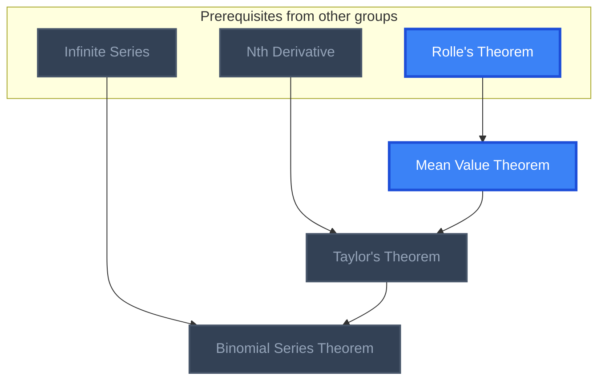

## Rudin Ch. 5: Differentiation
**Mastered:** 0 / 6 · **Discovered:** 6 / 6

```mermaid
flowchart TD
    classDef planned fill:#1E293B,stroke:#64748B,stroke-width:2px,stroke-dasharray:5 5,color:#94A3B8;
    classDef locked fill:#334155,stroke:#475569,stroke-width:2px,color:#94A3B8;
    classDef L0 fill:#F1F5F9,stroke:#94A3B8,stroke-width:2px,color:#000000;
    classDef L1 fill:#22C55E,stroke:#15803D,stroke-width:2px,color:#000000;
    classDef L2 fill:#3B82F6,stroke:#1D4ED8,stroke-width:3px,color:#FFFFFF;
    classDef L3 fill:#A855F7,stroke:#6B21A8,stroke-width:3px,color:#FFFFFF,font-weight:bold;
    classDef L4 fill:#F97316,stroke:#C2410C,stroke-width:4px,color:#000000,font-weight:bold;
    classDef L5 fill:#FFD700,stroke:#FF8C00,stroke-width:5px,color:#000000,font-weight:bold;
    classDef rusty stroke:#8B4513,stroke-width:4px,stroke-dasharray:3 3;
    subgraph sg_prereqs["Prerequisites from other groups"]
        n_derivative["Derivative"]
        n_intermediate_value_theorem["Intermediate Value Theorem"]
        n_simple_discontinuity["Simple Discontinuity"]
        n_monotonic_function["Monotonic Function"]
        n_mean_value_theorem["Mean Value Theorem"]
        n_continuous_function_component_theorem["Continuous Function Component Theorem"]
        n_uniformly_continuous_function["Uniformly Continuous Function"]
    end
    n_darboux_s_theorem["Darboux's Theorem"]
    n_monotonic_function_derivative_theorem["Monotonic Function Derivative Theorem"]
    n_derivative_of_vector_valued_function["Derivative of Vector-Valued Function"]
    n_mean_value_inequality_for_vector_valued_function["Mean Value Inequality for Vector-Valued Function"]
    n_uniformly_differentiable_function["Uniformly Differentiable Function"]
    n_derivative_limit_theorem["Derivative Limit Theorem"]
    n_derivative --> n_darboux_s_theorem
    n_intermediate_value_theorem --> n_darboux_s_theorem
    n_simple_discontinuity --> n_darboux_s_theorem
    n_monotonic_function --> n_monotonic_function_derivative_theorem
    n_mean_value_theorem --> n_monotonic_function_derivative_theorem
    n_derivative --> n_derivative_of_vector_valued_function
    n_continuous_function_component_theorem --> n_derivative_of_vector_valued_function
    n_mean_value_theorem --> n_mean_value_inequality_for_vector_valued_function
    n_derivative_of_vector_valued_function --> n_mean_value_inequality_for_vector_valued_function
    n_derivative --> n_uniformly_differentiable_function
    n_uniformly_continuous_function --> n_uniformly_differentiable_function
    n_mean_value_theorem --> n_derivative_limit_theorem
    n_darboux_s_theorem --> n_derivative_limit_theorem
    class n_intermediate_value_theorem,n_simple_discontinuity,n_monotonic_function,n_continuous_function_component_theorem,n_darboux_s_theorem,n_monotonic_function_derivative_theorem,n_derivative_of_vector_valued_function,n_mean_value_inequality_for_vector_valued_function,n_uniformly_differentiable_function,n_derivative_limit_theorem locked;
    class n_uniformly_continuous_function L0;
    class n_mean_value_theorem L2;
    class n_derivative L3;
    class n_derivative,n_intermediate_value_theorem,n_simple_discontinuity,n_monotonic_function,n_mean_value_theorem,n_continuous_function_component_theorem,n_uniformly_continuous_function,n_darboux_s_theorem,n_monotonic_function_derivative_theorem,n_derivative_of_vector_valued_function,n_mean_value_inequality_for_vector_valued_function,n_uniformly_differentiable_function,n_derivative_limit_theorem internal-link;
```

## Ross Ch. 6: Integration
**Mastered:** 0 / 15 · **Discovered:** 15 / 15

```mermaid
flowchart TD
    classDef planned fill:#1E293B,stroke:#64748B,stroke-width:2px,stroke-dasharray:5 5,color:#94A3B8;
    classDef locked fill:#334155,stroke:#475569,stroke-width:2px,color:#94A3B8;
    classDef L0 fill:#F1F5F9,stroke:#94A3B8,stroke-width:2px,color:#000000;
    classDef L1 fill:#22C55E,stroke:#15803D,stroke-width:2px,color:#000000;
    classDef L2 fill:#3B82F6,stroke:#1D4ED8,stroke-width:3px,color:#FFFFFF;
    classDef L3 fill:#A855F7,stroke:#6B21A8,stroke-width:3px,color:#FFFFFF,font-weight:bold;
    classDef L4 fill:#F97316,stroke:#C2410C,stroke-width:4px,color:#000000,font-weight:bold;
    classDef L5 fill:#FFD700,stroke:#FF8C00,stroke-width:5px,color:#000000,font-weight:bold;
    classDef rusty stroke:#8B4513,stroke-width:4px,stroke-dasharray:3 3;
    subgraph sg_prereqs["Prerequisites from other groups"]
        n_infimum["Infimum"]
        n_supremum["Supremum"]
        n_bounded_function["Bounded Function"]
        n_refinement_of_partition["Refinement of Partition"]
        n_continuous_to_uniformly_continuous_theorem["Continuous to Uniformly Continuous Theorem"]
        n_triangle_inequality["Triangle Inequality"]
        n_uniformly_continuous_function["Uniformly Continuous Function"]
        n_monotonic_function["Monotonic Function"]
        n_uniform_limit_of_integrals_theorem["Uniform Limit of Integrals Theorem"]
        n_sequence_of_function_pointwise_convergence["Sequence of Function Pointwise Convergence"]
    end
    n_integral["Integral"]
    n_darboux_integral["Darboux Integral"]
    n_partition["Partition"]
    n_darboux_sums_of_2_partitions_lemma["Darboux Sums of 2 Partitions Lemma"]
    n_darboux_integrable_theorem["Darboux Integrable Theorem"]
    n_mesh_of_partition["Mesh of Partition"]
    n_riemann_sum["Riemann Sum"]
    n_riemann_integrable_theorem["Riemann Integrable Theorem"]
    n_functions_that_are_riemann_integrable_theorem["Functions that are Riemann Integrable Theorem"]
    n_riemann_integral_triangle_inequality["Riemann Integral Triangle Inequality"]
    n_piecewise_continuous_function["Piecewise Continuous Function"]
    n_piecewise_monotonic_function["Piecewise Monotonic Function"]
    n_interchangeability_of_limit_and_integral_theorem["Interchangeability of Limit and Integral Theorem"]
    n_dominated_convergence_theorem["Dominated Convergence Theorem"]
    n_monotone_convergence_theorem["Monotone Convergence Theorem"]
    n_infimum --> n_darboux_integral
    n_supremum --> n_darboux_integral
    n_bounded_function --> n_darboux_integral
    n_integral --> n_darboux_integral
    n_partition --> n_darboux_integral
    n_darboux_integral --> n_darboux_sums_of_2_partitions_lemma
    n_refinement_of_partition --> n_darboux_sums_of_2_partitions_lemma
    n_darboux_sums_of_2_partitions_lemma --> n_darboux_integrable_theorem
    n_partition --> n_mesh_of_partition
    n_bounded_function --> n_riemann_sum
    n_partition --> n_riemann_sum
    n_darboux_integrable_theorem --> n_riemann_integrable_theorem
    n_mesh_of_partition --> n_riemann_integrable_theorem
    n_riemann_sum --> n_riemann_integrable_theorem
    n_continuous_to_uniformly_continuous_theorem --> n_functions_that_are_riemann_integrable_theorem
    n_darboux_integrable_theorem --> n_functions_that_are_riemann_integrable_theorem
    n_piecewise_continuous_function --> n_functions_that_are_riemann_integrable_theorem
    n_piecewise_monotonic_function --> n_functions_that_are_riemann_integrable_theorem
    n_triangle_inequality --> n_riemann_integral_triangle_inequality
    n_darboux_integral --> n_riemann_integral_triangle_inequality
    n_uniformly_continuous_function --> n_piecewise_continuous_function
    n_partition --> n_piecewise_continuous_function
    n_monotonic_function --> n_piecewise_monotonic_function
    n_partition --> n_piecewise_monotonic_function
    n_uniform_limit_of_integrals_theorem --> n_interchangeability_of_limit_and_integral_theorem
    n_dominated_convergence_theorem --> n_interchangeability_of_limit_and_integral_theorem
    n_monotone_convergence_theorem --> n_interchangeability_of_limit_and_integral_theorem
    n_sequence_of_function_pointwise_convergence --> n_dominated_convergence_theorem
    n_darboux_integral --> n_dominated_convergence_theorem
    n_sequence_of_function_pointwise_convergence --> n_monotone_convergence_theorem
    n_darboux_integral --> n_monotone_convergence_theorem
    class n_continuous_to_uniformly_continuous_theorem,n_triangle_inequality,n_monotonic_function,n_uniform_limit_of_integrals_theorem,n_sequence_of_function_pointwise_convergence,n_darboux_integral,n_darboux_sums_of_2_partitions_lemma,n_darboux_integrable_theorem,n_riemann_integrable_theorem,n_functions_that_are_riemann_integrable_theorem,n_riemann_integral_triangle_inequality,n_piecewise_continuous_function,n_piecewise_monotonic_function,n_interchangeability_of_limit_and_integral_theorem,n_dominated_convergence_theorem,n_monotone_convergence_theorem locked;
    class n_infimum,n_supremum,n_refinement_of_partition,n_uniformly_continuous_function,n_integral,n_mesh_of_partition L0;
    class n_bounded_function,n_partition,n_riemann_sum L2;
    class n_infimum,n_supremum,n_bounded_function,n_refinement_of_partition,n_continuous_to_uniformly_continuous_theorem,n_triangle_inequality,n_uniformly_continuous_function,n_monotonic_function,n_uniform_limit_of_integrals_theorem,n_sequence_of_function_pointwise_convergence,n_integral,n_darboux_integral,n_partition,n_darboux_sums_of_2_partitions_lemma,n_darboux_integrable_theorem,n_mesh_of_partition,n_riemann_sum,n_riemann_integrable_theorem,n_functions_that_are_riemann_integrable_theorem,n_riemann_integral_triangle_inequality,n_piecewise_continuous_function,n_piecewise_monotonic_function,n_interchangeability_of_limit_and_integral_theorem,n_dominated_convergence_theorem,n_monotone_convergence_theorem internal-link;
```

## Rudin Ch. 6: The Riemann-Stieltjes Integral
**Mastered:** 0 / 15 · **Discovered:** 15 / 15

```mermaid
flowchart TD
    classDef planned fill:#1E293B,stroke:#64748B,stroke-width:2px,stroke-dasharray:5 5,color:#94A3B8;
    classDef locked fill:#334155,stroke:#475569,stroke-width:2px,color:#94A3B8;
    classDef L0 fill:#F1F5F9,stroke:#94A3B8,stroke-width:2px,color:#000000;
    classDef L1 fill:#22C55E,stroke:#15803D,stroke-width:2px,color:#000000;
    classDef L2 fill:#3B82F6,stroke:#1D4ED8,stroke-width:3px,color:#FFFFFF;
    classDef L3 fill:#A855F7,stroke:#6B21A8,stroke-width:3px,color:#FFFFFF,font-weight:bold;
    classDef L4 fill:#F97316,stroke:#C2410C,stroke-width:4px,color:#000000,font-weight:bold;
    classDef L5 fill:#FFD700,stroke:#FF8C00,stroke-width:5px,color:#000000,font-weight:bold;
    classDef rusty stroke:#8B4513,stroke-width:4px,stroke-dasharray:3 3;
    subgraph sg_prereqs["Prerequisites from other groups"]
        n_monotonic_function["Monotonic Function"]
        n_darboux_integral["Darboux Integral"]
        n_partition["Partition"]
        n_darboux_sums_of_2_partitions_lemma["Darboux Sums of 2 Partitions Lemma"]
        n_continuous_to_uniformly_continuous_theorem["Continuous to Uniformly Continuous Theorem"]
        n_discontinuity["Discontinuity"]
        n_heaviside_function["Heaviside Function"]
        n_mean_value_theorem["Mean Value Theorem"]
        n_fundamental_theorem_of_calculus["Fundamental Theorem of Calculus"]
        n_curve["Curve"]
        n_p_series["p-Series"]
        n_function["Function"]
        n_continuous_function["Continuous Function"]
    end
    n_riemann_stieltjes_integral["Riemann-Stieltjes Integral"]
    n_refinement_of_partition["Refinement of Partition"]
    n_riemann_stieltjes_integrable_theorem["Riemann-Stieltjes Integrable Theorem"]
    n_functions_that_are_riemann_stieltjes_integrable_theorem["Functions that are Riemann-Stieltjes Integrable Theorem"]
    n_riemann_stieltjes_integral_basic_properties["Riemann-Stieltjes Integral Basic Properties"]
    n_riemann_stieltjes_integral_with_step_function_integrator_theorem["Riemann-Stieltjes Integral with Step Function Integrator Theorem"]
    n_riemann_stieltjes_integral_with_differentiable_integrator_theorem["Riemann-Stieltjes Integral with Differentiable Integrator Theorem"]
    n_riemann_stieltjes_integral_change_of_variable_theorem["Riemann-Stieltjes Integral Change of Variable Theorem"]
    n_riemann_stieltjes_integral_of_vector_valued_function["Riemann-Stieltjes Integral of Vector-Valued Function"]
    n_arc["Arc"]
    n_rectifiable_curve["Rectifiable Curve"]
    n_young_s_inequality["Young's Inequality"]
    n_riemann_zeta_function["Riemann Zeta Function"]
    n_convex_function["Convex Function"]
    n_convex_function_basic_properties["Convex Function Basic Properties"]
    n_monotonic_function --> n_riemann_stieltjes_integral
    n_darboux_integral --> n_riemann_stieltjes_integral
    n_partition --> n_refinement_of_partition
    n_darboux_sums_of_2_partitions_lemma --> n_riemann_stieltjes_integrable_theorem
    n_riemann_stieltjes_integral --> n_riemann_stieltjes_integrable_theorem
    n_continuous_to_uniformly_continuous_theorem --> n_functions_that_are_riemann_stieltjes_integrable_theorem
    n_discontinuity --> n_functions_that_are_riemann_stieltjes_integrable_theorem
    n_riemann_stieltjes_integrable_theorem --> n_functions_that_are_riemann_stieltjes_integrable_theorem
    n_riemann_stieltjes_integrable_theorem --> n_riemann_stieltjes_integral_basic_properties
    n_heaviside_function --> n_riemann_stieltjes_integral_with_step_function_integrator_theorem
    n_riemann_stieltjes_integral --> n_riemann_stieltjes_integral_with_step_function_integrator_theorem
    n_mean_value_theorem --> n_riemann_stieltjes_integral_with_differentiable_integrator_theorem
    n_riemann_stieltjes_integrable_theorem --> n_riemann_stieltjes_integral_with_differentiable_integrator_theorem
    n_riemann_stieltjes_integral_with_differentiable_integrator_theorem --> n_riemann_stieltjes_integral_change_of_variable_theorem
    n_fundamental_theorem_of_calculus --> n_riemann_stieltjes_integral_of_vector_valued_function
    n_riemann_stieltjes_integral_basic_properties --> n_riemann_stieltjes_integral_of_vector_valued_function
    n_curve --> n_arc
    n_curve --> n_rectifiable_curve
    n_riemann_stieltjes_integral_of_vector_valued_function --> n_rectifiable_curve
    n_convex_function --> n_young_s_inequality
    n_p_series --> n_riemann_zeta_function
    n_function --> n_convex_function
    n_continuous_function --> n_convex_function_basic_properties
    n_convex_function --> n_convex_function_basic_properties
    class n_monotonic_function,n_darboux_integral,n_darboux_sums_of_2_partitions_lemma,n_continuous_to_uniformly_continuous_theorem,n_fundamental_theorem_of_calculus,n_curve,n_p_series,n_riemann_stieltjes_integral,n_riemann_stieltjes_integrable_theorem,n_functions_that_are_riemann_stieltjes_integrable_theorem,n_riemann_stieltjes_integral_basic_properties,n_riemann_stieltjes_integral_with_step_function_integrator_theorem,n_riemann_stieltjes_integral_with_differentiable_integrator_theorem,n_riemann_stieltjes_integral_change_of_variable_theorem,n_riemann_stieltjes_integral_of_vector_valued_function,n_arc,n_rectifiable_curve,n_young_s_inequality,n_riemann_zeta_function,n_convex_function_basic_properties locked;
    class n_discontinuity,n_heaviside_function,n_refinement_of_partition,n_convex_function L0;
    class n_partition,n_mean_value_theorem L2;
    class n_function,n_continuous_function L3;
    class n_monotonic_function,n_darboux_integral,n_partition,n_darboux_sums_of_2_partitions_lemma,n_continuous_to_uniformly_continuous_theorem,n_discontinuity,n_heaviside_function,n_mean_value_theorem,n_fundamental_theorem_of_calculus,n_curve,n_p_series,n_function,n_continuous_function,n_riemann_stieltjes_integral,n_refinement_of_partition,n_riemann_stieltjes_integrable_theorem,n_functions_that_are_riemann_stieltjes_integrable_theorem,n_riemann_stieltjes_integral_basic_properties,n_riemann_stieltjes_integral_with_step_function_integrator_theorem,n_riemann_stieltjes_integral_with_differentiable_integrator_theorem,n_riemann_stieltjes_integral_change_of_variable_theorem,n_riemann_stieltjes_integral_of_vector_valued_function,n_arc,n_rectifiable_curve,n_young_s_inequality,n_riemann_zeta_function,n_convex_function,n_convex_function_basic_properties internal-link;
```

## Rudin Ch. 7: Sequences and Series of Functions
**Mastered:** 0 / 17 · **Discovered:** 17 / 17

```mermaid
flowchart TD
    classDef planned fill:#1E293B,stroke:#64748B,stroke-width:2px,stroke-dasharray:5 5,color:#94A3B8;
    classDef locked fill:#334155,stroke:#475569,stroke-width:2px,color:#94A3B8;
    classDef L0 fill:#F1F5F9,stroke:#94A3B8,stroke-width:2px,color:#000000;
    classDef L1 fill:#22C55E,stroke:#15803D,stroke-width:2px,color:#000000;
    classDef L2 fill:#3B82F6,stroke:#1D4ED8,stroke-width:3px,color:#FFFFFF;
    classDef L3 fill:#A855F7,stroke:#6B21A8,stroke-width:3px,color:#FFFFFF,font-weight:bold;
    classDef L4 fill:#F97316,stroke:#C2410C,stroke-width:4px,color:#000000,font-weight:bold;
    classDef L5 fill:#FFD700,stroke:#FF8C00,stroke-width:5px,color:#000000,font-weight:bold;
    classDef rusty stroke:#8B4513,stroke-width:4px,stroke-dasharray:3 3;
    subgraph sg_prereqs["Prerequisites from other groups"]
        n_limit_point["Limit Point"]
        n_cauchy_criterion_for_uniform_convergence_theorem["Cauchy Criterion for Uniform Convergence Theorem"]
        n_compact_set["Compact Set"]
        n_sequence_of_function_uniform_convergence["Sequence of Function Uniform Convergence"]
        n_supremum_norm["Supremum Norm"]
        n_complete_metric_space["Complete Metric Space"]
        n_bounded_function["Bounded Function"]
        n_uniform_limit_of_continuous_functions_theorem["Uniform Limit of Continuous Functions Theorem"]
        n_mean_value_theorem["Mean Value Theorem"]
        n_weierstrass_m_test["Weierstrass M-Test"]
        n_bounded_sequence["Bounded Sequence"]
        n_sequence_of_function["Sequence of Function"]
        n_uniformly_continuous_function["Uniformly Continuous Function"]
        n_countable_set["Countable Set"]
        n_bolzano_weierstrass_theorem["Bolzano-Weierstrass Theorem"]
        n_compact_metric_space["Compact Metric Space"]
        n_separable_metric_space["Separable Metric Space"]
        n_polynomial["Polynomial"]
        n_dense_subset["Dense Subset"]
        n_complex_conjugate["Complex Conjugate"]
        n_monotonic_function["Monotonic Function"]
    end
    n_uniform_convergence_interchange_of_limits_theorem["Uniform Convergence Interchange of Limits Theorem"]
    n_dini_s_theorem["Dini's Theorem"]
    n_space_of_bounded_continuous_functions["Space of Bounded Continuous Functions"]
    n_uniform_limit_of_derivatives_theorem["Uniform Limit of Derivatives Theorem"]
    n_continuous_nowhere_differentiable_function_theorem["Continuous Nowhere Differentiable Function Theorem"]
    n_sequence_of_function_pointwise_bounded["Sequence of Function Pointwise Bounded"]
    n_sequence_of_function_uniformly_bounded["Sequence of Function Uniformly Bounded"]
    n_equicontinuity["Equicontinuity"]
    n_pointwise_bounded_sequence_countable_set_subsequence_theorem["Pointwise Bounded Sequence Countable Set Subsequence Theorem"]
    n_arzel_ascoli_theorem["Arzelà-Ascoli Theorem"]
    n_weierstrass_approximation_theorem["Weierstrass Approximation Theorem"]
    n_algebra_of_functions["Algebra of Functions"]
    n_point_separating_family_of_functions["Point-Separating Family of Functions"]
    n_stone_weierstrass_theorem["Stone-Weierstrass Theorem"]
    n_self_adjoint_algebra_of_functions["Self-Adjoint Algebra of Functions"]
    n_helly_s_selection_theorem["Helly's Selection Theorem"]
    n_completion_of_metric_space["Completion of Metric Space"]
    n_limit_point --> n_uniform_convergence_interchange_of_limits_theorem
    n_cauchy_criterion_for_uniform_convergence_theorem --> n_uniform_convergence_interchange_of_limits_theorem
    n_compact_set --> n_dini_s_theorem
    n_sequence_of_function_uniform_convergence --> n_dini_s_theorem
    n_supremum_norm --> n_space_of_bounded_continuous_functions
    n_complete_metric_space --> n_space_of_bounded_continuous_functions
    n_bounded_function --> n_space_of_bounded_continuous_functions
    n_uniform_limit_of_continuous_functions_theorem --> n_space_of_bounded_continuous_functions
    n_cauchy_criterion_for_uniform_convergence_theorem --> n_space_of_bounded_continuous_functions
    n_mean_value_theorem --> n_uniform_limit_of_derivatives_theorem
    n_uniform_convergence_interchange_of_limits_theorem --> n_uniform_limit_of_derivatives_theorem
    n_uniform_limit_of_continuous_functions_theorem --> n_continuous_nowhere_differentiable_function_theorem
    n_weierstrass_m_test --> n_continuous_nowhere_differentiable_function_theorem
    n_bounded_sequence --> n_sequence_of_function_pointwise_bounded
    n_sequence_of_function --> n_sequence_of_function_pointwise_bounded
    n_sequence_of_function_pointwise_bounded --> n_sequence_of_function_uniformly_bounded
    n_uniformly_continuous_function --> n_equicontinuity
    n_sequence_of_function --> n_equicontinuity
    n_countable_set --> n_pointwise_bounded_sequence_countable_set_subsequence_theorem
    n_bolzano_weierstrass_theorem --> n_pointwise_bounded_sequence_countable_set_subsequence_theorem
    n_sequence_of_function_pointwise_bounded --> n_pointwise_bounded_sequence_countable_set_subsequence_theorem
    n_compact_metric_space --> n_arzel_ascoli_theorem
    n_separable_metric_space --> n_arzel_ascoli_theorem
    n_space_of_bounded_continuous_functions --> n_arzel_ascoli_theorem
    n_sequence_of_function_uniformly_bounded --> n_arzel_ascoli_theorem
    n_equicontinuity --> n_arzel_ascoli_theorem
    n_pointwise_bounded_sequence_countable_set_subsequence_theorem --> n_arzel_ascoli_theorem
    n_polynomial --> n_weierstrass_approximation_theorem
    n_dense_subset --> n_weierstrass_approximation_theorem
    n_space_of_bounded_continuous_functions --> n_weierstrass_approximation_theorem
    n_space_of_bounded_continuous_functions --> n_algebra_of_functions
    n_algebra_of_functions --> n_point_separating_family_of_functions
    n_compact_set --> n_stone_weierstrass_theorem
    n_weierstrass_approximation_theorem --> n_stone_weierstrass_theorem
    n_point_separating_family_of_functions --> n_stone_weierstrass_theorem
    n_self_adjoint_algebra_of_functions --> n_stone_weierstrass_theorem
    n_complex_conjugate --> n_self_adjoint_algebra_of_functions
    n_algebra_of_functions --> n_self_adjoint_algebra_of_functions
    n_monotonic_function --> n_helly_s_selection_theorem
    n_pointwise_bounded_sequence_countable_set_subsequence_theorem --> n_helly_s_selection_theorem
    n_complete_metric_space --> n_completion_of_metric_space
    n_dense_subset --> n_completion_of_metric_space
    class n_limit_point,n_cauchy_criterion_for_uniform_convergence_theorem,n_compact_set,n_sequence_of_function_uniform_convergence,n_supremum_norm,n_complete_metric_space,n_uniform_limit_of_continuous_functions_theorem,n_weierstrass_m_test,n_bounded_sequence,n_sequence_of_function,n_bolzano_weierstrass_theorem,n_compact_metric_space,n_separable_metric_space,n_dense_subset,n_complex_conjugate,n_monotonic_function,n_uniform_convergence_interchange_of_limits_theorem,n_dini_s_theorem,n_space_of_bounded_continuous_functions,n_uniform_limit_of_derivatives_theorem,n_continuous_nowhere_differentiable_function_theorem,n_sequence_of_function_pointwise_bounded,n_sequence_of_function_uniformly_bounded,n_equicontinuity,n_pointwise_bounded_sequence_countable_set_subsequence_theorem,n_arzel_ascoli_theorem,n_weierstrass_approximation_theorem,n_algebra_of_functions,n_point_separating_family_of_functions,n_stone_weierstrass_theorem,n_self_adjoint_algebra_of_functions,n_helly_s_selection_theorem,n_completion_of_metric_space locked;
    class n_uniformly_continuous_function,n_countable_set L0;
    class n_bounded_function,n_mean_value_theorem,n_polynomial L2;
    class n_limit_point,n_cauchy_criterion_for_uniform_convergence_theorem,n_compact_set,n_sequence_of_function_uniform_convergence,n_supremum_norm,n_complete_metric_space,n_bounded_function,n_uniform_limit_of_continuous_functions_theorem,n_mean_value_theorem,n_weierstrass_m_test,n_bounded_sequence,n_sequence_of_function,n_uniformly_continuous_function,n_countable_set,n_bolzano_weierstrass_theorem,n_compact_metric_space,n_separable_metric_space,n_polynomial,n_dense_subset,n_complex_conjugate,n_monotonic_function,n_uniform_convergence_interchange_of_limits_theorem,n_dini_s_theorem,n_space_of_bounded_continuous_functions,n_uniform_limit_of_derivatives_theorem,n_continuous_nowhere_differentiable_function_theorem,n_sequence_of_function_pointwise_bounded,n_sequence_of_function_uniformly_bounded,n_equicontinuity,n_pointwise_bounded_sequence_countable_set_subsequence_theorem,n_arzel_ascoli_theorem,n_weierstrass_approximation_theorem,n_algebra_of_functions,n_point_separating_family_of_functions,n_stone_weierstrass_theorem,n_self_adjoint_algebra_of_functions,n_helly_s_selection_theorem,n_completion_of_metric_space internal-link;
```

## Rudin Ch. 8: Some Special Functions
**Mastered:** 0 / 7 · **Discovered:** 2 / 7

```mermaid
flowchart TD
    classDef planned fill:#1E293B,stroke:#64748B,stroke-width:2px,stroke-dasharray:5 5,color:#94A3B8;
    classDef locked fill:#334155,stroke:#475569,stroke-width:2px,color:#94A3B8;
    classDef L0 fill:#F1F5F9,stroke:#94A3B8,stroke-width:2px,color:#000000;
    classDef L1 fill:#22C55E,stroke:#15803D,stroke-width:2px,color:#000000;
    classDef L2 fill:#3B82F6,stroke:#1D4ED8,stroke-width:3px,color:#FFFFFF;
    classDef L3 fill:#A855F7,stroke:#6B21A8,stroke-width:3px,color:#FFFFFF,font-weight:bold;
    classDef L4 fill:#F97316,stroke:#C2410C,stroke-width:4px,color:#000000,font-weight:bold;
    classDef L5 fill:#FFD700,stroke:#FF8C00,stroke-width:5px,color:#000000,font-weight:bold;
    classDef rusty stroke:#8B4513,stroke-width:4px,stroke-dasharray:3 3;
    subgraph sg_prereqs["Prerequisites from other groups"]
        n_weierstrass_m_test["Weierstrass M-Test"]
        n_limit_point["Limit Point"]
        n_power_series_derivative["Power Series Derivative"]
        n_polynomial["Polynomial"]
        n_trigonometric_function["Trigonometric Function"]
        n_convex_function["Convex Function"]
        n_improper_riemann_integral["Improper Riemann Integral"]
    end
    n_stirling_s_approximation["Stirling's Approximation"]
    n_double_series_interchange_theorem["Double Series Interchange Theorem"]
    n_power_series_identity_theorem["Power Series Identity Theorem"]
    n_trigonometric_polynomial["Trigonometric Polynomial"]
    n_beta_function["Beta Function"]
    n_bohr_mollerup_theorem["Bohr-Mollerup Theorem"]
    n_gamma_function["Gamma Function"]
    n_gamma_function --> n_stirling_s_approximation
    n_weierstrass_m_test --> n_double_series_interchange_theorem
    n_limit_point --> n_power_series_identity_theorem
    n_power_series_derivative --> n_power_series_identity_theorem
    n_polynomial --> n_trigonometric_polynomial
    n_trigonometric_function --> n_trigonometric_polynomial
    n_gamma_function --> n_beta_function
    n_convex_function --> n_bohr_mollerup_theorem
    n_gamma_function --> n_bohr_mollerup_theorem
    n_improper_riemann_integral --> n_gamma_function
    class n_double_series_interchange_theorem,n_power_series_identity_theorem,n_trigonometric_polynomial,n_beta_function,n_bohr_mollerup_theorem planned;
    class n_weierstrass_m_test,n_limit_point,n_power_series_derivative,n_stirling_s_approximation,n_gamma_function locked;
    class n_convex_function,n_improper_riemann_integral L0;
    class n_polynomial L2;
    class n_trigonometric_function L3;
    class n_weierstrass_m_test,n_limit_point,n_power_series_derivative,n_polynomial,n_trigonometric_function,n_convex_function,n_improper_riemann_integral,n_stirling_s_approximation,n_gamma_function internal-link;
```

## Rudin Ch. 9: Functions of Several Variables
**Mastered:** 0 / 7 · **Discovered:** 2 / 7

```mermaid
flowchart TD
    classDef planned fill:#1E293B,stroke:#64748B,stroke-width:2px,stroke-dasharray:5 5,color:#94A3B8;
    classDef locked fill:#334155,stroke:#475569,stroke-width:2px,color:#94A3B8;
    classDef L0 fill:#F1F5F9,stroke:#94A3B8,stroke-width:2px,color:#000000;
    classDef L1 fill:#22C55E,stroke:#15803D,stroke-width:2px,color:#000000;
    classDef L2 fill:#3B82F6,stroke:#1D4ED8,stroke-width:3px,color:#FFFFFF;
    classDef L3 fill:#A855F7,stroke:#6B21A8,stroke-width:3px,color:#FFFFFF,font-weight:bold;
    classDef L4 fill:#F97316,stroke:#C2410C,stroke-width:4px,color:#000000,font-weight:bold;
    classDef L5 fill:#FFD700,stroke:#FF8C00,stroke-width:5px,color:#000000,font-weight:bold;
    classDef rusty stroke:#8B4513,stroke-width:4px,stroke-dasharray:3 3;
    subgraph sg_prereqs["Prerequisites from other groups"]
        n_linear_map["Linear Map"]
        n_operator_norm["Operator Norm"]
        n_partial_derivative["Partial Derivative"]
        n_lipschitz_continuity["Lipschitz Continuity"]
        n_complete_metric_space["Complete Metric Space"]
        n_inverse_function_theorem["Inverse Function Theorem"]
        n_rank["Rank"]
        n_continuous_to_uniformly_continuous_theorem["Continuous to Uniformly Continuous Theorem"]
        n_riemann_stieltjes_integral_basic_properties["Riemann-Stieltjes Integral Basic Properties"]
    end
    n_total_derivative["Total Derivative"]
    n_total_derivative_chain_rule["Total Derivative Chain Rule"]
    n_contraction["Contraction"]
    n_banach_fixed_point_theorem["Banach Fixed-Point Theorem"]
    n_implicit_function_theorem["Implicit Function Theorem"]
    n_rank_theorem["Rank Theorem"]
    n_leibniz_integral_rule["Leibniz Integral Rule"]
    n_linear_map --> n_total_derivative
    n_operator_norm --> n_total_derivative
    n_partial_derivative --> n_total_derivative
    n_total_derivative --> n_total_derivative_chain_rule
    n_lipschitz_continuity --> n_contraction
    n_complete_metric_space --> n_banach_fixed_point_theorem
    n_contraction --> n_banach_fixed_point_theorem
    n_inverse_function_theorem --> n_implicit_function_theorem
    n_total_derivative --> n_implicit_function_theorem
    n_inverse_function_theorem --> n_rank_theorem
    n_rank --> n_rank_theorem
    n_total_derivative --> n_rank_theorem
    n_partial_derivative --> n_leibniz_integral_rule
    n_continuous_to_uniformly_continuous_theorem --> n_leibniz_integral_rule
    n_riemann_stieltjes_integral_basic_properties --> n_leibniz_integral_rule
    class n_total_derivative,n_total_derivative_chain_rule,n_implicit_function_theorem,n_rank_theorem,n_leibniz_integral_rule planned;
    class n_linear_map,n_operator_norm,n_lipschitz_continuity,n_complete_metric_space,n_inverse_function_theorem,n_rank,n_continuous_to_uniformly_continuous_theorem,n_riemann_stieltjes_integral_basic_properties,n_contraction,n_banach_fixed_point_theorem locked;
    class n_partial_derivative L0;
    class n_linear_map,n_operator_norm,n_partial_derivative,n_lipschitz_continuity,n_complete_metric_space,n_inverse_function_theorem,n_rank,n_continuous_to_uniformly_continuous_theorem,n_riemann_stieltjes_integral_basic_properties,n_contraction,n_banach_fixed_point_theorem internal-link;
```

## Rudin Ch. 10: Integration of Differential Forms
**Mastered:** 0 / 4 · **Discovered:** 0 / 4

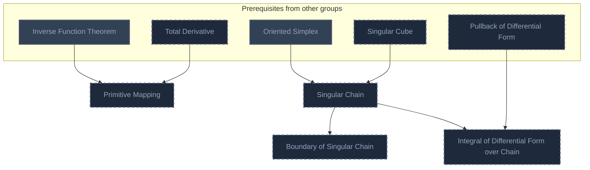

## Rudin Ch. 11: The Lebesgue Theory
**Mastered:** 0 / 8 · **Discovered:** 0 / 8

```mermaid
flowchart TD
    classDef planned fill:#1E293B,stroke:#64748B,stroke-width:2px,stroke-dasharray:5 5,color:#94A3B8;
    classDef locked fill:#334155,stroke:#475569,stroke-width:2px,color:#94A3B8;
    classDef L0 fill:#F1F5F9,stroke:#94A3B8,stroke-width:2px,color:#000000;
    classDef L1 fill:#22C55E,stroke:#15803D,stroke-width:2px,color:#000000;
    classDef L2 fill:#3B82F6,stroke:#1D4ED8,stroke-width:3px,color:#FFFFFF;
    classDef L3 fill:#A855F7,stroke:#6B21A8,stroke-width:3px,color:#FFFFFF,font-weight:bold;
    classDef L4 fill:#F97316,stroke:#C2410C,stroke-width:4px,color:#000000,font-weight:bold;
    classDef L5 fill:#FFD700,stroke:#FF8C00,stroke-width:5px,color:#000000,font-weight:bold;
    classDef rusty stroke:#8B4513,stroke-width:4px,stroke-dasharray:3 3;
    subgraph sg_prereqs["Prerequisites from other groups"]
        n_borel_sigma_algebra["Borel Sigma-Algebra"]
        n_measurable_space["Measurable Space"]
        n_extended_real_number_set["Extended Real Number Set"]
        n_lebesgue_integral_measure_theory["Lebesgue Integral (Measure Theory)"]
        n_limit_infimum["Limit Infimum"]
        n_almost_everywhere["Almost Everywhere"]
        n_discontinuity["Discontinuity"]
        n_darboux_integrable_theorem["Darboux Integrable Theorem"]
        n_hilbert_space["Hilbert Space"]
        n_complete_metric_space["Complete Metric Space"]
    end
    n_measurable_function["Measurable Function"]
    n_simple_function["Simple Function"]
    n_lebesgue_monotone_convergence_theorem["Lebesgue Monotone Convergence Theorem"]
    n_fatou_s_lemma["Fatou's Lemma"]
    n_lebesgue_dominated_convergence_theorem["Lebesgue Dominated Convergence Theorem"]
    n_lebesgue_criterion_for_riemann_integrability["Lebesgue Criterion for Riemann Integrability"]
    n_l2_space["L2 Space"]
    n_riesz_fischer_theorem["Riesz-Fischer Theorem"]
    n_borel_sigma_algebra --> n_measurable_function
    n_measurable_space --> n_measurable_function
    n_extended_real_number_set --> n_measurable_function
    n_measurable_function --> n_simple_function
    n_lebesgue_integral_measure_theory --> n_lebesgue_monotone_convergence_theorem
    n_limit_infimum --> n_fatou_s_lemma
    n_lebesgue_monotone_convergence_theorem --> n_fatou_s_lemma
    n_fatou_s_lemma --> n_lebesgue_dominated_convergence_theorem
    n_almost_everywhere --> n_lebesgue_criterion_for_riemann_integrability
    n_discontinuity --> n_lebesgue_criterion_for_riemann_integrability
    n_darboux_integrable_theorem --> n_lebesgue_criterion_for_riemann_integrability
    n_hilbert_space --> n_l2_space
    n_lebesgue_integral_measure_theory --> n_l2_space
    n_complete_metric_space --> n_riesz_fischer_theorem
    n_lebesgue_monotone_convergence_theorem --> n_riesz_fischer_theorem
    n_l2_space --> n_riesz_fischer_theorem
    class n_measurable_function,n_simple_function,n_lebesgue_monotone_convergence_theorem,n_fatou_s_lemma,n_lebesgue_dominated_convergence_theorem,n_lebesgue_criterion_for_riemann_integrability,n_l2_space,n_riesz_fischer_theorem planned;
    class n_borel_sigma_algebra,n_measurable_space,n_extended_real_number_set,n_lebesgue_integral_measure_theory,n_limit_infimum,n_almost_everywhere,n_darboux_integrable_theorem,n_hilbert_space,n_complete_metric_space locked;
    class n_discontinuity L0;
    class n_borel_sigma_algebra,n_measurable_space,n_extended_real_number_set,n_lebesgue_integral_measure_theory,n_limit_infimum,n_almost_everywhere,n_discontinuity,n_darboux_integrable_theorem,n_hilbert_space,n_complete_metric_space internal-link;
```

## Spivak Ch. 1: Functions on Euclidean Space
**Mastered:** 0 / 1 · **Discovered:** 0 / 1

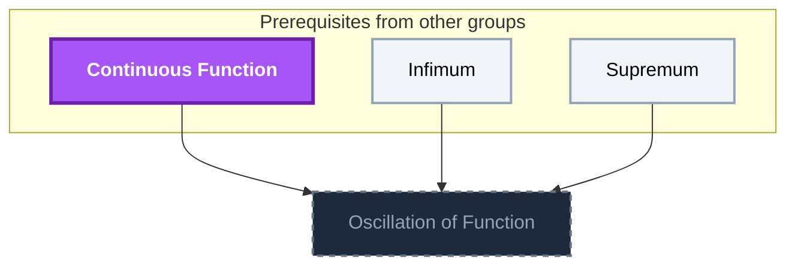

## Spivak Ch. 3: Integration
**Mastered:** 0 / 2 · **Discovered:** 0 / 2

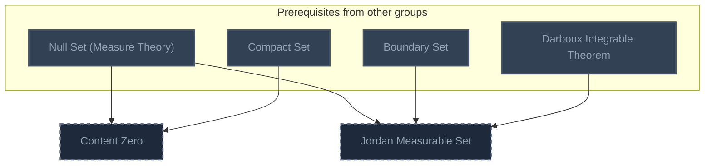

## Spivak Ch. 4: Integration on Chains
**Mastered:** 0 / 2 · **Discovered:** 0 / 2

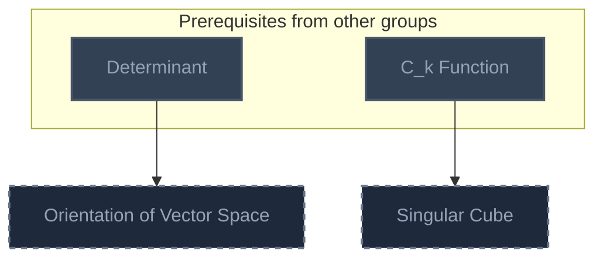

## Spivak Ch. 5: Integration on Manifolds
**Mastered:** 0 / 3 · **Discovered:** 1 / 3

```mermaid
flowchart TD
    classDef planned fill:#1E293B,stroke:#64748B,stroke-width:2px,stroke-dasharray:5 5,color:#94A3B8;
    classDef locked fill:#334155,stroke:#475569,stroke-width:2px,color:#94A3B8;
    classDef L0 fill:#F1F5F9,stroke:#94A3B8,stroke-width:2px,color:#000000;
    classDef L1 fill:#22C55E,stroke:#15803D,stroke-width:2px,color:#000000;
    classDef L2 fill:#3B82F6,stroke:#1D4ED8,stroke-width:3px,color:#FFFFFF;
    classDef L3 fill:#A855F7,stroke:#6B21A8,stroke-width:3px,color:#FFFFFF,font-weight:bold;
    classDef L4 fill:#F97316,stroke:#C2410C,stroke-width:4px,color:#000000,font-weight:bold;
    classDef L5 fill:#FFD700,stroke:#FF8C00,stroke-width:5px,color:#000000,font-weight:bold;
    classDef rusty stroke:#8B4513,stroke-width:4px,stroke-dasharray:3 3;
    subgraph sg_prereqs["Prerequisites from other groups"]
        n_differential_form["Differential Form"]
        n_orientable_manifold["Orientable Manifold"]
        n_partition_of_unity["Partition of Unity"]
        n_generalized_stokes_theorem["Generalized Stokes' Theorem"]
        n_analytic_function["Analytic Function"]
        n_taylor_series["Taylor Series"]
    end
    n_volume_element["Volume Element"]
    n_stokes_theorem_on_manifolds["Stokes' Theorem on Manifolds"]
    n_real_analytic_function["Real Analytic Function"]
    n_differential_form --> n_volume_element
    n_orientable_manifold --> n_volume_element
    n_partition_of_unity --> n_stokes_theorem_on_manifolds
    n_generalized_stokes_theorem --> n_stokes_theorem_on_manifolds
    n_orientable_manifold --> n_stokes_theorem_on_manifolds
    n_analytic_function --> n_real_analytic_function
    n_taylor_series --> n_real_analytic_function
    class n_orientable_manifold,n_partition_of_unity,n_generalized_stokes_theorem,n_volume_element,n_stokes_theorem_on_manifolds planned;
    class n_differential_form,n_analytic_function,n_taylor_series,n_real_analytic_function locked;
    class n_differential_form,n_analytic_function,n_taylor_series,n_real_analytic_function internal-link;
```

## Fourier Analysis
**Mastered:** 0 / 4 · **Discovered:** 4 / 4

```mermaid
flowchart TD
    classDef planned fill:#1E293B,stroke:#64748B,stroke-width:2px,stroke-dasharray:5 5,color:#94A3B8;
    classDef locked fill:#334155,stroke:#475569,stroke-width:2px,color:#94A3B8;
    classDef L0 fill:#F1F5F9,stroke:#94A3B8,stroke-width:2px,color:#000000;
    classDef L1 fill:#22C55E,stroke:#15803D,stroke-width:2px,color:#000000;
    classDef L2 fill:#3B82F6,stroke:#1D4ED8,stroke-width:3px,color:#FFFFFF;
    classDef L3 fill:#A855F7,stroke:#6B21A8,stroke-width:3px,color:#FFFFFF,font-weight:bold;
    classDef L4 fill:#F97316,stroke:#C2410C,stroke-width:4px,color:#000000,font-weight:bold;
    classDef L5 fill:#FFD700,stroke:#FF8C00,stroke-width:5px,color:#000000,font-weight:bold;
    classDef rusty stroke:#8B4513,stroke-width:4px,stroke-dasharray:3 3;
    subgraph sg_prereqs["Prerequisites from other groups"]
        n_periodic_function["Periodic Function"]
        n_imaginary_unit["Imaginary Unit"]
        n_series["Series"]
        n_sinusoid_signal_processing["Sinusoid (Signal Processing)"]
        n_spatial_frequency["Spatial Frequency"]
    end
    n_fourier_series["Fourier Series"]
    n_fourier_sine_series["Fourier Sine Series"]
    n_fourier_cosine_series["Fourier Cosine Series"]
    n_fourier_transform["Fourier Transform"]
    n_periodic_function --> n_fourier_series
    n_imaginary_unit --> n_fourier_series
    n_series --> n_fourier_series
    n_sinusoid_signal_processing --> n_fourier_series
    n_fourier_series --> n_fourier_sine_series
    n_fourier_series --> n_fourier_cosine_series
    n_spatial_frequency --> n_fourier_transform
    class n_series,n_spatial_frequency,n_fourier_series,n_fourier_sine_series,n_fourier_cosine_series,n_fourier_transform locked;
    class n_periodic_function,n_imaginary_unit,n_sinusoid_signal_processing L0;
    class n_periodic_function,n_imaginary_unit,n_series,n_sinusoid_signal_processing,n_spatial_frequency,n_fourier_series,n_fourier_sine_series,n_fourier_cosine_series,n_fourier_transform internal-link;
```

# Source
Graph structure: the single source for the diagrams above, edited by `/note` and `Scripts/skill_trees.py` (`add`, `edge`, `rename`). Everything above this heading is regenerated by `render`.

```skilltree
    %% PREREQUISITES
    n_absolute_value["Absolute Value"]
    n_almost_everywhere["Almost Everywhere"]
    n_borel_sigma_algebra["Borel Sigma-Algebra"]
    n_c_k_function["C_k Function"]
    n_complex_conjugate["Complex Conjugate"]
    n_continuous_function["Continuous Function"]
    n_countable_set["Countable Set"]
    n_curve["Curve"]
    n_decreasing_function["Decreasing Function"]
    n_derivative["Derivative"]
    n_determinant["Determinant"]
    n_differential_form["Differential Form"]
    n_euclidean_n_space["Euclidean n-Space"]
    n_field["Field"]
    n_function["Function"]
    n_fundamental_theorem_of_calculus["Fundamental Theorem of Calculus"]
    n_heaviside_function["Heaviside Function"]
    n_hilbert_space["Hilbert Space"]
    n_increasing_function["Increasing Function"]
    n_inverse_function_theorem["Inverse Function Theorem"]
    n_limit_of_function["Limit of Function"]
    n_linear_map["Linear Map"]
    n_measurable_space["Measurable Space"]
    n_nth_derivative["Nth Derivative"]
    n_null_set_measure_theory["Null Set (Measure Theory)"]
    n_one_sided_limit_of_function["One-Sided Limit of Function"]
    n_operator_norm["Operator Norm"]
    n_oriented_simplex["Oriented Simplex"]
    n_partial_derivative["Partial Derivative"]
    n_polynomial["Polynomial"]
    n_polynomial_function["Polynomial Function"]
    n_power_series["Power Series"]
    n_proof_by_induction["Proof by Induction"]
    n_rank["Rank"]
    n_rational_number["Rational Number"]
    n_real_number["Real Number"]
    n_relation["Relation"]
    n_riemann_integral["Riemann Integral"]
    n_rolle_s_theorem["Rolle's Theorem"]
    n_supremum_norm["Supremum Norm"]
    n_trigonometric_function["Trigonometric Function"]
    n_partition_of_unity["Partition of Unity"]
    n_pullback_of_differential_form["Pullback of Differential Form"]
    n_generalized_stokes_theorem["Generalized Stokes' Theorem"]
    n_orientable_manifold["Orientable Manifold"]
    n_analytic_function["Analytic Function"]
    n_taylor_series["Taylor Series"]
    n_improper_riemann_integral["Improper Riemann Integral"]
    n_lebesgue_integral_measure_theory["Lebesgue Integral (Measure Theory)"]
    n_set_complement["Set Complement"]
    n_periodic_function["Periodic Function"]
    n_imaginary_unit["Imaginary Unit"]
    n_sinusoid_signal_processing["Sinusoid (Signal Processing)"]
    n_spatial_frequency["Spatial Frequency"]
    %% NODES
    %% == Ross Ch. 1: Introduction ==
    n_peano_axioms["Peano Axioms"]
    n_set_of_integers["Set of Integers"]
    n_set_of_rational_numbers["Set of Rational Numbers"]
    n_set_of_real_numbers["Set of Real Numbers"]
    n_algebraic_number["Algebraic Number"]
    n_ordered_field["Ordered Field"]
    n_ordered_field_basic_properties["Ordered Field Basic Properties"]
    n_absolute_value_non_negativity["Absolute Value Non-negativity"]
    n_triangle_inequality["Triangle Inequality"]
    n_maximum["Maximum"]
    n_minimum["Minimum"]
    n_set_maximum["Set Maximum"]
    n_set_minimum["Set Minimum"]
    n_set_of_integers_minimum_maximum_properties["Set of Integers Minimum Maximum Properties"]
    n_set_of_natural_numbers_minimum_maximum_properties["Set of Natural Numbers Minimum Maximum Properties"]
    n_set_of_rational_numbers_minimum_maximum_properties["Set of Rational Numbers Minimum Maximum Properties"]
    n_set_of_real_numbers_minimum_maximum_properties["Set of Real Numbers Minimum Maximum Properties"]
    n_bounded_set["Bounded Set"]
    n_set_lower_bound["Set Lower Bound"]
    n_set_maximum_as_set_upper_bound["Set Maximum as Set Upper Bound"]
    n_set_minimum_as_set_lower_bound["Set Minimum as Set Lower Bound"]
    n_set_upper_bound["Set Upper Bound"]
    n_infimum["Infimum"]
    n_infimum_on_different_intervals["Infimum on Different Intervals"]
    n_set_maximum_as_supremum["Set Maximum as Supremum"]
    n_set_minimum_as_infimum["Set Minimum as Infimum"]
    n_supremum["Supremum"]
    n_supremum_on_different_intervals["Supremum on Different Intervals"]
    n_completeness_axiom["Completeness Axiom"]
    n_archimedean_property["Archimedean Property"]
    n_denseness_of_set_of_rational_numbers["Denseness of Set of Rational Numbers"]
    n_infimum_addition_rule["Infimum Addition Rule"]
    n_supremum_addition_rule["Supremum Addition Rule"]
    n_dedekind_cut["Dedekind Cut"]
    %% == Rudin Ch. 1: The Real and Complex Number Systems ==
    n_ordered_set["Ordered Set"]
    n_set_order["Set Order"]
    n_extended_real_number_set["Extended Real Number Set"]
    %% == Ross Ch. 2: Sequences ==
    n_sequence["Sequence"]
    n_limit["Limit"]
    n_limit_of_sequence["Limit of Sequence"]
    n_limit_of_sequence_basic_examples["Limit of Sequence Basic Examples"]
    n_limit_of_sequence_theorem_of_infimum["Limit of Sequence Theorem of Infimum"]
    n_bounded_sequence["Bounded Sequence"]
    n_limit_of_sequence_bounded_theorem["Limit of Sequence Bounded Theorem"]
    n_unbounded_sequence["Unbounded Sequence"]
    n_limit_of_sequence_arithmetic_theorems["Limit of Sequence Arithmetic Theorems"]
    n_order_limit_theorem["Order Limit Theorem"]
    n_2_policemen_lemma["2 Policemen Lemma"]
    n_divergent_sequence["Divergent Sequence"]
    n_stolz_cesaro_theorem["Stolz-Cesaro Theorem"]
    n_limit_of_sequence_divergent_to_infinity_theorems["Limit of Sequence Divergent to Infinity Theorems"]
    n_decreasing_sequence["Decreasing Sequence"]
    n_increasing_sequence["Increasing Sequence"]
    n_monotone_sequence["Monotone Sequence"]
    n_bounded_monotone_sequence_convergence_theorem["Bounded Monotone Sequence Convergence Theorem"]
    n_unbounded_decreasing_sequence_limit["Unbounded Decreasing Sequence Limit"]
    n_unbounded_increasing_sequence_limit["Unbounded Increasing Sequence Limit"]
    n_limit_infimum["Limit Infimum"]
    n_limit_supremum["Limit Supremum"]
    n_monotone_sequence_limit_corollary["Monotone Sequence Limit Corollary"]
    n_limit_of_sequence_with_limit_supremum_and_limit_infimum["Limit of Sequence With Limit Supremum And Limit Infimum"]
    n_cauchy_sequence["Cauchy Sequence"]
    n_cauchy_sequence_boundedness["Cauchy Sequence Boundedness"]
    n_convergent_sequence["Convergent Sequence"]
    n_convergent_sequence_is_cauchy_sequence["Convergent Sequence is Cauchy Sequence"]
    n_subsequence["Subsequence"]
    n_subsequence_with_limit_theorem["Subsequence with Limit Theorem"]
    n_monotonic_subsequence_theorem["Monotonic Subsequence Theorem"]
    n_subsequence_limit_convergence_theorem["Subsequence Limit Convergence Theorem"]
    n_bolzano_weierstrass_theorem["Bolzano-Weierstrass Theorem"]
    n_subsequential_limit["Subsequential Limit"]
    n_monotonic_subsequence_limit_theorem["Monotonic Subsequence Limit Theorem"]
    n_subsequential_limit_theorem["Subsequential Limit Theorem"]
    n_set_of_subsequential_limit["Set of Subsequential Limit"]
    n_limit_supremum_of_product_of_sequences["Limit Supremum of Product of Sequences"]
    n_limit_supremum_and_infimum_inequality["Limit Supremum and Infimum Inequality"]
    n_metric["Metric"]
    n_metric_space["Metric Space"]
    n_complete_metric_space["Complete Metric Space"]
    n_high_dimensional_real_cauchy_sequence["High Dimensional Real Cauchy Sequence"]
    n_high_dimensional_real_sequence["High Dimensional Real Sequence"]
    n_sequence_in_metric_space["Sequence in Metric Space"]
    n_interior_point["Interior Point"]
    n_open_set["Open Set"]
    n_open_set_basic_properties["Open Set Basic Properties"]
    n_boundary_set["Boundary Set"]
    n_boundary_set_basic_properties["Boundary Set Basic Properties"]
    n_closed_set["Closed Set"]
    n_closed_set_basic_properties["Closed Set Basic Properties"]
    n_closure_set["Closure Set"]
    n_closure_set_basic_properties["Closure Set Basic Properties"]
    n_closed_set_intersection["Closed Set Intersection"]
    n_closed_set_union["Closed Set Union"]
    n_decreasing_closed_set_theorem["Decreasing Closed Set Theorem"]
    n_open_cover["Open Cover"]
    n_compact_metric_space["Compact Metric Space"]
    n_compact_set["Compact Set"]
    n_heine_borel_theorem["Heine-Borel Theorem"]
    n_subcover["Subcover"]
    n_finite_series["Finite Series"]
    n_infinite_series["Infinite Series"]
    n_series["Series"]
    n_geometric_series["Geometric Series"]
    n_infinite_series_cauchy_criterion["Infinite Series Cauchy Criterion"]
    n_infinite_series_comparison_test["Infinite Series Comparison Test"]
    n_infinite_series_convergence_cauchy_criterion_theorem["Infinite Series Convergence Cauchy Criterion Theorem"]
    n_absolutely_convergent_infinite_series["Absolutely Convergent Infinite Series"]
    n_absolutely_convergent_infinite_series_convergence_theorem["Absolutely Convergent Infinite Series Convergence Theorem"]
    n_infinite_series_ratio_test["Infinite Series Ratio Test"]
    n_infinite_series_root_test["Infinite Series Root Test"]
    n_infinite_series_integral_test["Infinite Series Integral Test"]
    n_infinite_series_convergent_examples["Infinite Series Convergent Examples"]
    n_alternating_series["Alternating Series"]
    n_infinite_series_alternating_series_test["Infinite Series Alternating Series Test"]
    n_decimal_expansion_sequence["Decimal Expansion Sequence"]
    n_epsilon_neighborhood["Epsilon Neighborhood"]
    n_interior_set["Interior Set"]
    n_exterior_set["Exterior Set"]
    n_clopen_set["Clopen Set"]
    %% == Rudin Ch. 2: Basic Topology ==
    n_set_of_binary_sequences_uncountability_theorem["Set of Binary Sequences Uncountability Theorem"]
    n_k_cell["k-Cell"]
    n_isolated_point["Isolated Point"]
    n_limit_point["Limit Point"]
    n_relatively_open_set["Relatively Open Set"]
    n_finite_intersection_property["Finite Intersection Property"]
    n_nested_interval_theorem["Nested Interval Theorem"]
    n_cantor_set["Cantor Set"]
    n_connected_metric_space["Connected Metric Space"]
    n_connected_subset_of_real_line_theorem["Connected Subset of Real Line Theorem"]
    n_separated_sets["Separated Sets"]
    n_separable_metric_space["Separable Metric Space"]
    n_totally_bounded["Totally Bounded"]
    %% == Rudin Ch. 3: Numerical Sequences and Series ==
    n_diameter_metric_space["Diameter (Metric Space)"]
    n_polish_space["Polish Space"]
    n_cauchy_condensation_test["Cauchy Condensation Test"]
    n_p_series["p-Series"]
    n_summation_by_parts["Summation by Parts"]
    n_abel_s_theorem_power_series_boundary_convergence["Abel's Theorem (Power Series Boundary Convergence)"]
    n_cauchy_product["Cauchy Product"]
    n_mertens_theorem["Mertens' Theorem"]
    n_rearrangement_series["Rearrangement (Series)"]
    n_riemann_series_theorem["Riemann Series Theorem"]
    %% == Ross Ch. 3: Continuity ==
    n_continuous_function_absolute_value_rule["Continuous Function Absolute Value Rule"]
    n_maximum_function["Maximum Function"]
    n_continuous_function_bounded_theorem["Continuous Function Bounded Theorem"]
    n_intermediate_value_theorem["Intermediate Value Theorem"]
    n_continuous_function_strictly_increasing_inverse_theorem["Continuous Function Strictly Increasing Inverse Theorem"]
    n_uniformly_continuous_function["Uniformly Continuous Function"]
    n_continuous_to_uniformly_continuous_theorem["Continuous to Uniformly Continuous Theorem"]
    n_extension_of_function["Extension of Function"]
    n_uniformly_continuous_function_cauchy_sequence_theorem["Uniformly Continuous Function Cauchy Sequence Theorem"]
    n_uniformly_continuous_function_extension_of_function_theorem["Uniformly Continuous Function Extension of Function Theorem"]
    n_uniformly_continuous_function_interval_theorem["Uniformly Continuous Function Interval Theorem"]
    n_limit_of_function_composition_law["Limit of Function Composition Law"]
    n_continuous_function_on_metric_space_theorem["Continuous Function on Metric Space Theorem"]
    n_continuous_function_compact_metric_space_theorem["Continuous Function Compact Metric Space Theorem"]
    n_dense_subset["Dense Subset"]
    n_nowhere_dense_subset["Nowhere Dense Subset"]
    n_complete_metric_space_theorem["Complete Metric Space Theorem"]
    n_baire_category_theorem["Baire Category Theorem"]
    n_category_1["Category 1"]
    n_category_2["Category 2"]
    n_perfect_subset["Perfect Subset"]
    n_non_degenerate_interval["Non-degenerate Interval"]
    n_non_degenerate_interval_disjoint_union_theorem["Non-degenerate Interval Disjoint Union Theorem"]
    n_disconnected_metric_space["Disconnected Metric Space"]
    n_connected_metric_space_continuous_function_theorem["Connected Metric Space Continuous Function Theorem"]
    n_path_connected_metric_space["Path Connected Metric Space"]
    n_convex_set["Convex Set"]
    n_convex_set_path_connected_theorem["Convex Set Path Connected Theorem"]
    %% == Rudin Ch. 4: Continuity ==
    n_limit_of_function_sequential_characterization["Limit of Function Sequential Characterization"]
    n_continuous_function_component_theorem["Continuous Function Component Theorem"]
    n_bounded_function["Bounded Function"]
    n_noncompact_subset_of_real_line_continuous_function_theorem["Noncompact Subset of Real Line Continuous Function Theorem"]
    n_discontinuity["Discontinuity"]
    n_discontinuity_of_the_second_kind["Discontinuity of the Second Kind"]
    n_simple_discontinuity["Simple Discontinuity"]
    n_removable_discontinuity["Removable Discontinuity"]
    n_jump_discontinuity["Jump Discontinuity"]
    n_monotonic_function["Monotonic Function"]
    n_monotonic_function_one_sided_limit_theorem["Monotonic Function One-Sided Limit Theorem"]
    n_monotonic_function_discontinuity_countable_theorem["Monotonic Function Discontinuity Countable Theorem"]
    n_limit_of_function_in_extended_real_number_system["Limit of Function in Extended Real Number System"]
    n_continuous_function_dense_subset_theorem["Continuous Function Dense Subset Theorem"]
    n_open_map["Open Map"]
    n_tietze_extension_theorem["Tietze Extension Theorem"]
    n_uniformly_continuous_function_composition["Uniformly Continuous Function Composition"]
    n_normal_space["Normal Space"]
    n_lipschitz_continuity["Lipschitz Continuity"]
    %% == Ross Ch. 4: Sequences and Series of Functions ==
    n_power_series_root_test["Power Series Root Test"]
    n_power_series_ratio_test["Power Series Ratio Test"]
    n_sequence_of_function["Sequence of Function"]
    n_sequence_of_function_pointwise_convergence["Sequence of Function Pointwise Convergence"]
    n_sequence_of_function_uniform_convergence["Sequence of Function Uniform Convergence"]
    n_uniform_limit_of_continuous_functions_theorem["Uniform Limit of Continuous Functions Theorem"]
    n_uniform_limit_of_integrals_theorem["Uniform Limit of Integrals Theorem"]
    n_cauchy_criterion_for_uniform_convergence_theorem["Cauchy Criterion for Uniform Convergence Theorem"]
    n_sequence_of_function_uniformly_cauchy["Sequence of Function Uniformly Cauchy"]
    n_weierstrass_m_test["Weierstrass M-Test"]
    n_power_series_uniform_convergence_continuous_function_theorem["Power Series Uniform Convergence Continuous Function Theorem"]
    n_power_series_derivative["Power Series Derivative"]
    n_power_series_integral["Power Series Integral"]
    n_abel_s_theorem["Abel's Theorem"]
    n_dirichlet_test["Dirichlet Test"]
    %% == Ross Ch. 5: Differentiation ==
    n_mean_value_theorem["Mean Value Theorem"]
    n_taylor_s_theorem["Taylor's Theorem"]
    n_binomial_series_theorem["Binomial Series Theorem"]
    %% == Rudin Ch. 5: Differentiation ==
    n_darboux_s_theorem["Darboux's Theorem"]
    n_monotonic_function_derivative_theorem["Monotonic Function Derivative Theorem"]
    n_derivative_of_vector_valued_function["Derivative of Vector-Valued Function"]
    n_mean_value_inequality_for_vector_valued_function["Mean Value Inequality for Vector-Valued Function"]
    n_uniformly_differentiable_function["Uniformly Differentiable Function"]
    n_derivative_limit_theorem["Derivative Limit Theorem"]
    %% == Ross Ch. 6: Integration ==
    n_integral["Integral"]
    n_darboux_integral["Darboux Integral"]
    n_partition["Partition"]
    n_darboux_sums_of_2_partitions_lemma["Darboux Sums of 2 Partitions Lemma"]
    n_darboux_integrable_theorem["Darboux Integrable Theorem"]
    n_mesh_of_partition["Mesh of Partition"]
    n_riemann_sum["Riemann Sum"]
    n_riemann_integrable_theorem["Riemann Integrable Theorem"]
    n_functions_that_are_riemann_integrable_theorem["Functions that are Riemann Integrable Theorem"]
    n_riemann_integral_triangle_inequality["Riemann Integral Triangle Inequality"]
    n_piecewise_continuous_function["Piecewise Continuous Function"]
    n_piecewise_monotonic_function["Piecewise Monotonic Function"]
    n_interchangeability_of_limit_and_integral_theorem["Interchangeability of Limit and Integral Theorem"]
    n_dominated_convergence_theorem["Dominated Convergence Theorem"]
    n_monotone_convergence_theorem["Monotone Convergence Theorem"]
    %% == Rudin Ch. 6: The Riemann-Stieltjes Integral ==
    n_riemann_stieltjes_integral["Riemann-Stieltjes Integral"]
    n_refinement_of_partition["Refinement of Partition"]
    n_riemann_stieltjes_integrable_theorem["Riemann-Stieltjes Integrable Theorem"]
    n_functions_that_are_riemann_stieltjes_integrable_theorem["Functions that are Riemann-Stieltjes Integrable Theorem"]
    n_riemann_stieltjes_integral_basic_properties["Riemann-Stieltjes Integral Basic Properties"]
    n_riemann_stieltjes_integral_with_step_function_integrator_theorem["Riemann-Stieltjes Integral with Step Function Integrator Theorem"]
    n_riemann_stieltjes_integral_with_differentiable_integrator_theorem["Riemann-Stieltjes Integral with Differentiable Integrator Theorem"]
    n_riemann_stieltjes_integral_change_of_variable_theorem["Riemann-Stieltjes Integral Change of Variable Theorem"]
    n_riemann_stieltjes_integral_of_vector_valued_function["Riemann-Stieltjes Integral of Vector-Valued Function"]
    n_arc["Arc"]
    n_rectifiable_curve["Rectifiable Curve"]
    n_young_s_inequality["Young's Inequality"]
    n_riemann_zeta_function["Riemann Zeta Function"]
    n_convex_function["Convex Function"]
    n_convex_function_basic_properties["Convex Function Basic Properties"]
    %% == Rudin Ch. 7: Sequences and Series of Functions ==
    n_uniform_convergence_interchange_of_limits_theorem["Uniform Convergence Interchange of Limits Theorem"]
    n_dini_s_theorem["Dini's Theorem"]
    n_space_of_bounded_continuous_functions["Space of Bounded Continuous Functions"]
    n_uniform_limit_of_derivatives_theorem["Uniform Limit of Derivatives Theorem"]
    n_continuous_nowhere_differentiable_function_theorem["Continuous Nowhere Differentiable Function Theorem"]
    n_sequence_of_function_pointwise_bounded["Sequence of Function Pointwise Bounded"]
    n_sequence_of_function_uniformly_bounded["Sequence of Function Uniformly Bounded"]
    n_equicontinuity["Equicontinuity"]
    n_pointwise_bounded_sequence_countable_set_subsequence_theorem["Pointwise Bounded Sequence Countable Set Subsequence Theorem"]
    n_arzel_ascoli_theorem["Arzelà-Ascoli Theorem"]
    n_weierstrass_approximation_theorem["Weierstrass Approximation Theorem"]
    n_algebra_of_functions["Algebra of Functions"]
    n_point_separating_family_of_functions["Point-Separating Family of Functions"]
    n_stone_weierstrass_theorem["Stone-Weierstrass Theorem"]
    n_self_adjoint_algebra_of_functions["Self-Adjoint Algebra of Functions"]
    n_helly_s_selection_theorem["Helly's Selection Theorem"]
    n_completion_of_metric_space["Completion of Metric Space"]
    %% == Rudin Ch. 8: Some Special Functions ==
    n_stirling_s_approximation["Stirling's Approximation"]
    n_double_series_interchange_theorem["Double Series Interchange Theorem"]
    n_power_series_identity_theorem["Power Series Identity Theorem"]
    n_trigonometric_polynomial["Trigonometric Polynomial"]
    n_beta_function["Beta Function"]
    n_bohr_mollerup_theorem["Bohr-Mollerup Theorem"]
    n_gamma_function["Gamma Function"]
    %% == Rudin Ch. 9: Functions of Several Variables ==
    n_total_derivative["Total Derivative"]
    n_total_derivative_chain_rule["Total Derivative Chain Rule"]
    n_contraction["Contraction"]
    n_banach_fixed_point_theorem["Banach Fixed-Point Theorem"]
    n_implicit_function_theorem["Implicit Function Theorem"]
    n_rank_theorem["Rank Theorem"]
    n_leibniz_integral_rule["Leibniz Integral Rule"]
    %% == Rudin Ch. 10: Integration of Differential Forms ==
    n_primitive_mapping["Primitive Mapping"]
    n_singular_chain["Singular Chain"]
    n_boundary_of_singular_chain["Boundary of Singular Chain"]
    n_integral_of_differential_form_over_chain["Integral of Differential Form over Chain"]
    %% == Rudin Ch. 11: The Lebesgue Theory ==
    n_measurable_function["Measurable Function"]
    n_simple_function["Simple Function"]
    n_lebesgue_monotone_convergence_theorem["Lebesgue Monotone Convergence Theorem"]
    n_fatou_s_lemma["Fatou's Lemma"]
    n_lebesgue_dominated_convergence_theorem["Lebesgue Dominated Convergence Theorem"]
    n_lebesgue_criterion_for_riemann_integrability["Lebesgue Criterion for Riemann Integrability"]
    n_l2_space["L2 Space"]
    n_riesz_fischer_theorem["Riesz-Fischer Theorem"]
    %% == Spivak Ch. 1: Functions on Euclidean Space ==
    n_oscillation_of_function["Oscillation of Function"]
    %% == Spivak Ch. 3: Integration ==
    n_content_zero["Content Zero"]
    n_jordan_measurable_set["Jordan Measurable Set"]
    %% == Spivak Ch. 4: Integration on Chains ==
    n_orientation_of_vector_space["Orientation of Vector Space"]
    n_singular_cube["Singular Cube"]
    %% == Spivak Ch. 5: Integration on Manifolds ==
    n_volume_element["Volume Element"]
    n_stokes_theorem_on_manifolds["Stokes' Theorem on Manifolds"]
    n_real_analytic_function["Real Analytic Function"]
    %% == Fourier Analysis ==
    n_fourier_series["Fourier Series"]
    n_fourier_sine_series["Fourier Sine Series"]
    n_fourier_cosine_series["Fourier Cosine Series"]
    n_fourier_transform["Fourier Transform"]
    %% EDGES
    n_proof_by_induction --> n_peano_axioms
    n_peano_axioms --> n_set_of_integers
    n_rational_number --> n_set_of_rational_numbers
    n_set_of_integers --> n_set_of_rational_numbers
    n_real_number --> n_set_of_real_numbers
    n_set_of_rational_numbers --> n_set_of_real_numbers
    n_polynomial_function --> n_algebraic_number
    n_set_of_integers --> n_algebraic_number
    n_field --> n_ordered_field
    n_ordered_set --> n_ordered_field
    n_ordered_field --> n_ordered_field_basic_properties
    n_absolute_value --> n_absolute_value_non_negativity
    n_absolute_value_non_negativity --> n_triangle_inequality
    n_maximum --> n_set_maximum
    n_minimum --> n_set_minimum
    n_set_of_integers --> n_set_of_integers_minimum_maximum_properties
    n_set_maximum --> n_set_of_integers_minimum_maximum_properties
    n_set_minimum --> n_set_of_integers_minimum_maximum_properties
    n_peano_axioms --> n_set_of_natural_numbers_minimum_maximum_properties
    n_set_maximum --> n_set_of_natural_numbers_minimum_maximum_properties
    n_set_minimum --> n_set_of_natural_numbers_minimum_maximum_properties
    n_set_of_rational_numbers --> n_set_of_rational_numbers_minimum_maximum_properties
    n_set_maximum --> n_set_of_rational_numbers_minimum_maximum_properties
    n_set_minimum --> n_set_of_rational_numbers_minimum_maximum_properties
    n_set_of_real_numbers --> n_set_of_real_numbers_minimum_maximum_properties
    n_set_maximum --> n_set_of_real_numbers_minimum_maximum_properties
    n_set_minimum --> n_set_of_real_numbers_minimum_maximum_properties
    n_set_lower_bound --> n_bounded_set
    n_set_upper_bound --> n_bounded_set
    n_set_of_real_numbers --> n_set_lower_bound
    n_set_maximum --> n_set_maximum_as_set_upper_bound
    n_set_upper_bound --> n_set_maximum_as_set_upper_bound
    n_set_minimum --> n_set_minimum_as_set_lower_bound
    n_set_lower_bound --> n_set_minimum_as_set_lower_bound
    n_set_of_real_numbers --> n_set_upper_bound
    n_set_lower_bound --> n_infimum
    n_infimum --> n_infimum_on_different_intervals
    n_set_maximum --> n_set_maximum_as_supremum
    n_supremum --> n_set_maximum_as_supremum
    n_set_minimum --> n_set_minimum_as_infimum
    n_infimum --> n_set_minimum_as_infimum
    n_set_upper_bound --> n_supremum
    n_supremum --> n_supremum_on_different_intervals
    n_ordered_field --> n_completeness_axiom
    n_infimum --> n_completeness_axiom
    n_supremum --> n_completeness_axiom
    n_completeness_axiom --> n_archimedean_property
    n_archimedean_property --> n_denseness_of_set_of_rational_numbers
    n_bounded_set --> n_infimum_addition_rule
    n_infimum --> n_infimum_addition_rule
    n_bounded_set --> n_supremum_addition_rule
    n_supremum --> n_supremum_addition_rule
    n_completeness_axiom --> n_dedekind_cut
    n_set_order --> n_ordered_set
    n_relation --> n_set_order
    n_infimum --> n_extended_real_number_set
    n_supremum --> n_extended_real_number_set
    n_function --> n_sequence
    n_function --> n_limit
    n_sequence --> n_limit_of_sequence
    n_limit --> n_limit_of_sequence
    n_limit_of_sequence --> n_limit_of_sequence_basic_examples
    n_infimum --> n_limit_of_sequence_theorem_of_infimum
    n_convergent_sequence --> n_limit_of_sequence_theorem_of_infimum
    n_bounded_set --> n_bounded_sequence
    n_sequence --> n_bounded_sequence
    n_bounded_sequence --> n_limit_of_sequence_bounded_theorem
    n_convergent_sequence --> n_limit_of_sequence_bounded_theorem
    n_bounded_sequence --> n_unbounded_sequence
    n_limit_of_sequence_bounded_theorem --> n_limit_of_sequence_arithmetic_theorems
    n_convergent_sequence --> n_order_limit_theorem
    n_convergent_sequence --> n_2_policemen_lemma
    n_convergent_sequence --> n_divergent_sequence
    n_limit_of_sequence_divergent_to_infinity_theorems --> n_stolz_cesaro_theorem
    n_monotone_sequence --> n_stolz_cesaro_theorem
    n_divergent_sequence --> n_limit_of_sequence_divergent_to_infinity_theorems
    n_sequence --> n_decreasing_sequence
    n_sequence --> n_increasing_sequence
    n_decreasing_sequence --> n_monotone_sequence
    n_increasing_sequence --> n_monotone_sequence
    n_completeness_axiom --> n_bounded_monotone_sequence_convergence_theorem
    n_bounded_sequence --> n_bounded_monotone_sequence_convergence_theorem
    n_monotone_sequence --> n_bounded_monotone_sequence_convergence_theorem
    n_convergent_sequence --> n_bounded_monotone_sequence_convergence_theorem
    n_unbounded_sequence --> n_unbounded_decreasing_sequence_limit
    n_limit_of_sequence_divergent_to_infinity_theorems --> n_unbounded_decreasing_sequence_limit
    n_decreasing_sequence --> n_unbounded_decreasing_sequence_limit
    n_unbounded_sequence --> n_unbounded_increasing_sequence_limit
    n_limit_of_sequence_divergent_to_infinity_theorems --> n_unbounded_increasing_sequence_limit
    n_increasing_sequence --> n_unbounded_increasing_sequence_limit
    n_extended_real_number_set --> n_limit_infimum
    n_monotone_sequence_limit_corollary --> n_limit_infimum
    n_extended_real_number_set --> n_limit_supremum
    n_monotone_sequence_limit_corollary --> n_limit_supremum
    n_bounded_monotone_sequence_convergence_theorem --> n_monotone_sequence_limit_corollary
    n_unbounded_decreasing_sequence_limit --> n_monotone_sequence_limit_corollary
    n_unbounded_increasing_sequence_limit --> n_monotone_sequence_limit_corollary
    n_limit_infimum --> n_limit_of_sequence_with_limit_supremum_and_limit_infimum
    n_limit_supremum --> n_limit_of_sequence_with_limit_supremum_and_limit_infimum
    n_sequence --> n_cauchy_sequence
    n_bounded_sequence --> n_cauchy_sequence_boundedness
    n_cauchy_sequence --> n_cauchy_sequence_boundedness
    n_limit_of_sequence --> n_convergent_sequence
    n_cauchy_sequence --> n_convergent_sequence_is_cauchy_sequence
    n_convergent_sequence --> n_convergent_sequence_is_cauchy_sequence
    n_sequence --> n_subsequence
    n_convergent_sequence --> n_subsequence_with_limit_theorem
    n_subsequence --> n_subsequence_with_limit_theorem
    n_monotone_sequence --> n_monotonic_subsequence_theorem
    n_subsequence --> n_monotonic_subsequence_theorem
    n_convergent_sequence --> n_subsequence_limit_convergence_theorem
    n_subsequence --> n_subsequence_limit_convergence_theorem
    n_bounded_monotone_sequence_convergence_theorem --> n_bolzano_weierstrass_theorem
    n_monotonic_subsequence_theorem --> n_bolzano_weierstrass_theorem
    n_limit_of_sequence --> n_subsequential_limit
    n_subsequence --> n_subsequential_limit
    n_limit_infimum --> n_monotonic_subsequence_limit_theorem
    n_limit_supremum --> n_monotonic_subsequence_limit_theorem
    n_monotonic_subsequence_theorem --> n_monotonic_subsequence_limit_theorem
    n_limit_infimum --> n_subsequential_limit_theorem
    n_limit_supremum --> n_subsequential_limit_theorem
    n_subsequence_with_limit_theorem --> n_subsequential_limit_theorem
    n_subsequential_limit --> n_subsequential_limit_theorem
    n_subsequential_limit_theorem --> n_set_of_subsequential_limit
    n_closed_set --> n_set_of_subsequential_limit
    n_limit_supremum --> n_limit_supremum_of_product_of_sequences
    n_limit_infimum --> n_limit_supremum_and_infimum_inequality
    n_limit_supremum --> n_limit_supremum_and_infimum_inequality
    n_function --> n_metric
    n_triangle_inequality --> n_metric
    n_metric --> n_metric_space
    n_convergent_sequence_is_cauchy_sequence --> n_complete_metric_space
    n_sequence_in_metric_space --> n_complete_metric_space
    n_cauchy_sequence --> n_high_dimensional_real_cauchy_sequence
    n_high_dimensional_real_sequence --> n_high_dimensional_real_cauchy_sequence
    n_sequence_in_metric_space --> n_high_dimensional_real_sequence
    n_limit_of_sequence --> n_sequence_in_metric_space
    n_metric_space --> n_sequence_in_metric_space
    n_metric_space --> n_interior_point
    n_interior_point --> n_open_set
    n_open_set --> n_open_set_basic_properties
    n_closure_set --> n_boundary_set
    n_boundary_set --> n_boundary_set_basic_properties
    n_open_set --> n_closed_set
    n_limit_point --> n_closed_set
    n_sequence_in_metric_space --> n_closed_set_basic_properties
    n_closed_set --> n_closed_set_basic_properties
    n_closed_set --> n_closure_set
    n_sequence_in_metric_space --> n_closure_set_basic_properties
    n_closure_set --> n_closure_set_basic_properties
    n_closed_set --> n_closed_set_intersection
    n_closed_set --> n_closed_set_union
    n_bolzano_weierstrass_theorem --> n_decreasing_closed_set_theorem
    n_high_dimensional_real_sequence --> n_decreasing_closed_set_theorem
    n_closed_set --> n_decreasing_closed_set_theorem
    n_open_set --> n_open_cover
    n_complete_metric_space --> n_compact_metric_space
    n_heine_borel_theorem --> n_compact_metric_space
    n_totally_bounded --> n_compact_metric_space
    n_subcover --> n_compact_set
    n_decreasing_closed_set_theorem --> n_heine_borel_theorem
    n_compact_set --> n_heine_borel_theorem
    n_open_cover --> n_subcover
    n_series --> n_finite_series
    n_limit_of_sequence --> n_infinite_series
    n_series --> n_infinite_series
    n_sequence --> n_series
    n_finite_series --> n_geometric_series
    n_infinite_series --> n_geometric_series
    n_cauchy_sequence --> n_infinite_series_cauchy_criterion
    n_infinite_series --> n_infinite_series_cauchy_criterion
    n_infinite_series_convergence_cauchy_criterion_theorem --> n_infinite_series_comparison_test
    n_absolutely_convergent_infinite_series --> n_infinite_series_comparison_test
    n_convergent_sequence_is_cauchy_sequence --> n_infinite_series_convergence_cauchy_criterion_theorem
    n_infinite_series_cauchy_criterion --> n_infinite_series_convergence_cauchy_criterion_theorem
    n_infinite_series --> n_absolutely_convergent_infinite_series
    n_infinite_series_comparison_test --> n_absolutely_convergent_infinite_series_convergence_theorem
    n_limit_supremum_and_infimum_inequality --> n_infinite_series_ratio_test
    n_infinite_series_root_test --> n_infinite_series_ratio_test
    n_limit_supremum --> n_infinite_series_root_test
    n_geometric_series --> n_infinite_series_root_test
    n_infinite_series_comparison_test --> n_infinite_series_root_test
    n_riemann_integral --> n_infinite_series_integral_test
    n_infinite_series --> n_infinite_series_integral_test
    n_infinite_series_comparison_test --> n_infinite_series_convergent_examples
    n_infinite_series_integral_test --> n_infinite_series_convergent_examples
    n_infinite_series --> n_alternating_series
    n_infinite_series_convergence_cauchy_criterion_theorem --> n_infinite_series_alternating_series_test
    n_alternating_series --> n_infinite_series_alternating_series_test
    n_bounded_monotone_sequence_convergence_theorem --> n_decimal_expansion_sequence
    n_countable_set --> n_set_of_binary_sequences_uncountability_theorem
    n_sequence --> n_set_of_binary_sequences_uncountability_theorem
    n_euclidean_n_space --> n_k_cell
    n_limit_point --> n_isolated_point
    n_metric_space --> n_limit_point
    n_open_set --> n_relatively_open_set
    n_closed_set --> n_finite_intersection_property
    n_compact_set --> n_finite_intersection_property
    n_k_cell --> n_nested_interval_theorem
    n_finite_intersection_property --> n_nested_interval_theorem
    n_heine_borel_theorem --> n_cantor_set
    n_perfect_subset --> n_cantor_set
    n_separated_sets --> n_connected_metric_space
    n_disconnected_metric_space --> n_connected_metric_space
    n_connected_metric_space --> n_connected_subset_of_real_line_theorem
    n_closure_set --> n_separated_sets
    n_countable_set --> n_separable_metric_space
    n_dense_subset --> n_separable_metric_space
    n_bounded_set --> n_totally_bounded
    n_open_cover --> n_totally_bounded
    n_supremum --> n_diameter_metric_space
    n_metric_space --> n_diameter_metric_space
    n_complete_metric_space --> n_polish_space
    n_separable_metric_space --> n_polish_space
    n_bounded_monotone_sequence_convergence_theorem --> n_cauchy_condensation_test
    n_infinite_series --> n_cauchy_condensation_test
    n_geometric_series --> n_p_series
    n_cauchy_condensation_test --> n_p_series
    n_finite_series --> n_summation_by_parts
    n_power_series --> n_abel_s_theorem_power_series_boundary_convergence
    n_summation_by_parts --> n_abel_s_theorem_power_series_boundary_convergence
    n_infinite_series --> n_cauchy_product
    n_absolutely_convergent_infinite_series --> n_mertens_theorem
    n_cauchy_product --> n_mertens_theorem
    n_absolutely_convergent_infinite_series --> n_rearrangement_series
    n_rearrangement_series --> n_riemann_series_theorem
    n_continuous_function --> n_continuous_function_absolute_value_rule
    n_maximum --> n_maximum_function
    n_continuous_function_absolute_value_rule --> n_maximum_function
    n_continuous_function --> n_continuous_function_bounded_theorem
    n_bolzano_weierstrass_theorem --> n_continuous_function_bounded_theorem
    n_bounded_function --> n_continuous_function_bounded_theorem
    n_continuous_function --> n_intermediate_value_theorem
    n_completeness_axiom --> n_intermediate_value_theorem
    n_intermediate_value_theorem --> n_continuous_function_strictly_increasing_inverse_theorem
    n_continuous_function --> n_uniformly_continuous_function
    n_compact_metric_space --> n_continuous_to_uniformly_continuous_theorem
    n_uniformly_continuous_function --> n_continuous_to_uniformly_continuous_theorem
    n_function --> n_extension_of_function
    n_cauchy_sequence --> n_uniformly_continuous_function_cauchy_sequence_theorem
    n_uniformly_continuous_function --> n_uniformly_continuous_function_cauchy_sequence_theorem
    n_extension_of_function --> n_uniformly_continuous_function_extension_of_function_theorem
    n_uniformly_continuous_function_cauchy_sequence_theorem --> n_uniformly_continuous_function_extension_of_function_theorem
    n_uniformly_continuous_function --> n_uniformly_continuous_function_interval_theorem
    n_mean_value_theorem --> n_uniformly_continuous_function_interval_theorem
    n_limit_of_function --> n_limit_of_function_composition_law
    n_continuous_function --> n_continuous_function_on_metric_space_theorem
    n_closed_set --> n_continuous_function_on_metric_space_theorem
    n_compact_metric_space --> n_continuous_function_compact_metric_space_theorem
    n_continuous_function_on_metric_space_theorem --> n_continuous_function_compact_metric_space_theorem
    n_closure_set --> n_dense_subset
    n_dense_subset --> n_nowhere_dense_subset
    n_complete_metric_space --> n_complete_metric_space_theorem
    n_nowhere_dense_subset --> n_complete_metric_space_theorem
    n_complete_metric_space_theorem --> n_baire_category_theorem
    n_category_2 --> n_baire_category_theorem
    n_nowhere_dense_subset --> n_category_1
    n_category_1 --> n_category_2
    n_closed_set --> n_perfect_subset
    n_isolated_point --> n_perfect_subset
    n_set_of_real_numbers --> n_non_degenerate_interval
    n_closed_set --> n_non_degenerate_interval_disjoint_union_theorem
    n_non_degenerate_interval --> n_non_degenerate_interval_disjoint_union_theorem
    n_open_set --> n_disconnected_metric_space
    n_connected_metric_space --> n_connected_metric_space_continuous_function_theorem
    n_continuous_function_on_metric_space_theorem --> n_connected_metric_space_continuous_function_theorem
    n_curve --> n_path_connected_metric_space
    n_connected_metric_space_continuous_function_theorem --> n_path_connected_metric_space
    n_euclidean_n_space --> n_convex_set
    n_path_connected_metric_space --> n_convex_set_path_connected_theorem
    n_convex_set --> n_convex_set_path_connected_theorem
    n_limit_of_function --> n_limit_of_function_sequential_characterization
    n_sequence_in_metric_space --> n_limit_of_function_sequential_characterization
    n_limit_point --> n_limit_of_function_sequential_characterization
    n_continuous_function --> n_continuous_function_component_theorem
    n_metric_space --> n_continuous_function_component_theorem
    n_function --> n_bounded_function
    n_bounded_set --> n_bounded_function
    n_continuous_to_uniformly_continuous_theorem --> n_noncompact_subset_of_real_line_continuous_function_theorem
    n_continuous_function_compact_metric_space_theorem --> n_noncompact_subset_of_real_line_continuous_function_theorem
    n_continuous_function --> n_discontinuity
    n_one_sided_limit_of_function --> n_discontinuity
    n_simple_discontinuity --> n_discontinuity_of_the_second_kind
    n_discontinuity --> n_simple_discontinuity
    n_simple_discontinuity --> n_removable_discontinuity
    n_simple_discontinuity --> n_jump_discontinuity
    n_decreasing_function --> n_monotonic_function
    n_increasing_function --> n_monotonic_function
    n_one_sided_limit_of_function --> n_monotonic_function_one_sided_limit_theorem
    n_infimum --> n_monotonic_function_one_sided_limit_theorem
    n_supremum --> n_monotonic_function_one_sided_limit_theorem
    n_monotonic_function --> n_monotonic_function_one_sided_limit_theorem
    n_countable_set --> n_monotonic_function_discontinuity_countable_theorem
    n_denseness_of_set_of_rational_numbers --> n_monotonic_function_discontinuity_countable_theorem
    n_simple_discontinuity --> n_monotonic_function_discontinuity_countable_theorem
    n_monotonic_function_one_sided_limit_theorem --> n_monotonic_function_discontinuity_countable_theorem
    n_limit_of_function --> n_limit_of_function_in_extended_real_number_system
    n_extended_real_number_set --> n_limit_of_function_in_extended_real_number_system
    n_dense_subset --> n_continuous_function_dense_subset_theorem
    n_limit_of_function_sequential_characterization --> n_continuous_function_dense_subset_theorem
    n_continuous_function_on_metric_space_theorem --> n_open_map
    n_extension_of_function --> n_tietze_extension_theorem
    n_continuous_function_component_theorem --> n_tietze_extension_theorem
    n_normal_space --> n_tietze_extension_theorem
    n_uniformly_continuous_function --> n_uniformly_continuous_function_composition
    n_closed_set --> n_normal_space
    n_metric_space --> n_lipschitz_continuity
    n_power_series --> n_power_series_root_test
    n_infinite_series_root_test --> n_power_series_root_test
    n_infinite_series_ratio_test --> n_power_series_ratio_test
    n_power_series_root_test --> n_power_series_ratio_test
    n_sequence --> n_sequence_of_function
    n_limit_of_sequence --> n_sequence_of_function_pointwise_convergence
    n_sequence_of_function --> n_sequence_of_function_pointwise_convergence
    n_supremum --> n_sequence_of_function_uniform_convergence
    n_sequence_of_function_pointwise_convergence --> n_sequence_of_function_uniform_convergence
    n_continuous_function --> n_uniform_limit_of_continuous_functions_theorem
    n_sequence_of_function_uniform_convergence --> n_uniform_limit_of_continuous_functions_theorem
    n_sequence_of_function_uniform_convergence --> n_uniform_limit_of_integrals_theorem
    n_darboux_integral --> n_uniform_limit_of_integrals_theorem
    n_sequence_of_function_uniform_convergence --> n_cauchy_criterion_for_uniform_convergence_theorem
    n_sequence_of_function_uniformly_cauchy --> n_cauchy_criterion_for_uniform_convergence_theorem
    n_cauchy_sequence --> n_sequence_of_function_uniformly_cauchy
    n_sequence_of_function --> n_sequence_of_function_uniformly_cauchy
    n_infinite_series_comparison_test --> n_weierstrass_m_test
    n_cauchy_criterion_for_uniform_convergence_theorem --> n_weierstrass_m_test
    n_power_series_root_test --> n_power_series_uniform_convergence_continuous_function_theorem
    n_uniform_limit_of_continuous_functions_theorem --> n_power_series_uniform_convergence_continuous_function_theorem
    n_weierstrass_m_test --> n_power_series_uniform_convergence_continuous_function_theorem
    n_fundamental_theorem_of_calculus --> n_power_series_derivative
    n_power_series_integral --> n_power_series_derivative
    n_uniform_limit_of_integrals_theorem --> n_power_series_integral
    n_power_series_uniform_convergence_continuous_function_theorem --> n_power_series_integral
    n_power_series_uniform_convergence_continuous_function_theorem --> n_abel_s_theorem
    n_rolle_s_theorem --> n_mean_value_theorem
    n_nth_derivative --> n_taylor_s_theorem
    n_mean_value_theorem --> n_taylor_s_theorem
    n_infinite_series --> n_binomial_series_theorem
    n_taylor_s_theorem --> n_binomial_series_theorem
    n_derivative --> n_darboux_s_theorem
    n_intermediate_value_theorem --> n_darboux_s_theorem
    n_simple_discontinuity --> n_darboux_s_theorem
    n_monotonic_function --> n_monotonic_function_derivative_theorem
    n_mean_value_theorem --> n_monotonic_function_derivative_theorem
    n_derivative --> n_derivative_of_vector_valued_function
    n_continuous_function_component_theorem --> n_derivative_of_vector_valued_function
    n_mean_value_theorem --> n_mean_value_inequality_for_vector_valued_function
    n_derivative_of_vector_valued_function --> n_mean_value_inequality_for_vector_valued_function
    n_derivative --> n_uniformly_differentiable_function
    n_uniformly_continuous_function --> n_uniformly_differentiable_function
    n_mean_value_theorem --> n_derivative_limit_theorem
    n_darboux_s_theorem --> n_derivative_limit_theorem
    n_infimum --> n_darboux_integral
    n_supremum --> n_darboux_integral
    n_bounded_function --> n_darboux_integral
    n_integral --> n_darboux_integral
    n_partition --> n_darboux_integral
    n_darboux_integral --> n_darboux_sums_of_2_partitions_lemma
    n_refinement_of_partition --> n_darboux_sums_of_2_partitions_lemma
    n_darboux_sums_of_2_partitions_lemma --> n_darboux_integrable_theorem
    n_partition --> n_mesh_of_partition
    n_bounded_function --> n_riemann_sum
    n_partition --> n_riemann_sum
    n_darboux_integrable_theorem --> n_riemann_integrable_theorem
    n_mesh_of_partition --> n_riemann_integrable_theorem
    n_riemann_sum --> n_riemann_integrable_theorem
    n_continuous_to_uniformly_continuous_theorem --> n_functions_that_are_riemann_integrable_theorem
    n_darboux_integrable_theorem --> n_functions_that_are_riemann_integrable_theorem
    n_piecewise_continuous_function --> n_functions_that_are_riemann_integrable_theorem
    n_piecewise_monotonic_function --> n_functions_that_are_riemann_integrable_theorem
    n_triangle_inequality --> n_riemann_integral_triangle_inequality
    n_darboux_integral --> n_riemann_integral_triangle_inequality
    n_uniformly_continuous_function --> n_piecewise_continuous_function
    n_partition --> n_piecewise_continuous_function
    n_monotonic_function --> n_piecewise_monotonic_function
    n_partition --> n_piecewise_monotonic_function
    n_uniform_limit_of_integrals_theorem --> n_interchangeability_of_limit_and_integral_theorem
    n_dominated_convergence_theorem --> n_interchangeability_of_limit_and_integral_theorem
    n_monotone_convergence_theorem --> n_interchangeability_of_limit_and_integral_theorem
    n_sequence_of_function_pointwise_convergence --> n_dominated_convergence_theorem
    n_darboux_integral --> n_dominated_convergence_theorem
    n_sequence_of_function_pointwise_convergence --> n_monotone_convergence_theorem
    n_darboux_integral --> n_monotone_convergence_theorem
    n_monotonic_function --> n_riemann_stieltjes_integral
    n_darboux_integral --> n_riemann_stieltjes_integral
    n_partition --> n_refinement_of_partition
    n_darboux_sums_of_2_partitions_lemma --> n_riemann_stieltjes_integrable_theorem
    n_riemann_stieltjes_integral --> n_riemann_stieltjes_integrable_theorem
    n_continuous_to_uniformly_continuous_theorem --> n_functions_that_are_riemann_stieltjes_integrable_theorem
    n_discontinuity --> n_functions_that_are_riemann_stieltjes_integrable_theorem
    n_riemann_stieltjes_integrable_theorem --> n_functions_that_are_riemann_stieltjes_integrable_theorem
    n_riemann_stieltjes_integrable_theorem --> n_riemann_stieltjes_integral_basic_properties
    n_heaviside_function --> n_riemann_stieltjes_integral_with_step_function_integrator_theorem
    n_riemann_stieltjes_integral --> n_riemann_stieltjes_integral_with_step_function_integrator_theorem
    n_mean_value_theorem --> n_riemann_stieltjes_integral_with_differentiable_integrator_theorem
    n_riemann_stieltjes_integrable_theorem --> n_riemann_stieltjes_integral_with_differentiable_integrator_theorem
    n_riemann_stieltjes_integral_with_differentiable_integrator_theorem --> n_riemann_stieltjes_integral_change_of_variable_theorem
    n_fundamental_theorem_of_calculus --> n_riemann_stieltjes_integral_of_vector_valued_function
    n_riemann_stieltjes_integral_basic_properties --> n_riemann_stieltjes_integral_of_vector_valued_function
    n_curve --> n_arc
    n_curve --> n_rectifiable_curve
    n_riemann_stieltjes_integral_of_vector_valued_function --> n_rectifiable_curve
    n_convex_function --> n_young_s_inequality
    n_p_series --> n_riemann_zeta_function
    n_limit_point --> n_uniform_convergence_interchange_of_limits_theorem
    n_cauchy_criterion_for_uniform_convergence_theorem --> n_uniform_convergence_interchange_of_limits_theorem
    n_compact_set --> n_dini_s_theorem
    n_sequence_of_function_uniform_convergence --> n_dini_s_theorem
    n_supremum_norm --> n_space_of_bounded_continuous_functions
    n_complete_metric_space --> n_space_of_bounded_continuous_functions
    n_bounded_function --> n_space_of_bounded_continuous_functions
    n_uniform_limit_of_continuous_functions_theorem --> n_space_of_bounded_continuous_functions
    n_cauchy_criterion_for_uniform_convergence_theorem --> n_space_of_bounded_continuous_functions
    n_mean_value_theorem --> n_uniform_limit_of_derivatives_theorem
    n_uniform_convergence_interchange_of_limits_theorem --> n_uniform_limit_of_derivatives_theorem
    n_uniform_limit_of_continuous_functions_theorem --> n_continuous_nowhere_differentiable_function_theorem
    n_weierstrass_m_test --> n_continuous_nowhere_differentiable_function_theorem
    n_bounded_sequence --> n_sequence_of_function_pointwise_bounded
    n_sequence_of_function --> n_sequence_of_function_pointwise_bounded
    n_sequence_of_function_pointwise_bounded --> n_sequence_of_function_uniformly_bounded
    n_uniformly_continuous_function --> n_equicontinuity
    n_sequence_of_function --> n_equicontinuity
    n_countable_set --> n_pointwise_bounded_sequence_countable_set_subsequence_theorem
    n_bolzano_weierstrass_theorem --> n_pointwise_bounded_sequence_countable_set_subsequence_theorem
    n_sequence_of_function_pointwise_bounded --> n_pointwise_bounded_sequence_countable_set_subsequence_theorem
    n_compact_metric_space --> n_arzel_ascoli_theorem
    n_separable_metric_space --> n_arzel_ascoli_theorem
    n_space_of_bounded_continuous_functions --> n_arzel_ascoli_theorem
    n_sequence_of_function_uniformly_bounded --> n_arzel_ascoli_theorem
    n_equicontinuity --> n_arzel_ascoli_theorem
    n_pointwise_bounded_sequence_countable_set_subsequence_theorem --> n_arzel_ascoli_theorem
    n_polynomial --> n_weierstrass_approximation_theorem
    n_dense_subset --> n_weierstrass_approximation_theorem
    n_space_of_bounded_continuous_functions --> n_weierstrass_approximation_theorem
    n_space_of_bounded_continuous_functions --> n_algebra_of_functions
    n_algebra_of_functions --> n_point_separating_family_of_functions
    n_compact_set --> n_stone_weierstrass_theorem
    n_weierstrass_approximation_theorem --> n_stone_weierstrass_theorem
    n_point_separating_family_of_functions --> n_stone_weierstrass_theorem
    n_self_adjoint_algebra_of_functions --> n_stone_weierstrass_theorem
    n_complex_conjugate --> n_self_adjoint_algebra_of_functions
    n_algebra_of_functions --> n_self_adjoint_algebra_of_functions
    n_monotonic_function --> n_helly_s_selection_theorem
    n_pointwise_bounded_sequence_countable_set_subsequence_theorem --> n_helly_s_selection_theorem
    n_complete_metric_space --> n_completion_of_metric_space
    n_dense_subset --> n_completion_of_metric_space
    n_gamma_function --> n_stirling_s_approximation
    n_weierstrass_m_test --> n_double_series_interchange_theorem
    n_limit_point --> n_power_series_identity_theorem
    n_power_series_derivative --> n_power_series_identity_theorem
    n_polynomial --> n_trigonometric_polynomial
    n_trigonometric_function --> n_trigonometric_polynomial
    n_gamma_function --> n_beta_function
    n_convex_function --> n_bohr_mollerup_theorem
    n_gamma_function --> n_bohr_mollerup_theorem
    n_linear_map --> n_total_derivative
    n_operator_norm --> n_total_derivative
    n_partial_derivative --> n_total_derivative
    n_total_derivative --> n_total_derivative_chain_rule
    n_lipschitz_continuity --> n_contraction
    n_complete_metric_space --> n_banach_fixed_point_theorem
    n_contraction --> n_banach_fixed_point_theorem
    n_inverse_function_theorem --> n_implicit_function_theorem
    n_total_derivative --> n_implicit_function_theorem
    n_inverse_function_theorem --> n_rank_theorem
    n_rank --> n_rank_theorem
    n_total_derivative --> n_rank_theorem
    n_partial_derivative --> n_leibniz_integral_rule
    n_continuous_to_uniformly_continuous_theorem --> n_leibniz_integral_rule
    n_riemann_stieltjes_integral_basic_properties --> n_leibniz_integral_rule
    n_inverse_function_theorem --> n_primitive_mapping
    n_total_derivative --> n_primitive_mapping
    n_oriented_simplex --> n_singular_chain
    n_singular_cube --> n_singular_chain
    n_singular_chain --> n_boundary_of_singular_chain
    n_pullback_of_differential_form --> n_integral_of_differential_form_over_chain
    n_singular_chain --> n_integral_of_differential_form_over_chain
    n_borel_sigma_algebra --> n_measurable_function
    n_measurable_space --> n_measurable_function
    n_extended_real_number_set --> n_measurable_function
    n_measurable_function --> n_simple_function
    n_lebesgue_integral_measure_theory --> n_lebesgue_monotone_convergence_theorem
    n_limit_infimum --> n_fatou_s_lemma
    n_lebesgue_monotone_convergence_theorem --> n_fatou_s_lemma
    n_fatou_s_lemma --> n_lebesgue_dominated_convergence_theorem
    n_almost_everywhere --> n_lebesgue_criterion_for_riemann_integrability
    n_discontinuity --> n_lebesgue_criterion_for_riemann_integrability
    n_darboux_integrable_theorem --> n_lebesgue_criterion_for_riemann_integrability
    n_hilbert_space --> n_l2_space
    n_lebesgue_integral_measure_theory --> n_l2_space
    n_complete_metric_space --> n_riesz_fischer_theorem
    n_lebesgue_monotone_convergence_theorem --> n_riesz_fischer_theorem
    n_l2_space --> n_riesz_fischer_theorem
    n_continuous_function --> n_oscillation_of_function
    n_infimum --> n_oscillation_of_function
    n_supremum --> n_oscillation_of_function
    n_null_set_measure_theory --> n_content_zero
    n_compact_set --> n_content_zero
    n_null_set_measure_theory --> n_jordan_measurable_set
    n_boundary_set --> n_jordan_measurable_set
    n_darboux_integrable_theorem --> n_jordan_measurable_set
    n_determinant --> n_orientation_of_vector_space
    n_c_k_function --> n_singular_cube
    n_differential_form --> n_volume_element
    n_orientable_manifold --> n_volume_element
    n_partition_of_unity --> n_stokes_theorem_on_manifolds
    n_generalized_stokes_theorem --> n_stokes_theorem_on_manifolds
    n_orientable_manifold --> n_stokes_theorem_on_manifolds
    n_metric_space --> n_epsilon_neighborhood
    n_interior_point --> n_interior_set
    n_open_set --> n_interior_set
    n_interior_set --> n_exterior_set
    n_closure_set --> n_exterior_set
    n_open_set --> n_clopen_set
    n_closed_set --> n_clopen_set
    n_analytic_function --> n_real_analytic_function
    n_taylor_series --> n_real_analytic_function
    n_infinite_series --> n_dirichlet_test
    n_summation_by_parts --> n_dirichlet_test
    n_sequence_of_function_uniform_convergence --> n_dirichlet_test
    n_function --> n_convex_function
    n_continuous_function --> n_convex_function_basic_properties
    n_convex_function --> n_convex_function_basic_properties
    n_improper_riemann_integral --> n_gamma_function
    n_set_complement --> n_exterior_set
    n_set_complement --> n_closed_set
    n_periodic_function --> n_fourier_series
    n_imaginary_unit --> n_fourier_series
    n_series --> n_fourier_series
    n_sinusoid_signal_processing --> n_fourier_series
    n_fourier_series --> n_fourier_sine_series
    n_fourier_series --> n_fourier_cosine_series
    n_spatial_frequency --> n_fourier_transform
```
