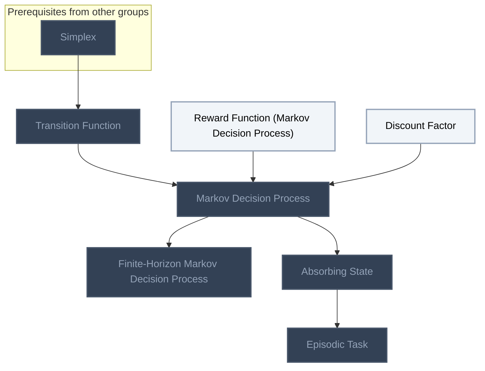
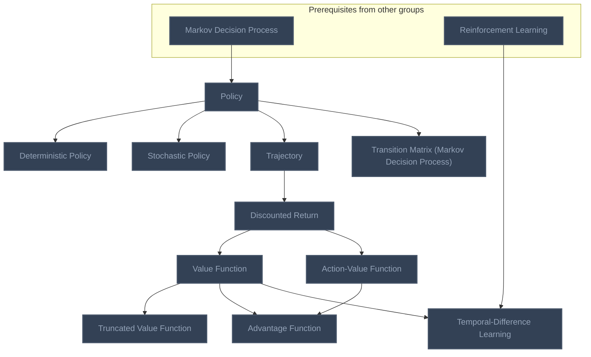
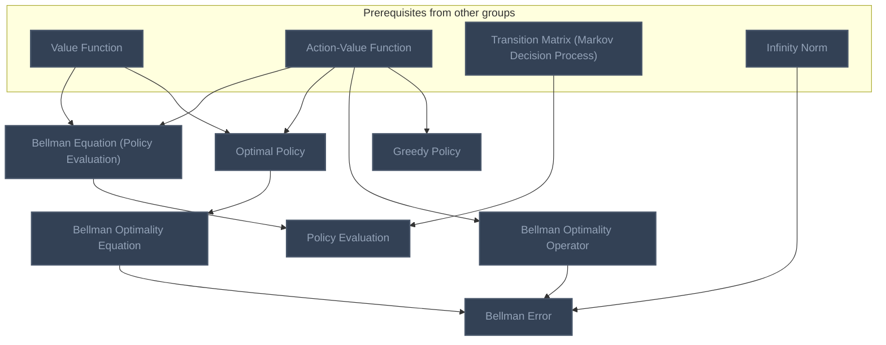
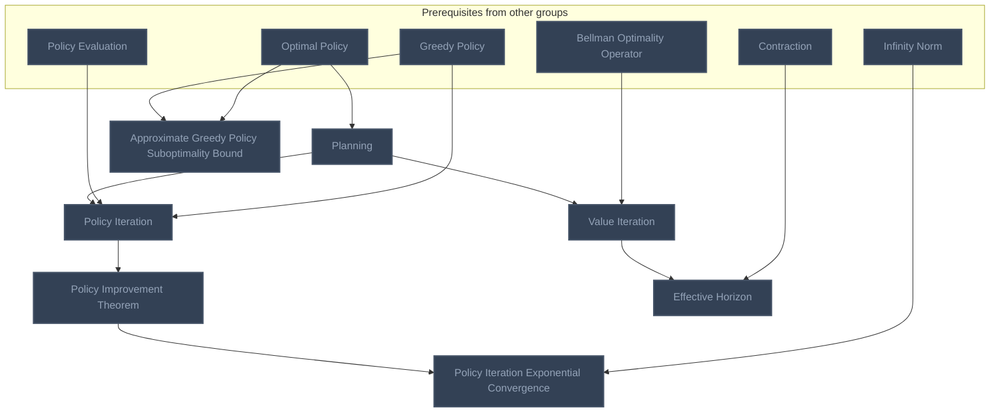
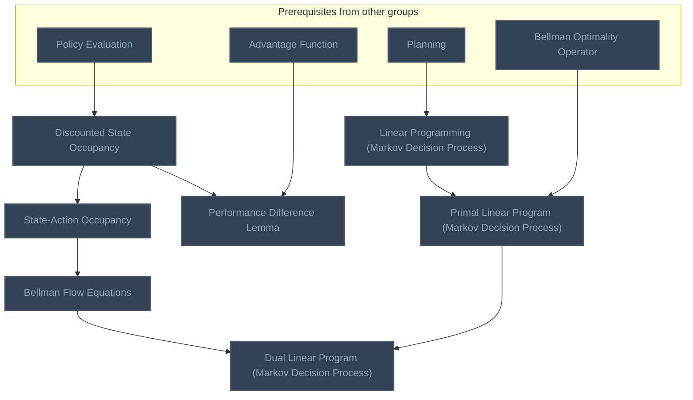
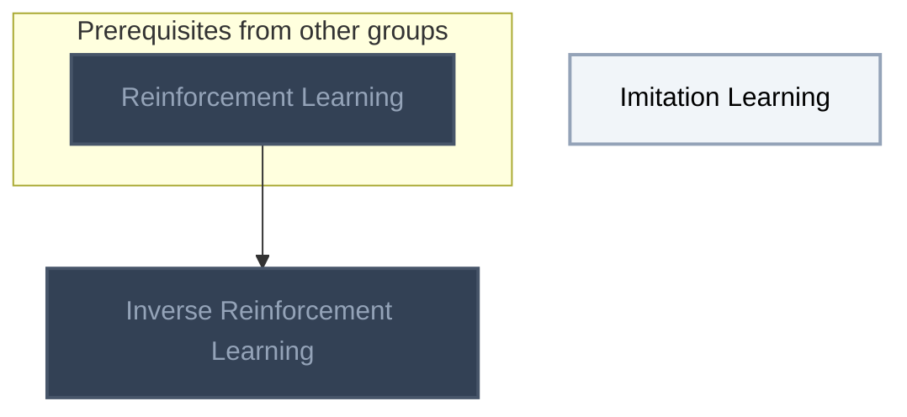

<!-- BEGIN STATS (generated by Scripts/skill_trees.py; do not edit) -->
**Mastered:** 0 / 41 · **Depth:** 0% · **Discovered:** 41 · **Planned:** 0 · **Locked:** 38 · **Rusty:** 0

**Levels:** L0 41 · L1 0 · L2 0 · L3 0 · L4 0 · L5 0

**Next up:** [[Reward Function (Markov Decision Process)]], [[Discount Factor]], [[Imitation Learning]]

Legend: dashed grey = planned (no note yet) · dark grey = locked · white L0 Discovered · green L1 Recall · blue L2 Apply · purple L3 Prove (Mastered) · orange L4 Wield · gold L5 Command · brown dashed border = rusty
<!-- END STATS -->

## Markov Decision Processes
**Mastered:** 0 / 7 · **Discovered:** 7 / 7



## Policies and Value Functions
**Mastered:** 0 / 11 · **Discovered:** 11 / 11



## Bellman Equations
**Mastered:** 0 / 7 · **Discovered:** 7 / 7



## Planning Algorithms
**Mastered:** 0 / 7 · **Discovered:** 7 / 7



## Occupancy Measures and Linear Programming
**Mastered:** 0 / 7 · **Discovered:** 7 / 7



## Learning from Demonstrations
**Mastered:** 0 / 2 · **Discovered:** 2 / 2



# Source
Graph structure: the single source for the diagrams above, edited by `/note` and `Scripts/skill_trees.py` (`add`, `edge`, `rename`). Everything above this heading is regenerated by `render`.

```skilltree
    %% PREREQUISITES
    n_simplex["Simplex"]
    n_infinity_norm["Infinity Norm"]
    n_contraction["Contraction"]
    n_reinforcement_learning["Reinforcement Learning"]
    %% NODES
    %% == Markov Decision Processes ==
    n_transition_function["Transition Function"]
    n_reward_function_markov_decision_process["Reward Function (Markov Decision Process)"]
    n_discount_factor["Discount Factor"]
    n_markov_decision_process["Markov Decision Process"]
    n_finite_horizon_markov_decision_process["Finite-Horizon Markov Decision Process"]
    n_absorbing_state["Absorbing State"]
    n_episodic_task["Episodic Task"]
    %% == Policies and Value Functions ==
    n_policy["Policy"]
    n_deterministic_policy["Deterministic Policy"]
    n_stochastic_policy["Stochastic Policy"]
    n_trajectory["Trajectory"]
    n_discounted_return["Discounted Return"]
    n_value_function["Value Function"]
    n_action_value_function["Action-Value Function"]
    n_truncated_value_function["Truncated Value Function"]
    n_advantage_function["Advantage Function"]
    n_transition_matrix_markov_decision_process["Transition Matrix (Markov Decision Process)"]
    n_temporal_difference_learning["Temporal-Difference Learning"]
    %% == Bellman Equations ==
    n_bellman_equation_policy_evaluation["Bellman Equation (Policy Evaluation)"]
    n_policy_evaluation["Policy Evaluation"]
    n_optimal_policy["Optimal Policy"]
    n_bellman_optimality_equation["Bellman Optimality Equation"]
    n_bellman_optimality_operator["Bellman Optimality Operator"]
    n_bellman_error["Bellman Error"]
    n_greedy_policy["Greedy Policy"]
    %% == Planning Algorithms ==
    n_planning["Planning"]
    n_policy_iteration["Policy Iteration"]
    n_policy_improvement_theorem["Policy Improvement Theorem"]
    n_policy_iteration_exponential_convergence["Policy Iteration Exponential Convergence"]
    n_value_iteration["Value Iteration"]
    n_effective_horizon["Effective Horizon"]
    n_approximate_greedy_policy_suboptimality_bound["Approximate Greedy Policy Suboptimality Bound"]
    %% == Occupancy Measures and Linear Programming ==
    n_discounted_state_occupancy["Discounted State Occupancy"]
    n_state_action_occupancy["State-Action Occupancy"]
    n_performance_difference_lemma["Performance Difference Lemma"]
    n_linear_programming_markov_decision_process["Linear Programming (Markov Decision Process)"]
    n_primal_linear_program_markov_decision_process["Primal Linear Program (Markov Decision Process)"]
    n_bellman_flow_equations["Bellman Flow Equations"]
    n_dual_linear_program_markov_decision_process["Dual Linear Program (Markov Decision Process)"]
    %% == Learning from Demonstrations ==
    n_imitation_learning["Imitation Learning"]
    n_inverse_reinforcement_learning["Inverse Reinforcement Learning"]
    %% EDGES
    n_simplex --> n_transition_function
    n_transition_function --> n_markov_decision_process
    n_reward_function_markov_decision_process --> n_markov_decision_process
    n_discount_factor --> n_markov_decision_process
    n_markov_decision_process --> n_finite_horizon_markov_decision_process
    n_markov_decision_process --> n_absorbing_state
    n_absorbing_state --> n_episodic_task
    n_markov_decision_process --> n_policy
    n_policy --> n_deterministic_policy
    n_policy --> n_stochastic_policy
    n_policy --> n_trajectory
    n_trajectory --> n_discounted_return
    n_discounted_return --> n_value_function
    n_discounted_return --> n_action_value_function
    n_value_function --> n_truncated_value_function
    n_value_function --> n_advantage_function
    n_action_value_function --> n_advantage_function
    n_policy --> n_transition_matrix_markov_decision_process
    n_value_function --> n_bellman_equation_policy_evaluation
    n_action_value_function --> n_bellman_equation_policy_evaluation
    n_bellman_equation_policy_evaluation --> n_policy_evaluation
    n_transition_matrix_markov_decision_process --> n_policy_evaluation
    n_value_function --> n_optimal_policy
    n_action_value_function --> n_optimal_policy
    n_optimal_policy --> n_bellman_optimality_equation
    n_action_value_function --> n_bellman_optimality_operator
    n_bellman_optimality_equation --> n_bellman_error
    n_bellman_optimality_operator --> n_bellman_error
    n_infinity_norm --> n_bellman_error
    n_action_value_function --> n_greedy_policy
    n_optimal_policy --> n_planning
    n_planning --> n_policy_iteration
    n_policy_evaluation --> n_policy_iteration
    n_greedy_policy --> n_policy_iteration
    n_policy_iteration --> n_policy_improvement_theorem
    n_policy_improvement_theorem --> n_policy_iteration_exponential_convergence
    n_infinity_norm --> n_policy_iteration_exponential_convergence
    n_planning --> n_value_iteration
    n_bellman_optimality_operator --> n_value_iteration
    n_value_iteration --> n_effective_horizon
    n_contraction --> n_effective_horizon
    n_greedy_policy --> n_approximate_greedy_policy_suboptimality_bound
    n_optimal_policy --> n_approximate_greedy_policy_suboptimality_bound
    n_policy_evaluation --> n_discounted_state_occupancy
    n_discounted_state_occupancy --> n_state_action_occupancy
    n_discounted_state_occupancy --> n_performance_difference_lemma
    n_advantage_function --> n_performance_difference_lemma
    n_planning --> n_linear_programming_markov_decision_process
    n_linear_programming_markov_decision_process --> n_primal_linear_program_markov_decision_process
    n_bellman_optimality_operator --> n_primal_linear_program_markov_decision_process
    n_state_action_occupancy --> n_bellman_flow_equations
    n_primal_linear_program_markov_decision_process --> n_dual_linear_program_markov_decision_process
    n_bellman_flow_equations --> n_dual_linear_program_markov_decision_process
    n_reinforcement_learning --> n_inverse_reinforcement_learning
    n_reinforcement_learning --> n_temporal_difference_learning
    n_value_function --> n_temporal_difference_learning
```
