<!-- BEGIN STATS (generated by Scripts/skill_trees.py; do not edit) -->
**Mastered:** 0 / 91 · **Depth:** 0% · **Discovered:** 91 · **Planned:** 0 · **Locked:** 88 · **Rusty:** 0

| | L0 Discovered | L1 Recall | L2 Apply | L3 Prove ★ | L4 Wield | L5 Command |
|---|---:|---:|---:|---:|---:|---:|
| **At this level** | 91 | 0 | 0 | 0 | 0 | 0 |
| **Reached (this level or higher)** | 91 | 0 | 0 | 0 | 0 | 0 |

**Next up:** [[Reward Function (Markov Decision Process)]], [[Discount Factor]], [[Imitation Learning]]

Legend: dashed grey = planned (no note yet) · dark grey = locked · white L0 Discovered · green L1 Recall · blue L2 Apply · purple L3 Prove (Mastered) · orange L4 Wield · gold L5 Command · brown dashed border = rusty
<!-- END STATS -->

## Markov Decision Processes
**Reached:** L1 0 · L2 0 · L3 0 · L4 0 · L5 0 (of 7 nodes)

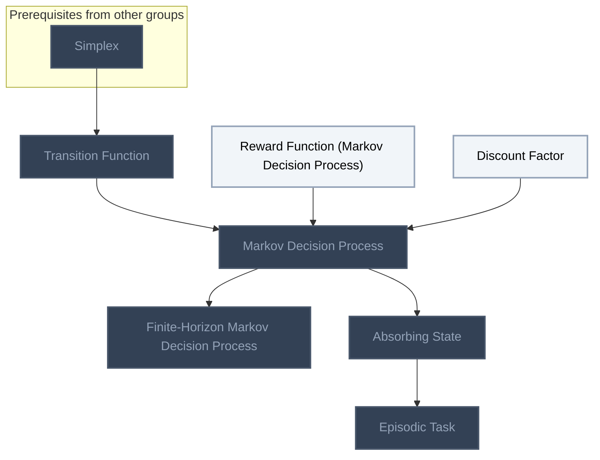

## Policies and Value Functions
**Reached:** L1 0 · L2 0 · L3 0 · L4 0 · L5 0 (of 12 nodes)

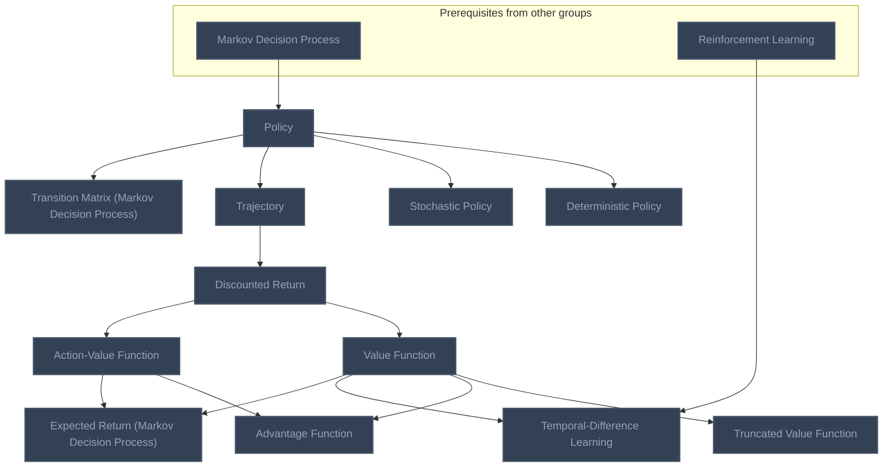

## Bellman Equations
**Reached:** L1 0 · L2 0 · L3 0 · L4 0 · L5 0 (of 8 nodes)

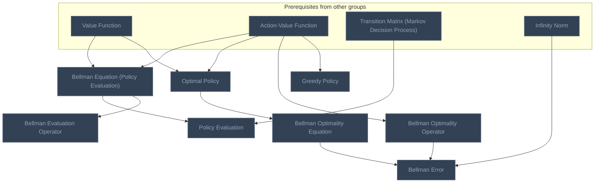

## Planning Algorithms
**Reached:** L1 0 · L2 0 · L3 0 · L4 0 · L5 0 (of 7 nodes)

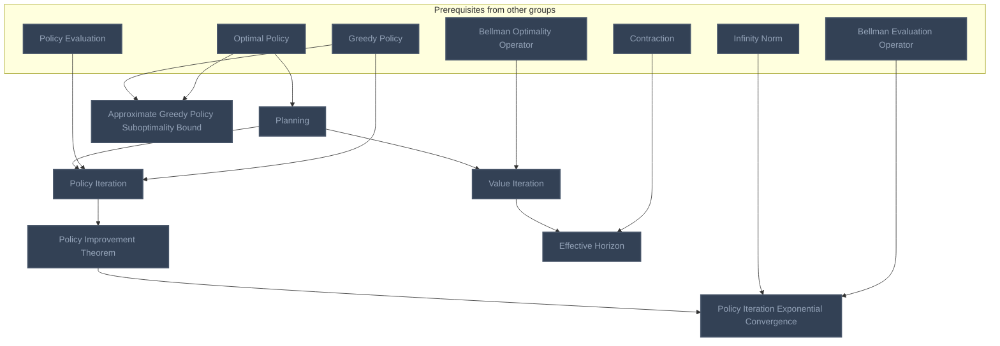

## Occupancy Measures and Linear Programming
**Reached:** L1 0 · L2 0 · L3 0 · L4 0 · L5 0 (of 7 nodes)

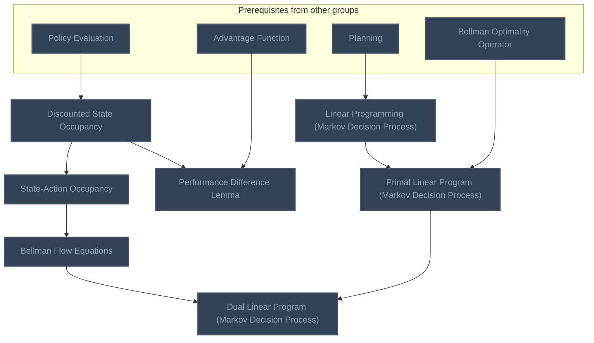

## Learning from Demonstrations
**Reached:** L1 0 · L2 0 · L3 0 · L4 0 · L5 0 (of 2 nodes)

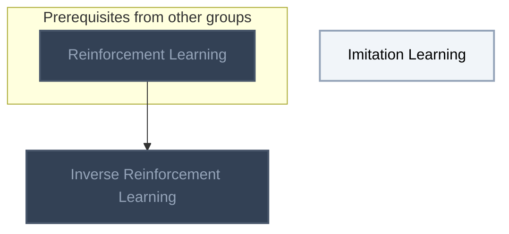

## Multi-Armed Bandits
**Reached:** L1 0 · L2 0 · L3 0 · L4 0 · L5 0 (of 6 nodes)

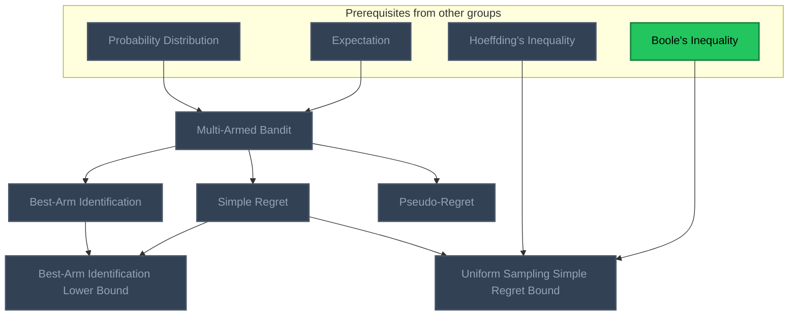

## Tabular Methods
**Reached:** L1 0 · L2 0 · L3 0 · L4 0 · L5 0 (of 10 nodes)

```mermaid
flowchart TD
    classDef planned fill:#1E293B,stroke:#64748B,stroke-width:2px,stroke-dasharray:5 5,color:#94A3B8;
    classDef locked fill:#334155,stroke:#475569,stroke-width:2px,color:#94A3B8;
    classDef L0 fill:#F1F5F9,stroke:#94A3B8,stroke-width:2px,color:#000000;
    classDef L1 fill:#22C55E,stroke:#15803D,stroke-width:2px,color:#000000;
    classDef L2 fill:#3B82F6,stroke:#1D4ED8,stroke-width:3px,color:#FFFFFF;
    classDef L3 fill:#A855F7,stroke:#6B21A8,stroke-width:3px,color:#FFFFFF,font-weight:bold;
    classDef L4 fill:#F97316,stroke:#C2410C,stroke-width:4px,color:#000000,font-weight:bold;
    classDef L5 fill:#FFD700,stroke:#FF8C00,stroke-width:5px,color:#000000,font-weight:bold;
    classDef rusty stroke:#8B4513,stroke-width:4px,stroke-dasharray:3 3;
    subgraph sg_prereqs["Prerequisites from other groups"]
        n_planning["Planning"]
        n_action_value_function["Action-Value Function"]
        n_markov_decision_process["Markov Decision Process"]
        n_multinomial_distribution_maximum_likelihood_estimation["Multinomial Distribution Maximum Likelihood Estimation"]
        n_bellman_equation_policy_evaluation["Bellman Equation (Policy Evaluation)"]
        n_infinity_norm["Infinity Norm"]
        n_1_norm["1-Norm"]
        n_optimal_policy["Optimal Policy"]
        n_bellman_evaluation_operator["Bellman Evaluation Operator"]
        n_state_action_occupancy["State-Action Occupancy"]
        n_greedy_policy["Greedy Policy"]
        n_bellman_optimality_operator["Bellman Optimality Operator"]
        n_empirical_distribution_l1_concentration_bound["Empirical Distribution L1 Concentration Bound"]
        n_approximate_greedy_policy_suboptimality_bound["Approximate Greedy Policy Suboptimality Bound"]
        n_effective_horizon["Effective Horizon"]
        n_expected_return_markov_decision_process["Expected Return (Markov Decision Process)"]
    end
    n_model_based_reinforcement_learning["Model-Based Reinforcement Learning"]
    n_value_based_reinforcement_learning["Value-Based Reinforcement Learning"]
    n_generative_model_reinforcement_learning["Generative Model (Reinforcement Learning)"]
    n_certainty_equivalence_reinforcement_learning["Certainty-Equivalence (Reinforcement Learning)"]
    n_simulation_lemma["Simulation Lemma"]
    n_evaluation_error_to_decision_loss_lemma["Evaluation Error to Decision Loss Lemma"]
    n_bellman_residual_telescoping_identity["Bellman Residual Telescoping Identity"]
    n_bellman_error_performance_difference_bound["Bellman Error Performance Difference Bound"]
    n_certainty_equivalence_sample_complexity["Certainty-Equivalence Sample Complexity"]
    n_sparse_sampling["Sparse Sampling"]
    n_planning --> n_model_based_reinforcement_learning
    n_action_value_function --> n_value_based_reinforcement_learning
    n_markov_decision_process --> n_generative_model_reinforcement_learning
    n_model_based_reinforcement_learning --> n_certainty_equivalence_reinforcement_learning
    n_multinomial_distribution_maximum_likelihood_estimation --> n_certainty_equivalence_reinforcement_learning
    n_bellman_equation_policy_evaluation --> n_simulation_lemma
    n_infinity_norm --> n_simulation_lemma
    n_1_norm --> n_simulation_lemma
    n_optimal_policy --> n_evaluation_error_to_decision_loss_lemma
    n_bellman_evaluation_operator --> n_bellman_residual_telescoping_identity
    n_state_action_occupancy --> n_bellman_residual_telescoping_identity
    n_bellman_residual_telescoping_identity --> n_bellman_error_performance_difference_bound
    n_greedy_policy --> n_bellman_error_performance_difference_bound
    n_bellman_optimality_operator --> n_bellman_error_performance_difference_bound
    n_certainty_equivalence_reinforcement_learning --> n_certainty_equivalence_sample_complexity
    n_generative_model_reinforcement_learning --> n_certainty_equivalence_sample_complexity
    n_simulation_lemma --> n_certainty_equivalence_sample_complexity
    n_evaluation_error_to_decision_loss_lemma --> n_certainty_equivalence_sample_complexity
    n_empirical_distribution_l1_concentration_bound --> n_certainty_equivalence_sample_complexity
    n_approximate_greedy_policy_suboptimality_bound --> n_certainty_equivalence_sample_complexity
    n_bellman_error_performance_difference_bound --> n_certainty_equivalence_sample_complexity
    n_certainty_equivalence_sample_complexity --> n_sparse_sampling
    n_effective_horizon --> n_sparse_sampling
    n_expected_return_markov_decision_process --> n_bellman_residual_telescoping_identity
    n_expected_return_markov_decision_process --> n_bellman_error_performance_difference_bound
    class n_planning,n_action_value_function,n_markov_decision_process,n_multinomial_distribution_maximum_likelihood_estimation,n_bellman_equation_policy_evaluation,n_infinity_norm,n_1_norm,n_optimal_policy,n_bellman_evaluation_operator,n_state_action_occupancy,n_greedy_policy,n_bellman_optimality_operator,n_empirical_distribution_l1_concentration_bound,n_approximate_greedy_policy_suboptimality_bound,n_effective_horizon,n_expected_return_markov_decision_process,n_model_based_reinforcement_learning,n_value_based_reinforcement_learning,n_generative_model_reinforcement_learning,n_certainty_equivalence_reinforcement_learning,n_simulation_lemma,n_evaluation_error_to_decision_loss_lemma,n_bellman_residual_telescoping_identity,n_bellman_error_performance_difference_bound,n_certainty_equivalence_sample_complexity,n_sparse_sampling locked;
    class n_planning,n_action_value_function,n_markov_decision_process,n_multinomial_distribution_maximum_likelihood_estimation,n_bellman_equation_policy_evaluation,n_infinity_norm,n_1_norm,n_optimal_policy,n_bellman_evaluation_operator,n_state_action_occupancy,n_greedy_policy,n_bellman_optimality_operator,n_empirical_distribution_l1_concentration_bound,n_approximate_greedy_policy_suboptimality_bound,n_effective_horizon,n_expected_return_markov_decision_process,n_model_based_reinforcement_learning,n_value_based_reinforcement_learning,n_generative_model_reinforcement_learning,n_certainty_equivalence_reinforcement_learning,n_simulation_lemma,n_evaluation_error_to_decision_loss_lemma,n_bellman_residual_telescoping_identity,n_bellman_error_performance_difference_bound,n_certainty_equivalence_sample_complexity,n_sparse_sampling internal-link;
```

## State Abstractions
**Reached:** L1 0 · L2 0 · L3 0 · L4 0 · L5 0 (of 10 nodes)

```mermaid
flowchart TD
    classDef planned fill:#1E293B,stroke:#64748B,stroke-width:2px,stroke-dasharray:5 5,color:#94A3B8;
    classDef locked fill:#334155,stroke:#475569,stroke-width:2px,color:#94A3B8;
    classDef L0 fill:#F1F5F9,stroke:#94A3B8,stroke-width:2px,color:#000000;
    classDef L1 fill:#22C55E,stroke:#15803D,stroke-width:2px,color:#000000;
    classDef L2 fill:#3B82F6,stroke:#1D4ED8,stroke-width:3px,color:#FFFFFF;
    classDef L3 fill:#A855F7,stroke:#6B21A8,stroke-width:3px,color:#FFFFFF,font-weight:bold;
    classDef L4 fill:#F97316,stroke:#C2410C,stroke-width:4px,color:#000000,font-weight:bold;
    classDef L5 fill:#FFD700,stroke:#FF8C00,stroke-width:5px,color:#000000,font-weight:bold;
    classDef rusty stroke:#8B4513,stroke-width:4px,stroke-dasharray:3 3;
    subgraph sg_prereqs["Prerequisites from other groups"]
        n_markov_decision_process["Markov Decision Process"]
        n_equivalence_relation["Equivalence Relation"]
        n_optimal_policy["Optimal Policy"]
        n_1_norm["1-Norm"]
        n_approximate_greedy_policy_suboptimality_bound["Approximate Greedy Policy Suboptimality Bound"]
        n_simulation_lemma["Simulation Lemma"]
        n_bellman_evaluation_operator["Bellman Evaluation Operator"]
        n_bellman_optimality_operator["Bellman Optimality Operator"]
        n_certainty_equivalence_sample_complexity["Certainty-Equivalence Sample Complexity"]
    end
    n_state_abstraction["State Abstraction"]
    n_pi_star_irrelevant_abstraction["Pi-Star-Irrelevant Abstraction"]
    n_q_star_irrelevant_abstraction["Q-Star-Irrelevant Abstraction"]
    n_model_irrelevant_abstraction["Model-Irrelevant Abstraction"]
    n_coarsest_bisimulation_uniqueness_theorem["Coarsest Bisimulation Uniqueness Theorem"]
    n_abstract_model_state_abstraction["Abstract Model (State Abstraction)"]
    n_state_abstraction_hierarchy_theorem["State Abstraction Hierarchy Theorem"]
    n_approximate_bisimulation_abstract_model_loss_bound["Approximate Bisimulation Abstract Model Loss Bound"]
    n_q_star_irrelevant_abstract_model_bound["Q-Star-Irrelevant Abstract Model Bound"]
    n_state_abstraction_finite_sample_bound["State Abstraction Finite Sample Bound"]
    n_markov_decision_process --> n_state_abstraction
    n_equivalence_relation --> n_state_abstraction
    n_state_abstraction --> n_pi_star_irrelevant_abstraction
    n_optimal_policy --> n_pi_star_irrelevant_abstraction
    n_state_abstraction --> n_q_star_irrelevant_abstraction
    n_optimal_policy --> n_q_star_irrelevant_abstraction
    n_state_abstraction --> n_model_irrelevant_abstraction
    n_1_norm --> n_model_irrelevant_abstraction
    n_model_irrelevant_abstraction --> n_coarsest_bisimulation_uniqueness_theorem
    n_model_irrelevant_abstraction --> n_abstract_model_state_abstraction
    n_abstract_model_state_abstraction --> n_state_abstraction_hierarchy_theorem
    n_q_star_irrelevant_abstraction --> n_state_abstraction_hierarchy_theorem
    n_pi_star_irrelevant_abstraction --> n_state_abstraction_hierarchy_theorem
    n_approximate_greedy_policy_suboptimality_bound --> n_state_abstraction_hierarchy_theorem
    n_simulation_lemma --> n_state_abstraction_hierarchy_theorem
    n_state_abstraction_hierarchy_theorem --> n_approximate_bisimulation_abstract_model_loss_bound
    n_bellman_evaluation_operator --> n_approximate_bisimulation_abstract_model_loss_bound
    n_q_star_irrelevant_abstraction --> n_q_star_irrelevant_abstract_model_bound
    n_abstract_model_state_abstraction --> n_q_star_irrelevant_abstract_model_bound
    n_bellman_optimality_operator --> n_q_star_irrelevant_abstract_model_bound
    n_state_abstraction_hierarchy_theorem --> n_state_abstraction_finite_sample_bound
    n_q_star_irrelevant_abstract_model_bound --> n_state_abstraction_finite_sample_bound
    n_certainty_equivalence_sample_complexity --> n_state_abstraction_finite_sample_bound
    class n_markov_decision_process,n_optimal_policy,n_1_norm,n_approximate_greedy_policy_suboptimality_bound,n_simulation_lemma,n_bellman_evaluation_operator,n_bellman_optimality_operator,n_certainty_equivalence_sample_complexity,n_state_abstraction,n_pi_star_irrelevant_abstraction,n_q_star_irrelevant_abstraction,n_model_irrelevant_abstraction,n_coarsest_bisimulation_uniqueness_theorem,n_abstract_model_state_abstraction,n_state_abstraction_hierarchy_theorem,n_approximate_bisimulation_abstract_model_loss_bound,n_q_star_irrelevant_abstract_model_bound,n_state_abstraction_finite_sample_bound locked;
    class n_equivalence_relation L2;
    class n_markov_decision_process,n_equivalence_relation,n_optimal_policy,n_1_norm,n_approximate_greedy_policy_suboptimality_bound,n_simulation_lemma,n_bellman_evaluation_operator,n_bellman_optimality_operator,n_certainty_equivalence_sample_complexity,n_state_abstraction,n_pi_star_irrelevant_abstraction,n_q_star_irrelevant_abstraction,n_model_irrelevant_abstraction,n_coarsest_bisimulation_uniqueness_theorem,n_abstract_model_state_abstraction,n_state_abstraction_hierarchy_theorem,n_approximate_bisimulation_abstract_model_loss_bound,n_q_star_irrelevant_abstract_model_bound,n_state_abstraction_finite_sample_bound internal-link;
```

## Fitted Q-Iteration
**Reached:** L1 0 · L2 0 · L3 0 · L4 0 · L5 0 (of 8 nodes)

```mermaid
flowchart TD
    classDef planned fill:#1E293B,stroke:#64748B,stroke-width:2px,stroke-dasharray:5 5,color:#94A3B8;
    classDef locked fill:#334155,stroke:#475569,stroke-width:2px,color:#94A3B8;
    classDef L0 fill:#F1F5F9,stroke:#94A3B8,stroke-width:2px,color:#000000;
    classDef L1 fill:#22C55E,stroke:#15803D,stroke-width:2px,color:#000000;
    classDef L2 fill:#3B82F6,stroke:#1D4ED8,stroke-width:3px,color:#FFFFFF;
    classDef L3 fill:#A855F7,stroke:#6B21A8,stroke-width:3px,color:#FFFFFF,font-weight:bold;
    classDef L4 fill:#F97316,stroke:#C2410C,stroke-width:4px,color:#000000,font-weight:bold;
    classDef L5 fill:#FFD700,stroke:#FF8C00,stroke-width:5px,color:#000000,font-weight:bold;
    classDef rusty stroke:#8B4513,stroke-width:4px,stroke-dasharray:3 3;
    subgraph sg_prereqs["Prerequisites from other groups"]
        n_optimal_policy["Optimal Policy"]
        n_bellman_optimality_operator["Bellman Optimality Operator"]
        n_value_iteration["Value Iteration"]
        n_empirical_risk_minimization["Empirical Risk Minimization"]
        n_state_action_occupancy["State-Action Occupancy"]
        n_performance_difference_lemma["Performance Difference Lemma"]
        n_uniform_deviation_bound["Uniform Deviation Bound"]
        n_jensen_s_inequality["Jensen's Inequality"]
        n_bernstein_s_inequality["Bernstein's Inequality"]
        n_boole_s_inequality["Boole's Inequality"]
        n_bellman_error_performance_difference_bound["Bellman Error Performance Difference Bound"]
        n_truncated_value_function["Truncated Value Function"]
    end
    n_realizability_reinforcement_learning["Realizability (Reinforcement Learning)"]
    n_bellman_completeness["Bellman Completeness"]
    n_fitted_q_iteration["Fitted Q-Iteration"]
    n_concentrability_coefficient["Concentrability Coefficient"]
    n_fitted_q_iteration_error_bound["Fitted Q-Iteration Error Bound"]
    n_fitted_q_iteration_fast_rate["Fitted Q-Iteration Fast Rate"]
    n_non_stationary_bellman_error_performance_difference_bound["Non-Stationary Bellman Error Performance Difference Bound"]
    n_non_stationary_fitted_q_iteration["Non-Stationary Fitted Q-Iteration"]
    n_optimal_policy --> n_realizability_reinforcement_learning
    n_bellman_optimality_operator --> n_bellman_completeness
    n_value_iteration --> n_fitted_q_iteration
    n_empirical_risk_minimization --> n_fitted_q_iteration
    n_state_action_occupancy --> n_concentrability_coefficient
    n_fitted_q_iteration --> n_fitted_q_iteration_error_bound
    n_bellman_completeness --> n_fitted_q_iteration_error_bound
    n_concentrability_coefficient --> n_fitted_q_iteration_error_bound
    n_performance_difference_lemma --> n_fitted_q_iteration_error_bound
    n_uniform_deviation_bound --> n_fitted_q_iteration_error_bound
    n_jensen_s_inequality --> n_fitted_q_iteration_error_bound
    n_fitted_q_iteration_error_bound --> n_fitted_q_iteration_fast_rate
    n_bernstein_s_inequality --> n_fitted_q_iteration_fast_rate
    n_boole_s_inequality --> n_fitted_q_iteration_fast_rate
    n_bellman_error_performance_difference_bound --> n_non_stationary_bellman_error_performance_difference_bound
    n_truncated_value_function --> n_non_stationary_bellman_error_performance_difference_bound
    n_fitted_q_iteration_error_bound --> n_non_stationary_fitted_q_iteration
    n_non_stationary_bellman_error_performance_difference_bound --> n_non_stationary_fitted_q_iteration
    n_realizability_reinforcement_learning --> n_bellman_completeness
    class n_optimal_policy,n_bellman_optimality_operator,n_value_iteration,n_empirical_risk_minimization,n_state_action_occupancy,n_performance_difference_lemma,n_uniform_deviation_bound,n_jensen_s_inequality,n_bernstein_s_inequality,n_bellman_error_performance_difference_bound,n_truncated_value_function,n_realizability_reinforcement_learning,n_bellman_completeness,n_fitted_q_iteration,n_concentrability_coefficient,n_fitted_q_iteration_error_bound,n_fitted_q_iteration_fast_rate,n_non_stationary_bellman_error_performance_difference_bound,n_non_stationary_fitted_q_iteration locked;
    class n_boole_s_inequality L1;
    class n_optimal_policy,n_bellman_optimality_operator,n_value_iteration,n_empirical_risk_minimization,n_state_action_occupancy,n_performance_difference_lemma,n_uniform_deviation_bound,n_jensen_s_inequality,n_bernstein_s_inequality,n_boole_s_inequality,n_bellman_error_performance_difference_bound,n_truncated_value_function,n_realizability_reinforcement_learning,n_bellman_completeness,n_fitted_q_iteration,n_concentrability_coefficient,n_fitted_q_iteration_error_bound,n_fitted_q_iteration_fast_rate,n_non_stationary_bellman_error_performance_difference_bound,n_non_stationary_fitted_q_iteration internal-link;
```

## Importance Sampling and Policy Gradient
**Reached:** L1 0 · L2 0 · L3 0 · L4 0 · L5 0 (of 14 nodes)

```mermaid
flowchart TD
    classDef planned fill:#1E293B,stroke:#64748B,stroke-width:2px,stroke-dasharray:5 5,color:#94A3B8;
    classDef locked fill:#334155,stroke:#475569,stroke-width:2px,color:#94A3B8;
    classDef L0 fill:#F1F5F9,stroke:#94A3B8,stroke-width:2px,color:#000000;
    classDef L1 fill:#22C55E,stroke:#15803D,stroke-width:2px,color:#000000;
    classDef L2 fill:#3B82F6,stroke:#1D4ED8,stroke-width:3px,color:#FFFFFF;
    classDef L3 fill:#A855F7,stroke:#6B21A8,stroke-width:3px,color:#FFFFFF,font-weight:bold;
    classDef L4 fill:#F97316,stroke:#C2410C,stroke-width:4px,color:#000000,font-weight:bold;
    classDef L5 fill:#FFD700,stroke:#FF8C00,stroke-width:5px,color:#000000,font-weight:bold;
    classDef rusty stroke:#8B4513,stroke-width:4px,stroke-dasharray:3 3;
    subgraph sg_prereqs["Prerequisites from other groups"]
        n_multi_armed_bandit["Multi-Armed Bandit"]
        n_policy["Policy"]
        n_policy_evaluation["Policy Evaluation"]
        n_importance_sampling["Importance Sampling"]
        n_trajectory["Trajectory"]
        n_bellman_equation_policy_evaluation["Bellman Equation (Policy Evaluation)"]
        n_control_variates["Control Variates"]
        n_law_of_total_variance["Law of Total Variance"]
        n_stochastic_policy["Stochastic Policy"]
        n_state_action_occupancy["State-Action Occupancy"]
        n_stochastic_gradient_descent["Stochastic Gradient Descent"]
        n_performance_difference_lemma["Performance Difference Lemma"]
        n_greedy_policy["Greedy Policy"]
        n_softmax_function["Softmax Function"]
        n_kullback_leibler_divergence["Kullback-Leibler Divergence"]
        n_bellman_residual_telescoping_identity["Bellman Residual Telescoping Identity"]
        n_mirror_descent["Mirror Descent"]
    end
    n_contextual_bandit["Contextual Bandit"]
    n_off_policy_evaluation["Off-Policy Evaluation"]
    n_inverse_propensity_score_estimator["Inverse Propensity Score Estimator"]
    n_per_trajectory_importance_sampling["Per-Trajectory Importance Sampling"]
    n_per_step_importance_sampling["Per-Step Importance Sampling"]
    n_doubly_robust_estimator["Doubly Robust Estimator"]
    n_bellman_equation_for_variance["Bellman Equation for Variance"]
    n_policy_gradient_theorem["Policy Gradient Theorem"]
    n_reinforce["REINFORCE"]
    n_actor_critic["Actor-Critic"]
    n_policy_gradient_stationary_point_suboptimality_bound["Policy Gradient Stationary Point Suboptimality Bound"]
    n_natural_policy_gradient["Natural Policy Gradient"]
    n_performance_difference_bellman_error_decomposition["Performance Difference Bellman Error Decomposition"]
    n_natural_policy_gradient_convergence_bound["Natural Policy Gradient Convergence Bound"]
    n_multi_armed_bandit --> n_contextual_bandit
    n_policy --> n_contextual_bandit
    n_policy_evaluation --> n_off_policy_evaluation
    n_importance_sampling --> n_inverse_propensity_score_estimator
    n_contextual_bandit --> n_inverse_propensity_score_estimator
    n_off_policy_evaluation --> n_inverse_propensity_score_estimator
    n_importance_sampling --> n_per_trajectory_importance_sampling
    n_off_policy_evaluation --> n_per_trajectory_importance_sampling
    n_trajectory --> n_per_trajectory_importance_sampling
    n_per_trajectory_importance_sampling --> n_per_step_importance_sampling
    n_inverse_propensity_score_estimator --> n_per_step_importance_sampling
    n_bellman_equation_policy_evaluation --> n_per_step_importance_sampling
    n_inverse_propensity_score_estimator --> n_doubly_robust_estimator
    n_control_variates --> n_doubly_robust_estimator
    n_per_step_importance_sampling --> n_doubly_robust_estimator
    n_per_step_importance_sampling --> n_bellman_equation_for_variance
    n_law_of_total_variance --> n_bellman_equation_for_variance
    n_stochastic_policy --> n_policy_gradient_theorem
    n_state_action_occupancy --> n_policy_gradient_theorem
    n_bellman_equation_policy_evaluation --> n_policy_gradient_theorem
    n_policy_gradient_theorem --> n_reinforce
    n_stochastic_gradient_descent --> n_reinforce
    n_policy_gradient_theorem --> n_actor_critic
    n_control_variates --> n_actor_critic
    n_policy_gradient_theorem --> n_policy_gradient_stationary_point_suboptimality_bound
    n_performance_difference_lemma --> n_policy_gradient_stationary_point_suboptimality_bound
    n_greedy_policy --> n_policy_gradient_stationary_point_suboptimality_bound
    n_policy_gradient_theorem --> n_natural_policy_gradient
    n_softmax_function --> n_natural_policy_gradient
    n_kullback_leibler_divergence --> n_natural_policy_gradient
    n_performance_difference_lemma --> n_performance_difference_bellman_error_decomposition
    n_bellman_residual_telescoping_identity --> n_performance_difference_bellman_error_decomposition
    n_natural_policy_gradient --> n_natural_policy_gradient_convergence_bound
    n_mirror_descent --> n_natural_policy_gradient_convergence_bound
    n_performance_difference_lemma --> n_natural_policy_gradient_convergence_bound
    n_performance_difference_bellman_error_decomposition --> n_natural_policy_gradient_convergence_bound
    class n_multi_armed_bandit,n_policy,n_policy_evaluation,n_importance_sampling,n_trajectory,n_bellman_equation_policy_evaluation,n_control_variates,n_law_of_total_variance,n_stochastic_policy,n_state_action_occupancy,n_stochastic_gradient_descent,n_performance_difference_lemma,n_greedy_policy,n_kullback_leibler_divergence,n_bellman_residual_telescoping_identity,n_mirror_descent,n_contextual_bandit,n_off_policy_evaluation,n_inverse_propensity_score_estimator,n_per_trajectory_importance_sampling,n_per_step_importance_sampling,n_doubly_robust_estimator,n_bellman_equation_for_variance,n_policy_gradient_theorem,n_reinforce,n_actor_critic,n_policy_gradient_stationary_point_suboptimality_bound,n_natural_policy_gradient,n_performance_difference_bellman_error_decomposition,n_natural_policy_gradient_convergence_bound locked;
    class n_softmax_function L0;
    class n_multi_armed_bandit,n_policy,n_policy_evaluation,n_importance_sampling,n_trajectory,n_bellman_equation_policy_evaluation,n_control_variates,n_law_of_total_variance,n_stochastic_policy,n_state_action_occupancy,n_stochastic_gradient_descent,n_performance_difference_lemma,n_greedy_policy,n_softmax_function,n_kullback_leibler_divergence,n_bellman_residual_telescoping_identity,n_mirror_descent,n_contextual_bandit,n_off_policy_evaluation,n_inverse_propensity_score_estimator,n_per_trajectory_importance_sampling,n_per_step_importance_sampling,n_doubly_robust_estimator,n_bellman_equation_for_variance,n_policy_gradient_theorem,n_reinforce,n_actor_critic,n_policy_gradient_stationary_point_suboptimality_bound,n_natural_policy_gradient,n_performance_difference_bellman_error_decomposition,n_natural_policy_gradient_convergence_bound internal-link;
```

# Source
Graph structure: the single source for the diagrams above, edited by `/note` and `Scripts/skill_trees.py` (`add`, `edge`, `rename`). Everything above this heading is regenerated by `render`.

```skilltree
    %% PREREQUISITES
    n_simplex["Simplex"]
    n_infinity_norm["Infinity Norm"]
    n_contraction["Contraction"]
    n_reinforcement_learning["Reinforcement Learning"]
    n_probability_distribution["Probability Distribution"]
    n_expectation["Expectation"]
    n_hoeffding_s_inequality["Hoeffding's Inequality"]
    n_boole_s_inequality["Boole's Inequality"]
    n_multinomial_distribution_maximum_likelihood_estimation["Multinomial Distribution Maximum Likelihood Estimation"]
    n_1_norm["1-Norm"]
    n_empirical_distribution_l1_concentration_bound["Empirical Distribution L1 Concentration Bound"]
    n_equivalence_relation["Equivalence Relation"]
    n_empirical_risk_minimization["Empirical Risk Minimization"]
    n_uniform_deviation_bound["Uniform Deviation Bound"]
    n_jensen_s_inequality["Jensen's Inequality"]
    n_bernstein_s_inequality["Bernstein's Inequality"]
    n_importance_sampling["Importance Sampling"]
    n_control_variates["Control Variates"]
    n_law_of_total_variance["Law of Total Variance"]
    n_stochastic_gradient_descent["Stochastic Gradient Descent"]
    n_softmax_function["Softmax Function"]
    n_kullback_leibler_divergence["Kullback-Leibler Divergence"]
    n_mirror_descent["Mirror Descent"]
    %% NODES
    %% == Markov Decision Processes ==
    n_transition_function["Transition Function"]
    n_reward_function_markov_decision_process["Reward Function (Markov Decision Process)"]
    n_discount_factor["Discount Factor"]
    n_markov_decision_process["Markov Decision Process"]
    n_finite_horizon_markov_decision_process["Finite-Horizon Markov Decision Process"]
    n_absorbing_state["Absorbing State"]
    n_episodic_task["Episodic Task"]
    %% == Policies and Value Functions ==
    n_policy["Policy"]
    n_deterministic_policy["Deterministic Policy"]
    n_stochastic_policy["Stochastic Policy"]
    n_trajectory["Trajectory"]
    n_discounted_return["Discounted Return"]
    n_value_function["Value Function"]
    n_action_value_function["Action-Value Function"]
    n_truncated_value_function["Truncated Value Function"]
    n_advantage_function["Advantage Function"]
    n_transition_matrix_markov_decision_process["Transition Matrix (Markov Decision Process)"]
    n_temporal_difference_learning["Temporal-Difference Learning"]
    n_expected_return_markov_decision_process["Expected Return (Markov Decision Process)"]
    %% == Bellman Equations ==
    n_bellman_equation_policy_evaluation["Bellman Equation (Policy Evaluation)"]
    n_policy_evaluation["Policy Evaluation"]
    n_optimal_policy["Optimal Policy"]
    n_bellman_optimality_equation["Bellman Optimality Equation"]
    n_bellman_optimality_operator["Bellman Optimality Operator"]
    n_bellman_error["Bellman Error"]
    n_greedy_policy["Greedy Policy"]
    n_bellman_evaluation_operator["Bellman Evaluation Operator"]
    %% == Planning Algorithms ==
    n_planning["Planning"]
    n_policy_iteration["Policy Iteration"]
    n_policy_improvement_theorem["Policy Improvement Theorem"]
    n_policy_iteration_exponential_convergence["Policy Iteration Exponential Convergence"]
    n_value_iteration["Value Iteration"]
    n_effective_horizon["Effective Horizon"]
    n_approximate_greedy_policy_suboptimality_bound["Approximate Greedy Policy Suboptimality Bound"]
    %% == Occupancy Measures and Linear Programming ==
    n_discounted_state_occupancy["Discounted State Occupancy"]
    n_state_action_occupancy["State-Action Occupancy"]
    n_performance_difference_lemma["Performance Difference Lemma"]
    n_linear_programming_markov_decision_process["Linear Programming (Markov Decision Process)"]
    n_primal_linear_program_markov_decision_process["Primal Linear Program (Markov Decision Process)"]
    n_bellman_flow_equations["Bellman Flow Equations"]
    n_dual_linear_program_markov_decision_process["Dual Linear Program (Markov Decision Process)"]
    %% == Learning from Demonstrations ==
    n_imitation_learning["Imitation Learning"]
    n_inverse_reinforcement_learning["Inverse Reinforcement Learning"]
    %% == Multi-Armed Bandits ==
    n_multi_armed_bandit["Multi-Armed Bandit"]
    n_pseudo_regret["Pseudo-Regret"]
    n_simple_regret["Simple Regret"]
    n_best_arm_identification["Best-Arm Identification"]
    n_uniform_sampling_simple_regret_bound["Uniform Sampling Simple Regret Bound"]
    n_best_arm_identification_lower_bound["Best-Arm Identification Lower Bound"]
    %% == Tabular Methods ==
    n_model_based_reinforcement_learning["Model-Based Reinforcement Learning"]
    n_value_based_reinforcement_learning["Value-Based Reinforcement Learning"]
    n_generative_model_reinforcement_learning["Generative Model (Reinforcement Learning)"]
    n_certainty_equivalence_reinforcement_learning["Certainty-Equivalence (Reinforcement Learning)"]
    n_simulation_lemma["Simulation Lemma"]
    n_evaluation_error_to_decision_loss_lemma["Evaluation Error to Decision Loss Lemma"]
    n_bellman_residual_telescoping_identity["Bellman Residual Telescoping Identity"]
    n_bellman_error_performance_difference_bound["Bellman Error Performance Difference Bound"]
    n_certainty_equivalence_sample_complexity["Certainty-Equivalence Sample Complexity"]
    n_sparse_sampling["Sparse Sampling"]
    %% == State Abstractions ==
    n_state_abstraction["State Abstraction"]
    n_pi_star_irrelevant_abstraction["Pi-Star-Irrelevant Abstraction"]
    n_q_star_irrelevant_abstraction["Q-Star-Irrelevant Abstraction"]
    n_model_irrelevant_abstraction["Model-Irrelevant Abstraction"]
    n_coarsest_bisimulation_uniqueness_theorem["Coarsest Bisimulation Uniqueness Theorem"]
    n_abstract_model_state_abstraction["Abstract Model (State Abstraction)"]
    n_state_abstraction_hierarchy_theorem["State Abstraction Hierarchy Theorem"]
    n_approximate_bisimulation_abstract_model_loss_bound["Approximate Bisimulation Abstract Model Loss Bound"]
    n_q_star_irrelevant_abstract_model_bound["Q-Star-Irrelevant Abstract Model Bound"]
    n_state_abstraction_finite_sample_bound["State Abstraction Finite Sample Bound"]
    %% == Fitted Q-Iteration ==
    n_realizability_reinforcement_learning["Realizability (Reinforcement Learning)"]
    n_bellman_completeness["Bellman Completeness"]
    n_fitted_q_iteration["Fitted Q-Iteration"]
    n_concentrability_coefficient["Concentrability Coefficient"]
    n_fitted_q_iteration_error_bound["Fitted Q-Iteration Error Bound"]
    n_fitted_q_iteration_fast_rate["Fitted Q-Iteration Fast Rate"]
    n_non_stationary_bellman_error_performance_difference_bound["Non-Stationary Bellman Error Performance Difference Bound"]
    n_non_stationary_fitted_q_iteration["Non-Stationary Fitted Q-Iteration"]
    %% == Importance Sampling and Policy Gradient ==
    n_contextual_bandit["Contextual Bandit"]
    n_off_policy_evaluation["Off-Policy Evaluation"]
    n_inverse_propensity_score_estimator["Inverse Propensity Score Estimator"]
    n_per_trajectory_importance_sampling["Per-Trajectory Importance Sampling"]
    n_per_step_importance_sampling["Per-Step Importance Sampling"]
    n_doubly_robust_estimator["Doubly Robust Estimator"]
    n_bellman_equation_for_variance["Bellman Equation for Variance"]
    n_policy_gradient_theorem["Policy Gradient Theorem"]
    n_reinforce["REINFORCE"]
    n_actor_critic["Actor-Critic"]
    n_policy_gradient_stationary_point_suboptimality_bound["Policy Gradient Stationary Point Suboptimality Bound"]
    n_natural_policy_gradient["Natural Policy Gradient"]
    n_performance_difference_bellman_error_decomposition["Performance Difference Bellman Error Decomposition"]
    n_natural_policy_gradient_convergence_bound["Natural Policy Gradient Convergence Bound"]
    %% EDGES
    n_simplex --> n_transition_function
    n_transition_function --> n_markov_decision_process
    n_reward_function_markov_decision_process --> n_markov_decision_process
    n_discount_factor --> n_markov_decision_process
    n_markov_decision_process --> n_finite_horizon_markov_decision_process
    n_markov_decision_process --> n_absorbing_state
    n_absorbing_state --> n_episodic_task
    n_markov_decision_process --> n_policy
    n_policy --> n_deterministic_policy
    n_policy --> n_stochastic_policy
    n_policy --> n_trajectory
    n_trajectory --> n_discounted_return
    n_discounted_return --> n_value_function
    n_discounted_return --> n_action_value_function
    n_value_function --> n_truncated_value_function
    n_value_function --> n_advantage_function
    n_action_value_function --> n_advantage_function
    n_policy --> n_transition_matrix_markov_decision_process
    n_value_function --> n_bellman_equation_policy_evaluation
    n_action_value_function --> n_bellman_equation_policy_evaluation
    n_bellman_equation_policy_evaluation --> n_policy_evaluation
    n_transition_matrix_markov_decision_process --> n_policy_evaluation
    n_value_function --> n_optimal_policy
    n_action_value_function --> n_optimal_policy
    n_optimal_policy --> n_bellman_optimality_equation
    n_action_value_function --> n_bellman_optimality_operator
    n_bellman_optimality_equation --> n_bellman_error
    n_bellman_optimality_operator --> n_bellman_error
    n_infinity_norm --> n_bellman_error
    n_action_value_function --> n_greedy_policy
    n_optimal_policy --> n_planning
    n_planning --> n_policy_iteration
    n_policy_evaluation --> n_policy_iteration
    n_greedy_policy --> n_policy_iteration
    n_policy_iteration --> n_policy_improvement_theorem
    n_policy_improvement_theorem --> n_policy_iteration_exponential_convergence
    n_infinity_norm --> n_policy_iteration_exponential_convergence
    n_planning --> n_value_iteration
    n_bellman_optimality_operator --> n_value_iteration
    n_value_iteration --> n_effective_horizon
    n_contraction --> n_effective_horizon
    n_greedy_policy --> n_approximate_greedy_policy_suboptimality_bound
    n_optimal_policy --> n_approximate_greedy_policy_suboptimality_bound
    n_policy_evaluation --> n_discounted_state_occupancy
    n_discounted_state_occupancy --> n_state_action_occupancy
    n_discounted_state_occupancy --> n_performance_difference_lemma
    n_advantage_function --> n_performance_difference_lemma
    n_planning --> n_linear_programming_markov_decision_process
    n_linear_programming_markov_decision_process --> n_primal_linear_program_markov_decision_process
    n_bellman_optimality_operator --> n_primal_linear_program_markov_decision_process
    n_state_action_occupancy --> n_bellman_flow_equations
    n_primal_linear_program_markov_decision_process --> n_dual_linear_program_markov_decision_process
    n_bellman_flow_equations --> n_dual_linear_program_markov_decision_process
    n_reinforcement_learning --> n_inverse_reinforcement_learning
    n_reinforcement_learning --> n_temporal_difference_learning
    n_value_function --> n_temporal_difference_learning
    n_bellman_equation_policy_evaluation --> n_bellman_evaluation_operator
    n_bellman_evaluation_operator --> n_policy_iteration_exponential_convergence
    n_probability_distribution --> n_multi_armed_bandit
    n_expectation --> n_multi_armed_bandit
    n_multi_armed_bandit --> n_pseudo_regret
    n_multi_armed_bandit --> n_simple_regret
    n_multi_armed_bandit --> n_best_arm_identification
    n_simple_regret --> n_uniform_sampling_simple_regret_bound
    n_hoeffding_s_inequality --> n_uniform_sampling_simple_regret_bound
    n_boole_s_inequality --> n_uniform_sampling_simple_regret_bound
    n_best_arm_identification --> n_best_arm_identification_lower_bound
    n_simple_regret --> n_best_arm_identification_lower_bound
    n_planning --> n_model_based_reinforcement_learning
    n_action_value_function --> n_value_based_reinforcement_learning
    n_markov_decision_process --> n_generative_model_reinforcement_learning
    n_model_based_reinforcement_learning --> n_certainty_equivalence_reinforcement_learning
    n_multinomial_distribution_maximum_likelihood_estimation --> n_certainty_equivalence_reinforcement_learning
    n_bellman_equation_policy_evaluation --> n_simulation_lemma
    n_infinity_norm --> n_simulation_lemma
    n_1_norm --> n_simulation_lemma
    n_optimal_policy --> n_evaluation_error_to_decision_loss_lemma
    n_bellman_evaluation_operator --> n_bellman_residual_telescoping_identity
    n_state_action_occupancy --> n_bellman_residual_telescoping_identity
    n_bellman_residual_telescoping_identity --> n_bellman_error_performance_difference_bound
    n_greedy_policy --> n_bellman_error_performance_difference_bound
    n_bellman_optimality_operator --> n_bellman_error_performance_difference_bound
    n_certainty_equivalence_reinforcement_learning --> n_certainty_equivalence_sample_complexity
    n_generative_model_reinforcement_learning --> n_certainty_equivalence_sample_complexity
    n_simulation_lemma --> n_certainty_equivalence_sample_complexity
    n_evaluation_error_to_decision_loss_lemma --> n_certainty_equivalence_sample_complexity
    n_empirical_distribution_l1_concentration_bound --> n_certainty_equivalence_sample_complexity
    n_approximate_greedy_policy_suboptimality_bound --> n_certainty_equivalence_sample_complexity
    n_bellman_error_performance_difference_bound --> n_certainty_equivalence_sample_complexity
    n_certainty_equivalence_sample_complexity --> n_sparse_sampling
    n_effective_horizon --> n_sparse_sampling
    n_markov_decision_process --> n_state_abstraction
    n_equivalence_relation --> n_state_abstraction
    n_state_abstraction --> n_pi_star_irrelevant_abstraction
    n_optimal_policy --> n_pi_star_irrelevant_abstraction
    n_state_abstraction --> n_q_star_irrelevant_abstraction
    n_optimal_policy --> n_q_star_irrelevant_abstraction
    n_state_abstraction --> n_model_irrelevant_abstraction
    n_1_norm --> n_model_irrelevant_abstraction
    n_model_irrelevant_abstraction --> n_coarsest_bisimulation_uniqueness_theorem
    n_model_irrelevant_abstraction --> n_abstract_model_state_abstraction
    n_abstract_model_state_abstraction --> n_state_abstraction_hierarchy_theorem
    n_q_star_irrelevant_abstraction --> n_state_abstraction_hierarchy_theorem
    n_pi_star_irrelevant_abstraction --> n_state_abstraction_hierarchy_theorem
    n_approximate_greedy_policy_suboptimality_bound --> n_state_abstraction_hierarchy_theorem
    n_simulation_lemma --> n_state_abstraction_hierarchy_theorem
    n_state_abstraction_hierarchy_theorem --> n_approximate_bisimulation_abstract_model_loss_bound
    n_bellman_evaluation_operator --> n_approximate_bisimulation_abstract_model_loss_bound
    n_q_star_irrelevant_abstraction --> n_q_star_irrelevant_abstract_model_bound
    n_abstract_model_state_abstraction --> n_q_star_irrelevant_abstract_model_bound
    n_bellman_optimality_operator --> n_q_star_irrelevant_abstract_model_bound
    n_state_abstraction_hierarchy_theorem --> n_state_abstraction_finite_sample_bound
    n_q_star_irrelevant_abstract_model_bound --> n_state_abstraction_finite_sample_bound
    n_certainty_equivalence_sample_complexity --> n_state_abstraction_finite_sample_bound
    n_optimal_policy --> n_realizability_reinforcement_learning
    n_bellman_optimality_operator --> n_bellman_completeness
    n_value_iteration --> n_fitted_q_iteration
    n_empirical_risk_minimization --> n_fitted_q_iteration
    n_state_action_occupancy --> n_concentrability_coefficient
    n_fitted_q_iteration --> n_fitted_q_iteration_error_bound
    n_bellman_completeness --> n_fitted_q_iteration_error_bound
    n_concentrability_coefficient --> n_fitted_q_iteration_error_bound
    n_performance_difference_lemma --> n_fitted_q_iteration_error_bound
    n_uniform_deviation_bound --> n_fitted_q_iteration_error_bound
    n_jensen_s_inequality --> n_fitted_q_iteration_error_bound
    n_fitted_q_iteration_error_bound --> n_fitted_q_iteration_fast_rate
    n_bernstein_s_inequality --> n_fitted_q_iteration_fast_rate
    n_boole_s_inequality --> n_fitted_q_iteration_fast_rate
    n_bellman_error_performance_difference_bound --> n_non_stationary_bellman_error_performance_difference_bound
    n_truncated_value_function --> n_non_stationary_bellman_error_performance_difference_bound
    n_fitted_q_iteration_error_bound --> n_non_stationary_fitted_q_iteration
    n_non_stationary_bellman_error_performance_difference_bound --> n_non_stationary_fitted_q_iteration
    n_realizability_reinforcement_learning --> n_bellman_completeness
    n_multi_armed_bandit --> n_contextual_bandit
    n_policy --> n_contextual_bandit
    n_policy_evaluation --> n_off_policy_evaluation
    n_importance_sampling --> n_inverse_propensity_score_estimator
    n_contextual_bandit --> n_inverse_propensity_score_estimator
    n_off_policy_evaluation --> n_inverse_propensity_score_estimator
    n_importance_sampling --> n_per_trajectory_importance_sampling
    n_off_policy_evaluation --> n_per_trajectory_importance_sampling
    n_trajectory --> n_per_trajectory_importance_sampling
    n_per_trajectory_importance_sampling --> n_per_step_importance_sampling
    n_inverse_propensity_score_estimator --> n_per_step_importance_sampling
    n_bellman_equation_policy_evaluation --> n_per_step_importance_sampling
    n_inverse_propensity_score_estimator --> n_doubly_robust_estimator
    n_control_variates --> n_doubly_robust_estimator
    n_per_step_importance_sampling --> n_doubly_robust_estimator
    n_per_step_importance_sampling --> n_bellman_equation_for_variance
    n_law_of_total_variance --> n_bellman_equation_for_variance
    n_stochastic_policy --> n_policy_gradient_theorem
    n_state_action_occupancy --> n_policy_gradient_theorem
    n_bellman_equation_policy_evaluation --> n_policy_gradient_theorem
    n_policy_gradient_theorem --> n_reinforce
    n_stochastic_gradient_descent --> n_reinforce
    n_policy_gradient_theorem --> n_actor_critic
    n_control_variates --> n_actor_critic
    n_policy_gradient_theorem --> n_policy_gradient_stationary_point_suboptimality_bound
    n_performance_difference_lemma --> n_policy_gradient_stationary_point_suboptimality_bound
    n_greedy_policy --> n_policy_gradient_stationary_point_suboptimality_bound
    n_policy_gradient_theorem --> n_natural_policy_gradient
    n_softmax_function --> n_natural_policy_gradient
    n_kullback_leibler_divergence --> n_natural_policy_gradient
    n_performance_difference_lemma --> n_performance_difference_bellman_error_decomposition
    n_bellman_residual_telescoping_identity --> n_performance_difference_bellman_error_decomposition
    n_natural_policy_gradient --> n_natural_policy_gradient_convergence_bound
    n_mirror_descent --> n_natural_policy_gradient_convergence_bound
    n_performance_difference_lemma --> n_natural_policy_gradient_convergence_bound
    n_performance_difference_bellman_error_decomposition --> n_natural_policy_gradient_convergence_bound
    n_value_function --> n_expected_return_markov_decision_process
    n_action_value_function --> n_expected_return_markov_decision_process
    n_expected_return_markov_decision_process --> n_bellman_residual_telescoping_identity
    n_expected_return_markov_decision_process --> n_bellman_error_performance_difference_bound
```
