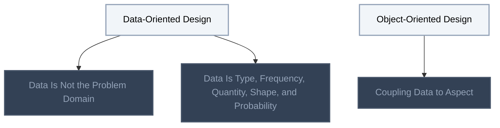
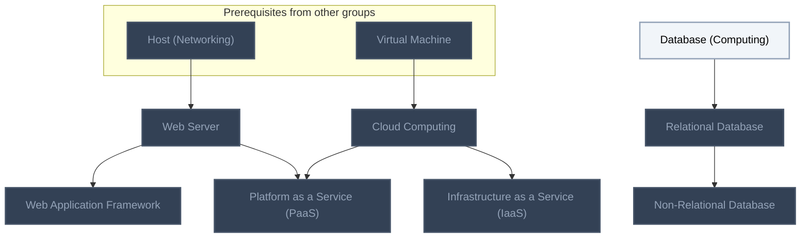

<!-- BEGIN STATS (generated by Scripts/skill_trees.py; do not edit) -->
**Mastered:** 0 / 32 · **Depth:** 0% · **Discovered:** 32 · **Planned:** 0 · **Locked:** 27 · **Rusty:** 0

**Levels:** L0 32 · L1 0 · L2 0 · L3 0 · L4 0 · L5 0

**Next up:** [[Software Complexity]], [[Data-Oriented Design]], [[Object-Oriented Design]], [[Brooks's Law]], [[Database (Computing)]]

Legend: dashed grey = planned (no note yet) · dark grey = locked · white L0 Discovered · green L1 Recall · blue L2 Apply · purple L3 Prove (Mastered) · orange L4 Wield · gold L5 Command · brown dashed border = rusty
<!-- END STATS -->

## A Philosophy of Software Design
**Mastered:** 0 / 18 · **Discovered:** 18 / 18

```mermaid
flowchart TD
    classDef planned fill:#1E293B,stroke:#64748B,stroke-width:2px,stroke-dasharray:5 5,color:#94A3B8;
    classDef locked fill:#334155,stroke:#475569,stroke-width:2px,color:#94A3B8;
    classDef L0 fill:#F1F5F9,stroke:#94A3B8,stroke-width:2px,color:#000000;
    classDef L1 fill:#22C55E,stroke:#15803D,stroke-width:2px,color:#000000;
    classDef L2 fill:#3B82F6,stroke:#1D4ED8,stroke-width:3px,color:#FFFFFF;
    classDef L3 fill:#A855F7,stroke:#6B21A8,stroke-width:3px,color:#FFFFFF,font-weight:bold;
    classDef L4 fill:#F97316,stroke:#C2410C,stroke-width:4px,color:#000000,font-weight:bold;
    classDef L5 fill:#FFD700,stroke:#FF8C00,stroke-width:5px,color:#000000,font-weight:bold;
    classDef rusty stroke:#8B4513,stroke-width:4px,stroke-dasharray:3 3;
    n_software_complexity["Software Complexity"]
    n_change_amplification["Change Amplification"]
    n_cognitive_load_software_design["Cognitive Load (Software Design)"]
    n_unknown_unknowns["Unknown Unknowns"]
    n_dependency_software_design["Dependency (Software Design)"]
    n_obscurity_software_design["Obscurity (Software Design)"]
    n_strategic_programming["Strategic Programming"]
    n_deep_module["Deep Module"]
    n_information_hiding["Information Hiding"]
    n_information_leakage["Information Leakage"]
    n_general_purpose_code["General-Purpose Code"]
    n_module_decomposition["Module Decomposition"]
    n_pass_through_method["Pass-Through Method"]
    n_pass_through_variable["Pass-Through Variable"]
    n_exception_handling_software_design["Exception Handling (Software Design)"]
    n_design_it_twice["Design It Twice"]
    n_comments_software_design["Comments (Software Design)"]
    n_naming_software_design["Naming (Software Design)"]
    n_software_complexity --> n_change_amplification
    n_software_complexity --> n_cognitive_load_software_design
    n_software_complexity --> n_unknown_unknowns
    n_software_complexity --> n_dependency_software_design
    n_software_complexity --> n_obscurity_software_design
    n_software_complexity --> n_strategic_programming
    n_software_complexity --> n_deep_module
    n_software_complexity --> n_naming_software_design
    n_deep_module --> n_information_hiding
    n_information_hiding --> n_information_leakage
    n_dependency_software_design --> n_information_leakage
    n_deep_module --> n_general_purpose_code
    n_general_purpose_code --> n_module_decomposition
    n_deep_module --> n_pass_through_method
    n_pass_through_method --> n_pass_through_variable
    n_dependency_software_design --> n_pass_through_variable
    n_deep_module --> n_exception_handling_software_design
    n_strategic_programming --> n_design_it_twice
    n_cognitive_load_software_design --> n_comments_software_design
    n_unknown_unknowns --> n_comments_software_design
    class n_change_amplification,n_cognitive_load_software_design,n_unknown_unknowns,n_dependency_software_design,n_obscurity_software_design,n_strategic_programming,n_deep_module,n_information_hiding,n_information_leakage,n_general_purpose_code,n_module_decomposition,n_pass_through_method,n_pass_through_variable,n_exception_handling_software_design,n_design_it_twice,n_comments_software_design,n_naming_software_design locked;
    class n_software_complexity L0;
    class n_software_complexity,n_change_amplification,n_cognitive_load_software_design,n_unknown_unknowns,n_dependency_software_design,n_obscurity_software_design,n_strategic_programming,n_deep_module,n_information_hiding,n_information_leakage,n_general_purpose_code,n_module_decomposition,n_pass_through_method,n_pass_through_variable,n_exception_handling_software_design,n_design_it_twice,n_comments_software_design,n_naming_software_design internal-link;
```



## Data-Oriented Design
**Mastered:** 0 / 5 · **Discovered:** 5 / 5



## Software Project Management
**Mastered:** 0 / 1 · **Discovered:** 1 / 1

```mermaid
flowchart TD
    classDef planned fill:#1E293B,stroke:#64748B,stroke-width:2px,stroke-dasharray:5 5,color:#94A3B8;
    classDef locked fill:#334155,stroke:#475569,stroke-width:2px,color:#94A3B8;
    classDef L0 fill:#F1F5F9,stroke:#94A3B8,stroke-width:2px,color:#000000;
    classDef L1 fill:#22C55E,stroke:#15803D,stroke-width:2px,color:#000000;
    classDef L2 fill:#3B82F6,stroke:#1D4ED8,stroke-width:3px,color:#FFFFFF;
    classDef L3 fill:#A855F7,stroke:#6B21A8,stroke-width:3px,color:#FFFFFF,font-weight:bold;
    classDef L4 fill:#F97316,stroke:#C2410C,stroke-width:4px,color:#000000,font-weight:bold;
    classDef L5 fill:#FFD700,stroke:#FF8C00,stroke-width:5px,color:#000000,font-weight:bold;
    classDef rusty stroke:#8B4513,stroke-width:4px,stroke-dasharray:3 3;
    n_brooks_s_law["Brooks's Law"]
    class n_brooks_s_law L0;
    class n_brooks_s_law internal-link;
```



## Databases and Cloud
**Mastered:** 0 / 8 · **Discovered:** 8 / 8



# Source
Graph structure: the single source for the diagrams above, edited by `/note` and `Scripts/skill_trees.py` (`add`, `edge`, `rename`). Everything above this heading is regenerated by `render`.

```skilltree
    %% PREREQUISITES
    n_host_networking["Host (Networking)"]
    n_virtual_machine["Virtual Machine"]
    %% NODES
    %% == A Philosophy of Software Design ==
    n_software_complexity["Software Complexity"]
    n_change_amplification["Change Amplification"]
    n_cognitive_load_software_design["Cognitive Load (Software Design)"]
    n_unknown_unknowns["Unknown Unknowns"]
    n_dependency_software_design["Dependency (Software Design)"]
    n_obscurity_software_design["Obscurity (Software Design)"]
    n_strategic_programming["Strategic Programming"]
    n_deep_module["Deep Module"]
    n_information_hiding["Information Hiding"]
    n_information_leakage["Information Leakage"]
    n_general_purpose_code["General-Purpose Code"]
    n_module_decomposition["Module Decomposition"]
    n_pass_through_method["Pass-Through Method"]
    n_pass_through_variable["Pass-Through Variable"]
    n_exception_handling_software_design["Exception Handling (Software Design)"]
    n_design_it_twice["Design It Twice"]
    n_comments_software_design["Comments (Software Design)"]
    n_naming_software_design["Naming (Software Design)"]
    %% == Data-Oriented Design ==
    n_data_oriented_design["Data-Oriented Design"]
    n_data_is_not_the_problem_domain["Data Is Not the Problem Domain"]
    n_data_is_type_frequency_quantity_shape_and_probability["Data Is Type, Frequency, Quantity, Shape, and Probability"]
    n_object_oriented_design["Object-Oriented Design"]
    n_coupling_data_to_aspect["Coupling Data to Aspect"]
    %% == Software Project Management ==
    n_brooks_s_law["Brooks's Law"]
    %% == Databases and Cloud ==
    n_database_computing["Database (Computing)"]
    n_relational_database["Relational Database"]
    n_non_relational_database["Non-Relational Database"]
    n_web_server["Web Server"]
    n_web_application_framework["Web Application Framework"]
    n_cloud_computing["Cloud Computing"]
    n_infrastructure_as_a_service_iaas["Infrastructure as a Service (IaaS)"]
    n_platform_as_a_service_paas["Platform as a Service (PaaS)"]
    %% EDGES
    n_software_complexity --> n_change_amplification
    n_software_complexity --> n_cognitive_load_software_design
    n_software_complexity --> n_unknown_unknowns
    n_software_complexity --> n_dependency_software_design
    n_software_complexity --> n_obscurity_software_design
    n_software_complexity --> n_strategic_programming
    n_software_complexity --> n_deep_module
    n_software_complexity --> n_naming_software_design
    n_deep_module --> n_information_hiding
    n_information_hiding --> n_information_leakage
    n_dependency_software_design --> n_information_leakage
    n_deep_module --> n_general_purpose_code
    n_general_purpose_code --> n_module_decomposition
    n_deep_module --> n_pass_through_method
    n_pass_through_method --> n_pass_through_variable
    n_dependency_software_design --> n_pass_through_variable
    n_deep_module --> n_exception_handling_software_design
    n_strategic_programming --> n_design_it_twice
    n_cognitive_load_software_design --> n_comments_software_design
    n_unknown_unknowns --> n_comments_software_design
    n_data_oriented_design --> n_data_is_not_the_problem_domain
    n_data_oriented_design --> n_data_is_type_frequency_quantity_shape_and_probability
    n_object_oriented_design --> n_coupling_data_to_aspect
    n_host_networking --> n_web_server
    n_database_computing --> n_relational_database
    n_relational_database --> n_non_relational_database
    n_web_server --> n_web_application_framework
    n_virtual_machine --> n_cloud_computing
    n_cloud_computing --> n_infrastructure_as_a_service_iaas
    n_web_server --> n_platform_as_a_service_paas
    n_cloud_computing --> n_platform_as_a_service_paas
```
