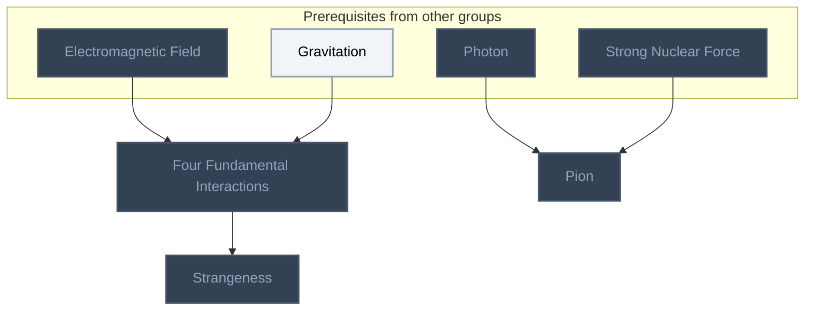
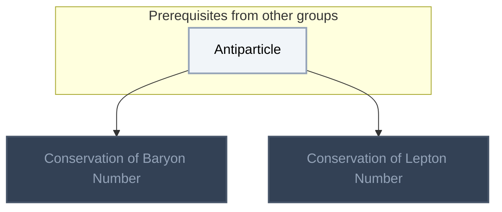
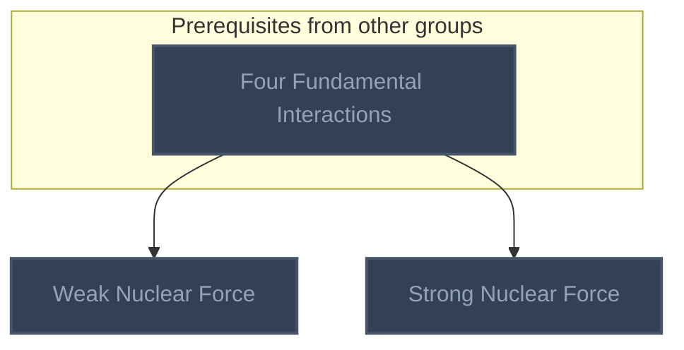

<!-- BEGIN STATS (generated by Scripts/skill_trees.py; do not edit) -->
**Mastered:** 0 / 8 · **Depth:** 0% · **Discovered:** 8 · **Planned:** 0 · **Locked:** 7 · **Rusty:** 0

| | L0 Discovered | L1 Recall | L2 Apply | L3 Prove ★ | L4 Wield | L5 Command |
|---|---:|---:|---:|---:|---:|---:|
| **At this level** | 8 | 0 | 0 | 0 | 0 | 0 |
| **Reached (this level or higher)** | 8 | 0 | 0 | 0 | 0 | 0 |

**Next up:** [[Effective Cross Section]]

Legend: dashed grey = planned (no note yet) · dark grey = locked · white L0 Discovered · green L1 Recall · blue L2 Apply · purple L3 Prove (Mastered) · orange L4 Wield · gold L5 Command · brown dashed border = rusty
<!-- END STATS -->

## Feynman Vol. I Ch. 2: Basic Physics
**Reached:** L1 0 · L2 0 · L3 0 · L4 0 · L5 0 (of 3 nodes)



## Feynman Vol. I Ch. 4: Conservation of Energy
**Reached:** L1 0 · L2 0 · L3 0 · L4 0 · L5 0 (of 2 nodes)



## Feynman Vol. I Ch. 5: Time and Distance
**Reached:** L1 0 · L2 0 · L3 0 · L4 0 · L5 0 (of 1 nodes)

```mermaid
flowchart TD
    classDef planned fill:#1E293B,stroke:#64748B,stroke-width:2px,stroke-dasharray:5 5,color:#94A3B8;
    classDef locked fill:#334155,stroke:#475569,stroke-width:2px,color:#94A3B8;
    classDef L0 fill:#F1F5F9,stroke:#94A3B8,stroke-width:2px,color:#000000;
    classDef L1 fill:#22C55E,stroke:#15803D,stroke-width:2px,color:#000000;
    classDef L2 fill:#3B82F6,stroke:#1D4ED8,stroke-width:3px,color:#FFFFFF;
    classDef L3 fill:#A855F7,stroke:#6B21A8,stroke-width:3px,color:#FFFFFF,font-weight:bold;
    classDef L4 fill:#F97316,stroke:#C2410C,stroke-width:4px,color:#000000,font-weight:bold;
    classDef L5 fill:#FFD700,stroke:#FF8C00,stroke-width:5px,color:#000000,font-weight:bold;
    classDef rusty stroke:#8B4513,stroke-width:4px,stroke-dasharray:3 3;
    n_effective_cross_section["Effective Cross Section"]
    class n_effective_cross_section L0;
    class n_effective_cross_section internal-link;
```



## Modern Physics and Cosmology
**Reached:** L1 0 · L2 0 · L3 0 · L4 0 · L5 0 (of 2 nodes)



# Source
Graph structure: the single source for the diagrams above, edited by `/note` and `Scripts/skill_trees.py` (`add`, `edge`, `rename`). Everything above this heading is regenerated by `render`.

```skilltree
    %% PREREQUISITES
    n_electromagnetic_field["Electromagnetic Field"]
    n_gravitation["Gravitation"]
    n_photon["Photon"]
    n_antiparticle["Antiparticle"]
    %% NODES
    %% == Feynman Vol. I Ch. 2: Basic Physics ==
    n_four_fundamental_interactions["Four Fundamental Interactions"]
    n_strangeness["Strangeness"]
    n_pion["Pion"]
    %% == Feynman Vol. I Ch. 4: Conservation of Energy ==
    n_conservation_of_baryon_number["Conservation of Baryon Number"]
    n_conservation_of_lepton_number["Conservation of Lepton Number"]
    %% == Feynman Vol. I Ch. 5: Time and Distance ==
    n_effective_cross_section["Effective Cross Section"]
    %% == Modern Physics and Cosmology ==
    n_weak_nuclear_force["Weak Nuclear Force"]
    n_strong_nuclear_force["Strong Nuclear Force"]
    %% EDGES
    n_electromagnetic_field --> n_four_fundamental_interactions
    n_gravitation --> n_four_fundamental_interactions
    n_four_fundamental_interactions --> n_strangeness
    n_photon --> n_pion
    n_strong_nuclear_force --> n_pion
    n_antiparticle --> n_conservation_of_baryon_number
    n_antiparticle --> n_conservation_of_lepton_number
    n_four_fundamental_interactions --> n_weak_nuclear_force
    n_four_fundamental_interactions --> n_strong_nuclear_force
```
