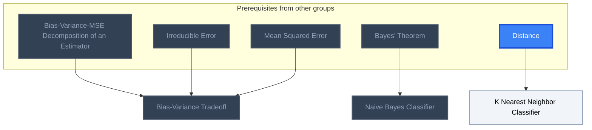

<!-- BEGIN STATS (generated by Scripts/skill_trees.py; do not edit) -->
**Mastered:** 0 / 32 · **Depth:** 0% · **Mastery Depth:** 0% · **Discovered:** 32 · **Planned:** 0 · **Locked:** 30 · **Rusty:** 0

| | L0 Discovered | L1 Recall | L2 Apply | L3 Prove ★ | L4 Wield | L5 Command |
|---|---:|---:|---:|---:|---:|---:|
| **At this level** | 32 | 0 | 0 | 0 | 0 | 0 |
| **Reached (this level or higher)** | 32 | 0 | 0 | 0 | 0 | 0 |

**Next up:** [[Statistical Learning]], [[K Nearest Neighbor Classifier]]

Legend: dashed grey = planned (no note yet) · dark grey = locked · white L0 Discovered · green L1 Recall · blue L2 Apply · purple L3 Prove (Mastered) · orange L4 Wield · gold L5 Command · brown dashed border = rusty
<!-- END STATS -->

## ISL Ch. 2: What Is Statistical Learning?
**Reached:** L1 0 · L2 0 · L3 0 · L4 0 · L5 0 (of 13 nodes)

```mermaid
flowchart TD
    classDef planned fill:#1E293B,stroke:#64748B,stroke-width:2px,stroke-dasharray:5 5,color:#94A3B8;
    classDef locked fill:#334155,stroke:#475569,stroke-width:2px,color:#94A3B8;
    classDef L0 fill:#F1F5F9,stroke:#94A3B8,stroke-width:2px,color:#000000;
    classDef L1 fill:#22C55E,stroke:#15803D,stroke-width:2px,color:#000000;
    classDef L2 fill:#3B82F6,stroke:#1D4ED8,stroke-width:3px,color:#FFFFFF;
    classDef L3 fill:#A855F7,stroke:#6B21A8,stroke-width:3px,color:#FFFFFF,font-weight:bold;
    classDef L4 fill:#F97316,stroke:#C2410C,stroke-width:4px,color:#000000,font-weight:bold;
    classDef L5 fill:#FFD700,stroke:#FF8C00,stroke-width:5px,color:#000000,font-weight:bold;
    classDef rusty stroke:#8B4513,stroke-width:4px,stroke-dasharray:3 3;
    subgraph sg_prereqs["Prerequisites from other groups"]
        n_machine_learning["Machine Learning"]
        n_regression["Regression"]
        n_function["Function"]
        n_independent_random_variable["Independent Random Variable"]
        n_overfitting["Overfitting"]
        n_supervised_learning["Supervised Learning"]
        n_unsupervised_learning["Unsupervised Learning"]
    end
    n_statistical_learning["Statistical Learning"]
    n_clustering["Clustering"]
    n_survival_analysis["Survival Analysis"]
    n_supervised_learning_formulation_from_statistical_learning_perspective["Supervised Learning Formulation from Statistical Learning Perspective"]
    n_prediction["Prediction"]
    n_prediction_error["Prediction Error"]
    n_reducible_error["Reducible Error"]
    n_irreducible_error["Irreducible Error"]
    n_inference["Inference"]
    n_statistical_learning_parametric_model["Statistical Learning Parametric Model"]
    n_statistical_learning_non_parametric_model["Statistical Learning Non-Parametric Model"]
    n_model_flexibility_vs_interpretability["Model Flexibility vs. Interpretability"]
    n_semi_supervised_learning["Semi-Supervised Learning"]
    n_machine_learning --> n_clustering
    n_statistical_learning --> n_clustering
    n_regression --> n_survival_analysis
    n_function --> n_supervised_learning_formulation_from_statistical_learning_perspective
    n_independent_random_variable --> n_supervised_learning_formulation_from_statistical_learning_perspective
    n_statistical_learning --> n_supervised_learning_formulation_from_statistical_learning_perspective
    n_supervised_learning_formulation_from_statistical_learning_perspective --> n_prediction
    n_prediction --> n_prediction_error
    n_prediction_error --> n_reducible_error
    n_prediction_error --> n_irreducible_error
    n_supervised_learning_formulation_from_statistical_learning_perspective --> n_inference
    n_supervised_learning_formulation_from_statistical_learning_perspective --> n_statistical_learning_parametric_model
    n_statistical_learning_parametric_model --> n_statistical_learning_non_parametric_model
    n_overfitting --> n_model_flexibility_vs_interpretability
    n_statistical_learning_non_parametric_model --> n_model_flexibility_vs_interpretability
    n_supervised_learning --> n_semi_supervised_learning
    n_unsupervised_learning --> n_semi_supervised_learning
    n_statistical_learning --> n_semi_supervised_learning
    class n_machine_learning,n_regression,n_overfitting,n_supervised_learning,n_unsupervised_learning,n_clustering,n_survival_analysis,n_supervised_learning_formulation_from_statistical_learning_perspective,n_prediction,n_prediction_error,n_reducible_error,n_irreducible_error,n_inference,n_statistical_learning_parametric_model,n_statistical_learning_non_parametric_model,n_model_flexibility_vs_interpretability,n_semi_supervised_learning locked;
    class n_statistical_learning L0;
    class n_independent_random_variable L1;
    class n_function L3;
    class n_machine_learning,n_regression,n_function,n_independent_random_variable,n_overfitting,n_supervised_learning,n_unsupervised_learning,n_statistical_learning,n_clustering,n_survival_analysis,n_supervised_learning_formulation_from_statistical_learning_perspective,n_prediction,n_prediction_error,n_reducible_error,n_irreducible_error,n_inference,n_statistical_learning_parametric_model,n_statistical_learning_non_parametric_model,n_model_flexibility_vs_interpretability,n_semi_supervised_learning internal-link;
```



## ISL Ch. 2: Assessing Model Accuracy and Classification
**Reached:** L1 0 · L2 0 · L3 0 · L4 0 · L5 0 (of 3 nodes)



## ISL Ch. 3: Simple Linear Regression
**Reached:** L1 0 · L2 0 · L3 0 · L4 0 · L5 0 (of 10 nodes)

```mermaid
flowchart TD
    classDef planned fill:#1E293B,stroke:#64748B,stroke-width:2px,stroke-dasharray:5 5,color:#94A3B8;
    classDef locked fill:#334155,stroke:#475569,stroke-width:2px,color:#94A3B8;
    classDef L0 fill:#F1F5F9,stroke:#94A3B8,stroke-width:2px,color:#000000;
    classDef L1 fill:#22C55E,stroke:#15803D,stroke-width:2px,color:#000000;
    classDef L2 fill:#3B82F6,stroke:#1D4ED8,stroke-width:3px,color:#FFFFFF;
    classDef L3 fill:#A855F7,stroke:#6B21A8,stroke-width:3px,color:#FFFFFF,font-weight:bold;
    classDef L4 fill:#F97316,stroke:#C2410C,stroke-width:4px,color:#000000,font-weight:bold;
    classDef L5 fill:#FFD700,stroke:#FF8C00,stroke-width:5px,color:#000000,font-weight:bold;
    classDef rusty stroke:#8B4513,stroke-width:4px,stroke-dasharray:3 3;
    subgraph sg_prereqs["Prerequisites from other groups"]
        n_independent_random_variable["Independent Random Variable"]
        n_linear_regression["Linear Regression"]
        n_normal_distribution["Normal Distribution"]
        n_regression["Regression"]
        n_standard_error["Standard Error"]
        n_t_distribution["t-Distribution"]
        n_confidence_interval["Confidence Interval"]
        n_statistical_hypothesis_test["Statistical Hypothesis Test"]
        n_variance["Variance"]
        n_multiple_linear_regression["Multiple Linear Regression"]
    end
    n_linear_regression_assumptions["Linear Regression Assumptions"]
    n_residual_sum_of_squares["Residual Sum of Squares"]
    n_simple_linear_regression["Simple Linear Regression"]
    n_residual_standard_error["Residual Standard Error"]
    n_simple_linear_regression_coefficient_standard_error["Simple Linear Regression Coefficient Standard Error"]
    n_simple_linear_regression_coefficient_confidence_interval["Simple Linear Regression Coefficient Confidence Interval"]
    n_t_test_statistic["t-Test Statistic"]
    n_simple_linear_regression_hypothesis_test["Simple Linear Regression Hypothesis Test"]
    n_total_sum_of_squares["Total Sum of Squares"]
    n_r2_statistic["R2 Statistic"]
    n_independent_random_variable --> n_linear_regression_assumptions
    n_linear_regression --> n_linear_regression_assumptions
    n_normal_distribution --> n_linear_regression_assumptions
    n_regression --> n_residual_sum_of_squares
    n_linear_regression --> n_simple_linear_regression
    n_residual_sum_of_squares --> n_simple_linear_regression
    n_simple_linear_regression --> n_residual_standard_error
    n_standard_error --> n_residual_standard_error
    n_simple_linear_regression --> n_simple_linear_regression_coefficient_standard_error
    n_standard_error --> n_simple_linear_regression_coefficient_standard_error
    n_t_distribution --> n_simple_linear_regression_coefficient_confidence_interval
    n_confidence_interval --> n_simple_linear_regression_coefficient_confidence_interval
    n_simple_linear_regression_coefficient_standard_error --> n_simple_linear_regression_coefficient_confidence_interval
    n_t_distribution --> n_t_test_statistic
    n_simple_linear_regression_coefficient_standard_error --> n_t_test_statistic
    n_statistical_hypothesis_test --> n_simple_linear_regression_hypothesis_test
    n_t_test_statistic --> n_simple_linear_regression_hypothesis_test
    n_regression --> n_total_sum_of_squares
    n_variance --> n_total_sum_of_squares
    n_simple_linear_regression --> n_r2_statistic
    n_total_sum_of_squares --> n_r2_statistic
    n_multiple_linear_regression --> n_r2_statistic
    class n_linear_regression,n_normal_distribution,n_regression,n_standard_error,n_t_distribution,n_confidence_interval,n_statistical_hypothesis_test,n_variance,n_multiple_linear_regression,n_linear_regression_assumptions,n_residual_sum_of_squares,n_simple_linear_regression,n_residual_standard_error,n_simple_linear_regression_coefficient_standard_error,n_simple_linear_regression_coefficient_confidence_interval,n_t_test_statistic,n_simple_linear_regression_hypothesis_test,n_total_sum_of_squares,n_r2_statistic locked;
    class n_independent_random_variable L1;
    class n_independent_random_variable,n_linear_regression,n_normal_distribution,n_regression,n_standard_error,n_t_distribution,n_confidence_interval,n_statistical_hypothesis_test,n_variance,n_multiple_linear_regression,n_linear_regression_assumptions,n_residual_sum_of_squares,n_simple_linear_regression,n_residual_standard_error,n_simple_linear_regression_coefficient_standard_error,n_simple_linear_regression_coefficient_confidence_interval,n_t_test_statistic,n_simple_linear_regression_hypothesis_test,n_total_sum_of_squares,n_r2_statistic internal-link;
```



## ISL Ch. 3: Multiple Linear Regression
**Reached:** L1 0 · L2 0 · L3 0 · L4 0 · L5 0 (of 6 nodes)

```mermaid
flowchart TD
    classDef planned fill:#1E293B,stroke:#64748B,stroke-width:2px,stroke-dasharray:5 5,color:#94A3B8;
    classDef locked fill:#334155,stroke:#475569,stroke-width:2px,color:#94A3B8;
    classDef L0 fill:#F1F5F9,stroke:#94A3B8,stroke-width:2px,color:#000000;
    classDef L1 fill:#22C55E,stroke:#15803D,stroke-width:2px,color:#000000;
    classDef L2 fill:#3B82F6,stroke:#1D4ED8,stroke-width:3px,color:#FFFFFF;
    classDef L3 fill:#A855F7,stroke:#6B21A8,stroke-width:3px,color:#FFFFFF,font-weight:bold;
    classDef L4 fill:#F97316,stroke:#C2410C,stroke-width:4px,color:#000000,font-weight:bold;
    classDef L5 fill:#FFD700,stroke:#FF8C00,stroke-width:5px,color:#000000,font-weight:bold;
    classDef rusty stroke:#8B4513,stroke-width:4px,stroke-dasharray:3 3;
    subgraph sg_prereqs["Prerequisites from other groups"]
        n_f_distribution["F-Distribution"]
        n_multiple_linear_regression["Multiple Linear Regression"]
        n_residual_sum_of_squares["Residual Sum of Squares"]
        n_total_sum_of_squares["Total Sum of Squares"]
        n_statistical_hypothesis_test["Statistical Hypothesis Test"]
        n_p_value["P-Value"]
    end
    n_f_test_statistic["F-Test Statistic"]
    n_multiple_linear_regression_hypothesis_test["Multiple Linear Regression Hypothesis Test"]
    n_linear_regression_parameter_selection["Linear Regression Parameter Selection"]
    n_forward_selection["Forward Selection"]
    n_backward_selection["Backward Selection"]
    n_mixed_selection["Mixed Selection"]
    n_f_distribution --> n_f_test_statistic
    n_multiple_linear_regression --> n_f_test_statistic
    n_residual_sum_of_squares --> n_f_test_statistic
    n_total_sum_of_squares --> n_f_test_statistic
    n_statistical_hypothesis_test --> n_multiple_linear_regression_hypothesis_test
    n_f_test_statistic --> n_multiple_linear_regression_hypothesis_test
    n_multiple_linear_regression --> n_linear_regression_parameter_selection
    n_residual_sum_of_squares --> n_forward_selection
    n_linear_regression_parameter_selection --> n_forward_selection
    n_p_value --> n_backward_selection
    n_linear_regression_parameter_selection --> n_backward_selection
    n_forward_selection --> n_mixed_selection
    n_backward_selection --> n_mixed_selection
    n_multiple_linear_regression --> n_multiple_linear_regression_hypothesis_test
    class n_f_distribution,n_multiple_linear_regression,n_residual_sum_of_squares,n_total_sum_of_squares,n_statistical_hypothesis_test,n_p_value,n_f_test_statistic,n_multiple_linear_regression_hypothesis_test,n_linear_regression_parameter_selection,n_forward_selection,n_backward_selection,n_mixed_selection locked;
    class n_f_distribution,n_multiple_linear_regression,n_residual_sum_of_squares,n_total_sum_of_squares,n_statistical_hypothesis_test,n_p_value,n_f_test_statistic,n_multiple_linear_regression_hypothesis_test,n_linear_regression_parameter_selection,n_forward_selection,n_backward_selection,n_mixed_selection internal-link;
```



# Source
Graph structure: the single source for the diagrams above, edited by `/note` and `Scripts/skill_trees.py` (`add`, `edge`, `rename`). Everything above this heading is regenerated by `render`.

```skilltree
    %% PREREQUISITES
    n_bayes_theorem["Bayes' Theorem"]
    n_multiple_linear_regression["Multiple Linear Regression"]
    n_overfitting["Overfitting"]
    n_linear_regression["Linear Regression"]
    n_machine_learning["Machine Learning"]
    n_regression["Regression"]
    n_supervised_learning["Supervised Learning"]
    n_unsupervised_learning["Unsupervised Learning"]
    n_f_distribution["F-Distribution"]
    n_independent_random_variable["Independent Random Variable"]
    n_normal_distribution["Normal Distribution"]
    n_p_value["P-Value"]
    n_statistical_hypothesis_test["Statistical Hypothesis Test"]
    n_variance["Variance"]
    n_t_distribution["t-Distribution"]
    n_bias_variance_mse_decomposition_of_an_estimator["Bias-Variance-MSE Decomposition of an Estimator"]
    n_distance["Distance"]
    n_function["Function"]
    n_mean_squared_error["Mean Squared Error"]
    n_confidence_interval["Confidence Interval"]
    n_standard_error["Standard Error"]
    %% NODES
    %% == ISL Ch. 2: What Is Statistical Learning? ==
    n_statistical_learning["Statistical Learning"]
    n_clustering["Clustering"]
    n_survival_analysis["Survival Analysis"]
    n_supervised_learning_formulation_from_statistical_learning_perspective["Supervised Learning Formulation from Statistical Learning Perspective"]
    n_prediction["Prediction"]
    n_prediction_error["Prediction Error"]
    n_reducible_error["Reducible Error"]
    n_irreducible_error["Irreducible Error"]
    n_inference["Inference"]
    n_statistical_learning_parametric_model["Statistical Learning Parametric Model"]
    n_statistical_learning_non_parametric_model["Statistical Learning Non-Parametric Model"]
    n_model_flexibility_vs_interpretability["Model Flexibility vs. Interpretability"]
    n_semi_supervised_learning["Semi-Supervised Learning"]
    %% == ISL Ch. 2: Assessing Model Accuracy and Classification ==
    n_bias_variance_tradeoff["Bias-Variance Tradeoff"]
    n_naive_bayes_classifier["Naive Bayes Classifier"]
    n_k_nearest_neighbor_classifier["K Nearest Neighbor Classifier"]
    %% == ISL Ch. 3: Simple Linear Regression ==
    n_linear_regression_assumptions["Linear Regression Assumptions"]
    n_residual_sum_of_squares["Residual Sum of Squares"]
    n_simple_linear_regression["Simple Linear Regression"]
    n_residual_standard_error["Residual Standard Error"]
    n_simple_linear_regression_coefficient_standard_error["Simple Linear Regression Coefficient Standard Error"]
    n_simple_linear_regression_coefficient_confidence_interval["Simple Linear Regression Coefficient Confidence Interval"]
    n_t_test_statistic["t-Test Statistic"]
    n_simple_linear_regression_hypothesis_test["Simple Linear Regression Hypothesis Test"]
    n_total_sum_of_squares["Total Sum of Squares"]
    n_r2_statistic["R2 Statistic"]
    %% == ISL Ch. 3: Multiple Linear Regression ==
    n_f_test_statistic["F-Test Statistic"]
    n_multiple_linear_regression_hypothesis_test["Multiple Linear Regression Hypothesis Test"]
    n_linear_regression_parameter_selection["Linear Regression Parameter Selection"]
    n_forward_selection["Forward Selection"]
    n_backward_selection["Backward Selection"]
    n_mixed_selection["Mixed Selection"]
    %% EDGES
    n_machine_learning --> n_clustering
    n_statistical_learning --> n_clustering
    n_regression --> n_survival_analysis
    n_function --> n_supervised_learning_formulation_from_statistical_learning_perspective
    n_independent_random_variable --> n_supervised_learning_formulation_from_statistical_learning_perspective
    n_statistical_learning --> n_supervised_learning_formulation_from_statistical_learning_perspective
    n_supervised_learning_formulation_from_statistical_learning_perspective --> n_prediction
    n_prediction --> n_prediction_error
    n_prediction_error --> n_reducible_error
    n_prediction_error --> n_irreducible_error
    n_supervised_learning_formulation_from_statistical_learning_perspective --> n_inference
    n_supervised_learning_formulation_from_statistical_learning_perspective --> n_statistical_learning_parametric_model
    n_statistical_learning_parametric_model --> n_statistical_learning_non_parametric_model
    n_overfitting --> n_model_flexibility_vs_interpretability
    n_statistical_learning_non_parametric_model --> n_model_flexibility_vs_interpretability
    n_supervised_learning --> n_semi_supervised_learning
    n_unsupervised_learning --> n_semi_supervised_learning
    n_statistical_learning --> n_semi_supervised_learning
    n_bias_variance_mse_decomposition_of_an_estimator --> n_bias_variance_tradeoff
    n_irreducible_error --> n_bias_variance_tradeoff
    n_mean_squared_error --> n_bias_variance_tradeoff
    n_bayes_theorem --> n_naive_bayes_classifier
    n_distance --> n_k_nearest_neighbor_classifier
    n_independent_random_variable --> n_linear_regression_assumptions
    n_linear_regression --> n_linear_regression_assumptions
    n_normal_distribution --> n_linear_regression_assumptions
    n_regression --> n_residual_sum_of_squares
    n_linear_regression --> n_simple_linear_regression
    n_residual_sum_of_squares --> n_simple_linear_regression
    n_simple_linear_regression --> n_residual_standard_error
    n_standard_error --> n_residual_standard_error
    n_simple_linear_regression --> n_simple_linear_regression_coefficient_standard_error
    n_standard_error --> n_simple_linear_regression_coefficient_standard_error
    n_t_distribution --> n_simple_linear_regression_coefficient_confidence_interval
    n_confidence_interval --> n_simple_linear_regression_coefficient_confidence_interval
    n_simple_linear_regression_coefficient_standard_error --> n_simple_linear_regression_coefficient_confidence_interval
    n_t_distribution --> n_t_test_statistic
    n_simple_linear_regression_coefficient_standard_error --> n_t_test_statistic
    n_statistical_hypothesis_test --> n_simple_linear_regression_hypothesis_test
    n_t_test_statistic --> n_simple_linear_regression_hypothesis_test
    n_regression --> n_total_sum_of_squares
    n_variance --> n_total_sum_of_squares
    n_simple_linear_regression --> n_r2_statistic
    n_total_sum_of_squares --> n_r2_statistic
    n_f_distribution --> n_f_test_statistic
    n_multiple_linear_regression --> n_f_test_statistic
    n_residual_sum_of_squares --> n_f_test_statistic
    n_total_sum_of_squares --> n_f_test_statistic
    n_statistical_hypothesis_test --> n_multiple_linear_regression_hypothesis_test
    n_f_test_statistic --> n_multiple_linear_regression_hypothesis_test
    n_multiple_linear_regression --> n_linear_regression_parameter_selection
    n_residual_sum_of_squares --> n_forward_selection
    n_linear_regression_parameter_selection --> n_forward_selection
    n_p_value --> n_backward_selection
    n_linear_regression_parameter_selection --> n_backward_selection
    n_forward_selection --> n_mixed_selection
    n_backward_selection --> n_mixed_selection
    n_multiple_linear_regression --> n_multiple_linear_regression_hypothesis_test
    n_multiple_linear_regression --> n_r2_statistic
```
