<!-- BEGIN STATS (generated by Scripts/skill_trees.py; do not edit) -->
**Mastered:** 0 / 9 · **Depth:** 0% · **Discovered:** 9 · **Planned:** 0 · **Locked:** 8 · **Rusty:** 0

**Levels:** L0 9 · L1 0 · L2 0 · L3 0 · L4 0 · L5 0

**Next up:** [[Atomic Hypothesis]]

Legend: dashed grey = planned (no note yet) · dark grey = locked · white L0 Discovered · green L1 Recall · blue L2 Apply · purple L3 Prove (Mastered) · orange L4 Wield · gold L5 Command · brown dashed border = rusty
<!-- END STATS -->

## Feynman Vol. I Ch. 1: Atoms in Motion
**Mastered:** 0 / 9 · **Discovered:** 9 / 9

```mermaid
flowchart TD
    classDef planned fill:#1E293B,stroke:#64748B,stroke-width:2px,stroke-dasharray:5 5,color:#94A3B8;
    classDef locked fill:#334155,stroke:#475569,stroke-width:2px,color:#94A3B8;
    classDef L0 fill:#F1F5F9,stroke:#94A3B8,stroke-width:2px,color:#000000;
    classDef L1 fill:#22C55E,stroke:#15803D,stroke-width:2px,color:#000000;
    classDef L2 fill:#3B82F6,stroke:#1D4ED8,stroke-width:3px,color:#FFFFFF;
    classDef L3 fill:#A855F7,stroke:#6B21A8,stroke-width:3px,color:#FFFFFF,font-weight:bold;
    classDef L4 fill:#F97316,stroke:#C2410C,stroke-width:4px,color:#000000,font-weight:bold;
    classDef L5 fill:#FFD700,stroke:#FF8C00,stroke-width:5px,color:#000000,font-weight:bold;
    classDef rusty stroke:#8B4513,stroke-width:4px,stroke-dasharray:3 3;
    subgraph sg_prereqs["Prerequisites from other groups"]
        n_crystalline_structure["Crystalline Structure"]
    end
    n_atomic_hypothesis["Atomic Hypothesis"]
    n_chemical_reaction["Chemical Reaction"]
    n_kinetic_theory_of_pressure["Kinetic Theory of Pressure"]
    n_evaporation["Evaporation"]
    n_dynamic_equilibrium["Dynamic Equilibrium"]
    n_kinetic_theory_of_heat["Kinetic Theory of Heat"]
    n_melting["Melting"]
    n_adiabatic_compression_and_expansion["Adiabatic Compression and Expansion"]
    n_evaporative_cooling["Evaporative Cooling"]
    n_atomic_hypothesis --> n_chemical_reaction
    n_atomic_hypothesis --> n_kinetic_theory_of_pressure
    n_atomic_hypothesis --> n_evaporation
    n_atomic_hypothesis --> n_dynamic_equilibrium
    n_atomic_hypothesis --> n_kinetic_theory_of_heat
    n_crystalline_structure --> n_melting
    n_kinetic_theory_of_heat --> n_melting
    n_kinetic_theory_of_pressure --> n_adiabatic_compression_and_expansion
    n_evaporation --> n_evaporative_cooling
    n_kinetic_theory_of_heat --> n_evaporative_cooling
    class n_crystalline_structure,n_chemical_reaction,n_kinetic_theory_of_pressure,n_evaporation,n_dynamic_equilibrium,n_kinetic_theory_of_heat,n_melting,n_adiabatic_compression_and_expansion,n_evaporative_cooling locked;
    class n_atomic_hypothesis L0;
    class n_crystalline_structure,n_atomic_hypothesis,n_chemical_reaction,n_kinetic_theory_of_pressure,n_evaporation,n_dynamic_equilibrium,n_kinetic_theory_of_heat,n_melting,n_adiabatic_compression_and_expansion,n_evaporative_cooling internal-link;
```



# Source
Graph structure: the single source for the diagrams above, edited by `/note` and `Scripts/skill_trees.py` (`add`, `edge`, `rename`). Everything above this heading is regenerated by `render`.

```skilltree
    %% PREREQUISITES
    n_crystalline_structure["Crystalline Structure"]
    %% NODES
    %% == Feynman Vol. I Ch. 1: Atoms in Motion ==
    n_atomic_hypothesis["Atomic Hypothesis"]
    n_chemical_reaction["Chemical Reaction"]
    n_kinetic_theory_of_pressure["Kinetic Theory of Pressure"]
    n_evaporation["Evaporation"]
    n_dynamic_equilibrium["Dynamic Equilibrium"]
    n_kinetic_theory_of_heat["Kinetic Theory of Heat"]
    n_melting["Melting"]
    n_adiabatic_compression_and_expansion["Adiabatic Compression and Expansion"]
    n_evaporative_cooling["Evaporative Cooling"]
    %% EDGES
    n_atomic_hypothesis --> n_chemical_reaction
    n_atomic_hypothesis --> n_kinetic_theory_of_pressure
    n_atomic_hypothesis --> n_evaporation
    n_atomic_hypothesis --> n_dynamic_equilibrium
    n_atomic_hypothesis --> n_kinetic_theory_of_heat
    n_crystalline_structure --> n_melting
    n_kinetic_theory_of_heat --> n_melting
    n_kinetic_theory_of_pressure --> n_adiabatic_compression_and_expansion
    n_evaporation --> n_evaporative_cooling
    n_kinetic_theory_of_heat --> n_evaporative_cooling
```
