<!-- BEGIN STATS (generated by Scripts/skill_trees.py; do not edit) -->
**Mastered:** 0 / 48 · **Depth:** 0% · **Discovered:** 0 · **Planned:** 48 · **Locked:** 0 · **Rusty:** 0

**Levels:** L0 0 · L1 0 · L2 0 · L3 0 · L4 0 · L5 0

**Next up:** —

Legend: dashed grey = planned (no note yet) · dark grey = locked · white L0 Discovered · green L1 Recall · blue L2 Apply · purple L3 Prove (Mastered) · orange L4 Wield · gold L5 Command · brown dashed border = rusty
<!-- END STATS -->

## Øksendal Ch. 2: Mathematical Preliminaries
**Mastered:** 0 / 3 · **Discovered:** 0 / 3

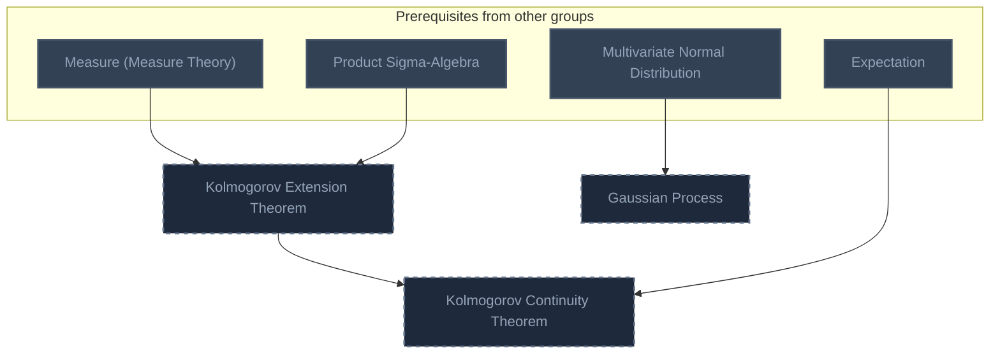

## Øksendal Ch. 3: Itô Integrals
**Mastered:** 0 / 7 · **Discovered:** 0 / 7

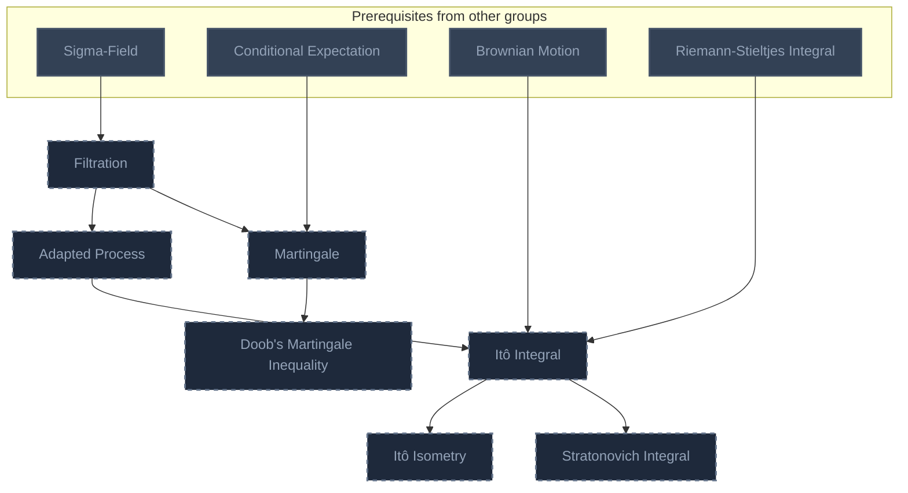

## Øksendal Ch. 4: The Itô Formula and the Martingale Representation Theorem
**Mastered:** 0 / 5 · **Discovered:** 0 / 5

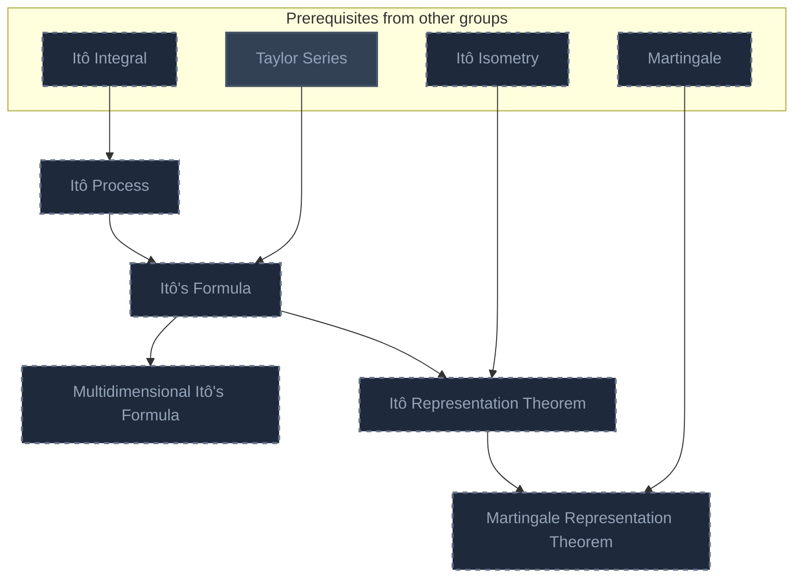

## Øksendal Ch. 5: Stochastic Differential Equations
**Mastered:** 0 / 4 · **Discovered:** 0 / 4

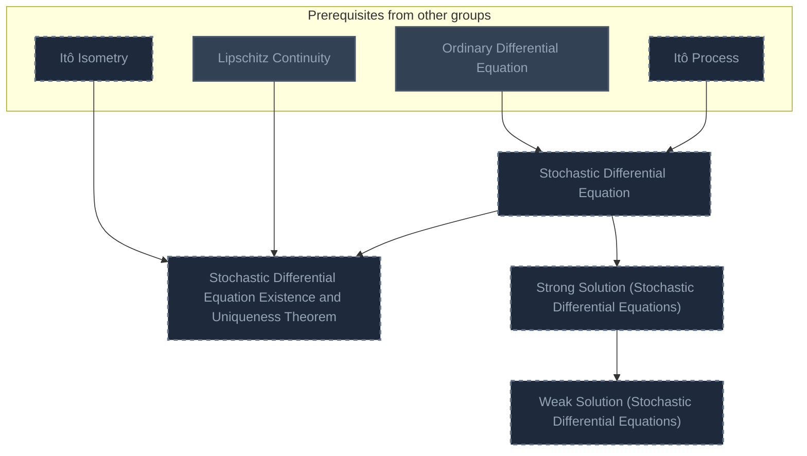

## Øksendal Ch. 6: The Filtering Problem
**Mastered:** 0 / 2 · **Discovered:** 0 / 2

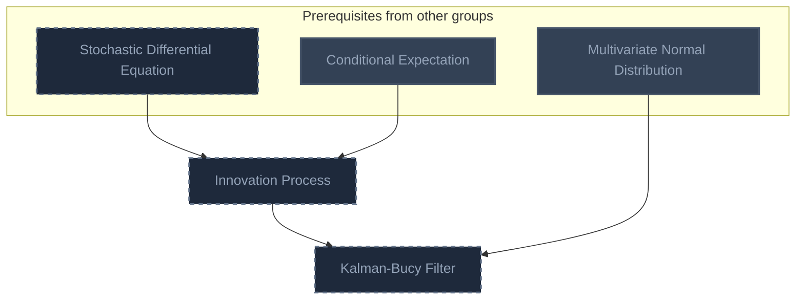

## Øksendal Ch. 7: Diffusions: Basic Properties
**Mastered:** 0 / 7 · **Discovered:** 0 / 7

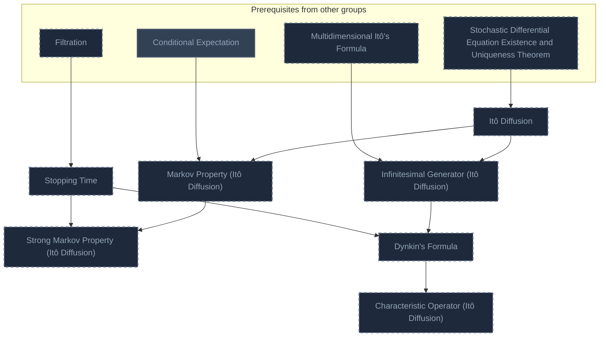

## Øksendal Ch. 8: Other Topics in Diffusion Theory
**Mastered:** 0 / 6 · **Discovered:** 0 / 6

```mermaid
flowchart TD
    classDef planned fill:#1E293B,stroke:#64748B,stroke-width:2px,stroke-dasharray:5 5,color:#94A3B8;
    classDef locked fill:#334155,stroke:#475569,stroke-width:2px,color:#94A3B8;
    classDef L0 fill:#F1F5F9,stroke:#94A3B8,stroke-width:2px,color:#000000;
    classDef L1 fill:#22C55E,stroke:#15803D,stroke-width:2px,color:#000000;
    classDef L2 fill:#3B82F6,stroke:#1D4ED8,stroke-width:3px,color:#FFFFFF;
    classDef L3 fill:#A855F7,stroke:#6B21A8,stroke-width:3px,color:#FFFFFF,font-weight:bold;
    classDef L4 fill:#F97316,stroke:#C2410C,stroke-width:4px,color:#000000,font-weight:bold;
    classDef L5 fill:#FFD700,stroke:#FF8C00,stroke-width:5px,color:#000000,font-weight:bold;
    classDef rusty stroke:#8B4513,stroke-width:4px,stroke-dasharray:3 3;
    subgraph sg_prereqs["Prerequisites from other groups"]
        n_dynkin_s_formula["Dynkin's Formula"]
        n_diffusion_equation["Diffusion Equation"]
        n_infinitesimal_generator_it_diffusion["Infinitesimal Generator (Itô Diffusion)"]
        n_martingale["Martingale"]
        n_multidimensional_it_s_formula["Multidimensional Itô's Formula"]
        n_absolutely_continuous_measure["Absolutely Continuous Measure"]
    end
    n_kolmogorov_backward_equation["Kolmogorov Backward Equation"]
    n_resolvent_operator_it_diffusion["Resolvent Operator (Itô Diffusion)"]
    n_feynman_kac_formula["Feynman-Kac Formula"]
    n_martingale_problem["Martingale Problem"]
    n_l_vy_characterization_of_brownian_motion["Lévy Characterization of Brownian Motion"]
    n_girsanov_theorem["Girsanov Theorem"]
    n_dynkin_s_formula --> n_kolmogorov_backward_equation
    n_diffusion_equation --> n_kolmogorov_backward_equation
    n_infinitesimal_generator_it_diffusion --> n_resolvent_operator_it_diffusion
    n_kolmogorov_backward_equation --> n_feynman_kac_formula
    n_infinitesimal_generator_it_diffusion --> n_martingale_problem
    n_martingale --> n_martingale_problem
    n_martingale --> n_l_vy_characterization_of_brownian_motion
    n_multidimensional_it_s_formula --> n_l_vy_characterization_of_brownian_motion
    n_l_vy_characterization_of_brownian_motion --> n_girsanov_theorem
    n_absolutely_continuous_measure --> n_girsanov_theorem
    class n_dynkin_s_formula,n_infinitesimal_generator_it_diffusion,n_martingale,n_multidimensional_it_s_formula,n_kolmogorov_backward_equation,n_resolvent_operator_it_diffusion,n_feynman_kac_formula,n_martingale_problem,n_l_vy_characterization_of_brownian_motion,n_girsanov_theorem planned;
    class n_diffusion_equation,n_absolutely_continuous_measure locked;
    class n_diffusion_equation,n_absolutely_continuous_measure internal-link;
```

## Øksendal Ch. 9: Applications to Boundary Value Problems
**Mastered:** 0 / 4 · **Discovered:** 0 / 4

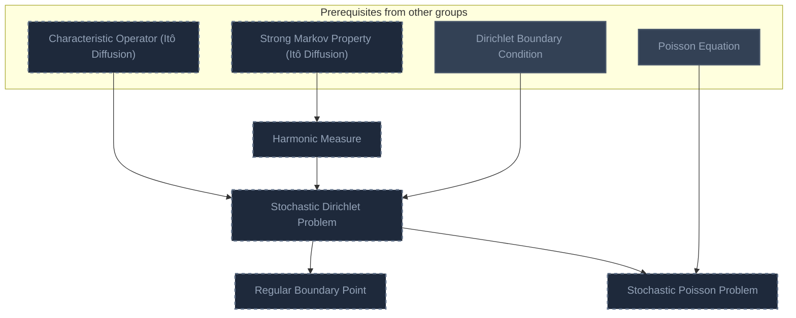

## Øksendal Ch. 10: Application to Optimal Stopping
**Mastered:** 0 / 3 · **Discovered:** 0 / 3

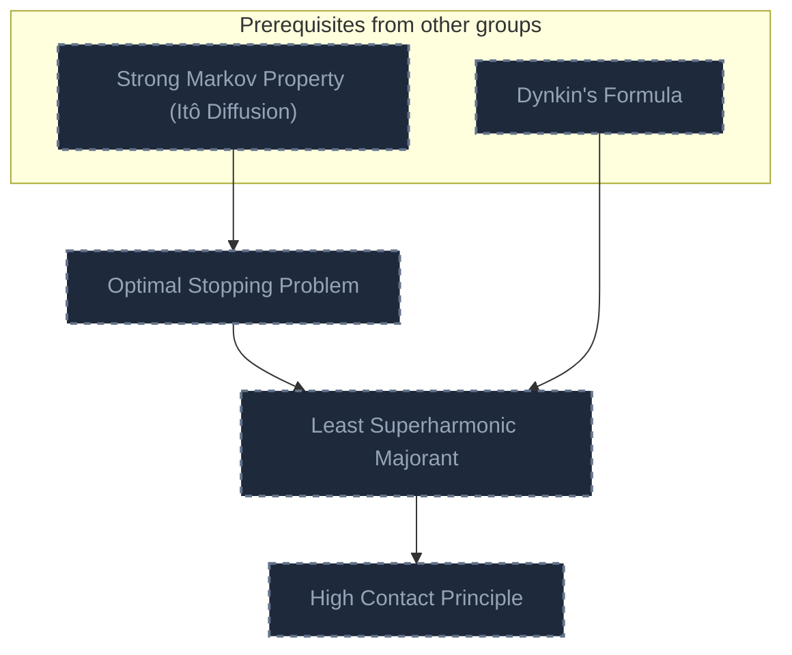

## Øksendal Ch. 11: Application to Stochastic Control
**Mastered:** 0 / 2 · **Discovered:** 0 / 2

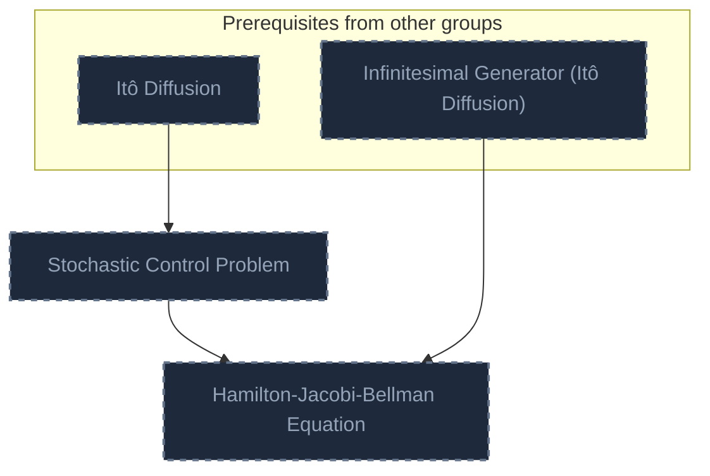

## Øksendal Ch. 12: Application to Mathematical Finance
**Mastered:** 0 / 5 · **Discovered:** 0 / 5

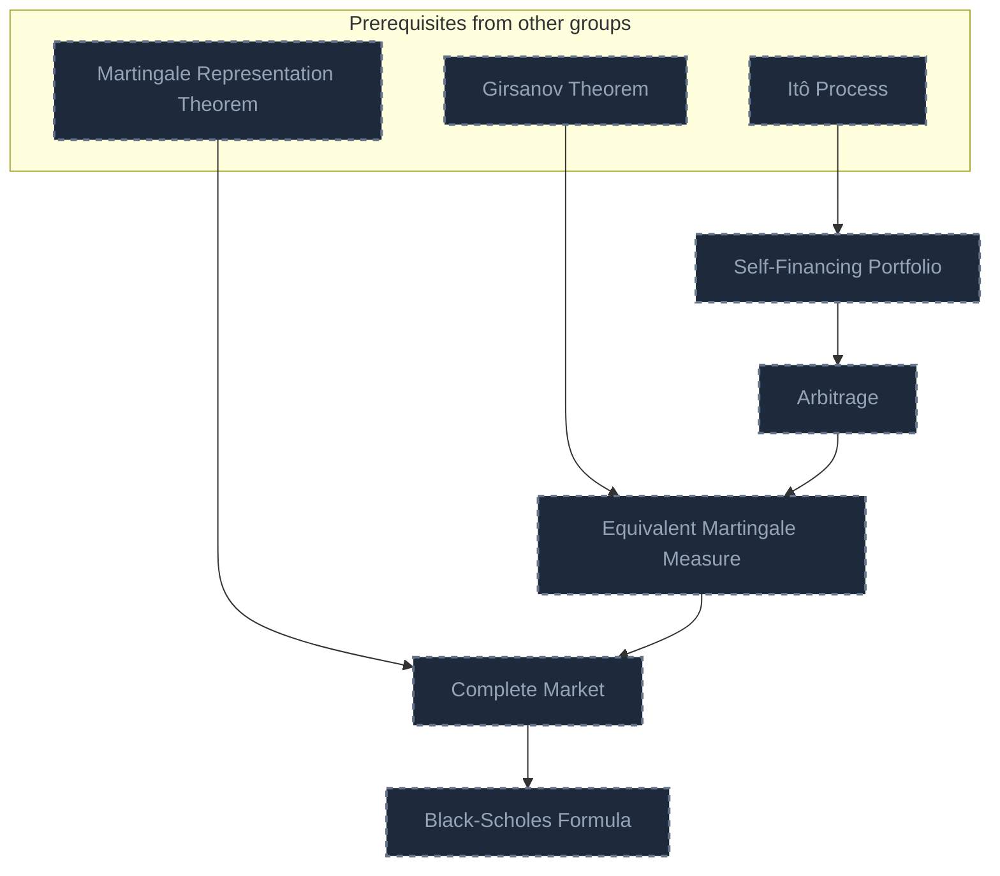

# Source
Graph structure: the single source for the diagrams above, edited by `/note` and `Scripts/skill_trees.py` (`add`, `edge`, `rename`). Everything above this heading is regenerated by `render`.

```skilltree
    %% PREREQUISITES
    n_measure_measure_theory["Measure (Measure Theory)"]
    n_product_sigma_algebra["Product Sigma-Algebra"]
    n_multivariate_normal_distribution["Multivariate Normal Distribution"]
    n_expectation["Expectation"]
    n_sigma_field["Sigma-Field"]
    n_conditional_expectation["Conditional Expectation"]
    n_brownian_motion["Brownian Motion"]
    n_riemann_stieltjes_integral["Riemann-Stieltjes Integral"]
    n_taylor_series["Taylor Series"]
    n_ordinary_differential_equation["Ordinary Differential Equation"]
    n_lipschitz_continuity["Lipschitz Continuity"]
    n_diffusion_equation["Diffusion Equation"]
    n_absolutely_continuous_measure["Absolutely Continuous Measure"]
    n_dirichlet_boundary_condition["Dirichlet Boundary Condition"]
    n_poisson_equation["Poisson Equation"]
    %% NODES
    %% == Øksendal Ch. 2: Mathematical Preliminaries ==
    n_kolmogorov_extension_theorem["Kolmogorov Extension Theorem"]
    n_gaussian_process["Gaussian Process"]
    n_kolmogorov_continuity_theorem["Kolmogorov Continuity Theorem"]
    %% == Øksendal Ch. 3: Itô Integrals ==
    n_filtration["Filtration"]
    n_adapted_process["Adapted Process"]
    n_martingale["Martingale"]
    n_doob_s_martingale_inequality["Doob's Martingale Inequality"]
    n_it_integral["Itô Integral"]
    n_it_isometry["Itô Isometry"]
    n_stratonovich_integral["Stratonovich Integral"]
    %% == Øksendal Ch. 4: The Itô Formula and the Martingale Representation Theorem ==
    n_it_process["Itô Process"]
    n_it_s_formula["Itô's Formula"]
    n_multidimensional_it_s_formula["Multidimensional Itô's Formula"]
    n_it_representation_theorem["Itô Representation Theorem"]
    n_martingale_representation_theorem["Martingale Representation Theorem"]
    %% == Øksendal Ch. 5: Stochastic Differential Equations ==
    n_stochastic_differential_equation["Stochastic Differential Equation"]
    n_stochastic_differential_equation_existence_and_uniqueness_theorem["Stochastic Differential Equation Existence and Uniqueness Theorem"]
    n_strong_solution_stochastic_differential_equations["Strong Solution (Stochastic Differential Equations)"]
    n_weak_solution_stochastic_differential_equations["Weak Solution (Stochastic Differential Equations)"]
    %% == Øksendal Ch. 6: The Filtering Problem ==
    n_innovation_process["Innovation Process"]
    n_kalman_bucy_filter["Kalman-Bucy Filter"]
    %% == Øksendal Ch. 7: Diffusions: Basic Properties ==
    n_it_diffusion["Itô Diffusion"]
    n_markov_property_it_diffusion["Markov Property (Itô Diffusion)"]
    n_stopping_time["Stopping Time"]
    n_strong_markov_property_it_diffusion["Strong Markov Property (Itô Diffusion)"]
    n_infinitesimal_generator_it_diffusion["Infinitesimal Generator (Itô Diffusion)"]
    n_dynkin_s_formula["Dynkin's Formula"]
    n_characteristic_operator_it_diffusion["Characteristic Operator (Itô Diffusion)"]
    %% == Øksendal Ch. 8: Other Topics in Diffusion Theory ==
    n_kolmogorov_backward_equation["Kolmogorov Backward Equation"]
    n_resolvent_operator_it_diffusion["Resolvent Operator (Itô Diffusion)"]
    n_feynman_kac_formula["Feynman-Kac Formula"]
    n_martingale_problem["Martingale Problem"]
    n_l_vy_characterization_of_brownian_motion["Lévy Characterization of Brownian Motion"]
    n_girsanov_theorem["Girsanov Theorem"]
    %% == Øksendal Ch. 9: Applications to Boundary Value Problems ==
    n_harmonic_measure["Harmonic Measure"]
    n_stochastic_dirichlet_problem["Stochastic Dirichlet Problem"]
    n_regular_boundary_point["Regular Boundary Point"]
    n_stochastic_poisson_problem["Stochastic Poisson Problem"]
    %% == Øksendal Ch. 10: Application to Optimal Stopping ==
    n_optimal_stopping_problem["Optimal Stopping Problem"]
    n_least_superharmonic_majorant["Least Superharmonic Majorant"]
    n_high_contact_principle["High Contact Principle"]
    %% == Øksendal Ch. 11: Application to Stochastic Control ==
    n_stochastic_control_problem["Stochastic Control Problem"]
    n_hamilton_jacobi_bellman_equation["Hamilton-Jacobi-Bellman Equation"]
    %% == Øksendal Ch. 12: Application to Mathematical Finance ==
    n_self_financing_portfolio["Self-Financing Portfolio"]
    n_arbitrage["Arbitrage"]
    n_equivalent_martingale_measure["Equivalent Martingale Measure"]
    n_complete_market["Complete Market"]
    n_black_scholes_formula["Black-Scholes Formula"]
    %% EDGES
    n_measure_measure_theory --> n_kolmogorov_extension_theorem
    n_product_sigma_algebra --> n_kolmogorov_extension_theorem
    n_multivariate_normal_distribution --> n_gaussian_process
    n_kolmogorov_extension_theorem --> n_kolmogorov_continuity_theorem
    n_expectation --> n_kolmogorov_continuity_theorem
    n_sigma_field --> n_filtration
    n_filtration --> n_adapted_process
    n_filtration --> n_martingale
    n_conditional_expectation --> n_martingale
    n_martingale --> n_doob_s_martingale_inequality
    n_brownian_motion --> n_it_integral
    n_adapted_process --> n_it_integral
    n_riemann_stieltjes_integral --> n_it_integral
    n_it_integral --> n_it_isometry
    n_it_integral --> n_stratonovich_integral
    n_it_integral --> n_it_process
    n_it_process --> n_it_s_formula
    n_taylor_series --> n_it_s_formula
    n_it_s_formula --> n_multidimensional_it_s_formula
    n_it_isometry --> n_it_representation_theorem
    n_it_s_formula --> n_it_representation_theorem
    n_it_representation_theorem --> n_martingale_representation_theorem
    n_martingale --> n_martingale_representation_theorem
    n_it_process --> n_stochastic_differential_equation
    n_ordinary_differential_equation --> n_stochastic_differential_equation
    n_stochastic_differential_equation --> n_stochastic_differential_equation_existence_and_uniqueness_theorem
    n_lipschitz_continuity --> n_stochastic_differential_equation_existence_and_uniqueness_theorem
    n_it_isometry --> n_stochastic_differential_equation_existence_and_uniqueness_theorem
    n_stochastic_differential_equation --> n_strong_solution_stochastic_differential_equations
    n_strong_solution_stochastic_differential_equations --> n_weak_solution_stochastic_differential_equations
    n_stochastic_differential_equation --> n_innovation_process
    n_conditional_expectation --> n_innovation_process
    n_innovation_process --> n_kalman_bucy_filter
    n_multivariate_normal_distribution --> n_kalman_bucy_filter
    n_stochastic_differential_equation_existence_and_uniqueness_theorem --> n_it_diffusion
    n_it_diffusion --> n_markov_property_it_diffusion
    n_conditional_expectation --> n_markov_property_it_diffusion
    n_filtration --> n_stopping_time
    n_markov_property_it_diffusion --> n_strong_markov_property_it_diffusion
    n_stopping_time --> n_strong_markov_property_it_diffusion
    n_it_diffusion --> n_infinitesimal_generator_it_diffusion
    n_multidimensional_it_s_formula --> n_infinitesimal_generator_it_diffusion
    n_infinitesimal_generator_it_diffusion --> n_dynkin_s_formula
    n_stopping_time --> n_dynkin_s_formula
    n_dynkin_s_formula --> n_characteristic_operator_it_diffusion
    n_dynkin_s_formula --> n_kolmogorov_backward_equation
    n_diffusion_equation --> n_kolmogorov_backward_equation
    n_infinitesimal_generator_it_diffusion --> n_resolvent_operator_it_diffusion
    n_kolmogorov_backward_equation --> n_feynman_kac_formula
    n_infinitesimal_generator_it_diffusion --> n_martingale_problem
    n_martingale --> n_martingale_problem
    n_martingale --> n_l_vy_characterization_of_brownian_motion
    n_multidimensional_it_s_formula --> n_l_vy_characterization_of_brownian_motion
    n_l_vy_characterization_of_brownian_motion --> n_girsanov_theorem
    n_absolutely_continuous_measure --> n_girsanov_theorem
    n_strong_markov_property_it_diffusion --> n_harmonic_measure
    n_characteristic_operator_it_diffusion --> n_stochastic_dirichlet_problem
    n_harmonic_measure --> n_stochastic_dirichlet_problem
    n_dirichlet_boundary_condition --> n_stochastic_dirichlet_problem
    n_stochastic_dirichlet_problem --> n_regular_boundary_point
    n_stochastic_dirichlet_problem --> n_stochastic_poisson_problem
    n_poisson_equation --> n_stochastic_poisson_problem
    n_strong_markov_property_it_diffusion --> n_optimal_stopping_problem
    n_optimal_stopping_problem --> n_least_superharmonic_majorant
    n_dynkin_s_formula --> n_least_superharmonic_majorant
    n_least_superharmonic_majorant --> n_high_contact_principle
    n_it_diffusion --> n_stochastic_control_problem
    n_stochastic_control_problem --> n_hamilton_jacobi_bellman_equation
    n_infinitesimal_generator_it_diffusion --> n_hamilton_jacobi_bellman_equation
    n_it_process --> n_self_financing_portfolio
    n_self_financing_portfolio --> n_arbitrage
    n_girsanov_theorem --> n_equivalent_martingale_measure
    n_arbitrage --> n_equivalent_martingale_measure
    n_martingale_representation_theorem --> n_complete_market
    n_equivalent_martingale_measure --> n_complete_market
    n_complete_market --> n_black_scholes_formula
```
