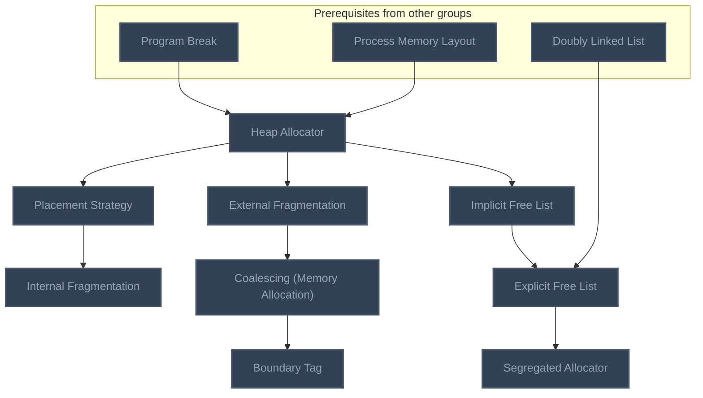
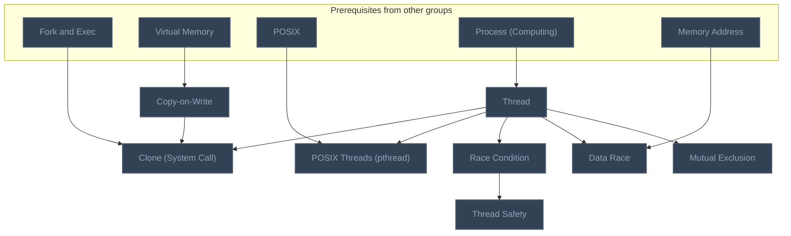
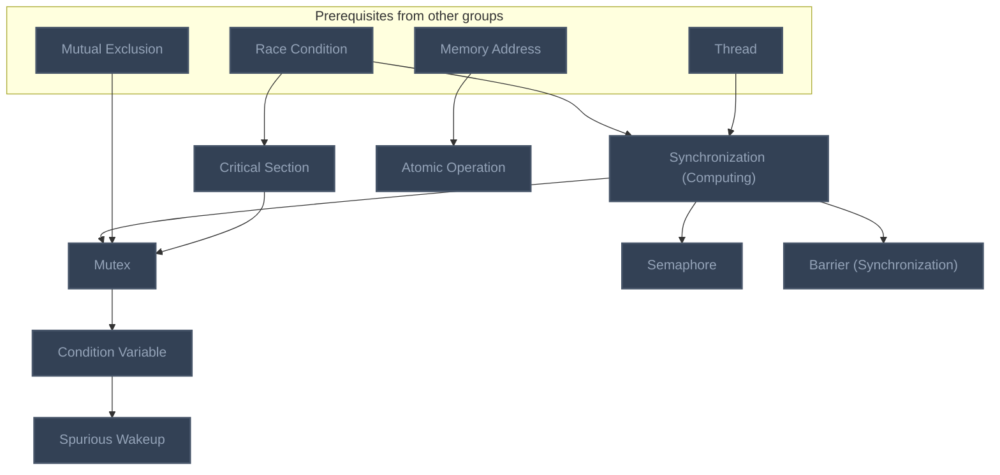
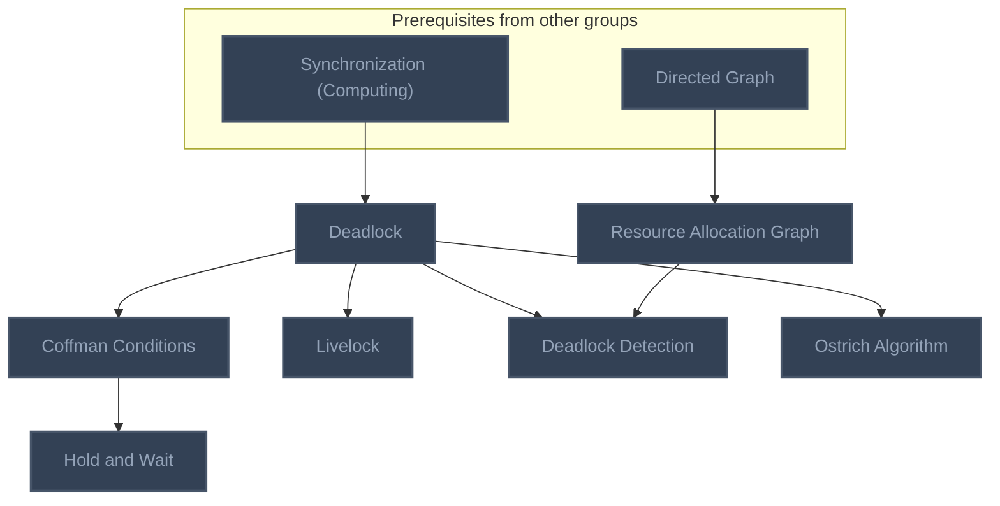
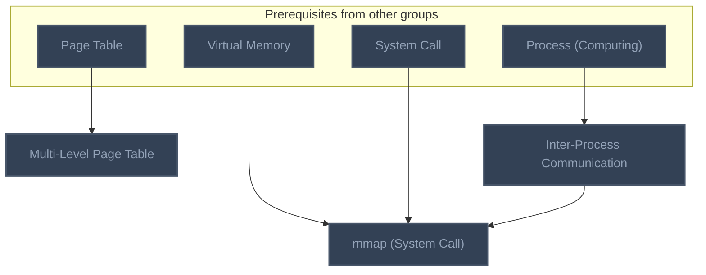
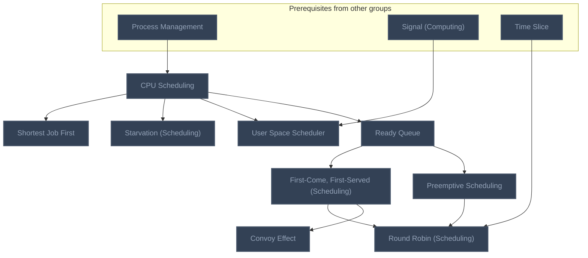
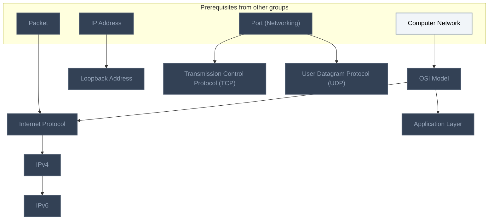
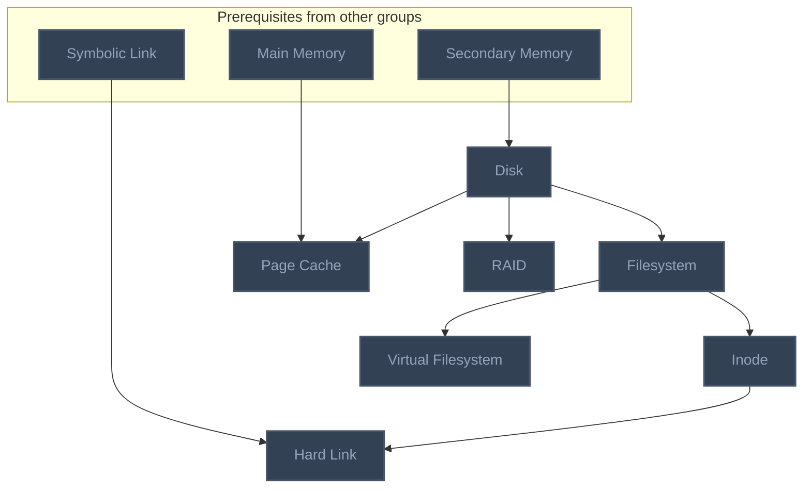
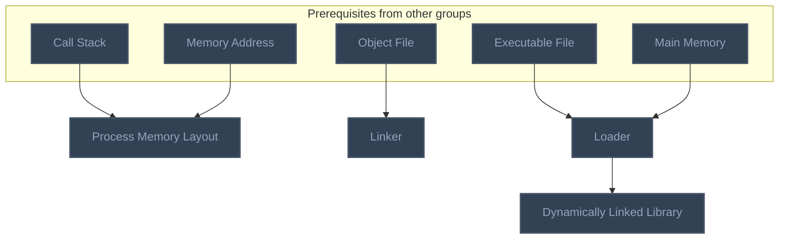

<!-- BEGIN STATS (generated by Scripts/skill_trees.py; do not edit) -->
**Mastered:** 0 / 76 · **Depth:** 0% · **Mastery Depth:** 0% · **Discovered:** 76 · **Planned:** 0 · **Locked:** 76 · **Rusty:** 0

| | L0 Discovered | L1 Recall | L2 Apply | L3 Prove ★ | L4 Wield | L5 Command |
|---|---:|---:|---:|---:|---:|---:|
| **At this level** | 76 | 0 | 0 | 0 | 0 | 0 |
| **Reached (this level or higher)** | 76 | 0 | 0 | 0 | 0 | 0 |

**Next up:** —

Legend: dashed grey = planned (no note yet) · dark grey = locked · white L0 Discovered · green L1 Recall · blue L2 Apply · purple L3 Prove (Mastered) · orange L4 Wield · gold L5 Command · brown dashed border = rusty
<!-- END STATS -->

## Systems Programming: Processes
**Reached:** L1 0 · L2 0 · L3 0 · L4 0 · L5 0 (of 13 nodes)

```mermaid
flowchart TD
    classDef planned fill:#1E293B,stroke:#64748B,stroke-width:2px,stroke-dasharray:5 5,color:#94A3B8;
    classDef locked fill:#334155,stroke:#475569,stroke-width:2px,color:#94A3B8;
    classDef L0 fill:#F1F5F9,stroke:#94A3B8,stroke-width:2px,color:#000000;
    classDef L1 fill:#22C55E,stroke:#15803D,stroke-width:2px,color:#000000;
    classDef L2 fill:#3B82F6,stroke:#1D4ED8,stroke-width:3px,color:#FFFFFF;
    classDef L3 fill:#A855F7,stroke:#6B21A8,stroke-width:3px,color:#FFFFFF,font-weight:bold;
    classDef L4 fill:#F97316,stroke:#C2410C,stroke-width:4px,color:#000000,font-weight:bold;
    classDef L5 fill:#FFD700,stroke:#FF8C00,stroke-width:5px,color:#000000,font-weight:bold;
    classDef rusty stroke:#8B4513,stroke-width:4px,stroke-dasharray:3 3;
    subgraph sg_prereqs["Prerequisites from other groups"]
        n_process_computing["Process (Computing)"]
        n_operating_system["Operating System"]
        n_fork_and_exec["Fork and Exec"]
        n_process_memory_layout["Process Memory Layout"]
        n_shell_unix["Shell (Unix)"]
    end
    n_posix["POSIX"]
    n_file_descriptor["File Descriptor"]
    n_file_description["File Description"]
    n_init_process["Init Process"]
    n_program_break["Program Break"]
    n_address_space_layout_randomization["Address Space Layout Randomization"]
    n_fork_bomb["Fork Bomb"]
    n_signal_computing["Signal (Computing)"]
    n_wait_system_call["Wait (System Call)"]
    n_zombie_process["Zombie Process"]
    n_orphan_process["Orphan Process"]
    n_fork_exec_wait_pattern["Fork-Exec-Wait Pattern"]
    n_system_function["System (Function)"]
    n_process_computing --> n_file_descriptor
    n_process_computing --> n_signal_computing
    n_operating_system --> n_posix
    n_file_descriptor --> n_file_description
    n_fork_and_exec --> n_init_process
    n_fork_and_exec --> n_fork_bomb
    n_fork_and_exec --> n_wait_system_call
    n_process_memory_layout --> n_program_break
    n_process_memory_layout --> n_address_space_layout_randomization
    n_wait_system_call --> n_zombie_process
    n_wait_system_call --> n_fork_exec_wait_pattern
    n_init_process --> n_orphan_process
    n_fork_exec_wait_pattern --> n_system_function
    n_shell_unix --> n_system_function
    class n_process_computing,n_operating_system,n_fork_and_exec,n_process_memory_layout,n_shell_unix,n_posix,n_file_descriptor,n_file_description,n_init_process,n_program_break,n_address_space_layout_randomization,n_fork_bomb,n_signal_computing,n_wait_system_call,n_zombie_process,n_orphan_process,n_fork_exec_wait_pattern,n_system_function locked;
    class n_process_computing,n_operating_system,n_fork_and_exec,n_process_memory_layout,n_shell_unix,n_posix,n_file_descriptor,n_file_description,n_init_process,n_program_break,n_address_space_layout_randomization,n_fork_bomb,n_signal_computing,n_wait_system_call,n_zombie_process,n_orphan_process,n_fork_exec_wait_pattern,n_system_function internal-link;
```



## Systems Programming: Memory Allocators
**Reached:** L1 0 · L2 0 · L3 0 · L4 0 · L5 0 (of 9 nodes)



## Systems Programming: Threads
**Reached:** L1 0 · L2 0 · L3 0 · L4 0 · L5 0 (of 8 nodes)



## Systems Programming: Synchronization
**Reached:** L1 0 · L2 0 · L3 0 · L4 0 · L5 0 (of 8 nodes)



## Systems Programming: Deadlock
**Reached:** L1 0 · L2 0 · L3 0 · L4 0 · L5 0 (of 7 nodes)



## Systems Programming: Virtual Memory and IPC
**Reached:** L1 0 · L2 0 · L3 0 · L4 0 · L5 0 (of 3 nodes)



## Systems Programming: Scheduling
**Reached:** L1 0 · L2 0 · L3 0 · L4 0 · L5 0 (of 9 nodes)



## Systems Programming: Networking
**Reached:** L1 0 · L2 0 · L3 0 · L4 0 · L5 0 (of 8 nodes)



## Systems Programming: Filesystems
**Reached:** L1 0 · L2 0 · L3 0 · L4 0 · L5 0 (of 7 nodes)



## Linking and Loading
**Reached:** L1 0 · L2 0 · L3 0 · L4 0 · L5 0 (of 4 nodes)



# Source
Graph structure: the single source for the diagrams above, edited by `/note` and `Scripts/skill_trees.py` (`add`, `edge`, `rename`). Everything above this heading is regenerated by `render`.

```skilltree
    %% PREREQUISITES
    n_process_computing["Process (Computing)"]
    n_operating_system["Operating System"]
    n_fork_and_exec["Fork and Exec"]
    n_shell_unix["Shell (Unix)"]
    n_doubly_linked_list["Doubly Linked List"]
    n_virtual_memory["Virtual Memory"]
    n_directed_graph["Directed Graph"]
    n_page_table["Page Table"]
    n_system_call["System Call"]
    n_process_management["Process Management"]
    n_time_slice["Time Slice"]
    n_computer_network["Computer Network"]
    n_packet["Packet"]
    n_ip_address["IP Address"]
    n_port_networking["Port (Networking)"]
    n_secondary_memory["Secondary Memory"]
    n_symbolic_link["Symbolic Link"]
    n_main_memory["Main Memory"]
    n_call_stack["Call Stack"]
    n_memory_address["Memory Address"]
    n_object_file["Object File"]
    n_executable_file["Executable File"]
    %% NODES
    %% == Systems Programming: Background ==
    %% == Systems Programming: Processes ==
    n_posix["POSIX"]
    n_file_descriptor["File Descriptor"]
    n_file_description["File Description"]
    n_init_process["Init Process"]
    n_program_break["Program Break"]
    n_address_space_layout_randomization["Address Space Layout Randomization"]
    n_fork_bomb["Fork Bomb"]
    n_signal_computing["Signal (Computing)"]
    n_wait_system_call["Wait (System Call)"]
    n_zombie_process["Zombie Process"]
    n_orphan_process["Orphan Process"]
    n_fork_exec_wait_pattern["Fork-Exec-Wait Pattern"]
    n_system_function["System (Function)"]
    %% == Systems Programming: Memory Allocators ==
    n_heap_allocator["Heap Allocator"]
    n_external_fragmentation["External Fragmentation"]
    n_placement_strategy["Placement Strategy"]
    n_internal_fragmentation["Internal Fragmentation"]
    n_implicit_free_list["Implicit Free List"]
    n_coalescing_memory_allocation["Coalescing (Memory Allocation)"]
    n_boundary_tag["Boundary Tag"]
    n_explicit_free_list["Explicit Free List"]
    n_segregated_allocator["Segregated Allocator"]
    %% == Systems Programming: Threads ==
    n_copy_on_write["Copy-on-Write"]
    n_clone_system_call["Clone (System Call)"]
    n_posix_threads_pthread["POSIX Threads (pthread)"]
    n_race_condition["Race Condition"]
    n_thread_safety["Thread Safety"]
    n_thread["Thread"]
    n_data_race["Data Race"]
    n_mutual_exclusion["Mutual Exclusion"]
    %% == Systems Programming: Synchronization ==
    n_synchronization_computing["Synchronization (Computing)"]
    n_critical_section["Critical Section"]
    n_mutex["Mutex"]
    n_semaphore["Semaphore"]
    n_condition_variable["Condition Variable"]
    n_spurious_wakeup["Spurious Wakeup"]
    n_barrier_synchronization["Barrier (Synchronization)"]
    n_atomic_operation["Atomic Operation"]
    %% == Systems Programming: Deadlock ==
    n_deadlock["Deadlock"]
    n_resource_allocation_graph["Resource Allocation Graph"]
    n_coffman_conditions["Coffman Conditions"]
    n_hold_and_wait["Hold and Wait"]
    n_livelock["Livelock"]
    n_deadlock_detection["Deadlock Detection"]
    n_ostrich_algorithm["Ostrich Algorithm"]
    %% == Systems Programming: Virtual Memory and IPC ==
    n_multi_level_page_table["Multi-Level Page Table"]
    n_inter_process_communication["Inter-Process Communication"]
    n_mmap_system_call["mmap (System Call)"]
    %% == Systems Programming: Scheduling ==
    n_cpu_scheduling["CPU Scheduling"]
    n_ready_queue["Ready Queue"]
    n_user_space_scheduler["User Space Scheduler"]
    n_preemptive_scheduling["Preemptive Scheduling"]
    n_starvation_scheduling["Starvation (Scheduling)"]
    n_shortest_job_first["Shortest Job First"]
    n_first_come_first_served_scheduling["First-Come, First-Served (Scheduling)"]
    n_convoy_effect["Convoy Effect"]
    n_round_robin_scheduling["Round Robin (Scheduling)"]
    %% == Systems Programming: Networking ==
    n_osi_model["OSI Model"]
    n_internet_protocol["Internet Protocol"]
    n_ipv4["IPv4"]
    n_ipv6["IPv6"]
    n_loopback_address["Loopback Address"]
    n_transmission_control_protocol_tcp["Transmission Control Protocol (TCP)"]
    n_user_datagram_protocol_udp["User Datagram Protocol (UDP)"]
    n_application_layer["Application Layer"]
    %% == Systems Programming: Filesystems ==
    n_disk["Disk"]
    n_filesystem["Filesystem"]
    n_inode["Inode"]
    n_hard_link["Hard Link"]
    n_virtual_filesystem["Virtual Filesystem"]
    n_page_cache["Page Cache"]
    n_raid["RAID"]
    %% == Systems Programming: Security ==
    %% == Linking and Loading ==
    n_process_memory_layout["Process Memory Layout"]
    n_linker["Linker"]
    n_loader["Loader"]
    n_dynamically_linked_library["Dynamically Linked Library"]
    %% EDGES
    n_process_computing --> n_file_descriptor
    n_process_computing --> n_signal_computing
    n_process_computing --> n_inter_process_communication
    n_operating_system --> n_posix
    n_file_descriptor --> n_file_description
    n_fork_and_exec --> n_init_process
    n_fork_and_exec --> n_fork_bomb
    n_fork_and_exec --> n_wait_system_call
    n_fork_and_exec --> n_clone_system_call
    n_process_memory_layout --> n_program_break
    n_process_memory_layout --> n_address_space_layout_randomization
    n_wait_system_call --> n_zombie_process
    n_wait_system_call --> n_fork_exec_wait_pattern
    n_init_process --> n_orphan_process
    n_fork_exec_wait_pattern --> n_system_function
    n_shell_unix --> n_system_function
    n_program_break --> n_heap_allocator
    n_heap_allocator --> n_external_fragmentation
    n_heap_allocator --> n_placement_strategy
    n_heap_allocator --> n_implicit_free_list
    n_placement_strategy --> n_internal_fragmentation
    n_external_fragmentation --> n_coalescing_memory_allocation
    n_coalescing_memory_allocation --> n_boundary_tag
    n_implicit_free_list --> n_explicit_free_list
    n_doubly_linked_list --> n_explicit_free_list
    n_explicit_free_list --> n_segregated_allocator
    n_virtual_memory --> n_copy_on_write
    n_virtual_memory --> n_mmap_system_call
    n_thread --> n_clone_system_call
    n_thread --> n_posix_threads_pthread
    n_thread --> n_race_condition
    n_copy_on_write --> n_clone_system_call
    n_posix --> n_posix_threads_pthread
    n_race_condition --> n_thread_safety
    n_race_condition --> n_synchronization_computing
    n_race_condition --> n_critical_section
    n_synchronization_computing --> n_mutex
    n_synchronization_computing --> n_semaphore
    n_synchronization_computing --> n_barrier_synchronization
    n_synchronization_computing --> n_deadlock
    n_mutual_exclusion --> n_mutex
    n_critical_section --> n_mutex
    n_mutex --> n_condition_variable
    n_condition_variable --> n_spurious_wakeup
    n_directed_graph --> n_resource_allocation_graph
    n_deadlock --> n_coffman_conditions
    n_deadlock --> n_livelock
    n_deadlock --> n_deadlock_detection
    n_deadlock --> n_ostrich_algorithm
    n_resource_allocation_graph --> n_deadlock_detection
    n_coffman_conditions --> n_hold_and_wait
    n_page_table --> n_multi_level_page_table
    n_system_call --> n_mmap_system_call
    n_inter_process_communication --> n_mmap_system_call
    n_process_management --> n_cpu_scheduling
    n_cpu_scheduling --> n_ready_queue
    n_cpu_scheduling --> n_user_space_scheduler
    n_cpu_scheduling --> n_starvation_scheduling
    n_cpu_scheduling --> n_shortest_job_first
    n_signal_computing --> n_user_space_scheduler
    n_ready_queue --> n_preemptive_scheduling
    n_ready_queue --> n_first_come_first_served_scheduling
    n_first_come_first_served_scheduling --> n_convoy_effect
    n_first_come_first_served_scheduling --> n_round_robin_scheduling
    n_time_slice --> n_round_robin_scheduling
    n_preemptive_scheduling --> n_round_robin_scheduling
    n_computer_network --> n_osi_model
    n_osi_model --> n_internet_protocol
    n_osi_model --> n_application_layer
    n_packet --> n_internet_protocol
    n_internet_protocol --> n_ipv4
    n_ipv4 --> n_ipv6
    n_ip_address --> n_loopback_address
    n_port_networking --> n_transmission_control_protocol_tcp
    n_port_networking --> n_user_datagram_protocol_udp
    n_secondary_memory --> n_disk
    n_disk --> n_filesystem
    n_disk --> n_raid
    n_disk --> n_page_cache
    n_filesystem --> n_inode
    n_filesystem --> n_virtual_filesystem
    n_inode --> n_hard_link
    n_symbolic_link --> n_hard_link
    n_main_memory --> n_page_cache
    n_process_memory_layout --> n_heap_allocator
    n_thread --> n_synchronization_computing
    n_process_computing --> n_thread
    n_call_stack --> n_process_memory_layout
    n_memory_address --> n_process_memory_layout
    n_object_file --> n_linker
    n_executable_file --> n_loader
    n_main_memory --> n_loader
    n_loader --> n_dynamically_linked_library
    n_memory_address --> n_atomic_operation
    n_thread --> n_data_race
    n_memory_address --> n_data_race
    n_thread --> n_mutual_exclusion
```
